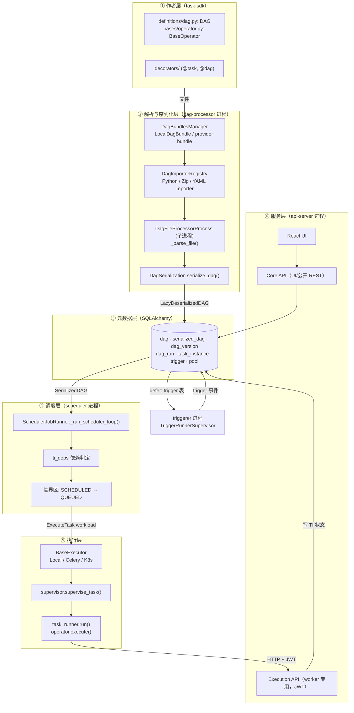
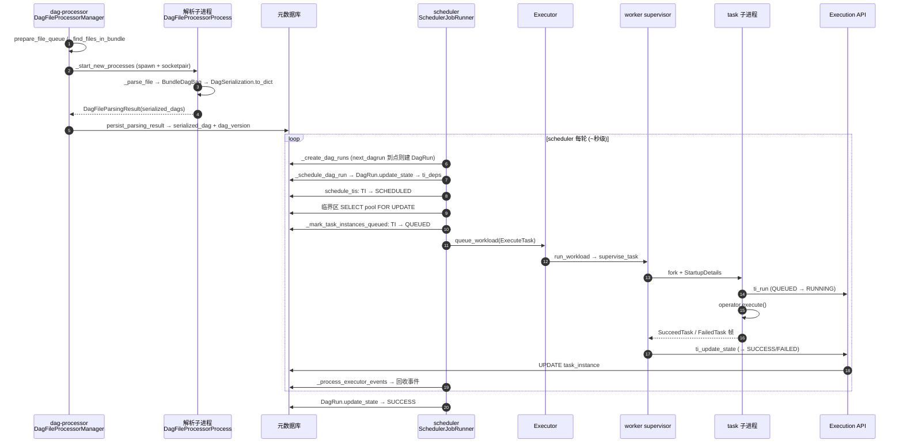

# Apache Airflow 架构笔记

> **仓库路径**：`D:/AgentABC/airflow`
> **上游地址**：https://github.com/apache/airflow
> **当前 commit**：`42945d62b1f6ecbb8255b306c9becf7c2900dfef`（`Wed Oct 14 18:43:41 2026 -0400`）
> **语言与规模**：Python 为主（8341 个 `.py`，全仓 14911 个文件，320MB），另有 TypeScript（UI）、Go（`go-sdk/`、`airflow-ctl` 部分）、Java（`java-sdk/`）
> **版本**：`apache-airflow-core 3.4.0`（`airflow-core/src/airflow/__init__.py:28`，根 `pyproject.toml` 同为 `3.4.0`）+ `apache-airflow-task-sdk 1.4.0`（`task-sdk/src/airflow/sdk/__init__.py:125`）
> **本文分析时间**：2026-11-04

---

## 1. 一句话定位

Airflow 是一个**基于元数据库的、以时间/数据依赖为触发条件的状态机调度器**：它把"何时、按什么顺序、以什么并发跑哪个任务"变成 `dag / dag_run / task_instance` 三张表里的行与状态，然后把这些状态机推进的每一步委托给外部执行器（Executor）去真正跑代码。

它**解决**：定时与依赖编排、失败重试、回填（backfill）、可观测与审计、多租户 DAG 作者与运维的隔离。

它**不解决**：

- 数据搬运与计算本身（那是 Operator/Hook 里调用的 Spark/SQL/HTTP 的事）；
- 集群资源调度（Airflow 只交出"要跑这个任务"，落到哪台机器由 Celery/Kubernetes/本机决定）；
- 大数据量在任务间传递（XCom 走元数据库，只适合小对象）；
- 强一致的低延迟事件总线（调度粒度是"秒级循环 + 轮询 DB"，不是流式）。

一句话：**Airflow 是"编排控制面"，不是"数据面"。**

---

## 2. 技术栈与工程结构

### 2.1 技术栈

| 维度 | 选型 | 证据（文件:行） |
|---|---|---|
| Web 框架 | FastAPI + Starlette + uvicorn；`cadwyn` 做 API 版本化 | `airflow-core/pyproject.toml:99`（`fastapi[standard-no-fastapi-cloud-cli]>=0.129.0,<0.137.0`）、`:100`（`uvicorn`）、`:104`（`starlette>=1.3.1`）、`:84`（`cadwyn>=6.1.1`） |
| ORM | SQLAlchemy 2.x（同步 + `[asyncio]`），Alembic 迁移 | `airflow-core/pyproject.toml:151`、`:79`；迁移目录 `airflow-core/src/airflow/migrations/` |
| 元数据库 | PostgreSQL / MySQL / SQLite（连接串 `[database] sql_alchemy_conn`） | `airflow-core/src/airflow/settings.py:116`、`:288-297` |
| 配置系统 | **YAML 声明式配置**（3.x 新格式：`core: options: xxx: default:`），非旧的 `airflow.cfg` 平铺 | `airflow-core/src/airflow/config_templates/config.yml:20`（`core:`）/`:22`（`options:`）、`configuration.py:158`（读取 `config.yml`）、`configuration.py:169`（`AirflowConfigParser`） |
| 进程内/进程间通信 | `msgspec.Struct` 定长帧 + socketpair/pipe（supervisor ↔ task 子进程）；`httpx2`（worker → Execution API） | `task-sdk/src/airflow/sdk/execution_time/comms.py:195`（`_RequestFrame(msgspec.Struct)`）、`:223`（`CommsDecoder`）、`task-sdk/pyproject.toml`（`msgspec>=0.19.0`、`httpx2>=2.0.0`） |
| 序列化 | 自研 `DagSerialization`（JSON + `jsonschema` 校验），不是 pickle | `serialization/serialized_objects.py:1744`（`DagSerialization`）、`:1763`（`_json_schema`）、`:1766`（`serialize_dag`） |
| 执行器 | 插件式 `BaseExecutor`，默认 `LocalExecutor` | `executors/base_executor.py:201`、`config_templates/config.yml`（executor 默认 `"LocalExecutor"`）、`executors/executor_loader.py:55` |
| 任务 SDK | 独立包 `apache-airflow-task-sdk`，DAG 定义、Task 运行时、API 客户端 | `task-sdk/src/airflow/sdk/definitions/dag.py:330`、`task-sdk/src/airflow/sdk/api/client.py:252` |
| UI | React + Vite + Chakra UI + TanStack Query（由 OpenAPI 生成客户端） | `airflow-core/src/airflow/ui/package.json:11`（`"dev": "vite --port 5173 --strictPort"`）、`:17`（`"codegen"` 用 `openapi-rq`） |
| 可观测性 | OpenTelemetry（trace 注入 Execution API）+ statsd/StatsD 后端 | `airflow-core/pyproject.toml:121-122`、`api_fastapi/execution_api/app.py`（`_inject_trace_context_dep`） |
| 凭据 | JWT（`pyjwt`），scheduler 为每个 workload 签发 token | `airflow-core/pyproject.toml:142`（`pyjwt`）、`base_executor.py:235`（`jwt_generator`） |

### 2.2 顶层目录职责表

| 目录 | 职责 | 是否核心 |
|---|---|---|
| `airflow-core/` | 调度器、DAG 解析、元数据 ORM、API server（Core API + Execution API）、CLI | ★ 核心 |
| `task-sdk/` | DAG 作者面向的 SDK：`DAG`/`BaseOperator`/decorators、Task 运行时（`execution_time/`）、Execution API 客户端 | ★ 核心 |
| `shared/` | 供 core 与 task-sdk **共用**的源码，通过仓内 symlink 落到 `airflow-core/src/airflow/_shared` 与 `task-sdk/src/airflow/sdk/_shared` | ★ 核心（构建期） |
| `providers/` | 80+ 个 provider 包（amazon/google/celery/standard…），Operator/Hook/Executor 的插件实现 | ★ 生态核心 |
| `airflow-ctl/` | 独立的运维 CLI（`airflowctl`），走 Core API 而非直连 DB | 辅助 |
| `chart/` | Helm chart（K8s 部署：scheduler/dag-processor/api-server/triggerer 各自 Deployment） | 辅助 |
| `clients/python/`、`go-sdk/`、`java-sdk/`、`ts-sdk/` | 面向公开 REST API 的多语言客户端 | 辅助 |
| `dev/breeze` | 开发环境工具链（容器内跑测试的官方入口） | 开发必需 |
| `constraints/`、`generated/`、`manifests/`、`registry/` | 依赖锁定、生成物、K8s manifest、第三方许可证 | 构建/发布 |
| `docs/`、`contributing-docs/` | 文档 | 非代码 |
| `docker-tests/`、`kubernetes-tests/`、`airflow-e2e-tests/` | 端到端测试 | 测试 |

`airflow-core/src/airflow/` 内部（本文主战场）：

```
airflow-core/src/airflow/
├── jobs/                  # 进程角色：scheduler / dag_processor / triggerer 的 JobRunner
├── dag_processing/        # DAG 发现、解析子进程、序列化落库、bundle 抽象
├── serialization/         # 编码（serialized_objects.py）与解码后的对象图（definitions/）
├── models/                # ORM：dag / dagrun / taskinstance / dag_version / trigger / pool …
├── executors/             # BaseExecutor、LocalExecutor、workload schema
├── ti_deps/               # TaskInstance 可运行性判定（trigger rule、pool、并发…）
├── api_fastapi/           # api-server：core_api（UI 用）+ execution_api（worker 用）
├── cli/                   # airflow 命令族（scheduler/dag-processor/api-server/triggerer/standalone）
├── _shared/               # ← symlink 到仓库根 shared/
└── ui/                    # React 前端源码
```

### 2.3 关键子包与演进关系

3.x 把 2.x 的单一 `apache-airflow` 拆成了多个发行包，**这是读这份代码时最容易踩坑的地方**：

| 包 | 版本 | 职责 | 演进说明 |
|---|---|---|---|
| `apache-airflow-core` | 3.4.0 | 服务端一切：调度、解析、ORM、API、CLI | 2.x 的 `airflow/` 主体，`www/` 被 `api_fastapi/` 取代 |
| `apache-airflow-task-sdk` | 1.4.0 | DAG 定义 + Task 运行时 + API 客户端 | 2.x 中 DAG 作者 import 的 `airflow.models.dag.DAG`、`airflow.models.baseoperator.BaseOperator` 已迁到这里 |
| `apache-airflow-providers-*` | 各自独立 | Operator/Hook/Executor 插件 | 2.x 起就从主仓剥离，现在有 80+ 个目录 |
| `shared/`（非发行包） | — | core 与 task-sdk 的公共源码（logging、configuration、state、secrets_masker…） | 用 **仓内 symlink** 保证只有一份源码，见 `shared/README.md` |

注意互相依赖的方向（两个 `pyproject.toml` 都这么写，实测如此）：

- `airflow-core/pyproject.toml:159` → `apache-airflow-task-sdk<1.5.0,>=1.4.0`
- `task-sdk/pyproject.toml:50` → `apache-airflow-core<3.5.0,>=3.4.0`

也就是说 **core 与 task-sdk 互相声明依赖**，靠 `shared/` 的 symlink 保证公共代码只有一份；两者必须同版本一起发布。

一个重要的心理预期修正：**DAG 类本身在 task-sdk 里**（`task-sdk/src/airflow/sdk/definitions/dag.py:330`），`airflow-core/src/airflow/models/dag.py` 只剩 `DagModel`（ORM，`:315`）与 `DagTag`（`:270`）。scheduler 从不 import 用户 DAG 模块，它只消费反序列化出来的 `SerializedDAG`。

---

## 3. 整体架构

### 3.1 分层图



### 3.2 核心组件职责表

| 组件 | 代码位置 | 职责 | 进程模型 |
|---|---|---|---|
| `SchedulerJobRunner` | `jobs/scheduler_job_runner.py:324` | 调度主循环：建 DagRun、推 TI 状态、下发 workload、回收事件 | scheduler 进程（可多副本 HA） |
| `DagFileProcessorManager` | `dag_processing/manager.py:204` | DAG 文件发现/排队/派发解析子进程/收集结果 | dag-processor 进程（也可内嵌 scheduler） |
| `DagFileProcessorProcess` | `dag_processing/processor.py:702` | 单个 DAG 文件的解析执行体 | **子进程**（崩溃不拖垮 manager） |
| `DagSerialization` | `serialization/serialized_objects.py:1744` | DAG 对象 → JSON | 解析子进程内 |
| `SerializedDAG` | `serialization/definitions/dag.py:101` | JSON → 只读对象图，供 scheduler/API 使用 | scheduler / api-server 内 |
| `DagRun` / `TI` | `models/dagrun.py`、`models/taskinstance.py` | 运行实例与任务实例状态机 | 各处共享的 ORM |
| `ti_deps.*` | `ti_deps/deps/*.py` | 判定某 TI 现在能不能跑 | scheduler 内（纯判定） |
| `BaseExecutor` | `executors/base_executor.py:201` | 抽象"接 workload → 跑 → 回事件" | scheduler 内对象（可含子进程） |
| `LocalExecutor` | `executors/local_executor.py:120` | 本机多进程执行 | scheduler 内 fork worker 进程 |
| `supervise_task` | `task-sdk/.../supervisor.py:3038` | worker 侧：fork 任务子进程、转发日志、上报终态 | worker 进程 |
| `task_runner.run` | `task-sdk/.../task_runner.py:1752` | 真正执行 `operator.execute()` | 任务子进程 |
| Core API | `api_fastapi/core_api/` | UI 与公开 REST（`/api/v2`） | api-server 进程（gunicorn/uvicorn） |
| Execution API | `api_fastapi/execution_api/app.py:290` | worker 的内部私有 API：拿 TI、报心跳、报状态、读 XCom/连接 | api-server 进程（同 app 挂载子路由） |
| `TriggererJobRunner` | `jobs/triggerer_job_runner.py:197` | 跑 deferrable operator 的 trigger 协程 | triggerer 进程 + runner 子进程 |
| `Job` / `JobRunner` | `jobs/job.py:85`、`jobs/base_job_runner.py:31` | 进程存活心跳、健康检查、graceful shutdown | 每个常驻进程一条 Job 记录 |

### 3.3 运行时进程与角色

怎么跑起来：`airflow standalone` 会拉起 4 个子命令（`cli/commands/standalone_command.py:51` 起，`run()` 在 `:71`）：

```
scheduler  dag-processor  api-server  triggerer
```

| 进程 | 干什么 | 怎么和别人通信 |
|---|---|---|
| **scheduler** | 每轮循环：建 DagRun → 跑依赖判定 → 临界区选 TI → 标 QUEUED → 交给 executor → 心跳回收事件 | 只读写元数据库；与 executor 在同一进程内（Local）或经 broker（Celery）；与 DAG 作者代码零接触 |
| **dag-processor** | 扫描 bundle 里的 DAG 文件，派子进程解析，把 `SerializedDAG` 与 import error 落库；顺带执行 callback（on_success/on_failure） | 只写库；scheduler 读 `serialized_dag`。反向的 callback 通过 `DatabaseCallbackSink`（`callbacks/database_callback_sink.py:32`）落表，dag-processor 轮询 `fetch_callbacks()` |
| **triggerer** | 加载 `trigger` 表里所有 DEFERRED 任务的 trigger，在 asyncio 事件循环里等外部事件 | 主进程起 `TriggerRunnerSupervisor` 子进程（无 DB 权限），事件回主进程写 `trigger` 表 → TI 变回 SCHEDULED |
| **worker** | 拿到 `ExecuteTask` workload，fork 任务子进程跑用户代码 | 对 Execution API 发 HTTP（JWT），不再直连元数据库（3.x 关键变化） |
| **api-server** | 一个 FastAPI app 里挂两套路由：`core_api`（UI/公开）与 `execution_api`（worker 私有） | 读写同一个元数据库 |

通信矩阵要点：

- **scheduler ↔ dag-processor**：完全解耦，只通过 `serialized_dag` / `dag_version` / `callback` 表；
- **scheduler → executor → worker**：传的是 **workload 的序列化对象**（`BaseDagBundleWorkload` 子类，`executors/workloads/base.py:141`），不是 pickle 的 DAG；
- **worker → api-server**：HTTP + JWT，token 由 scheduler 侧的 `JWTGenerator`（`base_executor.py:235`）签发，scope 为 `token:execution` / `token:workload`（见 `execution_api/routes/task_instances.py:141`）；
- **triggerer ↔ DB**：轮询 + 事件表，不直接连 worker。

---

## 4. 端到端主链路

选这条链路：**DAG 文件 → 解析成 SerializedDAG → 落库 → scheduler 建 DagRun → 依赖判定 → 临界区入队 → executor 交 worker → worker 执行 → 状态回写 → DagRun 收敛**。它同时覆盖了「调度循环」和「任务真正执行」两个关键点。



### 步骤 1：找到要解析的 DAG 文件

- **入口**：`airflow-core/src/airflow/dag_processing/manager.py:566` → `DagFileProcessorManager._run_parsing_loop()`
- **具体逻辑**：循环体依次做 `heartbeat()` → `_kill_timed_out_processors()`（`:1694`）→ `_queue_requested_files_for_parsing()`（处理 UI 点的"重新解析"）→ `_refresh_dag_bundles(known_files)`（`:880`）。当文件队列空了，调 `prepare_file_queue()`（`:1621`）重新扫描 bundle；扫描本身在 `_find_files_in_bundle()`（`:1006`），它把活交给 **DagImporterRegistry**（`task-sdk/src/airflow/sdk/importers/base.py:428`），由 Python/Zip/YAML importer 各自列举本 bundle 内的 DAG 定义位置。每轮结束用 `time.monotonic()` 算耗时，不足 1 秒就 `poll_time` 补齐——这就是"解析进程默认 1 秒一轮"的来源。
- **产出**：`dict[bundle_name, set[DagFileInfo]]` 与内部 `_file_queue`。

### 步骤 2：拉起解析子进程

- **入口**：`dag_processing/manager.py:1512` → `_start_new_processes()`，最终到 `dag_processing/processor.py:702` → `DagFileProcessorProcess.start()`
- **具体逻辑**：受 `[dag_processor] parsing_processes` 限制并发数。每个子进程是一个 `multiprocessing` 进程，父进程用 socketpair 与它通信（`_service_processor_sockets()` 在 `manager.py:621` 里用 `selectors` 统一 poll）。父进程先通过 `_add_files_to_queue()`（`:1754`）按 mtime 排序入队，保证老文件优先。
- **产出**：一个跑着 `_parse_file_entrypoint` 的子进程 + 一条 socket 连接。

### 步骤 3：子进程内解析并序列化

- **入口**：`dag_processing/processor.py:225` → `_parse_file()`
- **具体逻辑**：
  1. `check_dag_file_stability()` 先做文件稳定性检查（避免读到写一半的文件），失败直接返回 import error；
  2. 构造 `BundleDagBag`（`dag_processing/dagbag.py:639`），`BundleDagBag` 继承 `DagBag`（`:168`），负责 `import` 用户模块、把 `DAG` 对象放进 bag；
  3. 若这次请求是 callback（on_success 等），走 `_execute_callbacks()` 后直接返回 `None`，**不序列化**；
  4. 否则 `_serialize_dags()`（`:277`）对每个 DAG 调 `DagSerialization.to_dict(dag)`，产出 `LazyDeserializedDAG`；
  5. 组装 `DagFileParsingResult`（`serialized_dags` + `import_errors` + `warnings` + `dag_source_codes`）。
- **关键数据结构**：`LazyDeserializedDAG` 是"还没反序列化"的 JSON 包装，避免在解析进程里就构建完整对象图。
- **产出/流向**：`DagFileParsingResult` 经 socket 回到 manager。

### 步骤 4：解析结果落库（SerializedDAG + DagVersion）

- **入口**：`dag_processing/manager.py:1290` → `handle_parsing_result()` → `:1365` `persist_parsing_result()` → `dag_processing/collection.py:576` `update_dag_parsing_results_in_db()`
- **具体逻辑**：
  1. `SerializedDAG.bulk_write_to_db()`（`serialization/definitions/dag.py:201`）批量 upsert `dag` 表（`DagModel`，`models/dag.py:315`）、同步 asset/asset_alias 关联；
  2. 对每个 DAG 写一条 **`DagVersion`**（`models/dag_version.py:54`），`write_dag()` 在 `:120`：先 `SELECT ... FOR UPDATE NOWAIT` 拿最新 version_number（`_latest_version_select` 按 `version_number desc` 而不是 `created_at`，注释里明确说是为了避开时间戳并列导致的唯一键冲突），再 `+1` 插入；
  3. 写 **`SerializedDagModel`**（`models/serialized_dag.py:285`），行内是 `data`（JSON）+ `data_compressed` + `dag_hash`；
  4. import error 写 `ParseImportError`，warning 写 `DagWarning`，源码写 `DagCode`。
- **为什么值得单列**：这一步是 **"用户代码" 与 "调度器" 之间唯一的、也是最后的耦合点**。落库之后，scheduler 再也看不到 Python 对象，只看 JSON。
- **产出/流向**：`serialized_dag` / `dag_version` / `dag` 三张表有数据，scheduler 可以开始调度。

### 步骤 5：调度循环启动

- **入口**：`jobs/scheduler_job_runner.py:1948` → `SchedulerJobRunner._run_scheduler_loop()`（由 `cli/commands/scheduler_command.py:41` 的 `_run_scheduler_job()` 经 `run_job()` 调 `_execute()`，`:1832`）
- **具体逻辑**：
  - 先注册一堆 `timers.call_regular_interval(...)` 的旁路任务：`adopt_or_reset_orphaned_tasks`（`:3706`，接管孤儿任务）、`check_trigger_timeouts`（`:3814`）、`_mark_backfills_complete`（`:2668`）、`_handle_tasks_stuck_in_queued`（`:3408`）、`_update_asset_orphanage`（`:4213`）、`_find_and_purge_task_instances_without_heartbeats`（`:3941`）；
  - 主体是 `for loop_count in itertools.count(1)`：每轮 `_do_scheduling(session)` → 对每个 executor `heartbeat()` → `_process_executor_events()` → 处理 deadline、executor callback、connection test → `perform_heartbeat()` → `timers.run(blocking=False)`；
  - **空闲退避**：本轮既没排到 TI 也没收到完成事件时 `time.sleep(min(_scheduler_idle_sleep_time, next_event))`，否则不睡、全速跑。
- **产出**：一个永不结束（除非 `--num-runs`）的 while 循环，每轮返回"本轮入队了几条 TI"。

### 步骤 6：建 DagRun

- **入口**：`jobs/scheduler_job_runner.py:2149` → `_do_scheduling()` → `:2642` `_create_dagruns_for_dags()` → `:2698` `_create_dag_runs()`
- **具体逻辑**：`_do_scheduling` 在 `prohibit_commit(session)` 保护下（防止意外 commit）先建 run，再 `_start_queued_dagruns()`（`:3107`）把 QUEUED 的 run 推到 RUNNING。`_create_dag_runs` 的核心是读 `DagModel.next_dagrun` / `next_dagrun_create_after`（timetable 算出来的"下一次该建 run 的时间"），若到点且没超过 `max_active_runs`，插入 `DagRun`，然后 `dag_model.calculate_dagrun_date_fields()` 推进下一次时间。为了不再重复建 run，先一次性 `SELECT` 已存在的 `(dag_id, logical_date)` 做去重（注释说明：比捕获 IntegrityError 回滚更划算）。
- **注意**：`max_dagruns_to_create_per_loop` 默认 10，`max_dagruns_per_loop_to_schedule` 默认 20——这是**有意的限流**，因为后续要对 DagRun 行加锁。
- **产出**：`DagRun` 行（state=QUEUED/RUNNING）。

### 步骤 7：依赖判定，TI 进入 SCHEDULED

- **入口**：`:3209` `_schedule_all_dag_runs()` → `:3228` `_schedule_dag_run()` → `models/dagrun.py:1279` `DagRun.update_state()`
- **具体逻辑**：
  - `_schedule_dag_run` 先做一系列守卫：`dagrun_timeout` 超时则整 run FAILED、logical_date 在未来则跳过、`_verify_integrity_if_dag_changed()`（`:3359`）；
  - `dag_run.update_state()` 调 `task_instance_scheduling_decisions()`（`dagrun.py:1481`），后者用 **`ti_deps`** 逐个 TI 判定。依赖项是插件式的：`ti_deps/deps/trigger_rule_dep.py`、`pool_slots_available_dep.py`、`prev_dagrun_dep.py`（depends_on_past）、`task_concurrency_dep.py`、`not_in_retry_period_dep.py`、`mapped_task_expanded.py` 等，统一由 `DepContext`（`ti_deps/dep_context.py:39`）携带上下文；
  - 判定通过的 TI 由 `dag_run.schedule_tis()`（`dagrun.py:2641`）批量置 SCHEDULED；顺带把"空 Operator 且无回调"的 TI 直接置 SUCCESS，并对带 `start_trigger_args` 的任务走 `defer_task()`；
  - `update_state` 同时判定整个 run 的收敛：所有 TI 完成且有失败 → run FAILED + 触发 `on_failure_callback`。
- **产出**：`list[TI]`（schedulable）+ 可选 `DagCallbackRequest`（回调请求，`_send_dag_callbacks_to_processor()` 在 `:3397` 落表交给 dag-processor 执行）。

### 步骤 8：临界区入队（QUEUED）

- **入口**：`:1278` → `_critical_section_enqueue_task_instances()`
- **具体逻辑**（这是全仓最"讲究"的一段并发控制）：
  1. 算可用槽位：`max_tis = min(job.max_tis_per_query, parallelism - 已占用)`，再 `_acquire_pool_capacity()`（`:667`）按 pool 预扣；
  2. `_select_task_instances_to_queue()`（`:716`）在一轮轮 `itertools.count()` 里反复查 SCHEDULED 的 TI，比较 `ConcurrencyMap`（`:269`，dag/task 级并发）与 pool 余量，选出可跑的；
  3. `_mark_task_instances_queued()`（`:1115`）用一条 `UPDATE ... WHERE filter_for_tis` 批量把状态改成 QUEUED 并写 `queued_dttm` / `queued_by_job_id`；对 `pre_assigns_external_executor_id` 的执行器（如 Celery 需要 task_id）在**同一条 UPDATE** 里预分配 UUID，Postgres 用 `RETURNING` 读回；
  4. **HA 互斥靠 `SELECT ... FROM pool FOR UPDATE`**：拿不到锁的 scheduler 直接 `return 0`（`is_lock_not_available_error` 分支），不阻塞；
  5. `_enqueue_task_instances_with_queued_state()`（`:1211`）为每个 TI 构造 `ExecuteTask.make(ti, generator=executor.jwt_generator, ...)`，再 `executor.queue_workload(workload)`。
- **关键数据结构**：`ExecuteTask`（`executors/workloads/task.py:68`）内含 `TaskInstanceDTO`（`:39`）、`bundle_info`、`token`、`log_path`——**worker 需要的全部信息都在这个对象里**，worker 不需要连数据库。
- **产出**：executor 的内部队列里多了一条 workload。

### 步骤 9：executor 心跳与派发

- **入口**：`_run_scheduler_loop` 里的 `executor.heartbeat()`（`executors/base_executor.py:509`）→ `sync()`（`:502`）→ `trigger_workloads()`（`:573`）→ `_process_workloads()`（`:474`）
- **具体逻辑**：`BaseExecutor.trigger_workloads` 按 `slots_available` 取出队列里的 workload 并按 `sort_key`（`ExecuteTask.sort_key` 返回 `-priority_weight`）排序。`LocalExecutor` 用 `multiprocessing.SimpleQueue` 把 workload 发给 `_run_worker()`（`executors/local_executor.py:69`）起的常驻子进程；`CeleryExecutor` 则 `apply_async` 到 broker。
- **产出**：workload 到达 worker。

### 步骤 10：worker 上真正执行任务

- **入口**：`executors/base_executor.py:858` → `BaseExecutor.run_workload()` → `task-sdk/.../supervisor.py:3038` → `supervise_task()`
- **具体逻辑**：
  1. `run_workload` 按 workload 类型分派：`ExecuteTask` → `supervise_task`，`ExecuteCallback` → `supervise_callback`，`TestConnection` → `supervise_connection_test`；
  2. `supervise_task` 校验 Execution API URL、取 `coordinator = get_coordinator_manager().for_queue(ti.queue)`、建 `httpx2` client（带 JWT）、按 `log_path` 配置日志；
  3. `coordinator.execute_task(...)`（`task-sdk/src/airflow/sdk/coordinators/_subprocess.py:692`）→ fork 出子进程，通过 socketpair 发 `StartupDetails`；
  4. 子进程 `task_runner.run()`（`task_runner.py:1752`）→ `_execute_task()`（`:2286`）真正调 `operator.execute(context)`；
  5. 启动前子进程会 POST `ti_run`（`execution_api/routes/task_instances.py:155`）把 TI 从 QUEUED 改成 RUNNING，同时拿到 `TIRunContext`（含 connection、variable、xcom 的读取入口）；
  6. 任务执行期间的 `Variable.get()` / `XCom` / `BaseHook.get_connection` 全部走 Execution API（**子进程里 `block_orm_access()` 主动禁用了 ORM**，`supervisor.py:451`）；
  7. 结束（成功/失败/重试/defer/reschedule/await input）后，子进程通过 `SUPERVISOR_COMMS` 把 `SucceedTask` / `FailedTask` 等帧发给 supervisor。
- **产出**：supervisor 收到终态帧，进程退出码。

### 步骤 11：终态回写

- **入口**：`task-sdk/.../supervisor.py:2098` → `_handle_finished_task()` → `_send_terminal_state_msg()`
- **具体逻辑**：supervisor 收到 `SucceedTask` 后调 `client.task_instances.succeed(...)`（`task-sdk/src/airflow/sdk/api/client.py:316`），最终 `PUT /execution/task-instances/{id}/state`，落到 `ti_update_state()`（`task_instances.py:451`）。服务端在 `_create_ti_state_update_query_and_update_state()`（`:866`）里按 payload 类型分支：
  - 终态/重试：`SELECT ... FOR UPDATE` 后一条 UPDATE 改 `state` + `duration`；
  - FAILED 还额外做 `_handle_fail_fast_for_dag`；
  - SUCCESS 会 `TI.register_asset_changes_in_db` 生成 asset 事件（这是 Asset 调度的输入）；
  - DEFERRED 则插入一行 `Trigger`（`models/trigger.py:75`），交给 triggerer。
- **产出**：`task_instance.state` 与 `duration` 更新，asset 事件落表。

### 步骤 12：收敛与下一轮

- **入口**：`jobs/scheduler_job_runner.py:1428` `_process_executor_events()` → `:1447` `process_executor_events()`
- **具体逻辑**：从 `executor._drain_events_with_task_ids()` 取出事件缓冲，按 `TaskInstanceUuid` 匹配；处理"外部杀死""被别的 scheduler 重新入队""defer 后旧的成功事件不应覆盖"等边界；需要跑回调时构造 `TaskCallbackRequest` 交给 dag-processor。
- **产出**：下一轮 `_do_scheduling` 时，`DagRun.update_state` 发现 `unfinished` 为空且全 SUCCESS → `set_state(DagRunState.SUCCESS)`，run 收敛。

**这条链路的关键分界线**：步骤 1–4 是"用户代码 → 数据"，步骤 5–9 是"数据 → 调度决策"，步骤 10–12 是"决策 → 用户代码 → 数据"。三段之间只通过元数据库和 workload 对象相接，任何一段都可以单独重启而不丢状态。

---

## 5. 核心代码路径清单

| 文件路径 | 关键类/函数 | 作用 | 优先级 |
|---|---|---|---|
| `task-sdk/src/airflow/sdk/definitions/dag.py` | `DAG`（:330） | DAG 定义对象（作者侧） | ★★★ |
| `task-sdk/src/airflow/sdk/bases/operator.py` | `BaseOperator`（:670）、`BaseOperatorMeta`（:487） | Operator 基类与元类（参数校验、`__init_subclass__`） | ★★★ |
| `airflow-core/src/airflow/dag_processing/manager.py` | `DagFileProcessorManager`（:204）、`_run_parsing_loop`（:566） | DAG 发现/解析调度总线 | ★★★ |
| `airflow-core/src/airflow/dag_processing/processor.py` | `_parse_file`（:225）、`_serialize_dags`（:277）、`DagFileProcessorProcess`（:702） | 单文件解析与序列化 | ★★★ |
| `airflow-core/src/airflow/dag_processing/dagbag.py` | `DagBag`（:168）、`BundleDagBag`（:639） | import 用户模块、收集 DAG 对象 | ★★ |
| `airflow-core/src/airflow/dag_processing/bundles/base.py` | `BaseDagBundle`（:276） | DAG 来源抽象（本地/Git/S3…） | ★★ |
| `airflow-core/src/airflow/serialization/serialized_objects.py` | `DagSerialization`（:1744）、`serialize_dag` | DAG → JSON 编码 | ★★★ |
| `airflow-core/src/airflow/serialization/definitions/dag.py` | `SerializedDAG`（:101）、`bulk_write_to_db`（:201） | JSON → 只读对象图；批量写库 | ★★★ |
| `airflow-core/src/airflow/dag_processing/collection.py` | `update_dag_parsing_results_in_db`（:576） | 解析结果一站式落库 | ★★★ |
| `airflow-core/src/airflow/models/dag_version.py` | `DagVersion`（:54）、`write_dag`（:120） | 版本号单调递增、按版本固定运行 | ★★ |
| `airflow-core/src/airflow/models/serialized_dag.py` | `SerializedDagModel`（:285） | `serialized_dag` 表读写、hash 比对 | ★★ |
| `airflow-core/src/airflow/jobs/scheduler_job_runner.py` | `SchedulerJobRunner`（:324）、`_run_scheduler_loop`（:1948）、`_do_scheduling`（:2149） | 调度器主体 | ★★★ |
| 同上 | `_select_task_instances_to_queue`（:716）、`_critical_section_enqueue_task_instances`（:1278）、`_mark_task_instances_queued`（:1115） | 并发/pool 约束下的选任务与入队 | ★★★ |
| 同上 | `process_executor_events`（:1447）、`_handle_tasks_stuck_in_queued`（:3408）、`adopt_or_reset_orphaned_tasks`（:3706） | 事件回收与自愈 | ★★ |
| `airflow-core/src/airflow/models/dagrun.py` | `update_state`（:1279）、`task_instance_scheduling_decisions`（:1481）、`schedule_tis`（:2641） | DagRun 级状态机 | ★★★ |
| `airflow-core/src/airflow/models/taskinstance.py` | `set_state`（:1579）、`defer_task`（:2604）、`next_retry_datetime`（:2028） | TI 级状态机与重试 | ★★★ |
| `airflow-core/src/airflow/ti_deps/dep_context.py` + `ti_deps/deps/` | `DepContext`（:39）、`trigger_rule_dep.py` | 可运行性判定 | ★★ |
| `airflow-core/src/airflow/utils/state.py` | `TaskInstanceState`（:65）、`DagRunState`（:97） | 全部状态枚举与分组 | ★★★ |
| `airflow-core/src/airflow/executors/base_executor.py` | `BaseExecutor`（:201）、`queue_workload`（:442）、`heartbeat`（:509）、`run_workload`（:858） | 执行器抽象 | ★★★ |
| `airflow-core/src/airflow/executors/workloads/task.py` | `ExecuteTask`（:68）、`TaskInstanceDTO`（:39） | 跨进程传的任务描述 | ★★★ |
| `airflow-core/src/airflow/executors/local_executor.py` | `LocalExecutor`（:120）、`_run_worker`（:69） | 本机多进程执行样板 | ★★ |
| `task-sdk/src/airflow/sdk/execution_time/supervisor.py` | `supervise_task`（:3038）、`_handle_finished_task`（:2098）、`block_orm_access`（:451） | worker 侧任务监管 | ★★★ |
| `task-sdk/src/airflow/sdk/execution_time/task_runner.py` | `run`（:1752）、`_execute_task`（:2286）、`finalize`（:2390） | 任务子进程执行体 | ★★★ |
| `task-sdk/src/airflow/sdk/execution_time/comms.py` | `CommsDecoder`（:223）、`_RequestFrame`（:195） | 进程间帧协议 | ★★ |
| `airflow-core/src/airflow/api_fastapi/execution_api/routes/task_instances.py` | `ti_run`（:155）、`ti_update_state`（:451）、`ti_heartbeat`（:1230） | worker 侧唯一写状态入口 | ★★★ |
| `airflow-core/src/airflow/api_fastapi/execution_api/app.py` | `create_task_execution_api_app`（:290） | Execution API 组装（cadwyn 版本化） | ★★ |
| `airflow-core/src/airflow/api_fastapi/app.py` | `create_app`（:117）、`cached_app`（:168） | 挂载 core_api + execution_api | ★★ |
| `airflow-core/src/airflow/jobs/job.py` | `Job`（:85）、`run_job`（:362）、`execute_job`（:380） | 进程存活与生命周期 | ★★ |
| `airflow-core/src/airflow/jobs/triggerer_job_runner.py` | `TriggererJobRunner`（:197）、`TriggerRunnerSupervisor`（:477） | deferrable 任务的等待进程 | ★★ |
| `airflow-core/src/airflow/configuration.py` | `AirflowConfigParser`（:169） | 配置解析（YAML + provider fallback） | ★ |
| `airflow-core/src/airflow/cli/commands/standalone_command.py` | `StandaloneCommand`（:51） | 一键拉起 4 个进程 | ★★ |

---

## 6. 关键设计点

### 6.1 SerializedDAG：调度器不 import 用户代码

- **设计**：DAG 在解析子进程里被编码成 JSON（`DagSerialization.serialize_dag`），落 `serialized_dag` 表；scheduler/api-server 只反序列化成 `SerializedDAG`（`serialization/definitions/dag.py:101`）使用。
- **为什么**：a) 用户 DAG 里的 import 可能很重、可能有副作用、可能随时改坏；b) scheduler 不能被用户的顶层代码拖慢或搞崩；c) 多副本 scheduler 需要同一份"确定的 DAG 快照"；d) 顺带获得 `dag_hash` 做变更检测。
- **代价**：序列化器必须穷举所有 Operator 字段（`serialization/definitions/` 下 12 个模块），任何新特性都要同步改编码器 + JSON schema + 版本兼容；自定义对象必须"可序列化"，这是新用户最常踩的坑（`cannot be serialized`）。另外解析与调度之间天然存在延迟（`min_serialized_dag_update_interval`）。

### 6.2 Executor 抽象 + workload 协议：把"怎么跑"彻底外置

- **设计**：scheduler 只调 `executor.queue_workload(ExecuteTask)`；`ExecuteTask` 是 pydantic/msgspec 可序列化的 DTO（`executors/workloads/task.py:68`），含 `TaskInstanceDTO`、bundle 信息、JWT、日志路径。执行器实现只要"收下 → 跑 → 回事件"三件事（`BaseExecutor.run_workload` 在 `base_executor.py:858` 按 workload 类型分派到 supervisor）。
- **为什么**：同一套调度逻辑可以落到本机进程（Local）、Celery broker、K8s Pod。历史上 executor 接口从 `queue_task(ti)`（要 pickle ORM 对象）演进到 workload 协议，正是为了让 worker 不再需要元数据库连接。
- **代价**：DTO 与 ORM 必须保持字段同步（`TaskInstanceDTO` 注释里明确说"base class 是唯一事实来源，这里只加 executor 关心的字段"）；多执行器混合部署时路由逻辑复杂（`_executor_to_workloads` 在 `scheduler_job_runner.py:4511`，还要按 team 再分一次）。

### 6.3 triggerer 独立进程：把"等待"从"执行"里拆出来

- **设计**：deferrable operator 抛 `TaskDeferred` → TI 变 DEFERRED、写一行 `Trigger`（`models/trigger.py:75`）→ triggerer 用 asyncio 并发等待成千上万个 trigger → 事件到达写回 DB → TI 回到 SCHEDULED 重新排队。
- **为什么**：等待（等 S3 对象、等 Spark job、等传感器条件）不需要占一个 worker slot，也不需要占一个线程。把等待折叠进 asyncio 单进程后，1 个 triggerer 能顶几百个 worker slot。
- **代价**：trigger 必须"可序列化 + 幂等 + 不持有连接"；trigger 代码跑在无 DB 权限的子进程里（`TriggerRunnerSupervisor`，`triggerer_job_runner.py:477`），要读 connection 得走 API；triggerer 挂了需要 `check_trigger_timeouts`（`scheduler_job_runner.py:3814`）兜底。

### 6.4 临界区 + pool 行锁：多 scheduler 副本的幂等保证

- **设计**：所有"把 TI 从 SCHEDULED 变 QUEUED"的动作被收进 `_critical_section_enqueue_task_instances()`，靠 `SELECT ... FROM pool FOR UPDATE` 做全局互斥；拿不到锁的 scheduler 直接跳过本轮（`is_lock_not_available_error` → `return 0`）。状态改写用 `UPDATE ... WHERE state=...` 的条件更新，而不是"读-改-写"。
- **为什么**：HA 部署下多个 scheduler 会同时看到同一批 SCHEDULED 的 TI，没有全局锁就会重复下发；用 pool 表当锁是因为 pool 本身就是"全局资源计数"，一举两得。
- **代价**：pool 表成为写热点；MySQL/MariaDB 不支持 `NOWAIT` 时会退化成排队等锁，吞吐下降（代码注释里明说了）；`[core] parallelism` 的含义也变了——从"每个 executor 的上限"变成"跨所有 executor 的总上限"（`scheduler_job_runner.py:1284-1301` 的注释）。

### 6.5 状态机：所有迁移都走"带前置条件的 UPDATE"

- **设计**：`TaskInstanceState`（`utils/state.py:65`）区分中间态（SCHEDULED/QUEUED/UP_FOR_RETRY/DEFERRED/AWAITING_INPUT）与终态（SUCCESS/FAILED/SKIPPED/UPSTREAM_FAILED/REMOVED）。终态写入统一在 Execution API 的 `ti_update_state`，服务端先 `SELECT ... FOR UPDATE` 再条件更新，非法迁移返回 409；已归档的 attempt 返回 410。
- **为什么**：worker 会重试、会失联、会重复上报；scheduler 会接管孤儿任务（`adopt_or_reset_orphaned_tasks`）。只有"服务端唯一裁决 + 条件更新"才能保证同一个 `try_number` 不会被两个 worker 同时改成不同结果。
- **代价**：所有状态变更都要一次 HTTP 往返 + 一次行锁，worker 侧延迟上升；调试时"状态为什么变成这样"需要同时看 DB、Execution API 日志和 supervisor 日志。

### 6.6 DagVersion + bundle：让"这次运行用的是哪版 DAG"可复现

- **设计**：每次解析产出递增的 `DagVersion`（`models/dag_version.py:120`），`DagRun` 记住自己 pin 的 `bundle_version` 与 `created_dag_version`；`ExecuteTask.make()` 特意从 **run 的 pinned version** 取 `version_data` 而不是 TI 的 dag_version（`executors/workloads/task.py` 中的注释明确说明：避免 mid-run 重解析导致 hash/manifest 不一致）。
- **为什么**：DAG 文件随时会改，但一个已经跑了一半的 run 必须用同一份代码跑完，否则重试会跑出不同行为。
- **代价**：`dag_version` 表随解析次数增长，需要 `BundleUsageTrackingManager`（`dag_processing/bundles/base.py:92`）清理陈旧版本；bundle 抽象（Local/Git/S3）引入了额外的版本解析逻辑。

---

## 7. 扩展点：想改功能从哪下手

| 需求 | 落点 | 关键基类/文件 |
|---|---|---|
| **加一个 Operator** | 放 provider 里；继承 `BaseOperator`，实现 `execute(context)` | `task-sdk/src/airflow/sdk/bases/operator.py:670`；模板参考 `providers/standard/src/airflow/providers/standard/operators/` |
| **加一个 Hook / 连接类型** | 继承 `BaseHook`，用 `@classmethod get_connection` | `airflow-core/src/airflow/hooks/base.py`；连接字段 UI 由 provider 的 `get_ui_field_behaviour` 决定 |
| **改调度策略**（触发时间、追赶行为） | 实现 `Timetable`（`next_dagrun_info`）；或改 `DagRun` 收敛逻辑 | `task-sdk/src/airflow/sdk/definitions/timetables/`；`models/dagrun.py:1279`（`update_state`）；`scheduler_job_runner.py:2698`（建 run） |
| **接入新执行器** | 继承 `BaseExecutor`，至少实现 `queue_workload` / `sync` / `try_adopt_task_instances`，然后在 `[core] executor` 或 `[executors]` 里注册 | `executors/base_executor.py:201`、`executors/executor_loader.py:336`；现成参考 `providers/celery/src/airflow/providers/celery/executors/celery_executor.py:103` |
| **改任务可运行条件**（加一种依赖） | 新增一个 `BaseTIDep` 子类并挂进 `DepContext` | `ti_deps/deps/base_ti_dep.py`、`ti_deps/dep_context.py:39`、`ti_deps/dependencies_deps.py` |
| **改 UI** | React 源码在 `airflow-core/src/airflow/ui/`，接口由 Core API 的 OpenAPI 生成 | `ui/package.json`（`pnpm dev` 起 5173 端口）；后端 `api_fastapi/core_api/routes/ui/` |
| **加一个 API 端点** | 在 `core_api/routes/` 加 router；需版本化则走 cadwyn | `api_fastapi/core_api/app.py`、`api_fastapi/core_api/routes/public/` |
| **改 DAG 来源**（Git/S3/自定义） | 继承 `BaseDagBundle`，实现 `path` / `get_current_version` / `refresh` | `dag_processing/bundles/base.py:276`；参考 `bundles/local.py:26` |

---

## 8. 本地跑起来 / 调试入口

**安装（官方推荐路径）**

```bash
# 开发环境一律走 breeze（AGENTS.md 明确要求：不要在宿主机直接跑 pytest/airflow）
uv tool install prek && prek install
scripts/tools/setup_breeze       # 安装 breeze 垫片
breeze start-airflow             # 容器内起全套（含 DB）
```

**单测**

```bash
uv run --project airflow-core pytest tests/unit/models/test_dagrun.py -xvs
uv run --project task-sdk pytest tests/ -xvs
breeze testing core-tests --run-in-parallel     # 全量（需 DB）
```

**最快看到主链路**

```bash
airflow standalone          # 起 scheduler + dag-processor + api-server + triggerer（standalone_command.py:71）
airflow dags list           # 验证解析结果
airflow tasks test <dag_id> <task_id> 2026-01-01   # 跳过调度器，直接跑任务体
```

**断点该打在哪**（按你关心的问题选）

| 想搞清楚 | 断点位置 |
|---|---|
| DAG 是怎么被读到的 | `dag_processing/manager.py:566` `_run_parsing_loop`；`:1006` `_find_files_in_bundle` |
| 解析出的对象长什么样 | `dag_processing/processor.py:225` `_parse_file`；`serialization/serialized_objects.py:1769` `serialize_dag` |
| 落库写了哪些表 | `dag_processing/collection.py:576` `update_dag_parsing_results_in_db` |
| 为什么这个任务没被调度 | `models/dagrun.py:1481` `task_instance_scheduling_decisions`（看哪个 dep 返回 `False`） |
| 入队为什么被卡住 | `scheduler_job_runner.py:667` `_acquire_pool_capacity`、`:716` `_select_task_instances_to_queue` |
| workload 怎么交给执行器 | `executors/base_executor.py:442` `queue_workload`、`:858` `run_workload` |
| 任务真的跑起来了吗 | `task-sdk/.../supervisor.py:3038` `supervise_task`；`task_runner.py:2286` `_execute_task` |
| 状态谁改的 | `api_fastapi/execution_api/routes/task_instances.py:451` `ti_update_state` |

**实用技巧**

- `airflow config list --defaults` 看当前所有配置项（配置是 YAML 驱动，键名与 `config_templates/config.yml` 一一对应）。
- scheduler 卡住时 `kill -SIGUSR2`：`_debug_dump`（`scheduler_job_runner.py:566`）会打印当前线程栈与内存占用。
- `[scheduler] num_runs` / `--num-runs` 可以让调度循环跑 N 轮后自己退出，非常适合单步调试。

---

## 9. 阅读路线

### 半天（5 个文件，只求"能讲清主链路"）

1. `airflow-core/src/airflow/jobs/scheduler_job_runner.py` — 只读 `_run_scheduler_loop`（:1948）与 `_do_scheduling`（:2149）
2. `airflow-core/src/airflow/models/dagrun.py` — `update_state`（:1279）
3. `airflow-core/src/airflow/executors/workloads/task.py` — `ExecuteTask`（:68），理解"调度器交给了执行器什么"
4. `airflow-core/src/airflow/executors/base_executor.py` — `queue_workload`（:442）+ `run_workload`（:858）
5. `task-sdk/src/airflow/sdk/execution_time/task_runner.py` — `run`（:1752）+ `_execute_task`（:2286）

> 读完这 5 个，你应该能画出"调度循环 → workload → 用户代码"的完整箭头。

### 两天（加上解析与状态机）

6. `dag_processing/manager.py` — `_run_parsing_loop`（:566）、`persist_parsing_result`（:1365）
7. `dag_processing/processor.py` — `_parse_file`（:225）、`_serialize_dags`（:277）
8. `serialization/serialized_objects.py` — `DagSerialization`（:1744）与 `serialize_dag`
9. `serialization/definitions/dag.py` — `SerializedDAG`（:101）、`bulk_write_to_db`（:201）
10. `models/taskinstance.py` — `set_state`（:1579）
11. `utils/state.py` — `TaskInstanceState`（:65）
12. `ti_deps/dep_context.py` + `ti_deps/deps/trigger_rule_dep.py`
13. `api_fastapi/execution_api/routes/task_instances.py` — `ti_run`（:155）、`ti_update_state`（:451）

### 一周（补齐进程模型与治理）

14. `jobs/job.py`（`Job` / `run_job`）、`jobs/base_job_runner.py`
15. `jobs/triggerer_job_runner.py`（`TriggererJobRunner` :197、`TriggerRunnerSupervisor` :477）+ `models/trigger.py`
16. `dag_processing/bundles/base.py`（`BaseDagBundle` :276）+ `bundles/manager.py`（`DagBundlesManager` :312）
17. `task-sdk/src/airflow/sdk/execution_time/supervisor.py` 全文（3201 行，进程/fork/日志/信号都在里面）
18. `task-sdk/src/airflow/sdk/execution_time/comms.py`（帧协议）
19. `api_fastapi/app.py` + `api_fastapi/core_api/app.py` + `api_fastapi/execution_api/app.py`（一个 app 挂两套 API）
20. `configuration.py` + `config_templates/config.yml`（YAML 配置体系）
21. `cli/commands/standalone_command.py`（进程编排全景）

---

## 10. 未覆盖 / 存疑

**没读完的部分**

- **`providers/` 下 80+ 个 provider**：只抽查了 `providers/celery/.../celery_executor.py:103` 作为"非 Local 执行器"的对照，其余（amazon/google/kubernetes/databricks…）完全未读。它们的 Operator/Hook 实现、`provider.yaml` 元数据格式、以及 provider 与 core 的版本兼容矩阵都没看。
- **`scheduler_job_runner.py` 全文 4637 行**：只精读了调度主循环、选任务、入队、事件回收；`asset` 相关（`_create_dagruns_for_partitioned_asset_dags` :2404、`_create_dag_runs_asset_triggered` :2964、`_update_asset_orphanage` :4213）、分区（partition）、deadline、HITL（human-in-the-loop）分支只扫了函数名，未逐行读。Asset 调度是这个版本的重点新特性，本文只覆盖到"SUCCESS 时产生 asset 事件"这一层。
- **`ui/`**：只看了 `package.json`，React 组件与路由未读。所以"UI 里点重跑会发生什么"没法给出准确调用链。
- **`api_fastapi/core_api/`**：只看目录结构与 app 组装，具体 REST 端点、权限（auth manager）实现未读。
- **`migrations/`**：Alembic 迁移未看，所以"某个字段是哪版加的、升级会不会锁表"回答不了。
- **`shared/` 的内部**：确认了 symlink 机制（`shared/README.md`），但 `shared/` 下 14 个子模块的内容未逐个读。
- **`task-sdk/.../coordinators/`**：`_subprocess.py`（`execute_task` 在 :692）只看了签名，Java/Node coordinator（`coordinators/java`、`coordinators/node`）完全未读——这是"非 Python 语言写 DAG"的入口，属于新特性。
- **`airflow-ctl/`、`go-sdk/`、`java-sdk/`、`ts-sdk/`**：仅确认存在与语言，未读实现。

**验证不了 / 存疑的点**

1. **core 与 task-sdk 的双向依赖**：`airflow-core/pyproject.toml:159` 依赖 `apache-airflow-task-sdk>=1.4.0`，而 `task-sdk/pyproject.toml:50` 又依赖 `apache-airflow-core>=3.4.0`。两个 `pyproject.toml` 我确实读到了这两行，但这种循环依赖在 PyPI 上理论上无法解析。可能的解释是发布/构建脚本做了特殊处理，但我没有读构建脚本，**这一点未验证**。
2. **LocalExecutor 的实际并发模型**：`_run_worker`（`local_executor.py:69`）确认是常驻子进程 + `SimpleQueue` 收 workload，但"每个 worker 一次只跑一个 workload 还是内部再并发"我只读到 `_run_worker` 的 `while True` 循环里同步调 `BaseExecutor.run_workload`，推测是"一个 worker 进程同时只跑一个任务"，未验证是否有额外的线程池。
3. **`dag-processor` 是否总是独立进程**：代码里 dag-processor 是独立的 `DagProcessorJobRunner`（`jobs/dag_processor_job_runner.py:33`），但历史上存在 "embedded dag processor"（跑在 scheduler 里）的配置。这个版本是否还支持 embedded 模式，我没有找到确切的配置项来确认。
4. **状态机的完整迁移表**：`ti_update_state` 里对合法迁移的校验分散在 `_create_ti_state_update_query_and_update_state` 的各个分支与 datamodel 的类型系统里（`TIStateUpdate` 的各个子类），我没有把所有"非法迁移返回 409"的条件穷举出来，第 6.5 节的状态机描述是基于读到的分支归纳的，不是完整状态转移表。
5. **行号稳定性**：所有行号基于 commit `42945d6`，上游若已合并新 PR 会漂移；正文中对"函数内部某几行"的引用（如 `:1284-1301`）是区间估计，函数入口行号则是通过 `grep -n` 精确取得的。

---

## 修订记录

> 2026-11-04 对照本地仓库 `D:/AgentABC/airflow`（commit `42945d62`）逐条核验。共核对代码路径/行号引用 92 处，全部文件均存在；修正 6 处行号级事实错误，其余类名、函数名、调用链与源码一致。

| # | 位置 | 原表述 | 核实结果（源码依据） | 处理 |
|---|---|---|---|---|
| 1 | §2.1 配置系统 | `config_templates/config.yml:19` 处为 `core:` / `options:` | `config.yml:19` 是空行，`core:` 在 `:20`、`options:` 在 `:22` | 改为 `:20` / `:22` |
| 2 | §2.1 序列化 | `serialized_objects.py:1766` 是 `_json_schema` | `:1763` 才是 `_json_schema` 定义；`:1766` 是 `def serialize_dag()` | 拆成 `:1763`（`_json_schema`）+ `:1766`（`serialize_dag`） |
| 3 | §2.1 UI | `ui/package.json:5` 为 `"dev": "vite --port 5173"`，`:31` 为 `codegen` | `:11` 才是 `"dev": "vite --port 5173 --strictPort"`；`"codegen"` 在 `:17`；`:5` 是 `"type": "module"`，`:31` 是 `@guanmingchiu/sqlparser-ts` 依赖 | 改为 `:11` / `:17`，并补全 `--strictPort` |
| 4 | §2.1 凭据 | `airflow-core/pyproject.toml:141` 为 `pyjwt` | `:141` 是 `pygments`；`pyjwt>=2.11.0` 在 `:142` | 改为 `:142` |
| 5 | §2.3 依赖方向 | `task-sdk/pyproject.toml:49` 依赖 `apache-airflow-core` | `:49` 是 `dependencies = [`；依赖项在 `:50` | 改为 `:50` |
| 6 | §10 存疑 1 | 同上，写作 `task-sdk/pyproject.toml:49` | 同上 | 改为 `:50` |

**核验通过、未改动的关键判断**（避免后续误改）：

- `SchedulerJobRunner._run_scheduler_loop`（:1948）、`_do_scheduling`（:2149）、`_critical_section_enqueue_task_instances`（:1278，docstring 起于 :1279）、`_select_task_instances_to_queue`（:716）、`_mark_task_instances_queued`（:1115）、`_enqueue_task_instances_with_queued_state`（:1211）、`process_executor_events`（:1447）、`_executor_to_workloads`（:4511）均与文档一致。
- 定时旁路任务 `adopt_or_reset_orphaned_tasks`(:3706)、`check_trigger_timeouts`(:3814)、`_mark_backfills_complete`(:2668)、`_handle_tasks_stuck_in_queued`(:3408)、`_update_asset_orphanage`(:4213)、`_find_and_purge_task_instances_without_heartbeats`(:3941) 行号全部正确。
- `DagFileProcessorManager` 各内部函数行号（`_run_parsing_loop` :566、`_service_processor_sockets` :621、`_refresh_dag_bundles` :880、`_find_files_in_bundle` :1006、`prepare_file_queue` :1621、`_kill_timed_out_processors` :1694、`_add_files_to_queue` :1754、`handle_parsing_result` :1290、`persist_parsing_result` :1365）全部正确。
- `supervise_task`(:3038)、`_handle_finished_task`(:2098)、`block_orm_access`(:451)、`task_runner.run`(:1752)/`_execute_task`(:2286)/`finalize`(:2390)、`ti_run`(:155)/`ti_update_state`(:451)/`ti_heartbeat`(:1230)、`create_app`(:117)/`cached_app`(:168) 全部正确。
- 规模类陈述可复核：`serialization/definitions/` 恰为 12 个 `.py` 模块；`scheduler_job_runner.py` 4637 行、`supervisor.py` 3201 行；`config.yml` 中 executor 默认值确为 `"LocalExecutor"`（`:78`）。
- 唯一未能在本地复核的仍是 §10.1 的"双 pyproject 互依赖"疑问（两行依赖文本存在，但仓库内无发布脚本可佐证 PyPI 解析方式），文档已如实标注为存疑，本次保留。
