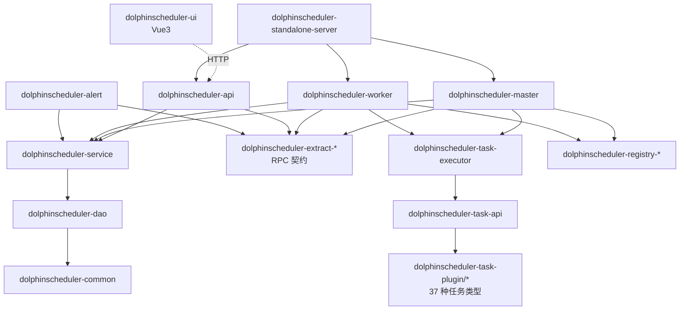
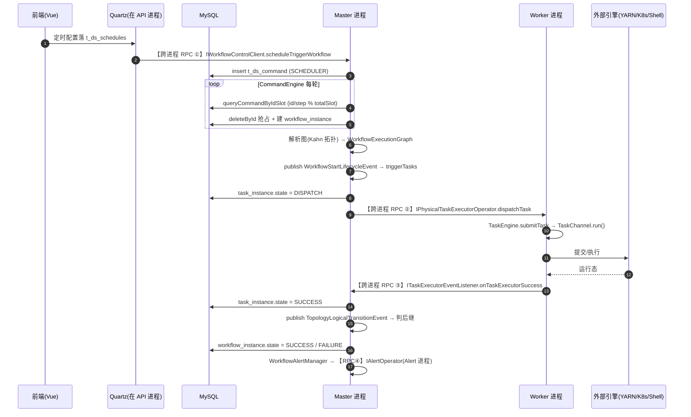

# Apache DolphinScheduler 架构笔记

> 仓库路径：`D:/AgentABC/dolphinscheduler`
> 上游地址：`https://github.com/LukeLi-EBD/dolphinscheduler.git`（apache/dolphinscheduler 的 fork）
> 语言与规模：Java（2564 个 `.java`）+ Vue3/TS，全仓 4866 文件 / 约 94MB，26 个 Maven module
> 版本：`dev-SNAPSHOT`（`pom.xml:28`），parent 版本 `25`（`pom.xml:24`）
> commit：`c366e26217d589378eaa98b64f9b29808927a662`（2026-10-15 09:41:33 +0800）
> 分析时间：2026-11-04

---

## 1. 一句话定位（和 Airflow/Oozie 这类调度系统的差异点）

DolphinScheduler 是一个**去中心化（无中心 scheduler 单点）+ 数据库命令队列 + 事件总线驱动状态机**的可视化 DAG 工作流调度系统。

| 维度 | Airflow | Oozie | DolphinScheduler（本仓库） |
|---|---|---|---|
| 调度决策位置 | 单点 Scheduler 进程（HA 靠 DB 锁选主） | Oozie Server（ZooKeeper 选主） | **每个 Master 按 slot 分片抢 `t_ds_command`**，无"唯一调度者" |
| DAG 触发方式 | Scheduler 定时轮询 DB 里的 DagRun | Coordinator + 定时 | 命令表 + 每个 Master 独立 `CommandEngine` 轮询自己分片 |
| 任务分发 | Executor 拉取 Celery/K8s 队列 | Launcher（YARN） | **Master 推**：按 workerGroup 选一台 Worker，走自研 Netty RPC |
| 状态推进 | Scheduler 解析 DAG 后批量调度 task | 单进程状态机 | Master 内存**事件总线 + 生命周期事件 + 状态机 Action** |
| 扩展任务类型 | Operator 类 | Action 类 | `TaskChannelFactory` + `PrioritySPIFactory` 插件 jar |

一句话：**它不是"一个 scheduler 调度所有 DAG"，而是"N 个 Master 各自认领一段命令号区间，各自把 DAG 跑在内存里"**——这决定了本仓库大量代码围绕"命令去重、故障接管、事件重放"展开。

---

## 2. 技术栈与工程结构

### 2.1 技术栈

| 关注点 | 选型 | 证据 |
|---|---|---|
| 注册中心 | 可插拔：ZooKeeper / JDBC / Etcd | `dolphinscheduler-registry/dolphinscheduler-registry-plugins/`（三个子模块） |
| RPC | **自研**：Netty + Jackson，`@RpcService`/`@RpcMethod` 注解 + JDK 动态代理客户端 | `extract/extract-base/.../client/JdkDynamicRpcClientProxyFactory.java`、`.../server/NettyRemotingServer.java` |
| 存储 | MySQL（表前缀 `t_ds_`），Quartz 用同库 `QRTZ_*` 表 | `dao/src/main/resources/sql/dolphinscheduler_mysql.sql:22`（QRTZ_JOB_DETAILS）、`:431`（t_ds_workflow_definition） |
| ORM | MyBatis-Plus（枚举 `@EnumValue` 落库）+ 自研 Repository | `WorkflowExecutionStatus.java:43`；`dao/.../repository/` |
| 定时 | Quartz（JDBC JobStore），抽象成 `scheduler-plugin` | `scheduler-plugin/dolphinscheduler-scheduler-quartz/.../QuartzScheduler.java` |
| 前端 | Vue3 + Vite + naive-ui + pinia + antv/x6（DAG 画布） | `dolphinscheduler-ui/package.json` |
| 线程模型 | `BaseDaemonThread` 守护线程 + 固定池 + 每 workerGroup 一条分发线程 | `CommandEngine.java:64`、`WorkerGroupDispatcher.java:47` |

### 2.2 模块划分表

| Maven module | 职责 | 是否核心 |
|---|---|---|
| `dolphinscheduler-master` | 调度引擎：命令消费、DAG 执行、任务分发、故障转移 | ★★★ |
| `dolphinscheduler-worker` | 物理任务执行器宿主：接收 RPC、起线程、跑插件 | ★★★ |
| `dolphinscheduler-api` | REST API + 内嵌 Quartz 定时触发 + 鉴权 | ★★★ |
| `dolphinscheduler-common` | 枚举、常量、`DAG` 图结构、工具类 | ★★★ |
| `dolphinscheduler-dao` | 实体 / Mapper / Repository、SQL 脚本 | ★★★ |
| `dolphinscheduler-service` | 跨进程共享业务：`CommandService`、`ProcessService`、`DagHelper`、告警管理器 | ★★★ |
| `dolphinscheduler-extract-*` | RPC 契约（base / master / worker / alert / common） | ★★★ |
| `dolphinscheduler-task-plugin` | 任务类型插件（36 个子模块 / 37 种 TaskChannel） | ★★★ |
| `dolphinscheduler-task-executor` | 执行框架：`TaskEngine`、容器、事件总线 | ★★★ |
| `dolphinscheduler-scheduler-plugin` | 定时器插件（quartz） | ★★ |
| `dolphinscheduler-registry-*` | 注册中心 SPI 与三种实现 | ★★ |
| `dolphinscheduler-alert` | 告警服务 + 渠道插件（邮件/钉钉/飞书/语音…） | ★★ |
| `dolphinscheduler-datasource-plugin` | 数据源插件 | ★★ |
| `dolphinscheduler-eventbus` / `meter` | 通用事件总线 / Micrometer 指标 | ★★ |
| `dolphinscheduler-ui` | 前端 | ★★ |
| `dolphinscheduler-standalone-server` | 单 JVM 内嵌 master+worker+api+alert，调试用 | ★★ |
| `dolphinscheduler-storage-plugin` / `tools` / `bom` / `dist` / `e2e` / `microbench` | 资源存储 / 建表 CLI / 依赖管理 / 打包 / 测试 | ★ |

（`pom.xml:36-61` 共 26 个 `<module>`。）

### 2.3 模块依赖图



`master` 与 `worker` **互不依赖**，只依赖 `extract` 的接口契约——这是"可独立扩缩容、独立发版"的物理基础。

---

## 3. 整体架构

### 3.1 进程与角色划分

| 进程 | 启动类 | 职责 | 选主 / 注册 |
|---|---|---|---|
| Master | `master/.../MasterServer.java` | 消费 `t_ds_command`、构建 DAG、调度 task、故障接管 | **不选主**：写临时节点 + 心跳（`MasterRegistryClient.registry():95`），再按地址排序算 slot（`MasterSlotManager.doReBalance():62`） |
| Worker | `worker/.../WorkerServer.java` | 持有 `TaskEngine`，接收 RPC，起线程/进程执行任务 | 注册到 registry，Master 通过 `WorkerClusters` 订阅 |
| API | `api/.../ApiApplicationServer.java` | REST、项目/定义 CRUD；**内嵌 Quartz** 做定时 | 无状态，可多副本 |
| Alert | `alert/.../AlertServer.java` | 拉 `t_ds_alert`、按插件发消息 | `AlertHAServer` active/standby：`changeToActive()` 回调里才 `alertBootstrapService.start()`（`AlertServer.java:85` / `:86`） |
| Logger | 无独立进程 | 任务日志落本地文件，经 `ILogService` RPC 读 | — |
| Standalone | `dolphinscheduler-standalone-server` | 上述四角色同 JVM | — |

**Master 的"选主"其实是"分片"**：

```java
// MasterSlotManager.java:62
public void doReBalance(List<MasterServerMetadata> normalMasterServers) {
    normalMasterServers = normalMasterServers.stream()
            .sorted(MasterServerMetadata::compareTo).collect(Collectors.toList());
    ...
    currentSlot = tmpCurrentSlot;                 // 我在排序后的下标
    totalSlots = normalMasterServers.size();
}
```

命令归属靠 SQL 取模（`CommandMapper.xml:59`）：

```sql
select * from t_ds_command
where (id / #{idStep}) % #{totalSlot} = #{currentSlotIndex}
order by workflow_instance_priority, id asc limit #{fetchNumber}
```

好处：**扩缩容不需要迁移数据**，slot 变了下一轮取模结果自然变化。代价：扩容瞬间同一条命令可能被两个 Master 读到，必须靠删除行数去重。

### 3.2 核心组件职责表

| 组件 | 代码位置 | 职责 | 进程模型 |
|---|---|---|---|
| `CommandEngine` | `master/engine/command/CommandEngine.java:64` | 命令消费主循环、过载保护 | 1 守护线程 + N 线程池 |
| `IdSlotBasedCommandFetcher` | `.../command/IdSlotBasedCommandFetcher.java:57` | 按 slot 拉命令 | 被调用 |
| `WorkflowExecutionFactory` | `.../workflow/execution/WorkflowExecutionFactory.java:50` | 事务内"删命令 + 建执行体" | 无状态 |
| `WorkflowEngine` | `.../engine/WorkflowEngine.java:36` | 组合根：事件总线 / 命令引擎 / 分发协调器 / 逻辑任务引擎 | 单例 |
| `WorkflowExecution` | `.../workflow/execution/WorkflowExecution.java:37` | 流程实例内存形态：图 + 事件总线 + 失败策略 | 每实例一个 |
| `WorkflowExecutionGraph` | `.../graph/WorkflowExecutionGraph.java` | 运行时 DAG（节点 = `ITaskExecution`） | 随实例 |
| `WorkerGroupDispatcher` | `.../task/dispatcher/WorkerGroupDispatcher.java:47` | 从队列 `take` → 调 RPC 推给 Worker | 每 workerGroup 1 条 |
| `TaskExecutorClient` | `.../task/client/TaskExecutorClient.java:52` | 逻辑任务 / 物理任务分发分流 | 无状态 |
| `PhysicalTaskExecutorClientDelegator` | 同目录 `:65` | 选 Worker + 发 `dispatchTask` RPC | 无状态 |
| `TaskEngine` | `task-executor/.../TaskEngine.java` | Worker 内任务容器管理与状态跟踪 | Worker 内单例 |
| `PhysicalTaskExecutorOperatorImpl` | `worker/rpc/PhysicalTaskExecutorOperatorImpl.java:48` | Worker 侧 RPC 实现 | — |
| `TaskPluginManager` | `task-plugin/.../api/TaskPluginManager.java:42` | SPI 加载全部 `TaskChannelFactory` | 静态单例 |
| `FailoverCoordinator` | `master/failover/FailoverCoordinator.java:76` | Master / Worker 宕机接管 | Master 单例 |

### 3.3 高可用与故障转移机制

**A. 命令 exactly-once（防重复执行的第一道闸）**

```java
// WorkflowExecutionFactory.java:50
@Transactional
public IWorkflowExecution createWorkflowExecuteRunnable(Command command) {
    deleteCommandOrThrow(command);                    // :73
    return doCreateWorkflowExecution(command);
}
private void deleteCommandOrThrow(Command command) {
    boolean deleteResult = commandDao.deleteById(command.getId());
    if (!deleteResult) {                              // 影响行数 0 → 已被别的 Master 处理
        throw new CommandDuplicateHandleException(command);
    }
}
```

`CommandEngine.bootstrapError():195` 捕获该异常只打 warn（`:198`）。**用"删除影响行数"当分布式锁**，比额外加 Redis 锁更简单且天然幂等。

**B. Master 宕机 → 未完成流程接管**：`FailoverCoordinator.globalMasterFailover():76` 扫描 `workflowInstanceDao.queryNeedFailoverMasters()`（`t_ds_workflow_instance.host` 指向死 Master 且状态未终结），对每个死 Master 调 `WorkflowFailover.failoverWorkflow():47` **插一条 `CommandType.FAILOVER` 命令**——故障恢复复用命令表，不另写一套恢复执行器。新 Master 拉到后重建执行图，并通过 `reassignMasterHost()`（`PhysicalTaskExecutorClientDelegator.java:104`，内部调 RPC `reassignWorkflowInstanceHost`）把 Worker 上跑着的任务的"归属 Master"改成自己。

**C. Worker 宕机 → 任务重新分派**：`TaskFailover` 对 `host` 落在死 Worker 的 task_instance 发 `TaskFailoverLifecycleEvent` → `TaskFailoverStateAction` → 回到分发。`WorkerGroupDispatcher.onDispatchTimeout():146` 对"累计分发超时"直接判 FAILED，避免无限重排。

**D. 负载保护**：`CommandEngine.run():127` 每轮先看 `masterServerLoadProtection.isOverload(...)`，过载就 sleep 跳过，不再抢命令——压力自然转移给其它 Master。

---

## 4. 端到端主链路（最重要）



### 步骤 1：工作流定义（DAG 如何存）
- 入口：`dao/src/main/resources/sql/dolphinscheduler_mysql.sql:431`（`t_ds_workflow_definition`）、`:486`（`t_ds_task_definition`）、`:561`（`t_ds_workflow_task_relation`）
- 逻辑：**不存 JSON DAG，而存"边表"**。relation 每条一行 `pre_task_code → post_task_code`，带 `condition_type`（0 none / 1 judge / 2 delay）与 `condition_params`(JSON)；定义有 `workflow_definition_version`，每次保存写新版并留档到 `_log` 表。
- 产出：给定 `(code, version)` 可唯一还原整图（4.x 相比 3.x 的 `process_definition.locations` JSON 是结构性改进）。

### 步骤 2：定时 / 手动触发
- 入口：`scheduler-plugin/.../quartz/ProcessScheduleTask.java:60` → `executeInternal()`
- 逻辑：Quartz 到点 → 校验 `Schedule`/`WorkflowDefinition` 是否 ONLINE → 组装 `WorkflowScheduleTriggerRequest`（`:106`）→ `workflowInstanceController.scheduleTriggerWorkflow(...)`（`:122`）。
- 产出：**跨进程 RPC** 进入 Master 的 `IWorkflowControlClient`（`extract-master/.../IWorkflowControlClient.java:42` 的 `@RpcService`）。手动执行走另一条路：`api/service/impl/ExecutorServiceImpl.java:329` 造 `CommandType.EXECUTE_TASK`。

### 步骤 3：Master 侧落命令
- 入口：`master/rpc/WorkflowControlClient.java:99` → `scheduleTriggerWorkflow()`
- 逻辑：委托 `WorkflowScheduleTrigger`（`.../trigger/WorkflowScheduleTrigger.java:45`），`constructTriggerCommand():87` 造 `CommandType.SCHEDULER` 命令，再由 `AbstractWorkflowTrigger.triggerWorkflow():63` → `commandDao.insert(command)`。
- 产出：`t_ds_command` 一行（字段语义见 SQL 注释：0 启动 / 6 定时 / 7 重跑 / 8 暂停 / 9 停止）。

### 步骤 4：Master 拉命令（分片 + 去重）
- 入口：`master/engine/command/CommandEngine.java:122` → `run()`；`IdSlotBasedCommandFetcher.java:57` → `fetchCommands()`
- 逻辑：① 先 `metricsProvider.getSystemMetrics()` 判过载（`:126`）；② `fetchCommands()` 走取模 SQL；③ 每条命令一个 `CompletableFuture`，串 `bootstrapCommand → bootstrapWorkflowExecution → bootstrapSuccess/bootstrapError`（`:142-150`）；④ `createWorkflowExecuteRunnable` 在**一个事务里删命令+建实例**，删失败即"别人已处理"。
- 产出：内存 `IWorkflowExecution`，`workflowRepository.put(...)`（`:182`）。

### 步骤 5：生成流程实例
- 入口：`master/engine/command/handler/RunWorkflowCommandHandler.java:72` → `assembleWorkflowInstance()`
- 逻辑：按 `command.getWorkflowInstanceId()` 取 API 侧预建的实例，置 `state=RUNNING_EXECUTION`、`host=masterConfig.getMasterAddress()`，合并命令参数与定义全局参数后 `upsertWorkflowInstance`。
- 产出：`t_ds_workflow_instance` 一行，`state=1`。

### 步骤 6：DAG 解析（算法）
- 入口：`master/engine/graph/WorkflowGraphFactory.java:44` → `createWorkflowGraph()`

```java
List<WorkflowTaskRelation> relations = processService.findRelationByCode(code, version);
List<TaskDefinition> tasks = taskDefinitionLogDao.queryTaskDefineLogList(relations);
return new WorkflowGraph(relations, tasks);
```

- 逻辑：静态图交给 `WorkflowGraphTopologyLogicalVisitor.doVisitationInSubGraph()` 做**入度拓扑排序（Kahn）**：先按 `TaskDependType` 裁剪子图（`TASK_ONLY`/`TASK_PRE`/`TASK_POST`，即"只跑选中/往前补/往后推"，`:63-75`），再用 `inDegreeMap` 从入度 0 出发逐层出队，回调 `taskExecutionCreator` 建 `TaskExecution` 并 `addNode/addEdge`（`WorkflowExecutionGraph.java:72/:79`）。
- 产出：运行时 `IWorkflowExecutionGraph`（只含可达节点，`removeUnReachableEdge()`）。**依赖判定**在运行时是 `WorkflowExecutionGraph.isTriggerConditionMet():206`——"所有直接前驱都已完成且未 failed/paused/killed"，O(入度)，不扫全图。

### 步骤 7：启动流程 → 触发起始节点
- 入口：`CommandEngine.java:184` publish `WorkflowStartLifecycleEvent` → `WorkflowRunningStateAction.onStartEvent():46`
- 逻辑：取 `workflowExecutionGraph.getStartNodes()`（空则直接判完成），调 `AbstractWorkflowStateAction.triggerTasks():83` 过滤 `isTriggerConditionMet`、按名字排序后逐个 `publish(TaskStartLifecycleEvent)`。
- 产出：事件进入该实例的事件总线，进入分发阶段。

### 步骤 8：任务分发（推模式）
- 入口：`.../task/dispatcher/WorkerGroupDispatcher.java:168` `dispatchTask()` → `:88 run()` → `:110 doDispatchTask()`
- 逻辑：① 包成 `TaskDispatchableEvent`（带 delay、失败次数）入 `TaskDispatchableEventBus`，同时登记 `waitingDispatchTaskIds`；② 消费线程 `take()`，`waitingDispatchTaskIds.remove()` 失败说明已被 pause/kill，跳过（`:114`）；③ `TaskExecutorClient.dispatch():52` 按 `TaskTypeUtils.isLogicTask()` 分流——**逻辑任务在 Master 本地执行**，物理任务走 `PhysicalTaskExecutorClientDelegator.dispatch():65`：

```java
String addr = workerLoadBalancer.select(workerGroup).map(Host::of).map(Host::getAddress)
        .orElseThrow(() -> new NoAvailableWorkerException(workerGroup));
taskExecution.getTaskInstance().setHost(addr);          // 先落 host，再发 RPC
Clients.withService(IPhysicalTaskExecutorOperator.class).withHost(addr)
       .dispatchTask(TaskExecutorDispatchRequest.of(ctx));
```

- 产出：**跨进程 RPC** `IPhysicalTaskExecutorOperator.dispatchTask`（`extract-worker/.../IPhysicalTaskExecutorOperator.java:36`）。分发失败按 `clamp(failTimes*1000, 1000, 60000)` 退避重入队（`:134`）。

### 步骤 9：Worker 执行
- 入口：`worker/rpc/PhysicalTaskExecutorOperatorImpl.java:48` → `dispatchTask()`
- 逻辑：`PhysicalTaskEngineDelegator.dispatchLogicTask():62` → `TaskEngine.submitTask():63` → 容器（`ExclusiveThreadTaskExecutorContainer` / `SharedThreadTaskExecutorContainer`）分配槽位 → `PhysicalTaskPluginFactory` → `TaskPluginManager.getTaskChannel(type)`：

```java
// TaskPluginManager.java:42  —— 插件注册点
PrioritySPIFactory<TaskChannelFactory> f = new PrioritySPIFactory<>(TaskChannelFactory.class);
for (Map.Entry<String, TaskChannelFactory> e : f.getSPIMap().entrySet()) {
    taskChannelMap.put(e.getKey(), e.getValue().create());   // "SHELL"/"SQL"/"FLINK"...
}
```

- 产出：任务真正执行。**插件注册方式**：实现类上标 `@AutoService(TaskChannelFactory.class)`（如 `ShellTaskChannelFactory.java:25`），由 auto-service 在编译期生成 `META-INF/services/org.apache.dolphinscheduler.plugin.task.api.TaskChannelFactory`。

### 步骤 10：状态回写
- 入口：Worker 侧 `PhysicalTaskExecutorEventRemoteReporterClient` → RPC `ITaskExecutorEventListener` → `master/rpc/TaskExecutorEventListenerImpl.java:110` `onTaskExecutorSuccess()`
- 逻辑：Master 把"执行器事件"翻译成"生命周期事件"publish 到实例总线 → `TaskSuccessLifecycleEventHandler.handle():51` → `TaskStateAction.onSucceedEvent()`（`AbstractTaskStateAction.java:233`）：释放任务组配额 → 写 `t_ds_task_instance.state=7` → 合并 varPool → publish 拓扑转移事件 → `ackTaskExecutorLifecycleEvent`。
- 产出：DB 状态 + 新的拓扑转移事件。

### 步骤 11：下游被唤醒
- 入口：`WorkflowTopologyLogicalTransitionWithTaskFinishLifecycleEventHandler.handle():34` → `WorkflowRunningStateAction.onTopologyLogicalTransitionEvent():61`
- 逻辑：`markTaskExecutionInActive()` 移出 active 集合 → `tryToTriggerSuccessorsAfterTaskFinish()`（`AbstractWorkflowStateAction.java:136`）：① `successorFlowAdjuster.adjustSuccessorFlow()` 做条件分支剪枝（标 skip/forbidden）；② 失败则交 `IWorkflowFailureStrategy`（Continue/End）；③ 链尾则 `emitWorkflowFinishedEventIfApplicable`；④ 否则 `triggerTasks(getSuccessors(task))`，回到步骤 7 的判定。
- 产出：下一批 `TaskStartLifecycleEvent`。

### 步骤 12：完成 / 失败重试 / 告警
- 入口：`WorkflowRunningStateAction.onSucceedEvent():108` / `onFailedEvent():120`
- 逻辑：成功需 `isAllTaskExecutionChainSuccess()`，失败需"确实存在失败链"（否则抛 `IllegalStateException`，断言式防御）；随后 `workflowFinish():154` 在事务内写 `end_time`、改状态、清 `serial_command`、publish `WorkflowFinalizeLifecycleEvent`。重试在 `AbstractTaskStateAction.onFailedEvent():199`：`isTaskInstanceCanRetry()` 为真则 publish `TaskRetryLifecycleEvent` 回到分发。告警由 `TaskSuccessLifecycleEventHandler` 调 `workflowAlertManager.sendTaskResultAlert()`（`:63`）落 `t_ds_alert`，Alert 进程 `AlertOperatorImpl.sendAlert():39` 按插件渠道发送。
- 产出：流程终态 + 告警记录。

**状态机三件套汇总**

| 层 | 枚举 | 位置 | 推进者 |
|---|---|---|---|
| 流程实例 | `WorkflowExecutionStatus`（10 值，含 `canStop/canPause/needFailover/finalState` 布尔矩阵） | `common/enums/WorkflowExecutionStatus.java:29-38` | `WorkflowXxxStateAction`（10 个，`master/engine/workflow/statemachine/`） |
| 任务实例 | `TaskExecutionStatus`（10 值，含 `NEED_FAULT_TOLERANCE`/`FORCED_SUCCESS`） | `task-plugin/.../api/enums/TaskExecutionStatus.java:28-37` | `TaskXxxStateAction`（10 个，`master/engine/task/statemachine/`） |
| 执行器侧 | `TaskExecutorState` | `task-executor/.../TaskExecutorState.java` | `TaskEngine` + `ITaskExecutorStateTracker` |

枚举把"能不能停 / 能不能暂停 / 要不要 failover"编码成构造参数，业务只查布尔值，**避免散落的 if-else 状态判断**——本仓库最值得抄的设计。

---

## 5. 核心代码路径清单

| 文件路径 | 关键类/方法 | 作用 | 优先级 |
|---|---|---|---|
| `master/.../engine/command/CommandEngine.java` | `run()` `:122` | 命令消费主循环 | ★★★ |
| `master/.../command/IdSlotBasedCommandFetcher.java` | `fetchCommands()` `:57` | 按 slot 拉命令 | ★★★ |
| `master/.../workflow/execution/WorkflowExecutionFactory.java` | `createWorkflowExecuteRunnable()` `:50` / `deleteCommandOrThrow()` `:73` | 命令 exactly-once | ★★★ |
| `dao/.../mapper/CommandMapper.xml` | `queryCommandByIdSlot` `:59` | 分片 SQL | ★★★ |
| `master/.../command/handler/RunWorkflowCommandHandler.java` | `assembleWorkflowInstance()` `:72` / `assembleWorkflowExecutionGraph()` `:85` | 建实例 + 建执行图 | ★★★ |
| `master/.../graph/WorkflowGraphFactory.java` | `createWorkflowGraph()` `:44` | 边表 → 静态图 | ★★★ |
| `master/.../graph/WorkflowGraphTopologyLogicalVisitor.java` | `doVisitationInSubGraph()` | Kahn 拓扑展开 | ★★★ |
| `master/.../graph/WorkflowExecutionGraph.java` | `isTriggerConditionMet()` `:206` | 前置依赖判定 | ★★★ |
| `master/.../workflow/statemachine/WorkflowRunningStateAction.java` | `onStartEvent()` `:46` / `onTopologyLogicalTransitionEvent()` `:61` | 流程状态推进 | ★★★ |
| `master/.../workflow/statemachine/AbstractWorkflowStateAction.java` | `triggerTasks()` `:83` / `tryToTriggerSuccessorsAfterTaskFinish()` `:136` / `workflowFinish()` `:154` | 触发与收尾 | ★★★ |
| `master/.../task/statemachine/AbstractTaskStateAction.java` | `onSucceedEvent()` `:233` / `onFailedEvent()` `:199` | 任务状态落库与事件 | ★★★ |
| `master/.../task/dispatcher/WorkerGroupDispatcher.java` | `dispatchTask()` `:168` / `doDispatchTask()` `:110` | 推送分发 + 退避重试 | ★★★ |
| `master/.../task/client/PhysicalTaskExecutorClientDelegator.java` | `dispatch()` `:65` | 选 Worker + RPC | ★★★ |
| `extract/.../worker/IPhysicalTaskExecutorOperator.java` | `dispatchTask/killTask/pauseTask` | Worker RPC 契约 | ★★★ |
| `worker/.../rpc/PhysicalTaskExecutorOperatorImpl.java` | `dispatchTask()` `:48` | Worker RPC 入口 | ★★★ |
| `worker/.../executor/PhysicalTaskEngineDelegator.java` | `dispatchLogicTask()` `:62` | Worker 侧提交 | ★★★ |
| `task-executor/.../TaskEngine.java` | `submitTask()` `:63` / `killTask()` `:82` | 执行容器调度 | ★★ |
| `task-plugin/.../api/TaskPluginManager.java` | `loadTaskPlugin()` `:42` / `getTaskChannel()` | 插件 SPI 注册表 | ★★★ |
| `master/.../registry/MasterRegistryClient.java` | `registry()` `:95` | Master 注册与心跳 | ★★ |
| `master/.../cluster/MasterSlotManager.java` | `doReBalance()` `:62` | 槽位计算 | ★★ |
| `master/.../failover/FailoverCoordinator.java` | `globalMasterFailover()` `:76` | 全局接管 | ★★ |
| `master/.../failover/WorkflowFailover.java` | `failoverWorkflow()` `:47` | 失败流程重入命令表 | ★★ |
| `scheduler-plugin/.../quartz/ProcessScheduleTask.java` | `executeInternal()` `:60` | 定时触发入口 | ★★★ |
| `master/.../rpc/WorkflowControlClient.java` | `scheduleTriggerWorkflow()` `:99` | Master 触发 RPC 实现 | ★★★ |
| `common/.../enums/WorkflowExecutionStatus.java` | 枚举 `:29-38` | 流程状态定义 | ★★★ |

---

## 6. 关键设计点

**① 命令表 + 取模分片，代替中心调度器**
→ 为什么：无单点，加 Master 就是加机器；命令创建与实例创建在同一 DB 事务里，天然一致。
→ 代价：每个 Master 每秒空轮询自己的分片（`Thread.sleep(1s)`，`CommandEngine.java:136`）；`t_ds_command` 成为热点表；扩容瞬间有双读窗口，必须靠 `deleteById` 影响行数兜底。

**② Master 推任务（而非 Worker 拉）**
→ 为什么：能实现 workerGroup 强隔离 + 多种负载均衡（`cluster/loadbalancer/` 下 4 个实现：随机/轮询/固定权重/动态权重），且 Master 掌握全局视图。
→ 代价：Master 必须维护每个 Worker 的健康与容量，`waitingDispatchTaskIds` + 退避 + 分发超时这一大坨复杂度就是这么长出来的；Worker 数量大时 Master 心跳与连接数压力显著。

**③ 事件总线 + 生命周期事件 + 状态机 Action 三层解耦**
→ 为什么：一次"任务成功"牵动 6 件事（落库、变量合并、配额释放、后继唤醒、告警、ACK）；`Handler` 管横切、`StateAction` 管状态，加行为只需加 Handler。
→ 代价：调用链长且异步，一次排查跨 4~5 个类；事件可能迟到/乱序，每个 Action 都必须 `throwExceptionIfStateIsNotMatch` 防御，否则出现"暂停后收到迟到 SUCCESS"（`TaskSuccessLifecycleEventHandler` 的注释就是这个坑）。

**④ 状态用布尔矩阵而不是 `switch`**
→ 为什么：`WorkflowExecutionStatus(code, canStop, canDirectStopInDB, canPause, ..., finalState, needFailover)` 把策略数据化，`NEED_FAILOVER_STATES`/`NOT_TERMINAL_STATES` 由枚举直接推导（`:99-107`），SQL 也能直接用 code 数组。
→ 代价：7 个布尔构造参数靠列对齐，新增状态容易填错位。

**⑤ DAG 存边表而非 JSON**
→ 为什么：支持按依赖查上游/下游、条件分支独立建模、版本 diff。
→ 代价：N 节点 DAG 要读 N 行 task + M 行 relation，比读一个大 JSON 多几次查询；必须严格按 `(code, version)` 匹配，否则混版本。

**⑥ 故障恢复复用正常链路（FAILOVER 也是 CommandType）**
→ 为什么：不需要另写恢复执行器，复用 `WorkflowExecutionFactory` 的事务与去重，天然不会重复恢复。
→ 代价：恢复有延迟（等命令被拉到），且 `queryNeedFailoverMasters()` 是全表条件扫描，Master 多时变慢。

---

## 7. 扩展点

**A. 加一种任务类型（`MYTASK`）**
1. 新建 `dolphinscheduler-task-plugin/dolphinscheduler-task-mytask`；
2. 实现 `AbstractTask`（`handle()` / `cancel()`）与参数类 `AbstractParameters`（`checkParameters()`）；
3. 实现 `TaskChannel` + `TaskChannelFactory`，`getName()` 返回 `"MYTASK"`；
4. 在实现类上标 `@AutoService(TaskChannelFactory.class)`，由 auto-service 编译期生成 `META-INF/services/org.apache.dolphinscheduler.plugin.task.api.TaskChannelFactory`（`TaskPluginManager` 靠 `PrioritySPIFactory` 扫描，`TaskPluginManager.java:42`）；
5. 前端在 `dolphinscheduler-ui/src/views/projects/task/components/node/` 加表单与图标；
6. 把 module 加进 `dolphinscheduler-task-all` 的依赖，否则 dist 不打进去。

**B. 加一种告警渠道（企业微信）**
1. 新建 `dolphinscheduler-alert-plugins/dolphinscheduler-alert-wecom`；
2. 实现 `AlertChannel`（`alert/api/AlertChannel.java`）+ `AlertChannelFactory`（`alert/api/AlertChannelFactory.java`），`getParams()` 返回 `AlertInputTips` 供前端渲染表单；
3. 在实现类上标 `@AutoService(AlertChannelFactory.class)`（编译期生成 `META-INF/services/org.apache.dolphinscheduler.alert.api.AlertChannelFactory`）；
4. 实例在 UI 创建（落 `t_ds_alert_plugin_instance`），运行时由 `AlertPluginManager` 加载。**无需改 Master/Worker**。

**C. 改调度策略**
- 分发路由：实现 `IWorkerLoadBalancer`（`master/cluster/loadbalancer/`）并注册到 `WorkerLoadBalancerType`/`WorkerLoadBalancerConfiguration`；
- 分发并发与超时：`TaskDispatchPolicy`（`master/config/TaskDispatchPolicy.java`）；
- 失败策略：实现 `IWorkflowFailureStrategy`（已有 `Continue`/`End`）；
- 分片粒度：`CommandFetchStrategy.IdSlotBasedFetchConfig` 的 `idStep`/`fetchSize`（默认 1/10，`:49-50`）；
- 定时表达式：换 `scheduler-plugin` 实现（`SchedulerApi` 是接口）。

---

## 8. 本地跑起来 / 调试入口

**最短路径：Standalone（一个 JVM 跑全部角色）**

```bash
# 必需中间件：MySQL 8（ZooKeeper 可选，standalone 默认 JDBC registry）
mysql -uroot -p -e "CREATE DATABASE dolphinscheduler DEFAULT CHARSET utf8;"
mysql -uroot -p dolphinscheduler < dolphinscheduler-dao/src/main/resources/sql/dolphinscheduler_mysql.sql
./mvnw -pl dolphinscheduler-standalone-server -am clean package -DskipTests
java -jar dolphinscheduler-standalone-server/target/dolphinscheduler-standalone-server-*.jar
# http://localhost:12345/dolphinscheduler/ui  admin/dolphinscheduler123
```

**分布式调试（真正看 RPC 边界）**：需 ZooKeeper；分别 `package` 后依次起 `master` → `worker` → `api` → `alert` 四个 jar。

**断点顺序**：`ProcessScheduleTask.executeInternal` → `WorkflowControlClient.scheduleTriggerWorkflow` → `CommandEngine.run`/`fetchCommands` → `WorkflowExecutionFactory.createWorkflowExecuteRunnable` → `WorkflowRunningStateAction.onStartEvent` → `triggerTasks` → `WorkerGroupDispatcher.doDispatchTask` → **`PhysicalTaskExecutorOperatorImpl.dispatchTask`（此处跨进程，Master/Worker 各挂一个调试器）** → `TaskExecutorEventListenerImpl.onTaskExecutorSuccess` → `tryToTriggerSuccessorsAfterTaskFinish`。

---

## 9. 阅读路线

**半天（只懂主链路）**：`WorkflowExecutionStatus`（布尔矩阵）→ `CommandEngine`（222 行，全读）→ `RunWorkflowCommandHandler:72-130` → `WorkflowGraphTopologyLogicalVisitor`（拓扑算法）→ `AbstractWorkflowStateAction:83-180` → `WorkerGroupDispatcher` + `PhysicalTaskExecutorClientDelegator` → `AbstractTaskStateAction.onSucceedEvent`。

**两天（补可靠性与扩展）**：D1 上午三张核心表字段（definition / instance / task_instance）+ DAO；D1 下午 `MasterSlotManager` + `MasterRegistryClient` + `FailoverCoordinator` + `WorkflowFailover`；D2 上午 `task-executor` 模块（`TaskEngine`/容器/`ITaskExecutorStateTracker`）；D2 下午 `TaskChannel` 插件 + 照 `ShellTask` 读一遍 `AbstractTask`，再看 alert 插件。

**一周（能改）**：D3 `WorkflowEventBus`/`WorkflowEventBusCoordinator`/`WorkflowEventBusFireWorker` 的串行与死锁规避；D4 条件分支与 `SuccessorFlowAdjuster`（switch/dependent 任务剪枝）；D5 `TaskGroupQueue`（任务组配额）；D6 API+Quartz 交互与 `CommandType` 全枚举、serial 串行工作流；D7 自己写一个 TaskChannel 跑通，再 kill 一个 Master 观察 failover。

---

## 10. 未覆盖 / 存疑

1. **`WorkflowEventBus` 的并发模型**未逐行读：只确认 `WorkflowEventBusCoordinator` 管注册回收、`WorkflowEventBusFireWorker(s)` 管串行消费；**同一实例的事件是否严格串行**未验证——这直接影响状态机断言能否被并发穿透。
2. **`dolphinscheduler-eventbus` 与 master 内 `WorkflowEventBus`** 的关系未厘清（前者像通用工具，后者像实例级总线）。
3. **`LogicTaskEngineDelegator`（Master 本地跑逻辑任务）** 的容器与线程池策略未展开；子流程/依赖节点在 Master 进程内执行，是"Master 被任务拖垮"的隐患点。
4. **`IdSlotBasedCommandFetcher` 的 `idStep` 取值**已确认默认 `idStep=1`、`fetchSize=10`（`CommandFetchStrategy.IdSlotBasedFetchConfig:49-50`），但对 slot 均衡的影响未评估。
5. **API 侧 `ExecutorServiceImpl` 的完整触发分支**（重跑/补数/从失败节点恢复）只看了 `:329`，各 `CommandType` 参数差异未逐一比对。
6. **`dolphinscheduler-dao-plugin` / `dolphinscheduler-authentication`** 只见到 `pom.xml:58/:59` 的模块声明，未展开。
7. **性能数字**（QPS、单 Master 承载实例数）仓库无基准，`microbench` 模块未运行。
8. **UI 与服务端的 DAG 保存格式**（x6 图 → relation 表）未追。

---

## 与 Airflow 的对比

- **调度模型**：Airflow 是"中心 Scheduler 解析 DAG → 把 TaskInstance 推到 Executor 队列 → Worker 拉"；DS 是"命令表分片 → Master 推给指定 Worker"。前者拉、后者推。
- **DAG 定义**：Airflow 用 Python 代码即 DAG（版本管理靠 git）；DS 用可视化画布 + 边表落库（版本靠 `_log` 表 + version）。
- **扩展成本**：Airflow 加 Operator 只需一个 Python 类；DS 要写 Java 插件 + `@AutoService` SPI 注册 + 前端表单 + 打进 dist，成本更高但可热插拔到 Worker。
- **状态推进**：Airflow Scheduler 每轮重解析 DAG，无长驻内存状态；DS 每个实例在 Master 内存里有完整图与事件总线，重启后靠 DB 重建。
- **适合场景**：Airflow 适合"工程师写 DAG、Python 生态为主、任务数万级"；DS 适合"业务人员可视化编 DAG、要租户/项目/workerGroup 隔离、要开箱即用多类型任务"。

---

## 修订记录

> 2026-11-04 对照本地仓库 `D:/AgentABC/dolphinscheduler` 逐条核验。共核对文档内 91 处行号引用（含重复）、证据包 39 处全量回源；另核对类名/方法名/配置项 18 个、规模类陈述 5 项，修订 19 项。结论：主链路与 CommandEngine→WorkflowEngine→TaskDispatcher 判断成立，问题集中在 3 个服务注册文件不存在、行号漂移与模块计数。


| # | 位置 | 原表述 | 核实结果（源码依据） | 处理 |
|---|------|--------------|------|------|
| 1 | 文档头 · 规模 | `约 174MB` | 工作区（不含 `.git`）4866 个文件合计 94.3MB | `约 94MB` |
| 2 | 文档头 · 规模 / §2.2 | `27 个 Maven module`；`pom.xml:36-61` 共 `27 个 <module>` | `pom.xml:36-61` 逐行计数为 26 个 `<module>` | 改为 26 |
| 3 | §3.1 Alert 行 | `AlertHAServer` active/standby（`:85` 才 `alertBootstrapService.start()`） | `AlertServer.java:84-87`；`AlertHAServer.java` 全文仅 47 行且不含该调用 | `AlertHAServer` 经 `AlertServer.changeToActive()`（`AlertServer.java:85`）在 `:86` 才 `alertBootstrapService.start()` |
| 4 | §3.3 B 故障转移 | `reassignWorkflowInstanceHost`（`PhysicalTaskExecutorClientDelegator.java:104`） | 该方法在 `PhysicalTaskExecutorClientDelegator.java:104` 声明为 `reassignMasterHost(...)` | `reassignMasterHost()`（`:104`，内部调 RPC `reassignWorkflowInstanceHost`） |
| 5 | §3.3 D 负载保护 | `CommandEngine.run():126` 先看 `isOverload(...)` | `CommandEngine.java:126` 是 `getSystemMetrics()`，`:127` 才是 `isOverload(...)` | `run():127` |
| 6 | §4 步骤 2 | `IWorkflowControlClient.java:30` 的 `@RpcService` | `IWorkflowControlClient.java:42` 为 `@RpcService`；`:30` 是 import | `:42` |
| 7 | §4 步骤 6 | 子图裁剪 `:69-78` | `WorkflowGraphTopologyLogicalVisitor.java:63-75` 为 `TaskDependType` switch；`:69-78` 落在 `TASK_POST` 分支尾部与注释区 | `:63-75` |
| 8 | §4 步骤 9、§7 A.4、§7 B.3、文末对比 | 插件靠 `src/main/resources/META-INF/services/...TaskChannelFactory` / `AlertChannelFactory` 文件注册 | 仓库无受版本管理的 `META-INF/services/*`；`ShellTaskChannelFactory.java:25` 等 37 个 `TaskChannelFactory` Java 实现均用 `@AutoService` | 实现类标 `@AutoService(TaskChannelFactory.class)`（alert 用 `AlertChannelFactory.class`），由 auto-service 编译期生成 SPI 文件 |
| 9 | §4 步骤 11 | `WorkflowTopologyLogicalTransitionWithTaskFinishLifecycleEventHandler.handle():41` | 文件 `handle()` 起始于第 34 行 | `:34` |
| 10 | §4 步骤 12 | `sendTaskResultAlert()`（`:57`） | `TaskSuccessLifecycleEventHandler.java:63`；`:57` 是解释该坑的注释起始 | `:63` |
| 11 | §4 状态机表 | `TaskExecutionStatus.java:29-38` | `:28` 为 `SUBMITTED_SUCCESS`，`:37` 为 `FORCED_SUCCESS`，`:38` 为空行 | `:28-37` |
| 12 | §4 状态机表 | `WorkflowXxxStateAction`（12 个） | `master/.../workflow/statemachine/` 下具体 `Workflow*StateAction` 类共 10 个（不含 `Abstract`/接口） | 10 个 |
| 13 | §4 状态机表 | `TaskXxxStateAction`（13 个） | `master/.../task/statemachine/` 下具体 `Task*StateAction` 类共 10 个（不含 `Abstract`/接口） | 10 个 |
| 14 | §4 状态机表、§9 | `TaskExecutorStateTracker` | `task-executor` 模块只存在 `ITaskExecutorStateTracker` 接口 | `ITaskExecutorStateTracker` |
| 15 | §6 ② 负载均衡 | `cluster/loadbalancer/` 下 5 个实现 | 该目录仅 `Random/RoundRobin/FixedWeighted/DynamicWeighted` 4 个实现类，与列出的 4 种策略一致 | 4 个实现 |
| 16 | §7 C 分片参数 | `CommandFetcherConfiguration` 的 `idStep`/`fetchSize` | 字段定义在 `CommandFetchStrategy.java:49-50`；`CommandFetcherConfiguration` 只装配 Bean | `CommandFetchStrategy.IdSlotBasedFetchConfig` 的 `idStep`/`fetchSize`（默认 1/10，`:49-50`） |
| 17 | §9 阅读路线 | `CommandEngine`（94 行，全读） | `CommandEngine.java` 实为 222 行 | 222 行 |
| 18 | §10 存疑 4 | 未从 `CommandFetcherConfiguration` 确认 `idStep` 默认值 | `CommandFetchStrategy.java:49-50` | 已确认默认 `idStep=1`、`fetchSize=10`，未评估对 slot 均衡的影响 |
| 19 | §2.2 模块表、§2.3 依赖图 | 任务类型插件"约 40 个子模块"、"40+ 任务类型" | `dolphinscheduler-task-plugin/*/pom.xml` 计数 36；`@AutoService(TaskChannelFactory.class)` 的 Java 实现类 37 个 | 36 个子模块 / 37 种 TaskChannel（33 个任务实现 + 4 个逻辑任务） |

**未改 / 存疑**

1. `AbstractTaskStateAction.onSucceedEvent():233` 指向方法多行签名的末行（方法起始行 231），`WorkflowScheduleTrigger.java:45` 同理指向类声明末行（类名在 43），均可定位故未改。
2. `WorkflowGraphTopologyLogicalVisitor.doVisitationInSubGraph()` 实为 `private`，只经 `visit()` 内部调用，文档未点明调用层级，不影响结论。
