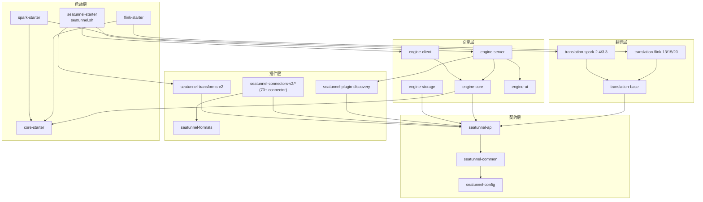
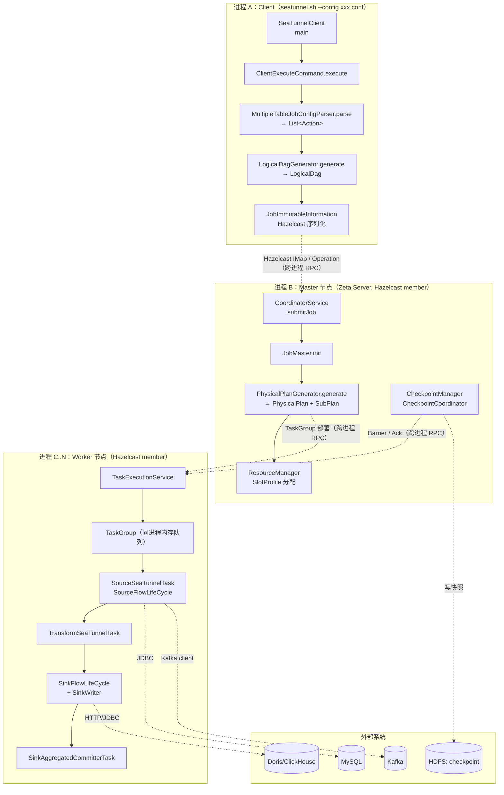
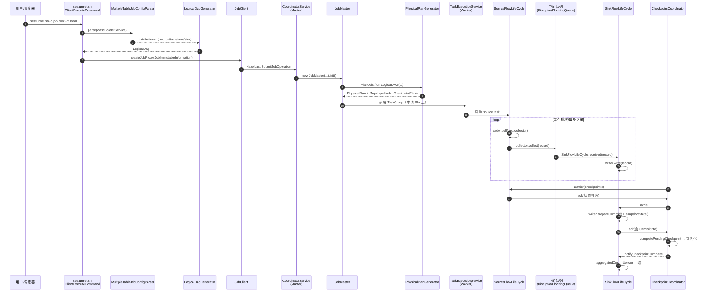

# Apache SeaTunnel 架构笔记

> **仓库路径**：`D:/AgentABC/seatunnel`
> **上游地址**：`https://github.com/apache/seatunnel`（本地 origin 为 `https://github.com/LukeLi-EBD/seatunnel.git`）
> **语言与规模**：Java 11（`pom.xml:81`）+ Scala 2.12.15（`pom.xml:82`），约 10137 文件 / 129 MB
> **版本**：`3.1.0-SNAPSHOT`（`pom.xml:62` 的 `<revision>`），Hazelcast shade 版 5.1（`pom.xml:70`）
> **commit**：`70ef5cd546cf2184cac0bd6d8c7f4399bffc1e9a`（Mon Nov 2 10:42:32 2026 +0000）
> **分析时间**：2026-11-04

---

## 1. 一句话定位

SeaTunnel 是一个**配置驱动的分布式数据集成引擎**：用户写一份 HOCON 配置（source / transform / sink），它把这份配置编译成一张 DAG，然后**要么交给自己的 Zeta 引擎跑，要么翻译成 Flink / Spark 作业交给对应引擎跑**——同一套 connector 插件在三种运行时上复用。

- **解决什么**：异构数据源之间的大批量 / 实时同步（MySQL→Doris、Kafka→Iceberg、文件→ClickHouse…），几百个 connector 开箱即用，且不需要写 Java/Scala 代码。
- **典型场景**：离线全量+增量同步（batch）、CDC 实时入仓（streaming）、多表整库同步、数据脱敏/字段映射等轻量 transform。
- **不解决什么**：不是通用流计算框架——没有窗口、没有 join 语义、没有状态后端 API 暴露给用户；复杂业务逻辑要靠 SQL transform（Calcite）或落库后再算。也不是调度系统（没有 cron/DAG 依赖编排，需要外部调度器调 `seatunnel.sh`）。

---

## 2. 技术栈与工程结构

### 2.1 技术栈

| 维度 | 选型 | 证据 |
|---|---|---|
| 配置语言 | HOCON（shade 过的 Typesafe Config） | `seatunnel-core/seatunnel-core-starter/.../utils/ConfigBuilder.java:21` 引入 `org.apache.seatunnel.shade.com.typesafe.config.ConfigFactory` |
| 配置解析 | `ConfigFactory.parseFile(...).resolve(...)`，支持 `--variable` 变量替换 | `ConfigBuilder.java:72`、`ConfigBuilder.java:255` 的 `substituteUserConfig` |
| 分布式协调 / 集群 | **Hazelcast**（不是 ZK/etcd/Raft），IMap 存运行态、成员自动发现 | `seatunnel-engine/seatunnel-engine-server/.../master/JobMaster.java:98` `import com.hazelcast.map.IMap`；`pom.xml:620` `seatunnel-shade-hazelcast` |
| 序列化 | Hazelcast `SerializationService` + ProtoStuff（checkpoint 内部状态） | `JobMaster.java:236` `nodeEngine.getSerializationService().toObject(...)`；`checkpoint/CheckpointManager.java:94` `new ProtoStuffSerializer()` |
| 中间队列 | 同 TaskGroup 内「内存队列」，可切 BlockingQueue / LMAX Disruptor | `PhysicalPlanGenerator.java:484` `TaskGroupWithIntermediateBlockingQueue`、`:492` `TaskGroupWithIntermediateDisruptor`；`config/seatunnel.yaml:23` `queue-type: blockingqueue` |
| 检查点存储 | 本地文件 / HDFS（SPI 可扩 S3 等） | `seatunnel-engine-storage/checkpoint-storage-plugins/` 下有 `checkpoint-storage-local-file`、`checkpoint-storage-hdfs` |
| 线程模型 | Master 上 `MDCExecutorService`（底层是 `coordinator-service` 线程池，`core-thread-num` 默认 10）驱动 job 状态机；Worker 上 TaskGroup 内多 task 共享线程池，可选 thread-share | `CoordinatorService.java:1415`、`CoordinatorService.java:305-315`；`ServerConfigOptions.java:525-529`；`TaskExecutionService.java:142` 注释 "Thread-share mode: Tasks share a common thread pool" |
| 元数据 / Catalog | 自研 `CatalogTable` / `SeaTunnelRowType`，不依赖 Flink Table 类型系统 | `seatunnel-api/.../table/catalog/`、`.../table/type/` |

### 2.2 模块划分表

| Maven module / 目录 | 职责 | 核心 |
|---|---|---|
| `seatunnel-config` | shade 后的 HOCON 配置库，独立发布 | ★ |
| `seatunnel-common` | 通用工具、`ConfigRuntimeException`、shade 依赖（guava/jackson/arrow） | ★ |
| `seatunnel-api` | **所有 SPI 契约**：`SeaTunnelSource`、`SeaTunnelSink`、`SinkWriter`、`SourceSplitEnumerator`、`TableSourceFactory`、`CatalogTable`、`Serializer` | ★★★ |
| `seatunnel-plugin-discovery` | 插件发现：`ServiceLoader` + `plugin-mapping.properties` 把 `Jdbc` 映射到 jar 名 | ★★★ |
| `seatunnel-transforms-v2` | 内置 transform（SQL/Calcite、字段改名、类型转换等） | ★★ |
| `seatunnel-connectors-v2/*` | 70+ 个 connector（`connector-jdbc`、`connector-kafka`、`connector-cdc/connector-cdc-mysql`…），每个是独立 Maven module | ★★（数量多但模式统一） |
| `seatunnel-formats` | 文件格式（text/json/parquet/orc） | ★ |
| `seatunnel-translation/seatunnel-translation-base` | **翻译层公共件**：`ParallelSource`、`CoordinatedSource`、`SinkConverter` | ★★★ |
| `seatunnel-translation/seatunnel-translation-flink*` | 把 SeaTunnel SPI 包装成 Flink `Source`/`Sink`（13/15/20 三个版本） | ★★★ |
| `seatunnel-translation/seatunnel-translation-spark*` | 包装成 Spark `MicroBatchStream` / `Sink`（2.4 / 3.3） | ★★★ |
| `seatunnel-engine/seatunnel-engine-core` | **逻辑计划层**：`JobConfigParser`、`LogicalDag`、`Action`/`LogicalVertex` | ★★★ |
| `seatunnel-engine/seatunnel-engine-server` | **Zeta 运行时**：`CoordinatorService`、`JobMaster`、`PhysicalPlan`、`CheckpointCoordinator`、`TaskExecutionService` | ★★★ |
| `seatunnel-engine/seatunnel-engine-client` | 客户端：`SeaTunnelClient`、`ClientJobExecutionEnvironment`、`JobClient` | ★★ |
| `seatunnel-engine/seatunnel-engine-storage` | checkpoint 存储 SPI + local-file/hdfs 实现、IMap 存储 | ★★ |
| `seatunnel-engine/seatunnel-engine-ui` | 内置 UI 静态资源（被 server 依赖） | ★ |
| `seatunnel-core/seatunnel-core-starter` | CLI 框架、`ConfigBuilder`、`TaskExecution` 抽象 | ★★ |
| `seatunnel-core/seatunnel-starter` | `seatunnel.sh` 主入口：client / server / application 三种模式 | ★★★ |
| `seatunnel-core/seatunnel-flink-starter`、`seatunnel-spark-starter` | 把配置翻译成 Flink/Spark 作业并 `execute()` | ★★★ |
| `seatunnel-dist`、`seatunnel-e2e`、`seatunnel-benchmarks`、`seatunnel-ci-tools` | 打包、端到端测试、基准、CI 校验 | ★ |

### 2.3 模块依赖图



依赖关系是实际从各 `pom.xml` 的 `<dependencies>` 里抽出来的，几个**容易踩坑**的点：

- `engine-core`（逻辑计划）居然依赖 `core-starter`——因为 `MultipleTableJobConfigParser` 复用了 starter 里的 `ConfigBuilder`（`seatunnel-engine-core/pom.xml` → `seatunnel-core-starter`）。这是一处分层倒挂。
- `translation-flink` / `translation-spark` **不被 engine 依赖**，只被各自的 starter 依赖。所以 Zeta 运行时完全不加载 Flink 的类——这是"三种运行时互不污染"的结构保证。
- `engine-server` 依赖 `hazelcast`（shade 成 `seatunnel-shade-hazelcast`），但不依赖 Flink/Spark。

---

## 3. 整体架构

### 3.1 架构分层图（含进程边界）



**进程边界要点**：

1. **Client 与 Master 之间是 Hazelcast 客户端协议**，不是自定义 RPC。客户端把整个 `JobImmutableInformation`（含 `LogicalDag`、jar URL 列表、`ConnectorJarIdentifier`）序列化后扔进集群（`ClientJobExecutionEnvironment.java:221-234`）。
2. **Master 与 Worker 也是 Hazelcast member 之间**。`TaskGroup` 部署、`Barrier` 下发、`TaskAcknowledgeOperation` 回传全靠 Hazelcast Operation。
3. **同一个 TaskGroup 内部的 Source→Transform→Sink 是同进程内存队列**，不走网络。跨 TaskGroup / 跨 pipeline 才走 Hazelcast。
4. `Master` 和 `Worker` 是**同一个进程角色可切换**的：`SeaTunnelServer.startMaster()` / `startWorker()`（`seatunnel-engine/seatunnel-engine-server/.../SeaTunnelServer.java:216`、`:255`），靠 Hazelcast 选主决定。

### 3.2 核心组件职责表

| 组件 | 代码位置 | 职责 | 线程/进程模型 |
|---|---|---|---|
| `SeaTunnelClient`（starter） | `seatunnel-core/seatunnel-starter/.../SeaTunnelClient.java:34` | `seatunnel.sh` 的 main（`bin/seatunnel.sh:41` 的 `APP_MAIN`），`ClientCommandArgs.buildCommand()` 分派到 client/校验/加解密命令 | 进程入口 |
| `ClientExecuteCommand` | `.../command/ClientExecuteCommand.java:87` | 解析命令行 + 配置，创建 `SeaTunnelClient`（`:113`），提交作业 | 客户端主线程 |
| `MultipleTableJobConfigParser` | `engine-core/.../parse/MultipleTableJobConfigParser.java:216` | **配置 → Action 列表**，多表展开、并行度计算、ClassLoader 隔离 | 客户端主线程 |
| `LogicalDagGenerator` | `engine-core/.../dag/logical/LogicalDagGenerator.java:72` | Action 列表 → `LogicalDag`（有向无环图，顶点是 `LogicalVertex`） | 客户端主线程 |
| `JobClient` | `engine-client/.../job/JobClient.java:70` | `createJobProxy()`：把 job 扔进集群 | 客户端主线程 |
| `CoordinatorService` | `engine-server/.../CoordinatorService.java:1400` | Master 侧 job 注册表、pending 队列、状态机驱动 | `MDCExecutorService`（`:1415`，底层 `coordinator-service` 线程池，`core-thread-num` 默认 10） |
| `JobMaster` | `engine-server/.../master/JobMaster.java:232` | 单个 job 的 owner：恢复 DAG、生成物理计划、初始化 CheckpointManager | Master 线程 |
| `PhysicalPlanGenerator` | `engine-server/.../dag/physical/PhysicalPlanGenerator.java:163` | `LogicalDag` → `PhysicalPlan`/`SubPlan`/`PhysicalVertex`/`TaskGroup` | Master 线程 |
| `ResourceManager` | `engine-server/.../resourcemanager/AbstractResourceManager.java:147` | Slot 申请与分配（策略可插：Random/SlotRatio/SystemLoad） | Master 线程 + Hazelcast 回调 |
| `TaskExecutionService` | `engine-server/.../TaskExecutionService.java:149` | Worker 侧 TaskGroup 部署、生命周期、取消 | Worker 线程池 |
| `SourceFlowLifeCycle` | `engine-server/.../task/flow/SourceFlowLifeCycle.java:285` | 源端读循环：`reader.pollNext(collector)` | Worker task 线程 |
| `SinkFlowLifeCycle` | `engine-server/.../task/flow/SinkFlowLifeCycle.java:805` | 写端 + prepareCommit 快照 | Worker task 线程 |
| `SinkAggregatedCommitterTask` | `engine-server/.../task/SinkAggregatedCommitterTask.java:207` | 两阶段提交的「全局 committer」 | Worker 上独立 task |
| `CheckpointCoordinator` | `engine-server/.../checkpoint/CheckpointCoordinator.java:1203` | 定时触发 barrier、收集 ack、提交 checkpoint | Master 调度线程池 |
| `CheckpointStorage` | `engine-storage/checkpoint-storage-api/.../CheckpointStorage.java:28` | 快照持久化 SPI（local/hdfs） | 同步/异步 |

### 3.3 集群角色与协调机制

选的是 **Hazelcast**，不是 ZK/etcd/Raft：

- **成员发现与选主**：Hazelcast 自己搞定（multicast / TCP-IP / Kubernetes，配置在 `config/hazelcast.yaml`、`hazelcast-master.yaml`、`hazelcast-worker.yaml`）。
- **主从判定**：`SeaTunnelServer.isMasterNode()`，`startMaster()` 里创建 `CoordinatorService`（`seatunnel-engine/seatunnel-engine-server/.../SeaTunnelServer.java:242`）。
- **状态共享**：`IMap` 而不是外部 KV。`JobMaster` 持有四个 IMap：`ownedSlotProfilesIMap`（slot 占用）、`runningJobStateIMap`（pipeline 状态）、`runningJobStateTimestampsIMap`（状态时间戳）、`runningJobInfoIMap`（job 元信息）——`JobMaster.java:163-180`。
- **为什么这么选**：想让「一个 jar 包就是集群」，不让用户额外部署 ZK。代价是协调状态绑死在 Hazelcast 的分布式对象语义上（IMap 的 eviction / backup 配置会直接影响恢复正确性），且 Hazelcast 被 shade 进 `seatunnel-shade-hazelcast` 与用户环境隔离。
- **设计取舍**：`JobMaster` 只在 active master 上存在；master 挂掉后新 master 从 `runningJobStateIMap` + `CheckpointStorage` 重建（`JobMaster.init(..., restart=true)` 分支）。所以 IMap 必须存够"重建所需的最小状态"——这也是 `PhysicalPlan` 里每个 `PhysicalVertex` 状态都要落 IMap 的原因。

---

## 4. 端到端主链路

选 **`seatunnel.sh --config job.conf`（Zeta 本地/集群模式）** 这条链路，它是理解全局最短路径。



### 步骤 1：命令行 → 配置对象

- **入口**：`seatunnel-core/seatunnel-starter/src/main/java/org/apache/seatunnel/core/starter/seatunnel/SeaTunnelClient.java:34` → `main()`（`seatunnel.sh:41` 指定的 `APP_MAIN`），`ClientCommandArgs.buildCommand()` 产出 `ClientExecuteCommand`，其 `execute()` 在 `.../command/ClientExecuteCommand.java:87`。
- **逻辑**：`ClientExecuteCommand` 拿到 `ClientCommandArgs`（`-c` 配置文件、`-m` master 类型、`-n` 作业名），先 `:113` `new SeaTunnelClient(clientConfig)`（`org.apache.seatunnel.engine.client.SeaTunnelClient`）连上（或本地起）Hazelcast，再 `engineClient.createExecutionContext(configFile.toString(), variables, ...)`（`:216`）把配置路径与变量交给 `ClientJobExecutionEnvironment`；真正把 HOCON 读成 `Config` 的是 `MultipleTableJobConfigParser` 构造时的 `ConfigBuilder.of(Paths.get(jobDefineFilePath), variables)`（`MultipleTableJobConfigParser.java:188`）。`ConfigBuilder` 做三件事：`ConfigFactory.parseFile(...).resolve(ConfigResolveOptions.defaults().setAllowUnresolved(true))` 展开 `${}` 引用（`ConfigBuilder.java:72-73`）、`substituteUserConfig` 合并 `-i/--variable` 传进来的变量（`ConfigBuilder.java:255`）、未解析项由 `setAllowUnresolved(true)` 容忍（源码中不存在名为 `allowUnresolved` 的配置项）。
- **产出/流向**：`Config`（未类型化）→ 交给 `MultipleTableJobConfigParser.parse()`。

### 步骤 2：配置 → 逻辑 DAG（Action 列表）

- **入口**：`seatunnel-engine/seatunnel-engine-core/src/main/java/org/apache/seatunnel/engine/core/parse/MultipleTableJobConfigParser.java:216` → `parse(ClassLoaderService)`
- **逻辑**：
  1. `fillJobConfigAndCommonJars()`（`:219`）解析 `env { }` 段；
  2. `TypesafeConfigUtils.getConfigList(..., "source"/"transform"/"sink")`（`:220-228`）把三段配置各自取成列表——注意这是**列表**，一份配置可以写多个 source；
  3. **关键：ClassLoader 隔离**。source + transform 共用一个 ClassLoader（`:240-246`），sink 单独一个（`:247-248`）。原因是不同 connector 会带冲突的依赖版本（比如两个 connector 各自带不同版本的 Guava / protobuf），隔离后 sink 端不会污染 source 端；
  4. 依次 `parseSource`（`:267`）→ `parseTransforms`（`:281`）→ `parseSink`（`:289`），中间用 `tableWithActionMap`（`LinkedHashMap<String, List<Tuple2<CatalogTable, Action>>>`）按 `plugin_output` 串起来；
  5. 返回 `ImmutablePair<List<Action>, Set<URL>>`——这里的 `List<Action>` 实际只装 **`sinkActions`**（`return new ImmutablePair<>(sinkActions, factoryUrls)`，`:301-302`），source/transform 通过 `Action.getUpstream()` 挂在 sink 上；URL 是这批插件用到的 jar。
- **产出/流向**：`List<SinkAction>`（其余 `SourceAction` / `TransformAction` 由 sink 的 upstream 链可达）→ `LogicalDagGenerator`。

### 步骤 3：Action → LogicalDag

- **入口**：`seatunnel-engine/seatunnel-engine-core/src/main/java/org/apache/seatunnel/engine/core/dag/logical/LogicalDagGenerator.java:72` → `generate()`
- **逻辑**：从 sink 端反向递归（`createLogicalVertex`，`:82`），对每个 Action 建一个 `LogicalVertex`，Action 的 `getUpstream()` 变成 `LogicalEdge`。递归而非迭代是为了保证"只有被 sink 引用的分支才进 DAG"——配置里写了但没被引用的 source 会被剪掉。
- **产出/流向**：`LogicalDag`（含 `jobConfig` + 顶点/边集合）→ 被打包进 `JobImmutableInformation`。

### 步骤 4：分发到集群

- **入口**：`seatunnel-engine/seatunnel-engine-client/src/main/java/org/apache/seatunnel/engine/client/job/ClientJobExecutionEnvironment.java:221` → `execute()`
- **逻辑**：先调 `getLogicalDag()`（`:153`），里面除了 `parse()` 还做了一件重要的事——**插件 jar 上传**。如果开了 `connectorJarStorageConfig.enable`（`:161`），就把 connector jar 上传到服务端的 ConnectorPackageService，再把 `Action` 里的本地 `URL` 替换成服务端可寻址的 URL（`uploadActionPluginJar`，`:204-219`）。这样 worker 节点不需要预装所有 connector jar。然后构造 `JobImmutableInformation`（`:223-232`）并 `jobClient.createJobProxy(...)`（`:234`）。
- **产出/流向**：Hazelcast Operation 到达 Master 的 `CoordinatorService`。

### 步骤 5：Master 建 JobMaster + 物理计划

- **入口**：`seatunnel-engine/seatunnel-engine-server/src/main/java/org/apache/seatunnel/engine/server/CoordinatorService.java:1400` → `submitJob(...)`；内部 `JobMaster.init()` 在 `JobMaster.java:232`
- **逻辑**：
  1. `submitJob` 先查重（同 jobId 已在跑就直接返回，`:1407`），然后在 `MDCExecutorService` 线程池里跑（`:1415-1416`），避免并发提交把状态机搞乱；
  2. 反序列化 `JobImmutableInformation`（`:1421`），构造 `JobMaster`（`:1444-1457`）；
  3. `JobMaster.init` 里 `DAGUtils.restoreLogicalDag(...)`（`:262-266`）为每个 logical vertex 建 ClassLoader，然后 `PlanUtils.fromLogicalDAG(...)`（`:295-307`）；
  4. 进入 `PhysicalPlanGenerator.generate()`（`PhysicalPlanGenerator.java:163`）：遍历 `Pipeline`，对每个 pipeline 生成 `getEnumeratorTask`（`:199`，源端分片协调 task）、`getCommitterTask`（`:203`，sink 聚合提交 task）、`getSourceTask`（`:206`，真正的数据 task）。同时产出 `CheckpointPlan`（`:214-222`），告诉 checkpoint 协调器"这个 pipeline 有哪些 task、哪些是 starting subtask"；
  5. `jobMaster.init` 结束后把 job 放进 `pendingJobQueue`（`:1474-1476`），并把状态置为 `PENDING`（`:1485`）。
- **产出/流向**：`PhysicalPlan`（`SubPlan` 列表）→ 进入资源申请。

### 步骤 6：切并行度 + 分配 Slot + 部署 TaskGroup

- **入口**：`PhysicalPlanGenerator.java:163` 的 `generate()`（并行度切分在这里）；`AbstractResourceManager.java:147/187` 的 `applyResource(s)`
- **逻辑**：
  - **并行度**来自 `getParallelism(config)`（`MultipleTableJobConfigParser.java:378`）：`Math.max(1, source级 parallelism 或 env级 parallelism)`，在 `parseSource` 里 `action.setParallelism(parallelism)`（`:432`）。transform 的并行度是"输入并行度"（`:522` `spareParallelism = inputs.get(0)._2().getParallelism()`），sink 跟最后一个 transform 走（`:759`）。
  - `expandEdgeByParallelism`（`PipelineGenerator.java:63`）把一条 `ExecutionEdge` 按并行度展开成 N 条，然后 `splitUnrelatedEdges`（`:66`）把图切成互不相连的子图，每个子图 = 一个 `Pipeline`（`PipelineGenerator.java:106`）。`splitUnionEdge`（`:70`）负责在 shuffle 边界处再切一刀。
  - 每个 `PhysicalVertex` 对应一个 `TaskGroup`。`queueType` 决定用哪种队列：`TaskGroupWithIntermediateBlockingQueue`（`:484`）或 `TaskGroupWithIntermediateDisruptor`（`:492`），默认普通 `TaskGroupDefaultImpl`（`:519`）。
  - `ResourceManager.applyResources` 按策略（`RandomStrategy` 默认，`AbstractResourceManager.java:94`）找有足够 slot 的 worker，返回 `List<SlotProfile>`。
- **产出/流向**：`TaskGroup` 通过 Hazelcast Operation 发到 worker 的 `TaskExecutionService`。

### 步骤 7：Source 读 + 中间队列

- **入口**：`seatunnel-engine/seatunnel-engine-server/src/main/java/org/apache/seatunnel/engine/server/task/flow/SourceFlowLifeCycle.java:285` → `collect()`
- **逻辑**：
  - 分片由 `SourceSplitEnumeratorTask`（对应 `PhysicalPlanGenerator.getEnumeratorTask`）算出，通过 `receivedSourceSplit`（`SourceSeaTunnelTask.java:164`）下发给 reader；
  - `collect()` 是一个**忙循环**：`reader.pollNext(collector)`（`:299`）→ 如果 `collector.isEmptyThisPollNext()` 就短暂 sleep 避免自旋（`:301`）→ 循环；
  - `collector` 是 `SeaTunnelSourceCollector`（`task/SeaTunnelSourceCollector.java:64`），它持有 `checkpointLock`（`:66`）——**所有 record 的发送和 checkpoint 的锁在同一个对象上**，这是"快照与数据流一致"的根本保证；
  - 记录通过 `outputs`（`List<OneInputFlowLifeCycle<Record<?>>>`，`:68`）推给下游。下游如果是同 TaskGroup，就是内存队列（`IntermediateQueueFlowLifeCycle`）；如果跨节点，就是 `OneOutputFlowLifeCycle` + Hazelcast。
- **产出/流向**：`Record<SeaTunnelRow>` → **Transform task**（`TransformSeaTunnelTask`，`SeaTunnelTransform.map()` 逐条处理，多表时 `AbstractMultiCatalogTransform` 以 `tableId.toTablePath()` 为 key 分派到每张表的 transform，`seatunnel-transforms-v2/.../transform/common/AbstractMultiCatalogTransform.java:41`；并行度继承上游、不做 repartition 所以不引入 shuffle）→ 中间队列 → Sink task。

### 步骤 8：Sink 写

- **入口**：`seatunnel-engine/seatunnel-engine-server/.../task/flow/SinkFlowLifeCycle.java:307` → `received(Record<?>)`；实际写在 `processDataRecord`（`:564`）
- **逻辑**：`SinkWriter.write(record)` 写入目标端；`SinkWriter` 由 `SeaTunnelSink.createWriter(context)` 创建（`seatunnel-api/.../sink/SeaTunnelSink.java:83`）。多表场景下 `SupportMultiTableSinkWriter` 会按 tableId 路由到不同 writer。
- **产出/流向**：数据落到外部系统；同时 `SinkWriter` 内部累积"待提交"信息。

### 步骤 9：Checkpoint（含两阶段提交）

这是全篇最值得看的部分，分 5 个动作：

**(a) 触发**：`CheckpointCoordinator` 用 `scheduler` 按 `checkpointInterval` 定期调 `scheduleTriggerPendingCheckpoint`（`CheckpointCoordinator.java:478`/`:545`），最终 `triggerCheckpoint(barrier)`（`:1203`）给 `plan.getStartingSubtasks()` 里每个 task 发 `CheckpointBarrierTriggerOperation`。

**(b) 源端快照**：`SourceSeaTunnelTask.triggerBarrier`（`SourceSeaTunnelTask.java:183`）→ `SourceFlowLifeCycle.triggerBarrier`，在 `checkpointLock` 保护下 `reader.snapshotState(checkpointId)`，把 offset/binlog 位点序列化后 `ack` 回 Master。**这里锁住的是 `collector.getCheckpointLock()`，所以 barrier 到达时不会有一条 record 卡在"已发送未记录"的缝隙里。**

**(c) Sink 的 prepare 阶段**：`SinkFlowLifeCycle.processCheckpointBarrier`（`SinkFlowLifeCycle.java:805`）：
```
lastCommitInfo = writer.prepareCommit(barrier.getId());   // :815  ← 阶段一
List<StateT> states = writer.snapshotState(barrier.getId()); // :824
runningTask.addState(barrier, ActionStateKey.of(sinkAction), ...); // :829
sendToMember(new SinkPrepareCommitOperation<CommitInfoT>(...), committerTaskAddress) // :842
```
`prepareCommit` 返回的 `CommitInfoT` 是"这次要提交什么"的描述（例如一批文件路径、一批事务 id），它**不发出去也不可见**，只是被序列化送给 committer task。

**(d) 全局聚合 + 落盘**：`SinkPrepareCommitOperation.runInternal`（`.../operation/sink/SinkPrepareCommitOperation.java:72`）把 commitInfo 交给 `SinkAggregatedCommitterTask.receivedWriterCommitInfo`（`SinkAggregatedCommitterTask.java:284`）缓存。等所有 writer 的 barrier 都到齐（`triggerBarrier` 里的计数判断 `:215`），`aggregatedCommitter.combine(...)`（`:226`）把 N 份 commitInfo 合成一份 `AggregatedCommitInfoT`，然后作为 `ActionSubtaskState` 塞进 `TaskAcknowledgeOperation` 发回 Master（`:243-248`）。**这一刻，"这次 checkpoint 要提交什么"才变成 checkpoint 状态的一部分，随快照一起持久化。** 如果这时候挂掉，恢复时 `restoreState`（`:260`）会调 `aggregatedCommitter.restoreCommit(...)`（`:275`），把半提交的东西补完或回滚。

**(e) 完成 + 第二阶段**：Master 收齐所有 ack 后 `completePendingCheckpoint`（`CheckpointCoordinator.java:1398`），存 `CheckpointStorage`，更新 `latestCompletedCheckpoint`（`:1448`），再 `notifyCheckpointCompleted`（`:1476`）广播。Sink 侧收到后 `SinkAggregatedCommitterTask.notifyCheckpointComplete`（`:304`）调 `aggregatedCommitter.commit(aggregatedCommitInfo)`（`:316`）——**这才是真正让数据可见/生效的动作**。

> 所以 SeaTunnel 的两阶段提交是：**prepare = 数据写到"暂不可见"的位置并产出 commitInfo；commit = checkpoint 全局完成后才让数据可见**。这要求 Sink 实现方（如 Iceberg、Hive、Doris）本身支持"暂存 + 提交"语义；不支持的 sink 就退化成 at-least-once。

---

## 5. 核心代码路径清单

| 文件路径 | 关键类/方法 | 作用 | 优先级 |
|---|---|---|---|
| `seatunnel-api/src/main/java/org/apache/seatunnel/api/source/SeaTunnelSource.java` | `SeaTunnelSource`(:38)、`createReader`(:79)、`createEnumerator`(:99) | 源端 SPI 契约：一个 source 生产 reader + enumerator | ★★★ |
| `seatunnel-api/src/main/java/org/apache/seatunnel/api/sink/SeaTunnelSink.java` | `SeaTunnelSink`(:47)、`createWriter`(:83)、`createCommitter`(:105) | 目标端 SPI 契约 + 提交器 | ★★★ |
| `seatunnel-api/.../table/factory/FactoryUtil.java` | `discoverFactories`(:405) | SPI 发现的统一入口，`ServiceLoader.load(Factory.class)` | ★★★ |
| `seatunnel-plugin-discovery/.../AbstractPluginDiscovery.java` | `PLUGIN_MAPPING_FILE`(:74)、`ServiceLoader.load`(:393) | 把配置里的 `Jdbc` / `Kafka` 映射到具体 connector jar | ★★★ |
| `seatunnel-core/seatunnel-starter/.../command/ClientExecuteCommand.java` | `execute`(:87) | `seatunnel.sh` 客户端模式主流程 | ★★★ |
| `seatunnel-engine/seatunnel-engine-core/.../parse/MultipleTableJobConfigParser.java` | `parse`(:216)、`parseSource`(:389)、`parseTransforms`(:462)、`parseSink`(:625)、`getParallelism`(:378) | **配置 → Action 的核心编译过程**，多表展开与 ClassLoader 隔离都在这里 | ★★★ |
| `seatunnel-engine/seatunnel-engine-core/.../dag/logical/LogicalDagGenerator.java` | `generate`(:72) | Action → LogicalDag | ★★ |
| `seatunnel-engine/seatunnel-engine-client/.../job/ClientJobExecutionEnvironment.java` | `getLogicalDag`(:153)、`execute`(:221) | 组装 `JobImmutableInformation`、上传插件 jar | ★★★ |
| `seatunnel-engine/seatunnel-engine-server/.../CoordinatorService.java` | `submitJob`(:1400) | Master 侧作业接纳 + pending 队列 | ★★★ |
| `seatunnel-engine/seatunnel-engine-server/.../master/JobMaster.java` | `init`(:232)、`initCheckPointManager`(:335) | 单作业 owner，恢复 DAG、建物理计划 | ★★★ |
| `seatunnel-engine/seatunnel-engine-server/.../dag/physical/PlanUtils.java` | `fromLogicalDAG`(:39) | 逻辑 → 物理的入口 | ★★★ |
| `seatunnel-engine/seatunnel-engine-server/.../dag/physical/PhysicalPlanGenerator.java` | `generate`(:163)、`getEnumeratorTask`(:338)、`getSourceTask`(:387)、`getCommitterTask`(:255) | 生成 SubPlan / TaskGroup / CheckpointPlan | ★★★ |
| `seatunnel-engine/seatunnel-engine-server/.../dag/execution/PipelineGenerator.java` | `generatePipelines`(:62) | 按并行度展开边、切成独立 pipeline | ★★ |
| `seatunnel-engine/seatunnel-engine-server/.../resourcemanager/AbstractResourceManager.java` | `applyResource`(:147)、`applyResources`(:187) | Slot 申请与分配 | ★★ |
| `seatunnel-engine/seatunnel-engine-server/.../TaskExecutionService.java` | `TaskExecutionService`(:149) | Worker 侧 TaskGroup 部署与回收 | ★★★ |
| `seatunnel-engine/seatunnel-engine-server/.../task/flow/SourceFlowLifeCycle.java` | `collect`(:285) | 源端读循环 + checkpoint lock | ★★★ |
| `seatunnel-engine/seatunnel-engine-server/.../task/SeaTunnelSourceCollector.java` | `SeaTunnelSourceCollector`(:64)、`checkpointLock`(:66) | 数据发送与快照的同步点 | ★★★ |
| `seatunnel-engine/seatunnel-engine-server/.../task/flow/SinkFlowLifeCycle.java` | `processCheckpointBarrier`(:805)、`prepareCommit`(:815)、`notifyCheckpointComplete`(:338) | 两阶段提交的 writer 侧 | ★★★ |
| `seatunnel-engine/seatunnel-engine-server/.../task/SinkAggregatedCommitterTask.java` | `triggerBarrier`(:207)、`combine`(:226)、`notifyCheckpointComplete`(:304) | 两阶段提交的 committer 侧 | ★★★ |
| `seatunnel-engine/seatunnel-engine-server/.../task/operation/sink/SinkPrepareCommitOperation.java` | `runInternal`(:72)、`receivedWriterCommitInfo`(:92) | writer → committer 的 commitInfo 传输 | ★★ |
| `seatunnel-engine/seatunnel-engine-server/.../checkpoint/CheckpointCoordinator.java` | `triggerCheckpoint`(:1203)、`completePendingCheckpoint`(:1398)、`notifyCheckpointCompleted`(:1476) | checkpoint 调度与完成 | ★★★ |
| `seatunnel-engine/seatunnel-engine-server/.../checkpoint/CheckpointManager.java` | `CheckpointManager`(:74) | 每 pipeline 一个 coordinator，管理触发与恢复 | ★★ |
| `seatunnel-translation/seatunnel-translation-base/.../source/ParallelSource.java` | `snapshotState`(:227)、`notifyCheckpointComplete`(:247) | Flink/Spark 侧的 SeaTunnel source 包装（并行模式） | ★★★ |
| `seatunnel-translation/seatunnel-translation-flink/.../sink/FlinkSink.java` | `FlinkSink`(:47)、`createWriter`(:78)、`createCommitter`(:96) | SeaTunnel sink 包成 Flink Sink V2 | ★★★ |
| `seatunnel-core/seatunnel-flink-starter/.../execution/AbstractSourceExecuteProcessor.java` | `execute`(:79)、`fromSource`(:89) | **翻译层**：把 `FlinkSource` 挂到 Flink DataStream 上 | ★★★ |

---

## 6. 关键设计点

**设计 1：自研 Zeta 引擎，而不是只做 Flink/Spark 的壳**
→ **为什么**：SeaTunnel 早期（v1）确实是纯壳，结果是"用户装 SeaTunnel 还得先装 Flink 集群"，且 Flink 自身的 checkpoint/状态后端/hadoop 依赖版本把用户锁死。自研引擎让 `seatunnel.sh` 单机就能跑（local 模式），也避免了 Flink 版本（1.13/1.15/1.20）三套翻译代码成为主路径。→ **代价**：要自己实现资源管理、故障恢复、checkpoint 协调、指标、UI，代码量巨大（`seatunnel-engine-server` 是整个仓库最大的模块），而且在超大规模/精确一次语义上的成熟度短期内比不过 Flink。

**设计 2：SPI 契约抽象出"引擎无关"的 Source/Sink，翻译层做适配**
→ **为什么**：一次编写 connector，三种引擎复用。做法是把 Flink 的 `Source`/`Sink V2` 抽象"降维"成更朴素的 `SeaTunnelSource`（只需要 `createReader` + `createEnumerator` + 两个 Serializer）和 `SeaTunnelSink`（`createWriter` + 可选 `createCommitter`）。Flink 侧用 `FlinkSource`（`translation-flink-common/.../source/FlinkSource.java:50`）把它包成 Flink `Source`，Spark 侧用 `ParallelSource` 包成 `MicroBatchStream`。
→ **代价**：抽象只能取三个引擎的交集，所以 Flink 的一些高级能力（自定义 watermark、复杂状态）用不上；同时"三套翻译代码"是长期维护负担——`seatunnel-translation-flink` 要为 1.13 / 1.15 / 1.20 各维护一份，`seatunnel-translation-spark` 要为 2.4 / 3.3 各维护一份。

**设计 3：checkpoint 用「Barrier 对齐 + 快照状态 + 两阶段提交」而不是简单 at-least-once**
→ **为什么**：数据集成最常见的坑是"作业重启后重复写一批数据"或"漏写一批"。Barrier 保证快照点前后不重不漏；两阶段提交让"数据已写但 checkpoint 未完成"这个窗口里的数据在恢复时可被回滚或补提交。
→ **代价**：要求 Sink 实现 `SinkCommitter`/`SinkAggregatedCommitter`，并且要能在 `prepareCommit` 产出可序列化的 `CommitInfoT`。对不支持事务的目标端（如某些 HTTP API）只能退化成 at-least-once，这是个必须自己判断的语义边界。

**设计 4：Source 与 Sink 用不同 ClassLoader**
→ **为什么**：connector 之间的依赖冲突是数据集成的经典噩梦（`connector-jdbc` 带 mysql-connector 8.x，`connector-cdc-mysql` 带 5.1.x）。`MultipleTableJobConfigParser` 在 `:240-248` 给 source+transform 一个 ClassLoader、sink 另一个，把冲突面缩到最小。
→ **代价**：跨 ClassLoader 传对象必须序列化，`SeaTunnelRow`/`CatalogTable` 因此必须是"干净"的 POJO；插件 jar 上传（`ClientJobExecutionEnvironment.java:161`）也增加了部署复杂度。

**设计 5：中间队列可切换 BlockingQueue / Disruptor**
→ **为什么**：同一个 TaskGroup 里的 source→transform→sink 是纯内存传递，队列实现直接决定吞吐上限。`config/seatunnel.yaml:23` 默认 `blockingqueue`（好调试），高吞吐场景换 `disruptor`（`IntermediateDisruptor`，`task/group/queue/`）。
→ **代价**：两种队列的背压语义不同——BlockingQueue 天然阻塞，Disruptor 需要自己处理 ring 满（`IntermediateDisruptor` 里的等待策略），切换后行为不完全等价。

**设计 6：把"多表同步"做成顶层能力，而不是 connector 内部逻辑**
→ **为什么**：整库同步（几百张表）要求表结构发现、并行度分配、单表失败隔离。`MultipleTableJobConfigParser` 用 `LinkedHashMap<String, List<Tuple2<CatalogTable, Action>>>` 显式建模"一个 source 产出多张表"，并记录了 `failedTables` / `sourceFailedTables`（`:136-137`）做失败表隔离，`MultiTableFailureHelper.shouldContinueOtherTables` 决定"部分表失败是否继续"。
→ **代价**：配置语义复杂（`plugin_output` / `plugin_input` 串联），且整库同步的 checkpoint 状态是"所有表的状态打包"，单表状态很大时 checkpoint 会很大。

---

## 7. 扩展点

### 7.1 加一个新数据源（Source）

1. 新建 Maven module `seatunnel-connectors-v2/connector-xxx`，依赖 `seatunnel-api`。
2. 实现 `SeaTunnelSource<T, SplitT, StateT>`（`SeaTunnelSource.java:38`）：`getBoundedness()` 声明有界/无界，`createEnumerator()` 产出分片，`createReader()` 消费分片。
3. 实现 `SourceSplit`（分片）与两个 `Serializer`（分片序列化 + enumerator 状态序列化）。
4. 实现 `TableSourceFactory`（`TableSourceFactory.java:33`）并在 `META-INF/services/org.apache.seatunnel.api.table.factory.Factory` 注册——`FactoryUtil.discoverFactories`（`FactoryUtil.java:405`）靠这个文件发现。
5. 在 `plugin-mapping.properties` 加一行 `seatunnel.source.Xxx = connector-xxx`，否则配置里写 `Xxx` 找不到 jar。
6. 参考最简样板：`connector-fake`（假数据源，逻辑最少）；参考复杂样板：`connector-cdc/connector-cdc-base/.../IncrementalSource.java`（快照 + 增量两阶段）。
7. 若要多表整库，让 source 的 `getProducedCatalogTables()`（`SeaTunnelSource.java:67`）返回多个 `CatalogTable`（框架按 `plugin_output` 串多表；源码中没有 `SupportMultiTableSource` 这个 SPI）。

### 7.2 加一个新处理逻辑（Transform）

- **不写代码的做法**：用 SQL transform（底层 Calcite），`seatunnel-transforms-v2/.../calcite/CalciteTransform.java`，配置里写 `transform { Sql { query = "select ..." } }`。
- **写代码的做法**：实现 `SeaTunnelTransform<T>` + `TableTransformFactory`（`TableTransformFactory.java:27`），在 `META-INF/services/` 注册。注意 transform 的并行度是继承上游的（`MultipleTableJobConfigParser.java:522`），**不能自己改变并行度**。

### 7.3 加一个新执行引擎（比如 Ray）

- 实现 `seatunnel-translation` 下的一套包装（参考 `seatunnel-translation-flink`），核心是做三件事：把 `SourceSplitEnumerator` 映射成引擎的"分片分配器"、把 `SourceReader` 映射成"读算子"、把 `SeaTunnelSink.createWriter` 映射成"写算子"。
- 在 `seatunnel-core` 加一个 starter，实现 `Command`，并在对应的 `*CommandArgs.buildCommand()`（如 `ClientCommandArgs.java:167`）里按参数分支。

---

## 8. 本地跑起来 / 调试入口

**最短路径（local 模式，零外部依赖）**

```bash
cd D:/AgentABC/seatunnel
./mvnw -q -DskipTests -Dspotless.check.skip=true clean install   # 首次会拉大量依赖
cd seatunnel-dist/target && tar -xzf apache-seatunnel-3.1.0-SNAPSHOT-bin.tar.gz
cd apache-seatunnel-3.1.0-SNAPSHOT
./bin/seatunnel.sh --config ./config/v2.batch.config.template -m local
```

`config/v2.batch.config.template` 就是最干净的调试入口：`FakeSource` 造 16 行假数据，`Console` 打出来，`env { parallelism = 2, job.mode = "BATCH", checkpoint.interval = 10000 }`。

**需要中间件的路径**

- Kafka 源：起一个 Kafka（或 `seatunnel-cli/benchmark/docker/docker-compose.yml` 里的），装 `connector-kafka` 插件（`./bin/install-plugin.sh kafka`）。
- MySQL CDC：需要 MySQL 开 `binlog_format=ROW`、`server_id`、`log_bin=ON`，装 `connector-cdc-mysql`。
- 集群模式：`./bin/seatunnel-cluster.sh -r master` 起 master 节点、`-r worker` 起 worker（`-cn/--cluster` 指定集群名；对应 `hazelcast-master.yaml` / `hazelcast-worker.yaml`）。

**断点建议（按序）**：`MultipleTableJobConfigParser.parse`（`:216`）看配置被拆成几个 Action → `LogicalDagGenerator.generate`（`:72`）看 DAG 形状 → `CoordinatorService.submitJob`（`:1400`）+ `JobMaster.init`（`:232`）看物理计划 → `SourceFlowLifeCycle.collect`（`:285`）看数据是否流出 → `SinkFlowLifeCycle.processCheckpointBarrier`（`:805`）看 prepareCommit 是否被调 → `SinkAggregatedCommitterTask.notifyCheckpointComplete`（`:304`）看 commit 是否生效。

**Flink 模式调试**：`ClientExecuteCommand` 换成 `FlinkTaskExecuteCommand`，入口在 `seatunnel-core/seatunnel-flink-starter/seatunnel-flink-starter-common/.../command/FlinkTaskExecuteCommand.java`，断点打在 `AbstractSourceExecuteProcessor.execute`（`:79`）和 `SinkExecuteProcessor`（`:69` 的 `new FlinkSink<>`）就能看到"翻译"发生的那一刻。

---

## 9. 阅读路线

**半天（配置怎么变成作业）**：`SeaTunnelSource.java` 全读（123 行）→ `SeaTunnelSink.java` 只扫方法签名 → `MultipleTableJobConfigParser.parse`（`:216-312`，重点 ClassLoader 段）→ `LogicalDagGenerator.generate`（`:72-100`）→ `ClientJobExecutionEnvironment.execute`（`:221-235`）→ 跑一遍 local 模式的 `v2.batch.config.template`。

**两天（作业怎么在 Zeta 上跑）**：Day1 走 `CoordinatorService.submitJob`（`:1400-1500`）→ `JobMaster.init`（`:232-320`）→ `PhysicalPlanGenerator.generate`（`:163-245`）+ `PipelineGenerator.generatePipelines`（`:62-110`）→ `AbstractResourceManager.applyResources`（`:187`）。Day2 走 `SourceFlowLifeCycle.collect`（`:285-350`）→ `SinkFlowLifeCycle.processCheckpointBarrier`（`:805-874`）→ `CheckpointCoordinator.triggerCheckpoint`/`completePendingCheckpoint`（`:1203`、`:1398`）→ `SinkAggregatedCommitterTask.triggerBarrier`/`notifyCheckpointComplete`（`:207`、`:304`）。

**一周（翻译层 + 插件生态）**：`seatunnel-translation-base` 全部 → `translation-flink-common` 的 `FlinkSource`/`FlinkSink`/`FlinkCommitter`/`FlinkGlobalCommitter` → `translation-spark-common` 对照读 → `seatunnel-plugin-discovery` 全部 → `connector-jdbc`（最典型的"表结构+分片+批量写"）→ `connector-cdc-base`（增量快照的 watermark 推进）→ `checkpoint/` 整包 → `task/group/queue/`（Disruptor vs BlockingQueue）。

---

## 10. 未覆盖 / 存疑

1. **Zeta 的 exactly-once 严格性**：`SinkAggregatedCommitterTask.notifyCheckpointComplete` 是 Master 广播后异步执行，若 commit 失败后续分支只 log error，**没看到"commit 失败触发全局回滚"的路径**。严格说可能是 at-least-once + 人工补偿，需再确认。
2. **`savepoint` 语义**：`checkpointType.isSavepoint()`（`CheckpointCoordinator.java:1464`）让 coordinator 进 `SUSPEND`，但看不出 savepoint 与普通 checkpoint 在存储格式上的差别。
3. **并行度 `spareParallelism`**（`MultipleTableJobConfigParser.java:522`）：命名奇怪，实际是"取第一个输入的并行度"，没看到按数据量动态调整的实现。
4. **`seatunnel-edge-agent` / `seatunnel-trace` 两个模块**：前者疑似边缘侧 agent（跨网闸场景），后者含 `StainTraceSampler`（`SeaTunnelSourceCollector.java:88` 有引用），疑似自研链路采样，均未读。
5. **Hazelcast IMap eviction 对恢复的影响**：`runningJobStateIMap` 若配了 TTL/eviction，长跑 job 的状态可能被驱逐，理论上影响 master failover。配置文件里没看到显式 TTL，也没看到防御性校验。
6. **版本 `3.1.0-SNAPSHOT`**：dev 分支，行为可能与本笔记不一致（仓库里还有 `AGENTS.md` / `GEMINI.md`，说明仍在高频改动）。

---

## 11. 和另一个项目的对比（SeaTunnel vs 纯 Flink CDC）

- **Flink CDC** 是"库 + 连接器"：你写 Flink 作业，`MySqlSource` 是其中一个算子，管道、checkpoint、扩缩容全交给 Flink。**SeaTunnel** 是"产品"：配置文件即作业，引擎可换（Zeta/Flink/Spark）。
- **Flink CDC** 强在 CDC 语义本身（增量快照、无锁读、schema 演进）；**SeaTunnel** 强在"sink 侧生态"（70+ 目标端）和"零代码"。
- 反过来：**Flink CDC 不能脱离 Flink**；**SeaTunnel 的 Zeta 引擎在超大规模流处理的成熟度上不如 Flink**。
- 实践中常见组合：用 SeaTunnel 做批量/整库同步的"面"，用 Flink CDC 做核心实时链路的"点"。
- 一句话：**Flink CDC 解决"怎么把 binlog 读出来"，SeaTunnel 解决"读出来之后往 70 个地方怎么写、怎么运维"。**

---

## 修订记录

> 2026-11-04 对照本地仓库 `D:/AgentABC/seatunnel` 逐条核验。共核对代码路径/行号引用 152 处，其中失效/错位 7 处；另核对类名/函数名/配置项 50 个。结论：主链路方向与绝大多数行号准确，主要问题是入口类认错、几处类名/路径不存在、以及把 CoordinatorService 线程池误写为单线程。

| # | 位置 | 原表述 | 核实结果（源码依据） | 处理 |
|---|---|---|---|---|
| 1 | §2.1 技术栈表·线程模型 | Master 上 `MDCExecutorService` **单线程**驱动 job 状态机 | `CoordinatorService.java:305-315` 为 `new ThreadPoolExecutor(coreThreadNum, maxThreadNum, ...)`；`ServerConfigOptions.java:525-529` 的 `core-thread-num` 默认 `10` | 已改为「底层 `coordinator-service` 线程池，`core-thread-num` 默认 10」并补行号 |
| 2 | §3.1 Client 进程图 / §3.2 组件表 | `SeaTunnelApplication` 是 `seatunnel.sh` 的 main，按 `--master` 分派 client/server | `bin/seatunnel.sh:41` `APP_MAIN="org.apache.seatunnel.core.starter.seatunnel.SeaTunnelClient"`；`SeaTunnelClient.java:34` `public static void main`；`SeaTunnelApplication` 只被 `seatunnel-application.sh` 使用 | 图形与表行均改为 `SeaTunnelClient`（starter），并注明 `seatunnel.sh:41` |
| 3 | §3.2 组件表·CoordinatorService 行 | 单线程 `MDCExecutorService`（`:1415`） | 同第 1 行：`:305-315` 线程池，核心线程数取 `core-thread-num`（默认 10） | 已改为「`MDCExecutorService`（底层 `coordinator-service` 线程池…）」 |
| 4 | §3.1 第 4 点 / §3.3 主从判定 | `SeaTunnelServer.java:216`、`:255`、`:242` | `seatunnel-core/seatunnel-starter/.../SeaTunnelServer.java` 仅 36 行且只有 `main`；`startMaster`(:216)、`startWorker`(:255)、`new CoordinatorService`(:242) 均在 `seatunnel-engine/seatunnel-engine-server/.../SeaTunnelServer.java` | 已补全 `seatunnel-engine/seatunnel-engine-server/...` 前缀 |
| 5 | §4 步骤 1 | `ClientExecuteCommand` 调用 `ConfigBuilder.of(path)`；未解析项容忍为 `allowUnresolved` | `ClientExecuteCommand.java:113` `new SeaTunnelClient(clientConfig)`、`:216` `engineClient.createExecutionContext(`；真正读 HOCON 的是 `MultipleTableJobConfigParser.java:188` `ConfigBuilder.of(Paths.get(jobDefineFilePath), variables)`；`ConfigBuilder.java:72-73` 为 `.resolve(ConfigResolveOptions.defaults().setAllowUnresolved(true))`，无 `allowUnresolved` 配置项 | 已按实际调用链重写该段（入口/读配置时机/方法名），属"与源码明确冲突"的段落级修订 |
| 6 | §4 步骤 2 产出/流向 | 产出 `List<Action>`（`SourceAction` / `TransformAction` / `SinkAction`） | `MultipleTableJobConfigParser.java:301-302` `getUsedFactoryUrls(sinkActions); return new ImmutablePair<>(sinkActions, factoryUrls);` | 已改为只返回 `sinkActions`，其余 Action 经 `getUpstream()` 可达 |
| 7 | §4 步骤 5 | 在**单线程** `MDCExecutorService` 里跑；`getSourceTask`（`:205`） | `:305-315` 线程池；`PhysicalPlanGenerator.java:205` 是 `List<PhysicalVertex> physicalVertexList =`，`getSourceTask(` 在 `:206` | 已改为线程池、行号改 `:206` |
| 8 | §4 步骤 7 产出/流向 | 多表时 `MultiCatalogTransform` 按 `TableId` 分派 | 全仓库无 `MultiCatalogTransform`；`AbstractMultiCatalogTransform.java:41` `public abstract class AbstractMultiCatalogTransform implements SeaTunnelTransform<SeaTunnelRow>`，`:87`、`:98` 以 `tableId.toTablePath().toString()` 为 key | 已改为 `AbstractMultiCatalogTransform` 并补路径/行号 |
| 9 | §5 核心代码路径表 | `fromSource`(:88) | `AbstractSourceExecuteProcessor.java:88` 是 `DataStreamSource<SeaTunnelRow> sourceStream =`，`executionEnvironment.fromSource(` 在 `:89` | 行号已改 `:89` |
| 10 | §7.1 第 7 条 | 实现 `SupportMultiTableSource` | 全仓库 grep 无该类；多表由 `SeaTunnelSource.java:67` `default List<CatalogTable> getProducedCatalogTables()` 返回多个 `CatalogTable` | 已改为 `getProducedCatalogTables()`，并注明无此 SPI |
| 11 | §7.3 | 在 `SeaTunnelApplication` 里按 `--master` 分支 | `ClientCommandArgs.java:167` `public Command<?> buildCommand()`；`-m/--master` 只接受 local/cluster，`SeaTunnelApplication` 无分派逻辑 | 已改为在 `*CommandArgs.buildCommand()` 里按参数分支 |
| 12 | §8 Kafka 源 | `docker/docker-compose.yaml` | 仓库根无 `docker/` 目录；含 kafka 服务的 compose 在 `seatunnel-cli/benchmark/docker/docker-compose.yml`（部署目录为 `deploy/kubernetes` Helm chart） | 已改路径 |
| 13 | §8 集群模式 | `./bin/seatunnel.sh -m master` / `-m worker`（`--cluster`） | `seatunnel-cluster.sh:40` `APP_MAIN="...starter.seatunnel.SeaTunnelServer"`；`ServerCommandArgs` 角色参数为 `-r/--role`（`-m` 是 `--member`），集群名参数为 `-cn/--cluster` | 已改为 `./bin/seatunnel-cluster.sh -r master` / `-r worker` |

**核验通过、未改动的关键判断**：

- Client 链路 `ClientExecuteCommand.execute(:87)` → `ClientJobExecutionEnvironment.execute(:221)` → `getLogicalDag(:153)` → `uploadActionPluginJar(:204-219)` → `JobImmutableInformation(:223-232)` → `createJobProxy(:234)`，方向与行号均正确。
- Master 链路 `CoordinatorService.submitJob(:1400)`：查重 `:1407`、反序列化 `:1421`、建 `JobMaster` `:1444-1457`、入队 `:1474-1476`、`PENDING` `:1485` 全部命中。
- `JobMaster.init(:232)` → `DAGUtils.restoreLogicalDag(:262-266)` → `PlanUtils.fromLogicalDAG(:295-307)` → `initCheckPointManager(:335)`；四个 IMap 在 `:163-180`。
- `PhysicalPlanGenerator.generate(:163)` 的 `getEnumeratorTask(:199)` / `getCommitterTask(:203)` / `CheckpointPlan(:214-222)` / 队列实现 `:484`、`:492`、`:519` 与源码一致。
- Checkpoint 全链路行号准确：`triggerCheckpoint(:1203)`、`SinkFlowLifeCycle.processCheckpointBarrier(:805)`/`prepareCommit(:815)`/`snapshotState(:824)`、`SinkPrepareCommitOperation.runInternal(:72)`、`SinkAggregatedCommitterTask(:215/:226/:243-248/:260/:275/:304/:316)`、`completePendingCheckpoint(:1398)`、`latestCompletedCheckpoint(:1448)`、`notifyCheckpointCompleted(:1476)`。
- 版本/commit 与仓库一致：`pom.xml:62` `<revision>3.1.0-SNAPSHOT`、`pom.xml:70` Hazelcast 5.1、HEAD `70ef5cd546cf2184cac0bd6d8c7f4399bffc1e9a`（Mon Nov 2 10:42:32 2026 +0000）、git 跟踪文件 10139 个。

**未解决/存疑**：

- §2.2 模块表未收录仓库根下新增的 `seatunnel-resource-managers`（Kubernetes 资源管理器）、`seatunnel-cli`、`seatunnel-examples` 等模块，属结构完整性问题，未改正文，留给审查报告汇总。
- 规模陈述「约 10137 文件 / 129 MB」的文件数与 `git ls-files`（10139）基本吻合，但 129 MB 无法用相同口径复现（受 `target/`、`.git` 与文件名编码影响），未改动。
