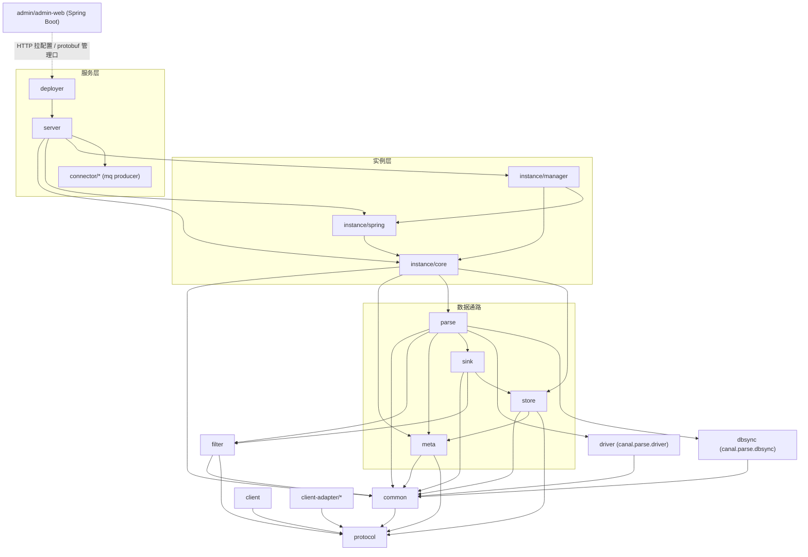
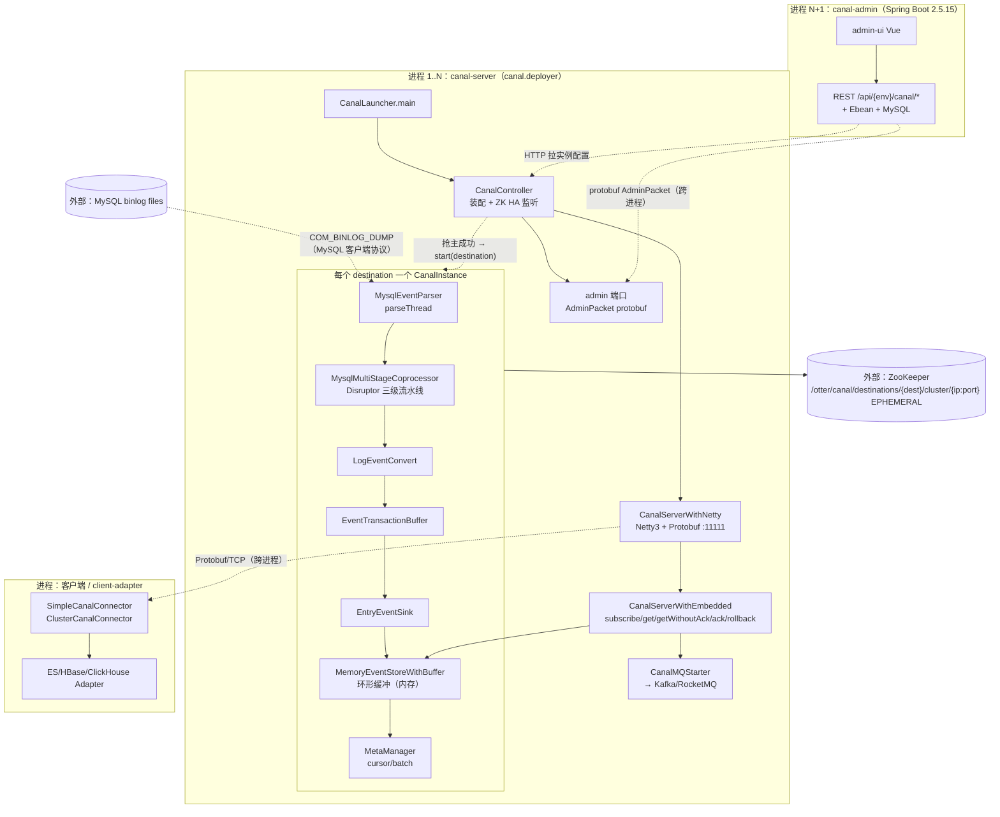
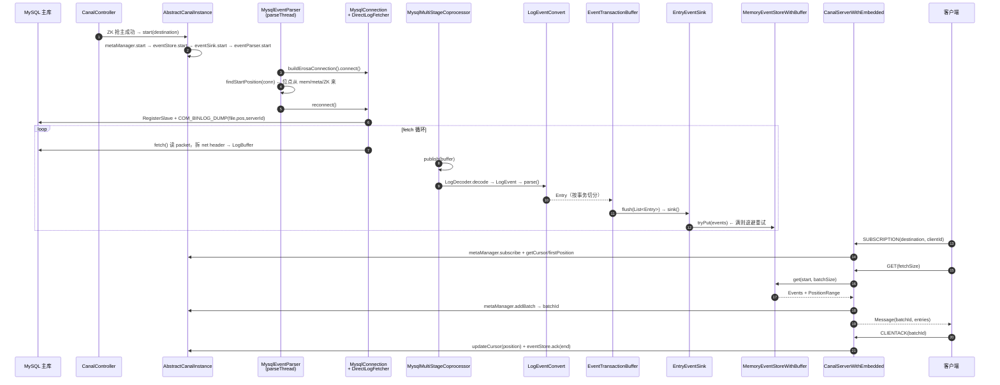

# 阿里巴巴 Canal 架构笔记

> **仓库路径**：`D:/AgentABC/canal`
> **上游地址**：`https://github.com/alibaba/canal`（本地 origin 为 `https://github.com/LukeLi-EBD/canal.git`）
> **语言与规模**：Java 8（`pom.xml:71` 的 `java_source_version=1.8`），约 1365 文件 / 59 MB
> **版本**：`1.1.9-SNAPSHOT`（`pom.xml:7`）；Spring 5.3.26（`pom.xml:75`），Netty 3.2.10（数据面/管理口，均为 `org.jboss.netty`）+ Netty 4.1.68（仅 `NettySocketChannel`（driver）与 RDS 下载链路（parse）使用），Disruptor 3.4.2，Protobuf 3.6.1，zkclient 0.10
> **commit**：`87be50e87686a3e8af08c368d0e1ffd1f59eb04a`（Thu Jul 30 15:38:12 2026 +0800）
> **分析时间**：2026-11-04

---

## 1. 一句话定位

Canal 是一个**伪装成 MySQL 从库（slave）的 binlog 订阅服务**：它向主库发 `COM_BINLOG_DUMP`，把 binlog event 解析成结构化的 `CanalEntry.Entry`，写进一个内存环形缓冲，然后让多个客户端按 `destination + clientId` 各自维护消费位点、拉取、ack。

- **解决什么**：让下游（缓存、搜索索引、数仓、MQ）能以「准实时、有序、带位点」的方式拿到 MySQL 的增量变更，而不必改业务代码、也不必直连从库跑 `SHOW BINLOG EVENTS`。
- **典型场景**：MySQL → Elasticsearch 增量同步（`client-adapter/es7x`）、MySQL → Kafka/RocketMQ 投递（`CanalMQStarter`）、缓存失效、异构数据源镜像（早期阿里 Otter 的核心）。
- **不解决什么**：不是全量同步工具（1.1.x 的 `dbsync`/`client-adapter` 有全量能力但需单独配置，主链路只做增量）；不做 schema 变更的自动 DDL 同步（DDL 只以 `EntryType.ROWDATA` 之外的 query 事件抛出，需要下游自己处理）；也不是计算引擎，没有 transform 能力。

---

## 2. 技术栈与工程结构

### 2.1 技术栈

| 维度 | 选型 | 证据 |
|---|---|---|
| MySQL 协议 | **手写驱动**，不依赖 mysql-connector-java 做 dump | `driver/src/main/java/com/alibaba/otter/canal/parse/driver/mysql/packets/client/BinlogDumpCommandPacket.java`；`driver` 模块 = `canal.parse.driver` |
| binlog 解码 | 内嵌淘宝 TDDL 的 `dbsync`（`com.taobao.tddl.dbsync.binlog`） | `dbsync` 模块（artifactId `canal.parse.dbsync`），`LogDecoder` / `LogEvent` / `RowsLogEvent` |
| 数据面 RPC | 自定义 **Protobuf over TCP**，Netty 3 | `server/.../netty/CanalServerWithNetty.java:29`（继承 `AbstractCanalLifeCycle`，handler 链基于 Netty 3 的 `SimpleChannelHandler`） |
| 管理面 RPC | Protobuf `AdminPacket`（Handshake/ClientAuth/ServerAdmin/InstanceAdmin） | `server/.../admin/handler/SessionHandler.java:28` 起 `case SERVER` / `case INSTANCE` |
| 管理控制台 | Spring Boot 2.5.15 + Ebean ORM + MySQL | `admin/pom.xml:38-40`（`spring-boot-dependencies:2.5.15`），`admin/admin-web/.../controller/*.java` 用 `@RequestMapping("/api/{env}/canal")` |
| 序列化 | Protobuf（`protocol/src/main/java/com/alibaba/otter/canal/protocol/EntryProtocol.proto`、`CanalProtocol.proto`）+ fastjson2（ZK 位点） | `pom.xml` 引 `protobuf-java:3.6.1`；`ZooKeeperMetaManager.java:158` 用 `JsonUtils.marshalToByte` |
| 存储（事件） | **纯内存环形缓冲**，无磁盘 store | `store/.../memory/MemoryEventStoreWithBuffer.java:38`（`start()` 里 `:90` 执行 `entries = new Event[bufferSize]`） |
| 存储（位点） | Memory / File / **ZooKeeper** 可组合，生产默认 `PeriodMixedMetaManager`(内存) + `ZooKeeperMetaManager` | `meta/` 下 `MemoryMetaManager`、`FileMixedMetaManager`、`ZooKeeperMetaManager` |
| 协调 | **ZooKeeper**（临时节点抢主），无 ZK 时退化到 MySQL 心跳 | `common/.../zookeeper/running/ServerRunningMonitor.java:148`；`parse/.../ha/HeartBeatHAController.java:16` |
| 并发/线程模型 | LMAX **Disruptor** 三级流水线；每 destination 一个 `parseThread` + `Timer` 心跳线程 + parser/sink 线程池 | `parse/.../mysql/MysqlMultiStageCoprocessor.java:51`；`parse/.../AbstractEventParser.java:77`、`:88` |

### 2.2 模块划分表

| Maven module / 目录 | 职责 | 核心 |
|---|---|---|
| `protocol` | Protobuf 生成物 + `EntryPosition`/`LogPosition`/`Position` 位点模型 + `ClientIdentity` | ★★★ |
| `common` | `CanalLifeCycle` 生命周期基类、ZK 工具与 `ServerRunningMonitor`、告警 | ★★ |
| `driver` | **手写 MySQL 客户端**：连接、握手、`COM_BINLOG_DUMP`、`RegisterSlave`、semi-ack 包 | ★★★ |
| `dbsync` | binlog **事件解码器**（`LogDecoder`、`LogEvent`、`RowsLogEvent`、`TableMapLogEvent`） | ★★★ |
| `parse` | **EventParser 主战场**：连库、找位点、dump、并行协处理器、`LogEventConvert`、位点管理、HA | ★★★ |
| `store` | `CanalEventStore` + 环形缓冲 `MemoryEventStoreWithBuffer` | ★★★ |
| `sink` | `EntryEventSink`：把 parse 出的 Entry 批量 `tryPut` 进 store，含心跳事件过滤 | ★★★ |
| `meta` | `CanalMetaManager`：cursor / batch / subscribe 的持久化（Memory/File/ZK） | ★★★ |
| `filter` | Aviater 正则表过滤 | ★ |
| `instance/core` | `CanalInstance` 接口 + `AbstractCanalInstance`（生命周期编排） | ★★★ |
| `instance/spring` | `CanalInstanceWithSpring` + `SpringCanalInstanceGenerator`（用 XML 装配 instance） | ★★★ |
| `instance/manager` | 从 canal-admin 拉配置：`CanalConfigClient`、`PlainCanalInstanceGenerator` | ★★ |
| `server` | `CanalServerWithEmbedded`（核心逻辑）+ `CanalServerWithNetty`（数据面）+ admin 端口 + `CanalMQStarter` | ★★★ |
| `deployer` | `canal.sh` 主入口 `CanalLauncher`/`CanalStarter`/`CanalController`，把上面全部装配起来 | ★★★ |
| `client` | `CanalConnector` 家族：`SimpleCanalConnector`（单节点）、`ClusterCanalConnector`（客户端侧 HA）、MQ connector | ★★ |
| `client-adapter` | 下游适配器：`es6x/es7x/es8x`、`hbase`、`kudu`、`clickhouse`、`logger`、`launcher` | ★★ |
| `admin/admin-web` + `admin/admin-ui` | canal-admin 服务端（Spring Boot REST + Ebean）+ Vue 前端 | ★★ |
| `connector/*` | MQ 投递 producer SPI（`connector/core`）与 kafka/rocketmq/rabbitmq/pulsarmq/tcp 实现 | ★★ |
| `example`、`prometheus`、`charts`、`docker` | 示例、指标、Helm chart、镜像 | ★ |

### 2.3 模块依赖图



几个关键点：

- **`parse` 是绝对的中心**，同时依赖 `driver`（协议）、`dbsync`（解码）、`sink`（下游）、`meta`（位点）、`filter`（过滤）。改造数据链路 90% 的时间在 `parse` 里。
- **`store` 反过来依赖 `meta`**（`MemoryEventStoreWithBuffer` 的 ack 要跟 `Position` 打交道），是一处轻微的分层倒挂。
- **`server` → `instance → parse → store` 是纯单向链**，没有回环，所以整条链路可以单独 new 出来做嵌入式测试（`CanalServerWithEmbedded` 就是为此设计的）。
- **`client` 只依赖 `protocol`**，不依赖 `server`，所以客户端能独立打包，也解释了 `client-adapter` 为什么那么轻。

---

## 3. 整体架构

### 3.1 架构分层图（含进程边界）



**进程边界要点**：

1. **canal-server 与 MySQL**：走**原生 MySQL 客户端协议**（不是自定义 RPC）。Canal 自己实现了一个 MySQL slave，所以主库视角它就是一个从库。
2. **canal-server 与客户端**：**Protobuf over TCP**（`CanalServerWithNetty`，默认 11111）。客户端发 `SUBSCRIPTION` / `GET` / `CLIENTACK` / `CLIENTROLLBACK` 四种包（`server/.../netty/handler/SessionHandler.java:48`、`:112`、`:231`、`:268`）。
3. **canal-admin 与 canal-server 有两条通道**：
   - **HTTP（拉）**：server 启动时通过 `PlainCanalConfigClient` 用 `configURL` 向 admin 拉 `destination` 的实例配置（`instance/manager/.../plain/PlainCanalConfigClient.java:84` 的 `findInstance`，server 级配置见 `:72` 的 `findServer`）；
   - **自定义 protobuf（推）**：admin 通过 `AdminConnector` 连 server 的 admin 端口，下发 `start/stop/restart/check/list`（`admin/admin-web/.../connector/SimpleAdminConnector.java` 引 `AdminPacket`）。
4. **每个 destination 是一条独立的解析流水线**，互相隔离（独立线程、独立 store、独立位点）。这是 Canal 能做「一个 server 承载几十个实例」的结构基础；例外是 `GroupEventParser` + `group-instance.xml`，多个上游实例会合并成一个逻辑流（分库分表场景）。

### 3.2 核心组件职责表

| 组件 | 代码位置 | 职责 | 线程/进程模型 |
|---|---|---|---|
| `CanalLauncher` | `deployer/.../CanalLauncher.java:34` | `canal.sh start` 的 main | 进程入口 |
| `CanalController` | `deployer/.../CanalController.java:54` | 读 `canal.properties`、装配 embedded server / netty / admin / MQ、注册 ZK HA 监听 | 主线程 + ZK 回调 |
| `CanalServerWithNetty` | `server/.../netty/CanalServerWithNetty.java:29` | 数据面 Netty Server，把 packet 转给 embedded | Netty 3 IO 线程池 |
| `CanalServerWithEmbedded` | `server/.../embedded/CanalServerWithEmbedded.java:48` | **真正的业务逻辑**：instance 管理、subscribe、get、ack、rollback | 调用方线程 + `synchronized(canalInstance)` |
| `AbstractCanalInstance` | `instance/core/.../AbstractCanalInstance.java:29` | 一个 destination 的 5 件套生命周期编排 | 调用方线程 |
| `AbstractEventParser` | `parse/.../inbound/AbstractEventParser.java:45` | 连库、找位点、dump 循环、心跳、异常重试 | **每实例一个 `parseThread`**（`:157`） |
| `MysqlConnection` | `parse/.../mysql/MysqlConnection.java` | 实现 `ErosaConnection`：`dump()`、`RegisterSlave`、`COM_BINLOG_DUMP` | parseThread |
| `MysqlMultiStageCoprocessor` | `parse/.../mysql/MysqlMultiStageCoprocessor.java:42` | 并行解析：把 buffer 拆成 event 并多线程 decode | Disruptor RingBuffer + 3 组 handler 线程 |
| `LogEventConvert` | `parse/.../mysql/dbsync/LogEventConvert.java:56` | `LogEvent` → `CanalEntry.Entry`，含表结构缓存 | Disruptor handler 线程 |
| `EventTransactionBuffer` | `parse/.../inbound/EventTransactionBuffer.java:20` | 按事务边界切分 Entry，攒够一批再 flush | parseThread |
| `EntryEventSink` | `sink/.../entry/EntryEventSink.java:32` | `doSink` → `eventStore.tryPut`，满了就退避重试 | parseThread（同步调用） |
| `MemoryEventStoreWithBuffer` | `store/.../memory/MemoryEventStoreWithBuffer.java:38` | 环形缓冲：`putSequence` / `getSequence` / `ackSequence` | 多线程（put 来自 parse，get 来自 client，ack 来自 client） |
| `PeriodMixedMetaManager` | `meta/.../PeriodMixedMetaManager.java:35` | 位点先写内存，异步批量刷 ZK | 1 个 `ScheduledExecutorService`（`:53`） |
| `ServerRunningMonitor` | `common/.../zookeeper/running/ServerRunningMonitor.java:29` | ZK 临时节点抢主，切换 active/passive | ZK 事件回调线程 |
| `CanalMQStarter` | `server/.../CanalMQStarter.java:23` | 把 store 里的数据转投 MQ（与客户端订阅并列的另一条出口） | 每 destination 一个 worker 线程 |

### 3.3 集群角色与协调机制

Canal 选的是 **ZooKeeper**（不是 etcd/Raft），且是**「临时节点抢主」这种最朴素的实现**：

- **路径约定**：抢主用 `/otter/canal/destinations/{destination}/running`，实例注册用 `/otter/canal/destinations/{destination}/cluster/{ip:port}`，全部定义在 `common/.../zookeeper/ZookeeperPathUtils.java`（`CANAL_ROOT_NODE` 在 `:38`，`CLUSTER_NODE` 在 `:54`，`RUNNING_NODE` 在 `:52`）。
- **抢主**：`ServerRunningMonitor.initRunning()`（`ServerRunningMonitor.java:138`）在 running 节点上尝试 `zkClient.create(path, bytes, CreateMode.EPHEMERAL)`（`:148`）。抢到 → `release=false`，触发 `processActiveEnter()`（`:245`）；抢不到 → 读现有节点，记下 active 是谁，进入 standby。
- **切换**：注册 `IZkDataListener`，`handleDataDeleted`（`:68`）时如果发现"原来的 active 是我"或者节点空了就重新抢，抢到后 `processStart()`。`CanalController` 在 `:163` 的 `processActiveEnter` 里调 `embeddedCanalServer.start(destination)`、`:175` 的 `processActiveExit` 里调 `stop(destination)`——**实例的启停完全由 ZK 主从状态驱动**。
- **为什么用临时节点而不是选主算法**：临时节点天然带「会话断开自动删除」语义，进程挂掉后 session 超时、节点消失、standby 立刻感知。代价是切换时间 = ZK session timeout（默认 30s 级），这段时间该 destination 不消费——这也是 `fallbackIntervalInSeconds`（`default-instance.xml:131`）存在的原因：切过去要往回退一段重放，避免漏数据。
- **无 ZK 时**：退化到 `HeartBeatHAController`（`parse/.../ha/HeartBeatHAController.java:16`），靠 MySQL 心跳判定主库是否可写、自己是否该让位，能力弱得多。**客户端侧 HA** 另有 `ClusterCanalConnector` + `ClientRunningMonitor`，保证「同一个 clientId 同一时刻只有一个客户端在消费」。

---

## 4. 端到端主链路

以「MySQL 主库 binlog → canal-server 环形缓冲 → 客户端 ack」为主线。



### 步骤 1：启动 → 装配 → 实例生成

- **入口**：`deployer/src/main/java/com/alibaba/otter/canal/deployer/CanalLauncher.java:34` → `main()` → `CanalStarter.start()`（`CanalStarter.java:64`）→ `new CanalController(properties)`（`CanalController.java:83`）
- **逻辑**：① 读 `canal.properties`；`CanalStarter.start` 先按 `canal.serverMode`（tcp/kafka/rocketmq…，`CanalStarter.java:65`）装配 MQ producer；`CanalController` 的 `initGlobalConfig`（`:347`）解析实例模式（manager/spring）与 manager 地址，ZK 地址在构造函数 `:148` 读取，`initInstanceConfig`（`:406`）解析 `canal.destinations`；② 创建 `CanalServerWithEmbedded` 并 `setCanalInstanceGenerator(instanceGenerator)`（`:114`）——**这里决定实例从哪来**：`manager` 模式用 `PlainCanalInstanceGenerator`（配置由 canal-admin 提供），`spring` 模式用 `SpringCanalInstanceGenerator`（配置由本地 `spring/*.xml` 提供），见 `:378-392`；③ `CanalController` 里按 `canal.without.netty` 取 `CanalServerWithNetty` 单例（`:131`）；`CanalStarter` 里启动 `CanalAdminWithNetty`（管理面）并按 `serverMode` 启停 `CanalMQStarter`（`:99-132`）。
- **产出/流向**：一个「空壳 server」，实例还没起——等 ZK 抢主结果。

### 步骤 2：CanalInstance 生命周期（含 HA 激活）

- **入口**：`instance/core/src/main/java/com/alibaba/otter/canal/instance/core/AbstractCanalInstance.java:76` → `start()`
- **逻辑**：**严格的 5 步顺序启动**（顺序不能乱，是 Canal 里最容易踩坑的地方）：
```
:79   metaManager.start();   // 位点管理器先起（后面都要读 cursor）
:83   alarmHandler.start();  :87 eventStore.start();  // 环形缓冲（校验 bufferSize 是 2 的幂）
:91   eventSink.start();     // parse 与 store 的桥
:96   eventParser.start();   // 最后起解析线程
```
  `stop()`（`:103`）**完全逆序**：`eventParser` → `eventSink` → `eventStore` → `metaManager` → `alarmHandler`。逆序是为了「先停生产者，再停缓冲，最后停位点记录」，否则会出现「位点已经停了但 parse 还在写」。
  在 `eventParser.start()` 之前，`beforeStartEventParser`（`:132`）/ `startEventParserInternal`（`:177`）会把 `logPositionManager` 和 `haController` 拉起来（`:181-196`）——**HA 控制器必须先于 parser 就绪，否则 parser 不知道自己该不该干活**。
- **产出/流向**：destination 进入「可解析」状态。

### 步骤 3：parseThread 起 → 找起始位点

- **入口**：`parse/src/main/java/com/alibaba/otter/canal/parse/inbound/AbstractEventParser.java:144` → `start()`，`:157` 起 `parseThread`
- **逻辑**：线程体是 `while (running)` 大循环，每轮：① `buildErosaConnection()`（`:165`）建连接 → ② `startHeartBeat(...)`（`:168`）起心跳 `Timer`（`:88`）定时 touch 主库防连接回收 → ③ `preDump(...)`（`:171`）+ `connect()` → ④ **`findStartPosition(...)`**（`:186`）→ ⑤ `reconnect()`（`:201`，**必须重连**，因为找位点过程中连接上可能残留查询状态）。
  第 ④ 步是位点管理的核心：`MysqlEventParser.findStartPosition`（`MysqlEventParser.java:340`）→ `findStartPositionInternal`（`:412`）。来源优先级由 `FailbackLogPositionManager`（`parse/.../index/FailbackLogPositionManager.java:63`）决定：**先查 primary（内存），miss 再查 secondary（`MetaLogPositionManager` → `metaManager` → ZK）**；`default-instance.xml:118-127` 的装配就是 `Memory → Meta(ZooKeeperMetaManager)`；完全找不到时才落到「从当前最新位点开始」（`findEndPositionWithMasterIdAndTimestamp` 定义在 `MysqlEventParser.java:377`，调用点见 `:426`/`:438`）。
- **产出/流向**：一个确定的 `EntryPosition`（`journalName` + `position` + `timestamp` + `gtid`）。

### 步骤 4：注册从库 + COM_BINLOG_DUMP

- **入口**：`parse/.../mysql/MysqlConnection.java:182` → `dump(binlogfilename, binlogPosition, SinkFunction)`；内部 `sendRegisterSlave()`（`:308`）、`sendBinlogDump()`（`:346`）
- **逻辑**：
  - `dump()` 先 `updateSettings()`（把 `net_write_timeout` 等调大）、`loadBinlogChecksum()`、`loadVersionComment()`（`:183-185`）——checksum 算法必须先问清楚，否则后面解出的 event 校验会错；
  - `sendRegisterSlave()` 构造 `RegisterSlaveCommandPacket`，把 `reportHost/reportPort/reportUser/serverId` 填上（`:309-322`），主库据此在 `SHOW SLAVE HOSTS` 里显示一个从库；
  - `sendBinlogDump()` 构造 `BinlogDumpCommandPacket`，**命令字是 `0x12` = COM_BINLOG_DUMP**（`driver/.../client/BinlogDumpCommandPacket.java:27` 的 `setCommand((byte) 0x12)`），包体格式见 `:50-65`：4 字节 position（小端）+ 2 字节 flags + 4 字节 slave serverId + binlog 文件名；
  - GTID 模式走另一条：`sendBinlogDumpGTID`（`MysqlConnection.java:375`），MySQL 和 MariaDB 的包格式不同（`:376-380` 分支）。
- **产出/流向**：主库开始往这条 socket 上推 binlog event 字节流。

### 步骤 5：读包 + 解码

- **入口**：`parse/.../mysql/dbsync/DirectLogFetcher.java:76` → `fetch()`
- **逻辑**：`DirectLogFetcher`（parse 模块这份，`:22`；`dbsync` 模块里还有一个同名类，别搞混）自己解析 MySQL 网络包：读 4 字节 net header（`NET_HEADER_SIZE=4`，`:35`），从 `PACKET_LEN_OFFSET=0` / `PACKET_SEQ_OFFSET=3`（`:39-40`）取包长和序号，遇到 `0xFE` 表示 EOF、`0xFF` 表示 error（`:99-121` 的异常分支）。`MASTER_HEARTBEAT_PERIOD_SECONDS=15`（`:27`）。
  然后 `MysqlConnection.dump` 里 `new LogDecoder(LogEvent.UNKNOWN_EVENT, LogEvent.ENUM_END_EVENT)`（`:190`）+ `decoder.decode(fetcher, context)`（`:197`）把字节流变成 `LogEvent` 子类（`WriteRowsLogEvent` / `UpdateRowsLogEvent` / `QueryLogEvent` / `TableMapLogEvent` / `XidLogEvent`…）。
- **产出/流向**：`LogEvent` → 单线程模式直接进 `SinkFunction.sink(event)`（`:203`）；并行模式进 Disruptor（下一步）。

### 步骤 6：并行解析（Disruptor 三级流水线）

- **入口**：`parse/.../mysql/MysqlMultiStageCoprocessor.java:42`；`start()` 在 `:80`，`RingBuffer.createSingleProducer(...)` 在 `:83`
- **逻辑**：Canal 1.1.x 的招牌优化。开关是 `canal.instance.parser.parallel`（`memory-instance.xml:195`），buffer 大小 `parallelBufferSize` 默认 256（必须是 2 的幂，`AbstractEventParser.java:96`）。
  流水线三级：
  1. `SimpleParserStage`（`:243`，`EventHandler`）——单线程做「便宜的活」：解析 header，区分事务头/尾和普通 event；
  2. `DmlParserStage`（`:342`，**`WorkHandler`**）——多线程并行做「贵的活」：所有 DML rows event 的列级解码。这是 CPU 密集的部分，所以用 `WorkHandler` 做 worker pool；
  3. `SinkStoreStage`（`:404`，`EventHandler`）——**必须单线程**，因为它要保证 Entry 顺序不乱，往 `EventTransactionBuffer` 里 add。
  队列满时 `publish` 返回 false（`:171` 起），`MysqlConnection.dump` 里 `if (!coprocessor.publish(buffer)) break;`（`:301`）直接断开这次 dump 重来——用「重启 dump」代替复杂背压。
- **产出/流向**：有序的 `LogEvent` → `LogEventConvert`。

### 步骤 7：LogEvent → CanalEntry.Entry

- **入口**：`parse/.../mysql/dbsync/LogEventConvert.java:56`；`parse(LogEvent, boolean isSeek)` 在 `:97`
- **逻辑**：按 event 类型分派（`:105` Query、`:113/:117/:120` Write/Update/Delete rows），核心是 `parseRowsEvent`（`:505`）：
  - 先拿 `TableMapLogEvent` 里的 tableId，去 `TableMetaCache` 查表结构；查不到抛 `TableIdNotFoundException`（`:458`）——**这是 Canal 最常见的运维异常**，含义是「起始位点落在了一个事务中间，导致 TableMap event 没被解析到」，`AbstractEventParser.java:277-283` 专门捕获它并设置 `needTransactionPosition=true`，让下次从上一个事务头开始重放；
  - 按 `TableMeta` 把每个 column 解成 `Column`（含 `isNull`、`isKey`、SQL type、值），组装成 `RowChange`；
  - 包一层 `Entry`，`EntryType` 是 `ROWDATA` / `TRANSACTIONBEGIN` / `TRANSACTIONEND` / `HEARTBEAT`。
- **产出/流向**：`CanalEntry.Entry` → `EventTransactionBuffer.add(entry)`（`AbstractEventParser.java:217`）。

### 步骤 8：按事务切分 → 写进 store

- **入口**：`parse/.../inbound/EventTransactionBuffer.java:65` → `add(entry)`；`flush()` 在 `:113`
- **逻辑**：这是一个**定容数组 + flushSequence 游标**的小缓冲（默认 `transactionSize=1024`，见 `AbstractEventParser.java:83`）。`add` 按 `EntryType` 分四种情况（`:68`/`:73`/`:80`/`:86`）：`TRANSACTIONBEGIN` 先 flush 再 put、`TRANSACTIONEND` 先 put 再 flush（保证事务原子性）、`ROWDATA` 里的非 DML（DDL）put 后立刻 flush、`HEARTBEAT` put 后 flush；buffer 满时 `put`（`:100`/`:108`）也会先 flush 再递归放入。`flush()`（`:113`）把 `[flushSequence+1, end]` 区间 copy 成 `List<Entry>`，回调 `flushCallback.flush(transaction)`（`:123`），成功后才推进 `flushSequence`（`:124`）。
  回调就是 `AbstractEventParser` 里的匿名 `TransactionFlushCallback`，最终调到 `eventSink.sink(entries, ...)` → `EntryEventSink.sink`（`sink/.../EntryEventSink.java:83`）→ `doSink`（`:160`）→ **`eventStore.tryPut(events)`（`:167`）**。
  `tryPut` 失败（buffer 满）时不抛异常，而是 `applyWait(++fullTimes)`（`:179`）**退避重试**：前 3 次 `Thread.yield()`，之后 `LockSupport.parkNanos(1ms * n)` 最多 10ms（`:196-203`）。这是一个「生产者主动限速」的设计——**Canal 不做真正的背压，而是让 parse 线程自己 park**。
- **产出/流向**：`Event` 进入环形缓冲。

### 步骤 9：环形缓冲的 put/get/ack 三游标

- **入口**：`store/src/main/java/com/alibaba/otter/canal/store/memory/MemoryEventStoreWithBuffer.java:99` → `put()`；`get()` 在 `:213`；`ack()` 在 `:417`
- **逻辑**：核心是三个 `AtomicLong` 游标（`:47-49`）：
  - `putSequence`：最后写入位置（parse 线程推进）；
  - `getSequence`：最后读取位置（client get 推进）；
  - `ackSequence`：最后确认位置（client ack 推进，决定哪些槽位可以覆盖）。

  `doPut`（`:188`）先写 `entries[getIndex(next)]` 再 `putSequence.set(end)`（`:197`）——注释说明这是刻意的顺序，避免并发下 get 读到「游标已前进但数据还没写」的脏槽。
  `checkFreeSlotAt(sequence)`（`:526`）判断环形是否还有空位，本质是 `sequence - min(getSequence, ackSequence) < bufferSize`（`:528` 的 `getMinimumGetOrAck`）。
  `get`（`:213`）做 4 件事：① 从 `start` 定位到下一个位置（`:278` 处理「第一次订阅要包含 start」的边界）；② 遍历读到 `putSequence` 为止；③ 按 `ddlIsolation` 在 DDL 边界截断（`:294`/`:313` 分支），保证返回给客户端的是一个完整事务（`TRANSACTIONBEGIN/END` 的过滤实际在 `EntryEventSink.sinkData`，见 `sink/.../entry/EntryEventSink.java:99`）；④ `getSequence.compareAndSet(current, end)`（`:351`）推进读游标。
- **产出/流向**：`Events<Event>` + `PositionRange`（含 `start`/`end`/`ack`/`endSeq`）。

### 步骤 10：客户端订阅 + 拉取

- **入口**：`server/.../embedded/CanalServerWithEmbedded.java:171` → `subscribe()`；`:319` → `getWithoutAck()`
- **逻辑**：
  - `subscribe`（`:171`）先 `metaManager.subscribe(clientIdentity)`（`:179`），再 `getCursor`（`:181`）；**如果没有 cursor（首次订阅），取 `eventStore.getFirstPosition()`（`:183`）并立刻写回 cursor（`:185`）**——这样即使客户端还没 ack，位点也不会退回「文件开头」。
  - `getWithoutAck`（`:319`）在 `synchronized (canalInstance)`（`:325`）里做，注释解释了原因（`:315`）：「meta 获取和数据的获取需要保证顺序性，不能出现先拿到 meta、拿到第二批数据的情况」。
  - 关键动作有三步：先 `getLastestBatch(clientIdentity)`（`:327`）拿到「上一批未 ack 的区间」，有就从它的 `start` 继续读（**这就是 rollback 语义的实现：没 ack 的 batch 还在，重连后从这里继续**）；否则从 cursor 读；读完 `metaManager.addBatch(...)`（`:350`）分配 `batchId`，返回 `Message(batchId, entries)`。
  - 注意 `get()`（`:241-289`）是「自动 ack」版本：读完立刻 `ack(clientIdentity, batchId)`（`:285`）。
- **产出/流向**：客户端拿到 `Message`，同时 `batch` 已登记在 `metaManager` 里（一份 `batchId → PositionRange` 的映射）。

### 步骤 11：ack / rollback → 位点推进

- **入口**：`CanalServerWithEmbedded.java:395` → `ack(clientIdentity, batchId)`；`:444`/`:466` → `rollback(...)`
- **逻辑**：
  - `ack` 先 `metaManager.removeBatch(clientIdentity, batchId)`（`:401`）把这一批从「未确认」列表摘掉；摘不到说明是重复 ack，直接抛异常（`:403`）——**这是防止客户端乱序 ack 的保护**（注释 `:391` 强调「必须按 batchId 顺序 ack，由客户端保证」）；
  - 然后 `metaManager.updateCursor(clientIdentity, positionRanges.getAck())`（`:427`）——位点前进；
  - 最后 `eventStore.ack(positionRanges.getEnd(), positionRanges.getEndSeq())`（`:437`）——**让环形缓冲的 ackSequence 前进，腾出可覆盖的槽位**。这一步如果漏了，buffer 会很快写满然后 parse 线程一直 park。
  - `rollback`（`:444`）不做位点回退，只做两件事：`metaManager.clearAllBatchs(clientIdentity)`（`:455`）+ `eventStore.rollback()`（`:457`，内部把 `getSequence` 拉回 `ackSequence`）。所以**下次 get 会从「最后一个已 ack 的位置」重新开始**。
- **位点持久化**：`updateCursor` 在 `PeriodMixedMetaManager`（`meta/.../PeriodMixedMetaManager.java:120`）里是「先写内存，加入 `updateCursorTasks` 集合」，然后由 `executor.scheduleAtFixedRate`（`:78`）每隔一个周期把脏的 clientIdentity 批量 `zooKeeperMetaManager.updateCursor(...)`（`:85`）。这是**异步最终一致**——server 崩溃时可能丢最后几秒的 ack 位点，表现为「重复消费几秒的数据」，但**不会漏**。
- **产出/流向**：位点写入 ZK `/otter/canal/destinations/{dest}/{clientId}/cursor`（`ZooKeeperMetaManager.java:157` 的 `getCursorPath`）。

---

## 5. 核心代码路径清单

| 文件路径 | 关键类/方法 | 作用 | 优先级 |
|---|---|---|---|
| `deployer/src/main/java/com/alibaba/otter/canal/deployer/CanalLauncher.java` | `main`(:34) | `canal.sh` 进程入口 | ★★ |
| `deployer/.../CanalController.java` | `CanalController`(:54)、`processActiveEnter`(:163) | 装配全部组件 + ZK HA 回调驱动实例启停 | ★★★ |
| `instance/core/.../AbstractCanalInstance.java` | `start`(:76)、`stop`(:103)、`startEventParserInternal`(:177) | 实例 5 件套生命周期（正序启动/逆序停止） | ★★★ |
| `instance/spring/.../CanalInstanceWithSpring.java` | `setEventParser`/`setEventStore`/`setEventSink`/`setMetaManager`(:40-52) | XML 装配入口 | ★★ |
| `deployer/src/main/resources/spring/default-instance.xml` | `:50` PeriodMixedMetaManager、`:59` MemoryEventStoreWithBuffer、`:118` FailbackLogPositionManager | **生产装配模板**（位点/存储/HA 的实际选型在这里） | ★★★ |
| `parse/.../inbound/AbstractEventParser.java` | `start`(:144)、`parseThread`(:157)、`sink`(:207)、`dump`(:250/:257) | 解析主循环、心跳、异常重试 | ★★★ |
| `parse/.../mysql/MysqlEventParser.java` | `findStartPosition`(:340)、`findStartPositionInternal`(:412) | 位点定位（含 GTID / timestamp 兜底） | ★★★ |
| `parse/.../index/FailbackLogPositionManager.java` | `getLatestIndexBy`(:63)、`persistLogPosition`(:72) | 位点读取的 primary→secondary 回退链 | ★★ |
| `parse/.../index/PeriodMixedLogPositionManager.java` | （与 `PeriodMixedMetaManager` 同构） | 位点异步刷盘 | ★ |
| `parse/.../mysql/MysqlConnection.java` | `dump`(:182)、`sendRegisterSlave`(:308)、`sendBinlogDump`(:346)、`sendBinlogDumpGTID`(:375) | MySQL slave 协议实现 | ★★★ |
| `driver/.../packets/client/BinlogDumpCommandPacket.java` | `setCommand((byte)0x12)`(:27)、`toBytes`(:50) | COM_BINLOG_DUMP 报文格式 | ★★★ |
| `parse/.../mysql/dbsync/DirectLogFetcher.java` | `fetch`(:76)、`COM_BINLOG_DUMP`(:32) | 从 socket 读 MySQL 网络包 | ★★ |
| `parse/.../mysql/MysqlMultiStageCoprocessor.java` | `RingBuffer.createSingleProducer`(:83)、`publish`(:171)、`SimpleParserStage`(:243)、`DmlParserStage`(:342)、`SinkStoreStage`(:404) | **并行解析三级流水线** | ★★★ |
| `parse/.../mysql/dbsync/LogEventConvert.java` | `parse`(:97)、`parseRowsEvent`(:505)、`parseQueryEvent`(:202) | binlog event → `CanalEntry.Entry` | ★★★ |
| `parse/.../inbound/EventTransactionBuffer.java` | `add`(:65)、`flush`(:113) | 按事务边界切分并批量 flush | ★★★ |
| `sink/.../entry/EntryEventSink.java` | `sink`(:83)、`doSink`(:160)、`tryPut`(:167)、`applyWait`(:196) | parse→store 的桥 + 退避重试 | ★★★ |
| `store/.../memory/MemoryEventStoreWithBuffer.java` | `putSequence`(:47)、`doPut`(:188)、`get`(:213)、`ack`(:417)、`rollback`(:484)、`checkFreeSlotAt`(:526) | **环形缓冲三游标** | ★★★ |
| `meta/.../PeriodMixedMetaManager.java` | `scheduleAtFixedRate`(:78)、`updateCursor`(:120) | 位点异步批量刷 ZK | ★★★ |
| `meta/.../ZooKeeperMetaManager.java` | `getCursor`(:145)、`updateCursor`(:156)、`addBatch`(:166) | 位点 ZK 持久化 | ★★★ |
| `server/.../embedded/CanalServerWithEmbedded.java` | `subscribe`(:171)、`getWithoutAck`(:319)、`ack`(:395)、`rollback`(:444) | **拉取/确认的全部业务逻辑** | ★★★ |
| `server/.../netty/CanalServerWithNetty.java` | `start`(:55) | 数据面 Netty Server | ★★ |
| `server/.../netty/handler/SessionHandler.java` | `SUBSCRIPTION`(:48)、`GET`(:112)、`CLIENTACK`(:231)、`CLIENTROLLBACK`(:268) | 数据面协议分派 | ★★★ |
| `common/.../zookeeper/running/ServerRunningMonitor.java` | `initRunning`(:138)、`create EPHEMERAL`(:148)、`isMine`(:221) | ZK 抢主 / HA 切换 | ★★★ |
| `client/.../impl/SimpleCanalConnector.java` | `connect`(:102)、`subscribe`(:233)、`rollback`(:385)（`connect` 内部的自动订阅/回滚调用见 `:118`、`:121`） | 单节点客户端（握手/认证/订阅/回滚） | ★★ |
| `server/.../CanalMQStarter.java` | `startDestination`(:106)、`worker`(:134) | 与客户端并列的第二条出口：投 MQ | ★★ |

---

## 6. 关键设计点

**设计 1：内置一个「假的 MySQL slave」，而不是轮询 `SHOW BINLOG EVENTS`**
→ **为什么**：轮询方式要么无法保证有序，要么拿不到 row 级变更（只能拿 statement）。伪装成 slave 走 `COM_BINLOG_DUMP`，能拿到主库**实时推送**的、按事务组织的、包含 before/after image 的 rows event，延迟从「秒级轮询」降到「毫秒级推送」。
→ **代价**：必须自己实现 MySQL 客户端协议的握手、认证（含 `mysql_native_password` / `caching_sha2_password`）、`RegisterSlave`、GTID、semi-sync ack、checksum 协商。`driver` 模块 59 个 Java 文件（共 60 个文件）几乎全是为此存在的，且要跟着 MySQL 版本演进（8.0 的 `caching_sha2` 就要单独的 `ClientAuthenticationSHA2Packet`）。

**设计 2：EventStore 用内存环形缓冲，不落盘**
→ **为什么**：Canal 的定位是「实时增量订阅」，数据源本身（binlog）就是持久化的。只要客户端能在 buffer 写满之前消费掉，就不需要落盘。环形缓冲的好处是**零 GC 压力**（复用数组槽位）、**天然支持多消费者按各自位点读**、**ack 才释放**。
→ **代价**：buffer 满了 parse 线程就 park（`EntryEventSink.applyWait`），**整条链路被最慢的消费者拖住**。而且进程一挂，未消费的数据全丢——只能靠「从最后持久化的位点重放 binlog」恢复。这也是为什么 `canal.instance.memory.buffer.size` 是个必须按「最慢消费者 + 峰值 TPS」估算的关键参数。

**设计 3：位点持久化到 ZK，且是异步批量刷**
→ **为什么**：位点必须跨进程/跨机器可见，否则 HA 切换后新 active 不知道该从哪继续。ZK 的持久节点天然适合「小而频繁的 KV 更新」。但每次 ack 都同步写 ZK 会把 ZK 打爆（QPS 上千就会成为瓶颈），所以 `PeriodMixedMetaManager` 先写内存、定时批量刷（`:78-85`）。
→ **代价**：**可能重复消费**（崩溃丢掉最后几秒的位点），但不会漏——因为位点只会「落后」不会「超前」。这是一个明确的「at-least-once」取舍，Canal 从设计上就没打算做 exactly-once。

**设计 4：batchId 机制 + 客户端必须顺序 ack**
→ **为什么**：客户端拉一批（比如 1000 条），处理到第 500 条挂了。没有 batch 概念位点只能二选一：前进（丢 500 条）或不动（重复 1000 条）。有了 `batchId → PositionRange` 映射，`rollback` 可以「整批放弃」、`ack` 可以「整批确认」，语义清晰。
→ **代价**：`ack` 必须严格按 batchId 顺序（`CanalServerWithEmbedded.java:391` 的注释），并发 ack 会直接抛异常（`:403`）；batch 粒度 = `fetchSize`，调太大内存压力大、调太小 round-trip 多。

**设计 5：并行解析用 Disruptor 三级流水线，但 sink 阶段强制单线程**
→ **为什么**：binlog 解码的瓶颈在「列级反序列化」（每个 column 要按 type 读变长编码），这是纯 CPU 活，可以多线程。但**输出必须严格有序**（同一个表的变更顺序不能乱），所以最后一级 `SinkStoreStage` 用 `EventHandler`（单线程）而不是 `WorkHandler`（多线程）。`SimpleParserStage` 用单线程是因为它便宜且要维护解析上下文（`LogContext`）。
→ **代价**：三级流水线的 buffer 满了只能「断开 dump 重连」（`MysqlConnection.java:301-303`），没有精细背压；而且并行模式下 `TableMapLogEvent` 的上下文传播很容易出 bug（`TableIdNotFoundException` 在并行模式下更难排查）。

**设计 6：canal-admin 与 canal-server 分离，配置外置**
→ **为什么**：早期 Canal 的实例配置是本地 `instance.properties` 文件，改一个 filter 要登机器改文件 + 重启实例。1.1.x 引入 canal-admin 后，配置存 MySQL、通过 REST 管理、server 启动时 HTTP 拉取，支持「热更新」（`InstanceConfigMonitor`）和「多集群多 server 的统一视图」。
→ **代价**：多了一个必须高可用的组件（admin 挂了不影响已启动的实例，但新实例起不来）；而且 admin ↔ server 是**双通道**（HTTP 拉配置 + protobuf 推控制指令），两边版本不匹配时排查很痛苦。

---

## 7. 扩展点

### 7.1 加一个新数据源（比如 PostgreSQL）

Canal 的架构对「非 MySQL 源」并不友好——`parse` 的抽象（`CanalEventParser` / `ErosaConnection` / `BinlogParser`）都是照着 MySQL 的形状设计的。落地路径：① 新建 module（参考 `parse/.../mysql/`），实现 `CanalEventParser`（`parse/.../CanalEventParser.java`）；② 实现 `ErosaConnection`（connect/dump/reconnect）与自己的 `BinlogParser`；③ 实现自己的 `LogEventConvert` 等价物，最终产出 `CanalEntry.Entry`——**这是唯一必须遵守的契约**，下游 `store`/`sink`/`server` 全不用改；④ 在 `spring/*.xml` 里换掉 `eventParser` 的 class（参考 `memory-instance.xml:55`）；⑤ 位点复用 `CanalLogPositionManager`，但 `LogPosition` 子类要新增（参考 `protocol/.../position/`）。

> 现实建议：成本很高（等于重写半个 `parse`）。只要 PG 的 CDC 就直接用 Debezium。Canal 官方在 `dbsync` 里也只覆盖 MySQL 系（MariaDB / PolarDB / RDS）。

### 7.2 加一个新下游或一段处理逻辑

- **客户端侧（推荐）**：实现 `CanalConnector`（或复用 `SimpleCanalConnector`），在 `getWithoutAck` / `ack` 之间做自己的写入。`client-adapter/` 下的 `es7x`、`hbase`、`clickhouse` 全是这个模式，且能在 `client-adapter/launcher` 里按配置装配。
- **服务端侧**：实现 `CanalMQProducer`（`connector/core/.../spi/CanalMQProducer.java`），在 `CanalMQStarter.worker`（`server/.../CanalMQStarter.java:134`）里被调用。适合「一次投递、多方消费」，参考 `connector/kafka-connector`。
- **过滤**：`filter` 的 `AviaterRegexFilter` 只做表名/库名正则；字段级有现成开关 `canal.instance.filter.field` / `canal.instance.filter.black.field`（装配到 `AbstractEventParser.java:55-58` 的 `fieldFilter`/`fieldBlackFilter`，解析成 `fieldFilterMap`/`fieldBlackFilterMap`），格式 `schema.table:col1,col2`。
- **值级脱敏**（如手机号打码）：最干净的位置是 `EntryEventSink.doSink` 之前挂一个 `CanalEventDownStreamHandler`（`sink/.../CanalEventDownStreamHandler.java`）——`EntryEventSink` 构造函数里 `addHandler(new HeartBeatEntryEventHandler())`（`:50`）就是这个扩展点的现成例子。

---

## 8. 本地跑起来 / 调试入口

**最短路径（单机 + 内存实例，不需要 ZK / admin）**

```bash
cd D:/AgentABC/canal && ./mvnw -q -DskipTests clean install
cd deployer && ./src/main/bin/startup.sh local   # 源码树脚本在 deployer/src/main/bin；等价的 main：com.alibaba.otter.canal.deployer.CanalLauncher
```

关键是 `deployer/src/main/resources/canal_local.properties` + `spring/memory-instance.xml`——**memory 实例不依赖 ZK**，`metaManager` 是 `MemoryMetaManager`（`memory-instance.xml:40`），`eventStore` 是 `MemoryEventStoreWithBuffer`（`:42`）。

**必须准备的中间件**：① 一个开了 binlog 的 MySQL（`log_bin=ON`、`binlog_format=ROW`、`binlog_row_image=FULL`、`server_id` 非 0，账号需 `REPLICATION SLAVE`/`REPLICATION CLIENT`/`SELECT`）；② 走 `default-instance.xml`（生产模板）还要 ZooKeeper（`canal.zkServers`）；③ 走 canal-admin 还要 MySQL 存配置 + 起 `admin/admin-web` 的 Spring Boot（默认 8089）。

**验证链路是否通**：跑 `client` 里的 `SimpleCanalClientTest` 示例，然后在 MySQL 里 insert/update，控制台应立刻打出 `Entry`。

**断点建议（按序）**：`CanalController` 构造函数（`:83`）确认 instance 被创建 → `AbstractCanalInstance.start`（`:76`）确认 5 件套启动顺序 → `AbstractEventParser` 的 `parseThread`（`:157`）→ `findStartPosition`（`MysqlEventParser.java:340`）看位点从哪来 → `sendBinlogDump`（`MysqlConnection.java:346`）确认 `0x12` 发出去了 → `LogEventConvert.parse`（`:97`）看 event 变 Entry → `EntryEventSink.doSink`（`EntryEventSink.java:167`）/ `MemoryEventStoreWithBuffer.doPut`（`:188`）确认进缓冲 → `CanalServerWithEmbedded.getWithoutAck`（`:319`）/ `ack`（`:395`）确认消费与位点推进。

**高频排查技巧**：客户端拿不到数据时，先看 `putSequence` 有没有涨（parse 是否正常），再看 `getSequence` / `ackSequence`（消费是否卡住）。三个游标一对比，问题立刻定位在「源端」还是「消费端」。

---

## 9. 阅读路线

**半天（数据怎么从 binlog 流到客户端）**：`AbstractCanalInstance.start`（`:76`）看顺序 → `AbstractEventParser.start`（`:144`）+ `parseThread`（`:157`）→ `MysqlConnection.dump`（`:182`）→ `EntryEventSink.doSink`（`:160`）→ `MemoryEventStoreWithBuffer.doPut`/`get`（`:188`、`:213`）→ `CanalServerWithEmbedded.getWithoutAck`（`:319`）+ `ack`（`:395`）。跑一遍 `local` 模式，边断点边看。

**两天（补齐 HA / 位点 / 并行解析）**：Day1 读 `ServerRunningMonitor`（`:138`）+ `CanalController` 的 `processActiveEnter`（`:163`）搞清抢主；再读 `PeriodMixedMetaManager`（`:78`、`:120`）+ `ZooKeeperMetaManager`（`:145`-`:174`）搞清位点。Day2 读 `MysqlMultiStageCoprocessor` 三级流水线（`:83`、`:243`、`:342`、`:404`）+ `EventTransactionBuffer.flush`（`:113`）+ `LogEventConvert.parseRowsEvent`（`:505`）。

**一周（补齐协议层与运维面）**：`driver` 模块的握手/认证包 → `dbsync` 模块的 `LogDecoder`/`RowsLogEvent`（列级解码）→ `BinlogDumpCommandPacket` / `BinlogDumpGTIDCommandPacket` 的字节布局 → `SessionHandler`（数据面四种包）→ `admin` 端口 `SessionHandler`（`AdminPacket`）→ `admin-web` 的 `CanalConfigController` / `CanalInstanceController` → `client-adapter` 某一种（推荐 `es7x`，逻辑最完整）。

---

## 10. 未覆盖 / 存疑

1. **"HTTP/TCP 两种客户端协议"**：本仓库**数据面只有一种**自定义 Protobuf-over-TCP 协议（`CanalServerWithNetty`），`client` 模块里**没有 HTTP 客户端**。仓库里的 HTTP 属于**管理面**：canal-admin 的 Spring Boot REST（`/api/{env}/canal/*`）+ server 拉配置的 `PlainCanalConfigClient`。外部文档若说 Canal 有 HTTP 客户端，可能指别的发行版或 `canal-adapter` 的接口，本仓库未验证。
2. **两个 `DirectLogFetcher`**：`dbsync/.../binlog/DirectLogFetcher.java:38`（`final class`）与 `parse/.../mysql/dbsync/DirectLogFetcher.java:22` 同名不同包，`MysqlConnection.java:36` 用的是 **parse 那份**。两份的历史关系未考证。
3. **`GroupEventParser` / `group-instance.xml`**：分库分表合并场景，只确认文件存在，没读合并时的事务对齐逻辑（`sink/.../entry/group/TimelineTransactionBarrier.java` 疑似关键）。
4. **全量同步**：`dbsync` / `client-adapter` 里有全量相关代码，但 1.1.9 主链路是纯增量。全量的入口与一致性保证（是否 `FLUSH TABLES WITH READ LOCK`）未读。
5. **`raw` 模式**：`EntryEventSink.raw`（`:47`）+ store 里的 `getRawEntry`，看起来是「直接转发 binlog 原始字节、客户端自己解析」的省一次反序列化路径，没验证哪些客户端支持。
6. **`zkclient 0.10`**：Curator 之前的老世代客户端，`ServerRunningMonitor` 用的 `ZkClientx` 还是阿里包装过的，在新版 ZK（3.6+）上的兼容性未验证。
7. **Canal 没有 savepoint / checkpoint**：位点只有「cursor（已 ack）」和「batch（已发未 ack）」，**没有全局一致的快照点**。这是它与 Flink/Debezium 最大的语义差别，也是它只能做到 at-least-once 的根因。
8. **版本 `1.1.9-SNAPSHOT`** 是 dev 分支，与 1.1.8 release 的行为可能有差异。

---

## 11. 和另一个项目的对比（Canal vs Debezium）

- **Canal** 是「一个长期运行的订阅服务」：内建 store、位点、多客户端、HA、admin；**Debezium** 是「一组 Kafka Connect connector」，把变更写进 Kafka topic，store 就是 Kafka，位点就是 consumer offset。
- **Canal** 的消费模型是**拉（pull）+ 显式 ack**，客户端自己控制节奏；**Debezium** 是**推（push）到 Kafka**，下游自己消费 topic。
- **Canal** 只做 MySQL 系（MySQL/MariaDB/PolarDB/RDS）；**Debezium** 支持 MySQL/PG/Oracle/SQL Server/MongoDB/DB2 等十几种。
- **Canal** 的 DDL 只作为事件抛出、不解析成 schema 变更；**Debezium** 有 `schema change topic`，且与 Kafka Connect 的 schema 演进体系打通。
- 一句话：**Canal 是「自建的 MySQL 增量管道」，Debezium 是「Kafka 原生的多源 CDC 平台」**——选 Canal 通常是因为已有 MySQL 生态且不想引入 Kafka Connect，选 Debezium 通常是因为要接多种源或已经 all-in Kafka。

---

## 修订记录

> 2026-11-04 对照本地仓库 `D:/AgentABC/canal` 逐条核验。共核对代码路径/行号引用 129 处（证据包 64 处全量 + 补充抽核 65 处），其中失效/错位 16 处；另核对类名/函数名/配置项 26 个。结论：主链路判断与绝大多数行号准确，本轮仅修正路径/行号/配置键错位与技术归属、规模描述，未改动结构与结论。

| # | 位置 | 原表述 | 核实结果（源码依据） | 处理 |
|---|---|---|---|---|
| 1 | §2.1 版本行 | Netty 4.1.68 用于「admin 面」 | `CanalAdminWithNetty.java:7` 为 `import org.jboss.netty.bootstrap.ServerBootstrap`；`import io.netty` 仅见 `NettySocketChannel.java:3` 等 4 个文件 | 已改为「数据面/管理口均为 `org.jboss.netty`，4.1.68 仅 socket/RDS 下载链路使用」 |
| 2 | §2.1 数据面 RPC | 「Netty 3 的 `AbstractCanalLifeCycle` + `SimpleChannelHandler`」 | `AbstractCanalLifeCycle` 在 `common/src/main/java/com/alibaba/otter/canal/common/AbstractCanalLifeCycle.java:1`（包 `com.alibaba.otter.canal.common`）；`SimpleChannelHandler` 见 `server/.../netty/handler/SessionHandler.java:29` | 已改为「继承 `AbstractCanalLifeCycle`，handler 链基于 Netty 3 的 `SimpleChannelHandler`」 |
| 3 | §2.1 序列化 | `protocol/src/main/protobuf/CanalEntry.proto`、`CanalPacket.proto` | 实际目录为 `protocol/src/main/java/com/alibaba/otter/canal/protocol/`，文件为 `EntryProtocol.proto`、`CanalProtocol.proto`、`AdminProtocol.proto` | 已改为真实路径与文件名 |
| 4 | §2.1 存储（事件） | `MemoryEventStoreWithBuffer.java:38`，`entries = new Event[bufferSize]` | `:38` 是类声明；赋值语句在 `:90`：`entries = new Event[bufferSize];`（`start()` 内） | 保留类行号并补注 `:90` |
| 5 | §3.1 架构图 | `/otter/canal/destination/{dest}/cluster/{ip:port}` | `ZookeeperPathUtils.java:41-42`：`DESTINATION_ROOT_NODE = CANAL_ROOT_NODE + "/" + "destinations"` | 已改为 `destinations` |
| 6 | §3.1 进程边界 | `PlainCanalConfigClient.java:41-58` 为拉实例配置 | `:41-58` 仅是构造函数；实例配置拉取在 `:84` `findInstance(...)`，server 级在 `:72` `findServer(...)` | 已改为 `:84`（并注 `:72`） |
| 7 | §3.3 路径约定/抢主 | `/otter/canal/destination/{destination}/cluster/{ip:port}`；抢主在同一路径 create EPHEMERAL | 抢主 path 来自 `ServerRunningMonitor.java:143` `getDestinationServerRunning(destination)`，即 `/otter/canal/destinations/{dest}/running`；cluster 节点由 `CanalController.initCid`（`:621` `createEphemeral`）创建 | 已区分 running/cluster 两类节点并改复数 |
| 8 | §3.3 回退配置 | `fallbackIntervalInSeconds`（`default-instance.xml:132`） | `:131` 为 `<property name="fallbackIntervalInSeconds" value="${canal.instance.fallbackIntervalInSeconds:60}" />`；`:132` 是空行 | 已改为 `:131` |
| 9 | §4 步骤1 | ① `initGlobalConfig`（`:347`）解析 `canal.serverMode`、ZK 地址、`canal.destinations`；③ 笼统说「创建 `CanalServerWithNetty`、`CanalAdminWithNetty`」 | `:347` 只处理 instance mode/lazy/managerAddress/springXml；serverMode 在 `CanalStarter.java:65`，ZK 在 `CanalController.java:148`，destinations 在 `:406`；admin 口/MQ 在 `CanalStarter.java:99-132` 装配 | 已按实际拆开并标注归属 |
| 10 | §4 步骤3 | `findStartPosition(...)`（`:176`）；`findEndPositionWithMasterIdAndTimestamp`（`:426`） | `AbstractEventParser.java:186` 才是 `findStartPosition(...)`，`:176` 为 `queryServerId`；后者定义在 `MysqlEventParser.java:377`（`:426`/`:438` 是调用） | 已改为 `:186`；方法引用改为 `:377`（并注调用点） |
| 11 | §4 步骤4、§5 | `BinlogDumpCommandPacket.java:28` 的 `setCommand((byte) 0x12)` | `:27` 为 `setCommand((byte) 0x12);`；`:28` 是 `}` | 两处均改为 `:27` |
| 12 | §4 步骤8 | flush 四种情况：「TRANSACTIONEND、buffer 满、DDL、其它累积」 | `:67-70` BEGIN flush+put、`:71-74` END put+flush、`:75-82` ROWDATA 非 DML flush、`:83-87` HEARTBEAT put+flush；buffer 满在 `put()` `:100`/`:108` | 已按实际四种分支改写 |
| 13 | §4 步骤9 | `checkFreeSlotAt` 本质是 `sequence - ackSequence < bufferSize` | `:526-529`：`wrapPoint = sequence - bufferSize; minPoint = getMinimumGetOrAck();`，用的是 min(get, ack) | 已改为 `min(getSequence, ackSequence)` |
| 14 | §4 步骤9 | `get()` 会「跳过 TRANSACTIONBEGIN/END（如果 `filterTransactionEntry`）」和 DDL 中间态（`:293`/`:312`） | `MemoryEventStoreWithBuffer` 无 `filterTransactionEntry` 字段；DDL 判断在 `:294`/`:313`；事务头尾过滤在 `EntryEventSink.java:99-114` | 已改写并指向 `EntryEventSink.java:99` |
| 15 | §4 步骤11 | ZK 位点 `/otter/canal/destination/{dest}/{clientId}/cursor` | `ZookeeperPathUtils.java:41-42` 根为 `/otter/canal/destinations`，`:65-66` 拼 `/{clientId}/cursor` | 已改为 `destinations` |
| 16 | §5 | `SimpleCanalConnector` `subscribe`(:118)、`rollback`(:121) | `:118` `subscribe(filter)`、`:121` `rollback()` 是 `connect()` 内的调用；方法定义在 `:233`、`:385` | 已改为 `:233`/`:385`，保留调用行说明 |
| 17 | §6 设计1 | `driver` 模块「近 100 个文件」 | `driver/` 下 59 个 `.java`，共 60 个文件 | 已改为「59 个 Java 文件（共 60 个文件）」 |
| 18 | §7.2 | 开关 `canal.instance.filter.field` / `fieldBlackFilter` | `memory-instance.xml:85-86` 为 `canal.instance.filter.field` / `canal.instance.filter.black.field`；`fieldBlackFilter` 是 bean 属性（`AbstractEventParser.java:57`） | 已改为真实配置键 |
| 19 | §8 | `cd deployer && ../bin/startup.sh local` | 仓库根无 `bin/`；脚本在 `deployer/src/main/bin/startup.sh`（`:13` `base=${bin_abs_path}/..`） | 已改为 `./src/main/bin/startup.sh local` |

**核验通过、未改动的关键判断**：

1. §4 步骤2 生命周期：`AbstractCanalInstance.java:79/83/87/91/96` 的启动顺序、`:103` 的 `stop()` 及 `:109/114/118/122/126` 的逆序释放，与原文完全一致。
2. §4 步骤3 位点定位：`MysqlEventParser.java:340/412`（`findStartPosition`/`findStartPositionInternal`）、`:377`（`findEndPositionWithMasterIdAndTimestamp` 定义）、`FailbackLogPositionManager.java:63/72`、`default-instance.xml:118-127`（Memory → Meta）均可直接命中。
3. §4 步骤4/5 协议与读包：`MysqlConnection.java:182/308/346/375/183-185/190/197/203/301-303`；`DirectLogFetcher.java:27/32/35/39-40/76`；`DirectLogFetcher`（dbsync 版）`:38` 为 `final class`。
4. §4 步骤6 并行流水线：`MysqlMultiStageCoprocessor.java:42/51/80/83/171/243/342/404`，`SimpleParserStage`/`DmlParserStage`/`SinkStoreStage` 的 `EventHandler`/`WorkHandler` 类型判断正确。
5. §4 步骤7 事件转换：`LogEventConvert.java:56/97/105/113/117/120/202/458/505`，`TableIdNotFoundException` 确在 `:458` 抛出。
6. §4 步骤9/10/11 store 与 embedded：`MemoryEventStoreWithBuffer.java:47-49/188/197/213/351/417/484`；`CanalServerWithEmbedded.java:171/179-185/319/325/327/350/391/395/401-403/427/437/444/455-457` 全部正确。
7. §3.3 ZK/HA：`ServerRunningMonitor.java:68/138/148/221/245`、`ZookeeperPathUtils.java:38/52/54`、`CanalController.java:163/175` 正确；数据面/管理面 `SessionHandler` 分派 `:48/:112/:231/:268`、`:28/:33/:61` 正确。
8. 其他抽查：`EntryEventSink.java:50/83/160/167/196`、`PeriodMixedMetaManager.java:78/120`、`ZooKeeperMetaManager.java:145/157/158/166`、`CanalMQStarter.java:106/134` 正确；规模与版本（1365 文件、commit `87be50e…`、1.1.9-SNAPSHOT、Spring 5.3.26、Disruptor 3.4.2、protobuf 3.6.1、zkclient 0.10、Netty 3.2.10）一致。

**未解决/存疑**：

1. **§4 主链路缺一跳（结构问题，未改写）**：`CanalController.processActiveEnter`（`:163`）实际调用 `CanalServerWithEmbedded.start(destination)`；实例在 `CanalServerWithEmbedded.java:81` 由 `canalInstanceGenerator.generate` 惰性创建，`:137` 才 `canalInstance.start()`。§4 的 mermaid 与「步骤 2 入口」直接写成 `CTRL → AbstractCanalInstance.start`，漏掉 embedded server 这一跳；按规范仅在记录中标注，留给审查报告汇总。
2. §4 时序图 `MSC->>CONV: LogDecoder.decode → LogEvent → parse()` 把 `LogDecoder.decode` 画在 `LogEventConvert` 参与者上；实际 `LogDecoder` 在 `SimpleParserStage` 内由 `MysqlConnection` 的 dump 循环驱动（正文步骤5/6 描述正确），属图示表达问题，未改。
3. 仓库体积：工作区实测 43.1 MB（含 `.git` 55.9 MB），原文「约 59 MB」无法精确复现（可能按磁盘占用统计），量级无实质影响，未改。
4. `deployer/src/main/bin/startup.sh` 以 `$base/conf`（`base=deployer/src/main`）读配置，源码树无 `conf/` 目录，路径已修正但该命令仍需发布包布局才能直接跑。
