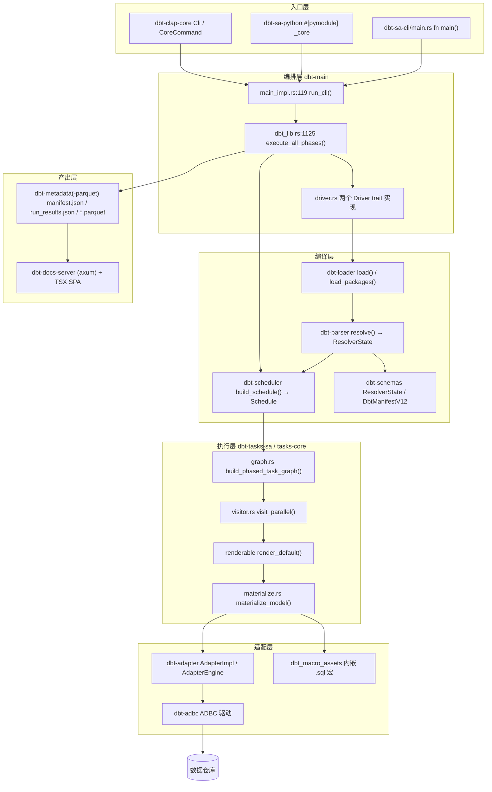
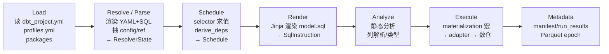

# dbt v2.0（Fusion 引擎）架构笔记

> 仓库路径：`D:/AgentABC/dbt`（本地 fork：`https://github.com/LukeLi-EBD/dbt.git`）
> 上游地址：`https://github.com/dbt-labs/dbt`（`main` 分支 = dbt v2.0 开源源码）
> 语言与规模：约 4868 文件 / 56MB（不计 `.git`、`target`、`node_modules`）；Rust 1531 个 `.rs`、SQL 705 个、TSX 511 个；`crates/` 下 88 个 crate 目录
> 版本：`2.0.8`（`CHANGELOG.md:11-13`，Released October 14, 2026）
> commit：`1fd47406ef951dbc08d43278b64b7875c98d6734`（Thu Oct 15 02:45:38 2026 +0000），HEAD 提交信息 `Read dbt models from the live catalog`
> 分析时间：2026-11-04

---

## 1. 一句话定位 + 仓库事实核查

**一句话定位**：这是 dbt 的下一代引擎（dbt v2.0 / Fusion）的 Apache-2.0 开源实现——把 v1 用 Python 写的"解析 → 编译 → 调度 → 执行"整条流水线整体重写成 Rust，用 Minijinja 跑用户宏、用 ADBC+Arrow 连数仓、用 Parquet 出 artifact。

### 1.1 它到底是什么（结论先行）

**结论：它是 dbt v2.0（Rust 重写版，产品名 dbt Fusion）的源码仓库，不是 dbt Core 的分支，也不是 v1 归档。仓库里没有 dbt-core v1 的 Python 实现。**

### 1.2 判断依据（逐条可核对）

1. `README.md:9-10`：
   > **dbt v1 development has moved to the `1.latest` branch.** The `main` branch now contains all the Apache 2.0 source code of dbt v2.0 — a ground-up rewrite of dbt in Rust. If you're looking for the v1 Python implementation of the dbt framework, switch to `1.latest`.

   这一行直接排除了"v1 归档"和"过渡分支"两种猜测：v1 被搬到了另一个分支，`main` 是全新的 v2。
2. `README.md:18`："dbt v2.0 is engineered for performance at scale. It parses, compiles, and runs projects in a fraction of the time compared to v1."——v2 的卖点是性能，符合重写的动机。
3. `Cargo.toml` 的 `[workspace] members` 从 `crates/dbt-test-primitives`、`crates/dbt-agate`、`crates/dbt-parser`、`crates/dbt-scheduler`、`crates/dbt-adapter`，一直到 `crates/dbt-python-core`、`crates/dbt-metricflow` 等——`crates/` 下 **88 个 crate 目录**，这是一个真实的 Rust 工作区，不是"少量 Rust 辅助模块"。
4. `pyproject.toml:2`：`name = "dbt-core"`，但 `classifiers` 里写的是 `"Programming Language :: Rust"`（`pyproject.toml:10`）。也就是说 PyPI 上的 `dbt-core` 包只是**分发壳**，装进去的是 Rust 编译产物。
5. Python 只以 pyo3 形式存在：`crates/dbt-sa-python/src/lib.rs` 里是
   ```rust
   #[pymodule]
   #[pyo3(name = "_core")]
   fn dbt_core_pyo3(m: &Bound<'_, PyModule>) -> PyResult<()> {
   ```
   即 `dbt` 的 Python 包 `import dbt._core` 直接进入 Rust 引擎。全仓 47 个 `.py` 文件全是构建脚本、CI 脚本、测试夹具（`crates/dbt-ci/templates/sdist_build_backend.py`、`crates/dbt-loader/src/dbt_macro_assets/*/__init__.py` 等），**没有一个是被解释执行的 dbt 实现**。
6. `AGENTS.md` 把 adapter 相关 crate 列成 `dbt-adapter` / `dbt-adapter-core` / `dbt-adapter-sql` / `dbt-auth` / `dbt-sql-keywords` / `dbt-adbc`——v1 的 `dbt-adapters` Python 包在这里变成 6 个 Rust crate；`docs/roadmap/2026-06-announcing-v2.md`、`2025-05-new-engine-same-language.md` 的标题也已说明"新引擎、同一门语言（Jinja-SQL）"。

### 1.3 三种语言各自的位置（先给结论，2.3 展开）

- **Rust（1531 个）**：整个引擎。解析、Jinja 渲染、DAG、调度、adapter、artifact、CLI、Python 扩展。
- **SQL（705 个）**：几乎全在 `crates/dbt-loader/src/dbt_macro_assets/`，是**内置的 materialization / adapter 宏**（v1 时代随 `dbt-adapters` 分发的那些 `.sql`），通过 `rust-embed` 编译进二进制。
- **TSX（511 个）**：全在 `crates/dbt-docs-server/`（`web/` + `dbt-docs-lib/`），是 `dbt docs serve` 的前端 SPA。

---

## 2. 技术栈与工程结构

### 2.1 技术栈

| 层 | 选型 | 证据 |
|---|---|---|
| 语言 | Rust 1.96，edition 2024 | `rust-toolchain.toml:2`、`Cargo.toml:118` |
| 异步运行时 | tokio（多线程，自建 `dbt-runtime` 包装） | `crates/dbt-runtime`；`main_impl.rs:33` 的 `FS_DEFAULT_MAX_BLOCKING_THREADS = 512` |
| 模板引擎 | **vendored Minijinja**（fork 在 `crates/dbt-jinja/minijinja`），加 `pycompat` 特性对齐 Jinja2 | `Cargo.toml` workspace deps 中 `minijinja = { path = "crates/dbt-jinja/minijinja", ... }` |
| 数据库访问 | ADBC（`dbt-labs/arrow-adbc` fork）+ Arrow 56 + Parquet 56 | `Cargo.toml` 的 `adbc-core` / `arrow` 段 |
| SQL 解析 | ANTLR4 生成的方言前端 + datafusion/sqlparser（sdf fork） | `dbt-antlr4`、`datafusion = 50.3.0`、`sqlparser` 指向 `sdf-labs/datafusion-sqlparser-rs` |
| CLI | clap 4（`dbt-clap-core` 定义命令树） | `crates/dbt-clap-core` |
| 内嵌资源 | `rust-embed`（把宏资产打进二进制） | `crates/dbt-loader/src/load_packages.rs:35` |
| 文档站 / 可观测性 | axum + utoipa + React/TSX + DuckDB-WASM；tracing + OpenTelemetry OTLP | `crates/dbt-docs-server`；`Cargo.toml` 的 `opentelemetry` 段 |
| Python 绑定 | pyo3 0.29（`#[pymodule] _core`） | `Cargo.toml` 的 `pyo3` 段 |

### 2.2 顶层/模块结构表

| 目录 | 职责 | 是否核心 |
|---|---|---|
| `crates/dbt-sa-cli` | 二进制入口（56 行），把 CLI 交给 `dbt-main` | ★ |
| `crates/dbt-main` | 主编排：`dbt_lib.rs`(3029 行) 串起 load→resolve→schedule→run→metadata；`driver.rs` 实现 3 个 trait 做驱动 | ★★★ |
| `crates/dbt-loader` | 读 `dbt_project.yml` / `profiles.yml` / 包依赖 / 内嵌宏资产 | ★★★ |
| `crates/dbt-parser` | resolve 阶段：把源文件变成 `ResolverState`（解析期 manifest） | ★★★ |
| `crates/dbt-schemas` | 全部数据结构 / serde 模型 / `ResolverState` / `DbtManifestV12` / 序列化 | ★★★ |
| `crates/dbt-scheduler` | 选择器求值 + 构建 `Schedule`（`node_selector.rs` 2875 行、`schedule.rs` 5437 行）+ `dbt-dag` 的 `Schedule<T>` | ★★★ |
| `crates/dbt-tasks-sa` | 单机任务实现：render / materialize / seed / snapshot / microbatch / check | ★★★ |
| `crates/dbt-tasks-core` | 任务框架、run_results 生成、hook、run cache | ★★ |
| `crates/dbt-adapter` | 适配器层：`AdapterImpl`(8493 行)、宏执行、元数据抓取、relation 模型 | ★★★ |
| `crates/dbt-adapter-core` / `-sql` / `dbt-adbc` | 方言枚举、SQL 方言工具、ADBC 驱动封装 | ★★ |
| `crates/dbt-jinja*` | Minijinja fork + dbt 的 Jinja 上下文/过滤器/变量 | ★★★ |
| `crates/dbt-sql` / `dbt-sql-base` | 6 个方言 lexer（snowflake/redshift/bigquery/databricks/duckdb/trino）+ 方言抽象（`Dialect`） | ★★ |
| `crates/dbt-frontend-common` | SQL 前端公共类型（`ColumnRef`、`FullyQualifiedName`、`span`） | ★★ |
| `crates/dbt-metadata` / `-metadata-parquet` / `dbt-index-core` | artifact 写盘：Parquet epoch、info_schema、lineage | ★★ |
| `crates/dbt-docs-server` | `dbt docs serve` 后端（axum）+ 前端（TSX） | ★ |
| `crates/dbt-metricflow` | **Rust 版 MetricFlow 编译器**（11633 行），把语义查询编译成 SQL | ★★ |
| `crates/dbt-python-core` / `dbt-sa-python` / `dbt-state` | pyo3 胶水 + `_core` 注册；defer / run cache / 远端状态 | ★ |
| `crates/dbt-jinja/minijinja*`、`snowflake-rs` | vendored 第三方 | – |

### 2.3 多语言仓库的分工

```
用户 ── dbt CLI ──► [Rust 引擎] ──ADBC/Arrow──► 数仓
                      │  ├─ Minijinja 解释 .sql 里的 {{ ref() }}
                      │  ├─ rust-embed 内置 .sql 宏（materialization）
                      │  └─ pyo3 `_core` ◄── PyPI 的 dbt-core 包
                      └─ axum 静态服务 ──► [TSX SPA] ──DuckDB-WASM──► 浏览器里查 Parquet
```

- **Rust 管"全部执行语义"**：这是唯一的真实实现。`.rs` 数量 1531 远超其他语言，且 `dbt-main` 是唯一把各阶段串起来的地方。
- **SQL 管"模板文本"**：705 个 `.sql` 中绝大部分位于 `crates/dbt-loader/src/dbt_macro_assets/{dbt-adapters,dbt-snowflake,dbt-bigquery,...}/macros/`。它们在**编译期**被 `rust-embed` 塞进二进制，**运行期**被当作普通 dbt 宏加载进 Minijinja 环境。所以它们不是被测代码，而是"随引擎分发的默认宏库"。
- **TSX 管"文档站 UI"**：`crates/dbt-docs-server/web/src/**` 与 `dbt-docs-lib/lib/**`（两边有大量重复组件，`web/src/shared` 与 `dbt-docs-lib/lib/shared` 下分别约 128 / 116 个 `.tsx`，像是迁移中的双份实现）。它消费 Rust 侧写出的 Parquet artifact，浏览器内用 DuckDB-WASM 查询，不需要服务端算力。

---

## 3. 整体架构

### 3.1 分层图



### 3.2 核心组件职责表

| 组件 | 代码位置 | 职责 |
|---|---|---|
| `main()` | `crates/dbt-sa-cli/src/main.rs:11` | 建 CLI parser、初始化 tracing/telemetry、组装 `FeatureStack`，交给 `dbt_main::run_cli` |
| `execute_all_phases` | `crates/dbt-main/src/dbt_lib.rs:1125` | 一次调用的主流程：加载+解析 → 建 schedule → 解析期 check → 跑任务图 → 写 artifact |
| `DbtCompilationDriver::compile` | `crates/dbt-main/src/driver.rs:48` | 实现 `CompilationDriver`，转调 `DbtProjectCompilation::initialize_server` |
| `DbtTaskExecutionDriver::run_tasks` / `::write_metadata` | `crates/dbt-main/src/driver.rs:82` / `:133` | 把 `Schedule` 变成一次运行；`build_manifest()` + 落盘 |
| `resolve()` / `resolve_inner()` | `crates/dbt-parser/src/resolver.rs:128` / `:746` | 解析总入口：宏 → 项目配置 → Jinja 环境 → 各 package 的单包解析，产出 `Nodes` |
| `build_schedule()` | `crates/dbt-scheduler/src/schedule.rs:55` | 选择器求值 + 依赖推导，产出 `Schedule<String>` |
| `TaskRunner::run` | `crates/dbt-tasks-sa/src/task_runner.rs:287` | 跑 on-run-start hook → 注册 schema → 遍历任务图 → on-run-end hook |
| `run_default_render` | `crates/dbt-tasks-sa/src/renderable/renderable/default.rs:31` | 单节点渲染：编译期把 `.sql` 渲染成 `SqlInstruction` |
| `materialize_model` | `crates/dbt-tasks-sa/src/materialize.rs:701` | 找 materialization 宏、塞 `sql` 进上下文、执行宏 |
| `AdapterImpl` | `crates/dbt-adapter/src/adapter/adapter_impl.rs:5662` | 对 Jinja 暴露的适配器实现体（`AdapterImplInner::{Impl,Replay,Mock}`） |
| `AdapterEngine` (trait) | `crates/dbt-adapter/src/engine/adapter_engine.rs:79` | Rust 内部真正的引擎接口：连接、方言、type_ops、splitter、query comment |
| `DbtManifestV12` | `crates/dbt-schemas/src/schemas/manifest/v12.rs:68` | 对外 JSON artifact 的 schema |

### 3.3 编译流水线全景

dbt v2 把一次 `dbt run` 明确切成 7 个"阶段"，每阶段都有独立 enum/span（`ExecutionPhase`），可以从 telemetry 里看到：



关键点：**v2 把 v1 的"先全量 compile 再 run"改成按节点交错的 render→analyze→execute**。`crates/dbt-tasks-sa/src/graph.rs:199` 的 `build_phased_task_graph` 负责把 `Schedule` 变成任务图（`DiGraph<Arc<dyn Task>, ()>`），render 与 execute 由 `visitor.rs:399` 的 `visit_parallel` 按依赖顺序推着走（`task_runner.rs:398`）。这也是它比 v1 快的主要原因之一：不用等全项目编译完才开始跑第一个模型。

---

## 4. 端到端主链路：`dbt run` 之后发生了什么

```mermaid
sequenceDiagram
    autonumber
    participant U as 用户
    participant CLI as dbt-sa-cli/main.rs
    participant MAIN as dbt-main/dbt_lib.rs
    participant LOAD as dbt-loader
    participant PAR as dbt-parser
    participant SCH as dbt-scheduler
    participant TR as tasks-sa/task_runner
    participant AD as dbt-adapter
    participant DW as 数仓
    participant FS as target/

    U->>CLI: dbt run --select tag:nightly
    CLI->>MAIN: run_cli(cli, arg, feature_stack)
    MAIN->>MAIN: execute_all_phases()
    MAIN->>LOAD: load()
    LOAD-->>MAIN: DbtState(packages/profiles/macros)
    MAIN->>PAR: resolve() → resolve_inner()
    PAR->>PAR: 渲染 YAML 属性 + Jinja 抽 ref/source
    PAR-->>MAIN: ResolverState + JinjaEnv
    MAIN->>SCH: create_schedule()
    SCH->>SCH: derive_deps() → expand_selector()
    SCH-->>MAIN: Schedule{deps, sorted_nodes, selected_nodes}
    MAIN->>TR: run_tasks()
    loop 每个节点（拓扑序）
        TR->>TR: render_default() → SqlInstruction
        TR->>AD: materialize_model() → 执行 materialization 宏
        AD->>DW: create table as select ...
        DW-->>AD: AdapterResponse(rows_affected)
        AD-->>TR: RecordBatch / stats
    end
    TR-->>MAIN: RunTaskResults
    MAIN->>FS: write_metadata() → manifest.json / run_results.json / *.parquet
```

### 步骤 1：CLI 解析与运行时搭建

- **入口**：`crates/dbt-sa-cli/src/main.rs:11` → `fn main()`
- **逻辑**：`DefaultCliParserFactory.create("dbt-oss", version)` 建 clap 命令树；`prepare_cli_or_exit()` 解析前先读 `.env`、把 `DBT_ENGINE_*` 别名成 `DBT_*`、处理 `FORCE_COLOR`（`main_impl.rs:68` 的 `init_env_before_parse()`），随后建 `FsTraceConfig` 与 `FeatureStack`（所有可替换能力的注册表）。
- **产出**：`Box<Cli>` + `SystemArgs` + `Arc<FeatureStack>`。

### 步骤 2：进入主编排

- **入口**：`crates/dbt-main/src/main_impl.rs:119` → `run_cli()` → `crates/dbt-main/src/dbt_lib.rs:1125` → `execute_all_phases()`
- **逻辑**：先拦截 `dbt show --info` 这类"只读 info_schema、不解析"的特例直接返回；再预读 retry artifact（`prepare_for_potential_retry()`）；`build`/`check` 在用户没显式传开关时默认打开 `write_metadata` + `write_index`（`dbt_lib.rs:1176`）。
- **产出**：一个待执行的 `EvalArgs`（含 `FsCommand::Run`）。

### 步骤 3：读项目文件

- **入口**：`crates/dbt-loader/src/loader.rs:204` → `load()`（`load_inner` 在 `:867`）
- **逻辑**：读 `dbt_project.yml` → `DbtProject`，读 `profiles.yml` → `DbtProfile`（单 target）；扫 `models/`、`seeds/`、`snapshots/`、`tests/`、`macros/` 等目录，把文件登记进 `DbtPackage`（`model_sql_files`、`dbt_properties`、`macro_files`…，`resolver.rs:95` 的 `parse_asset_count_total` 就在遍历这些字段）；同时解出内嵌的 14 个 adapter 宏包，合并成内置宏。
- **产出**：`DbtState`（packages + profile + vars + 内嵌宏）。

### 步骤 4：解析成 manifest / `ResolverState`

- **入口**：`crates/dbt-parser/src/resolver.rs:128` → `resolve()`；单包在 `:746` 的 `resolve_inner()`
- **逻辑**：
  1. 先对每个 package 跑 `resolve_macros` / `resolve_docs_macros`（`:155-172`），因为后面的属性渲染需要宏存在；
  2. 建 Jinja 环境：`jinja_factory.create_parse_jinja_environment(...)`（`:187`），把 `ref`/`source`/`config`/`this` 等名字注入；
  3. `resolve_minimal_properties()`（`:797`）先扫一遍 schema.yml，得到"最小属性集"（每个 model 的 YAML 内容），避免先全量解析 YAML 再解析 SQL；
  4. 逐 model：`into_typed_with_jinja()` 把 YAML 值渲染+反序列化成 `ModelProperties`（`:843`）；
  5. 之后按资源类型分派到 `resolve::resolve_models` / `resolve_sources` / `resolve_tests` / `resolve_semantic_models` 等 20 多个子模块（`crates/dbt-parser/src/resolve/`）；
  6. 多个 package 之间用 `resolve_package_waves()`（`:1575`）按 wave 推进，处理跨包 `ref`。
- **关键数据结构**：`ResolverState`（`crates/dbt-schemas/src/state.rs:848`）——`nodes`、`disabled_nodes`、`macros`、`operations`、`node_resolver`、`get_relation_calls`、`resolved_selectors`、`user_defined_schema_registry` 等。注意 `nodes: Nodes` 里装的是 `DbtModel`（`nodes.rs:5593`），它的字段是 `__common_attr__` / `__base_attr__` / `__model_attr__` / `__adapter_attr__` 四段式（这是 v2 为了做"部分解析 + 增量"而拆的）。
- **产出**：`(ResolverState, Arc<JinjaEnv>)`。这一步产出的东西就是"解析期 manifest"：`crates/dbt-parser/src/lib.rs:5-8` 的 crate 文档写得很清楚——"The result of resolution is a 'parse' phase `manifest.json`, ... the pre-compiled manifest output"。

### 步骤 5：构建 DAG / 选中节点

- **入口**：`crates/dbt-main/src/compilation.rs:1556` → `DbtProjectCompilation::create_schedule()` → `crates/dbt-scheduler/src/schedule.rs:84` → `build_schedule_with_state_selector_results()`
- **逻辑**：
  1. `derive_deps(nodes, token)`（`schedule.rs:140`）从每个节点的 `depends_on.nodes` 反过来建 `BTreeMap<uid, BTreeSet<uid>>`；
  2. `expand_selector()`（`schedule.rs:860`）调用 `eval_selector` 递归求值选择表达式，支持 `+model`、`@model`、`tag:`、`path:`、`config.` 等语义；`node_selector.rs`（2875 行）里是谓词实现；
  3. `--defer` / `--state` 通过 `filter_select_criteria_with_state_selector_results` 把 `state:modified` 之类的判据换成实际 uid 集合；
  4. 结果装进 `Schedule<String>`。
- **关键数据结构**：`Schedule`（`crates/dbt-dag/src/schedule.rs:24`）——`deps`（完整依赖图）、`sorted_nodes`（选中节点+frontier 的拓扑序）、`all_selected_nodes`、`selected_nodes`、`frontier_nodes`（只为 schema hydration 需要的上游）、`overlapping_sources`、`select`/`exclude` 归一化表达式。
- **产出**：`Schedule<String>`，即"这次要跑哪些节点、按什么顺序"。

### 步骤 6：把 Schedule 变成任务图并渲染

- **入口**：`crates/dbt-tasks-sa/src/task_runner.rs:287` → `TaskRunner::run()`；渲染在 `renderable/renderable/default.rs:31` → `run_default_render()` → `:52` `render_default()`
- **逻辑**：
  1. `register_schemas()` 先按目标 schema 建库/schema（可关）；
  2. 跑 `on-run-start` 钩子（`:326` 起的循环，逐个 `run_operation_on_run_with_ctx`）；
  3. `visit_parallel()`（`:398`）在 `Graph<Arc<dyn Task>, ()>` 上并发推进；每个节点的 render 步骤先在 `compiled_sql_cache` 里查（`default.rs:62` `try_get_compiled_sql`），未命中才真渲染；
  4. 渲染结果封成 `SqlInstruction { fqn, sql, original_path, spans }`——`spans` 是 Jinja 源码位置信息，用来把错误定位回用户的 `.sql` 行号。
- **产出**：每个节点的 `SqlInstruction`（编译后 SQL）+ 写进 `target/compiled/`。

### 步骤 7：materialization 套模板

- **入口**：`crates/dbt-tasks-sa/src/materialize.rs:701` → `materialize_model()`
- **逻辑**（这是 dbt 最核心的一招）：
  1. `build_run_node_context()` 造出该节点的 Jinja 上下文（`this`、`config`、`model`、`target`…）；
  2. `materialization = model.__base_attr__.materialized` 拿到 `table` / `view` / `incremental` / `materialized_view` 等；
  3. `materialization_resolver.find_materialization_macro_by_name(&materialization, model.node_adapter())`（`crates/dbt-schemas/src/materialization_resolver.rs:224`）在**已加载的宏**里按 `<materialization>, <adapter>` → `<materialization>, default` 的优先级找宏；
  4. `body_for_materialization()`（`materialize.rs:687`）去掉 SQL 末尾分号（python 模型原样传）；
  5. `context.insert("sql", ...)` 和 `context.insert("compiled_code", ...)` 把编译后 SQL 塞进去；
  6. `execute_materialization_macro()`（`materialize.rs:79`）执行 `jinja_env.compile_expression("{macro_name}()")`，把上下文交给宏；
  7. 若节点是 versioned model 且是最新版本，还会再跑 `materialize_latest_version_pointer()`（`:880`）。
- **宏长什么样**：`crates/dbt-loader/src/dbt_macro_assets/dbt-adapters/macros/materializations/models/table.sql:1`
  ```jinja
  
    
    
    ...
    
      {{ get_create_table_as_sql(False, intermediate_relation, sql) }}
    
  ```
  也就是：**materialization = 一个接收 `sql` 变量的 Jinja 宏**，里面自己调 `statement('main')` 去执行。`sql` 是"用户模型编译后的 SELECT"，宏负责包上 `create table as`、改名、加索引、跑 hook。
- **产出**：`(Value, Option<AdapterResponse>)`。

### 步骤 8：adapter 连数据库执行

- **入口**：宏里的 `statement()`/`run_query()` → `crates/dbt-adapter/src/adapter/adapter_impl.rs:5662` → `AdapterImpl`；底层 `AdapterEngine`（`engine/adapter_engine.rs:79`）→ `dbt-adbc`
- **逻辑**：
  1. 连接是**线程本地**的：`borrow_tlocal_connection()` 从 `ConnectionGuard` 拿本线程连接（`adapter_impl.rs:4`），避免跨线程共享驱动句柄；
  2. `apply_node_overrides()`（`materialize.rs:133`）在 Redshift 上做 `USE database`、在 Snowflake 上切 warehouse，跑完 `reset_node_overrides()`（`:163`）复位；复位失败会**丢弃连接**而不是留着污染下一个节点；
  3. 语句先按方言 splitter 切分（`body_for_materialization` 用到 `splitter.strip_trailing_statement_terminator`），再下发；
  4. 返回值统一成 Arrow `RecordBatch`，`convert_macro_result_to_record_batch` 把它变成 Jinja 能理解的 agate 风格表；
  5. `AdapterImplInner` 有三态：`Impl`（真连库）、`Replay`（回放录制）、`Mock`——这是 v2 的 record/replay 测试体系（`crates/dbt-adapter/src/time_machine`）。
- **产出**：`AdapterResponse`（`rows_affected`、`query_id` 等）→ 存进 `TaskRunnerCtx`。

### 步骤 9：记录结果、写 artifact

- **入口**：`crates/dbt-main/src/dbt_lib.rs:1773` 起（`write_metadata` 分支）→ `crates/dbt-main/src/metadata.rs` → `crates/dbt-tasks-core/src/generate_run_results.rs:37` → `generate_run_results()`
- **逻辑**：
  1. 每个节点的 `Stat`（`NodeStatus`、耗时、`rows_affected`）先在内存里汇总；`adapter_response_map()` 把响应摊平成 `run_results.json` 期望的扁平 map；
  2. `build_manifest(&invocation_id, &resolver_state)`（`dbt-schemas/src/schemas/manifest/manifest.rs:128`）把 `ResolverState` 投影成 `DbtManifest`；
  3. `update_manifest()`（`dbt_lib.rs:1815-1826`）把本次执行结果合并进 manifest（注释里写明"clones the full ResolverState (~3GB for 6k nodes)"，是已知的性能痛点）；
  4. `write_metadata_parquet_with_errors()`（`crates/dbt-main/src/metadata.rs:112`，函数定义在 `crates/dbt-features/src/index.rs:156`）写 Parquet epoch；`write_run_results_json()`（`crates/dbt-tasks-core/src/utils.rs:102`）写 JSON；`--write-catalog` 时再补 `catalog.json`。
- **产出**（运行后生成，不在源码仓库内）：`target/manifest.json`、`target/run_results.json`、`target/catalog.json` + `target/metadata/` 下的 Parquet epoch。

### 4.10 专题：manifest 里到底存了什么

`DbtManifestV12`（`crates/dbt-schemas/src/schemas/manifest/v12.rs:68`）的字段就是清单：

| 字段 | 内容 |
|---|---|
| `metadata` | dbt 版本、`invocation_id`、`dbt_schema_version` |
| `nodes` | `BTreeMap<String, DbtNode>`：model / seed / snapshot / test / analysis / operation / function / check |
| `sources` | 源表声明（含 freshness、quoting、loaded_at_field） |
| `macros` / `unit_tests` / `docs` / `exposures` / `metrics` / `saved_queries` / `semantic_models` / `functions` | 各类资源声明 |
| `child_map` / `parent_map` | 正/反向依赖（DAG 两种视图，下游工具全靠它） |
| `group_map` / `groups` / `selectors` | 分组访问控制、`selectors.yml` 定义 |
| `disabled` | 被 `enabled: false` 关掉的节点（保留以便解释"为什么没跑"） |

两个细节：
- 每个 node 上的 `compiled_code` / `compiled_path` 是**执行期**才填的，因此 manifest 既是"解析产物"也是"执行记录"；`into_map_compiled_sql()`（`v12.rs:90`）就是把这些 SQL 抽出来给 `dbt compile` 用。
- 序列化是流式的（`StreamingYamlMap`，`v12.rs:23`），因为大项目 manifest 有 GB 级，不能整体建 DOM。

### 4.11 专题：adapter 抽象层怎么分层

v1 的 adapter 是"Python 类 + 一堆宏"；v2 拆成三层，**宏仍然存在**，但底下全换成 Rust trait：

```
Jinja 宏 ({{ adapter.dispatch('x') }} / statement())
   │
AdapterImpl (adapter_impl.rs:5662)      ← 对 Jinja 的"假 adapter"，方法名须与宏里调用一致；三态 Impl/Replay/Mock
   │
AdapterEngine trait (adapter_engine.rs:79) ← Rust 真接口：new_connection / splitter / type_ops / quoting
   │
AdbcEngine / SidecarEngine               ← 具体实现，再往下是 dbt-adbc + arrow
```

`AdapterType`（`crates/dbt-adapter-core/src/lib.rs:50`）枚举了 18 种方言（Snowflake / Bigquery / Databricks / Redshift / Spark / DuckDB / Postgres / Salesforce / Fabric / ClickHouse / Exasol / Athena / Starburst / Trino / Datafusion / Dremio / Oracle / LakeCompute）。`AdapterType::iter_with_names()`（`:101`）给出一份"名字 → 变体"的稳定映射，注意 `Postgres` 对外渲染成 `"postgresql"` 这个小坑。

### 4.12 专题：为什么 v2 会快

- **解析不跑完整 Python**：`resolve` 只做"渲染 YAML + 抽 `ref`/`source` 的参数"，不求值 SQL（`dbt-parser/src/lib.rs:5-8` 的注释即此意）。
- **部分解析**：`crates/dbt-main/src/partial_parse.rs` 用持久化的 parse state 做增量，只重解析"脏文件 + 下游"（`unique_id_filter_for_dirty`）。
- **render/execute 交错** + **artifact 换 Parquet**：大项目的 `manifest.json` 序列化本身就贵，v2 同时写 Parquet epoch 供查询。

---

## 5. 核心代码路径清单

| 文件路径 | 关键类/函数 | 作用 | 优先级 |
|---|---|---|---|
| `crates/dbt-sa-cli/src/main.rs` | `main()` (11) | 二进制入口，装 tracing + FeatureStack | ★★★ |
| `crates/dbt-main/src/dbt_lib.rs` | `execute_all_phases()` (1125) | 全流程编排（最重要的一处） | ★★★ |
| `crates/dbt-main/src/dbt_lib.rs` | `load_and_resolve_state()` (836) | 串 load + resolve + 缓存 | ★★★ |
| `crates/dbt-main/src/compilation.rs` | `create_schedule()` (1556)、`resolved_state()` (824) | 编译态对象，被 driver 当 `CompiledProject` 用 | ★★★ |
| `crates/dbt-main/src/driver.rs` | `DbtTaskExecutionDriver::run_tasks()` (82)、`write_metadata()` (143) | trait 驱动实现，隔离"编译/执行/写盘" | ★★ |
| `crates/dbt-loader/src/loader.rs` | `load()` (204)、`load_inner()` (867) | 项目/profile/包加载 | ★★★ |
| `crates/dbt-loader/src/load_packages.rs` | `#[derive(RustEmbed)] MacroAssets` (35) | 内嵌 14 个 adapter 宏包 | ★★ |
| `crates/dbt-parser/src/resolver.rs` | `resolve()` (128)、`resolve_inner()` (746) | 解析期核心，产出 `ResolverState` | ★★★ |
| `crates/dbt-parser/src/resolve/resolve_models.rs` | `resolve_models` | 单个 model 的 config 传播与 `ref` 解析 | ★★★ |
| `crates/dbt-schemas/src/state.rs` | `ResolverState` (848) | 全量中间态（≈ manifest + 运行时信息） | ★★★ |
| `crates/dbt-schemas/src/schemas/manifest/v12.rs` | `DbtManifestV12` (68) | 对外 artifact schema | ★★ |
| `crates/dbt-scheduler/src/schedule.rs` | `build_schedule()` (55)、`derive_deps()` (140)、`expand_selector()` (860) | 选择 + DAG | ★★★ |
| `crates/dbt-scheduler/src/node_selector.rs` | 选择器谓词实现（2875 行） | `+model`/`tag:`/`state:modified` 求值 | ★★ |
| `crates/dbt-dag/src/schedule.rs` | `Schedule<T>` (24) | 调度数据结构（deps/sorted/selected/frontier） | ★★ |
| `crates/dbt-tasks-sa/src/task_runner.rs` | `TaskRunner::run()` (287)、`visit_parallel` (398，实现在 `visitor.rs:399`) | 任务图并发执行 | ★★★ |
| `crates/dbt-tasks-sa/src/renderable/renderable/default.rs` | `run_default_render()` (31)、`render_default()` (52) | 单节点编译（含编译缓存） | ★★★ |
| `crates/dbt-tasks-sa/src/materialize.rs` | `materialize_model()` (701)、`execute_materialization_macro()` (79) | materialization 套模板 | ★★★ |
| `crates/dbt-schemas/src/materialization_resolver.rs` | `find_materialization_macro_by_name()` (224) | `table, default` 到 `table, snowflake` 的查找 | ★★ |
| `crates/dbt-adapter/src/adapter/adapter_impl.rs` | `AdapterImpl` (5662) | 对 Jinja 的 adapter 门面 | ★★★ |
| `crates/dbt-adapter/src/engine/adapter_engine.rs` | `trait AdapterEngine` (79) | Rust 内部引擎接口 | ★★★ |
| `crates/dbt-adapter-core/src/lib.rs` | `enum AdapterType` (50) | 18 种方言枚举 | ★★ |
| `crates/dbt-tasks-core/src/generate_run_results.rs` | `generate_run_results()` (37) | `run_results.json` 的行模型 | ★★ |
| `crates/dbt-main/src/metadata.rs` | `write_metadata()` (33)、`write_metadata_parquet_with_errors()` 调用点 (112) | Parquet artifact 落盘 | ★★ |
| `crates/dbt-metricflow/src/lib.rs` | `compile()` (3838) | Rust 版 MetricFlow 编译器（语义查询 → SQL） | ★ |

---

## 6. 关键设计点

**设计 1：把 "manifest" 拆成 `ResolverState`（内存）与 `DbtManifestV12`（落盘）两层。**
→ 为什么 / 代价：运行期需要 manifest 里不存的东西（连接池、relation cache、`node_resolver`、`user_defined_schema_registry`），全塞一起序列化会爆炸；但两套结构必须同步，`update_manifest()`（`dbt_lib.rs:1815`）的注释直言"clones the full ResolverState (~3GB for 6k nodes)"。

**设计 2：materialization 仍然是 Jinja 宏，而不是 Rust 代码。**
→ 为什么 / 代价：十年间用户和 adapter 作者写的 `` 全部能继续跑，`dbt_utils` 之类不用改；但性能上限被 Jinja 解释器锁住，且"上下文里有哪些变量、`statement()` 返回什么形状"成了隐式契约——`materialize.rs:93-127` 那一大坨错误格式化就是在模仿 dbt-core 的报错文案。

**设计 3：节点属性拆成 `__common_attr__` / `__base_attr__` / `__model_attr__` / `__adapter_attr__` 四段。**
→ 为什么 / 代价：部分解析要能"只更新一层"（改 `+schema` 只重算 base_attr，改 `materialized` 只影响 model_attr），缓存失效才能细粒度；但代码里到处是 `model.__base_attr__.alias` 这样的长路径，新增字段时还要判断归属。

**设计 4：adapter 三态 `Impl / Replay / Mock`。**
→ 为什么 / 代价：集成测试可以"录制一次、CI 里回放"，不需要真实数仓（`crates/dbt-adapter/src/time_machine`）；但 `AdapterImpl` 每个方法都要处理三种分支，8493 行里有相当一部分是这层胶水。

**设计 5：调度与选择器是一等公民（独立的 `dbt-scheduler` crate，5437 行）。**
→ 为什么 / 代价：`--select` 语义极复杂（图算子 `+`/`@`/`n+`、`state:` 方法、`config.` 谓词），关进独立 crate 才能单测；代价是 `Schedule` 8 个字段彼此有不变式（`debug_assert_invariants`，`dbt-dag/src/schedule.rs:48`），`frontier_nodes` 这类"只为 hydration 存在"的概念很容易误用。

**设计 6：SQL 前端自己维护 6 个方言 lexer + 复用 datafusion 的 parser。**
→ 为什么 / 代价：列级 lineage 与 `--static-analysis strict` 需要真语法树，正则做不到；代价是 `dbt-lexer-*/src/generated` 是 ANTLR 生成物（改方言要重跑代码生成），且 `sqlparser` 被 pin 到 sdf fork，升级受制于人。

---

## 7. 扩展点

### 7.1 加一个 adapter

1. `crates/dbt-adapter-core/src/lib.rs:50` 的 `AdapterType` 加一个变体，并在 `iter_with_names()`（`:101`）里给出对外名字。
2. `crates/dbt-adapter/src/engine/adapter_engine.rs:79` 实现 `AdapterEngine`（最省事的做法是抄 `engine/adbc.rs`，因为大多数方言走 ADBC 就够了）。
3. `crates/dbt-adapter/src/adapter/adapter_factory.rs:90` 的 `DefaultAdapterFactory::create_engine` 里注册这个 engine。
4. 方言细节：`crates/dbt-sql/dbt-lexer-<name>`（若需要自己的 lexer）、`crates/dbt-adapter/src/relation/`（relation 命名规则）、`crates/dbt-adapter/src/sql_types.rs`（`TypeOps`）。
5. 宏：在 `crates/dbt-loader/src/dbt_macro_assets/` 下新建 `dbt-<name>/macros/`，实现 `` 等——不改 Rust 也能覆盖默认行为。
6. 参考 `AGENTS.md` 里列出的 adapter crate 清单（`dbt-adapter` / `dbt-adapter-core` / `dbt-adapter-sql` / `dbt-auth` / `dbt-sql-keywords` / `dbt-adbc`），改动通常横跨其中 2~3 个。

### 7.2 加一个 materialization

纯 Jinja 就能做完，不用碰 Rust：
1. 在 `crates/dbt-loader/src/dbt_macro_assets/dbt-adapters/macros/materializations/` 下建 `.sql`；
2. 写 ``，内部用 `` 执行；
3. 若要让它成为 `materialized='my_mat'` 的可选项，还需在 `crates/dbt-schemas` 的 `DbtMaterialization` 枚举（`crates/dbt-schemas/src/schemas/common.rs` 附近）里加上名字；
4. 若需要 Rust 侧特殊处理（比如 incremental 的 `is_incremental()`），看 `crates/dbt-tasks-sa/src/materialize.rs` 里 `materialize_clone` (530) / `materialize_microbatch_model` (1071) 的写法。

### 7.3 加方言能力 / 加 CLI 命令

- 方言能力：从 `crates/dbt-sql-base`（`Dialect` 枚举，`src/dialect.rs:42`）与 `crates/dbt-frontend-common`（`ColumnRef`、`FullyQualifiedName`、`span`）入手，静态分析从 `--static-analysis` 分支进、在 `dbt-index-core` 的 lineage 里落地。
- CLI 命令：命令树在 `crates/dbt-clap-core/src/commands.rs`；改 3 处即可——clap 定义、`FsCommand` 枚举（`dbt-common/src/io_args.rs`）、`execute_all_phases`（`dbt_lib.rs:1125`）里的 `match`。

---

## 8. 本地跑起来 / 调试入口

```bash
cd D:/AgentABC/dbt
cargo build -p dbt-sa-cli          # 首次很慢（88 crate + datafusion/arrow）；AGENTS.md 要求不要裸跑 cargo build
cargo run -p dbt-sa-cli -- run --project-dir crates/dbt-init/assets/jaffle_shop
cargo run -p dbt-sa-cli -- parse   --project-dir <proj>          # 只看解析
cargo run -p dbt-sa-cli -- compile --project-dir <proj> --select my_model
cargo run -p dbt-sa-cli -- ls --select "tag:nightly+" --output json   # 选择器调试
cargo run -p dbt-sa-cli -- show --inline "select 1" --compile         # 看编译后 SQL
```

调试入口（按"我想看哪一段"选）：

| 想看什么 | 打断点/加日志的位置 |
|---|---|
| 整体流程走到哪 | `dbt_lib.rs:1125` `execute_all_phases`，或看 `ExecutionPhase` span |
| 某个 model 的 config 是怎么来的 | `dbt-parser/src/resolve/resolve_models.rs` + `dbt-schemas/src/schemas/project/` 的 `ProjectConfigResolver` |
| 为什么这个节点被选中/没选中 | `dbt-scheduler/src/node_selector.rs` 的 `eval_selector` |
| 编译出来的 SQL 不对 | `renderable/renderable/default.rs:52` `render_default`，把 `SqlInstruction.sql` 打出来 |
| materialization 宏没生效 | `materialize.rs:701`，看 `macro_name` 与 `find_materialization_macro_by_name` 的返回值 |
| 连库报错 | `dbt-adapter/src/adapter/adapter_impl.rs` 的 `borrow_tlocal_connection` / `AdapterEngine::new_connection` |

辅助：
- `RUST_LOG=debug` 或 `DBT_LOG_LEVEL=debug`；telemetry 的 JSONL 里每个 phase 都有 span。
- `crates/dbt-test-primitives` / `dbt-test-utils` / `ProjectBuilder` / `TaskSeq::from_builder`（`CHANGELOG.md:26` 提到的新测试辅助）可以程序化构造项目，比手工建目录快。

---

## 9. 阅读路线

**半天（搞清"它是什么 + 主链路"）**：① `README.md:9-30` 确认 v2 定位；② `Cargo.toml` 的 `[workspace] members` 建 crate 地图；③ `dbt_lib.rs:1125-1300` 读 `execute_all_phases` 骨架（跳过中间注释块）；④ `dbt-parser/src/lib.rs`（8 行文档，"解析 = 预编译 manifest"）；⑤ `dbt-scheduler/src/schedule.rs:24-145`（`build_schedule` + `derive_deps`；`Schedule<T>` 结构体在 `crates/dbt-dag/src/schedule.rs:24`）；⑥ `materialize.rs:701-790`；⑦ `dbt_macro_assets/dbt-adapters/macros/materializations/models/table.sql`（40 行，看懂宏）。

**两天（能改 bug）**：在半天基础上加 ① `resolver.rs:128-200` 与 `:746-900`；② `dbt-schemas/src/state.rs:848` 的 `ResolverState` 全字段，对照 `manifest/v12.rs:68`；③ `node_selector.rs` 的 `eval_selector`（只读 `+`/`@`/`state:` 三类）；④ `task_runner.rs:287-410` + `renderable/renderable/default.rs` 全文件；⑤ `adapter_impl.rs` 里 `statement`/`execute` 两三个方法（不要通读 8493 行）；⑥ `generate_run_results.rs` 全文件（看懂 run_results 形状）。

**一周（能改架构）**：再加 ① `dbt-compilation/src/{traits.rs,core.rs}`（`CompiledProject`/`CompilationDriver`/`TaskExecutionDriver` 三个 trait 是可替换性的基础）；② `dbt-metadata` + `dbt-metadata-parquet` + `dbt-index-core`（Parquet epoch 与 lineage）；③ `dbt-adapter/src/engine/`（`adbc.rs`、`record_replay.rs`、`retry.rs`）；④ `dbt-jinja-utils` 的 `render_sql` 与 `dbt_namespace`（`ref`/`source` 在 Jinja 里解析，v2 最"魔法"的一段）；⑤ `dbt-metricflow/src/lib.rs:3838` 的 `compile()`（顺带理解 dbt 与 MetricFlow 的边界）；⑥ `docs/roadmap/` 的 `2025-05-new-engine-same-language.md`、`2026-06-announcing-v2.md`（设计取舍的"为什么"）。

---

## 10. 未覆盖 / 存疑

1. **`FeatureStack` 未读完**。`crates/dbt-features/src/feature_stack.rs` 显然是核心可替换性机制（adapter、loader、index hooks 都挂上面），本笔记只看了它在 `main.rs:46` 的构造，没搞清"同一二进制如何支持 OSS / Cloud / 不同发行版"。
2. **`dbt-jinja-utils` 未细读**。`render_sql` 与 `dbt_namespace` 决定 `ref()` 在渲染期如何变成 relation 名，这是 dbt 语义的核心，本笔记只从调用点反推。
3. **静态分析（Analyze）没追**。`--static-analysis strict` 那条路径跨 `dbt-frontend-common` / `dbt-sql-base` / `sdf-frontend` / `dbt-index-core` 至少四个 crate，3.3 只点了名，未逐环验证。
4. **`dbt-state`（defer / run cache / Redis）没深入**。`task_cache_redis.rs` 暗示有分布式缓存，但启用条件与协议未核实。
5. **`dbt-metricflow` 与 Python MetricFlow 的关系存疑**。`crates/dbt-metricflow/src/lib.rs:1-5` 自称 "storage-agnostic compiler"，而 `crates/dbt-tasks-core/src/metricflow.rs:12` 又有 `MetricflowClient` trait（可走 sidecar 子进程）。是"二选一"还是"Rust 版跑简单查询、sidecar 跑复杂查询"，从代码没能确定；`dbt-metricflow/src/bin` 里可能有答案，未展开。
6. **TSX 两份实现**（`web/src/components` 与 `dbt-docs-lib/lib/components` 下分别约 137 / 98 个 `.tsx`）是迁移中间态还是两个产品，未核实；只确认都在 `dbt-docs-server` 下。
7. **性能数字没实测**：README 说"a fraction of the time compared to v1"，但没找到可复现 benchmark（`crates/dbt-jinja/benchmarks` 是 Minijinja 自己的）。**`LakeCompute` 路线也未理解**：`AdapterType::LakeCompute`（`dbt-adapter-core/src/lib.rs:93`，注释说改过两次名）+ `dbt-tasks-core/src/lake_compute_*.rs`，只看到文件名，不知其运行时形态。

---

## 11. 三者的分工

- **dbt（本仓库）**：卡"转换执行"这一环。它负责把一堆 `select` 语句按依赖顺序编排、物化成表/视图，并保证可重跑、可测试、可文档化。它不懂"指标"，只懂"DAG + 物化"。
- **MetricFlow**：卡"指标语义"这一环。它在 dbt 已经物化好的模型之上，再声明一层 `measure / dimension / entity`，把"用户想看的指标 + 维度组合"反推成该 join 哪些表、怎么聚合，最后生成一段 SQL 交回给引擎执行。它不懂"调度"，只懂"语义 → SQL"。
- **parser / redshift-parser（昨天那份）**：卡"SQL 文本解析"这一环。它把一段 SQL 变成语法树/列引用图，是最底层的原料。dbt 的静态分析与列级 lineage 用它；MetricFlow 用它解析 measure 里的聚合表达式——该文件属独立的 `dbt-labs/metricflow` Python 仓库，不在本仓库；本仓库只有 Rust 版 `crates/dbt-metricflow/src/lib.rs:3838` 的 `compile()`。
- 串起来看：`parser` 提供"看懂 SQL"的能力 → `dbt` 用这个能力做编译与编排、把数据搬成表 → `MetricFlow` 在这些表上做语义聚合。三层的抽象层级依次升高（语法 → 执行 → 语义），谁也不能替代谁。

---

## 修订记录

> 2026-11-04 对照本地仓库 `D:/AgentABC/dbt` 逐条核验。共核对代码路径/行号引用 75 处，其中失效/错位 24 处；另核对类名/函数名/配置项 34 个。结论：主链路与关键类名基本真实，问题集中在行号漂移、个别函数的归属文件写错、以及一处跨仓库误引。

| # | 位置 | 原表述 | 核实结果（源码依据） | 处理 |
|---|---|---|---|---|
| 1 | 头部 · 规模 | 约 4868 文件 / 82MB | 排除 `.git`/`target`/`node_modules` 后实测 4868 文件、55.6MB（全目录含 `.git` 为 72.6MB） | 改为"56MB（不计 `.git`、`target`、`node_modules`）" |
| 2 | 头部 · 版本 | `2.0.8`（`CHANGELOG.md:13`） | `CHANGELOG.md:11` 为 `## 2.0.8`，`:13` 是 `Released October 14, 2026` | 改为 `CHANGELOG.md:11-13` |
| 3 | §1.2 第 3 条 | "……一直到 `crates/dbt-python-core`——**88 个 crate**" | `Cargo.toml:52` 之后还有 `dbt-sa-python`/`dbt-metricflow` 等成员；88 是 `crates/` 目录数 | 改为"……`dbt-python-core`、`dbt-metricflow` 等——`crates/` 下 88 个 crate 目录" |
| 4 | §1.2 第 4 条 | `pyproject.toml:11` 为 `"Programming Language :: Rust"` | `pyproject.toml:10` 才是 Rust classifier，`:11` 为 `"Development Status :: 3 - Alpha"` | 改为 `pyproject.toml:10` |
| 5 | §2.1 | `main_impl.rs:31` 的 `FS_DEFAULT_MAX_BLOCKING_THREADS = 512` | `crates/dbt-main/src/main_impl.rs:33`：`const FS_DEFAULT_MAX_BLOCKING_THREADS: usize = 512;`（`:31` 是注释） | 改为 `main_impl.rs:33` |
| 6 | §2.2 | `node_selector.rs` 2866+ 行 | `crates/dbt-scheduler/src/node_selector.rs` 实测 2875 行 | 改为 2875 行 |
| 7 | §2.3 | "约 105+105 个 shared components" | `web/src/shared` 下 128 个 `.tsx`、`dbt-docs-lib/lib/shared` 下 116 个 `.tsx` | 改为 128 / 116 |
| 8 | §3.1 分层图 | `GRAPH["compilation_pipeline.rs 任务图"]` | 任务图由 `crates/dbt-tasks-sa/src/graph.rs:199` 的 `build_phased_task_graph` 构建 | 标签改为 `graph.rs build_phased_task_graph()` |
| 9 | §3.2 | `DbtTaskExecutionDriver::write_metadata` @ `driver.rs:143` | `crates/dbt-main/src/driver.rs:133`：`async fn write_metadata(`；`:143` 是 `let manifest = build_manifest(` | 改为 `:133` |
| 10 | §3.3 | "`compilation_pipeline.rs:48` 的 `schedule_phase` 负责把 `Schedule` 变成任务图（`Graph<…>`）" | `compilation_pipeline.rs:56` 返回 `FsResult<Schedule<String>>`；建图在 `crates/dbt-tasks-sa/src/graph.rs:199`，返回 `DiGraph<Arc<dyn Task>, ()>` | 改为 `graph.rs:199` 的 `build_phased_task_graph` + `DiGraph` |
| 11 | §3.3 | `task_runner.rs:394` | `crates/dbt-tasks-sa/src/task_runner.rs:398` 为 `visit_parallel(...)`；`:394` 是 `visit_sequential(...)` | 改为 `:398` |
| 12 | §4 步骤 1 | `main_impl.rs:70` | `crates/dbt-main/src/main_impl.rs:68`：`pub fn init_env_before_parse()`，`:71` 调 `maybe_load_dotenv()` | 改为 `:68` |
| 13 | §4 步骤 3 | `resolver.rs:96` 的 `parse_asset_count_total` | `crates/dbt-parser/src/resolver.rs:95`：`fn parse_asset_count_total(dbt_state: &DbtState) -> u64 {` | 改为 `:95` |
| 14 | §4 步骤 4 第 2 项 | `create_parse_jinja_environment(...)`（`:186`） | `crates/dbt-parser/src/resolver.rs:187`：`jinja_factory.create_parse_jinja_environment(` | 改为 `:187` |
| 15 | §4 步骤 4 第 4 项 | `into_typed_with_jinja()`（`:822`） | `crates/dbt-parser/src/resolver.rs:843`：`let typed_model_props: ModelProperties = into_typed_with_jinja(`；`:822` 是 `semantic_layer_spec_is_legacy` | 改为 `:843` |
| 16 | §4 步骤 6 第 3 项 | `visit_parallel()`（`:394`） | `crates/dbt-tasks-sa/src/task_runner.rs:398`：`visit_parallel(&run_task_args.io, &graph, …)` | 改为 `:398` |
| 17 | §4 步骤 6 第 3 项 | `default.rs:64` `try_get_compiled_sql` | `crates/dbt-tasks-sa/src/renderable/renderable/default.rs:62`：`.try_get_compiled_sql(&ctx.inner.arg.io, node.common())`；`:64` 是 `convert_yml_to_dash_map` | 改为 `:62` |
| 18 | §4 步骤 9 第 3 项 | `update_manifest()`（`dbt_lib.rs:1826`）的注释 | 注释在 `crates/dbt-main/src/dbt_lib.rs:1815`：`// update_manifest clones the full ResolverState (~3GB for 6k nodes)`；`:1826` 是调用 | 改为 `:1815-1826` |
| 19 | §4 步骤 9 第 4 项 | `write_metadata_parquet_with_errors()`（`metadata.rs:112`） | `crates/dbt-main/src/metadata.rs:112` 只是调用点；定义在 `crates/dbt-features/src/index.rs:156`；`write_run_results_json` 定义在 `crates/dbt-tasks-core/src/utils.rs:102` | 补全两个文件的路径与定义位置 |
| 20 | §4 步骤 9 产出 | 直接列 `target/manifest.json` 等 | 仓库内实测无 `target/` 目录（`git ls-files target` 为空），三者均为运行期产物 | 加"（运行后生成，不在源码仓库内）" |
| 21 | §4.10 字段表 | `macros`/`unit_tests`/…/`semantic_models` | `crates/dbt-schemas/src/schemas/manifest/v12.rs:80` 还有 `pub functions: BTreeMap<String, ManifestFunction>` | 补 `/ functions` |
| 22 | §4.10 | `into_map_compiled_sql()`（`v12.rs:96`） | `crates/dbt-schemas/src/schemas/manifest/v12.rs:90`：`pub fn into_map_compiled_sql(&self)`；`:96` 只是函数体内一行 | 改为 `:90` |
| 23 | §4.10 | `StreamingYamlMap`，`v12.rs:52` 附近 | `crates/dbt-schemas/src/schemas/manifest/v12.rs:23`：`struct StreamingYamlMap<'a, T> {`；`:52` 是 `{` | 改为 `:23` |
| 24 | §4.11、§5 | "枚举了 17 种方言" | `crates/dbt-adapter-core/src/lib.rs:50-94` 共 18 个变体，含 `LakeCompute`（`:93`） | 两处均改为 18 |
| 25 | §4.11、§7.1 | `iter_with_names()`（`:95`） | `crates/dbt-adapter-core/src/lib.rs:101`：`pub fn iter_with_names() -> impl Iterator<Item = (AdapterType, &'static str)>` | 两处均改为 `:101` |
| 26 | §5 | `visit_parallel` (394) | `task_runner.rs:398` 为调用点；实现是 `crates/dbt-tasks-sa/src/visitor.rs:399` | 改为 398，并注明实现位置 |
| 27 | §5 | `crates/dbt-main/src/metadata.rs` 的 `write_metadata_parquet_with_errors()` (112) | 同 #19：该文件 `:33` 是 `pub(crate) async fn write_metadata(`，`:112` 仅调用点 | 改为 `write_metadata()` (33)、调用点 (112) |
| 28 | §6 设计 1 | `update_manifest()`（`dbt_lib.rs:1826`）的注释 | 同 #18，注释实际在 `dbt_lib.rs:1815` | 改为 `:1815` |
| 29 | §7.1 第 3 步 | `adapter_factory.rs:61` 的 `AdapterFactory` 里注册 engine | `crates/dbt-adapter/src/adapter/adapter_factory.rs:61` 是 `pub trait AdapterFactory`；注册在 `:90`：`fn create_engine(`（`DefaultAdapterFactory` 的 impl） | 改为 `:90` 的 `DefaultAdapterFactory::create_engine` |
| 30 | §7.3 | `crates/dbt-sql-base`（`Dialect` trait） | `crates/dbt-sql-base/src/dialect.rs:42`：`pub enum Dialect {`，是枚举而非 trait | 改为 `Dialect` 枚举 + `src/dialect.rs:42` |
| 31 | §7.3 | 命令树在 `crates/dbt-clap-core/src/commands` | 该路径不存在；实际是单文件 `crates/dbt-clap-core/src/commands.rs` | 改为 `commands.rs` |
| 32 | §9 ⑤ | `dbt-scheduler/src/schedule.rs:24-145`（`Schedule` + `build_schedule`） | `Schedule<T>` 定义在 `crates/dbt-dag/src/schedule.rs:24`；scheduler 该区间是 imports + `build_schedule`（`:55`）+ `derive_deps`（`:140`） | 调整括注并指回 `dbt-dag` |
| 33 | §10 第 1 条 | FeatureStack 在 `main.rs:45` 的构造 | `crates/dbt-sa-cli/src/main.rs:46-53` 才是 `let feature_stack: Arc<FeatureStack> = { … }` | 改为 `:46` |
| 34 | §10 第 5 条 | `crates/dbt-tasks-core/src/metricflow.rs:11` 的 `MetricflowClient` trait | `:12`：`pub trait MetricflowClient: Send + Sync {`；`:11` 是 `#[async_trait]` | 改为 `:12` |
| 35 | §10 第 6 条 | 各有约 105 个 shared 组件 | `web/src/components` 下 137 个 `.tsx`，`dbt-docs-lib/lib/components` 下 98 个 `.tsx` | 改为 137 / 98 |
| 36 | §11 | `metricflow/converters/expression_utils.py:5` | 仓库内无 `metricflow/` 目录与 `expression_utils.py`（证据包为 `[UNRESOLVED PATH]`）；本仓库只有 Rust 版 `crates/dbt-metricflow/src/lib.rs:3838` 的 `compile()` | 改为说明该文件属独立的 `dbt-labs/metricflow` 仓库，并指向本仓库的 `dbt-metricflow` |

**核验通过、未改动的关键判断**：

- 版本与 commit 完全对得上：`Cargo.toml:123` `version = "2.0.8"`、`CHANGELOG.md:11` `## 2.0.8`；HEAD 为 `1fd47406ef951dbc08d43278b64b7875c98d6734`，日期 `2026-10-15 02:45:38 +0000`，subject `Read dbt models from the live catalog`。
- 规模陈述核对无误：`.rs` 1531、`.sql` 705、`.tsx` 511、`.py` 47、总文件 4868（排除 `.git`/`target`/`node_modules`）、`crates/` 88 个目录；`dbt-sa-cli/src/main.rs` 56 行、`dbt_lib.rs` 3029 行、`adapter_impl.rs` 8493 行、`dbt-metricflow/src/lib.rs` 11633 行、`dbt-scheduler/src/schedule.rs` 5437 行。
- §4 主链路每一步入口都真实存在且方向正确：`main.rs:11 fn main()` → `main_impl.rs:119 run_cli` → `dbt_lib.rs:1125 execute_all_phases` → `loader.rs:204 load`（`load_inner:867`）→ `resolver.rs:128 resolve`（`resolve_inner:746`）→ `compilation.rs:1556 create_schedule` → `dbt-scheduler/src/schedule.rs:55/84` → `task_runner.rs:287` → `renderable/default.rs:31/52` → `materialize.rs:701`（宏执行 `:79`、`body_for_materialization:687`）→ `adapter_impl.rs:5662` → `metadata.rs:112`。
- `dbt-docs` 一侧真实组件是 `crates/dbt-docs-core`、`crates/dbt-docs-server`，后者内含 `web/`（包名 `dbt-docs-web`）与 `dbt-docs-lib/`（包名 `dbt-docs-lib`）；仓库中没有名为 `dbt-docs` 的包，原文也未使用该名，无需改。
- `sqlparser` 确实指向 `sdf-labs/datafusion-sqlparser-rs`（`Cargo.toml:152`）；`datafusion = 50.3.0`（`:424`）、`adbc-core` 走 `dbt-labs/arrow-adbc` fork（`:397`）、Minijinja fork 在 `crates/dbt-jinja/minijinja`（`:337`）、`pyo3 0.29`（`:632`）均与原文一致。
- pyo3 `_core` 模块真实：`crates/dbt-sa-python/src/lib.rs:33-35` 为 `#[pymodule] #[pyo3(name = "_core")] fn dbt_core_pyo3(...)`。
- 数据结构与行号无误：`ResolverState`（`state.rs:848`，含 `node_resolver`/`get_relation_calls`/`resolved_selectors`/`user_defined_schema_registry`）、`DbtModel` 四段式（`nodes.rs:5593-5600`）、`Schedule<T>` 8 字段（`dbt-dag/src/schedule.rs:24-43`）、`debug_assert_invariants`（`:48`）、`DbtManifestV12`（`v12.rs:68`）。
- `AdapterType` 18 变体及 `Postgres` 对外渲染为 `"postgresql"`（`dbt-adapter-core/src/lib.rs:104`）与原文一致；`materialize.rs` 的 `:133/:163/:687/:701/:880/:530/:1071`、`adapter_engine.rs:79`、`materialization_resolver.rs:224`、`generate_run_results.rs:37`、`manifest.rs:128`、`compilation_pipeline.rs:48` 全部命中。
- 内嵌宏资产确为 14 个目录（`crates/dbt-loader/src/dbt_macro_assets/` 下 `dbt-adapters` + 13 个 adapter），`rust-embed` 的 `#[folder = "src/dbt_macro_assets/"]` 在 `load_packages.rs:35`。

**未解决/存疑**：

- `sdf-frontend` 仅见于 `Cargo.toml:199` 的 `[profile.dev.package.sdf-frontend]`，`crates/` 内没有同名 crate 目录，§10 第 3 条的表述保留原样。
- §10 第 7 条 `LakeCompute` 的运行时形态仍无法从代码确定（`dbt-tasks-core/src/lake_compute_catalog_attach.rs` 等 3 个文件未展开）。
- 文档未提到 `dbt-docs-core`、`dbt-adapter-engine`、`dbt-lineage-core`、`dbt-schema-store` 等实际存在的 crate；属"覆盖面"问题，未改正文。
