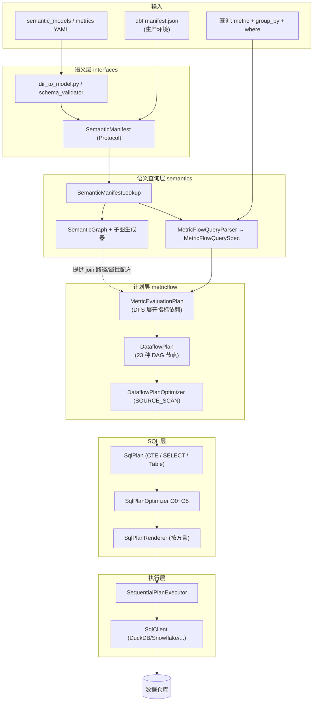
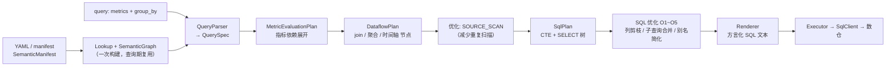
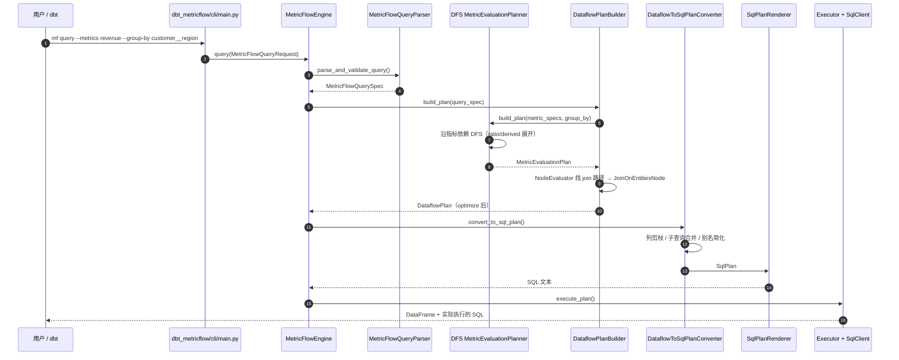

# MetricFlow 架构笔记

> 仓库路径：`D:/AgentABC/metricflow`（本地 fork：`https://github.com/LukeLi-EBD/metricflow.git`）
> 上游地址：`https://github.com/dbt-labs/metricflow`
> 语言与规模：约 5633 文件 / 84MB；SQL 3664 个、Python 1019 个（**3659 个 SQL 是测试快照，见 2.2**）
> 版本：`0.214.0.dev0`（`metricflow/__about__.py:3`）；最近发布 `0.213.0`（`CHANGELOG.md:8`，September 10, 2026）
> commit：`fe4b8c1ccb72a8ca77494b345777eff20a714119`（Tue Oct 13 20:38:40 2026 +0300），HEAD 提交 `Fix TimeSpineRule to only warn for agg_time_dimensions (#2131)`
> 分析时间：2026-11-04

---

## 1. 一句话定位 + 仓库事实核查

**一句话定位**：MetricFlow 是 dbt 生态里的**语义层（semantic layer）引擎**——它把「指标 + 维度」的业务问法，编译成一段确定性的、可跨仓复用的 SQL，让"营收"这种指标在整个组织里只有一个定义。

### 1.1 "语义层"到底是什么

数据栈下层已经解决了"数据怎么算"（dbt 把 `select` 物化成表）。但同一个概念在上层会被反复误读：

- "营收"是 `sum(amount)` 还是 `sum(amount) - refunds`？退款要不要算进来？
- 按"月"看和按"周"看，是否要换成另一套口径？
- 用户想看 `region`（在 `dim_region` 表里）和 `revenue`（在 `fct_orders` 表里），中间要 join 哪几张表？走 `order → customer → region` 还是 `order → region`？

语义层就是把这三件事**声明化**：

1. 用 YAML 声明 **semantic model**（对应一张已经物化的表/视图），里面写 `entities`（join 键）、`dimensions`（可切分属性）、`measures`（可加总的原子表达式）；
2. 在 measures 之上声明 **metric**（`simple` / `ratio` / `derived` / `cumulative` / `conversion`）；
3. 用户只写 `mf query --metrics revenue --group-by customer__region --start-time ...`。

引擎负责：找出 revenue 来自哪个 semantic model → 从那个 model 出发沿 entities 找到 `region` 所在的 model → 决定 join 顺序与类型（含多跳、含 time spine）→ 生成聚合 SQL。

**为什么需要它**：dbt 只保证"表算得对"，不保证"表和表拼起来、聚合再聚合之后仍然对"。语义层是唯一能同时保证**口径唯一**与**查询自由度**的地方——而且它能被 BI 工具、Notebook、AI Agent 共同消费（这也是 dbt 把它做成独立可被 sidecar 调用的原因）。

### 1.2 仓库事实核查（它不是什么）

- **它不是 dbt 的一部分**，是独立仓库、独立 PyPI 包（`pyproject.toml:6` `name = "metricflow"`），版本号独立演进（0.214）。与 dbt 的耦合是**单向**的：dbt 通过 sidecar 子进程调它（`sidecar/mf_entry.py`），它自己不 import dbt。
- **它不是"SQL 生成器"那么简单**：核心产物是一张 **dataflow DAG**（`metricflow/dataflow/nodes/` 下 23 种节点），SQL 只是这张 DAG 的一种渲染结果。`--display-plans` / `dbt-metricflow` 的 `--explain` 能直接打出计划树，这就是证据。
- **它不是"另一个 dbt"**：仓库里没有 adapter 执行框架、没有调度、没有物化。它生成 SQL 后交给 `SqlClient`（`metricflow/protocols/sql_client.py:66`）跑一次就返回 DataFrame。
- **它正在从"图搜索"迁移到"语义图"**：`metricflow_semantics/semantic_graph/` 是一套新实现，`graph_builder.py:36` 的注释直言 "This will replace `PartialSemanticGraphBuilder` once the PRs that depend on it are merged"。仓库当前处于两代并存状态（详见 4.9）。

---

## 2. 技术栈与工程结构

### 2.1 技术栈

| 层 | 选型 | 证据 |
|---|---|---|
| 语言 | Python ≥3.10,<3.15 | `pyproject.toml:9` |
| 构建 | hatchling + `hatch-requirements-txt`（依赖写在 requirements 文件里） | `pyproject.toml:1-3`、`requirements-files/` |
| 校验/模型 | pydantic 1.10~2.x（协议层用 `typing.Protocol`，实现层用 pydantic） | `requirements-files/requirements.txt` |
| 表达式渲染 | **Jinja2（Sandboxed）**——`where_sql_template` 本身是 Jinja 模板 | `metricflow_semantics/specs/where_filter/where_filter_spec_factory.py:94` |
| SQL 表达式解析 | `sqlglot`（仅用于把 measure 表达式拆成 metric input） | `metricflow/converters/expression_utils.py:5` |
| YAML/schema 校验 | `jsonschema` + `referencing` + 生成的 JSON Schema | `metricflow_semantic_interfaces/parsing/schema_validator.py`、`parsing/generated_json_schemas/` |
| 数据表 | 自研 `MetricFlowDataTable`（不是 pandas） | `metricflow/data_table/mf_table.py` |
| 模糊匹配 | `rapidfuzz`（"你是不是想查 xxx"） | `requirements-files/requirements.txt` |
| CLI | click（`dbt-metricflow/dbt_metricflow/cli/main.py:53` `@click.group()`） | – |
| 打包分发（给 dbt 用） | Nuitka 编译 sidecar + NDJSON over stdio | `sidecar/mf_entry.py:1-20` |

### 2.2 顶层/模块结构表

| 目录 | 职责 | 是否核心 |
|---|---|---|
| `metricflow_semantic_interfaces/` | **协议与 spec 的"宪法"层**：`SemanticManifest`/`Metric`/`SemanticModel` 的 Protocol、YAML 解析与 JSON Schema、校验规则 | ★★★ |
| `metricflow_semantics/` | 语义模型查询层：specs、naming、filters、**semantic_graph**、query_parser、time | ★★★ |
| `metricflow/` | 引擎本体：`engine/`（对外 API）、`dataflow/`（计划 DAG）、`metric_evaluation/`（新计划器）、`plan_conversion/`（→SQL）、`sql/`（SQL 计划与渲染）、`execution/`、`protocols/` | ★★★ |
| `dbt-metricflow/` | 独立 CLI（`mf` 命令）+ dbt 集成 | ★★ |
| `sidecar/` | 给 dbt 用的 IPC 入口（Nuitka 编译成独立二进制） | ★★ |
| `tests_metricflow/snapshots/` | **3659 个 `.sql` 快照文件**（golden file），不是产品代码 | – |
| `tests_metricflow/` / `tests_metricflow_semantics/` / `tests_metricflow_semantic_interfaces/` | 测试 | – |
| `local-data-warehouses/` | 本地 DuckDB/Postgres 测试仓配置 | – |

> **关于 3664 个 SQL 文件的提醒**：其中 3659 个位于 `tests_metricflow/snapshots/`，是每次生成 SQL 后落盘的**期望输出**（snapshot 测试用），剩下 5 个在 `dbt-metricflow/` 里是示例模型。**不要把 snapshots 当核心代码读**——它们唯一的用处是"改动了 SQL 生成逻辑后，看 diff 是否合理"。真正描述 SQL 结构的是 `metricflow/sql/` 下的 Python 类。

### 2.3 四层包的分工（为什么拆成 4 个包）

```
metricflow_semantic_interfaces   协议 + YAML 解析 + 校验（零依赖引擎，可被 dbt 直接复用）
        ▲
metricflow_semantics             语义图、specs、query 解析（依赖 interfaces）
        ▲
metricflow                        计划构建、SQL 生成、执行（依赖 semantics）
        ▲
dbt-metricflow / sidecar          CLI 与 dbt 集成（依赖 metricflow）
```

拆开的实际收益：dbt 的 Rust/Python 侧只需要 `metricflow_semantic_interfaces` 就能读懂/生产 `SemanticManifest`（dbt 仓库：`../dbt/crates/dbt-schemas/src/schemas/semantic_layer/semantic_manifest.rs:16`），不必把整个引擎拖进去。

---

## 3. 整体架构

### 3.1 分层图



### 3.2 核心组件职责表

| 组件 | 代码位置 | 职责 |
|---|---|---|
| `SemanticManifest` | `metricflow_semantic_interfaces/protocols/semantic_manifest.py:12` | 语义层的"编译产物"协议：models / metrics / saved_queries / time_spines |
| `parse_directory_of_yaml_files_to_semantic_manifest` | `metricflow_semantic_interfaces/parsing/dir_to_model.py:110` | 目录 → manifest（开发/测试用） |
| `SemanticManifestLookup` | `metricflow_semantics/model/semantic_manifest_lookup.py:25` | 一次构造、到处查：建 semantic graph、time spine、各类 lookup |
| `SemanticGraphBuilder` | `metricflow_semantics/semantic_graph/builder/graph_builder.py:33` | 用 7 个子图生成器拼出语义图 |
| `MetricFlowQueryParser` | `metricflow_semantics/query/query_parser.py:389` | 查询字符串/参数 → `MetricFlowQuerySpec`（含合法性校验） |
| `MetricFlowQuerySpec` | `metricflow_semantics/specs/query_spec.py:54` | 一次查询的全部已解析 spec |
| `MetricFlowEngine` | `metricflow/engine/metricflow_engine.py:429` | 对外门面：`query` / `explain` / `list_metrics` |
| `DataflowPlanBuilder` | `metricflow/dataflow/builder/dataflow_plan_builder.py:172` | `build_plan()`：spec → dataflow DAG |
| `DepthFirstSearchMetricEvaluationPlanner` | `metricflow/metric_evaluation/dfs_me_planner.py:37` | 按指标依赖 DFS 展开（derived/ratio 的多层输入） |
| `NodeEvaluatorForLinkableInstances` | `metricflow/dataflow/builder/node_evaluator.py:390` | 判断"要的维度能不能 join 到"，产出 `JoinLinkableInstancesRecipe` |
| `DataflowToSqlPlanConverter` | `metricflow/plan_conversion/to_sql_plan/dataflow_to_sql.py:68` | dataflow DAG → `SqlPlan` |
| `DefaultSqlPlanRenderer` | `metricflow/sql/render/sql_plan_renderer.py:70` | `SqlPlan` → SQL 文本（方言子类覆写） |
| `SqlOptimizationLevel` | `metricflow/sql/optimizer/optimization_levels.py:16` | O0~O5 优化档位（默认 O5） |
| `SequentialPlanExecutor` | `metricflow/execution/executor.py:49` | 执行计划里的 task（目前单 task 顺序跑） |
| `SqlClient` (Protocol) | `metricflow/protocols/sql_client.py:66` | 引擎适配：`query` / `execute` / `dry_run` / `renderer` |

### 3.3 编译流水线全景



三个"计划"是理解 MetricFlow 的关键，务必分清：

| 计划 | 层级 | 节点类型 | 谁生成 |
|---|---|---|---|
| **MetricEvaluationPlan** | 指标依赖 | `SimpleMetricsQueryNode` / `DerivedMetricsQueryNode` / `CumulativeMetricQueryNode` / `ConversionMetricQueryNode` / `TopLevelQueryNode`（`me_nodes.py`，538 行） | `DepthFirstSearchMetricEvaluationPlanner` |
| **DataflowPlan** | 关系代数 | `ReadSqlSourceNode` / `JoinOnEntitiesNode` / `AggregateSimpleMetricInputsNode` / `ComputeMetricsNode` / `JoinToTimeSpineNode` / `WhereFilterNode` / `OrderByLimitNode`…（23 种） | `DataflowPlanBuilder` |
| **SqlPlan** | SQL 语法 | `SqlSelectStatementNode` / `SqlCteNode` / `SqlTableNode` / `SqlSelectTextNode` / `SqlCreateTableAsNode` | `DataflowToSqlPlanConverter` |

三层各自有 visitor、各自有 optimizer，互相解耦。这也是为什么它能做到"同一份语义、渲染成 Snowflake 或 DuckDB 的 SQL"。

---

## 4. 端到端主链路



### 步骤 1：加载/构造语义模型

- **入口**：`dbt-metricflow/dbt_metricflow/cli/cli_configuration.py:232` → `_build_semantic_manifest_lookup()`（生产路径）；开发路径是 `metricflow_semantic_interfaces/parsing/dir_to_model.py:110`
- **逻辑**：`SemanticManifestLookup.__init__`（`semantic_manifest_lookup.py:28`）一次做完 4 件事：① 建 `TimeSpineSource`（标准时间轴 + 自定义粒度）；② 建 `SemanticModelLookup`；③ 建 `ManifestObjectLookup` 并交给 `SemanticGraphBuilder` 生成 **semantic graph**；④ 用 `SemanticGraphGroupByItemSetResolver` 建 `MetricLookup`。
- **关键点**：这一步是 O(manifest) 的一次性成本，之后所有查询共享。所以 `mf` CLI 启动慢、单次查询快，而 dbt 走 sidecar 常驻进程正是为了摊掉这个成本。
- **产出**：`SemanticManifestLookup`（内含 semantic graph）。

### 步骤 2：解析查询

- **入口**：`metricflow/engine/metricflow_engine.py:557` `_create_execution_plan()` → `metricflow_semantics/query/query_parser.py:389` `parse_and_validate_query()`
- **逻辑**：对每个 metric 名尝试所有 `MetricNamingScheme`（`revenue`、`revenue_monthly`、`bookings_per_listing` 等不同写法），命中则生成 `spec_pattern`；group-by 同理（`customer__region`、`metric_time__month` 这类双下划线命名由 naming scheme 解析）。解析失败不会抛第一个错，而是收集成 `InputToIssueSetMappingItem` 列表，最后一次性报告全部问题——这就是 CLI 能一次列出"这几个维度都不合法"的原因。
- **关键数据结构**：`MetricFlowQuerySpec`（`query_spec.py:54`）——`metric_specs` / `dimension_specs` / `entity_specs` / `time_dimension_specs` / `order_by_specs` / `time_range_constraint` / `limit` / `filter_intersection` / `min_max_only` / `input_spec_order`。
- **产出**：`MetricFlowQuerySpec`。

### 步骤 3：展开指标依赖（MetricEvaluationPlan）

- **入口**：`metricflow/metric_evaluation/dfs_me_planner.py:52` → `build_plan()`
- **逻辑**：把每个请求的指标当成一个"查询元素"（`MetricQueryElement`），迭代式 DFS 展开：`bookings_per_listing` 依赖 `bookings` 和 `listings`，就会生成 `MetricQuery(bookings)` / `MetricQuery(listings)` 两个子节点，再挂一个 `TopLevelQueryNode`（`dfs_me_planner.py:40-46` 的 docstring 直接给了这个例子）。
  - 每类指标有专属节点（`me_nodes.py`）：`SimpleMetricsQueryNode` / `DerivedMetricsQueryNode` / `CumulativeMetricQueryNode` / `ConversionMetricQueryNode`。
  - 同构的还有 `PassThroughMetricEvaluationPlanner`（`metricflow/metric_evaluation/passthrough/`），用于 `PASSTHROUGH_METRIC_EVALUATION` 优化档。
- **关键点**：**这是 MetricFlow 与普通 SQL 生成器最大的差别**——一个 ratio 指标在 SQL 里表现为两段 CTE + 一个除法，在计划里表现为"三条边"。
- **产出**：`MetricEvaluationPlan`（`me_plan.py:36` 的 `MetricFlowGraph` 子类，变体在 `:220`）。

### 步骤 4：计划 → dataflow DAG（含 join 反推）

- **入口**：`metricflow/dataflow/builder/dataflow_plan_builder.py:172` `build_plan()` → `:213` `_build_query_output_node()`
- **逻辑**：
  1. `_build_query_output_node` 先把 query 级 where 过滤变成 `WhereFilterSpec`，构造 `PredicatePushdownState`（目前只下推时间范围）；
  2. 选 planner：默认 `DepthFirstSearchMetricEvaluationPlanner`，开 `PASSTHROUGH_METRIC_EVALUATION` 时用 `PassThroughMetricEvaluationPlanner`；
  3. 得到 `MetricEvaluationPlan` 后，按 DFS 顺序把每个 evaluation 节点翻译成 dataflow 节点（`_build_aggregated_simple_metric_input`、`_build_aggregated_conversion_node`（`:405`）等）；
  4. 需要维度时，走 `NodeEvaluatorForLinkableInstances`（`node_evaluator.py:390` `evaluate_node`）为"指标节点 + 需要的维度集合"找 join 方案；
  5. `build_sink_node` 收口成 `OrderByLimitNode` / `WriteToResultDataTableNode`；
  6. `_optimize_plan()` 跑 dataflow 优化器。
- **关键数据结构**：`DataflowPlan(sink_nodes=[...], plan_id=...)`（`:208`）；每个节点带 `parent_nodes`，构成 DAG；`SourceNodeSet`（`source_node.py:23`）缓存"每个 semantic model 对应的读表节点"，避免每个查询重复构造。
- **产出**：优化后的 `DataflowPlan`。

### 步骤 5：dataflow → SqlPlan

- **入口**：`metricflow/execution/dataflow_to_execution.py:54` 的 `DataflowToExecutionPlanConverter` → `metricflow/plan_conversion/to_sql_plan/dataflow_to_sql.py:68` `convert_to_sql_plan()`
- **逻辑**：visitor 从 sink 节点向下递归，每个 dataflow 节点生成一个 `SqlSelectStatementNode`（或 `SqlCteNode`）。两种策略由 `SqlGenerationOptionSet.allow_cte` 决定：`DataflowNodeToSqlCteVisitor`（共用 CTE）vs `DataflowNodeToSqlSubqueryVisitor`（嵌套子查询）。
  - 有**降级重试**机制：按 `[O5, O4, O3, O2, O1]` 顺序尝试，某一档抛异常就退一档重来（`dataflow_to_sql.py:80-96`），并记 `retried_at_lower_optimization_level`。这是为了防止优化器 bug 直接让用户查不了数。
  - 方言特判：BigQuery 允许 `GROUP BY` 用 select 别名；ClickHouse 因为会错误解析未限定列名，关掉对应归约（`:100-106`）。
- **关键数据结构**：`SqlPlanNode`（`metricflow/sql/sql_plan.py:28`）——注释写得很清楚："源节点（表/字面 SQL）+ SELECT 变换节点"，`SqlTableNode` 单独不能成为合法查询。
- **产出**：`SqlPlan`（+ 优化）。

### 步骤 6：SQL 层优化

- **入口**：`metricflow/sql/optimizer/optimization_levels.py:27` `default_level()` = **O5**；优化器在 `convert_to_sql_plan` 内部按档位串起来
- **逻辑**：`O1` 只做别名简化（`SqlTableAliasSimplifier`）；`O2` 加列剪枝（`SqlColumnPrunerOptimizer`，`column_pruning/column_pruner.py:42`）；更高档位加子查询归约（`SqlRewritingSubQueryReducer`，911 行，负责把嵌套子查询合并、内联 CTE）。
  - 已知坑：CHANGELOG 记录过"sub-query reducer 内联了非确定性表达式，导致 conversion 指标多算"（`CHANGELOG.md` 0.213.0 Fixes 第 1 条）。
- **产出**：更瘦的 `SqlPlan`。

### 步骤 7：渲染成方言 SQL

- **入口**：`metricflow/sql/render/sql_plan_renderer.py:70` `DefaultSqlPlanRenderer` → `:339` `visit_select_statement_node()`
- **逻辑**：基类负责拼 `SELECT ... FROM ... JOIN ... WHERE ... GROUP BY ... ORDER BY ... LIMIT`，每个片段一个 `_render_*` 方法（`_render_cte_sections`、`_render_joins_section`、`_render_group_by_section`…）。方言子类只覆写差异部分：`snowflake.py` / `big_query.py` / `databricks.py` / `redshift.py` / `postgres.py` / `duckdb_renderer.py` / `trino.py` / `athena.py` / `clickhouse.py` / `vertica.py`。
  - 表达式渲染在 `expr_renderer.py`：`date_trunc`、`cast`、interval 字面量、聚合函数参数（`count(distinct ...)` 之类）都按方言分支。
  - 输出还带 `bind_parameter_set`（参数化查询），`SqlPlanRenderResult`（`:37`）同时返回 `sql` 与参数集。
- **产出**：`SqlPlanRenderResult`（SQL 文本 + 绑定参数 + 描述注释）。

### 步骤 8：执行

- **入口**：`metricflow/engine/metricflow_engine.py:522` `query()` → `metricflow/execution/executor.py:49` `SequentialPlanExecutor.execute_plan()`
- **逻辑**：`ExecutionPlan` 由若干 `ExecutionPlanTask` 组成（`SelectSqlQueryToDataTableTask` / `SelectSqlQueryToTableTask`）。当前只支持单 task（`metricflow_engine.py:528` 明写 "Multiple tasks not yet supported"），执行器按 DFS 顺序跑，结果汇总到 `ExecutionResults`。
- **产出**：`MetricFlowQueryResult(query_spec, dataflow_plan, sql, result_df, result_table)`。

### 4.9 专题：语义图（semantic graph）到底解决什么

旧实现用 `SemanticModelLookup` + `SemanticModelJoinEvaluator` 在"model 图"上做 BFS 找 join 路径（`node_evaluator.py:194` `_find_joinable_candidate_nodes_that_can_satisfy_linkable_specs` 就是这一代）。问题是：一个维度可以有多条路径到达（`order → customer → region` 与 `order → region`），且不同路径的**语义**不同（是否跨时间、是否多跳导致扇出）。

新实现在 `metricflow_semantics/semantic_graph/`：

- **建图**：`SemanticGraphBuilder`（`graph_builder.py:33`）用 7 个子图生成器叠加（`:40`）：`CategoricalDimensionSubgraphGenerator`、`EntityKeySubgraphGenerator`、`EntityJoinSubgraphGenerator`、`SimpleMetricSubgraphGenerator`、`TimeDimensionSubgraphGenerator`、`TimeEntitySubgraphGenerator`、`ComplexMetricSubgraphGenerator`。
- **节点/边**：节点是"模型内的元素"（`nodes/node_labels.py` 有 `LocalModelLabel`、`MetricLabel`、`MetricTimeLabel`），边带标签（`mf_graph/graph_labeling.py`）。
- **查路径**：`MetricFlowPathfinder` 在图上找路径，结果不是"一串表"，而是 **`AttributeRecipe`**（`attribute_resolution/attribute_recipe.py:30`）：
  ```python
  indexed_dunder_name, joined_model_ids, element_properties, entity_link_names,
  element_type, source_time_grain, recipe_time_grain, recipe_date_part
  ```
  即"要拿到 `customer__region`，需要依次 join 这些 model，途经这些 entity link，最后取这个 time grain / date part"。Dataflow 层直接照这个配方建 `JoinOnEntitiesNode`。
- **对外接口**：`SemanticGraphGroupByItemSetResolver`（`sg_linkable_spec_resolver.py:54`）把"给定指标，有哪些 group-by 可用、各自配方是什么"变成一个可缓存的查询（带 `WeightedLruResultCache`，上限 100k 条）。
- **现状**：`graph_builder.py:36` 说全量 builder 会替换 `PartialSemanticGraphBuilder`；`metric_evaluation/` 是新一代计划器，`dataflow/builder/` 里仍保留旧路径。**两代并存**，读代码时注意区分。

### 4.10 专题：SQL 渲染层的三层抽象

```
SqlExpressionNode  (sql_exprs.py：Column / Function / String / Case / Between / Comparison ...)
        ↑ 被引用于
SqlSelectColumn / SqlJoinDescription / SqlOrderByDescription  (sql_select_node.py)
        ↑ 组装成
SqlSelectStatementNode / SqlCteNode / SqlTableNode / SqlSelectTextNode  (sql_plan.py)
        ↑ 被 visitor 遍历
SqlPlanRenderer (每方言一个子类，覆写少量方法)
```

为什么要这么多层：`SqlSelectTextNode` 允许"把一段原始 SQL 当表用"（dbt 的 `where_sql_template` 经 Jinja 渲染后就是这种节点），`SqlCteNode` 支持把公共子计划提成 CTE，`SqlSelectStatementNode` 才有完整的 `joins` / `group_bys` 列表。渲染器只需实现 `visit_*`，新增方言的成本被压到"覆写十几个方法"。

---

## 5. 核心代码路径清单

| 文件路径 | 关键类/函数 | 作用 | 优先级 |
|---|---|---|---|
| `metricflow/engine/metricflow_engine.py` | `MetricFlowEngine.query()` (522)、`_create_execution_plan()` (557) | 对外主链路 | ★★★ |
| `metricflow_semantics/query/query_parser.py` | `parse_and_validate_query()` (389) | 查询 → spec，含报错聚合 | ★★★ |
| `metricflow_semantics/specs/query_spec.py` | `MetricFlowQuerySpec` (54) | 一次查询的完整 spec | ★★★ |
| `metricflow_semantics/model/semantic_manifest_lookup.py` | `SemanticManifestLookup.__init__` (28) | 一切 lookup 的入口，建 semantic graph | ★★★ |
| `metricflow_semantics/semantic_graph/builder/graph_builder.py` | `SemanticGraphBuilder` (33)、`_ALL_SUBGRAPH_GENERATORS` (39) | 语义图装配 | ★★★ |
| `metricflow_semantics/semantic_graph/attribute_resolution/attribute_recipe.py` | `AttributeRecipe` (30) | join 路径的"配方"表示 | ★★★ |
| `metricflow_semantics/semantic_graph/attribute_resolution/sg_linkable_spec_resolver.py` | `SemanticGraphGroupByItemSetResolver` (54) | 指标 → 可用 group-by + 配方 | ★★★ |
| `metricflow/dataflow/builder/dataflow_plan_builder.py` | `build_plan()` (172)、`_build_query_output_node()` (213) | dataflow 计划构建 | ★★★ |
| `metricflow/metric_evaluation/dfs_me_planner.py` | `DepthFirstSearchMetricEvaluationPlanner` (37) | 指标依赖展开 | ★★★ |
| `metricflow/metric_evaluation/plan/me_nodes.py` | 五类 query node（538 行） | 指标依赖图的节点 | ★★ |
| `metricflow/dataflow/builder/node_evaluator.py` | `evaluate_node()` (390)、`_find_joinable_candidate...` (194) | 判断能否 join、怎么 join | ★★★ |
| `metricflow/dataflow/builder/source_node.py` | `SourceNodeSet` (23) | 每个 semantic model 的读表节点缓存 | ★★ |
| `metricflow/dataflow/nodes/join_to_base.py` | `JoinOnEntitiesNode` (48) | 真正的 join 节点 | ★★ |
| `metricflow/dataflow/nodes/compute_metrics.py` | `ComputeMetricsNode` (22) | 最终聚合 | ★★ |
| `metricflow/dataflow/optimizer/source_scan/source_scan_optimizer.py` | `SourceScanOptimizer` (63) | 合并重复扫描 | ★★ |
| `metricflow/plan_conversion/to_sql_plan/dataflow_to_sql.py` | `convert_to_sql_plan()` (68) | dataflow → SqlPlan（含降级重试） | ★★★ |
| `metricflow/sql/sql_plan.py` | `SqlPlanNode` (28) | SQL 计划节点基类 | ★★ |
| `metricflow/sql/optimizer/optimization_levels.py` | `SqlOptimizationLevel` (16)、`default_level()` (27) | O0~O5 档位 | ★★ |
| `metricflow/sql/optimizer/rewriting_sub_query_reducer.py` | `SqlRewritingSubQueryReducer`（911 行） | 子查询/CTE 合并 | ★★ |
| `metricflow/sql/render/sql_plan_renderer.py` | `DefaultSqlPlanRenderer` (70)、`visit_select_statement_node` (339) | SQL 文本生成 | ★★★ |
| `metricflow/execution/dataflow_to_execution.py` | `DataflowToExecutionPlanConverter` (54) | 计划 → 可执行 task | ★★ |
| `metricflow/execution/executor.py` | `SequentialPlanExecutor` (49) | 顺序执行 | ★ |
| `metricflow/protocols/sql_client.py` | `SqlEngine` (15)、`SqlClient` (66) | 引擎适配协议 | ★★ |
| `metricflow_semantic_interfaces/parsing/dir_to_model.py` | `parse_directory_of_yaml_files_to_semantic_manifest` (110) | YAML 目录 → manifest | ★★ |
| `sidecar/mf_entry.py` | NDJSON `explain` / `ping` / `shutdown` | dbt 调用的 IPC 入口 | ★★ |

---

## 6. 关键设计点

**设计 1：三层计划（MetricEvaluation → Dataflow → SqlPlan），而不是一步生成 SQL。**
→ 为什么 / 代价：每层可以独立优化、独立测试、独立渲染（同一份语义换方言只影响最下层）；代价是理解成本极高——同一个"revenue"在仓库里以四种形态出现（spec / ME node / dataflow node / SQL 节点），排查问题要判断"错在哪一层"，`--display-plans` 就是为此而生。

**设计 2：join 路径由语义图 + 配方（AttributeRecipe）决定，而不是让用户写 join。**
→ 为什么 / 代价：用户只写 `customer__region`，引擎自己找路——这是语义层存在的理由；代价是路径选择一旦有歧义（多跳、扇出、时间维度差异），行为很难向用户解释，`GroupByItemProperty` 里那一堆属性（是否多跳、是否可加、是否需 time spine）就是这些规则的沉淀。

**设计 3：SQL 优化器有"降级重试"。**
→ 为什么 / 代价：优化器是纯元程序变换，任何 bug 都会让用户拿不到数据；`dataflow_to_sql.py:80-96` 按 O5→O1 逐档退让，保证"至少能出 SQL"；代价是同一个查询在不同档位产出的 SQL 差异巨大，且性能问题可能被"悄悄降档"掩盖。

**设计 4：`where_sql_template` 就是 Jinja 模板。**
→ 为什么 / 代价：用户能写 `{{ Dimension('customer__region') }} = 'US'`，引擎把维度引用渲染成真实列名，用户不需要知道物理表名——语义层的核心体验；代价是模板注入风险，`where_filter_spec_factory.py:94` 与 `converters/filter_utils.py:106` 都改用 `SandboxedEnvironment`（CHANGELOG 0.213.0 Security 条明确记录这是一次 SSI 漏洞修复）。

**设计 5：所有 SQL 快照入库（3659 个 `.sql`）。**
→ 为什么 / 代价：SQL 生成逻辑改动的影响面无法靠单元测试覆盖，只能靠 golden file diff；代价是每次合理改动都会产生大量快照变更，review 时难以分辨"预期变化"与"回归"，且仓库体积里 SQL 占了绝大多数。

**设计 6：协议层（`metricflow_semantic_interfaces`）用 `typing.Protocol`，实现层用 pydantic。**
→ 为什么 / 代价：dbt 侧只需要结构化数据、不需要 pydantic 版本绑定，Protocol 让两边可以各自演化；代价是类型检查靠 mypy（`mypy.ini`）+ 运行时校验混用，出错时栈很深，且 pydantic v1/v2 双支持（`pydantic>=1.10,<3.0`）带来兼容代码。

---

## 7. 扩展点

### 7.1 加一种度量类型（metric type）

1. `metricflow_semantic_interfaces/type_enums/metric_type.py` 加枚举值；
2. `metricflow_semantic_interfaces/validations/` 加校验规则（`time_spines.py:15` 的 `TimeSpineRule` 正是 HEAD 提交改动之处，可作模板）；
3. `metricflow/metric_evaluation/plan/me_nodes.py` 加对应的 query node，并在 `dfs_me_planner.py` 的 DFS 里分派；
4. `metricflow/dataflow/builder/dataflow_plan_builder.py` 加 `_build_*_node`（参考 `_build_aggregated_conversion_node`，`:405`）；
5. `metricflow_semantic_interfaces/parsing/schemas.py` + `generated_json_schemas/` 补 YAML schema；
6. 补快照测试（会新增大量 `tests_metricflow/snapshots/*.sql`，属正常）。

### 7.2 加一个 SQL 引擎

1. `metricflow/protocols/sql_client.py:15` 的 `SqlEngine` 加枚举，并在 `unsupported_granularities` 里声明该引擎不支持的粒度；
2. `metricflow/sql/render/` 新建 `<engine>.py`，继承 `DefaultSqlPlanRenderer`（或从最接近的方言抄，如 `postgres.py`），覆写 `expr_renderer` 与日期/类型相关的 `_render_*`；
3. `metricflow/protocols/sql_client.py:66` 实现 `SqlClient`（`query` / `execute` / `dry_run` / `sql_engine_type` / `sql_plan_renderer`）；
4. 在 `dbt-metricflow/dbt_metricflow/cli/dbt_connectors/` 接入 dbt adapter，让 `mf` CLI 能用 `profiles.yml` 连库；
5. `requirements-files/requirements-<engine>.txt`。

### 7.3 加一种 group-by 能力 / 修 join 决策

几乎一定在 `metricflow_semantics/semantic_graph/`：子图生成器（`builder/`）、属性配方（`attribute_resolution/`）、路径权重（`recipe_writer_weight.py`，345 行，决定"哪条路径更优"）。这是新架构的核心，改动前先读 `sg_interfaces.py` 与 `mf_graph/path_finding/`。

### 7.4 加一种 SQL 优化

`metricflow/sql/optimizer/`：实现 `SqlPlanOptimizer`（`sql_query_plan_optimizer.py`，只有 `optimize()` 一个方法），然后在 `optimization_levels.py` 的 `options_for_level` 里挂到某个档位。注意要在 O0/O1 保持"总能出 SQL"的底线。

---

## 8. 本地跑起来 / 调试入口

```bash
cd D:/AgentABC/metricflow
python -m venv .venv && . .venv/bin/activate     # Windows: .venv\Scripts\activate
pip install -r requirements-files/requirements.txt
pip install -e . -e ./dbt-metricflow

# 1. 用仓库自带的示例项目（DuckDB，无需外部数仓）
mf --help
mf tutorial                       # 建示例 dbt 项目 + 本地 DuckDB
mf query --metrics transactions --group-by metric_time__day

# 2. 只看计划与 SQL，不执行
mf query --metrics transactions --group-by metric_time__day --explain
mf query --metrics transactions --explain --display-plans   # 打 dataflow 计划树

# 3. 列出可用指标/维度（语义图是否正确的最快验证）
mf list metrics --show-all-dimensions
mf list dimensions --metrics transactions

# 4. 跑测试（snapshot 测试是主力）
pytest tests_metricflow -k "snapshot" -x
```

调试入口：

| 想看什么 | 位置 |
|---|---|
| 查询解析为什么失败 | `query_parser.py:389`，看 `InputToIssueSetMappingItem` 收集了哪些 issue |
| 有哪些 group-by 可选 | `mf list dimensions`；底层 `SemanticGraphGroupByItemSetResolver` |
| join 选错了 | `node_evaluator.py:390` `evaluate_node`，打印 `JoinLinkableInstancesRecipe.join_on_entity` |
| 计划长什么样 | `--explain` / `--display-plans`；`DataflowPlan.structure_text()` |
| SQL 优化把 SQL 弄坏了 | 把 `sql_optimization_level` 调到 O1/O2 复现，再二分档位 |
| 方言差异 | `metricflow/sql/render/<engine>.py` 覆写了哪些方法 |

---

## 9. 阅读路线

**半天（跑通一次查询）**：① `README.md` 前 40 行 + `metricflow/__about__.py`；② `metricflow/engine/metricflow_engine.py:522-670`（`query` 与 `_create_execution_plan` 全流程）；③ `metricflow_semantics/specs/query_spec.py:54`（QuerySpec 字段）；④ `metricflow/dataflow/nodes/` 目录名扫一遍（认识 23 种节点）；⑤ `mf query --explain --display-plans` 亲眼看一次计划树。**不要碰 `tests_metricflow/snapshots/`。**

**两天（能改语义/计划）**：加 ① `query_parser.py:389-520`；② `dfs_me_planner.py` 全文件（250 行）；③ `dataflow_plan_builder.py:172-300` + `node_evaluator.py:390` 起；④ `dataflow_to_sql.py:68-160`（含降级重试）；⑤ `sql_plan_renderer.py` 全文件（约 400 行）；⑥ `semantic_manifest_lookup.py` 全文件（理解 semantic graph 何时建）。

**一周（能改架构）**：加 ① `metricflow_semantics/semantic_graph/`（`builder/` 7 个子图 + `attribute_resolution/` + `trie_resolver/`）；② `metricflow/metric_evaluation/`（新旧两代计划器的差异）；③ `sql/optimizer/`（`rewriting_sub_query_reducer.py` 911 行 + 列剪枝）；④ `metricflow_semantic_interfaces/parsing/`（YAML → manifest + JSON Schema 生成）；⑤ `sidecar/mf_entry.py` + `dbt-metricflow/`（对外接口面）；⑥ `TENETS.md` 与 `GLOSSARY.md`（设计原则）。

---

## 10. 未覆盖 / 存疑

1. **新旧两代计划器的边界没摸清**。`metric_evaluation/`（DFS planner）与 `dataflow/builder/`（旧路径）同时存在，`DataflowPlanOptimization.PASSTHROUGH_METRIC_EVALUATION` 的启用条件、以及哪些指标类型仍走旧路径，我只看到分派点（`dataflow_plan_builder.py:265-285`），没验证全量覆盖情况。
2. **semantic graph 的"路径权重"未读**。`recipe_writer_weight.py`（345 行）显然决定"多条路径里选哪条"，这直接决定 join 结果是否正确，本笔记只到 `AttributeRecipe` 结构为止。
3. **`metricflow/converters/`（Ossie / dbt 互转）几乎没看**。只知道 `expression_utils.py:5` 用 sqlglot 解析 measure 表达式，`filter_utils.py:106` 用沙箱 Jinja。
4. **time spine 的完整语义未展开**。`TimeSpineSource.build_standard_time_spine_sources`、`JoinToTimeSpineNode`、`custom granularities` 三者关系只看了接口，没追 cumulative / offset 指标的实际用法。
5. **`local-data-warehouses/` 未核实**。看起来是 CI 用的本地数仓定义（DuckDB / Postgres），但没确认 `mf tutorial` 是否依赖它。
6. **性能特性没有数据**。`SourceScanOptimizer` 与 O5 优化器的收益幅度、以及"大 manifest 下 `SemanticManifestLookup` 构建耗时"，仓库里没有 benchmark 可引用。
7. **`sidecar` 的版本协商只看了 README 级说明**（`mf_entry.py:1-20` 的 protocol_version=1），dbt 侧如何校验版本、失败如何回退到 Python 进程，未追。
8. **`msi_pydantic_shim.py`（仓库根目录）用途不明**，可能是 pydantic v1/v2 兼容层，未读。

---

## 11. 三者的分工

- **MetricFlow（本仓库）**：卡"指标语义"这一环。输入是「指标 + 维度」的业务问法，输出是**一段确定性 SQL**；它保证"营收"在任何 BI 工具里都是同一个口径，并负责反推该 join 哪些表。
- **dbt**：卡"转换执行"这一环。它把 MetricFlow 依赖的那些 `fct_/dim_` 模型按 DAG 物化出来，并提供 `manifest.json` 作为语义层的输入（dbt 通过 sidecar 进程调 MetricFlow，`sidecar/mf_entry.py` 就是这条 IPC）。
- **parser / redshift-parser（昨天那份）**：卡"SQL 文本解析"这一环，是最底层的原料。MetricFlow 解析 `sum(case when ...)` 这类 measure 表达式用的是 sqlglot（`metricflow/converters/expression_utils.py:5`，依赖见 `requirements-files/requirements.txt:12`），不依赖 parser；dbt 用它做静态分析与列级 lineage。
- 串起来：`parser` 看懂 SQL 语法 → `dbt` 把数据算成表 → `MetricFlow` 在表上做语义聚合。抽象层级依次是「语法 → 执行 → 语义」，越往上越贴近业务、越不能替代下层。

---

## 修订记录

> 2026-11-04 对照本地仓库 `D:/AgentABC/metricflow` 逐条核验。共核对代码路径/行号引用 58 处，其中失效/错位 14 处（同一引用在多处复现，合计修订 23 个位置）；另核对类名/函数名/配置项 30 个。结论：整体引用体系可靠、主链路各入口真实存在，失效项主要是"指向装饰器/空行/docstring"的行号偏移，以及把 dbt 仓库的 Rust 路径写成了 metricflow 的相对路径。

| # | 位置 | 原表述 | 核实结果（源码依据） | 处理 |
|---|---|---|---|---|
| 1 | 文档头 | `CHANGELOG.md:11` | `CHANGELOG.md:8` 为 `## MetricFlow 0.213.0 - September 10, 2026`，`:11` 是空行 | 改为 `CHANGELOG.md:8` |
| 2 | §1.2 / §3.1 / §3.3 / §9 | "24 种节点" | `metricflow/dataflow/nodes/` 只有 23 个 `DataflowPlanNode` 子类（23 个 `.py`，`__init__.py` 为空）；`dataflow_plan_visitor.py` 同为 23 个 `visit_*` | 4 处均改为 23 种 |
| 3 | §2.3 | `crates/dbt-schemas/src/schemas/semantic_layer/semantic_manifest.rs` | metricflow 根目录无 `crates/`；该文件在 `../dbt/crates/dbt-schemas/src/schemas/semantic_layer/semantic_manifest.rs:16`（`pub struct SemanticManifest`） | 补 `../dbt/` 前缀并加行号 `:16` |
| 4 | §3.2 / §4 步骤1 / §5 | `semantic_manifest_lookup.py:39` | `:39` 为 `)`；`class SemanticManifestLookup` 在 `:25`，`__init__` 在 `:28` | 3 处分别改为 `:25` / `:28` |
| 5 | §3.2 / §4 步骤3 / §5 | `dfs_me_planner.py:39`、`:47`、`:39-47` | `class DepthFirstSearchMetricEvaluationPlanner` 在 `:37`；`def build_plan` 在 `:52`；示例 docstring 在 `:40-46`（`:39`/`:47` 均为空行） | 改为 `:37` / `:52` / `:40-46` |
| 6 | §3.2 / §4 步骤4 | `NodeEvaluator` | 仓库无 `NodeEvaluator` 类；实际为 `class NodeEvaluatorForLinkableInstances`（`node_evaluator.py:153`），`evaluate_node` 在 `:390` | 改为 `NodeEvaluatorForLinkableInstances` |
| 7 | §3.2 / §4 步骤6 / §5 | `optimization_levels.py:15`、`:26` | `@functools.total_ordering` 在 `:15`，`class SqlOptimizationLevel(Enum)` 在 `:16`；`@staticmethod` 在 `:26`，`def default_level` 在 `:27` | 改为 `:16` / `:27`（共 3 处） |
| 8 | §4 步骤4 | `DataflowPlan(sink_nodes=[...], plan_id=...)`（`:207`） | `:207` 为 `plan_id = DagId.from_id_prefix(...)`，`:208` 才构造 `DataflowPlan(sink_nodes=[sink_node], plan_id=plan_id)` | 改为 `:208` |
| 9 | §4 步骤5 / §5 | `sql_plan.py:32` / `SqlPlanNode (32)` | `:32` 是类 docstring 的 `* A source node that takes data...`；`class SqlPlanNode` 在 `:28` | 2 处改为 `:28` |
| 10 | §4.9 / §5 | `attribute_recipe.py:29` / `AttributeRecipe (29)` | `:29` 为 `@fast_frozen_dataclass()`，`class AttributeRecipe` 在 `:30` | 2 处改为 `:30` |
| 11 | §4.9 / §5 | `sg_linkable_spec_resolver.py:50` / `(50)` | `:50` 为空行，`class SemanticGraphGroupByItemSetResolver` 在 `:54` | 2 处改为 `:54` |
| 12 | §5 | `_ALL_SUBGRAPH_GENERATORS` (40) | 赋值语句在 `:39`（`:40` 起才是 7 个生成器元素） | 改为 `(39)` |
| 13 | §4 步骤8 | `metricflow_engine.py:526` | `:526` 为空行；`raise NotImplementedError("Multiple tasks not yet supported.")` 在 `:528` | 改为 `:528` |
| 14 | §5 / §7.2 | `sql_client.py:18` / `SqlEngine (18)` | `:18` 是 docstring；`class SqlEngine(Enum)` 在 `:15` | 2 处改为 `:15` |
| 15 | §4 时序图 | `ENG->>ME: build_plan(metric_specs, group_by)` | `metricflow_engine.py:620` 是 `self._dataflow_plan_builder.build_plan(...)`；`dataflow_plan_builder.py:279` 才由 DF 调 `me_planner.build_plan(...)` | 补 `ENG->>DF` 与 `DF->>ME` 两条边 |
| 16 | §11 | "MetricFlow 用它解析 `sum(case when ...)` …（… 的 sqlglot）" | metricflow 无 parser 依赖；`requirements-files/requirements.txt:12` 为 `sqlglot>=20.0.0`，`expression_utils.py:5` 为 `import sqlglot` | 改为"用 sqlglot 解析…不依赖 parser" |

**核验通过、未改动的关键判断**：
- 版本 `0.214.0.dev0`（`metricflow/__about__.py:3`）、`CHANGELOG.md:8` 的 0.213.0 发布日期、HEAD commit `fe4b8c1…` 与 `git log -1` 完全一致。
- 规模陈述准确：5633 文件 / 3664 SQL / 1019 Python / 3659 snapshot 均与实测一致；"84MB"是磁盘分配占用（逻辑 65.6MB，按 4KB 簇计 83.5MB），不是笔误，未改。
- §4 主链路各入口真实：`metricflow_engine.py:522 query` → `:557 _create_execution_plan`；`query_parser.py:389 parse_and_validate_query`；`dataflow_plan_builder.py:172 build_plan` / `:213 _build_query_output_node`；`dataflow_to_sql.py:68 convert_to_sql_plan`；`sql_plan_renderer.py:70` / `:339`；`executor.py:49`。
- `dataflow_to_sql.py:80-96` 的 O5→O1 降级重试、`:100-106` 的 BigQuery/ClickHouse 特判均与源码逐行吻合。
- `SemanticManifestLookup.__init__`（`:28-56`）确实依次建 `TimeSpineSource`、`SemanticModelLookup`、`SemanticGraphBuilder`、`SemanticGraphGroupByItemSetResolver`→`MetricLookup`。
- 行数陈述全部吻合：`me_nodes.py` 538、`dfs_me_planner.py` 250、`rewriting_sub_query_reducer.py` 911、`recipe_writer_weight.py` 345、`sql_plan_renderer.py` 394（原文"约 400"）。
- `metricflow/sql/render/` 10 个方言文件齐全，`dbt-metricflow` 恰有 5 个示例 `.sql`，与 §2.2/§4 步骤7 一致。
- 示例名 `dim_region` / `fct_orders` / `revenue_monthly` / `customer__region` 在仓库中没有同名真实模型，正文均处于举例语境，未改。

**未解决/存疑**：
- §4 用"步骤 1–8"混搭"4.9/4.10"编号，属体例问题，按要求未改章节编号。
- §5 表部分行号指向方法而非类（`DataflowPlanBuilder :172`、`MetricFlowQueryParser :389`、`NodeEvaluatorForLinkableInstances :390`），沿用原文"入口方法"体例，未统一。
- §11 关于 dbt 侧使用 parser 的说法跨仓库，未在本仓库可验证，仅修正了 MetricFlow 自身依赖（sqlglot）。
- §10 已列出的未覆盖项（sidecar 版本协商、`recipe_writer_weight.py` 权重规则等）保持原状。
