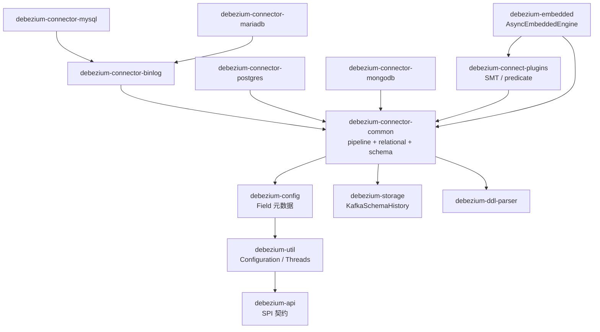
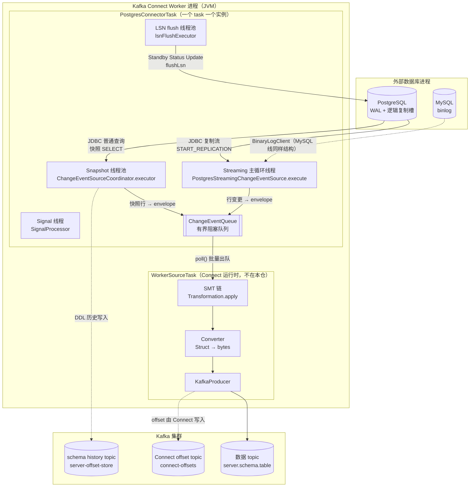
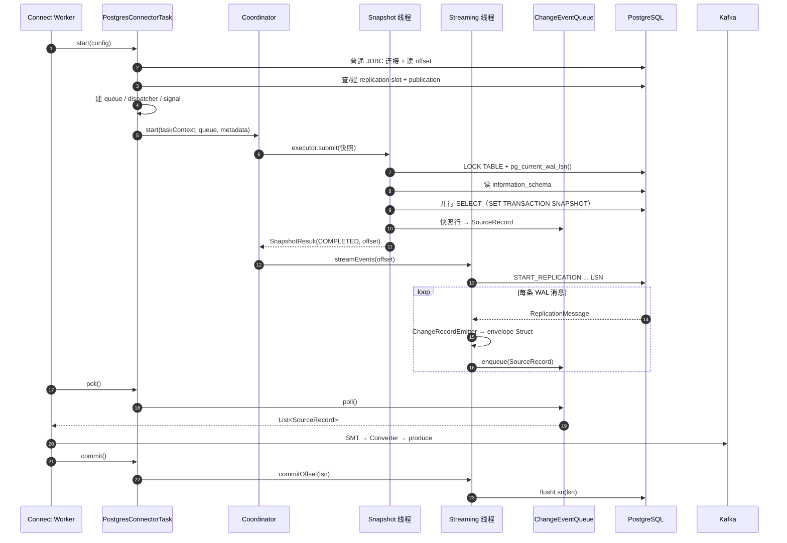

# Debezium 架构笔记

> **仓库路径**：`D:/AgentABC/debezium`
> **上游地址**：`https://github.com/debezium/debezium`（本地 origin 为 `https://github.com/LukeLi-EBD/debezium.git`）
> **语言与规模**：Java（源码级 21、字节码目标 17，见根 `pom.xml:59` 与 `pom.xml:62`），3166 个 `.java` 文件；全仓 4684 文件 / 约 39 MB（不含 `.git`），36 个 Maven 子模块（根 `pom.xml:217-254`）
> **版本**：`3.8.0-SNAPSHOT`（`pom.xml:13`）；Kafka Connect 依赖 4.3.1（`pom.xml:112`）
> **commit**：`8974b2bed859560cd9bacab5e2e6e85ff42a843f`（Fri Oct 16 09:43:41 2026 -0400）
> **分析时间**：2026-11-04

---

## 1. 一句话定位 + 仓库事实核查

Debezium 是一组 **Kafka Connect Source Connector**：它在 Connect worker 进程里起一个 task，task 内部长期持有「一条到源库的变更日志连接」（PG 的逻辑复制槽 / MySQL 的 binlog dump / Mongo 的 change stream），把日志条目解码成行级变更，再用 **统一的 envelope schema** 包装成 `SourceRecord`，塞进内存队列，由 Connect 的 `poll()` 拉走、经 SMT 与 converter 后写入 Kafka topic。

- **解决什么**：把「异构数据库的日志协议 + DDL 演进 + 全量/增量切换 + 位点管理」这四件极脏的活，收敛成一条对下游恒定的 `before/after/op/source` 事件流。
- **不解决什么**：不是同步引擎（不做 upsert、不做目标端写）；不是计算引擎（无 join/聚合）；SMT 只是逐条记录的结构改写，不是 SQL。
- **事实核查（重要，与上游不同）**：
  1. 本仓 **`debezium-core` 已被重命名/搬迁**。`debezium-core/pom.xml` 的 `<name>` 为 `Debezium Core (Relocated to debezium-connector-common)`，`<packaging>` 为 `pom`，目录下只有 1 个 pom 文件。真正的核心源码（`io.debezium.pipeline`、`io.debezium.relational`、`io.debezium.schema` 等）在 **`debezium-connector-common`**（570 个 `.java`，本仓最大模块）。
  2. `debezium-common` 同样被标为 `Relocated to debezium-util`（`debezium-common/pom.xml:12`）。
  3. **SMT 实现不在 core，而在 `debezium-connect-plugins`**（102 个 `.java`，包含 `ExtractNewRecordState`、`ByLogicalTableRouter`、`Outbox` 等）。
  4. `debezium-server` 在本仓 **只有 `README.md`，源码未纳入**（`debezium-server/` 下 1 个文件）。涉及 server 运行时（Quarkus 打包）的描述本文一律不给行号。
  5. 因此本文所有「core」路径都写作 `debezium-connector-common/...`，读上游文档时请自行做 `debezium-core → debezium-connector-common` 的映射。

---

## 2. 技术栈与工程结构

### 2.1 技术栈

| 维度 | 选型 | 证据 |
|---|---|---|
| 运行宿主 | **Kafka Connect**（分布式或 standalone worker），connector 本身不含 main | `debezium-connector-common/.../connector/common/BaseSourceTask.java:80` 继承 `org.apache.kafka.connect.source.SourceTask` |
| 事件模型 | Connect `SourceRecord`：`(sourcePartition, sourceOffset, topic, keySchema, key, valueSchema, value, headers)` | `debezium-connector-common/.../pipeline/EventDispatcher.java:552` |
| Schema 表示 | Connect `Schema`/`Struct`，由 `SchemaFactory` + `SchemaBuilder` 手工构造（不依赖 Avro 运行时） | `debezium-connector-common/.../schema/SchemaFactory.java` |
| 序列化 | 交给 Connect 的 `Converter`（JSON / Avro / Protobuf / CloudEvents），connector 只产出 `Struct` | `debezium-api/.../engine/format/{Json,Avro,Protobuf,CloudEvents}.java` |
| PG 变更日志 | **逻辑复制协议**（`pgoutput` / `decoderbufs` / `wal2json`），JDBC 驱动 + 自写复制流实现 | `debezium-connector-postgres/.../PostgresConnectorConfig.java:433`（`PGOUTPUT("pgoutput")`）、`:454`（`DECODERBUFS`） |
| MySQL 变更日志 | `com.github.shyiko.mysql.binlog.BinaryLogClient`（shyiko 客户端） | `debezium-connector-binlog/.../BinlogStreamingChangeEventSource.java:51`、`:142` |
| DDL 解析 | 各库独立 ANTLR4 语法（`debezium-ddl-parser`，14 个 java + 大量 `.g4`） | `debezium-ddl-parser/src/main/antlr4/` |
| 位点存储 | 由 Connect 的 `OffsetStorageReader/Writer` 承载；PG 额外把 LSN flush 回复制槽 | `BaseSourceTask.java:641`（`getPreviousOffsets`）、`PostgresStreamingChangeEventSource.java:514` |
| Schema 历史 | 可插拔 `SchemaHistory`：Kafka topic / 文件 / 内存 | `debezium-storage/debezium-storage-kafka/.../history/KafkaSchemaHistory.java:89` |
| 内部队列 | 自研 **有界阻塞队列**，支持条数 + 字节数双上限、超时后强制提交 | `debezium-connector-common/.../connector/base/ChangeEventQueue.java:78` |

### 2.2 模块划分表

| 目录/模块 | 职责 | 是否核心 |
|---|---|---|
| `debezium-api` | 对外 SPI：`DebeziumEngine`、`ChangeEvent`、`Converter`、`Snapshotter`、事件格式枚举 | ★★★（接口契约） |
| `debezium-util` | `Configuration`、`Threads`、`Clock`、`Metronome`、`ElapsedTimeStrategy` 等基础设施 | ★★★ |
| `debezium-config` | `Field` / `ConfigDefinition` 声明式配置元数据（比 Connect `ConfigDef` 更强） | ★★ |
| `debezium-connector-common` | **事实上的 core**：pipeline 编排、relational 模型、schema、serde、metrics、notification、signal | ★★★ |
| `debezium-connector-binlog` | MySQL/MariaDB 共享的 binlog 基座（连接、位点、DDL 事件） | ★★★（MySQL 线） |
| `debezium-connector-postgres` | PG 连接器：复制槽、pgoutput 解码、LSN 位点、增量快照 | ★★★（本文主线） |
| `debezium-connector-mysql` / `-mariadb` | 在 binlog 基座上的方言实现 | ★★ |
| `debezium-connector-mongodb` | 文档型（无 relational 层，走 change stream） | ★★（另一条模型线） |
| `debezium-connector-oracle` / `-sqlserver` | LogMiner / CDC 表实现 | ★（按需） |
| `debezium-connect-plugins` | 全部 SMT、predicate、tracing、openlineage 转换器 | ★★（下游必读） |
| `debezium-storage` | `SchemaHistory` 与 offset 的存储后端（Kafka / 文件 / 内存） | ★★ |
| `debezium-embedded` | 不依赖 Connect worker 的内嵌引擎 `DebeziumEngine`（实现 `AsyncEmbeddedEngine`），自带 SMT 链与 converter | ★★（调试入口） |
| `debezium-ddl-parser` | 各库 DDL 的 ANTLR4 语法与生成代码 | ★ |
| `debezium-sink` | 反向：Kafka → 数据库（JDBC sink） | ★ |
| `debezium-testing` | 242 个 java，集成测试基座（Testcontainers 等） | ★ |
| `debezium-ai/*` | Docling 文档解析、向量 embedding 的 SMT 扩展（7 个子模块） | ★（新方向） |

### 2.3 模块依赖图



读法：`debezium-connector-common` 是唯一的「总线」，所有方言连接器只提供 **3 个差异点**——变更日志客户端、`ChangeRecordEmitter`、`RelationalDatabaseConnectorConfig`。`debezium-core` 已退化为 relocation pom，不参与依赖。

---

## 3. 整体架构

### 3.1 分层图（含进程/线程边界）



三条边界必须记清：

1. **数据库进程 ↔ worker 进程**：只有两条通道——普通 JDBC（快照 + 元数据）和复制流（增量）。没有中间件、没有 agent。
2. **task 内部线程**：snapshot 在独立线程池跑（`ChangeEventSourceCoordinator.java:136`），streaming 在另一条线程跑（`PostgresStreamingChangeEventSource.java:162`），二者通过 **同一个队列** 和 **同一个 offset 对象** 交接；`commitLock`/`context.isPaused()` 是唯一的同步点。
3. **connector ↔ Connect 运行时**：connector 只往队列里放 `SourceRecord`。**SMT 与序列化发生在 Connect 的 `WorkerSourceTask` 里，不在 Debezium 代码内**。这是理解「为什么 SMT 报错栈里看不到 Debezium 类」的关键。（内嵌模式例外，见 `debezium-embedded/.../Transformations.java:92`。）

### 3.2 核心组件职责表

| 组件 | 代码位置 | 职责 |
|---|---|---|
| `PostgresConnector` | `debezium-connector-postgres/.../PostgresConnector.java:59` | Connect `SourceConnector` 入口，仅负责 `taskClass()`、`config()`、`taskConfigs()`；无状态 |
| `PostgresConnectorTask` | `.../PostgresConnectorTask.java:76` | task 生命周期：建连、建槽、装队列、装 dispatcher、起 coordinator |
| `BaseSourceTask` | `debezium-connector-common/.../connector/common/BaseSourceTask.java:80` | 所有关系型 task 的模板方法：`poll()`（:359）、`commit()`、`commitRecord()`、重试与状态机 |
| `ChangeEventSourceCoordinator` | `.../pipeline/ChangeEventSourceCoordinator.java:124` | **总导演**：先 snapshot 再 streaming，处理 blocking snapshot、pause/resume、异常上报 |
| `AbstractSnapshotChangeEventSource` | `.../pipeline/source/AbstractSnapshotChangeEventSource.java:70` | 快照模板：跳过判断、延迟、开始/完成/中止通知 |
| `RelationalSnapshotChangeEventSource` | `.../relational/RelationalSnapshotChangeEventSource.java:133` | 关系型快照 7 步流程（加锁、定 offset、读结构、写 schema 历史、读数据） |
| `IncrementalSnapshotChangeEventSource` | `.../pipeline/source/snapshot/incremental/IncrementalSnapshotChangeEventSource.java:34` | 增量快照 SPI：`init` / `addDataCollectionNamesToSnapshot` / `processMessage` / `readChunk` |
| `PostgresStreamingChangeEventSource` | `.../PostgresStreamingChangeEventSource.java:162` | 复制流生命周期：`startStreaming`、`readPending` 循环、`commitOffset`（LSN flush） |
| `ReplicationConnection` / `PostgresReplicationConnection` | `.../connection/PostgresReplicationConnection.java:715` | 复制槽创建/删除、`START_REPLICATION` 参数拼装、消息解码器绑定 |
| `PostgresChangeRecordEmitter` | `.../PostgresChangeRecordEmitter.java` | 把一条 `ReplicationMessage` 变成 `Operation` + 列值 |
| `RelationalChangeRecordEmitter` | `.../relational/RelationalChangeRecordEmitter.java:41` | 把「操作 + 列值」变成 envelope `Struct`（`emitCreateRecord` 在 :67） |
| `EventDispatcher` | `.../pipeline/EventDispatcher.java:109` 起 | 过滤（表/操作）、schema 一致性、心跳、事务边界、**构造 `SourceRecord` 并入队**（:527 `StreamingChangeRecordReceiver`） |
| `ChangeEventQueue` | `.../connector/base/ChangeEventQueue.java:207` | 有界队列；`poll()`（:312）带超时与批量上限 |
| `KafkaSchemaHistory` | `debezium-storage/debezium-storage-kafka/.../KafkaSchemaHistory.java:89` | 把 DDL 变更序列化成 Kafka 记录写 topic，并在重启时 `recover` 回放 |
| `PostgresOffsetContext` | `.../PostgresOffsetContext.java:78` | 位点载体：`lsn_proc`（:38）、`lsn_commit`（:39）、`snapshot` 标志位 |

---

## 4. 端到端主链路

以 **PostgreSQL** 为主线，MySQL 差异在步骤 11 括注。

### 步骤 1：Connector 被实例化，切出 task 配置

- 入口：`debezium-connector-postgres/src/main/java/io/debezium/connector/postgresql/PostgresConnector.java:59` → `taskClass()`
- 逻辑：Connect worker 通过 `META-INF/services` 发现 `PostgresConnector`，调 `start(props)` 校验配置，再调 `taskConfigs(maxTasks)` 为每个 task 生成一份配置 Map。PG 连接器实际只支持单 task（一个复制槽），多 task 会共享同一个 slot 而互相抢位点。
- 产出：`List<Map<String,String>>`，长度通常为 1。

### 步骤 2：Task 启动，建普通 JDBC 连接、装 schema 与 offset loader

- 入口：`.../PostgresConnectorTask.java:106` → `start(Configuration config)`
- 逻辑：`PostgresConnectorConfig` 解析配置 → `PostgresConnection`（`CONNECTION_GENERAL`）建立普通 JDBC 连接并 `setAutoCommit(false)`（:138）→ 构建 `PostgresSchema`（:153）与 `PostgresPartition.Provider`、`PostgresOffsetContext.Loader`（:154-155）→ 通过 `getSinglePartitionPreviousOffsets(...)` 从 Connect 的 `OffsetStorageReader` 读回上次位点（`BaseSourceTask.java:641`）。
- 产出：`Offsets<PostgresPartition, PostgresOffsetContext>`（可能为「空 offset」，代表首次启动）。

### 步骤 3：建/查复制槽与 publication

- 入口：`.../PostgresConnectorTask.java:195` 附近 `getSlotState()` + `tryToCreateSlot()`
- 逻辑：先 `getReplicationSlotState(slotName, pluginName)` 查槽是否存在（:342）；不存在则按 `plugin()` 创建（`pgoutput` 还需 `CREATE PUBLICATION`）；随后 `jdbcConnection.commit()`。若 `snapshot.mode` 需要导出快照，`slotCreatedInfo` 会被后续快照阶段用于 `SET TRANSACTION SNAPSHOT`。
- 产出：`SlotState` / `SlotCreationResult`；复制起点（restart LSN）确定。

### 步骤 4：装配队列、ErrorHandler、Dispatcher、SignalProcessor

- 入口：`.../PostgresConnectorTask.java:206`（`new ChangeEventQueue.Builder<DataChangeEvent>()`）
- 逻辑：队列按 `pollInterval` / `maxBatchSize` / `maxQueueSize` / `maxQueueSizeInBytes` 构建（:207-214）；`PostgresErrorHandler` 包裹队列；`SignalProcessor` 从 `previousOffsets` 恢复信号位点；`PostgresEventDispatcher` 注入 `topicNamingStrategy`、`schema`、`queue`、`PostgresChangeRecordEmitter::updateSchema`、心跳工厂（:226 起）。队列是 task 内 **唯一** 的生产者-消费者交汇点。
- 产出：一个 `queue` + 一个 `dispatcher`，二者被 coordinator 与 streaming source 共享。

### 步骤 5：Coordinator 在**独立线程**启动

- 入口：`.../PostgresConnectorTask.java:293` → `coordinator.start(taskContext, this.queue, metadataProvider)`；实现见 `ChangeEventSourceCoordinator.java:124`
- 逻辑：`executor.submit(...)`（:136）把后续流程丢到单独线程，避免 `start()` 阻塞 Connect 的 task 启动超时；线程内先注册 metrics、建 `ChangeEventSourceContextImpl`，再判断 `schema.isHistorized() && getSchemaHistory().exists()` 决定是否 `recover(previousOffsets)`（:147）——**这一步会把 schema history topic 全量回放，重建内存中的表结构**。
- 产出：`context`（全局 running/paused 标志）+ 恢复后的 `schema`。

### 步骤 6：快照任务决策（要不要快照、快照到什么程度）

- 入口：`.../PostgresSnapshotChangeEventSource.java:63` → `getSnapshottingTask()`
- 逻辑：读 `previousOffset.isInitialSnapshotRunning()`（:73）判断上次是否中断；再委托 `snapshotterService.getSnapshotter().shouldSnapshotData(offsetExists, snapshotInProgress)`（:81）。`Snapshotter` 是 SPI（`debezium-api/.../spi/snapshot/Snapshotter.java`），实现位于 `debezium-connector-common/.../snapshot/mode/`：`InitialSnapshotter`、`NoDataSnapshotter`(NoData)、`WhenNeededSnapshotter`、`RecoverySnapshotter`、`AlwaysSnapshotter`、`InitialOnlySnapshotter`。同一套枚举同时决定「要不要 stream」。
- 产出：`SnapshottingTask(snapshotSchema, snapshotData, tables, overrides, onDemand)`。

### 步骤 7：快照执行 7 步（schema 锁 + 定 offset）

- 入口：`.../pipeline/source/AbstractSnapshotChangeEventSource.java:70` → `execute()` → `RelationalSnapshotChangeEventSource.java:133` → `doExecute()`
- 逻辑（源码里的日志就是最好的提纲）：
  1. `Snapshot step 1 - Preparing`（:148）
  2. `Snapshot step 2 - Determining captured tables`（:157）
  3. `Snapshot step 3 - Locking captured tables`（:166）→ PG 走 `LOCK TABLE ... IN ACCESS SHARE MODE`（`SharedSnapshotLock.java:33`；可由 `snapshot.lock.timeout.ms` 控制）
  4. `Snapshot step 4 - Determining snapshot offset`（:175）→ `PostgresSnapshotChangeEventSource.java:173` `determineSnapshotOffset()`，取 `pg_current_wal_lsn()` 作为快照位点
  5. `Snapshot step 5 - Reading structure`（:182）→ 读 `information_schema` / `pg_catalog`
  6. `Snapshot step 6 - Persisting schema history`（:186）→ 生成 `CREATE TABLE` 历史记录写入 schema history
  7. `Snapshot step 7 - Snapshotting data`（:198）→ `createDataEvents()`
- 产出：`SnapshotResult`（`COMPLETED` / `SKIPPED` / `ABORTED`）+ 一个「快照位点」。

### 步骤 8：全量数据读取（分块 + 多连接）

- 入口：`.../relational/RelationalSnapshotChangeEventSource.java:524` → `createDataEvents()`
- 逻辑：按 `snapshot.max.threads` 建连接池；`isUseNonChunkedSnapshots()`（:553）决定走 `createLegacyDataEvents()`（表级并行，:558）还是 `createChunkedDataEvents()`（主键区间分块，:587）。PG 在 `PostgresSnapshotChangeEventSource.java:113` 的 `connectionPoolConnectionCreated()` 里对 **每个池化连接** 执行 `SET TRANSACTION SNAPSHOT`，保证并行读共享同一 MVCC 视图——这是「并行快照仍然一致」的关键，注释里写得很清楚。
- 产出：逐行 `READ` 事件进入 `snapshotReceiver`；末尾 `completeSnapshot()` + `pre/postSnapshotCompletion()` 翻转 offset 标志位。

### 步骤 9：snapshot → streaming 的衔接（三种策略）

这是 Debezium 最容易读错的地方。源码里有三条路径，由 `snapshotter.shouldStreamEventsStartingFromSnapshot()` 与 `slotInfo` 决定：

- **A. 先快照后流式（默认 `initial`）**：快照事务提交 → `streamEvents(context, partition, snapshotResult.getOffset())`（`ChangeEventSourceCoordinator.java:227`）。流式从「快照位点」开始读 WAL，理论上无重叠、无丢失。
- **B. catch-up streaming（`PostgresChangeEventSourceCoordinator.java:58`）**：当已有 offset 且不需要「从快照开始流」时，先以**只读事务**从旧位点追到「快照开始 LSN」（`setSnapshotStartLsn()` → `updateOffsetForPreSnapshotCatchUpStreaming`），停住，再做快照。好处是快照期间 WAL 不会被撑爆；代价是多一次全量扫描窗口。
- **C. 增量快照（incremental snapshot）**：见步骤 10。

衔接的精确性由两件东西保证：`PostgresOffsetContext.setStreamingStoppingLsn()`（:223）给出「流到哪停」，`WalPositionLocator`（`PostgresStreamingChangeEventSource.java:180`）在重连后定位「上次处理到哪条消息」。

### 步骤 10：增量快照（signal / read-only）

- 入口：`.../PostgresChangeEventSourceFactory.java:91` → `getIncrementalSnapshotChangeEventSource()`；实现 `PostgresReadOnlyIncrementalSnapshotChangeEventSource` / `PostgresSignalBasedIncrementalSnapshotChangeEventSource`
- 逻辑：不再加表锁。用 **watermark 窗口** 实现：向源表写入一条「低水位」标记 → 读到它说明「此前的变更已全部流出」→ 按主键 chunk 读数据 → 写入「高水位」→ 读到高水位才认为该 chunk 完成。`AbstractIncrementalSnapshotChangeEventSource.readChunk()`（:248）负责分块，`deduplicateWindow()`（:201）用主键去重，避免「快照读」与「流式读」的同一条变更重复下发。触发方式：`source` 表里的 signal 记录（`execute-snapshot`），由 `SignalProcessor` 消费（`EventDispatcher.java:314` 附近 `isASignalEventToProcess`）。
- 产出：混在正常流里的 `op=r` 事件 + 一份「已同步 chunk」的进度位点。

### 步骤 11：流式读取变更日志

- 入口：`.../PostgresStreamingChangeEventSource.java:162` → `execute()`
- 逻辑：`replicationConnection.startStreaming(lsn, walPosition)`（:182，实现在 `PostgresReplicationConnection.java:715/720`）→ 进入 `processMessages()`（:261）的 `while (context.isRunning() && haveNotReceivedStreamingStoppingLsn(...) && !commitOffsetFailure)` 循环 → `stream.readPending(message -> processReplicationMessages(...))` → 解出 `ReplicationMessage`（pgoutput 走 `PgOutputMessageDecoder`）。无消息时发心跳、按 `THROTTLE_NO_MESSAGE_BEFORE_PAUSE` 退避；`context.isPaused()` 时阻塞等快照完成（:295 起，这是 blocking snapshot 的挂起点）。
- MySQL 差异：`BinlogStreamingChangeEventSource.execute()`（:207）用 `BinaryLogClient`，优先按 **GTID set** 注册（:289），无 GTID 才回落到 `setBinlogFilename/setBinlogPosition`（:295-296）。
- 产出：连续的「行变更 + 事务边界」消息流。

### 步骤 12：行变更 → 领域事件（emitter 层）

- 入口：`.../PostgresChangeRecordEmitter.java`（继承 `RelationalChangeRecordEmitter`）→ `.../relational/RelationalChangeRecordEmitter.java:41` → `emitChangeRecords()`
- 逻辑：先由 `getOperation()` 判断 `CREATE/READ/UPDATE/DELETE/TRUNCATE`，再分派到 `emitCreateRecord()`（:67）/`emitUpdateRecord()`/`emitDeleteRecord()`。每个方法做三件事：`tableSchema.keyFromColumnData(values)` 造 key、`tableSchema.valueFromColumnData(values)` 造行 `Struct`、`tableSchema.getEnvelopeSchema().create(newValue, offset.getSourceInfo(), clock.currentTimeAsInstant())` 造 envelope。**schema 演进就发生在这里**：`PostgresChangeRecordEmitter::updateSchema` 会在发现未知表/列时触发 `schema.refresh()`。
- 产出：`(key Struct, value Struct=envelope, Operation, OffsetContext)`。

### 步骤 13：分发、过滤与一致性处理

- 入口：`.../pipeline/EventDispatcher.java:278` 附近 → `dispatchDataChangeEvent()`（内部匿名 `Receiver.changeRecord`，:300 起）
- 逻辑：`filter` 先按表过滤；`skippedOperations` 按 `op` 过滤；命中 signal 表则先喂给 `sourceSignalChannel` 并立即 `signalProcessor.processSourceSignal()`；然后 `transactionMonitor.dataEvent(...)`、`eventListener.onEvent(...)`（metrics）、`incrementalSnapshotChangeEventSource.processMessage(...)`（增量快照窗口推进）；最后 `streamingReceiver.changeRecord(...)`。若 schema 缺失，由 `inconsistentSchemaHandler` 决定 refresh 还是报错。末尾 `dispatchHeartbeatEvent()`。
- 产出：一次「可以落库的记录」调用。

### 步骤 14：序列化为 Connect `SourceRecord` 并入队

- 入口：`.../pipeline/EventDispatcher.java:527` → `StreamingChangeRecordReceiver.changeRecord()`
- 逻辑：`topicName = topicNamingStrategy.dataChangeTopic(dataCollectionSchema.id())`（:546，默认 `server.schema.table`）→ 执行 `postProcessorRegistry` 的后处理（:548）→ `new SourceRecord(partition.getSourcePartition(), offsetContext.getOffset(), topicName, null, keySchema, key, envelopeSchema, value, null, headers)`（:552-559）→ `queue.enqueue(changeEventCreator.createDataChangeEvent(record))`（:561）。若 `emitTombstonesOnDelete` 且 `op=DELETE`，再产生一条 value 为 null 的墓碑记录（:563 起）。
- 产出：`DataChangeEvent`（就是个 `SourceRecord` 的壳，`DataChangeEvent.java:12`）+ `objectSize()` 供字节级限流。

### 步骤 15：Connect 拉取（队列出口）

- 入口：`.../connector/common/BaseSourceTask.java:359` → `poll()`
- 逻辑：`poll()` 先处理「延迟提交」（`shouldPerformCommit.getAndSet(false)` → `performCommit()`），再调 `doPoll()`；`PostgresConnectorTask.doPoll()`（:407）→ `pollRecords(queue)`（`BaseSourceTask.java:454`）→ `queue.poll()`（`ChangeEventQueue.java:312`）返回一批 `DataChangeEvent`，剥壳成 `List<SourceRecord>`。队列空则按 `pollInterval` 阻塞。
- 产出：`List<SourceRecord>` 交给 Connect 的 `WorkerSourceTask`。

### 步骤 16：SMT 链（在 Connect 内执行，不在本仓）

- 入口：**Kafka Connect `WorkerSourceTask`**（不在本仓源码里）；内嵌模式对应 `debezium-embedded/.../Transformations.java:92` → `record = t.apply(record)`
- 逻辑：按 `transforms=unwrap,route,...` 的顺序逐个 `Transformation<SourceRecord>.apply()`，每个 transform 前可挂 `predicate` 做条件判断（`debezium-connect-plugins/.../transforms/predicates/`）。Debezium 提供的 SMT 都在 `debezium-connect-plugins/src/main/java/io/debezium/transforms/`：`ExtractNewRecordState`（即 `unwrap`）、`ByLogicalTableRouter`、`ToLogicalTopicRouter`、`ExtractChangedRecordState`、`HeaderToValue`、`EnforceRecordSize`、`SchemaChangeEventFilter`、`outbox/`、`partitions/` 等。
- 产出：变换后的 `SourceRecord`，schema 已被改写（例如 `unwrap` 后 value schema 直接是行 schema，不再有 `before/after`）。

### 步骤 17：序列化 + 写入 Kafka

- 入口：Connect `WorkerSourceTask` 调 `Converter.fromConnectData(topic, schema, value)`
- 逻辑：`JsonConverter`/`AvroConverter`/`ProtobufConverter` 把 `Struct` 变成字节；`KafkaProducer.send()` 写入 topic，按 key 分区（默认按主键，保证同主键有序）。
- 产出：Kafka 消息。**到这一步为止，Debezium 的代码已经全部退出调用栈。**

### 步骤 18：offset 提交（双写：Connect + 源库）

- 入口：`.../PostgresConnectorTask.java:469` → `commit()`；`BaseSourceTask.java:607` → `performCommit()`
- 逻辑：Connect 在「已 flush 到 Kafka」后回调 `commit()`，Debezium 只置 `shouldPerformCommit=true`，真正的提交推迟到下一次 `poll()` 开头（:367-368），避免与 streaming 线程抢锁。`performCommit()` 在 `commitLock` 下取最新 offset，逐 partition 调 `coordinator.commitOffset(partition, lastOffset)` → `PostgresStreamingChangeEventSource.commitOffset()`（:514）：从 offset 里取 `lsn_commit`（优先）或 `lsn_proc`，提交到 `lsnFlushExecutor`，执行 `replicationStream.flushLsn(lsn)`（:535）。
- 为什么双写：Connect 的 offset topic 记录「我发到 Kafka 哪了」（重启时恢复用）；复制槽的 `confirmed_flush_lsn` 告诉 PG「这些 WAL 可以回收了」（防止 WAL 无限增长）。两者**缺一不可**：只写 Connect → WAL 堆积撑爆磁盘；只 flush LSN → 重启后重复消费。
- 产出：`connect-offsets` topic 一条记录 + PG 侧 `pg_replication_slots.confirmed_flush_lsn` 推进。



---

## 5. 核心代码路径清单

| 文件路径 | 关键类/函数 | 作用 | 优先级 |
|---|---|---|---|
| `debezium-connector-postgres/src/main/java/io/debezium/connector/postgresql/PostgresConnector.java` | `taskClass()` `:59`, `config()` `:80` | 连接器入口 | ★★ |
| `debezium-connector-postgres/.../PostgresConnectorTask.java` | `start()` `:106`, slot 装配 `:195`, queue `:206`, dispatcher `:226`, `commit()` `:469` | PG task 全生命周期 | ★★★ |
| `debezium-connector-common/.../connector/common/BaseSourceTask.java` | `poll()` `:359`, `pollRecords()` `:454`, `getPreviousOffsets()` `:641` | 所有 task 的模板方法 | ★★★ |
| `debezium-connector-common/.../pipeline/ChangeEventSourceCoordinator.java` | `start()` `:124`, `executeChangeEventSources()` `:209`, `doSnapshot()` `:306`, `streamEvents()` `:335` | 快照/流式总调度 | ★★★ |
| `debezium-connector-common/.../pipeline/EventDispatcher.java` | `StreamingChangeRecordReceiver` `:527`, `new SourceRecord` `:552`, `enqueue` `:561`, `dispatchSchemaChangeEvent()` `:416` | 过滤 + 造 record + 入队 | ★★★ |
| `debezium-connector-common/.../connector/base/ChangeEventQueue.java` | `enqueue()` `:207`, `poll()` `:312` | 有界队列 | ★★★ |
| `debezium-connector-common/.../relational/RelationalSnapshotChangeEventSource.java` | `doExecute()` `:133`, `createDataEvents()` `:524`, `createChunkedDataEvents()` `:587` | 关系型快照 7 步 | ★★★ |
| `debezium-connector-common/.../pipeline/source/AbstractSnapshotChangeEventSource.java` | `execute()` `:70` | 快照生命周期/通知 | ★★ |
| `debezium-connector-common/.../pipeline/source/snapshot/incremental/AbstractIncrementalSnapshotChangeEventSource.java` | `readChunk()` `:248`, `deduplicateWindow()` `:201`, `addDataCollectionNamesToSnapshot()` `:502` | 增量快照分块与去重 | ★★★ |
| `debezium-connector-common/.../relational/RelationalChangeRecordEmitter.java` | `emitChangeRecords()` `:41`, `emitCreateRecord()` `:67` | 行值 → envelope | ★★★ |
| `debezium-connector-postgres/.../PostgresSnapshotChangeEventSource.java` | `getSnapshottingTask()` `:63`, `connectionCreated()` `:99`, `determineSnapshotOffset()` `:173` | PG 快照方言 | ★★★ |
| `debezium-connector-postgres/.../PostgresStreamingChangeEventSource.java` | `execute()` `:162`, `processMessages()` `:261`, `commitOffset()` `:514` | PG 复制流主循环 | ★★★ |
| `debezium-connector-postgres/.../PostgresChangeEventSourceCoordinator.java` | `executeCatchUpStreaming()` `:58` | 先追日志再快照 | ★★ |
| `debezium-connector-postgres/.../connection/PostgresReplicationConnection.java` | `startStreaming()` `:715` / `:720` | 复制协议客户端 | ★★★ |
| `debezium-connector-postgres/.../PostgresOffsetContext.java` | `lsn_proc` `:38`, `lsn_commit` `:39`, `getOffset()` `:78`, `setStreamingStoppingLsn()` `:223` | PG 位点语义 | ★★★ |
| `debezium-connector-postgres/.../PostgresConnectorConfig.java` | `PGOUTPUT` `:433`, `DECODERBUFS` `:454` | 解码插件枚举 | ★★ |
| `debezium-storage/debezium-storage-kafka/.../history/KafkaSchemaHistory.java` | `storeRecord()` `:317`, `initializeStorage()` `:625` | schema 历史持久化 | ★★★ |
| `debezium-connector-binlog/.../BinlogStreamingChangeEventSource.java` | `execute()` `:207`, GTID `:289`, binlog pos `:295` | MySQL 增量入口 | ★★★（MySQL 线） |
| `debezium-connect-plugins/.../transforms/ExtractNewRecordState.java` | `apply()` | 最常用 SMT（unwrap） | ★★★ |
| `debezium-api/.../engine/DebeziumEngine.java` | `:46`, `ChangeConsumer` `:184` | 内嵌引擎契约 | ★★ |

---

## 6. 关键设计点

**设计 1：Task 内「队列解耦」双线程模型。**
为什么：Connect 的 `poll()` 是拉模型，数据库复制流是推模型，节拍完全不同。中间放一个有界队列（`ChangeEventQueue`），生产者（snapshot/streaming）永远不阻塞在 Kafka 上，消费者（Connect）按自己的批量节奏取。代价：多一次内存拷贝与一次上下文切换；队列满时**反压直接作用在复制流上**（读不动 → LSN 不 flush → 源库 WAL 增长），所以 `max.queue.size.in.bytes` 调小反而危险。

**设计 2：offset 双写（Connect offset topic + 源库 LSN）。**
为什么：两者回答不同问题——「重启从哪继续」与「源库能回收哪些日志」。刻意把 `commit()` 做成「只置标志」，真正 flush 推迟到下一次 `poll()`，是为了避开 Connect 会调用的 `commitRecord()`（PG 里是空实现，`PostgresConnectorTask.java:464`），从而只在「整批已投递」时推进位点，实现**至少一次**语义。代价：极端情况下（Kafka 已收、offset 未提交）会重复投递，下游必须幂等。

**设计 3：snapshot 与 streaming 共用同一份 `ChangeEventSourceContext` 与 offset 对象。**
为什么：切换点必须是「原子的」——快照结束时的 offset 就是流式的起点。所以 `doSnapshot()` 返回 `SnapshotResult.getOffset()`，直接喂给 `streamEvents()`（`ChangeEventSourceCoordinator.java:227`）。代价：`paused`/`running`/`streamingPaused` 三个标志加上 `commitOffsetLock`，形成了本项目最难的并发区；blocking snapshot 必须在流式暂停后才能开始（`doBlockingSnapshot()` 里 `context.waitStreamingPaused()`）。

**设计 4：增量快照用 watermark 而非锁。**
为什么：`LOCK TABLE` 在大表上等于停服。watermark 把「一致性」降级成「窗口内去重」：低水位保证边界清晰，`deduplicateWindow()` 用主键吸收窗口内的重复变更。代价：需要表有主键（或 `message.key.columns`）；窗口期间产生额外写入；实现分散在 `PostgresReadOnly...` 与 `PostgresSignalBased...` 两个子类里，读起来割裂。

**设计 5：schema 演进走「历史 topic + 内存重建」。**
为什么：Kafka 里的历史消息是按**当时的 schema** 序列化的。如果只存最新 schema，重放旧消息就会错位。`KafkaSchemaHistory` 把每次 DDL 作为一条带 `HistoryRecord` 的记录追加到 `<server>-offset-store` topic（`storeRecord()` `:317`），启动时 `recover()` 按序回放。代价：DDL 频繁的库会让这个 topic 无限增长（无 compaction，只按 `KAFKA_QUERY_TIMEOUT` 与 retention 控制）；且 `recover` 是 O(全部 DDL)，冷启动慢。

**设计 6：方言隔离靠「模板方法 + 三个注入点」。**
为什么：`ChangeEventSourceCoordinator`、`RelationalSnapshotChangeEventSource`、`EventDispatcher` 全在 common 里，方言只实现 `StreamingChangeEventSource`、`SnapshotChangeEventSource`（`getSnapshottingTask`/`determineSnapshotOffset`/`getSnapshotSelect`）、`ChangeRecordEmitter`。代价：抽象层次多（`AbstractSnapshotChangeEventSource` → `RelationalSnapshotChangeEventSource` → `PostgresSnapshotChangeEventSource` 三层），追一条调用链要跳 4~5 个文件；泛型参数 `<P extends Partition, O extends OffsetContext>` 让 IDE 跳转经常落到桥接方法。

---

## 7. 扩展点

### 7.1 加一个数据库 connector

1. 新建模块 `debezium-connector-xxx`，`pom.xml` 依赖 `debezium-connector-common`（不是 `debezium-core`）。
2. 实现四个必需件：
   - `XxxConnector extends SourceConnector`：照 `PostgresConnector.java:59` 写 `taskClass()`/`config()`/`taskConfigs()`。
   - `XxxConnectorTask extends BaseSourceTask<P, O>`：照 `PostgresConnectorTask.java:106` 的 `start()` 顺序（建连 → schema → 读 offset → 建 queue → 建 dispatcher → `coordinator.start`）。
   - `XxxStreamingChangeEventSource`：核心是 `execute()` 里的读循环 + `commitOffset()`。
   - `XxxChangeRecordEmitter extends RelationalChangeRecordEmitter`：实现 `getOperation()` 与 `getNewColumnValues()`/`getOldColumnValues()`。
3. 若源库是关系型，直接继承 `RelationalSnapshotChangeEventSource`，只需实现 `getSnapshottingTask()`、`determineSnapshotOffset()`、`getSnapshotSelect()`、`getCreateTableEvent()` 四个抽象方法（`RelationalSnapshotChangeEventSource.java:437`、`:520`、`:1247`）。
4. 注册：`src/main/resources/META-INF/services/org.apache.kafka.connect.source.SourceConnector` 写全类名（示例：`debezium-connector-postgres/src/main/resources/META-INF/services/org.apache.kafka.connect.source.SourceConnector` 内容为 `io.debezium.connector.postgresql.PostgresConnector`）。
5. 别忘了 `XxxOffsetContext implements OffsetContext`（`getOffset()` 返回可 JSON 化的 Map）与 `Partition.Provider`。

### 7.2 写一个自定义 SMT

- 位置：放 `debezium-connect-plugins/src/main/java/io/debezium/transforms/`（不要放 connector 模块，会被打包进 connector jar 导致类加载冲突）。
- 实现 `org.apache.kafka.connect.transforms.Transformation<SourceRecord>`，`apply()` 里返回 `record.newRecord(...)`；需要判断 envelope 合法性时复用 `SmtManager.isValidEnvelope()`（`SmtManager.java:46`）。
- 配置：`transforms=mySmt`、`transforms.mySmt.type=io.debezium.transforms.MySmt`，可加 `transforms.mySmt.predicate=...` 做条件触发。
- 已有可抄的样板：`ExtractNewRecordState`（最完整，带 `ExtractNewRecordStateConfigDefinition`）、`EnforceRecordSize`（最简单，只改 value）。
- 注意：SMT 在 Connect 侧执行，**改了 SMT 必须重启 worker 或至少重启 connector**；且 SMT 看不到 `source` 之外的元数据（`source` 结构由 `SourceInfo` 决定）。

### 7.3 自定义序列化

- 优先用现成 `Converter`：`JsonConverter`（默认）、`AvroConverter`、`ProtobufConverter`、`CloudEvents`（`debezium-api/.../engine/format/`）。改的是 worker 配置，不是代码。
- 要定制字节布局：实现 `io.debezium.engine.converter.Converter`（`debezium-api/.../engine/converter/Converter.java`），在 `debezium-embedded` 模式下由 `ConverterBuilder` 装配；Connect 模式下则实现 Connect 的 `Converter` 接口并在 worker 里配置 `value.converter`。
- 想改「事件长什么样」（字段增删、命名）应该在 **envelope schema** 层做：`io.debezium.schema.SchemaFactory` + 各库的 `XxxValueConverter`，而不是在序列化层硬拼字节。

---

## 8. 本地跑起来 / 调试入口

**最快路径（不装 Kafka）——内嵌引擎：**

```bash
cd D:/AgentABC/debezium
./mvnw -pl debezium-embedded,debezium-connector-postgres -am -DskipTests install
```

然后写一个小 main，用 `DebeziumEngine.create(...)`（`debezium-api/.../engine/DebeziumEngine.java:415`）+ `PostgresConnector.class`，`offset.storage=org.apache.kafka.connect.storage.FileOffsetBackingStore`，`DebeziumEngine.CompletionCallback`（:62）里打印 `SourceRecord`。这条路的 SMT 由 `debezium-embedded/.../Transformations.java` 执行，断点好下。

**完整路径（Connect + Kafka）：**

```bash
./mvnw -pl debezium-connector-postgres -am -DskipTests -Passembly package
# 产物：debezium-connector-postgres/target/debezium-connector-postgres-3.8.0-SNAPSHOT-plugin/
# 解压到 $KAFKA_HOME/plugins/，connect-standalone.sh config/connect-standalone.properties pg-source.properties
```

**单元/集成测试：**

```bash
./mvnw -pl debezium-connector-postgres test -Dtest=PostgresConnectorIT   # 需要 Docker（Testcontainers）
./mvnw -pl debezium-connector-common test                                # 纯内存，最快
```

**断点建议（按调用顺序）：**

1. `PostgresConnectorTask.java:106` `start()` —— 看配置如何被翻译成对象。
2. `ChangeEventSourceCoordinator.java:209` `executeChangeEventSources()` —— 看 snapshot 是否被 skip。
3. `RelationalSnapshotChangeEventSource.java:133` `doExecute()` —— 7 步日志逐条过。
4. `EventDispatcher.java:552` —— 在这里看 `SourceRecord` 的真实内容（`value` 是 `Struct`，IDE 里展开即可）。
5. `PostgresStreamingChangeEventSource.java:261` `processMessages()` —— 流式循环、心跳、pause 的位置。
6. `PostgresStreamingChangeEventSource.java:514` `commitOffset()` —— LSN 什么时候真正 flush 回 PG。排查「WAL 不回收」也看这里：`:502` 的告警明确说「事件全被过滤 → offset 无法提交 → 槽卡住」，解法是开 `heartbeat.interval.ms`。

---

## 9. 阅读路线

**半天（够改配置、看懂报错）**
1. 本文第 3.1 节那张分层图 + 第 4 节步骤 1/2/5/15/18。
2. `BaseSourceTask.java` 的 `poll()` / `commit()` / `performCommit()`（约 80 行）。
3. `EventDispatcher.java:527-570`（`StreamingChangeRecordReceiver`）。
4. `PostgresOffsetContext.java:38-105`（位点到底存了什么）与 `debezium-connect-plugins/.../ExtractNewRecordState.java` 的 `apply()`。

**两天（能定位绝大多数线上问题）**
1. `ChangeEventSourceCoordinator.java` 全文（559 行，值得逐行读）。
2. `AbstractSnapshotChangeEventSource.execute()` + `RelationalSnapshotChangeEventSource.doExecute()`（快照 7 步）。
3. `PostgresStreamingChangeEventSource.java:162-300`（读循环、心跳、pause）。
4. `ChangeEventQueue.java`（有界队列、字节限流、超时强制提交）。
5. `KafkaSchemaHistory.java` 的 `storeRecord` / `recover`（schema 演进）。
6. `PostgresSnapshotChangeEventSource.java:63-200`（PG 方言差异：导出快照、并行连接共享快照）。

**一周（能改核心 / 加 connector）**
1. 增量快照全链路：`IncrementalSnapshotChangeEventSource` → `AbstractIncrementalSnapshotChangeEventSource`（`readChunk` / `deduplicateWindow`）→ `PostgresSignalBasedIncrementalSnapshotChangeEventSource` → `SignalProcessor`。
2. `io.debezium.relational` 包：`TableSchema`、`Table`、`Column`、`HistorizedDatabaseSchema`、`SchemaChangeEvent`（DDL 如何变成事件）。
3. `PostgresSchema` + `PostgresValueConverter` + `PgOid`（类型映射，坑最多的地方）。
4. `debezium-connector-binlog`（对照读 MySQL 线，理解「基座 + 方言」的另一种切法）。
5. `debezium-embedded` 的 `AsyncEmbeddedEngine` / `DebeziumEngineCommon`（不依赖 Connect 的运行时），以及 `debezium-testing` 的基座类（写新 connector 的 IT 必读）。

---

## 10. 未覆盖 / 存疑

1. **`debezium-core` 的搬迁是本仓特有状态。** `debezium-core/pom.xml` 只声明 relocation，源码在 `debezium-connector-common`。上游 3.8 是否同样如此，本文未核实（无法联网比对）。凡是从旧文档/旧博客看到的 `debezium-core/src/main/java/io/debezium/pipeline/...` 路径，在本仓都要换前缀。
2. **`debezium-server` 无源码**（只有 `README.md`）。涉及 Quarkus 打包、`DebeziumServer` 运行时的描述全部缺席，未做任何推测。
3. **SMT 在 Connect 侧的执行代码不在本仓**。步骤 16 的「`WorkerSourceTask` 按序 apply」属于 Kafka Connect 的既有行为，本文只以 `debezium-embedded/.../Transformations.java:92` 作为仓内可验证的等价实现；Connect 侧无行号。
4. **Oracle / SQL Server 连接器未读**。`debezium-connector-oracle`（363 个 java）走 LogMiner，`-sqlserver`（100 个）走 CDC 表，二者的「变更日志客户端」与 PG/MySQL 差异很大，本文的 18 步链路不直接适用。
5. **`debezium-ai/*` 的 7 个子模块只看了目录结构**（`debezium-ai-docling` 的 `DoclingDocument`、`FieldToDocling`）。这些是 SMT 形态的 AI 扩展，与主链路正交。
6. **`snapshot.max.threads > 1` 的分块逻辑只读了入口**（`RelationalSnapshotChangeEventSource.java:587` 的 `createChunkedDataEvents`），`SnapshotChunk` / `TableChunkProgress` 的调度与失败重试未细读。
7. **性能数字全部缺失**。`debezium-e2e-benchmark` 与 `debezium-microbenchmark` 未运行，本文不含任何吞吐/延迟数据。

---

## 在你的数据栈里的位置

Debezium 是**最上游的采集环**：它把 OLTP 库的物理日志翻译成「带 before/after 的、有序的、可重放的」Kafka 事件流，本仓不承担任何解析 SQL、转换语义或计算指标的职责。
它和 Canal 是同一环的两种实现（Canal 伪装从库、偏 MySQL 生态；Debezium 走 Connect 生态、多库覆盖）。
向下游交付的契约只有一条：`(topic, key, value=envelope, headers, offset)`；之后 topic 里的 SQL 文本由 `parser` 系去解析，语义由 `dbt` 去转换，指标由 `metricflow` 去定义。
因此它的稳定性直接决定整条链的「新鲜度下限」，而 `schema history` 与 `offset` 双写则是整条链唯一的「可重放」保证。

---

## 修订记录

> 2026-11-04 对照本地仓库 `D:/AgentABC/debezium` 逐条核验。证据包 66 处引用全部回源比对，另抽查 30 余处；共发现失效/错位 38 处（含同一路径的重复引用）。另核对类名/函数名/配置项/规模陈述 30 余项，其中 5 处引用了仓内不存在的类名（`SchemaOnlySnapshotter` 1 处、`EmbeddedEngine` 4 处）。结论：主链路 15 步的入口类与调用方向全部成立，问题集中在行号整体偏移（多处引用落在 javadoc/空行/相邻语句上）以及 4 处类名/配置语义错误（`SchemaOnlySnapshotter`、`EmbeddedEngine`、services 注册文件名、PG 快照锁模式）。

| # | 位置 | 原表述 | 核实结果（源码依据） | 处理 |
|---|---|---|---|---|
| 1 | 文档头「语言与规模」 | 全仓约 50 MB、31 个 Maven 子模块 | 实测 4684 文件 / 39.35 MB（不含 `.git`）；根 `pom.xml:217-254` 的 `<modules>` 共 36 个 `<module>` | 已改为「约 39 MB」「36 个 Maven 子模块（根 `pom.xml:217-254`）」 |
| 2 | 文档头「版本」 | `3.8.0-SNAPSHOT`（`pom.xml:7`） | `pom.xml:7` 为 `<artifactId>jboss-parent</artifactId>`；`<version>3.8.0-SNAPSHOT</version>` 在 `pom.xml:13` | 已改为 `pom.xml:13` |
| 3 | §1-2 | `debezium-common/pom.xml:13` | `debezium-common/pom.xml:13` 为 `<packaging>pom</packaging>`，`<name>Debezium Common (Relocated to debezium-util)</name>` 在 `:12` | 已改为 `:12` |
| 4 | §2.1、§3.2 | `BaseSourceTask.java:76` 继承 `SourceTask` | `:76` 为注释 `* such as validation of the configuration.`；`public abstract class BaseSourceTask<...> extends SourceTask` 在 `:80` | 已改为 `:80`（2 处） |
| 5 | §3.2、§4 步骤15、§5 | `poll()`（`:348`） | `:348` 为注释 `* that the task should attempt to retry the start later.`；`public final List<SourceRecord> poll()` 在 `:359` | 已改为 `:359`（3 处） |
| 6 | §3.1、§4 步骤5 | `ChangeEventSourceCoordinator.java:134` | `:134` 为空行；`executor.submit(() -> {` 在 `:136` | 已改为 `:136`（2 处） |
| 7 | §4 步骤5 | `recover(previousOffsets)`（`:143`） | `:143` 为 `context = new ChangeEventSourceContextImpl();`；`((HistorizedDatabaseSchema<?>) schema).recover(previousOffsets)` 在 `:147` | 已改为 `:147` |
| 8 | §3.2、§4 步骤12、§5 | `emitCreateRecord` 在 `:63` | `:63` 在 `emitChangeRecords()` 体内；`protected void emitCreateRecord(...)` 在 `:67` | 已改为 `:67`（3 处） |
| 9 | §4 步骤2 | `setAutoCommit(false)`（`:137`）、`PostgresSchema`（`:154`）、`Provider/Loader`（`:156-157`） | 实际 `:138` `jdbcConnection.setAutoCommit(false)`、`:153` `schema = new PostgresSchema(...)`、`:154-155` `new PostgresPartition.Provider(...)` / `new PostgresOffsetContext.Loader(...)` | 已分别改为 `:138`、`:153`、`:154-155` |
| 10 | §4 步骤3 | `getReplicationSlotState(slotName, pluginName)` 查槽（`:337`） | `:337` 为 `getSlotState()`（方法声明 `:336`）体内的 `SlotState slotInfo = null;`；实际调用 `jdbcConnection.getReplicationSlotState(...)` 在 `:342` | 已改为 `:342` |
| 11 | §4 步骤4 | 队列入口 `:209`、构建参数 `:210-215` | `this.queue = new ChangeEventQueue.Builder<DataChangeEvent>()` 在 `:206`，`.pollInterval(...)`～`.build()` 在 `:207-214` | 已改为 `:206`、`:207-214` |
| 12 | §4 步骤4、§5 | dispatcher 注入「`:245` 起」 | `final PostgresEventDispatcher<TableId> dispatcher = new PostgresEventDispatcher<>(` 在 `:226` | 已改为 `:226`（2 处） |
| 13 | §4 步骤5 | `PostgresConnectorTask.java:296` → `coordinator.start(...)` | `:296` 为 `}`；`coordinator.start(taskContext, this.queue, metadataProvider);` 在 `:293` | 已改为 `:293` |
| 14 | §4 步骤6 | `shouldSnapshotData(offsetExists, snapshotInProgress)`（`:82`） | `:82` 为 `if (snapshotData) {`；调用在 `:81` `boolean snapshotData = snapshotterService.getSnapshotter().shouldSnapshotData(...)` | 已改为 `:81` |
| 15 | §4 步骤6 | 实现列表中的 `SchemaOnlySnapshotter`(NoData) | 仓内无 `SchemaOnlySnapshotter`；`debezium-connector-common/.../snapshot/mode/NoDataSnapshotter.java:14` 为 `public class NoDataSnapshotter` | 已改为 `NoDataSnapshotter` |
| 16 | §4 步骤7-3 | PG 走 `LOCK TABLE ... IN ACCESS EXCLUSIVE MODE` | `debezium-connector-postgres/.../snapshot/lock/SharedSnapshotLock.java:33` 为 `return Optional.of(String.format("LOCK TABLE %s IN ACCESS SHARE MODE;", tableId));`；`PostgresSnapshotChangeEventSource.java:157` 注释亦写 "we're locking in ACCESS SHARE MODE" | 已改为 `ACCESS SHARE MODE`（补 `SharedSnapshotLock.java:33`） |
| 17 | §4 步骤8 | `isUseNonChunkedSnapshots()` `:545`、`createLegacyDataEvents()` `:552`、`createChunkedDataEvents()` `:583`、`connectionPoolConnectionCreated()` `:121` | 实际 `:553` / `:558` / `:587`；`PostgresSnapshotChangeEventSource.java:113` 为 `protected void connectionPoolConnectionCreated(...)`（`:121` 是方法体内的 `if (slotCreatedInfo == null`） | 已分别改为 `:553` / `:558` / `:587` / `:113` |
| 18 | §4 步骤11、§5 | MySQL 优先按 GTID set 注册（`:287`） | `:287` 为 `LOGGER.info("Registering binlog reader with GTID set: '{}'", filteredGtidSet);`；实际注册 `client.setGtidSet(filteredGtidSetStr)` 在 `:289` | 已改为 `:289`（2 处） |
| 19 | §4 步骤13 | `EventDispatcher.java:250` 附近 → `dispatchDataChangeEvent()` | `:250` 为空行；`public boolean dispatchDataChangeEvent(...)` 在 `:278` | 已改为 `:278` |
| 20 | §4 步骤15 | `PostgresConnectorTask.doPoll()`（`:441`） | `public List<SourceRecord> doPoll()` 在 `:407` | 已改为 `:407` |
| 21 | §4 步骤18 | 提交推迟（`:369-370`）、`flushLsn(lsn)`（`:534`） | `BaseSourceTask.java:367` 为 `if (shouldPerformCommit.getAndSet(false)) {`、`:368` 为 `performCommit();`；`PostgresStreamingChangeEventSource.java:535` 为 `replicationStream.flushLsn(lsn);` | 已改为 `:367-368`、`:535` |
| 22 | §5 | `streamEvents()` `:330`、`createChunkedDataEvents()` `:583`、`connectionCreated()` `:103` | 实际 `ChangeEventSourceCoordinator.java:335`、`RelationalSnapshotChangeEventSource.java:587`、`PostgresSnapshotChangeEventSource.java:99` | 已分别改为 `:335`、`:587`、`:99` |
| 23 | §7.1-4 | 注册文件 `META-INF/services/org.apache.kafka.connect.connector.Connector` | 仓内无该路径；实际为 `debezium-connector-postgres/src/main/resources/META-INF/services/org.apache.kafka.connect.source.SourceConnector`，内容 `io.debezium.connector.postgresql.PostgresConnector`（mysql/mariadb/mongodb/oracle/sqlserver 同名同结构） | 已改为 `...services/org.apache.kafka.connect.source.SourceConnector` 并补充 PG 示例路径 |
| 24 | §1-2 表、§2.3 图、§8、§9 | `EmbeddedEngine`（模块职责、mermaid 节点、`EmbeddedEngine.create()`/`EmbeddedEngine.CompletionCallback`、阅读路线） | 仓内无 `EmbeddedEngine` 类；引擎契约是 `DebeziumEngine`（`debezium-api/.../engine/DebeziumEngine.java:46`，静态工厂 `create(...)` 自 `:415` 起），实现类 `io.debezium.embedded.async.AsyncEmbeddedEngine`（`:86`），`CompletionCallback` 在 `DebeziumEngine.java:62` | 已改为 `DebeziumEngine`（实现 `AsyncEmbeddedEngine`）/`DebeziumEngine.create(...)`/`DebeziumEngine.CompletionCallback` |
| 25 | §8-6 | 「`:500` 的告警」 | `:500` 为空行；`:501` 为 `if (numberOfEventsSinceLastEventSentOrWalGrowingWarning > ...)`，`:502` 为 `LOGGER.warn("Received {} events which were all filtered out, so no offset could be committed. ...")` | 已改为 `:502` |
| 26 | §9 两天路线 | `ChangeEventSourceCoordinator.java` 全文 558 行 | 文件实测 559 行 | 已改为 559 行 |
| 27 | §10-6 | 分块逻辑入口 `RelationalSnapshotChangeEventSource.java:583` | `private void createChunkedDataEvents(...)` 在 `:587`（`:583` 在 `doExecute` 的方法尾） | 已改为 `:587` |

**核验通过、未改动的关键判断**：
- §4 主链路 15 步入口全部真实且方向正确：`PostgresConnector.java:59` `taskClass()` → `PostgresConnectorTask.java:106` `start()` → `ChangeEventSourceCoordinator.java:124`(`start`)/`:209`(`executeChangeEventSources`)/`:227`(`streamEvents(context, partition, snapshotResult.getOffset())`) → `AbstractSnapshotChangeEventSource.java:70` `execute()` / `RelationalSnapshotChangeEventSource.java:133` `doExecute()` → `PostgresStreamingChangeEventSource.java:162` `execute()` / `:261` `processMessages()` → `RelationalChangeRecordEmitter.java:41` → `EventDispatcher.java:527`/`:552`/`:561` → `ChangeEventQueue.java:207`(`enqueue`)/`:312`(`poll`) → `BaseSourceTask.java:359`/`:454`；以上每一步都在源码中逐行核对通过。
- `WorkerSourceTask` 归属正确：原文 3 处（3.1 图标注「Connect 运行时，不在本仓」、步骤 16/17）均未把它当作 Debezium 类，仓内确实不存在该类；步骤 16 的内嵌等价物 `Transformations.java:92` `record = t.apply(record);` 真实。
- 快照 7 步日志行号全部命中：`RelationalSnapshotChangeEventSource.java:148/157/166/175/182/186/198` 分别为 `Snapshot step 1..7` 的 `LOGGER.info`。
- 证据包中以下引用与源码逐字一致、未改：`EventDispatcher.java:109/416/552`、`ChangeEventQueue.java:207/312`、`PostgresOffsetContext.java:38/39/78/223`、`KafkaSchemaHistory.java:89/317/625`、`PostgresConnectorConfig.java:433/454`、`PostgresReplicationConnection.java:715/720`、`PostgresChangeEventSourceCoordinator.java:58`、`PostgresChangeEventSourceFactory.java:91`、`AbstractIncrementalSnapshotChangeEventSource.java:201/248/502`、`SmtManager.java:46`、`DebeziumEngine.java:46/184`、`Transformations.java:92`、`BinlogStreamingChangeEventSource.java:51/207/295`。
- 规模陈述（`debezium-connector-common` 570 个 `.java`、`debezium-connect-plugins` 102、`debezium-testing` 242、`oracle` 363、`sqlserver` 100、`ddl-parser` 14 个 java + 8 个 `.g4`、`debezium-server` 仅 1 个 `README.md`、`debezium-core` 仅 1 个 pom）全部与实测一致。
- `XxxConnector`/`XxxConnectorTask`/`XxxStreamingChangeEventSource`/`XxxChangeRecordEmitter`/`XxxOffsetContext`/`XxxValueConverter` 均为 §7 扩展点的示意命名，上下文没有把它们当真实类使用；对应真实类 `PostgresConnector`/`PostgresStreamingChangeEventSource`/`PostgresValueConverter` 均存在，故未改。
- 增量快照两个 SPI 实现类 `PostgresReadOnlyIncrementalSnapshotChangeEventSource`、`PostgresSignalBasedIncrementalSnapshotChangeEventSource` 与 SPI 路径 `debezium-api/.../spi/snapshot/Snapshotter.java` 均真实存在。

**未解决/存疑**：
- §7.1 第 3 点称「实现四个抽象方法」但只给出 3 个行号；`getSnapshottingTask()` 并不在 `RelationalSnapshotChangeEventSource` 中声明（属 `SnapshotChangeEventSource` 契约），属体例不完整，未改动。
- §4 步骤 13 的「内部匿名 `Receiver.changeRecord`，`:300` 起」：匿名 `Receiver` 自 `:299` 起、`changeRecord` 方法体自 `:302` 起；因原文带「起」的区间语义，未改动。
- §4 步骤 10 的「`EventDispatcher.java:314` 附近 `isASignalEventToProcess`」：`:313` 为调用、`:340` 为方法定义、`:314` 为 `sourceSignalChannel.process(value);`；原文有「附近」限定，未改动。
