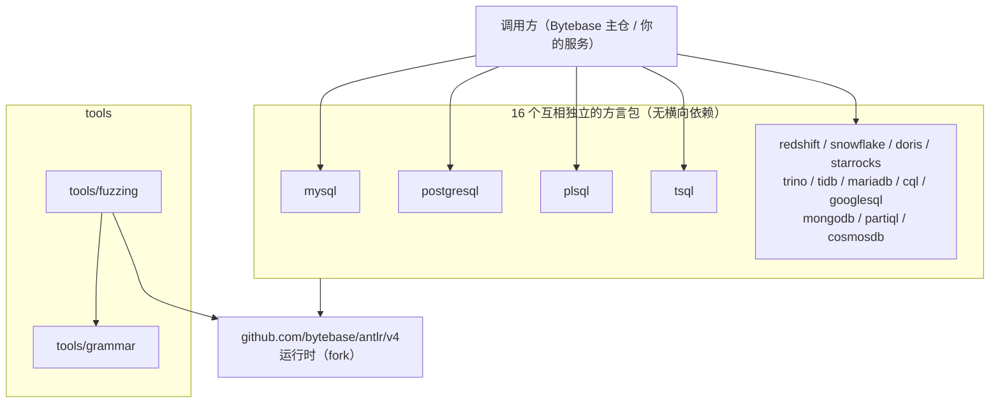
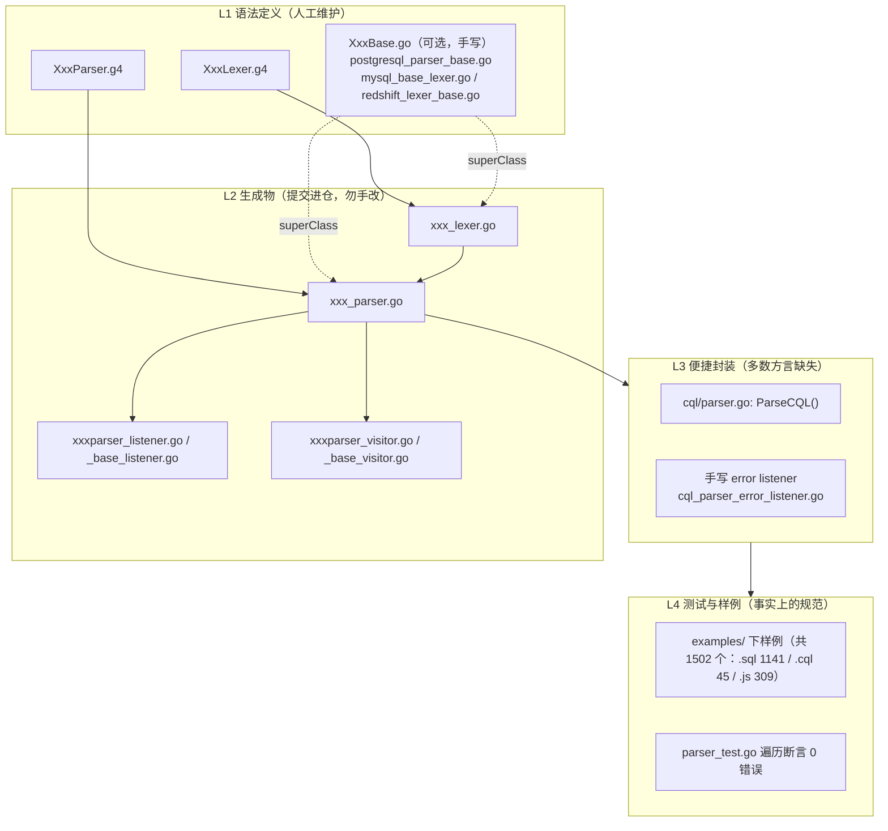
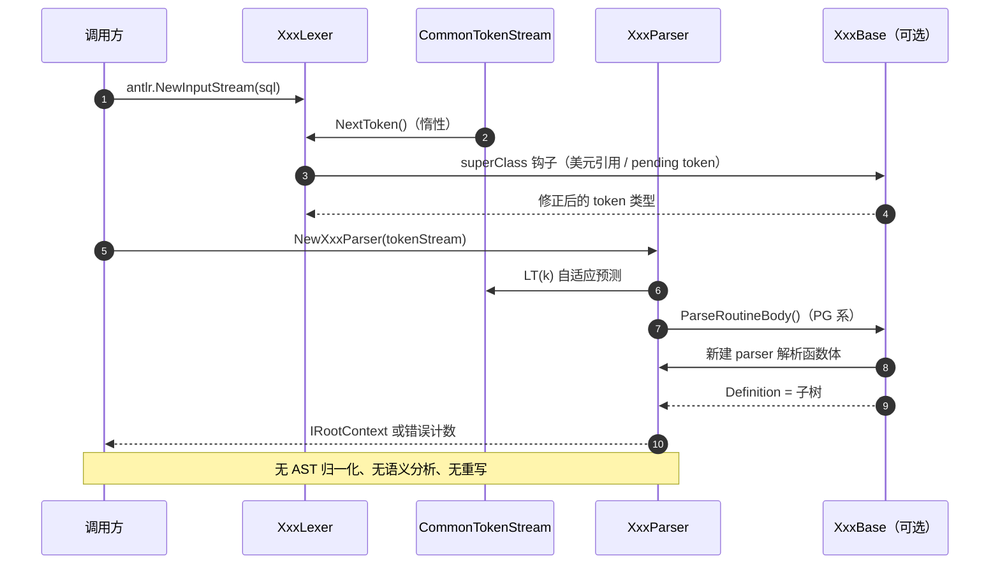

# bytebase/parser 架构笔记（多方言 SQL 解析器集合）

> **仓库路径**：`D:/AgentABC/parser`
> **上游地址**：module 为 `github.com/bytebase/parser`（`go.mod:1`）；本地 origin 为 `https://github.com/LukeLi-EBD/parser.git`
> **语言与规模**：Go 1.24.5（`go.mod:3`），156 个 `.go` / 约 257 万行（绝大多数是生成物），35 个 `.g4`；全仓 1768 个文件 / 约 89 MB（不含 `.git`；含 `.git` 为 1797 文件 / 约 100 MB）
> **版本**：无 tag、无版本文件；`antlr4-go/antlr/v4 v4.13.1` 被 `replace` 到 `github.com/bytebase/antlr/v4`（`go.mod:18`）
> **commit**：`57b6ef7a2640481d8734cd63af0c7b781fa85f22`（Fri Apr 17 15:50:56 2026 +0800）
> **分析时间**：2026-11-04
> **说明**：本仓**没有 README**。结论的第一手证据是根目录 `CLAUDE.md`、`go.mod`、各子目录 `Makefile`/`README.md` 与生成物本身。

---

## 1. 一句话定位 + 仓库事实核查

**它是一套「16 个数据库方言各自独立、但工程约定统一」的 ANTLR4 Go 解析器集合**：每个方言一个 Go 包，包内是该方言 `.g4` 生成的 lexer/parser/listener/visitor，对外只做一件事——喂 SQL 字符串，拿回一棵 ANTLR 语法树。

- **解决什么**：给 Bytebase 这类要同时对接 MySQL/PG/Oracle/Snowflake/Doris/Trino 的产品，提供**离线、不连库、纯 Go** 的 SQL 语法校验与语法树能力。
- **不解决什么**：**没有统一 AST**，没有语义分析、name resolution、血缘、格式化、改写。要这些得在调用侧另建一层。
- **事实核查（逐条给证据）**：
  1. **是 16 个独立包，不是「一套 AST 适配 N 方言」。** 根目录没有任何 `.go`（即无公共包）；16 个子目录的 `package` 名与目录名一一对应（`cosmosdb`…`tsql`）。
  2. **方言之间零代码复用。** 全仓非测试代码里对 `github.com/bytebase/parser/` 的 import 只有 4 处，全在 `tools/fuzzing` 内部（`tools/fuzzing/internal/generator/generator.go:8`、`:9`、`internal/grammar/parser.go:10`、`internal/lexer/token_generator.go:9`）——**没有任何方言 import 另一个方言**。
  3. **属 bytebase 系，不是 vitess/pingcap 的 fork。** 各方言 README 写明语法来源：`plsql`/`tsql`/`mariadb`/`snowflake` 来自 `antlr/grammars-v4`；`doris` 抄 Apache Doris 仓的 `nereids` 语法（`doris/README.md` 给出 apache/doris 原始路径）；`mysql` 来自 **MySQL Workbench 8.0** 的 `library/parsers/grammars`（`mysql/README.md`）。组织方式（每方言一个目录 + Makefile + `examples/` + `parser_test.go`）也是 bytebase 的一贯做法。
  4. **生成物已提交进仓。** `.gitignore` 只忽略 `**/*.interp`（:41）、`**/*.tokens`（:42）、`**/gen/`（:36），**不忽略 `*.go`**。所以 `go get` 即可用，不必装 ANTLR。
  5. **成熟度极不均衡**：`plsql` 的 parser 36.4 万行、`redshift` 25.9 万、`tsql` 24.5 万；而 `cosmosdb` 仅 9.4 千行，`cosmosdb/CosmosDBParser.g4:7` 的根规则是 `root: select EOF;`——**只支持单条 SELECT**。`partiql` 连 `examples/` 都没有。

---

## 2. 技术栈与工程结构

### 2.1 技术栈

| 维度 | 选型 | 证据 |
|---|---|---|
| 解析器生成 | **ANTLR 4**，Go target，`-visitor`（同时出 listener + visitor） | `cql/Makefile:4` `antlr -Dlanguage=Go -package cql -visitor -o . CqlLexer.g4 CqlParser.g4` |
| 运行时 | `antlr4-go/antlr/v4`，替换为 bytebase fork | `go.mod:6`、`go.mod:18` |
| 词法自定义 | 部分方言用 `superClass` 挂手写基类（美元引用、版本注释、`<<`/`>>` 歧义） | `postgresql/PostgreSQLParser.g4:6` `superClass = PostgreSQLParserBase`；`mysql/MySQLLexer.g4:48` `superClass = MySQLBaseLexer` |
| 关键字/函数表 | 部分方言做成 Go 数据（保留/非保留），供上层复用；内置函数同构 | `mysql/keywords.go`（`Keywords56` 版本化列表）、`postgresql/keyword-generator/`、`mysql/builtin_functions.go`、`redshift/builtin_function.go` |
| 测试 | `go test` + `testify/require`；遍历 `examples/*.sql` 断言 0 错误 | `postgresql/parser_test.go:40`（`testSQLFile`）、`:89`（`processDirectory`）、`:106`（`TestPostgreSQLParser`） |
| CI | Actions 按改动目录动态生成 matrix，只测受影响方言 | `.github/workflows/tests.yml`，`ALL_PARSERS="redshift postgresql cql snowflake tsql doris starrocks trino plsql googlesql mysql partiql tidb mariadb cosmosdb mongodb"` |
| 模糊测试 | 用 ANTLR 解析 `.g4` 本身，再按语法随机生成输入 | `tools/grammar/`（`ANTLRv4Lexer.g4` 的生成物）、`tools/fuzzing/internal/{grammar,generator,lexer,config}` |

### 2.2 模块划分表

| 目录/模块 | 职责 | 是否核心 |
|---|---|---|
| `mysql` | MySQL 8.0（Workbench 语法 + 手写 lexer 基类） | ★★★ |
| `postgresql` | PG（`root: stmtblock EOF`，含 `plsqlroot` 支持函数体二次解析） | ★★★ |
| `plsql` | Oracle 11g/12c PL/SQL（36.4 万行 parser，全仓最大） | ★★★ |
| `tsql` | SQL Server（含 `GO` 批处理分隔等） | ★★★ |
| `redshift` / `snowflake` | Redshift（PG 方言变体）/ Snowflake | ★★ |
| `doris` / `starrocks` / `trino` / `tidb` / `mariadb` | 各自方言；`doris` 语法原样搬运，`starrocks` 语法拆为 `StarRocksSQL.g4`（import `StarRocksSQLLex.g4`）两文件 | ★★ |
| `cql` | Cassandra CQL（**不是 SQL**，但复用同一套约定；唯一带 `parser.go` 便捷函数 `ParseCQL` 的方言） | ★★ |
| `googlesql` | GoogleSQL（BigQuery/Spanner 风格，含 `graph_*` 图查询规则） | ★★ |
| `mongodb` | **Mongo Shell 脚本**（`mongoshell_parser.go`），语法对象是 `db.coll.find({...})` 的 JS 调用 | ★ |
| `partiql` / `cosmosdb` | PartiQL（测试数据来自 `partiql-tests` 子模块）/ Cosmos DB（能力极窄） | ★ |
| `tools/grammar` | 用 ANTLR 解析 ANTLR 语法（元循环），给 fuzz 提供语法模型 | ★ |
| `tools/fuzzing` | 基于语法模型的随机 SQL 生成 + token 生成 | ★ |

> `tools` 不是方言。除去 `tools`，方言数为 **16**。

### 2.3 模块依赖图



关键读法：**所有方言只依赖 ANTLR 运行时，彼此之间没有任何边**。所以「一套 AST 适配 N 方言」在本仓不成立——换来的是「加一个方言 = 加一个目录，不动任何已有代码」。

---

## 3. 整体架构

### 3.1 分层图



**没有 L5。** 仓里不存在 `ast`、`semantic`、`rewrite`、`format` 这类包；解析产物就是 ANTLR 的 `antlr.Tree` / `IRootContext`。

### 3.2 核心组件职责表

| 组件 | 代码位置 | 职责 |
|---|---|---|
| `CqlParser` / `PostgreSQLParser` | `cql/cql_parser.go:1908`、`postgresql/postgresql_parser.go:8104`（均为 `Root()`） | 生成物；`Root()` 是每个方言固定的入口 |
| `PostgreSQLParserBase` | `postgresql/postgresql_parser_base.go` | `ParseRoutineBody()` 对 `CREATE FUNCTION ... AS $$...$$` 做**函数体二次解析** |
| `MySQLBaseLexer` | `mysql/mysql_base_lexer.go:9`、`NextToken()` `:17` | **pending token 队列**（版本注释 `/*!40101 ... */`、`DELIMITER` 需一次吐多 token） |
| `RedshiftLexerBase` | `redshift/redshift_lexer_base.go:10`（`pushTag` `:17`、`isTag` `:21`、`popTag` `:28`） | **美元引用标签栈**，栈容器见 `redshift/string_stack.go:11` |
| `ParseCQL()` | `cql/parser.go:9` | 全仓唯一的「一行式」API：lexer → token stream → parser → 装 listener → `Root()` → 有错返 error |
| `ErrorListener` | `cql/cql_parser_error_listener.go:25`/`:32` | 收集 `SyntaxError` 而不 panic，供上层判断合法性 |
| `ParseService` | `postgresql/parser_test.go:118`、`Parse()` `:128` | 可复用 parser 封装（`Reset` + `SetInputStream`）；`BailErrorStrategy` 首错即停 |
| `ANTLRv4Parser` | `tools/grammar/antlrv4_parser.go` | 元循环：用 ANTLR 解析 `.g4`，供 fuzz 使用 |

---

## 4. 端到端主链路

以 **PostgreSQL** 为例（其余方言只差根规则名与是否二次解析）。

### 步骤 1：读入 SQL 文本，构造字符流

- 入口：`postgresql/parser_test.go:40` → `testSQLFile()`；生产代码对应 `antlr.NewInputStream(string(data))`
- 逻辑：`os.ReadFile` 读整个文件（不逐行）。ANTLR 的 `InputStream` 是 UTF-8 码点流，不是 byte 流，中文注释不会错位。
- 产出：`antlr.CharStream`。

### 步骤 2：词法分析

- 入口：`NewPostgreSQLLexer(input)`（生成于 `postgresql/postgresql_lexer.go`，测试里在 `parser_test.go:49`）
- 逻辑：`PostgreSQLLexer.g4` 定义 token（关键字大小写不敏感、`E'...'`、`U&'...'`、`$tag$...$tag$`、嵌套块注释）。遇 `$tag$` 时经 `superClass`（`PostgreSQLParser.g4:6`）调手写方法维护标签栈；数字溢出等边界由 `postgresql_lexer_base.go` 修正 token 类型。lexer **按需拉取**（`NextToken`），非全量扫描。
- 产出：`antlr.TokenSource`（惰性）。

### 步骤 3：装填 token 流

- 入口：`postgresql/parser_test.go:51` → `antlr.NewCommonTokenStream(lexer, 0)`
- 逻辑：缓存 token 并支持任意位置 `LT(k)` 回溯——这是 ALL(*) 能处理 SQL 强歧义的前提。第二个参数 `0` 即默认通道，注释/空白走隐藏通道，parser 看不到。
- 产出：`antlr.TokenStream`。

### 步骤 4：语法分析

- 入口：`postgresql/postgresql_parser.go:8104` → `func (p *PostgreSQLParser) Root()`
- 逻辑：由 `PostgreSQLParser.g4:16` 的 `root : stmtblock EOF ;` 生成，规则体三段式：`enterRule` → `match` 序列（每个 `stmt` 是一次 ALL(*) 决策）→ `exitRule`。`stmt` 是巨型 alternation（`altereventtrigstmt | altercollationstmt | ...`），ANTLR 用自适应预测选分支。`BuildParseTrees=true` 才挂树，置 `false` 只做校验（benchmark 里对比过）。
- 产出：`IRootContext`（`RuleContext` 组成的语法树）。

### 步骤 5：错误处理

- 入口：`postgresql/parser_test.go:54-63`（移除默认 listener、装 `CustomErrorListener`）
- 逻辑：默认 `ConsoleErrorListener` 只打 stderr、不改控制流；生产用法必须换成计数 listener。测试还断言 `tree.GetStart().GetTokenIndex()` 等于首个默认通道 token、`GetStop()` 等于最后一个非 EOF token（`:83-84`），用于抓「提前结束但没报错」的静默失败。
- 产出：`errors int`；>0 即不合法。

### 步骤 6（仅 PG/PLSQL/Redshift）：函数体二次解析

- 入口：`postgresql/postgresql_parser_base.go` → `ParseRoutineBody()`
- 逻辑：`AS $$ BEGIN ... END $$ LANGUAGE plpgsql` 的函数体对主语法只是一个字符串常量。基类用 `GetRoutineBodyString()` 处理 `'...'`、`E'...'`、`U&'...'`、`$tag$...$tag$` 四种常量，再按 `LANGUAGE` 决定用 `Plsqlroot()` 还是 `Root()` 重建一个 parser 解析，结果挂到 `Func_asContext.Definition`。**这是全仓唯一的「树中树」**，也是遍历时最易踩空处（`Definition` 可能为 nil）。
- 产出：嵌套的第二棵树（或 nil）。

### 步骤 7：语义 / 重写

- **没有这一步。** 仓内不存在语义检查、类型推导、表名解析、AST 归一化。语法树即最终产物，直接交给调用方（Bytebase 主仓的 `plugin/parser` 在此之上做 catalog 与 AST 转换，不在本仓）。



---

## 5. 核心代码路径清单

| 文件路径 | 关键类/函数 | 作用 | 优先级 |
|---|---|---|---|
| `CLAUDE.md` | `:3`（定位）、`:19`（`make build`）、`:33`（`make test`） | 唯一的项目级说明 | ★★★ |
| `go.mod` | `:1` module、`:18` replace | 上游归属与运行时 fork | ★★★ |
| `cql/parser.go` | `ParseCQL()` `:9` | **全仓唯一成品 API**，照它抄即可 | ★★★ |
| `cql/Makefile` | `:4` `antlr -Dlanguage=Go -package cql -visitor -o .` | 生成命令的唯一权威写法 | ★★★ |
| `cql/cql_parser_error_listener.go` | `NewErrorListener()` `:25`、`SyntaxError()` `:32` | 错误收集器样板 | ★★ |
| `postgresql/PostgreSQLParser.g4` | `:6` `superClass`、`:16` `root`、`:32` `stmt` | PG 语法入口与手写基类挂载点 | ★★★ |
| `postgresql/postgresql_parser.go` | `Root()` `:8104` | 生成物；所有遍历从这里下钻 | ★★★ |
| `postgresql/postgresql_parser_base.go` | `ParseRoutineBody()`、`GetRoutineBodyString()` | 函数体二次解析（树中树） | ★★★ |
| `mysql/MySQLLexer.g4` | `:48` `superClass`、`:49` `tokenVocab = predefined` | MySQL 词法定制入口（`predefined` 缺失，见 §10） | ★★★ |
| `mysql/mysql_base_lexer.go` | `NextToken()` `:17` | pending token 队列（版本注释 / DELIMITER） | ★★★ |
| `mysql/keywords.go` | `Keywords56` 等 | 版本化关键字表（保留/非保留） | ★★ |
| `redshift/string_stack.go` | `StringStack` `:11`、`Pop()` `:19` | 美元引用标签栈的容器（配 `redshift_lexer_base.go:17`） | ★ |
| `postgresql/parser_test.go` | `testSQLFile()` `:40`、`processDirectory()` `:89`、`ParseService.Parse()` `:128` | 测试与「复用 parser」的标准姿势 | ★★★ |
| `cql/parser_test.go` | `TestCQLParser()` `:40`、`TestCQLParserPerformance()` `:182` | 最简测试样板 | ★★ |
| `.github/workflows/tests.yml` | `ALL_PARSERS=...` | 方言清单与按改动跑测 | ★★ |

---

## 6. 关键设计点

**设计 1：方言隔离 = Go 子包 + 独立 `.g4` + 独立 Makefile，而非接口抽象。**
为什么：各方言 token 集合、关键字歧义、类型系统完全不同（PG 的 `stmt` 有上百个分支，CosmosDB 只有一个 `select`）。硬抽公共 AST 会立刻被方言特例撑爆；「各写各的」成本最低，加/删方言不影响他人。
代价：**消费者必须自己写 16 套适配**。想「统一遍历」只能在调用侧为每个方言实现 visitor（这正是 Bytebase 主仓 `plugin/parser` 存在的原因）。16 份生成代码共 257 万行，`go build` 与 IDE 索引都慢。

**设计 2：生成物提交进仓，`make build` 是开发者动作而非构建动作。**
为什么：消费方不可能要求本机装 Java + ANTLR；且 ANTLR 不同小版本生成代码有差异，锁死生成物才可重现。
代价：**语法与生成物时刻可能不同步**。改了 `.g4` 忘了 `make build`，测试跑的是旧代码且不报错（CI 只跑 `make test`）。`CLAUDE.md:15` 用全大写强调「Always generate the parser」，说明这是真实踩过的坑。

**设计 3：用 `superClass` 把 ANTLR 表达不了的东西下放到 Go。**
为什么：SQL 词法有大量上下文相关行为——`$tag$` 需要栈、MySQL 版本注释需一次吐多 token、`<<`/`>>` 既可能是操作符又可能是尖括号。`.g4` 没有可变状态，只能在生成的 `BaseLexer`/`BaseParser` 子类里写命令式代码再挂钩。
代价：**方言不再是「纯 .g4」**。读语法必须同时读 `*_lexer_base.go`/`*_parser_base.go`，否则漏一半行为；手写文件与生成文件的耦合是隐式的（生成器只知道方法名，不知道语义）。

**设计 4：测试即规范——`examples/` 就是验收标准。**
为什么：SQL 方言没有机器可读的权威规范，唯一可靠真值是「真实 SQL 能不能解析」。所以多数方言都有 `examples/`（`cql` 用 `.cql`、`mongodb` 用 `.js`，`partiql` 缺失），测试遍历断言 0 错误（`parser_test.go:106`）。PG 的 218 个样例直接来自 PG 回归测试套件（文件名 `aggregates.sql`、`brin.sql` 与 PG 源码 `src/test/regress/sql/` 一致）。
代价：只验证「能解析」，不验证「解析对不对」。树结构没有任何断言——`parser_test.go:85` 那句被注释掉的 `require.Equal(t, string(data), stream.GetTextFromTokens(...))` 就是曾想做 token 往返校验但放弃的痕迹。数量也极不均衡：`plsql` 342、`mongodb` 309、`postgresql` 218，而 `starrocks` 1、`tidb` 2。

**设计 5：用 `replace` 指向自家 ANTLR fork。**
为什么：官方 Go runtime 在错误恢复、`BailErrorStrategy`、大文件性能上有已知问题，fork 可自行打补丁而不用等上游。
代价：**replace 会传染**。任何 import 本仓的项目，`go mod tidy` 后都会带上同一条 replace（否则类型不兼容），等于被迫使用同一 runtime fork。

---

## 7. 扩展点

### 7.1 加一种方言

1. 建目录 `newdb/`，放 `NewDBLexer.g4` + `NewDBParser.g4`（可从 `antlr/grammars-v4` 或目标库自身 repo 抄）。
2. parser 语法要有 **`root` 规则且以 EOF 结尾**（参照 `PostgreSQLParser.g4:16`、`GoogleSQLParser.g4:7` 的 `root: stmts EOF;`）。例外存在（`trino` 用 `statements`、`mysql` 用 `script`），但统一叫 `root` 能让测试代码直接复制。
3. 写 `newdb/Makefile`，照 `cql/Makefile:4` 改 `-package newdb` 与两个文件名；**注意 `-o .`**，生成物落在同目录。
4. 装 ANTLR 后 `make build`，确认生成 `newdb_lexer.go`、`newdb_parser.go`、`newdbparser_{listener,base_listener,visitor,base_visitor}.go`。
5. 建 `examples/*.sql`，抄 `cql/parser_test.go`（约 40 行）写 `parser_test.go`，跑 `make test`；并更新 `.github/workflows/tests.yml` 的 `ALL_PARSERS`，否则 CI 不测新方言。
6. 满足以下任一条件时需写 `superClass` 基类：上下文相关词法（栈/模式切换）、需二次解析、需修正默认歧义处理。

### 7.2 加一个「AST 节点」

- **改语法（新增语句/子句）**：直接改 `XxxParser.g4` 再 `make build`。生成物会多出 `IXxxContext` 与 `XxxContext`——**这就是本仓意义上的「新节点」**。命名必须与现有规则一致（全小写下划线分词，如 `createfunc_opt_item`），否则生成的方法名（`AllCreatefunc_opt_item()`）与手写基类对不上。
- **想要真正的归一化 AST**：不要在 16 个方言里各写一套。正确做法是在**调用侧**建一层：定义统一 `Node` 接口，为每个方言实现 `Visitor`（生成物已带 `xxxparser_base_visitor.go`）做翻译。Bytebase 主仓就是这么做的，本仓刻意只做语法层。

### 7.3 接入新的下游

- **只要语法校验**：`NewXxxLexer` → `NewCommonTokenStream` → `NewXxxParser` → 装 listener → `p.Root()`，看错误计数。抄 `cql/parser.go:9`，20 行。
- **要遍历结构**：用 `XxxParserBaseVisitor`（`-visitor` 已开），按 `Context` 类型 `switch`。注意 `ParseRoutineBody` 的 `Definition` 子树不会被自动访问，要手动下钻。
- **要接审核/血缘/格式化**：本仓不够，需在上层补 catalog（表/列元数据）与语义规则；本仓只给「结构正确的树」。
- **要接 CI 做 SQL 静态检查**：照 `postgresql/parser_test.go:89` 的 `processDirectory` 遍历 `.sql`，把「0 错误」变成门禁。

---

## 8. 本地跑起来 / 调试入口

**只跑测试（不用装 ANTLR，生成物已在仓里）**

```bash
cd D:/AgentABC/parser
go test ./cql/...                                   # 单方言，最快
go test ./postgresql/... -run TestPostgreSQLParser -v
go test ./... 2>&1 | tail -30                       # 全量，首次编译很慢
```

**改语法后重新生成**（需 Java 11+ 与 `antlr` 在 PATH）

```bash
cd D:/AgentABC/parser/cql
make build     # = antlr -Dlanguage=Go -package cql -visitor -o . CqlLexer.g4 CqlParser.g4
make test      # = go test -v -run TestCqlParser
```

`postgresql` 多一步：`make build` 会先跑 `generate-keywords`（`postgresql/Makefile:6-8`，`cd keyword-generator && go run main.go`），需要 PG 源码/网络才能生成关键字表。

**断点顺序**

1. `cql/parser.go:28` `tree := p.Root()` —— 树到底建出来没有；`postgresql/postgresql_parser.go:8104` `Root()` —— 看 `enterRule`/`match` 节奏。
2. `cql/parser_test.go:56` 附近 —— `antlr.NewCommonTokenStream(lexer, 0)` 之后遍历 `lexer.GetAllTokens()` 打印 `GetTokenType()`/`GetText()`，排查「关键字被当成标识符」最快。
3. `mysql/mysql_base_lexer.go:17` `NextToken()` —— 版本注释/DELIMITER 类 bug 必看；`postgresql/postgresql_parser_base.go` 的 `ParseRoutineBody()` —— 函数体解析失败必看（`Definition == nil`）。
4. `make -C tools/fuzzing test` —— 用语法随机生成输入撞 panic。

**性能基线**：`postgresql/parser_test.go:197` 的 `TestBenchmarkParser` 会打印四种模式耗时（每文件新建 / 冷启动复用 / 预热后复用 / 不建树）。要压测就照它改。

---

## 9. 阅读路线

**半天（够用某个方言做语法校验）**：`CLAUDE.md` 全文 → `cql/parser.go`（39 行）→ `cql/parser_test.go:40-110` → 目标方言 `.g4` 头部 20 行（看 `superClass`、`tokenVocab`、`root`）。

**两天（能加方言 / 能定位解析 bug）**：`PostgreSQLParser.g4` 的 `root → stmtblock → stmt` 三层，体会 ALL(*) 在巨型 alternation 上的行为 → `postgresql_parser_base.go`（二次解析）→ `mysql_base_lexer.go` + `MySQLLexer.g4:40-60`（superClass 与 tokenVocab 的配合）→ `redshift_lexer_base.go` + `string_stack.go`（栈式词法的最小完整例子）→ `.github/workflows/tests.yml` → 对比两个方言的 `Makefile`。

**一周（能重构 / 能做统一 AST）**：`tools/grammar`（用 ANTLR 解析 ANTLR，理解 `.g4` 元模型）→ `tools/fuzzing/internal/{grammar,generator,lexer}`（如何从语法图生成合法输入）→ 挑差异最大的三个方言（`plsql`、`googlesql`、`mongodb`）读顶层语句集合 → 统计各 `examples/` 的来源，评估覆盖真实性 → 写一个跨方言 `Visitor` 原型，量化「统一 AST」的真实成本。

---

## 10. 未覆盖 / 存疑

1. **`mysql` 重新生成大概率会失败。** `mysql/MySQLLexer.g4:49` 是 `tokenVocab = predefined;`，但仓里**不存在 `predefined.g4` 也不存在 `predefined.tokens`**（`find . -name "predefined*"` 为空），而 `mysql/Makefile:4` 只喂两个 `.g4`。按 ANTLR 行为缺 `.tokens` 会直接报错。**这是推断，我没有实际执行 `make build`**；已知 `mysql_lexer.go` 已提交，运行时不受影响。
2. **ANTLR 版本未锁。** 生成物头部统一标注 `ANTLR 4.13.2`（如 `cql/cqlparser_base_listener.go:1`），但仓里没有 `.antlr-version`、没有 Docker 镜像、Makefile 也没写版本。用错版本重新生成会产生几万行无意义 diff，这是本仓最大的可重现性风险。
3. **`partiql` 几乎没有样例。** `partiql/` 下没有 `examples/` 目录，`parser_test.go:39` 直接读包根的 `simple.sql`（`filepath := "simple.sql"`）——测试会跑，但只覆盖一个文件。
4. **`starrocks`（1 个样例）/ `tidb`（2 个）覆盖近乎为零**，生产可用性本仓给不出答案。
5. **`cosmosdb` 只支持 `root: select EOF`**（`CosmosDBParser.g4:7`），不能多语句、不能 DDL；`mongodb` 也**不是 SQL**（解析 `MongoShellParser.g4:29` 的 `program`，即 JS 调用），与之并列是工程约定而非技术同构。
6. **没有语义层是「设计」还是「未完成」无法从仓内判断**（无 TODO/issue 痕迹）；`tools/fuzzing` 的实际有效性也未验证（没跑过，不确定能否稳定产生 crash）。

---

## 在你的数据栈里的位置

`parser` 处在**「SQL 文本 → 结构」这一环**，刻意只做到语法树为止，不做语义。
它是 CDC（`debezium`/`canal`）采上来的 DDL 与查询文本的**第一道可编程消费方**：拿到 `ALTER TABLE`，用对应方言包解成树，才能谈「这张表加了什么列」。
向下它把树交给 `dbt` 这类转换层（dbt 做模板渲染与依赖图，不碰方言细节），`metricflow` 再在其上定义指标语义。
所以它的价值不在「算得对」，而在**「不连数据库也能判断这条 SQL 属于哪个方言、结构长什么样」**——这是整条链里唯一的纯离线语法能力。

---

## 修订记录

> 2026-11-04 对照本地仓库 `D:/AgentABC/parser` 逐条核验。共核对代码路径/行号引用 39 处，其中失效/错位 14 处（另 5 处规模/文件类陈述与实测不符）；另核对类名/函数名/包名/配置项约 30 个。结论：文档主干判断（16 个独立方言包、无横向依赖、无 AST/语义层、生成物入库）全部成立，问题集中在行号偏移与规模数字，属小修。

| # | 位置 | 原表述 | 核实结果（源码依据） | 处理 |
|---|---|---|---|---|
| 1 | 文档头部 | 「全仓约 1768 文件 / 104 MB（含 `.git`）」 | 实测不含 `.git`：1768 文件 / 89.3 MB；含 `.git`：1797 文件 / 100.2 MB | 已改为「1768 个文件 / 约 89 MB（不含 `.git`；含 `.git` 为 1797 文件 / 约 100 MB）」 |
| 2 | §1 事实核查 2 | 「import 只有 4 处…（`generator.go:8`、`parser.go:10`、`token_generator.go:9`）」 | 实测非测试 import 4 行，其中 `generator.go:8` `"…/internal/config"`、`generator.go:9` `"…/internal/grammar"` | 补列 `generator.go:9` |
| 3 | §2.2 模块表 | 「`starrocks` 单文件语法」 | `starrocks/StarRocksSQL.g4:15` `grammar StarRocksSQL;`、`:16` `import StarRocksSQLLex;`，另有 `StarRocksSQLLex.g4`（共 2 个 `.g4`） | 已改为「语法拆为 `StarRocksSQL.g4`（import `StarRocksSQLLex.g4`）两文件」 |
| 4 | §3.1 L4 | 「`examples/*.sql`（共 1476 个）」 | 各 `examples/` 共 1502 个文件：`.sql` 1141、`.cql` 45、`.js` 309、`.tree` 6、`.md` 1 | 已改为「examples/ 下样例（共 1502 个：.sql 1141 / .cql 45 / .js 309）」 |
| 5 | §3.2 组件表 | `mysql/mysql_base_lexer.go:10`、`NextToken()` `:16` | `:9` `type MySQLBaseLexer struct`、`:10` `*antlr.BaseLexer`；`:17` `func (l *MySQLBaseLexer) NextToken() antlr.Token` | 已改为 `:9`、`:17` |
| 6 | §3.2 组件表 | `redshift_lexer_base.go:9`（`pushTag` `:15`、`isTag` `:19`、`popTag` `:27`） | `:10` `type RedshiftLexerBase struct`；`:17` `func (receiver *…) pushTag()`、`:21` `isTag()`、`:28` `popTag()` | 已改为 `:10`（`:17`/`:21`/`:28`） |
| 7 | §4 步骤 2 | 「测试里在 `parser_test.go:53`」 | `postgresql/parser_test.go:49` `lexer := pgparser.NewPostgreSQLLexer(input)`；`:53` 实为 `p := pgparser.NewPostgreSQLParser(stream)` | 已改为 `:49` |
| 8 | §4 步骤 3 | 「`postgresql/parser_test.go:55` → `antlr.NewCommonTokenStream(lexer, 0)`」 | `:51` `stream := antlr.NewCommonTokenStream(lexer, 0)`；`:55` 实为 `lexer.RemoveErrorListeners()` | 已改为 `:51` |
| 9 | §4 步骤 5 | 「`:57-63`（移除默认 listener、装 `CustomErrorListener`）」 | `:54` `lexerErrors := &CustomErrorListener{}` … `:60` `p.AddErrorListener(parserErrors)`、`:62` `p.BuildParseTrees = true`（`:57` 是空行） | 已改为 `:54-63` |
| 10 | §4 步骤 5 | 「（`:68-86`）」（GetStart/GetStop 断言） | `:83` `require.Equal(t, start, tree.GetStart().GetTokenIndex())`、`:84` `require.Equal(t, stop, tree.GetStop().GetTokenIndex())` | 已改为 `:83-84` |
| 11 | §5 路径表 | `CLAUDE.md` `:37`（`make test`） | `CLAUDE.md:33` `make test`；`:37` 为空行 | 已改为 `:33` |
| 12 | §5 路径表 | `mysql/mysql_base_lexer.go` `NextToken()` `:16` | `:16` `// NextToken implements antlr.TokenSource`（注释），函数定义在 `:17` | 已改为 `:17` |
| 13 | §5 路径表 | 「配 `redshift_lexer_base.go:15`」 | `:15` 是 struct 结束 `}`；`:17` `func (receiver *RedshiftLexerBase) pushTag()` | 已改为 `:17` |
| 14 | §6 设计 4 | 「每方言都有 `examples/*.sql`」 | `cql/examples/` 为 45 个 `.cql`、`mongodb/examples/` 为 309 个 `.js`、`partiql/` 无 `examples/`（仅 `simple.sql`） | 已改为「多数方言都有 `examples/`（`cql` 用 `.cql`、`mongodb` 用 `.js`，`partiql` 缺失）」 |
| 15 | §6 设计 4 | 「`parser_test.go:86` 那句被注释掉的…」 | `postgresql/parser_test.go:85` `// require.Equal(t, string(data), stream.GetTextFromTokens(…))` | 已改为 `:85` |
| 16 | §8 | 「`postgresql/Makefile:7`，`cd keyword-generator && go run main.go`」 | `:6` `generate-keywords:`、`:7` `@echo "Generating…"`、`:8` `cd keyword-generator && go run main.go` | 已改为 `:6-8` |
| 17 | §8 断点 2 | 「`cql/parser_test.go:52` 附近 —— `stream.Fill()` 后遍历 `GetAllTokens()`」 | 该文件无 `stream.Fill()`/`GetAllTokens()` 调用；`:56` 为 `stream := antlr.NewCommonTokenStream(lexer, 0)` | 已改为 `:56` 建流后遍历 `lexer.GetAllTokens()` |
| 18 | §8 断点 3 | 「`mysql/mysql_base_lexer.go:16` `NextToken()`」 | 函数定义在 `:17` | 已改为 `:17` |
| 19 | §10.2 | 「ANTLR 版本未知且未锁」 | 生成物头 `// Code generated from CqlParser.g4 by ANTLR 4.13.2. DO NOT EDIT.`（`cql/cqlparser_base_listener.go:1`） | 标题改为「版本未锁」，并补版本号出处 |
| 20 | §10.3 | 「`partiql` 的测试可能根本没跑…`parser_test.go` 是按 `examples` 遍历的」 | `partiql/parser_test.go:39-40` `filepath := "simple.sql"` / `content, err := os.ReadFile(filepath)` | 改述为「几乎没有样例，测试只读 `simple.sql`」 |

**核验通过、未改动的关键判断**：
- 16 个方言目录的 `package` 名与目录名一一对应；根目录无 `.go`（仅 `.gitignore`/`CLAUDE.md`/`go.mod`/`go.sum`/`LICENSE`）。
- 方言零横向依赖：非测试代码中 `github.com/bytebase/parser/` 的 import 仅 4 行，全在 `tools/fuzzing/internal/{generator,grammar,lexer}`。
- 规模数字：156 个 `.go`、2,575,487 行、35 个 `.g4`；`plsql_parser.go` 363,747 行、`redshift_parser.go` 259,453、`tsql_parser.go` 244,811、`cosmosdb_parser.go` 9,409。
- 关键入口行号：`cql/cql_parser.go:1908 Root()`、`postgresql/postgresql_parser.go:8104 Root()`、`cql/parser.go:9 ParseCQL()`、`cql/parser.go:28 tree := p.Root()`。
- 测试样板行号：`postgresql/parser_test.go:40/:89/:106/:118/:128/:197`、`cql/parser_test.go:40/:182/:52`（`:52` 为 `input := antlr.NewInputStream(...)`）。
- 语法与配置：`PostgreSQLParser.g4:6/:16/:32`、`GoogleSQLParser.g4:7 root: stmts EOF;`、`MySQLLexer.g4:48/:49`、`CosmosDBParser.g4:7 root: select EOF;`、`MongoShellParser.g4:29 program`、`CLAUDE.md:3/:15/:19`、`.gitignore:36/:41/:42`、`go.mod:1/:3/:6/:18`。
- examples 分布：`plsql` 342、`mongodb` 309、`postgresql` 218、`starrocks` 1、`tidb` 2（均为 `examples/` 下全部文件数）。
- CI：`tests.yml:37` 的 `ALL_PARSERS` 16 项与文档完全一致，且 matrix 确由改动目录生成（`tests.yml:44-62`）。
- 版本事实：无 tag（`git tag` 为空）、`go.mod:3` `go 1.24.5`、commit `57b6ef7…` 与 `2026-04-17 15:50:56 +0800` 一致；`predefined*` 文件确不存在（§10.1 推断成立）。

**未解决/存疑**：§2.2 称 partiql「测试数据来自 `partiql-tests` 子模块」，该说法只见于 `partiql/README.md:6`，但仓内无 `.gitmodules`（`git` 未初始化子模块），实际样例仅 `simple.sql`；因有 README 依据，未改动正文。§6「PG 的 218 个样例直接来自 PG 回归测试套件」仅核对到数量为 218（`.sql` 217 + `README.md` 1），未逐文件比对来源。
