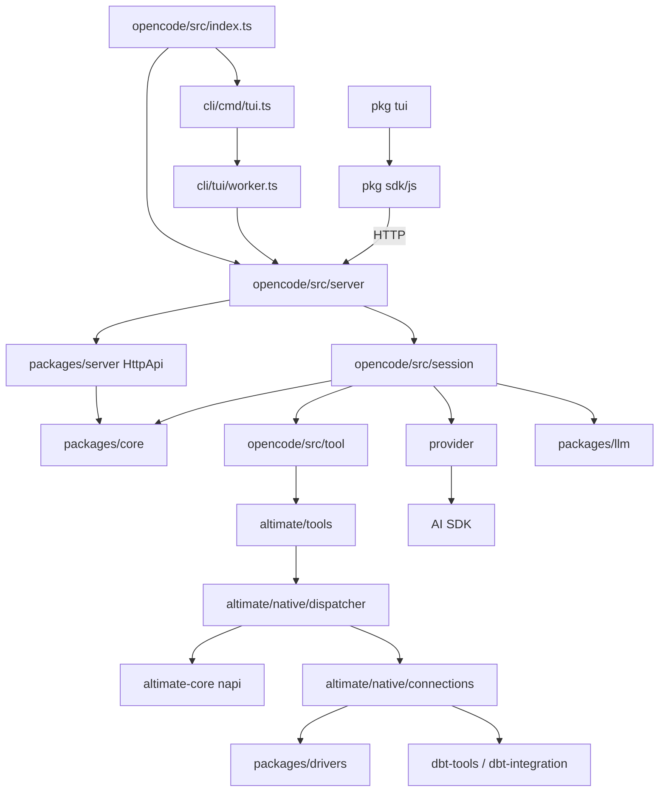
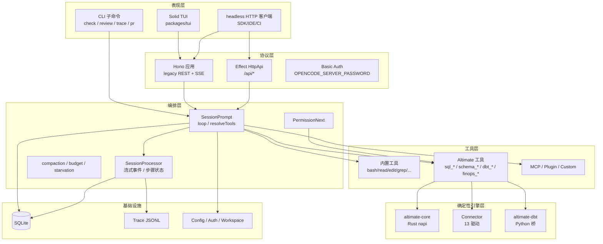

# Altimate Code 架构笔记

> 仓库路径：`D:/agentABC/altimate-code`
> 版本：`1.17.9`（`packages/opencode/package.json`），HEAD commit `3d5a704`
> 语言与规模：TypeScript（Bun + Turbo monorepo）为主，另有 Rust napi 二进制（`@altimateai/altimate-core`）；全仓 TS/TSX 2869 个文件 / 66.8 万行（已排除 `node_modules`、`dist`、`.git`）
> 运行时：Bun 1.x（CLI/TUI/服务端），Node 原生扩展（`napi-rs`），Python 仅在 `altimate-dbt` 的 dbt 集成桥中出现
> 本文分析时间：2026-11-04

---

## 1. 一句话定位

**Altimate Code 是面向数据工程（SQL / dbt / 数仓）的终端 AI Agent：它把"模型会写 SQL"这件事，拆成"模型负责编排 + 确定性工具负责结论"。**

它是 OpenCode（终端 AI coding agent）的一个深度 fork：保留了通用的 Agent 骨架（会话、工具调用、权限、LSP、MCP、插件、TUI/服务端），在此之上叠加了一整层数据工程能力——SQL 解析/校验/血缘/改写、dbt 项目理解与执行、数仓连接与查询、FinOps、PR 审查、团队规则学习。

### 1.1 它解决什么问题

| 问题 | 通用 coding agent 的做法 | Altimate Code 的做法 |
|---|---|---|
| SQL 正确性无法验证 | 靠模型"看起来对" | 调 Rust 引擎 `altimate-core` 做方言解析、语义校验、列级血缘、SQL 差异比较 |
| 数仓 schema 不在上下文里 | 只能读仓库文本 | 连接真实数仓，缓存表结构，按需检索/裁剪后注入 |
| dbt 项目结构复杂 | 逐个读文件猜 | 解析 `manifest.json` / `catalog.json`，构建模型-列-依赖图 |
| 大查询烧钱 | 直接执行 | 连接级超时、行数上限、LIMIT 注入、运行时预算 |
| 企业安全 | 无差别执行 | 权限规则 + PII 分类 + 只读/只写分级 + 审计 trace |

### 1.2 它不做什么

- **不是 dbt 的替代品**：不实现 dbt 的编译/物化引擎，而是把 dbt 当作外部命令与产物来源（读 manifest、调 dbt CLI）。dbt 项目仍是唯一的模型定义与执行真相。
- **不是数仓/BI 工具**：不做调度、不做建模平台；只作为客户端连接数仓、执行 SQL。
- **不是 IDE 插件本身**：它是终端进程；IDE 集成通过 MCP 桥（`datamate`）与云 workspace 绑定完成。
- **不保证 SQL 一定正确**：确定性引擎给出可复现的诊断与改写，但"是否该这么改"仍由人和模型判断。

### 1.3 与生态中同类项目的关系

| 项目/品类 | 关系 |
|---|---|
| **dbt Core（及 dbt 兼容项目/平台）** | 上游依赖。Altimate 读取 dbt 产物、调用 dbt 命令完成 `build/test/run`；自身不做建模执行。 |
| **OpenCode（上游）** | 代码骨架来源。Session/Tool/Permission/Provider/TUI/Server 均源自上游，fork 用 `altimate_change` 注释标记差异（两代内核目录 5278 处，全仓 7327 处）。 |
| **Claude Code / Cursor 类通用 Agent** | 同类形态（终端/IDE Agent），差异在"确定性数据工具层"而非通用文件编辑。 |
| **SQLFluff / sqlglot / sqlmesh** | 功能重叠（lint/解析/血缘/transpile），Altimate 用自有 Rust 引擎（`altimate-core`）一次实现并同时服务模型工具与 CLI。 |
| **Altimate VS Code 扩展（DataMate）** | 协同关系。通过 MCP Server（`@altimateai/datamate`，工具前缀 `datamate_`）把 IDE/云端数仓能力借给终端 Agent。 |

---

## 2. 技术栈与工程结构

### 2.1 技术栈

| 层 | 选型 | 证据 |
|---|---|---|
| 包管理与脚本 | Bun workspaces + Turbo | `package.json`、`turbo.json`、`bun.lock` |
| CLI 参数解析 | yargs | `packages/opencode/src/index.ts:99-299` |
| HTTP 服务 | Hono（遗留路由）+ Effect `HttpApi`（V2 路由） | `packages/opencode/src/server/server.ts:256-516` |
| TUI | Solid + OpenTUI，运行在独立包 | `packages/tui/src/app.tsx:228`（`export const run`） |
| 会话存储 | SQLite（`bun:sqlite`）+ Drizzle | `packages/opencode/src/storage/db.ts:51`、`packages/core/src/database/schema.sql.ts` |
| LLM 抽象 | Vercel AI SDK（默认）+ 自研 `packages/llm` 原生协议路由 | `packages/opencode/src/session/llm.ts:112,377`、`packages/opencode/src/session/llm/native-runtime.ts` |
| SQL 智能 | Rust 编译的 napi 模块 `@altimateai/altimate-core` | `packages/opencode/src/altimate/native/altimate-core.ts:11` |
| dbt 执行 | 两条路径：Agent 内直接 `spawn dbt`（`native/dbt/runner.ts:27`）；独立 CLI `altimate-dbt` 经 `@altimateai/dbt-integration` Python 桥（`packages/dbt-tools/src/adapter.ts:100`） | `packages/dbt-tools/src/index.ts`、`packages/dbt-tools/package.json` |
| 数仓驱动 | 13 个连接器，统一 `Connector` 接口 | `packages/drivers/src/index.ts:19-31`、`packages/drivers/src/types.ts:129` |
| 可观测性 | 本地 trace 文件 + OTel GenAI 语义 | `packages/opencode/src/altimate/observability/tracing.ts:31` |

### 2.2 顶层包职责

| 包 | 文件数 / 行数（TS） | 职责 |
|---|---|---|
| `packages/opencode` | 1765 / 48.2 万 | 主程序：CLI、Hono 服务端、会话运行时（V1）、工具目录、Altimate 数据工程层 |
| `packages/core` | 467 / 6.2 万 | V2 共享内核：Effect 服务（会话/工具/权限/Agent/Skill/Provider/事件溯源/DB schema） |
| `packages/tui` | 236 / 3.8 万 | 新版 Solid TUI（`run(TuiInput)`），通过 SDK 客户端访问服务端 |
| `packages/sdk` | 43 / 2.5 万 | 生成式 TypeScript SDK（`@opencode-ai/sdk`），TUI/外部集成的唯一 HTTP 客户端 |
| `packages/server` | 47 / 2664 | V2 `HttpApi` 路由与 handler，挂载到 `/api/*` |
| `packages/drivers` | 62 / 1.67 万 | 数仓连接器（Snowflake/BigQuery/Postgres/Redshift/...），无状态、可单测 |
| `packages/dbt-tools` | 33 / 5801 | 独立 CLI `altimate-dbt`：dbt 项目的确定性检查/操作，供 Agent 与 CI 共用 |
| `packages/llm` | 100 / 1.76 万 | LLM 协议适配层（`protocols/`、`providers/`、`route/`），支撑"原生请求"通道 |
| `packages/plugin` | 8 / 1171 | 插件接口类型（`Hooks`），供第三方扩展会话与工具 |
| `packages/cli` / `util` / `script` | — | npm 包装、通用工具函数、构建脚本 |
| `packages/effect-drizzle-sqlite` / `effect-sqlite-node` / `http-recorder` | — | V2 内核的 SQLite/Effect 适配与 HTTP 录制回放 |

### 2.3 目录树（关键路径）

```
altimate-code/
├── packages/
│   ├── opencode/src/
│   │   ├── index.ts                     CLI 入口（yargs 命令注册）
│   │   ├── cli/cmd/                     serve / run / tui / check / review / trace / pr / github / gitlab / acp ...
│   │   ├── cli/tui/worker.ts            TUI 进程内的 Bun Worker（内嵌 Hono 服务端）
│   │   ├── server/                      Hono 应用、路由、SSE 事件流、实例管理
│   │   ├── session/                     V1 会话运行时：prompt / processor / llm / system / compaction
│   │   ├── tool/                        V1 工具注册表与内置工具
│   │   ├── permission/                  权限规则求值 + pending 请求
│   │   ├── provider/                    Provider/Model 注册与解析
│   │   ├── config/                      配置加载与 Schema
│   │   ├── mcp/  plugin/  skill/  lsp/  pty/  format/
│   │   └── altimate/                    ★ 数据工程层（见 2.4）
│   ├── core/src/                        V2 内核（session runner / tool / permission / agent / event / db）
│   ├── tui/src/                         Solid TUI
│   ├── server/src/                      V2 HttpApi
│   ├── drivers/src/                     数仓连接器
│   ├── dbt-tools/src/                   altimate-dbt CLI
│   └── llm/src/                         LLM 原生协议层
├── docs/docs/                           用户文档（agent-modes / drivers / cli / config ...）
├── specs/                               行为规格与回归清单
└── patches/                             依赖补丁
```

### 2.4 `packages/opencode/src/altimate` 分模块

| 子目录 | 规模 | 职责 |
|---|---|---|
| `native/` | ~10.7k 行 | 与 Rust `altimate-core` 的桥：Dispatcher + 82 个 bridge 方法注册 |
| `tools/` | 89 个文件 / 80 个 `Tool.define` | 模型可见的 SQL/dbt/数仓/FinOps 工具 |
| `validators/` | ~5k 行 | 确定性校验（方言/语义/策略），产出可执行修复建议 |
| `workspace/` | ~14k 行 | Altimate 云 workspace 绑定 + 远端 DataMate 引擎接入 |
| `review/` | ~8k 行 | dbt PR 审查（确定性配方 + LLM 叙述） |
| `learn/` | ~6.9k 行 | 团队规则/教训的采集、存储与注入 |
| `observability/` | ~4k 行 | trace 落盘、消费、上传 |
| `free/`、`onboarding/`、`training/`、`telemetry/` | — | 免费额度、引导、训练样本、遥测 |
| `datamate-transport.ts` | — | 从 IDE 的 MCP 配置同步 DataMate 连接 |

### 2.5 依赖方向



---

## 3. 整体架构

### 3.1 分层视图



### 3.2 核心组件职责表

| 组件 | 代码位置 | 职责 | 关键接口 |
|---|---|---|---|
| CLI 入口 | `packages/opencode/src/index.ts:99-299` | 注册全部子命令、解析参数、设置日志 | yargs `command` |
| TUI 命令 | `packages/opencode/src/cli/cmd/tui.ts:86-280` | 启动 Worker、建立 RPC、渲染 TUI | `TuiInput` |
| TUI Worker | `packages/opencode/src/cli/tui/worker.ts:133-234` | 在 Bun Worker 线程内托管 Hono 服务端 | `rpc.fetch` |
| Hono 服务端 | `packages/opencode/src/server/server.ts:256-516` | REST + SSE + 实例中间件 + 鉴权 | `Server.App()` |
| 实例管理 | `packages/opencode/src/project/instance.ts` | 以目录为 key 提供异步上下文，隔离项目状态 | `Instance.provide` |
| V1 会话运行时 | `packages/opencode/src/session/prompt.ts:379,638` | 组装上下文、循环调用模型、执行工具 | `SessionPrompt.prompt/loop` |
| 流式处理器 | `packages/opencode/src/session/processor.ts:293,382` | 消费 LLM 流，落地 message part 状态与事件 | `SessionProcessor.create/process` |
| LLM 适配 | `packages/opencode/src/session/llm.ts:112,377` | 选择 AI SDK 或原生协议，注入工具、重试、缓存 | `LLM.stream` |
| 工具注册表 | `packages/opencode/src/tool/registry.ts:389,565` | 汇总内置 + Altimate + MCP + Plugin + Custom 工具 | 内部 `all` / 导出 `allInfos` / `tools` |
| 权限引擎 | `packages/opencode/src/permission/evaluate.ts:32-60` | 规则求值 allow/ask/deny | `PermissionEvaluate`（`PermissionNext` 与 V1 `Permission` 共用） |
| 权限请求 | `packages/opencode/src/permission/next.ts:134-164` | 发布请求、挂起等待、回填结果 | `PermissionNext.ask` |
| 原生桥 | `packages/opencode/src/altimate/native/dispatcher.ts:52-144` | 方法名 → 模块 → handler 的调用（首次 call 惰性注册全部模块） | `Dispatcher.call` |
| 连接注册处 | `packages/opencode/src/altimate/native/connections/registry.ts:43,505` | 连接配置解析、凭据、驱动实例化 | `Registry.get(name)` |
| 数仓驱动 | `packages/drivers/src/types.ts:129` | 统一连接/查询/元数据接口 | `Connector` |
| dbt CLI | `packages/dbt-tools/src/index.ts:116` | dbt 项目命令封装（Python 桥） | `main()` |
| V2 内核 | `packages/core/src/session/runner/llm.ts:174-219` | Effect 版会话执行（事件溯源） | `SessionRunner.run` |
| V2 HTTP | `packages/server/src` | `/api/*` 的 Effect HttpApi | 生成 handler |

### 3.3 进程模型

```text
┌────────────────────────── altimate (无参数) ──────────────────────────┐
│ 主线程（Bun）                                                          │
│  ├─ TUI 渲染（Solid/OpenTUI）                                          │
│  ├─ SDK client（fetch 被替换为 Rpc.fetch）                              │
│  └─ RPC 通道（postMessage / MessagePort）                              │
│         │                                                              │
│         ▼                                                              │
│ Worker 线程（Bun Worker）                                              │
│  ├─ Hono Server（默认走 Server.Default().fetch，进程内；仅外部服务器模式才 listen） │
│  ├─ Session 运行时 / 工具 / 权限 / DB                                   │
│  └─ trace consumer / 事件总线                                          │
└────────────────────────────────────────────────────────────────────────┘

┌──────────────────────────── altimate serve ───────────────────────────┐
│ 单进程：Hono 监听 hostname:port（默认端口来自 config.server）           │
│ 每请求按 x-opencode-directory / x-opencode-workspace 加载 Instance      │
│ 外部客户端（IDE/SDK/CI）经 HTTP + SSE 使用                              │
└────────────────────────────────────────────────────────────────────────┘

┌──────────────────────────── altimate run ─────────────────────────────┐
│ 单进程：无 TUI，直接驱动一次会话，把流式结果打印到 stdout               │
└────────────────────────────────────────────────────────────────────────┘
```

证据：`packages/opencode/src/cli/cmd/tui.ts:175-280`、`packages/opencode/src/cli/tui/worker.ts:133-234`、`packages/opencode/src/cli/cmd/serve.ts:26-74`。

### 3.4 两代运行时并存（重要）

代码里同时存在两套会话内核，必须分清：

| 维度 | V1（当前 TUI/CLI 实际走的那套） | V2（`packages/core` + `packages/server`） |
|---|---|---|
| 入口 | `SessionPrompt.prompt/loop` | `SessionRunner.run` |
| 位置 | `packages/opencode/src/session/` | `packages/core/src/session/` |
| 模型调用 | AI SDK `streamText`（`session/llm.ts:377`） | `@opencode-ai/llm` 客户端 + `runTurnAttempt` |
| 事件 | `Bus` + `message.part.updated` 等广播 | `EventV2` + 事件表 + `Projector` 重放 |
| 工具 | `ToolRegistry` + `Tool.define`（Zod） | `ToolRegistry.materialize` / `settle`（Effect） |
| HTTP | Hono `/session`、`/event` 等 | Effect `HttpApi`，挂在 `/api/*` |
| 状态 | V1 message/part 表 | 事件序列 + 投影表 |

`server.ts:375-390` 把 `/api/*` 与若干 `/experimental/*`、`/sync/*` 转发给 V2 HttpApi，其余走遗留 Hono 路由；TUI 仍主要调用遗留路由。**结论：这是一次进行中的渐进式重写，V2 已能承载新 SDK/云同步，但主对话链路仍是 V1。**

---

## 4. 端到端主链路

### 4.1 场景 A：在 TUI 里说"帮我看看这个模型为什么慢"

```text
用户输入
  → packages/tui 的输入/会话组件
  → SDK 客户端发起 POST /session/:id/message
  → fetch 被替换为 Rpc.fetch（cli/cmd/tui.ts:217-241）
  → Worker 线程 rpc.fetch → Server.Default().fetch（cli/tui/worker.ts:155）
  → Hono POST /session/:sessionID/message（server/routes/session.ts:901-959）
  → SessionPrompt.prompt(input)（session/prompt.ts:379）
  → SessionPrompt.loop(sessionID)（session/prompt.ts:638）
```

`loop` 内部单步：

1. **选 Agent / Model**：从 `Agent.get` 与 `Provider.getModel` 解析；`builder`/`analyst`/`plan` 等模式决定工具集与系统提示（`agent.ts:303-471`）。
2. **建上下文**：`Session.system` 拼装 `instructions / provider / environment / currentDate / skills`（`session/system.ts:38-114`）；读 `AGENTS.md`、Altimate 团队规则（`altimate/learn/select.ts:71` 的 `core(lessons, limit)` 打分选择，提示词在 `altimate/learn/prompt.txt`）。
3. **解析工具**：`resolveTools()`（`session/prompt.ts:2688`）把 `ToolRegistry.tools()` 的结果包装为 AI SDK tool：包一层 Zod 输入、权限求值、插件前后钩子。执行时依次经过 `Plugin.trigger("tool.execute.before")`（2792-2800）→ `item.execute`（2804）→ `Plugin.trigger("tool.execute.after")`（2819-2840）。
4. **调模型**：`SessionProcessor.process()`（`session/processor.ts:382`）→ `LLM.stream()`（`session/llm.ts:112`）→ `streamText()`（377）。
5. **流式落地**：processor 把 `text-delta / reasoning-delta / tool-input-* / tool-result` 转成 message part，写库并 `Bus.publish`；Hono 的 `/event` SSE（`server/routes/event.ts:12-34`）把事件推回 TUI。
6. **工具执行**：模型返回 tool call 后，processor 触发上一步的 execute；结果作为 `tool` part 回填，进入下一轮 `loop`。
7. **终止**：无工具调用、或命中 `maxSteps`、或 run budget / starvation breaker 触发。
8. **收尾**：写 token/成本统计，触发标题生成、快照、trace 落盘。

### 4.2 场景 B：`sql_execute` 从模型到数仓

这是"确定性落地"的最典型一条链：

```text
模型选择工具 sql_execute
  → altimate/tools/sql-execute.ts:126  ctx.ask({permission:"sql_execute", ...})   // 只读分支
  → altimate/tools/sql-execute.ts:224  ctx.ask({permission:"sql_execute_write"})  // 写语句分支
                                        → PermissionNext.ask → 事件 → TUI 弹窗 → /permission/:requestID/reply
  → altimate/workspace/precedence.ts:879  Precedence.check(sessionID, "sql_execute", warehouse)
        └─ 若该 warehouse 类型已由 workspace 引擎物化且可调用 → 返回 redirect，提前结束（不跑本地查询）
  → altimate/tools/sql-execute.ts:278  Dispatcher.call("sql.execute", ...)（query_from 的源查询在 135，仅取 2 行预览）
  → altimate/native/dispatcher.ts:52-105    惰性注册后按方法名查 handler
  → altimate/native/connections/register.ts:505  sql.execute handler
        ├─ altimate/native/connections/registry.ts:505 Registry.get(warehouse) 取 Connector
        ├─ register.ts:155-171  resolveDefaultTarget：存在 dbt adapter 时 source=dbt，否则回退首个本地连接
        ├─ register.ts:218  adapter.immediatelyExecuteSQLWithLimit（注入行数上限）
        ├─ altimate/native/schema-resolver.ts:291 prepareSql（schema 折叠/规范化）
        └─ Connector.query(...) → 数仓
  → 结果回填：行数上限、PII 列脱敏/拦截
  → tool part → SSE → TUI
```

关键点：
- 工具**不直接**持有连接；连接与凭据集中在 `native/connections`。
- `sql.execute` 是**进程内函数调用**：Dispatcher 的方法表在首次 `call` 时惰性注册（`native/index.ts:9-16`），不是进程间协议；`dispatcher.ts:4-5` 的注释写明"所有 bridge 方法已原生实现，Python 桥不再使用"（注释里的 73 已过时，`BridgeMethods` 实际有 82 项）。
- dbt 相关工具有两条链：Agent 内 `native/dbt/runner.ts:27` 直接 `execFile("dbt", ...)`；独立 CLI `altimate-dbt` 走 `@altimateai/dbt-integration`（Python，`dbt-tools/src/adapter.ts:100`）。

### 4.3 场景 C：权限请求的往返

```text
工具 execute
  → PermissionNext.evaluate(permission, pattern, ruleset, tool)   // evaluate.ts:32-60
      allow → 直接执行
      deny  → 抛 PermissionDeniedError，工具失败但不执行
      ask   → PermissionNext.ask(...)                            // next.ts:134-164
                ├─ 生成 requestID，存入该 Instance 的 pending Map（next.ts:121-132）
                ├─ Bus.publish("permission.asked")
                ├─ SSE → TUI 权限弹窗
                └─ POST /permission/:requestID/reply → resolve pending（事件 permission.replied）
```

`--yolo` / 配置 `permission` 全 allow 时，`ask` 分支短路。V2 同样有 `Permission` 服务，语义保持一致。

### 4.4 场景 D：不经过模型的确定性路径

`altimate check` / `altimate review` 这类命令省略 LLM：

```text
altimate check <path>
  → cli/cmd/check.ts
  → altimate/validators/*
  → Dispatcher("altimate_core.lint" / "altimate_core.check" / "altimate_core.policy")
  → altimate-core（Rust）
  → 结构化诊断 + 退出码
```

这正是该产品的架构主张：**可验证的结论由工具产出，模型只负责解释与编排**。

---

## 5. 核心代码路径清单

| 功能 | 关键文件 | 关键符号 | 备注 |
|---|---|---|---|
| CLI 入口 | `packages/opencode/src/index.ts` | yargs 命令注册（99-299） | `scriptName("altimate-code")` |
| TUI 命令 | `packages/opencode/src/cli/cmd/tui.ts` | 命令定义 86-132；Worker 192-210；RPC/fetch 217-241；`run` 262-280 | 参数 `--model/--continue/--session/--fork/--prompt/--workspace/--agent` |
| 进程内 Worker | `packages/opencode/src/cli/tui/worker.ts` | `rpc.fetch` 155；`Server.listen` 174；`Rpc.listen` 234 | 默认走进程内 fetch，仅外部服务器模式才 listen |
| headless 服务 | `packages/opencode/src/cli/cmd/serve.ts` | `Server.listen` 67；trace 订阅 85 | `instance:false` |
| HTTP 应用 | `packages/opencode/src/server/server.ts` | Hono 创建 256-314；`/api/*` 桥 375-390；遗留路由 391-516 | Basic Auth 默认用户名 `opencode` |
| 会话路由 | `packages/opencode/src/server/routes/session.ts` | `POST /:sessionID/message` 901-959 | 其他：list/create/abort/permissions |
| 事件流 | `packages/opencode/src/server/routes/event.ts` | `GET /event` SSE 12-34 | 心跳 + `server.connected` |
| 权限路由 | `packages/opencode/src/server/routes/permission.ts` | `POST /:requestID/reply` 16-28 | |
| 会话主循环 | `packages/opencode/src/session/prompt.ts` | `prompt` 379；`loop` 638；`resolveTools` 2688 | 工具包装 2775-2840 |
| 流处理 | `packages/opencode/src/session/processor.ts` | `create` 293；`process` 382 | message part 状态机 |
| LLM 适配 | `packages/opencode/src/session/llm.ts` | `LLM.stream` 112；`streamText` 377 | AI SDK 默认通道 |
| 原生协议通道 | `packages/opencode/src/session/llm/native-runtime.ts` | `stream()` | 由 provider 能力开关选择 |
| 系统提示 | `packages/opencode/src/session/system.ts` | `instructions` 38；`provider` 42；`environment` 75；`skills` 114 | |
| 工具定义 | `packages/opencode/src/tool/tool.ts` | `define` 391-410（3 个重载）；`Def` 105；`Info` 127 | Zod 参数 + 权限钩子 |
| 工具注册表 | `packages/opencode/src/tool/registry.ts` | 内部 `all` 389；内置清单 405-546；`allInfos` 552；`tools` 565 | 内置约 20 + Altimate 80 + 动态 |
| 权限求值 | `packages/opencode/src/permission/evaluate.ts` | `evaluate` 32；`evaluateRequest` 36；`evaluateRequestPatterns` 55 | glob 规则 |
| 权限挂起 | `packages/opencode/src/permission/next.ts` | `ask` 134；`Instance.state` 121；pending Map 129 | 按项目隔离 |
| Agent 定义 | `packages/opencode/src/agent/agent.ts` | `defaultAgent` 706；`get` 720；三模式 303-471 | builder/analyst/plan |
| 配置 | `packages/opencode/src/config/config.ts` | `Info` 242；`globalConfigFile` 257；`get` 961 | 全局 `~/.config/altimate-code/altimate-code.json`，项目 `.altimate-code/` |
| 配置 Schema | `packages/core/src/v1/config/config.ts` | 顶层字段 23-350 | 单一事实源 |
| Provider | `packages/opencode/src/provider/provider.ts` | 注册/解析/model 目录 | |
| MCP | `packages/opencode/src/mcp/index.ts` | 客户端集合 302；`tools()` 1714 | stdio/SSE/HTTP |
| 插件 | `packages/opencode/src/plugin/index.ts` + `packages/plugin/src/index.ts` | `namespace Plugin` 44；`Hooks` 222-334 | trigger 钩子 |
| Skill | `packages/opencode/src/skill/skill.ts` | `SKILL.md` 77-79；内置技能 146；`all` 290；`available` 298 | 目录/Claude 兼容 |
| 存储 | `packages/opencode/src/storage/db.ts` | DB 路径 51 | `~/.local/share/altimate-code/opencode.db` |
| 原生桥 | `packages/opencode/src/altimate/native/dispatcher.ts` | `register` 17；`call` 52-144 | 惰性方法表 |
| 原生模块注册 | `packages/opencode/src/altimate/native/index.ts` | 惰性导入 9-16 | altimate-core / sql / connections / schema / finops / dbt / local |
| 原生方法表 | `packages/opencode/src/altimate/native/types.ts` | `BridgeMethods` 1202-1315 | 82 个方法（其中 42 个 `altimate_core.*`） |
| 连接注册 | `packages/opencode/src/altimate/native/connections/registry.ts` | 连接器 Map 43；`Registry.get` 505；配置路径 4-7、96-100 | |
| SQL 执行 handler | `packages/opencode/src/altimate/native/connections/register.ts` | `sql.execute` 505；`sql.explain` 618 | `prepareSql` 在 `schema-resolver.ts:291` |
| SQL 工具 | `packages/opencode/src/altimate/tools/sql-execute.ts` | 权限 126/171/224；派发 135/278 | |
| workspace 优先级 | `packages/opencode/src/altimate/workspace/precedence.ts` | `check` 879；`refresh` 522；`forSession` 676；`servedInventory` 769 | 决定本地工具是否被引擎工具遮蔽 |
| 驱动接口 | `packages/drivers/src/types.ts` | `Connector` 129 | |
| 驱动注册 | `packages/drivers/src/index.ts` | 13 个 `connect` 导出 19-31 | 非统一 `Drivers` 对象 |
| dbt CLI | `packages/dbt-tools/src/index.ts` | `main` 116 | Python 桥 |
| dbt 运行 | `packages/opencode/src/altimate/native/dbt/runner.ts` | `runDbt` 27 | `execFile("dbt")` |
| V2 内核 | `packages/core/src/session/runner/llm.ts` | `runTurnAttempt` 174-219；`tools.materialize` 218 | Effect |
| V2 工具 | `packages/core/src/tool/registry.ts` | `settle` 49；`materialize` 23 | |
| V2 工具契约 | `packages/core/src/tool/tool.ts` | `Context` 9；`Definition` 20；`validateName` 116 | 与 V1 不同 |
| V2 HTTP | `packages/server/src/handlers.ts` | HttpApi handler | 挂 `/api/*` |
| trace | `packages/opencode/src/altimate/observability/tracing.ts` | `LLMRequestEvent` 31；`TraceSpan` 87 | JSONL |

---

## 6. 关键设计点

### 6.1 工具契约：模型看到的只是薄壳

`Tool.define(name, { description, parameters, execute })`（`tool/tool.ts:391-410`）返回 `Tool.Info`（`tool.ts:127`），`init` 后得到 `Tool.Def`（`tool.ts:105`）：
- `parameters` 是 Zod schema → 转 JSON Schema 给模型；
- `execute(args, ctx)` 拿到的 `ctx` 提供 `ask`（权限）、`metadata`、`abort`；
- 返回值约定 `{ title, metadata, output }`，output 会做截断/摘要（`tool-result-cap`）。

Altimate 工具是**一工具一文件**，多数只做三件事：参数归一化 → `Dispatcher.call(...)` → 结果整形（截断、结构化、人类可读摘要）。真正算法在 Rust 引擎或驱动里。

### 6.2 双 LLM 通道

`session/llm.ts:112` 的 `LLM.stream` 在内部二选一：
- **AI SDK 通道**：`streamText`（377），覆盖面最广；
- 原生通道：`session/llm/native-request.ts` + `packages/llm` 的 `protocols/providers`，先按 provider/model 做能力探测（`RuntimeStatus: supported | unsupported`）再直连，绕过 AI SDK 以获得更精确的预算/停止/工具运行时控制。

选择逻辑封装在 native runtime 内；`core/src/flag/flag.ts:48-112` 只提供环境变量开关（同时接受 `ALTIMATE_CLI_*` 与 `OPENCODE_*`）。

### 6.3 事件与状态：两套模型

- **V1**：消息落库（session/message/part 表），同时 `Bus.publish` 广播；SSE 只负责搬运。前端乐观更新 + 事件修正。
- **V2**：事件溯源。所有变更先写事件表（`EventSequenceTable`），由 `Projector` 投影成可查询表（`packages/core/src/session/projector.ts`），可重放、可审计、可跨端同步。

这也解释了 `packages/core/src/session/runner/llm.ts:174-219` 中 `runTurnAttempt` 的行为：先校验 session/agent/model，初始化 context epoch，加载历史，再物化工具。

### 6.4 权限：每个 Instance 一个 pending map

`PermissionNext` 的状态由 `Instance.state(...)` 管理（`permission/next.ts:121-132`），因此 **pending 请求与已批准规则按项目目录隔离**，不是全局共享。所有工具（含 MCP、插件、Altimate SQL 工具）共用同一套机制：
- 求值只依赖 `(permission, pattern, ruleset, tool)`，无副作用；
- `ask` 会挂起 Promise，把 requestID 暴露给 UI；
- 只有 reply 才能解锁，避免"默认拒绝导致 Agent 卡死"或"默认允许绕过审计"。

### 6.5 上下文工程（决定 Agent 上限）

| 机制 | 位置 | 作用 |
|---|---|---|
| Compaction | `session/compaction.ts` | 历史超阈值时摘要压缩 |
| Context epoch | `core/src/session/context-epoch.ts` | V2 中一次工具集/提示变更的边界 |
| Tool result cap | `session/tool-result-cap.ts` | 单工具输出截断，防爆上下文 |
| Starvation / nudge | `session/starvation.ts`、`session/nudge.ts` | 检测"原地打转"，注入提示或终止 |
| Run budget | `altimate/run-budget.ts` | token/时长/工具调用次数预算 |
| SQL row limit | `native/connections/register.ts:219` | 自动注入 LIMIT，保护数仓与上下文 |

### 6.6 连接与凭据

- 连接配置：`~/.altimate-code/connections.json`（全局）+ `.altimate-code/connections.json`（项目级，按 project root 解析），见 `connections/registry.ts:4-7,96-100`。
- 驱动实例由 `packages/drivers` 按 `type` 构造，凭据只在该层出现，工具层拿不到明文。
- workspace 模式可把引擎切换为远端 DataMate（`altimate/workspace/engine-types.ts:23-29`），此时工具调用走 MCP，而非本地驱动。

**优先级由 `altimate/workspace/precedence.ts` 的 `check()`（879）统一裁决**：只有当引擎能力"已物化（MCP 工具 key 真实存在）且归因于当前绑定 workspace"时，本地的 `sql_execute` / `sql_explain` / `schema_inspect` 才被遮蔽（shadow），改由引擎工具执行；其余情况一律留在本地。版本隔离、能力不对称（如 BigQuery/Postgres 只支持 execute）、以及 `analyst` 的读操作权限，都由同一处判定；未命中的调用照常走本地连接。

### 6.7 PII 与安全

- `altimate_core.classify_pii` / `schema.detect_pii` 做列级分类；
- `altimate_core.query_pii` 与 `sql-execute` 的结果整形阶段做列脱敏或拒绝返回（`sql-execute.ts`，工具输出分支）；
- 企业策略由 `altimate_core.policy` 落到工具层。

### 6.8 可观测性

trace 为本地 JSONL + 可上传（`observability/tracing.ts:31`、`trace-consumer.ts`）。`serve` 也订阅 trace consumer（`serve.ts:85`），保证 headless 调用同样留痕。字段对齐 OTel GenAI 语义，便于接入后端。

### 6.9 fork 的工程约束

所有上游改动都包在 `// altimate_change start/end` 之间（两代内核目录 5278 处，全仓 7327 处），并有 `upstream_fix:` 前缀说明原因（例：`server.ts:375-380`）。这既是合并上游的锚点，也是"哪些是 Altimate 自有逻辑"的边界标记。**读代码时，先看标记外（上游骨架），再看标记内（产品差异），效率最高。**

---

## 7. 扩展点与二次开发

### 7.1 新增一个模型工具（最常见）

1. 在 `packages/opencode/src/altimate/tools/` 新建 `xxx.ts`；
2. `Tool.define("xxx", { description, parameters: z.object({...}), execute })`；
3. 复杂计算加到 `native/` 的对应 register 模块，并在 `native/types.ts` 的 `BridgeMethods` 声明方法名；
4. 在 `tool/registry.ts` 的内置清单（405-546）里加入该工具；
5. 如涉及权限，在 `permission` 配置里新增权限名。

**不需要**改会话循环、服务端或 TUI。

### 7.2 新增数仓驱动

1. 在 `packages/drivers/src/` 增加连接器，实现 `Connector`（`types.ts:129`：连接、query、schema 列举、能力声明）；
2. 在 `drivers/src/index.ts` 增加该 `connect` 导出（现有 13 个，19-31）；`native/connections/registry.ts` 的映射（43）负责按 `type` 路由；
3. `warehouse_add` 工具会引导用户写 `connections.json`；
4. 若需特殊 SQL 方言，另在 `native/sql` 注册方言支持。

### 7.3 新增原生能力（Rust 侧）

- 方法名进 `native/types.ts` 的 `BridgeMethods`（1202-1315）；
- 在 `native/<domain>/register.ts` 里 `register("method", handler)`；
- `native/index.ts` 惰性模块表加一行（9-16）；
- handler 为 `async`，只做"参数校验 + 调 `altimate-core` + 结果整形"，业务计算留在 Rust。

### 7.4 插件 / MCP / Skill / Command / Agent

| 扩展 | 位置 | 说明 |
|---|---|---|
| Plugin | `.altimate-code/plugin/*.ts`（或 npm 包） | 实现 `Hooks`（`packages/plugin/src/index.ts:222-334`）：`tool.execute.before/after`、`chat.message`、`chat.params`、`permission.ask`、`event`、`config`、`auth` |
| MCP | `altimate-code.json` 的 `mcp` 字段 | stdio / SSE / HTTP；工具自动并入注册表，key 为 `<client>_<tool>`（`mcp/index.ts:313-315`） |
| Skill | `.altimate-code/skills/**/SKILL.md`、全局 skills 目录 | frontmatter 元数据；按需注入系统提示（`system.ts:114`） |
| Command | `.altimate-code/command/*.md` | 预置提示模板 |
| Agent | `.altimate-code/agent/*.md` | 自定义模式：工具白名单、模型、提示 |

### 7.5 新增 LLM Provider

- 配置层：`provider` 字段（`core/src/v1/config/config.ts`）；
- 运行时：`provider/provider.ts` 注册模型目录与鉴权方式；
- 若要接原生协议，落到 `packages/llm/src/providers/`，并在 `session/llm/native-request.ts` 声明请求体映射。

### 7.6 扩展时的"不要做"

- 不要在工具里直连数仓（绕过连接注册与限额）；
- 不要绕过 `ctx.ask` 执行写操作；
- 不要把大结果直接塞回 `output`（走截断/摘要）；
- 不要在上游文件里散写产品逻辑，统一用 `altimate_change` 标记包裹。

---

## 8. 外部依赖与集成

| 依赖/集成 | 形态 | 说明 |
|---|---|---|
| `@altimateai/altimate-core` | napi 原生库 | SQL 解析/校验/血缘/改写/transpile/差异比较（`sql.diff`、`altimate_core.column_lineage` 等） |
| `@altimateai/dbt-integration` | Python 包 | dbt 调用的 Python 桥，随 `dbt-tools` 打包 |
| dbt Core | 外部命令 | 用户环境安装；Altimate 只调不改 |
| AI SDK (`ai`) | npm | 默认 LLM 通道 |
| `packages/llm` | 内部包 | 原生协议通道 |
| MCP Servers | stdio/SSE/HTTP | 外部能力接入（含 DataMate） |
| LSP | 内置客户端 | 诊断/跳转，工具化暴露 |
| PTY | 内置 | 终端会话与命令执行 |
| GitHub / GitLab | CLI 子命令 + API | PR 审查、CI 检查 |
| Altimate 云（workspace/API） | HTTPS | workspace 绑定、会话同步、遥测、免费额度 |
| IDE（VS Code 系） | MCP | `datamate` 提供 warehouse 工具，前缀 `datamate_` |

---

## 9. 本地跑起来 / 调试入口

```bash
bun install
bun dev                                   # 开发 TUI（root script 直接跑 packages/opencode/src/index.ts）
bun run --cwd packages/opencode src/index.ts serve
bun run --cwd packages/opencode src/index.ts run "解释这个模型"
```

| 目的 | 入口 |
|---|---|
| 只看服务端 | `packages/opencode/src/cli/cmd/serve.ts:64-74` |
| 复现 TUI 请求 | Worker 里的 `rpc.fetch`（`cli/tui/worker.ts:155`）打断点 |
| 复现一次对话 | `SessionPrompt.loop`（`session/prompt.ts:638`） |
| 复现工具 | `resolveTools` 包装处（`session/prompt.ts:2688-2840`） |
| 复现 SQL 执行 | `connections/register.ts:505` 的 `sql.execute` |
| 不用模型验证 SQL | `altimate check` / `packages/dbt-tools` |
| 看 trace | `altimate trace`（`cli/cmd/trace.ts`），文件在 trace 目录 |

常用环境变量：`ALTIMATE_CLI_CONFIG`、`ALTIMATE_CLI_*`（`OPENCODE_*` 仍兼容，见 `core/src/flag/flag.ts:48-112`）、`OPENCODE_SERVER_PASSWORD`（headless 鉴权，未设置会告警）。

---

## 10. 阅读建议（新人顺序）

**第一天：先建立"请求怎么走到模型"的骨架**
1. `packages/opencode/src/index.ts` → 命令如何注册；
2. `cli/cmd/tui.ts` + `cli/tui/worker.ts` → 进程与 RPC；
3. `server/server.ts` 的 `/api/*` 与遗留路由分界；
4. `session/prompt.ts` 的 `prompt`、`loop`、`resolveTools` 三处。

**第二天：理解"工具体系"这个产品核心**
5. `tool/tool.ts` 的 `define` 契约；
6. `tool/registry.ts` 的清单与 `tools()` 过滤；
7. `permission/evaluate.ts` + `permission/next.ts`；
8. `altimate/native/dispatcher.ts`、`native/index.ts`、`native/types.ts` 三件套。

**第三天：进数据工程层**
9. 任选一条链读透：`sql_execute`（连接/驱动/限额）或 `dbt_manifest`（dbt 产物解析）；
10. `altimate/validators/` 与 `altimate-core` 的调用边界；
11. `altimate/workspace/` + `datamate-transport.ts`（云端/IDE 两种引擎来源）。

**第四天：看演进方向**
12. `packages/core/src/session/runner/llm.ts` + `packages/core/src/tool/registry.ts`（V2 设计意图）；
13. `packages/server/src` 的 HttpApi groups；
14. `docs/docs/` 的 agent-modes / drivers / cli，把实现与用户叙事对齐。

**避坑提示**
- `packages/opencode/src/session/prompt.ts` 约 4600 行，不要顺序读；按符号跳转。
- 同名概念在两代内核里含义不同（`Tool` / `Session` / `Permission`），看 import 路径区分。
- 大量 `// altimate_change` 标记说明"上游 vs 产品"边界，先读标记外。
- `packages/opencode/src/server` 与 `packages/server` 不是同一个东西。

---

## 11. 与 dbt / 通用 coding agent 的对比

| 维度 | dbt Core | OpenCode（上游） | Altimate Code |
|---|---|---|---|
| 核心职责 | 编译 + 物化模型 | 通用代码编辑 Agent | 数据工程 Agent（工具 + 编排） |
| SQL 理解 | 有限（Jinja 编译） | 文本级 | 深层 AST：方言/语义/血缘/SQL 差异 |
| 数仓连接 | adapter 执行 | 无 | 13 驱动 + schema 缓存 + 限额 |
| dbt 集成 | 本体 | 无 | 读 manifest、调 CLI、PR 审查、单测生成 |
| 扩展方式 | adapter/materialization | plugin/MCP/skill | 同左 + 原生桥方法 + 工具文件 |
| 输出确定性 | 高（执行结果） | 低 | 工具高 + 模型叙述 |

---

## 12. 未覆盖 / 存疑

以下为读源码时**未能完全核实**或只能推断的点，均标注依据：

1. **V2 运行时的上线状态（推测）**：`packages/core` + `packages/server` 已完整实现，且 `/api/*` 已挂载、TUI 部分调用（`sync`/`workspace`），但主对话仍走 V1。推断依据：`server.ts:375-390` 的桥接范围与 `session/prompt.ts` 仍是 TUI 主路径。未见 feature flag 全量切换的证据。
2. **workspace 遮蔽快照的刷新时机（部分核实）**：`workspace/precedence.ts` 的 `check()`（879）是单一裁决入口，规则（已物化 + 已归因 + 能力不对称）在该文件头注释中写明；但 `refresh()`（522）何时被触发、以及 MCP 工具 key 与本地 `type` 的逐条映射细节未完全追踪，故"某次运行中遮蔽何时生效"仍只能按代码路径推断。
3. **`packages/server` 的完整路由清单**：只确认了它承载 `/api/*` 的 HttpApi groups（session/event 等），未逐一枚举 47 个文件。
4. **`altimate-core` 的 Rust 源码不在本仓库**：仅见 napi 绑定入口（`altimate-core.ts:11`，直接 `import * as core from "@altimateai/altimate-core"`）与 `BridgeMethods` 方法表。`altimate-core.ts` 头部注释称覆盖 34 个 `altimate_core.*` 方法，但 `BridgeMethods` 实有 42 个（总计 82 个桥方法）；`dispatcher.ts:4` 仍写 73，属过时注释。算法实现无法从本仓核实。
5. **`@altimateai/dbt-integration` 的 Python 侧行为**：只确认它被 `dbt-tools` 依赖并在 `adapter.ts:100` 实例化 `PythonDBTCommandExecutionStrategy`，未见 Python 源码。注意：Agent 内的 `dbt` 工具并不走这条 Python 桥，而是直接 `execFile("dbt")`（`native/dbt/runner.ts:27`）。
6. **云 API 契约**：`workspace/api-client.ts` 指向 Altimate 云，但服务端 schema 不在本仓，字段语义只能从客户端推断。
7. **TUI 组件层**：`packages/tui` 3.8 万行只抽读了 `app.tsx` 入口与 SDK 注入方式，未覆盖具体面板实现。
8. **FinOps 系列工具的数据来源**：只确认工具与权限，未逐一核实每个云厂商的查询语句与配额差异。

---

## 修订记录

| 日期 | 变更 |
|---|---|
| 2026-11-04 | 初版：基于 `1.17.9` / `3d5a704` 全仓阅读，覆盖 15 个包、80 个 Altimate 工具、82 个原生桥方法 |
