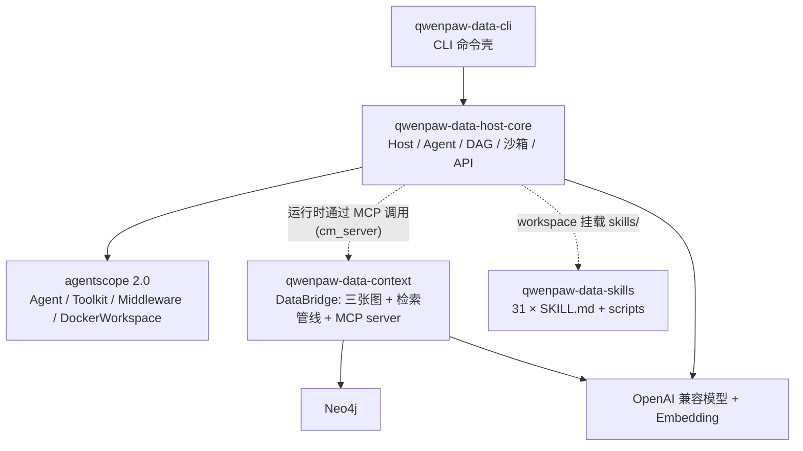
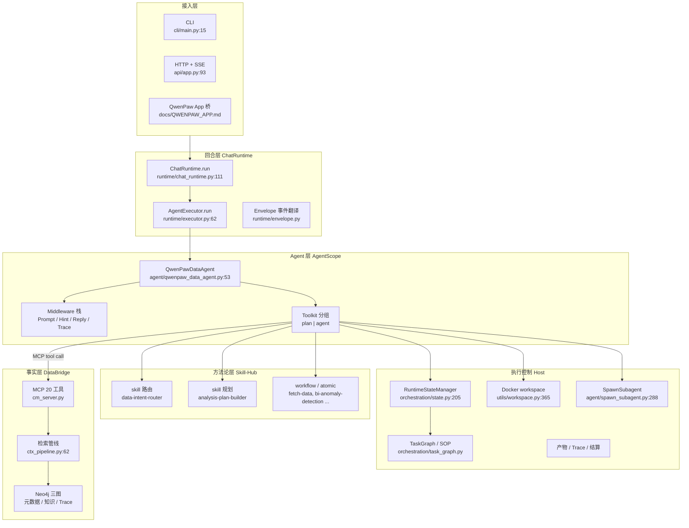
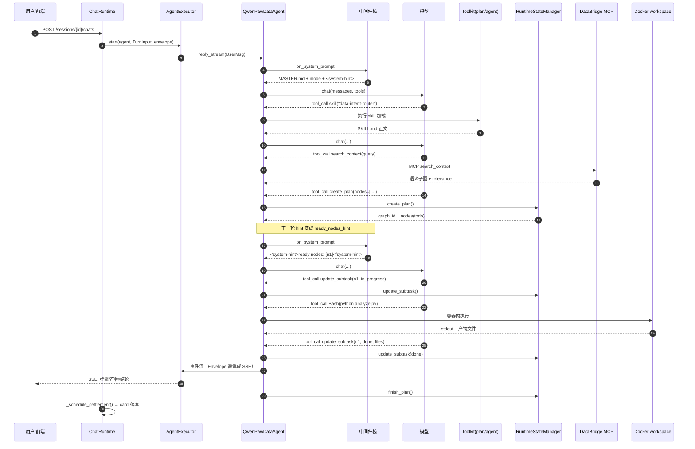

# QwenPaw-Data 架构笔记

> **仓库路径**：`D:/AgentABC/QwenPaw-Data`
> **上游地址**：https://github.com/agentscope-ai/QwenPaw-Data （本地 `git remote -v` 指向镜像 `https://github.com/LukeLi-EBD/QwenPaw-Data.git`）
> **语言与规模**：Python ≥3.11（`pyproject.toml:20` `requires-python = ">=3.11"`；classifiers 覆盖 3.11/3.12/3.13）+ uv workspace monorepo + 前端（React/TS）；864 个文件 / 25 MB；556 个 `.py` / 125,615 行；其中 `qwenpaw-data-context` 264 个 py、`qwenpaw-data-host-core` 235 个 py、前端 `src` 135 个文件；32 个 `SKILL.md`（其中 31 个由 `qwenpaw-data-skills` 挂载）
> **版本**：`qwenpaw-data-cli` 0.3.3（`packages/qwenpaw-data-cli/pyproject.toml:3`），`host-core` `__version__ = "0.3.0"`（`packages/qwenpaw-data-host-core/src/qwenpaw_data/host/core/__version__.py:3`）
> **commit**：`e0c8ce54b3a60bc26df11c75a43766dbf8c8a7c2`（2026-10-16 15:49:19 -0700，浅克隆，仅 1 条提交 `chore(release): prepare QwenPaw-Data 0.3.3 (#97)`）
> **分析时间**：2026-11-04

---

## 1. 一句话定位

**它不是「让 LLM 写 SQL 的 agent」，而是把「企业数据资产」和「分析方法论」都当成一等公民、可以被检索和演进的 agent 运行时。**

同类（pi / deepseek-harness / nanobot）都在解决「循环 + 工具 + 上下文」；QwenPaw-Data 认为这三件事对数据分析根本不够，硬拆成三层：

| 层 | 回答的问题 | 子系统 | Python 包 |
|---|---|---|---|
| **Facts** | 用哪些事实？（指标口径、维度、表、血缘、业务事件、历史经验） | DataBridge | `qwenpaw-data-context` |
| **Methodology** | 怎么分析？（路由 → 规划 → 工作流 → 原子分析动作） | Skill-Hub | `qwenpaw-data-skills`（纯 Markdown + 脚本） |
| **Execution** | 怎么跑完？（DAG 任务图、工具、沙箱、产物、反思、恢复） | Host | `qwenpaw-data-host-core` |

差异点三个，都能在代码里指到：

1. **Facts 是「图 + 管线」而不是向量库**。`search_context` 走到 Neo4j 做多步检索（语义切分 → 锚点 → 策略卡 → 决策 → 遍历），最终返回一个 **子图**，而不是 top-k 文本块（`packages/qwenpaw-data-context/src/context_manager/api/ctx_pipeline.py:62`）。
2. **Methodology 是文件，不是代码**。31 个 `SKILL.md` 直接被 workspace 当 skill 挂给模型，改方法论不用改 Python（`packages/qwenpaw-data-skills/skills/`）。
3. **Execution 是「状态机 + 提示注入」**。DAG 状态不在循环里 `if`，而是每轮推理前由 `QwenPawDataHintMiddleware` 把 `<system-hint>` 追加进 system prompt（`orchestration/middleware.py:150`），模型自己按 hint 推进；中断恢复也靠这条 hint 自愈（`orchestration/hint.py:65`）。

---

## 2. 技术栈与工程结构

### 2.1 技术栈

| 层 | 选型 | 证据 |
|---|---|---|
| Agent 内核 | **AgentScope 2.0**（`agentscope.agent.Agent` / `Toolkit` / `MiddlewareBase` / `Offloader`） | `agent/qwenpaw_data_agent.py:1,14-27` |
| 模型接入 | OpenAI 兼容协议（默认 DashScope `qwen3.7-max`）+ embedding `text-embedding-v3` | `.env.example`、`providers/factory.py`、`providers/registry.py` |
| 图存储 | Neo4j（元数据图 / 知识图 / Trace 图三张图共库） | `scripts/start_local.py`、`graph/schema_init.py`、`graph/backends/` |
| 服务端 | FastAPI + Uvicorn + SSE（可重放） | `api/app.py:93` `create_app()`；`api/sse.py`；`api/routers/` 共 15 个 router |
| MCP | `mcp` Python SDK，streamable-http；DataBridge 以 MCP server 形态暴露给 agent | `context_manager/mcp/cm_server.py:694` `mount_streamable_http()` |
| 执行沙箱 | **默认 Docker workspace**（`python:3.11-slim` + 预装分析栈） | `core.py:47` `workspace_type: Literal["local","docker"] = "docker"`；`utils/workspace.py:365` |
| 前端 | React（`qwenpaw-data-context/frontend`，135 文件） | 由 `scripts/init_local.py` 构建，端口 3000 |
| 打包 | uv workspace（`pyproject.toml`）、`uv.lock` 874 KB | 根目录 |

### 2.2 顶层/包结构表

| 目录 / 包 | 职责 | 是否核心 |
|---|---|---|
| `packages/qwenpaw-data-host-core` | **Execution**：Host 句柄、Agent、DAG 状态机、工具装配、中间件、Docker 沙箱、HTTP API、存储（JSON/SQL）、结算/后续问题/业务溯源三个 algo 子模块 | ★★★ 核心 |
| `packages/qwenpaw-data-context`（DataBridge） | **Facts**：元数据图/知识图/Trace 图、检索管线、语义层配置（`semantic_config`）、MCP server、管理 UI 后端 | ★★★ 核心 |
| `packages/qwenpaw-data-skills` | **Methodology**：31 个 skill，分 `atomic/` `workflows/` `planning/` `routing/` `runtime/` `domains/` `meta/` | ★★★ 核心（内容即核心） |
| `packages/qwenpaw-data-cli` | 命令行壳：`chat` / `run` / `plan` / `execute` / `datasource` / `semantic` / `mcp` / `doctor` | ★★ |
| `packages/qwenpaw-data-context/src/semantic_config` | 语义层 CRUD（指标/维度/数据集），独立 FastAPI 子应用 | ★★ |
| `packages/qwenpaw-data-host-core/src/.../algo/{biztrace,followup,settlement}` | 三个「回合后」算法：业务事件溯源、后续问题推荐、口径结算卡 | ★ |
| `tests/integration`、`examples/demo`、`scripts/` | 集成测试、demo 数据、初始化/启动脚本 | ★ |
| `docs/Technical_Report.pdf` | 论文正文（arXiv 2607.11019） | 参考 |

### 2.3 包依赖图（uv workspace，非 npm monorepo，但结构等价）



注意方向：**Host 对 DataBridge 是「运行时 MCP 依赖」，不是 Python import 依赖**（`mcp_cm.py:53` `is_cm_mcp_config()` 只认 URL 配置）。这意味着 Facts 层可以独立部署、独立替换。

---

## 3. 整体架构

### 3.1 分层图



### 3.2 核心模块职责表

| 模块 | 代码位置 | 职责 |
|---|---|---|
| `QwenPawDataHost` | `host/core/core.py:38` | 会话级句柄：模型、workspace、toolkit、agent 的懒建与复用；`get_agent()` 在 `:187` |
| `QwenPawDataAgent` | `agent/qwenpaw_data_agent.py:53` | 继承 AgentScope `Agent`，**system_prompt 传空字符串**，全靠 middleware 生成；额外加 `_continue_current_graph_stream()`（`:357`）实现 DAG 自动续跑 |
| `QwenPawDataPromptMiddleware` | `orchestration/middleware.py:107` | 把 `MASTER.md` + `AGENT_MODE.md`/`PLAN_MODE.md` + `PLANNER.md` + `ANALYSIS_ENVIRONMENT.md` 拼成 system prompt（`:128` → `prompts.build_master_prompt`，`prompts/__init__.py:46`） |
| `QwenPawDataHintMiddleware` | `orchestration/middleware.py:144` | 每轮推理前追加 `<system-hint>`（DAG 状态机的外部化表达） |
| `QwenPawDataReplyMiddleware` | `orchestration/middleware.py:157` | 注入用户在前端对产物文件的 pending edits |
| `QwenPawDataTraceMiddleware` | `orchestration/middleware.py:201` | 把 reasoning/acting/工具调用/工具结果写成 session trace 事件（500+ 行，是文件里最长的一段） |
| `QwenPawDataToolkit` | `agent/toolkit.py:189` | 覆写 `_get_available_tools()`，用 `_qwenpaw_data_mode` 强制只给「plan」或「agent」组 |
| `build_qwenpaw_data_toolkit` | `agent/toolkit.py:210` | 装配：共享工具 + agent-only 工具 + workspace 工具 + workspace MCP + skills；plan/agent 两个 `ToolGroup` 在 `:292` 起 |
| `RuntimeStateManager` | `orchestration/state.py:205` | DAG 状态机唯一真源：`create_plan`（:510）/ `update_subtask`（:574）/ `revise_current_plan`（:670）/ `finish_plan`（:706） |
| `DefaultGraphToHint` | `orchestration/hint.py:21` | 6 种 hint 文案（无图 / 全 todo / 有 ready / in_progress / 全 done / 有失败），是**自纠错的核心载体** |
| `SOP` / `TaskNode` | `orchestration/task_graph.py:619` / `:59` | 计划的可序列化 IR；`is_graph_done:156`、`get_ready_nodes:169`、`apply_plan_changes:977` |
| `AgentExecutor` | `runtime/executor.py:24` | 唯一把 `Agent.reply_stream()` 事件泵出去的地方；同时处理 `RequireExternalExecutionEvent`（弹问题给用户） |
| `ChatRuntime` | `runtime/chat_runtime.py:56` | 一次 Chat 的编排：取 agent → 起 followup/biztrace 两条旁路 → 跑 executor → 结算 → 收尾 |
| Docker workspace | `utils/workspace.py:365` `create_docker_workspace()` | 沙箱；`ManagedDockerBash`（`:106`）修了 AgentScope 2.0.3 的 docker exec 超时不杀进程问题 |
| DataBridge MCP | `context_manager/mcp/cm_server.py` | 20 个 `@mcp.tool()`：`search_context:269`、`search_event:326`、`explore_entity:348`、`execute_sql:377`、`recall_experience:424`、指标/维度/数据集查询共 15 个 |
| 检索管线 | `api/ctx_pipeline.py:62` `_run_pipeline_front()` | 0b–4 步：语义切分 + 实体扩展（并发两次 LLM）→ 锚点召回 → 策略卡 → 决策 → 遍历出子图 |

### 3.3 内核边界：哪几个文件是「必须读的」

**判据：把文件删掉，系统还能编过但语义就废了。** 按这个标准，内核只有 5 个文件 + 1 个目录：

| # | 文件 | 行数 | 为什么是内核 |
|---|---|---|---|
| 1 | `packages/qwenpaw-data-host-core/src/qwenpaw_data/host/core/orchestration/state.py` | 779 | DAG 状态机的**唯一写入点**。所有「计划推进」都过这里，没有第二条路径 |
| 2 | `.../orchestration/task_graph.py` | 1164 | `SOP ↔ TaskNode ↔ DAG` 三套 IR 的互转 + 拓扑校验 + diff/patch |
| 3 | `.../orchestration/hint.py` | ~150 | 状态机向模型暴露的**全部接口**。改 hint 文案 = 改 agent 行为，比改 prompt 有效 |
| 4 | `.../agent/qwenpaw_data_agent.py` | 457 | Agent 与 AgentScope 的接缝；`_MAX_DRIVE_ROUNDS = 6`（`:50`）就是这个文件定义的「自动续跑」预算 |
| 5 | `packages/qwenpaw-data-context/src/context_manager/mcp/cm_server.py` | 750 | Facts 层对 agent 的**全部可见面**。20 个工具的 docstring 就是 agent 的世界观 |
| 6 | `packages/qwenpaw-data-skills/skills/` | 31 × SKILL.md | Methodology 层。它不改代码但改行为，等于「可热更新的 prompt」 |

**什么是外壳**（可以最后看）：`api/routers/*`（15 个，HTTP→domain 翻译，每个约 20 行）；`store/{json_store,sql_store}.py`（1141 + 1144 行，两套等价持久化，读一个就够）；`algo/{biztrace,followup,settlement}`（约 9,700 行，「回合结束后」的增强，删掉不影响主链路）；`frontend/`（135 文件）；`semantic_config/`（语义层 CRUD 子应用）。

**判断依据**：`host/core/core.py:248` 构造 `QwenPawDataAgent` 时传的参数就是全部依赖清单——`toolkit`、`runtime_state`、`middlewares`、`offloader`。除这四样，其余都是可替换实现。而 `toolkit` 的核心是 `build_qwenpaw_data_toolkit`，`runtime_state` 的核心是 `state.py` + `task_graph.py` + `hint.py`，`middlewares` 的核心是 `middleware.py` 里的 4 个类。

---

## 4. 端到端主链路

场景：「分析产品 X 的有效用户 GAAP 均值」。

### 步骤 1：请求进入 Host，起一次 Chat
- **入口**：`packages/qwenpaw-data-host-core/src/qwenpaw_data/host/core/api/routers/chats.py:22` → `create_chat()`
- **逻辑**：`session.open_chat()` 建 `Chat`（status=`running`），落库，然后 `new ChatRuntime(...)` 并 `asyncio.create_task(runtime.run(chat.id, ...))`。HTTP 立刻返回 `{chat: ...}`，真正的执行在后台任务里，前端靠 SSE 追。CLI 走的是另一条：`cli/commands/chat.py:30` `handle()` → `dp.run(text)` → 直接 `agent.reply()`（无 executor，因此 CLI 下 `ask_user_question` 被关掉，见 `core.py:61-63` 注释）。
- **产出**：一个 `Chat` 记录 + 一个后台 asyncio task。

### 步骤 2：ChatRuntime 组装本轮输入
- **入口**：`runtime/chat_runtime.py:141` → `ChatRuntime._run()`
- **逻辑**：取 `host = self.hosts.get(session_id)`（会话级 Host，`host/core/registry.py:32` `QwenPawDataHostRegistry.get()`），建 `OutputStream` + `Envelope`，写 `request_context = {datasource_id, user_id}`，然后 `host.get_agent(mode="agent", ...)`。同时并发起两条旁路：`_start_followup()`（后续问题推荐）与 `_start_biztrace()`（业务事件溯源），它们在本轮结束后才交付。
- **产出**：一个带 request_context 的 agent 实例（同 session 内复用）+ 一个 `RunContext`。

### 步骤 3：Agent 装配 → system prompt 由 middleware 现算
- **入口**：`core.py:187` `get_agent()` → `core.py:248` `QwenPawDataAgent(...)`；prompt 在 `orchestration/middleware.py:128` `on_system_prompt()`
- **逻辑**：`QwenPawDataAgent.__init__` 收到 `system_prompt=""`，然后在 `_build_middlewares()`（`:440`）里挂 4 个中间件。AgentScope 每次要 prompt 时依次调用：`PromptMiddleware` 拼 `MASTER.md + AGENT_MODE.md + PLANNER.md + ANALYSIS_ENVIRONMENT.md`（`prompts/__init__.py:46`），`HintMiddleware` 再追加 DAG 状态。**所以 system prompt 是每轮重算的，不是启动时固定的**——这是 DAG 状态能驱动行为的根本原因。
- **产出**：一段形如 `MASTER.md ... <system-hint>…</system-hint>` 的 system prompt。

### 步骤 4：模型加载 skill 做路由与规划
- **入口**：skill 通过 workspace 的 `list_skills()` 挂进 `ToolGroup("agent")` 的 `skills_or_loaders`（`agent/toolkit.py:315`），模型按需 `skill(name)` 加载
- **逻辑**：`data-intent-router/SKILL.md` 是一张「命中即停」的判定表（元数据查询 / 数据查询 / BI 分析 / 数据探索 / 统计建模 / 定量计算 / 报告生成 / 非数据任务），含复合意图「以分析为准」的兜底。命中的类型决定下一步加载 `analysis-plan-builder` 还是直接 `fetch-data`。`analysis-plan-builder` 明确写了「**行动优先**」：先 `search_context` 拿上下文，再规划，信息不足才反问——这是刻意对抗「agent 连环提问什么都不做」的退化。
- **产出**：任务类型 + 一个待确认的分析计划草稿。

### 步骤 5：检索 Facts —— `search_context` 打到 DataBridge
- **入口**：`context_manager/mcp/cm_server.py:269` `search_context()` → HTTP `POST /api/v1/cm/search_context`（`api/cm_api.py:1404` `cm_search_context`）→ `api/ctx_pipeline.py:62` `_run_pipeline_front()`
- **逻辑**：
  1. `_ensure_session` 建/复用 ContextSession（一个用户问题生命周期一条 append-only 快照链，见 `api/ctx_session.py:4` 注释）；
  2. 域识别：显式 scope > `detect_domain()` 从问句猜（`retrieval.py:193`）；
  3. **语义切分**（`semantic_split_for_retrieval`）与**实体/别名扩展**（`build_anchor_recall_queries`）两个 LLM 调用**并发**跑（注释原话："so we pay one LLM latency instead of two serially"）；
  4. 锚点召回 + `rerank_anchor_set` 重排；
  5. 策略卡检索 `StrategyCardRetriever` + `gate_strategy_cards_for_llm` 门槛过滤；
  6. 决策 `decide_with_path()` 挑子图路径；
  7. 遍历 `subgraph_from_picked_paths` 出子图。
- **产出**：`{metrics, dimensions, datasets, strategy_cards, similar_experiences, subgraph, relevance}` —— **一个结构化的语义子图**，还带 `relevance.status ∈ {relevant, low_confidence, no_match}` 让 agent 知道该不该拦截。`MASTER.md` 明确要求「多解先确认」，就是靠这个 status 落地的。

### 步骤 6：把计划变成 DAG（`create_plan`）
- **入口**：`orchestration/tools.py:40` `CreatePlan.__call__()` → `orchestration/state.py:510` `create_plan()`
- **逻辑**：`create_plan(name, description, expected_outcome, nodes)` 给每个 node 生成 `TaskNode(graph_id, node_id, name, description, expected_outcome, deps, state="todo")`（`task_graph.py:83` `make_node`），`_normalize_deps_to_node_ids()` 把「按名字写的依赖」统一成 node_id，然后写 `_graph_registry`，最后 `_notify_graph_change(GRAPH_CREATED)` 让前端任务面板立刻出现。注意：**如果已有活动图，会被 archive 而不是报错**（`state.py:552-560`），因为用户可能中途改主意。
- **产出**：一个 `graph_id` + 若干 `todo` 节点 + 一条 `GRAPH_CREATED` 事件。

### 步骤 7：逐节点执行（一次只做一个）
- **入口**：模型收到新的 hint（`hint.py:48` `ready_nodes_hint`）→ 调 `update_subtask(node_id, "in_progress")`（`state.py:574`）→ 干活
- **逻辑**：`update_subtask` 在 `in_progress` 分支做了**并发闸门**：若已有别的节点在 `in_progress`，直接返回中文拒绝（`state.py:654`）。`DefaultGraphToHint.ready_nodes_hint` 文案里连写三遍「even if multiple ready nodes are listed, execute exactly ONE node at a time」——**串行是提示词约束的，不是代码强制的**（代码只挡了 in_progress 冲突，没挡「并行发两个 todo→in_progress」的时序）。
- 干活的手段三选一：workspace 工具（`Bash`/`Read`/`Write`/`Edit`/`Grep`/`Glob`，在 Docker 里跑 Python/pandas）；MCP 数据工具（`execute_sql` 等）；`spawn_subagent(task, role="data_fetcher")`（`agent/spawn_subagent.py:288`）——进程内起一个 role 受限的子 agent，只给 `_skills_for_role(role)`（`:224`）对应 SKILL 名集合 + 只读工具集，返回执行摘要 + 落盘路径。用它的理由是取数上下文很长但结论很短，隔离掉能省主上下文。
- **产出**：中间文件 + 一次 `update_subtask(..., "done", reasoning, summary, files)`。

### 步骤 8：SQL 结果落盘（不要指望模型自己 curl）
- **入口**：`agent/middleware/sql_artifact.py:42` `SqlArtifactMiddleware`
- **逻辑**：这是 `core.py:264` 里唯一硬编码进 agent 的中间件。每次 `execute_sql` 返回后，它把 DataBridge 的 CSV 从 host artifacts 目录搬进 **session workspace**，并把工具结果改写成模型可见的相对路径。失败时返回 `SQL_ARTIFACT_MATERIALIZATION_FAILED` 且**明确写「Do not retry the same query」**（`sql_artifact.py:33`）——防止模型把「落盘失败」误判成「查询失败」而无限重试。
- **产出**：`artifacts/<session_id>/<graph_id>/<node_id>/*.csv`。

### 步骤 9：自纠错的三条真实路径
- **路径 A（结构级）**：节点失败 → `update_subtask(node_id, "failed")` → 模型调 `revise_current_plan(changes=[...])`（`state.py:670`）→ `apply_plan_changes`（`task_graph.py:977`）把**该节点的下游**重置成 `todo`（`mark_downstream_todo:354`）。失败不会被静默吞掉，而是变成一次显式的计划修订。
- **路径 B（中断级）**：进程被杀/hint 里发现 `in_progress` 残留 → `hint.py:65` `in_progress_hint` 让模型「先查历史，tool call 已完成就直接标 done，否则重跑」。这是**用提示词实现幂等恢复**，没有 checkpoint 机制。
- **路径 C（驱动级）**：模型提前收尾但图没走完 → `qwenpaw_data_agent.py:357` `_continue_current_graph_stream()` 用 `_MAX_DRIVE_ROUNDS = 6` 循环发 `user_msg("继续执行剩余未完成的节点。")`，直到 `is_graph_done()`（`task_graph.py:156`）。这是**硬续跑**，与路径 A/B 的软提示互补。

### 步骤 10：收尾
- **入口**：`state.py:706` `finish_plan()`；`release` 后 `chat_runtime.py:502` `_finish()`
- **逻辑**：`finish_plan` 把未终态节点（todo / in_progress）统一标记为传入的 `done`/`abandoned`，并不校验 in_progress（`state.py:720-723`）。然后 `ChatRuntime` 交付两条旁路：`_deliver_biztrace()`（把业务事件解释挂到结论上）与 `_deliver_followup()`（推荐后续问题）。最后 `_schedule_settlement()`（`chat_runtime.py:254`）在后台跑「口径结算」：把本轮确认过的指标口径抽成 card 落库，下一轮通过 `ConfirmedSettlementPromptMiddleware`（`agent/middleware/settlement.py:16`）注入 system prompt——**这是系统唯一的在线自我演进闭环**。
- **产出**：最终消息 + 产物清单 + trace + 若干 settlement card。



---

## 5. 核心代码路径清单

| 文件路径 | 关键类/函数 | 作用 | 优先级 |
|---|---|---|---|
| `packages/qwenpaw-data-host-core/src/qwenpaw_data/host/core/orchestration/state.py` | `RuntimeStateManager`（:205）、`create_plan`（:510）、`update_subtask`（:574） | DAG 状态机唯一真源 | ★★★ |
| `.../orchestration/task_graph.py` | `TaskNode`（:59）、`SOP`（:619）、`get_ready_nodes`（:169）、`apply_plan_changes`（:977） | 计划 IR + 拓扑 + 修订 | ★★★ |
| `.../orchestration/hint.py` | `DefaultGraphToHint`（:21）、`in_progress_hint`（:65） | 状态机 → 模型的唯一出口 | ★★★ |
| `.../agent/qwenpaw_data_agent.py` | `QwenPawDataAgent`（:53）、`_continue_current_graph_stream`（:357）、`_build_middlewares`（:440） | Agent 与 AgentScope 的接缝 | ★★★ |
| `.../agent/toolkit.py` | `build_qwenpaw_data_toolkit`（:210）、`QwenPawDataToolkit`（:189） | 工具分组与模式边界 | ★★★ |
| `.../orchestration/middleware.py` | `PromptMiddleware`（:107）、`HintMiddleware`（:144）、`TraceMiddleware`（:201） | system prompt 每轮重算 | ★★★ |
| `packages/qwenpaw-data-context/src/context_manager/mcp/cm_server.py` | `search_context`（:269）、`execute_sql`（:377）、`recall_experience`（:424） | Facts 层全部对外能力 | ★★★ |
| `packages/qwenpaw-data-context/src/context_manager/api/ctx_pipeline.py` | `_run_pipeline_front`（:62） | 检索管线 0b–4 步 | ★★★ |
| `.../host/core/core.py` | `QwenPawDataHost`（:38）、`get_agent`（:187） | 会话级总装 | ★★★ |
| `.../runtime/executor.py` | `AgentExecutor.run`（:62）、`_handle_external_execution`（:99） | 事件泵 + 澄清回路 | ★★★ |
| `.../runtime/chat_runtime.py` | `ChatRuntime._run`（:141）、`_schedule_settlement`（:254） | 一回合的全生命周期 | ★★ |
| `.../utils/workspace.py` | `create_docker_workspace`（:365）、`ManagedDockerBash`（:106） | 执行沙箱 | ★★ |
| `.../agent/spawn_subagent.py` | `SpawnSubagent`（:288）、`_run_subagent`（:401） | 进程内 role 受限子 agent | ★★ |
| `.../agent/middleware/sql_artifact.py` | `SqlArtifactMiddleware`（:42） | SQL 结果自动落盘 | ★★ |
| `.../agent/middleware/settlement.py` | `ConfirmedSettlementPromptMiddleware`（:16） | 口径卡注入（自我演进） | ★★ |
| `packages/qwenpaw-data-skills/skills/routing/data-intent-router/SKILL.md` | — | 意图路由判定表 | ★★★ |
| `packages/qwenpaw-data-skills/skills/planning/analysis-plan-builder/SKILL.md` | — | 规划 SOP（行动优先） | ★★★ |
| `.../prompts/MASTER.md` + `.../prompts/__init__.py:46` | `build_master_prompt()` | 121 行的系统世界观 + prompt 拼装 | ★★★ |
| `.../api/routers/chats.py` | `create_chat`（:22） | HTTP 入口 | ★★ |
| `.../algo/settlement/manager.py` | `SettlementManager` | 结算卡生命周期 | ★ |
| `packages/qwenpaw-data-cli/src/qwenpaw_data/cli/commands/chat.py` | `handle`（:30） | CLI 入口（无 executor 的简化路径） | ★★ |

---

## 6. 关键设计点

**设计 1：system prompt 每轮重算，把它当「状态寄存器」用**
→ 为什么：DAG 状态、模式（plan/agent）、待确认编辑、已确认口径卡，四类信息都要变。若走「追加 user 消息」路线，上下文会被状态广播撑爆且模型容易把状态当成对话内容。走「每轮重算 system prompt」路线，状态永远是「当前事实」，且不进对话历史（因此不需要压缩）。
→ 代价：prompt 不再可缓存（Anthropic prompt cache 之类失效），每轮都是全新 system 块；`QwenPawDataPromptMiddleware.on_system_prompt` 每次都要读 4 个 md 文件（`prompts/__init__.py:57-65` 是同步 `read_text`，在事件循环里）。

**设计 2：方法论做成 Markdown skill，而不是 Python 工具**
→ 为什么：数据分析的「方法论」变动频率远高于「工具」。归因分析该先做什么后做什么，是业务共识，不是工程产物。做成 `SKILL.md` 后，业务方改一个文件就能改 agent 行为，且能被 `data-intent-router` 按类型精确加载（不是 all-in-context）。
→ 代价：无法做类型/参数校验，全靠自然语言约束；skill 之间的一致性靠人维护（31 个 skill 里 `bi-anomaly-detection` 与 `bi-attribution-analysis` 的边界，只能靠 prompt 说清楚）。

**设计 3：Facts 只走 MCP，不做 Python 依赖**
→ 为什么：`mcp_cm.py:53` `is_cm_mcp_config()` 只判 URL，说明设计上 Facts 层可以完全独立部署（论文语境里 DataBridge 是给多个 agent 复用的基础设施）。Host 侧只认「工具列表里有什么」，不认「DataBridge 类是什么」。
→ 代价：跨进程多一次 HTTP + MCP 序列化；且 `cm_server.py` 每个工具都要手写 `_parse_json_object` / `_meta_datasource_id` 这类防御代码（`:192-266` 共 70 行纯胶水）。

**设计 4：DAG 串行靠 hint 文案约束，并发靠 in_progress 闸门兜底**
→ 为什么：完全用代码禁止并行会挡住「同轮多节点并行」的合法场景（论文里提到维度下钻和归因可以并行）。选择「默认串行（提示词强约束）+ 允许模型越界（代码只挡 in_progress 冲突）」。
→ 代价：模型确实可能在一轮里连发两个 `todo→in_progress`，因为 `state.py:654` 的检查是「已有 in_progress」而不是「本轮已启动过」。也就是说这个闸门有 TOCTOU 窗口（同一 turn 内两次调用之间没有锁）。

**设计 5：自纠错不写 checkpoint，写 hint**
→ 为什么：`in_progress_hint` 把「恢复」变成一个模型可判断的问题（"if the tool call for this node has already produced a complete result, call update_subtask(done) immediately"），而不是运行时的 redo log。省掉了所有 checkpoint 持久化代码。
→ 代价：正确性依赖模型读懂 hint；且 `_MAX_DRIVE_ROUNDS = 6` 是硬上限，超过就静默停下（没有「未完成」的显式失败状态）。

**设计 6：执行沙箱默认 Docker，但要修 AgentScope 的坑**
→ 为什么：`core.py:47` 默认 `workspace_type="docker"`，且 `QwenPawDataHost.__init__` 在 `workspace_type == "local"` 且未注入 workspace 时会打 warning 说「not sandboxed」（`core.py:83-86`）。安全默认值。
→ 代价：`ManagedDockerBash`（`utils/workspace.py:106`）整个类是为「AgentScope 2.0.3 取消等待但不杀 docker exec 进程」这个上游 bug 写的补丁，含 supervisor 脚本 + 进程组清理（`:214`）。另外容器里还要重装 `agentscope==宿主机版本` 和 `mcp==宿主机版本`（`:385-386`），否则工具序列化不兼容——这是「沙箱 + MCP」组合的隐性成本。

---

## 7. 扩展点

**加一个分析能力（首选：加 skill，不改代码）**
1. 在 `packages/qwenpaw-data-skills/skills/atomic/` 下新建 `<name>/SKILL.md`（可照 `atomic/bi-anomaly-detection/SKILL.md` 复制），frontmatter 写 `name` + `description`（description 是路由依据，要写「什么时候用」而不是「这是什么」）。
2. 需要参考文档就放 `references/`，需要可执行脚本放 `scripts/`（参考 `workflows/fetch-data/scripts/generate_nl2sql_prompt.py`）。
3. 如果要让它被路由到，改 `skills/routing/data-intent-router/SKILL.md` 的判定表；如果要让它进规划模板，改 `skills/planning/analysis-plan-builder/SKILL.md`。
4. 不需要重启：workspace 每次 `list_skills()` 重新扫盘（`toolkit.py:268`）。

**加一个工具（要改代码）**
1. 纯 Host 侧工具：继承 `ToolBase`，放 `host/core/agent/tools/`，在 `build_qwenpaw_data_toolkit`（`toolkit.py:210`）里决定挂 `shared_tools`（plan+agent 都可见）还是 `agent_only_tools`（只在 agent 模式）。参考 `AskUserQuestionTool` / `CronJobTool`。
2. 数据类工具：**优先加在 DataBridge MCP server**（`context_manager/mcp/cm_server.py`，`@mcp.tool()` 装饰即可），Host 侧零改动——因为 MCP 工具是运行期发现的。若要限制 plan 模式不可见，把裸名加进 `toolkit.py:24` 的 `_PLAN_MODE_BLOCKED_MCP_TOOL_NAMES`。
3. 计划管理工具（新增 DAG 操作）：加在 `orchestration/tools.py` 的 `ALL_QWENPAW_DATA_TOOLS`（:297），并在 `PLAN_MODE_TOOL_NAMES` / `PLAN_TOOL_NAMES`（:289-296）里声明归属。

**接一个模型**
1. `host/core/providers/{builtins,factory,registry}.py`：`factory.py` 的 `build_model()` 是关键，按 `UserRuntimeConfig.default` 构造；`builtins.py` 注册内置 provider。
2. 环境变量路线最简单：`OPENAI_API_KEY` / `OPENAI_BASE_URL` / `LLM_MODEL`（CLI 走 `QWENPAW_DATA_MODEL_*` 覆盖，见 `cli/env.py`）。
3. DataBridge 侧另有自己的模型配置（`context_manager/api/model_config_api.py` + `context_manager/model_config_store.py` + 前端「Model Config」），**两边要分别配**——检索管线的 LLM 和 agent 的 LLM 是两套。

**加一个方法论层（workflow 级）**
放 `skills/workflows/<name>/`，含 `SKILL.md` + `prompts/` + `references/` + `scripts/`。`fetch-data` 是最完整的参考实现：`prompts/nl2sql.md` 定义生成 SQL 的模板，`references/partition-query.md` 讲分区裁剪，`scripts/generate_nl2sql_prompt.py` 负责把表结构填进模板。

---

## 8. 本地跑起来 / 调试入口

```bash
# 0. 前置：Git / uv / Node 22 / Docker Desktop
cp .env.example .env
# 在 .env 里填 OPENAI_API_KEY、OPENAI_BASE_URL、LLM_MODEL、NEO4J_PASSWORD

# 1. 初始化（建 context 的 .venv、构建前端、装工作区所有包、注册 databridge MCP）
python3 scripts/init_local.py          # Windows: .\scripts\init_local.ps1

# 2. 起本地服务（Neo4j + DataBridge API:8765 + UI:3000），前台不退出
python3 scripts/start_local.py

# 3. 交互（另一个终端）
qwenpaw-data chat
qwenpaw-data run "昨天 DAU 多少" --stream
qwenpaw-data plan "分析 3 月转化率下降原因"     # 只出计划
qwenpaw-data execute <plan.json>                # 只执行
```

| 想调什么 | 看哪里 |
|---|---|
| 命令行行为 | `packages/qwenpaw-data-cli/src/qwenpaw_data/cli/main.py:15` `main()`；命令在 `commands/` |
| 事件流长什么样 | `host/core/runtime/envelope.py`（801 行，事件 → SSE 的唯一映射） |
| DAG 为什么不动 | 先看 `hint.py` 输出的 `<system-hint>` 文本，再看 `state.py:352` `get_current_hint()` 的入参 |
| 检索为什么没命中 | DataBridge 侧开 `include_debug=True`（`cm_server.py:276` 参数），返回 `pipeline_steps`；或直接 `curl -X POST localhost:8765/api/v1/cm/search_context` |
| 沙箱里跑崩了 | `QWENPAW_DATA_DOCKER_BASE_IMAGE` 换成带调试工具的镜像；`QWENPAW_DATA_DOCKER_EXTRA_PIP` 追加依赖（`utils/workspace.py:371-373`） |
| MCP 超时 | `QWENPAW_DATA_MCP_EXECUTION_TIMEOUT`（默认 120s，`toolkit.py:31`）、`QWENPAW_DATA_MCP_DISCOVERY_TIMEOUT`（默认 15s，`:73`） |
| 关掉"回合后算法" | `QWENPAW_DATA_FOLLOWUP_ENABLED=0`、`QWENPAW_DATA_BIZ_TRACE_ENABLED=0`（`chat_runtime.py:46,51`） |

**测试**：`tests/integration/`（根）+ 三个包各自的 `tests/`。`qwenpaw-data-cli/tests/test_permission_mode.py` 可直接当权限模型的规格读。
---

## 9. 阅读路线

**半天（抓住三层抽象）**
1. `prompts/MASTER.md`（121 行）—— 先知道 agent 被要求做什么。
2. `orchestration/hint.py`（~150 行）—— 六段 hint 文案，等于状态机的全部对外语义。
3. `orchestration/task_graph.py:59-200`（TaskNode / is_graph_done / get_ready_nodes）。
4. `orchestration/state.py:510-740`（create / update / revise / finish 四个方法）。
5. `agent/qwenpaw_data_agent.py:440-457` + `orchestration/middleware.py:107-175` —— 看懂 prompt 是每轮拼的。
6. `context_manager/mcp/cm_server.py` 的 20 个 `@mcp.tool()` docstring，只看 docstring。

**两天（补 Facts 与执行细节）**
7. `api/ctx_pipeline.py:62-434` —— 检索管线的 0b–4 步。
8. `api/retrieval.py:38` `relevance_gate` + `:164` `detect_dimensions` + `:494` `expand_subgraph`。
9. `agent/toolkit.py:210-325` —— 工具分组、MCP 过滤、skill 挂载。
10. `runtime/executor.py`（149 行，全文）+ `runtime/chat_runtime.py:141-244`。
11. `agent/spawn_subagent.py:288-540` —— 子 agent 的隔离边界。
12. `utils/workspace.py:106-222` + `:288-405` —— Docker 沙箱与补丁。
**一周（摸到「可演进」的部分）**
13. `algo/settlement/{detector,confirmer,manager}.py` —— 口径卡从「模型说了什么」到「落库成结构化卡」的判定链。
14. `algo/biztrace/{pipeline,segmentation,converter}.py`（`segmentation.py` 1071 行 / `converter.py` 900 行）+ `algo/followup/` —— 业务事件溯源与后续问题推荐。
15. `graph/{semantic,semantic_derive,strategy_card}.py` + `knowledge/{pipeline,pass_d,normalize}.py` —— DataBridge 的图构建与知识抽取（仓库最重的部分，`graph/` 20,105 行 + `knowledge/` 5,053 行）。
16. `docs/Technical_Report.pdf` 对照代码读一遍。

---

## 10. 未覆盖 / 存疑

1. **`_MAX_DRIVE_ROUNDS = 6` 的取值依据未见注释**（`agent/qwenpaw_data_agent.py:50`）。超过 6 轮后图仍未完成时，没有「失败」事件，只有静默停止——这一条我只读到了代码行为，没找到设计说明。
2. **`QwenPawDataSandboxContextMiddleware`（`orchestration/middleware.py:542`）已定义但不在 `_build_middlewares()` 的返回列表里**（`:443-457` 只有 4 个）。它会把当前 graph/node 同步成 sandbox 的 `rel_path`，但装配点缺失。可能由 `host.get_agent()` 之外的地方注入（`extra_middlewares` 参数，`core.py:52`），但我在 host-core 内部没找到调用点。**存疑：是不是死代码？**
3. **`tests/` 的覆盖面未逐一核实**：只确认了 `qwenpaw-data-cli/tests/` 有 7 个测试文件（另有 `conftest.py`）、`host-core/tests/` 有 `test_spawn_subagent.py` / `test_permission_governance.py` 等，整体覆盖率没测。
4. **`semantic_config/` 与 `context_manager/` 的共用关系只做了浅层确认**：两者同属 `qwenpaw-data-context`，但前者有独立四层结构，是否共用同一 DB session 我没追。
5. **论文（arXiv 2607.11019）与代码的对应关系未逐条核对**。本文所有三层映射（Facts/Methodology/Execution → 包）是我从 README 表格 + 代码结构推的，README 明确写了这个对应，但我无法验证论文里的术语是否完全一致。
6. **前端（135 文件 React）完全未读**。任务图面板如何消费 `_notify_graph_change` 的事件、pending edits 如何产生，只有后端侧证据。
7. **浅克隆（1 条提交）**，无法通过 `git log` 判断哪些代码是 0.3.3 新加的、哪些是历史包袱。`algo/` 下 5,400 行的 biztrace 有可能是从内部系统迁移过来的遗留。

---

## 附：与其他 agent 的横向对比

| 项目 | 它最值得抄的一点 | 依据（我读到的代码） |
|---|---|---|
| **hermes-agent** | 工程约束（白名单/预算/超时）写在循环外的「护栏层」，不污染循环 | 对比：QwenPaw 把沙箱、MCP 超时（`toolkit.py:31`）做成默认值而非策略 |
| **pi** | 循环对厂商/工具语义零知识，全部行为靠 9 个回调注入 | 对比：QwenPaw 的 `QwenPawDataAgent` 直接继承 AgentScope `Agent`，循环在框架里，自纠错靠中间件外挂 |
| **deepseek-harness** | 日志即真相：所有状态可从事件流重建 | 对比：QwenPaw 的 `Envelope`（801 行）是「事件→SSE」投影，不保证可重放成完整状态 |
| **nanobot** | 上下文治理（压缩/裁剪）是独立策略模块 | 对比：QwenPaw 靠「system prompt 每轮重算 + 状态不进历史」绕开压缩问题 |
| **altimate-code** | 用「工具权限掩码 + 提示词」在 80+ 个专业工具里做选择，而不是让模型盲选 | 对比：QwenPaw 用 `ToolGroup(plan/agent)` 两档 + skill 精确加载，思路同源但粒度粗 |
| **QwenPaw-Data** | **把「方法论」外置成可热更新的 Markdown，把「状态机」外置成每轮注入的 hint** | `skills/`（31 个 SKILL.md）+ `hint.py` |

一句话选型：要做**领域深度**的分析 agent，抄 QwenPaw-Data 的三层拆分与 hint 机制；要做**通用循环**，抄 pi；要做**大工具集的可选性**，抄 altimate-code。

---

## 修订记录

> 2026-11-04 对照本地仓库 `D:/AgentABC/QwenPaw-Data` 逐条核验。共核对文档内路径/行号引用 41 个点位（含重复约 90 处），另核对类名/函数名/配置项与规模陈述 30 余项；修订 29 处。结论：三层拆分、hint 机制与主链路判断成立，问题集中在行号指向装饰器/空行、计数口径与两处 plan 状态语义描述。

以下为本次逐条回源核对后**实际改动**的条目（原表述 → 核实结果均取自 `D:\agentABC\QwenPaw-Data` 源码）。

| # | 位置 | 原表述 | 核实结果（源码依据） | 处理 |
|---|---|---|---|---|
| 1 | 头部规模 | `31 个 SKILL.md` | 仓库共 32 个 `SKILL.md`：`packages/qwenpaw-data-skills/skills/` 31 个 + 根 `skills/qwenpaw-data-cli/SKILL.md` 1 个 | 改为 `32 个 SKILL.md（其中 31 个由 qwenpaw-data-skills 挂载）` |
| 2 | §2.1 / §6 | `core.py:46` `workspace_type` | `core.py:47` 才是 `workspace_type: Literal["local","docker"] = "docker"`；`:46` 是 `workspace: Any = None` | 改为 `core.py:47` |
| 3 | §1 / §3.2 / §4 步骤 9 / §5 | hint 行号：`DefaultGraphToHint` :19、`ready_nodes_hint` :41、`in_progress_hint` :66 | `hint.py:21` 是 `class DefaultGraphToHint`；`:48` 是 `ready_nodes_hint` 类属性；`:65` 是 `in_progress_hint` 类属性 | 三处行号分别改为 :21 / :48 / :65 |
| 4 | §3.1 / §3.2 / §9 | `MCP 22 工具`、`22 个 @mcp.tool()`、`CRUD 共 17 个` | `cm_server.py` 实际 20 个 `@mcp.tool()`；其中指标/维度/数据集查询共 15 个 | 改为 20 / 20 / 15 |
| 5 | §3.2 | `ToolGroup ... 在 :296 起` | `toolkit.py:292` 是 `ToolGroup("plan", ...)` 起始行（`agent` 组在 :302） | 改为 `:292` |
| 6 | §3.3 / §9 / §10 | `algo` 约 4,000 行；graph+knowledge `~15k`；biztrace 4,000 行 | 实测 `algo/` 9,681 行、`algo/biztrace/` 5,461 行；`graph/` 20,105 行 + `knowledge/` 5,053 行 | 改为约 9,700 / 5,400 / 25,000 行 |
| 7 | §3.3 / §4 步骤 3 | `core.py:235` 构造 `QwenPawDataAgent` | `core.py:248` 才是 `QwenPawDataAgent(...)` 构造点（`:235` 为 `get_agent` 参数续行） | 改为 `core.py:248` |
| 8 | §4 步骤 1 / §5 | `chats.py:21` `create_chat()` | `chats.py:22` 是 `async def create_chat`；`:21` 是 `@router.post` 装饰器 | 改为 `:22` |
| 9 | §4 步骤 1 / §5 | `cli/commands/chat.py:31` `handle()` | `chat.py:30` 是 `def handle`；`:31` 为函数体第一行 | 改为 `:30` |
| 10 | §4 步骤 1 | `core.py:52` 注释解释 `ask_user_question` 关闭 | `core.py:61-63` 才是该注释（`:52` 是 `extra_middlewares` 参数） | 改为 `core.py:61-63` |
| 11 | §4 步骤 2 | 会话级 Host `registry.py:12` | `host/core/registry.py:12` 是 `QwenPawDataHostRegistry` 类，取 Host 的 `get()` 在 `:32`；原路径还易与 `graph/adapters/registry.py` 混淆 | 改为 `host/core/registry.py:32` `QwenPawDataHostRegistry.get()` |
| 12 | §4 步骤 4 | skill 挂载 `toolkit.py:310` | `toolkit.py:315` 才是 `skills_or_loaders=...`；`list_skills()` 在 `:268` | 改为 `:315` |
| 13 | §4 步骤 5 / §5 | `cm_server.py:268` `search_context`、`cm_api.py:1403` | `cm_server.py:269` 为函数定义（`:268` 是装饰器）；`cm_api.py:1404` 为 `async def cm_search_context` | 改为 `:269` / `:1404` |
| 14 | §4 步骤 8 / §5 | `sql_artifact.py:40` 类、`:26` 报错文案、`core.py:283` 装配 | `sql_artifact.py:42` 是 `class SqlArtifactMiddleware`；`「Do not retry」` 在 `:33`；`core.py:264` 是 `SqlArtifactMiddleware(...)` 唯一硬编码注入点 | 改为 :42 / :33 / core.py:264 |
| 15 | §4 步骤 9 路径 A | `apply_plan_changes` 把「该节点及其全部下游」重置为 todo | `mark_downstream_todo`（`task_graph.py:354`）只重置下游，`find_downstream_node_ids` 不含自身 | 改为「该节点的下游」 |
| 16 | §4 步骤 10 | `finish_plan` 校验「没有 in_progress」才允许结束 | `state.py:720-723` 把未终态节点（含 todo/in_progress）直接赋为传入的 `done`/`abandoned`，无校验 | 改为「把未终态节点统一标记为 done/abandoned」 |
| 17 | §4 步骤 10 / §5 | `settlement.py:15` 中间件 | `settlement.py:16` 是 `class ConfirmedSettlementPromptMiddleware` | 改为 `:16` |
| 18 | §6 | `create_local_workspace` 走 local 时打 warning（`core.py:78`） | warning 实际在 `QwenPawDataHost.__init__`，`core.py:83-86`（`workspace_type == "local"` 且未注入 workspace） | 改函数名并改为 `core.py:83-86` |
| 19 | §7 | `bi-xxx/SKILL.md` 示例目录 | `atomic/` 下真实业务技能为 `bi-anomaly-detection`、`bi-attribution-analysis` 等；`bi-xxx` 是占位符 | 改为「新建 `<name>/SKILL.md`（可照 `atomic/bi-anomaly-detection/SKILL.md` 复制）」 |
| 20 | §7 / §8 | `toolkit.py:266` `list_skills()`、`toolkit.py:29` 禁用名单、`:76` 发现超时 | `list_skills` 在 `:268`；`_PLAN_MODE_BLOCKED_MCP_TOOL_NAMES` 在 `:24`；`DEFAULT_MCP_DISCOVERY_TIMEOUT` 在 `:73` | 分别改为 :268 / :24 / :73 |
| 21 | §7 | `ALL_QWENPAW_DATA_TOOLS`（:299）、`PLAN_MODE_TOOL_NAMES`/`PLAN_TOOL_NAMES`（:290-296） | `tools.py:297` 是 `ALL_QWENPAW_DATA_TOOLS`；两个模式常量在 `:289-296` | 改为 :297 / :289-296 |
| 22 | §7 | `context_manager/api/model_config.py` | 该文件不存在；真实模块是 `api/model_config_api.py`（`router = APIRouter(prefix="/api/system/model-config")`，:27）与 `context_manager/model_config_store.py` | 改为两个真实路径 |
| 23 | §3.1 / §8 | `cli/main.py:16` `main()` | `cli/main.py:15` 是 `def main` | 改为 `:15`（mermaid 与表格两处） |
| 24 | §8 | `include_debug=True`（`cm_server.py:281`） | `cm_server.py:276` 是 `search_context(..., include_debug=...)` 参数行 | 改为 `:276` |
| 25 | §8 | 两个开关 `chat_runtime.py:40-41` | `_followup_enabled()` 在 `:46`、`_biztrace_enabled()` 在 `:51` | 改为 `:46,51` |
| 26 | §10 | `_MAX_DRIVE_ROUNDS`（`qwenpaw_data_agent.py:52`） | `:50` 是 `_MAX_DRIVE_ROUNDS = 6` | 改为 `:50` |
| 27 | §10 | `extra_middlewares`（`core.py:57`） | `core.py:52` 才是 `extra_middlewares` 参数定义行（`:57` 为 `self.home = ...`） | 改为 `:52` |
| 28 | §10 | `qwenpaw-data-cli/tests/` 有 5 个测试文件 | 实际 7 个 `test_*.py` + `conftest.py` | 改为 7 个（另有 conftest.py） |
| 29 | 头部 | `Python 3.12` | `pyproject.toml:20` 为 `requires-python = ">=3.11"`，classifiers 同时声明 3.11/3.12/3.13；仓库无 `.python-version` | 改为 `Python ≥3.11` |

抽查后确认无误、未改动的关键引用：`api/app.py:93`、`cm_server.py:694`、`mcp_cm.py:53`、`core.py:38/:187`、`qwenpaw_data_agent.py:53/:357/:440`、`middleware.py:107/:128/:144/:157/:201/:542`、`toolkit.py:189/:210`、`state.py:205/:510/:574/:654/:670/:706`、`task_graph.py:59/:156/:169/:619/:977`、`executor.py:24/:62/:99`、`chat_runtime.py:56/:141/:180/:254/:502`、`workspace.py:106/:365/:371-373/:385-386`、`spawn_subagent.py:288/:401`、`ctx_pipeline.py:62`、`retrieval.py:38/:164/:193/:494`、`prompts/__init__.py:46/:57-65`、`.env.example`（`qwen3.7-max` / `text-embedding-v3`）、`agentscope>=2.0.8,<2.1`。
