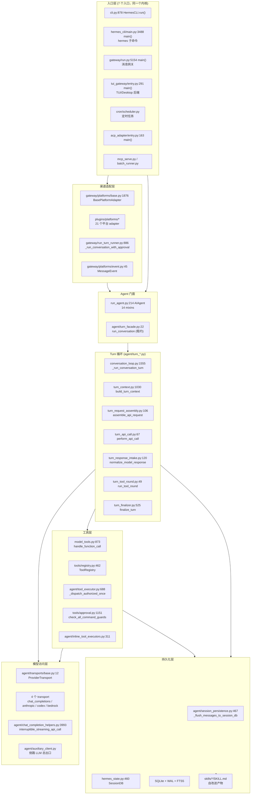
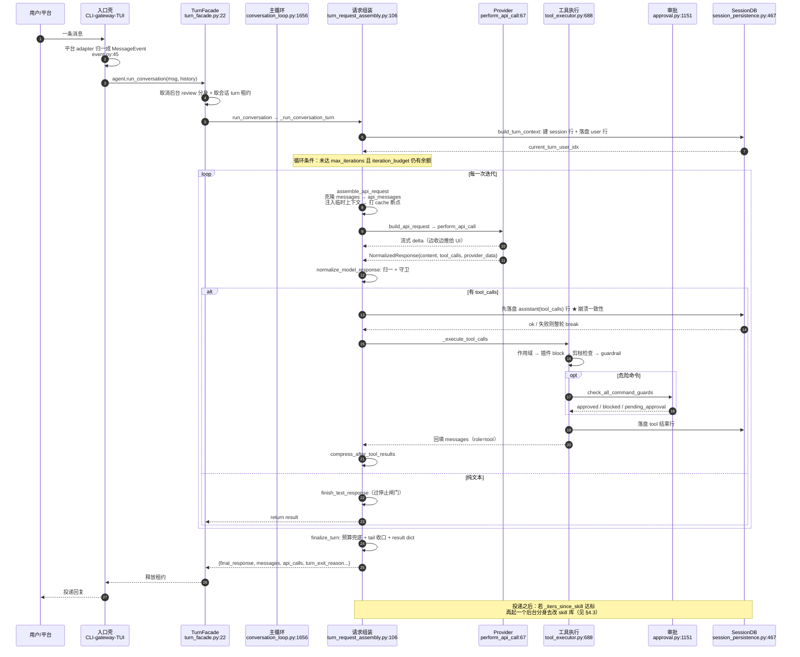

# hermes-agent 架构笔记

> **仓库路径**：`D:/AgentABC/hermes-agent`
> **git remote**：`origin https://github.com/LukeLi-EBD/hermes-agent.git`（上游 `package.json` 里 `repository.url` 指向 `github.com/NousResearch/Hermes-Agent`）
> **语言与规模**：Python 为主（9441 个 `.py`，约 94.7 万行），另有 TypeScript（Electron 桌面端 / Ink TUI / Docusaurus 文档站）；全仓 19725 个文件、359MB
> **commit**：`525dbcad8d744710a43d01eb7366500e46eacbf4`（Thu Oct 15 03:44:50 2026 +0000）
> **分析时间**：2026-11-04

---

## 1. 一句话定位

**hermes-agent 是一个"内核极窄、能力全在边缘"的自改进型个人 agent**：同一个 `AIAgent` 内核被 CLI / TUI / Electron 桌面 / 20+ 消息平台网关 / cron / ACP / MCP 复用，它把"会话即缓存前缀"当作不可破坏的硬约束，并在每轮结束后**后台 fork 一个分身 agent 去改写自己的 skill 库**。

它和 nanobot 这类"个人助手型"产品的差异在于四点，且都能在代码里指到具体位置：

1. **nanobot 是"一个进程一个助手"**；hermes 是**一个内核 + 一层平台适配 + 一层网关进程**，`gateway/platforms/base.py:1876` 的 `BasePlatformAdapter` 之上挂了 21 个平台目录（`plugins/platforms/`），CLI 与 IM 走的是同一个 `run_conversation()`。
2. **nanobot 的上下文治理偏"截断/摘要"**；hermes 把**prompt cache 字节稳定性**提到架构级铁律（根 `AGENTS.md` 的两条不变量之一），因此它有一整套"请求副本"机制——真实历史 (`messages`) 与线上请求 (`api_messages`) 是两份数据，所有清洗只动副本。
3. **nanobot 的工具是中心注册表 + if/else**；hermes 的 `registry.register()` 是 **import 副作用**，`check_fn` 在**导出 schema 时**过滤，`handler(args, **kw) -> str` 强制字符串返回，新工具 = 新文件 + 一行 `register`。
4. **最能区分的一点：自改进是"事后异步、独立分身、只写 skill_manage"**，不是"主循环里边干边改自己"。见 §4.3。

---

## 2. 技术栈与工程结构

### 2.1 技术栈

| 层 | 选型 | 证据 |
|---|---|---|
| LLM SDK | `openai==2.24.0` 为主干（OpenAI 兼容协议做统一底座），`anthropic==0.87.0` 为可选 extra，`boto3` 走 Bedrock | `pyproject.toml:40`、`:229`、`:433` |
| HTTP | `httpx[socks]==0.28.1`、`aiohttp==3.14.3`（消息平台用） | `pyproject.toml:51`、`:266` |
| CLI/TUI | `prompt_toolkit==3.0.52` + `rich==14.3.3`（CLI REPL）；Ink/React（`ui-tui/`，由 Python 侧 `tui_gateway/` 通过 JSON-RPC 驱动） | `pyproject.toml:72-73`、`tui_gateway/entry.py:291` |
| Web/API | `fastapi>=0.104`（dashboard 与 `api_server` 平台） | `pyproject.toml:137` |
| 存储 | **SQLite + WAL + FTS5**，多读单写 | `hermes_state.py:466` 文档串；`hermes_state_common.py:451` 建表 |
| 消息平台 SDK | `slack-bolt`/`slack-sdk`、`aiohttp`、`mautrix`（Matrix）、`defusedxml`（Teams/Webhook 解析）等，按 extra 懒安装 | `pyproject.toml:268-273`、`:292` |
| 桌面 | Electron 40 + TypeScript，workspace `apps/desktop` | `package.json` workspaces / `allowScripts` |

> 关键观察：**协议层不绑定 SDK**。`agent/transports/base.py:12` 的 `ProviderTransport` 只负责"消息/工具/参数/响应"四件格式转换，客户端构造、流式、重试、中断全留在 `AIAgent` 上。所以加一个厂商 = 加一个 transport 类，不需要碰循环。

### 2.2 顶层目录职责表

| 目录 | 职责 | 规模（.py 文件 / 行） |
|---|---|---|
| `run_agent.py` | `AIAgent` 门面（14 个 mixin 组装）+ `main()` | 1 / 1555 |
| `agent/` | turn 循环各阶段（`turn_*.py`）、provider/transport、压缩、prompt 构建、工具执行器、记忆 | 362 / 139587 |
| `tools/` | 工具实现 + `registry.py`（注册表 + AST 自动发现）+ 审批/沙箱 | 353 / 125780 |
| `model_tools.py` | 工具编排总闸 `handle_function_call()` + schema 导出 | 1 / 993 |
| `toolsets.py` | `TOOLSETS` 字典、`_HERMES_CORE_TOOLS` | 1 / ~700 |
| `gateway/` | 消息网关：`run.py` 门面 + `run_*.py` 阶段 + `platforms/` 基类 | 307 / 121544 |
| `plugins/platforms/` | 21 个平台 adapter（telegram/discord/slack/feishu/wecom/...） | 225（plugins 全量）/ 75879 |
| `hermes_cli/` | CLI 子命令、config、setup、plugins loader、web 路由、observability | 731 / 285248 |
| `hermes_state*.py` | `SessionDB` 门面 + 40 余个 sibling（schema/消息/FTS/压缩/可移植） | 40+ / ~110 万字符级 |
| `tui_gateway/` | TUI/Desktop 的 Python JSON-RPC 后端 | 116 / 45456 |
| `apps/desktop/`、`ui-tui/`、`web/` | Electron 外壳、Ink TUI、dashboard SPA | 4176 个文件（apps 全量） |
| `cron/` | 定时任务 `scheduler.py` + `jobs.py` | 45 / 19128 |
| `acp_adapter/` | ACP（Agent Client Protocol）适配，给编辑器用 | 19 / 5846 |
| `skills/`、`optional-skills/` | 内置 skill（按类别分目录，每个含 `SKILL.md`） | 50 / 11590 |
| `tests/` | pytest 套件，镜像源码树 | 6669 / 1409051 |

### 2.3 代码规模热点

用 `find . -name "*.py" | xargs wc -l | sort -rn` 得到的真实 Top（已剔除 `total` 行）：

| 文件 | 行数 | 为什么大 |
|---|---|---|
| `agent/auxiliary_client.py` | 8407 | **所有侧路 LLM 调用的总出口**：curator、vision、embedding、标题生成、session_search、压缩摘要都要在这里解析路由、key 轮换、降级链、流看门狗、OAuth。任务种类越多，这个文件越胖 |
| `agent/context_compressor.py` | 5825 | 压缩策略的全部：阈值解析（含 per-model 覆盖）、两段式压缩、边界选择、摘要校验、失败冷却、原生 checkpoint。策略维度多（provider × 模型 × 会话） |
| `plugins/platforms/discord/adapter.py` | 7407 | Discord 的交互组件（按钮/模态/线程/附件/分片重连）天生比"发文本"复杂一个数量级 |
| `plugins/platforms/telegram/adapter.py` | 7318 | 同上：PTB 的 topic、inline keyboard、审批卡片、媒体组、update_id 去重 |
| `plugins/platforms/slack/adapter.py` | 6940 | Socket Mode + Block Kit + 线程 + 审批弹窗 |
| `agent/conversation_compression.py` | 4555 | 压缩的**会话级编排**（in-place 轮换、租约、fence），与 `context_compressor.py`（算法）分工 |
| `gateway/run.py` | 5288 | 网关门面：启动、hygiene、审批转发、健康、drain、profile 作用域。已按 `run_*.py` 拆分但仍大 |
| `gateway/platforms/base.py` | 4914 | `BasePlatformAdapter`：流式草稿、消息分片、TTS、媒体缓存、锁、审批 UI 全在这里 |
| `hermes_cli/gateway.py` | 5716 | 网关的 CLI 侧：安装/服务化/systemd/s6/Windows 服务/自检 |
| `hermes_cli/config.py` | 4055 | 全量配置 schema + 迁移 + 校验（`cli-config.yaml.example` 有 12.7 万字节） |
| `tools/registry.py` | 1086 | 注册表本身不大，但含 AST 发现、check_fn 缓存、插件覆盖策略、作用域快照 |
| `model_tools.py` | 993 | 工具编排总闸 + 动态 schema 重写器（execute_code / delegate_task / browser_*） |

**大文件是刻意的**：`AGENTS.md` 里写明"god-file → facade + `<stem>_<topic>.py` siblings"，`scripts/code_health/config.py` 对每单元设了棘轮（函数 CC ≤ 20、≤ 300 行、嵌套 ≤ 6、文件 ≤ 2000 行），**已超标的只许降不许升**——这解释了为什么 `hermes_state` 有 40 多个 sibling 而 `context_compressor.py` 还在 5825 行（它已超标，正在被拆，`context_compressor_*.py` 就是拆出来的碎片）。

---

## 3. 整体架构

### 3.1 分层图



读图要点：**L4 的七个阶段是"顺序执行的函数"，不是对象**。`conversation_loop.py` 里的 `while` 只负责"调哪个函数、拿到的 verdict 怎么处理"，业务全在被调函数里。

### 3.2 核心模块职责表

| 模块 | 代码位置 | 职责 |
|---|---|---|
| Turn 主循环 | `agent/conversation_loop.py:1555` `_run_conversation_turn` / `:1717` `run_conversation` | 驱动一次用户 turn：prologue → while → finalize；持有 `_LoopState` |
| 循环状态 | `agent/conversation_loop.py:1388` `_LoopState` | 一个 turn 的**全部局部变量**（固定槽 + 每迭代槽），字段名与 phase 函数的形参名对齐 |
| 阶段反射注入 | `agent/conversation_loop.py:1484` `_run_phase` | 用 `inspect.signature` 取 phase 需要的形参名，从 `_LoopState` 取值传入，再把 verdict 的字段按名回写 |
| Turn 序章 | `agent/turn_context.py:1030` `build_turn_context` | 建 session row、恢复 system prompt、绑定 turn_id、preflight 压缩、把 user message 落地 |
| 请求组装 | `agent/turn_request_assembly.py:106` `assemble_api_request` | 从 `messages` 生成**请求副本** `api_messages`，注入临时上下文，打 cache 断点，估算压力 |
| 模型调用 | `agent/turn_api_call.py:67` `perform_api_call` | 流式/非流式决策、LLM 执行中间件、redirect 竞态检查 |
| 响应归一 | `agent/turn_response_intake.py:120` `normalize_model_response` | 把各家响应压成统一 assistant_message，跑 post_api_request hook，跑截断/续写守卫 |
| 工具轮 | `agent/turn_tool_round.py:49` `run_tool_round` | 校验 → 去重 → **先落盘** → 执行 → guardrail → 工具结果后压缩 |
| 收尾 | `agent/turn_finalizer.py:525` `finalize_turn` | 预算兜底、tail 收口、memory 同步、**skill review 触发**、产出 result dict |
| 工具注册表 | `tools/registry.py:462` `ToolRegistry` / `:709` `register` | import 副作用注册、toolset 分组、check_fn 缓存、插件覆盖策略 |
| 工具调度 | `model_tools.py:873` `handle_function_call` | 参数强转 → 别名 → bridge 展开 → 请求中间件 → 守卫 → 执行 → post hook → transform hook |
| 工具执行器 | `agent/tool_executor.py:688` `_dispatch_authorized_once` | 作用域 → 插件 block → 参数剪枝检查 → guardrail → 真正 dispatch |
| 审批 | `tools/approval.py:1151` `check_all_command_guards` | 硬红线 → 永久 allowlist → 危险命令检测 → 人机确认（CLI 弹窗 / 网关卡片） |
| Provider 抽象 | `agent/transports/base.py:12`、`types.py:15/60` | 四方法接口 + `ToolCall`/`NormalizedResponse` 两个 dataclass |
| 会话持久化 | `agent/session_persistence.py:467`、`hermes_state.py:460` | 增量落盘（`_DB_PERSISTED_MARKER` 去重）、SQLite WAL |
| 压缩 | `agent/context_compressor.py:3002` `should_compress` / `:5528` `compress` | 阈值判定 + 两段式压缩 |
| 自改进 | `agent/background_review.py:448` `_SKILL_REVIEW_PROMPT` / `tools/skill_manager_tool.py:768` `skill_manage` | 后台分身改写 skill 库 |
| 平台基类 | `gateway/platforms/base.py:1876` | 流式草稿、分片、审批 UI、TTS、媒体缓存 |

### 3.3 多入口：同一个内核怎么跑七种壳

| 壳 | 入口文件:D 行 | 怎么进内核 |
|---|---|---|
| **CLI（REPL）** | `cli.py:878` `HermesCLI`（17 个 mixin）→ `cli.py:1389` `run()` | 直接 `AIAgent.run_conversation()`，`_stream_callback` 把 delta 打到 rich Live |
| **CLI（子命令）** | `hermes`（根脚本）→ `hermes_cli/main.py:3488` `main()` | 子命令分发；`hermes gateway` → `hermes_cli/gateway.py:4547` `run_gateway()` |
| **消息网关** | `gateway/run.py:5154` `main()` | `gateway/run_inbound.py:1196` `_handle_message` 收到 `MessageEvent` → `gateway/run_turn_runner.py:886` → `:936` `agent.run_conversation(api_message, **kwargs)` |
| **TUI / Desktop** | `tui_gateway/entry.py:291` `main()` | 从 stdin 读 JSON-RPC，`tui_gateway/prompt_turn.py` 转发给 `AIAgent`；Electron 只是这个后端的客户端 |
| **cron** | `cron/scheduler.py`（`CronScheduler`） | 到点构造 task 配置 → 直接跑 agent，且 `skip_background_review=True`（无人值守，review fork 没意义） |
| **ACP（编辑器）** | `acp_adapter/entry.py:163` `main()` | ACP 协议 → `agent/acp_openai_bridge.py` → 同一个循环 |
| **MCP server / 批量** | `mcp_serve.py`、`batch_runner.py` | 把 agent 当工具暴露 / 离线批量跑 evals |

**统一的接缝是 `AIAgent.run_conversation()`**（`agent/turn_facade.py:22`，转 `agent/conversation_loop.py:1717`）。所有壳都只做两件事：**(a) 把输入变成一条 user message + 一份 `conversation_history`；(b) 注册一堆 callback（`stream_delta_callback` / `tool_progress_callback` / `status_callback` / `clarify_callback` / `approval` 回调）把过程渲染出来。** 这也是为什么 `AIAgent.__init__` 有 60 多个参数——一半是 callback。

---

## 4. 端到端主链路：一次 turn 的完整生命周期

先给一张全景时序图（以"模型先调一个工具、拿到结果、再给终局回答"这一最常见形态为例）：



### 步骤 1：会话加载与 turn 准入

- 入口：`agent/turn_facade.py:22` `TurnFacadeMixin.run_conversation()` → `agent/turn_facade_lease.py::admit_durable_turn_lease`
- 逻辑：先 `cancel_background_review_for_live_turn(self)` 把可能正在跑的后台 review 分身踢掉（它共享同一个 `session_id` 以蹭 prompt cache，会污染主 turn 的观测）；再取**跨进程的会话 turn 租约**（SQLite 的 `session_turn_leases` 行），防止 CLI 和 gateway 同时对一个 session 说话；然后 `begin_turn` 建立 relay 记账上下文，最后才 `run_conversation(self, ...)`。
- 关键数据结构：`TurnLeaseAdmission`（`agent/turn_facade_lease.py:260`）；租约对象 `DurableTurnLease`（`:34`）；租约表 `session_turn_leases`（`hermes_state_common.py:623`）。

### 步骤 2：Turn 序章 `build_turn_context`

- 入口：`agent/turn_context.py:1030` `build_turn_context()`
- 逻辑（顺序 **不可换**，注释里写死了原因）：
  1. `install_safe_stdio()` 防 broken pipe；
  2. `recover_rotated_compression_session()` 恢复被压缩轮换掉的子会话；
  3. `set_session_context()` 绑日志 session；`_restore_primary_runtime()` 从 fallback 回来；
  4. `_bind_turn_identity()`（`:572`）生成 `effective_task_id` 与 `turn_id`（`{session}:{task}:{8位hex}`），并 `note_turn_start()` 打"上一 turn 还没落盘"的 tripwire；
  5. `_reset_per_turn_agent_state()`——一张 `_PER_TURN_RESET_STATE` 表（`:602`）把 `_invalid_tool_retries`、`_empty_content_retries`、guardrail 状态等逐项归零。**注意 `_turns_since_memory` / `_iters_since_skill` 故意不重置**，它们是跨 turn 的；
  6. **建 DB session row 必须在 system prompt 建好之后、preflight 压缩之前**——否则新 row 的 `system_prompt` 是 NULL，会触发首轮缓存 miss（注释直接引了 issue #45499）；
  7. `_hydrate_from_history()`（`:706`）从持久化历史恢复 todo store、usage anchor、nudge 计数；
  8. `_stage_turn_user_message()`（`:664`）把本轮 user message **先落盘**（并打上 `api_content` sidecar——"这一行当时真正发出去的字节"）；
  9. preflight 压缩（`turn_context_compaction.run_turn_start_compaction`），超时抛 `PreflightCompressionTimedOut`，被 `conversation_loop.py:1621` 兜住并返回 typed 结果。
- 关键数据结构 **`TurnContext`**（`agent/turn_context.py:491`）：
  ```python
  user_message: str            # 已去 surrogate 的入站消息
  original_user_message: Any   # 干净文本，供 transcript / memory 查询
  messages: list[dict]         # 本轮工作列表（循环往里 append）
  conversation_history: Optional[list[dict]]  # 轮换后可能为 None
  active_system_prompt: Optional[str]
  effective_task_id: str
  turn_id: str
  current_turn_user_idx: int   # 本轮 user 行在 messages 里的下标
  should_review_memory: bool
  plugin_user_context: str     # pre_llm_call hook 注入的上下文
  ext_prefetch_cache: str      # 外部记忆预取
  preflight_compression_blocked: bool
  ```

### 步骤 3：进入 while 前的状态装配

- 入口：`agent/conversation_loop.py:1643` 构造 `_LoopState`，`:1650` 检查 `codex_app_server` 特殊路径，`:1653` `play_prelude()`。
- 逻辑：`_LoopState` 的 `_CTX_FIELDS`（`:1472`）里的 12 个字段从 `TurnContext` 拷贝（**去掉前导下划线**：`plugin_user_context` ↔ `_plugin_user_context`）；随后清掉 7 项 turn 级 agent 状态（`:1635-1641`），因为**网关会缓存 agent 跨 turn 复用**，任何残留都会串味。
- `play_prelude` 是"脚本化工具调用"：prompt 内置的 `prelude` 可以在**第一次模型调用之前**先播几个假 tool_call（如 `setup_beat`，先弹一张卡片等用户确认），这样首轮请求里就带着工具结果，模型一上来就有确定性输入。

### 步骤 4：循环条件与阶段推进

- 入口：`agent/conversation_loop.py:1656`
  ```python
  while _prelude_action != "break" and (
      (s.api_call_count < agent.max_iterations and agent.iteration_budget.remaining > 0)
      or agent._budget_grace_call
  ):
  ```
- 逻辑：条件有三个出口——达到 `max_iterations`、`IterationBudget`（`agent/iteration_budget.py:25`，线程安全计数器）耗尽、或 `_budget_grace_call`（预算用尽后允许**最后一次**调用，让模型有机会说句人话而不是硬截断）。每轮：
  1. `begin_iteration`（`turn_iteration_prep.py`）→ 可能 break（停止闸门）；
  2. `prepare_iteration`（`:144`）→ 消费 `/steer`、注入预算警告、修 tool_call 参数、`_iters_since_skill += 1`（`:167`）；
  3. `assemble_api_request`；
  4. `run_preflight_gate`（`turn_preflight_gate.py`）→ 可 return/break/continue；
  5. `announce_api_call` → `_run_api_retry_loop`（`:1505`，内含 `nous_rate_limit_guard` → `build_api_request` → `perform_api_call` → `check_api_response`，加 `handle_api_error` / `handle_api_interrupt`）；
  6. `apply_retry_restarts` → 可能重启本轮；
  7. `normalize_model_response`；
  8. **二选一**：`s.assistant_message.tool_calls` 非空 → `run_tool_round`，否则 → `finish_text_response`（终局）。
  9. 外层 `try/except` 兜 `handle_outer_loop_error`（`_MAX_OUTER_LOOP_ERRORS` 次后放弃）。

- **这是整个项目最值得抄的一条工程约束**：没有一个 2000 行的 `while`。每个 phase 是一个 `@dataclass` verdict + 一个纯函数，`action ∈ {fallthrough, continue, break, return}`。改"溢出怎么办"只动 `turn_overflow.py`，改"重试退避"只动 `turn_api_error.py`。原文在 `agent/AGENTS.md` 的"Agent loop"节。

### 步骤 5：上下文/历史 → 请求副本 `api_messages`

这是**全项目最核心的一段**，因为 prompt cache 铁律全压在这里。

- 入口：`agent/turn_request_assembly.py:106` `assemble_api_request()` → `agent/turn_context.py:1237` `build_api_messages()`
- 逻辑：
  1. **拆分前缀**：`split = current_turn_user_idx`，只对本轮之前的行做 `canonicalize_replay_history()`（`:1269`）——因为持久化端的读取路径也会做同样的规范化，线上字节必须与重放字节一致，否则 resume 会在前缀中段分叉。**本轮 append 的行永远不改写。**
  2. **结构克隆**：`_clone_message_for_send()`（`conversation_loop.py:1026`）深拷一层，保证下面的 in-place 清洗不会写穿到 `messages`（持久化历史）。
  3. **剥掉簿记字段**：`api_content`（记录"当时发出去的字节"）与 `PERSISTENCE_ONLY_MESSAGE_FIELDS`（`display_*`、`_row_id`、`timestamp`）全部 `pop`——严格 OpenAI 后端会因未知 key 报 400。
  4. **临时上下文只进副本**：`ext_prefetch_cache` + `plugin_user_context` 只在本轮 user 行上拼（`:1287-1296`），`messages` 不动。system prompt **整会话只构建一次**并原样回放。
  5. 回到 `assemble_api_request` 继续：MoA 参考模型聚合（`:130`）→ 临时 prefill 插入（`:133`）→ context engine 选择 hook（`:145`）→ `apply_rejected_thinking_suppression`（`:153`）→ `_sanitize_api_messages`（`:157`，无条件跑，兜住孤儿 tool result）→ 发送路径的旧截图驱逐（`:164`）→ 丢弃 thinking-only 轮 + 合并相邻 user（`:183`）→ 空白归一 + tool_call JSON 规范化（`:190-193`）→ 剥孤立 surrogate（`:197`）。
  6. **最后**才打 prompt cache 断点（`:206-230` `build_prompt_cache_plan`）——注释写得很清楚：`ORDER IS LOAD-BEARING`，断点必须落在所有变形之后。
  7. 末尾算两个数：`approx_tokens`（粗估，只给日志）与 `request_pressure_tokens`（**喂压缩判定**，优先用 usage anchor 的真实 prompt_tokens 反推）。
- 关键数据结构 **`AssembledRequest`**（`turn_request_assembly.py:24`）：`api_messages` / `tools_for_api` / `_moa_prepared_request` / `approx_tokens` / `request_pressure_tokens`。

> 一句话：**`messages` 是账本，`api_messages` 是每次要发出去的快递箱**。这个"请求副本治理"是 hermes 与大多数 agent 最大的实现差异。

### 步骤 6：发给模型 + 流式响应解析

- 入口：`agent/turn_api_call.py:67` `perform_api_call()` → `agent/chat_completion_helpers.py:3993` `interruptible_streaming_api_call()`
- 逻辑：
  1. `_should_stream()`（`turn_api_call.py:46`）决定流式与否：ACP 外部进程 provider 不流式；MoA 无消费者不流式；测试里的 `Mock` client 不流式；**其余默认流式**，理由是"即使没有消费者也需要 stale-stream / read-timeout 健康检查"。
  2. codex_responses 走 `_stream_codex_passthrough`；bedrock 走 `_BedrockStream`；其余走 `_StreamingCall(agent, api_kwargs, on_first_delta).run()`。
  3. `on_first_delta` 用来停 thinking spinner（首字节即"模型活着"）。
  4. 整个调用包在 `run_llm_execution_middleware`（`:132`）里，插件可替换请求/响应。
  5. **redirect 竞态**：调用前后各一次 `_model_request_active.set()/clear()`，在 `_pending_redirect_lock` 保护下。如果响应回来时发现有 pending redirect（用户在你等模型时改了需求），**丢掉这个已经付费的响应**，`_retry.restart_with_redirected_messages = True`，下轮重建（`:147-155`）。这是"宁可浪费一次调用也不污染历史"的选择。
  6. 非流式路径走 `agent/relay_llm.execute()`（用于外部 relay 进程模式）。
- 关键数据结构：`_StreamingCall`（`chat_completion_helpers.py` 内）用 `deltas_were_sent` / `result{response,error}` 之类的小状态盒跨线程传递；返回值被包装成 **非流式响应形状的 `SimpleNamespace`**，这样下游只有一条解析路径。
- 解析结果落到 **`NormalizedResponse`**（`agent/transports/types.py:60`）：`content` / `tool_calls: list[ToolCall]` / `finish_reason` / `reasoning` / `usage` / `provider_data`。
  其中 `provider_data` 是**协议私有状态逃生舱**：Gemini 的 `thought_signature`、Codex 的 `codex_reasoning_items`/`call_id`、Anthropic 的 `reasoning_details`/`anthropic_content_blocks` 都塞这里。不原样回放，多轮必 400。

### 步骤 7：tool_call 分发（`run_tool_round`）

- 入口：`agent/turn_tool_round.py:49` `run_tool_round()`
- 逻辑（顺序即语义）：
  1. `validate_tool_calls()`（`agent/turn_tool_validation.py`）——名字不在 `agent.valid_tool_names` 里、参数坏 JSON、finish_reason 异常，分别走不同兜底。**混合批次**（部分合法部分非法）特判：assistant 行保留**全部** call（协议要求每个 tool_call 必须有对应结果），只把非法的不派发，并为它们补 error 结果（`:116-128`）。
  2. `expand_local_tool_batches()`（`agent/tool_call_batches.py`）——把本地批量桥接调用展开成等价的单调用；
  3. `_deduplicate_tool_calls()`（`run_agent.py:1194`，按 `(name, canonical-json-args)` 去重，first wins）+ `_cap_delegate_task_calls()`；
  4. `stage_tool_call_message()`（`:236`）→ `_build_assistant_message()`（`chat_completion_helpers.py:1671`）生成持久化行；丢弃裸 `[memory]` 之类协议脚手架；判定 housekeeping-only 轮以静音工具进度；
  5. **`agent._flush_messages_to_session_db(messages, conversation_history)`（`:133`）——先落盘**；
  6. 落盘失败 → `_turn_exit_reason = "session_persistence_failed"`、`failed=True`、**直接 break，绝不执行工具**（`:145-153`）；
  7. `agent._execute_tool_calls(...)`（`:166`，实现在 `run_agent.py:1299` → `agent/tool_executor.py`）；
  8. `_incremental_persistence_failed` 检查（工具结果也落不了盘 → break，`：171`）；
  9. guardrail halt 检查（`:179`）→ 把控制性终止语写进 assistant 行并 break；
  10. `compress_after_tool_results()`（`agent/turn_preflight.py`）——**工具结果后压缩**，因为工具结果是最大的 token 源；
  11. `agent._touch_activity()` 刷新网关不活跃计时（`:232`，防 1800s 超时误杀）。

- **"先落盘再执行"为什么必须**：注释原话在 `:130-132`——"Persist the tool-call turn before any tool side effects so resume sees the executed block if a destructive tool restarts Hermes"。如果先执行 `rm -rf` 再落盘，进程被这条命令干掉后，重启的 agent 看不到"它曾经决定执行这条命令"这件事，会重放。**这是崩溃一致性问题，不是性能问题。**

### 步骤 8：工具执行（含审批与沙箱）

- 入口：`agent/tool_executor.py:688` `_dispatch_authorized_once()`（并发批次）／`:1862` `_execute_tool_calls_sequential()`（单个或交互式工具）
- 逻辑：
  1. **作用域**：`scope_block` 检查本会话是否有该工具（session-scoped surface tools）；
  2. **插件 pre-hook**：`_pre_tool_block()` 可 block 或**改写 `ref.args`**（改写同步回 `state.args`）；
  3. **剪枝参数检查**：`_context_pruned_argument_paths()`——被压缩剪掉的旧参数值如果出现在"有副作用的参数"里，直接 block（防"抄了一个压缩标记去执行"）；
  4. **guardrail**：`agent._tool_guardrails.before_call()`——重复调用同一工具无进展就 halt；
  5. 计数复位：`memory` → `_turns_since_memory = 0`；`skill_manage` → `_iters_since_skill = 0`（`:746-749`）；
  6. 真正 dispatch → `registry.dispatch()` 或 connector 总线；
  7. `_run_with_activity_heartbeat()`——工具跑很久时持续心跳，避免网关判死。
- 再往下：`model_tools.py:873` `handle_function_call()` 是**逻辑上的总闸**，顺序是：参数强转 `coerce_tool_args` → legacy 别名替换 → **Tool Search bridge 展开**（`_dispatch_bridge_tool`，`:906`，让下游 hook 看到真实工具名而不是 bridge）→ connector 名字校验 → 请求中间件 → `_AGENT_LOOP_TOOLS` 拒绝（这些必须由循环处理）→ 前置守卫 → **重置 read-loop 计数**（非读类工具，`:947`）→ `_execute_tool()`（`:823`，包 `_approval_observability`，过 tool-execution 中间件）→ `post_tool_call` hook → `transform_tool_result` hook（插件可替换最终字符串）。
- **审批（危险命令）**：`tools/terminal_tool.py:1013` `_run_approval_guards()` → `:1019` `check_all_command_guards()`（`tools/approval.py:1151`）。顺序：
  1. 容器内跳过（`:1157`）；
  2. **硬红线** `_floor_block(command, sudo_guard=True)`（`:1160`，`tools/approval_floors.py`）；
  3. 已预判定的批量结果复用（`consume_prepared_guard`，避免同一条命令审批两次）；
  4. `yolo` / `approval_mode == "off"` → 放行；
  5. 永久 allowlist → 放行；
  6. **无人值守上下文**（cron / 后台）→ 按配置 deny 或 allow，**永不阻塞等人**；
  7. `detect_dangerous_command()`（`:1185`）→ 不危险或本 session 已批准该 pattern → 放行；
  8. 否则 `_human_decision(...)`：CLI 弹 `prompt_dangerous_approval`（`tools/approval_prompt.py:20`），网关发审批卡片并 `_await_gateway_decision`（`tools/approval_gateway_wait.py:133`）。
- **沙箱**：`tools/environments/` 提供 local / docker / 远程后端；`tools/terminal_scope.py` 管作用域，`_docker_has_host_access()` 决定"docker 但挂了宿主目录"要按正常审批流走。
- 关键数据结构：`_ToolCallRef`（`tool_executor.py:274`，一次调用的身份+参数+超时）、`_ManagedToolResult`（`:471`，执行结果+blocked+risk 元数据）、`ToolEntry`（`tools/registry.py:216`）。

### 步骤 9：结果回填

- 入口：`tool_executor.py` 的 `make_tool_result_message()`（`agent/tool_dispatch_helpers.py:448`）构造结果行，`messages.append(tool_message)`（`agent/tool_executor.py:1162`）回填，随后 `_flush_session_db_after_tool_progress()`（`:1163`）增量落盘。
- 逻辑：`handler` 强制返回 **str**（JSON 字符串也行），因此上下文里的工具结果永远是字符串；大小受 `max_result_size_chars` 截断；如果结果**逐字节相同**且是第二次调用，会替换成短 stub（`run_agent.py:1272-1275` 的 result-reference stubbing，注意注释强调"这不是缓存，工具确实跑过了"）。
- 回填后 `agent._session_messages = messages`（`agent/turn_tool_round.py:224`），下一轮 `assemble_api_request` 会把这批新行纳入 `api_messages`（因为它们在 `split` 之后，**不做重放规范化**）。
- 关键数据结构：OpenAI 格式 `{"role": "tool", "tool_call_id", "name", "content"}`；`append_message()`（`agent/message_metadata.py:265`）负责写入带元数据的消息行。

### 步骤 10：循环终止条件

一共 8 类出口，全在 `conversation_loop.py` 的 verdict 里：

| 条件 | 位置 | 结果 |
|---|---|---|
| 模型返回纯文本（无 tool_calls）且通过停止闸门 | `:1693` → `turn_final_response.py:56` `finish_text_response` → `return` | 正常完成 |
| `api_call_count >= max_iterations` 或 `iteration_budget.remaining == 0` | `:1656` while 条件 | 出循环 → `finalize_turn` 走 `_handle_max_iterations` 摘要 |
| 工具执行后落盘失败 | `turn_tool_round.py:153` | `failed=True`, `turn_exit_reason="session_persistence_failed"` |
| guardrail halt | `turn_tool_round.py:193` | 输出控制性终止语 |
| 用户中断（`InterruptedError` / `_interrupt_requested`） | `turn_api_call.py:170` `handle_api_interrupt` | 保留已流出的部分文本 |
| 上下文溢出且压缩耗尽 | `turn_overflow.py` | typed 失败结果 |
| preflight 压缩超时 | `conversation_loop.py:1621` | `turn_exit_reason="context_compression_timeout"` |
| 外层异常超阈值 | `:1702` → `handle_outer_loop_error` | break |

- 出口统一到 `agent/turn_finalizer.py:525` `finalize_turn()`，产出 result dict（`:687-721`）：
  `{final_response, messages, api_calls, completed, turn_exit_reason, failed, partial, interrupted, response_transformed, response_previewed, model, provider, base_url, session_id, last_prompt_tokens, ...}`。

### 4.3 单独一节：自改进 / "造 skill" 链路

这是它区别于其他 agent 的核心卖点，也是最少人看懂的一段。**它不是主循环里"顺便写个文件"，而是"主 turn 结束后，另起一个分身 agent，只给它 memory/skill_manage 两个工具，让它去改 skill 库"。**

#### 触发条件（三个计数器 + 一次判定）

1. **迭代计数**：`agent/turn_iteration_prep.py:167`——每次工具迭代 `agent._iters_since_skill += 1`（仅当 `skill_manage` 在 `valid_tool_names` 里）。间隔默认 10，可配 `skills.creation_nudge_interval`（`agent/agent_init.py:1387-1389`）。
2. **归零**：本次 turn 里只要用过 `skill_manage`，`agent/tool_executor.py:749` 立刻把它清零——"刚学过就别再催"。
3. **终局判定**：`agent/turn_finalizer.py:763`：
   ```python
   _should_review_skills = (
       agent._skill_nudge_interval > 0
       and agent._iters_since_skill >= agent._skill_nudge_interval
       and "skill_manage" in agent.valid_tool_names
   )
   ```
   命中则清零并记下，`memory` 侧同理有个 `_should_review_memory`。
4. **起分身**：`agent/turn_finalizer.py:781-791`，条件是 `final_response` 非空 + 未中断 + 未 `skip_background_review`（cron 会 skip，因为"分身一次事件烧 ~30K token，没有人类在环不值"）。调用 `agent._spawn_background_review(...)`，**在回复已经投递给用户之后**才起。

#### 分身搭建

- `agent/background_review.py` 里 `prepare_background_review_run()`（`:75`）/`_fork_init_kwargs()`（`:921`）构造一个 `AIAgent` 分身：
  - **共享父会话的 `session_id`**（为了 warm cache 省钱），但 `_persist_disabled = True`（`agent/session_persistence.py:489` 会因此直接 return，分身的 turn 绝不写进用户真实历史）；
  - `_memory_nudge_interval = _skill_nudge_interval = 0`（`:995`）——分身不再递归触发 review，否则会无限套娃；
  - 工具白名单只有 `{"memory", "skill_manage"}`（`:628` 的 `notify_tools`），**写类工具一律 deny**（`:1102` 附近），所以它想改磁盘只能通过 `skill_manage` 的校验路径；
  - 输入是 `messages_snapshot` 的结构化克隆（`_digest_history()` `:332`，routed 模式只带最后 24 条摘要以省 token）。
- 在 daemon 线程里跑（`_run_review_in_thread` `:1219`），`_set_thread_approval_callback(_bg_review_auto_deny)`——**分身拿不到人机审批，一律自动拒绝**。

#### 提示词（这是"学习策略"本体）

`agent/background_review.py:448` 起是 `_SKILL_REVIEW_PROMPT`，几条硬性设计：

- **默认必须动手**："most sessions produce at least one skill update… A pass that does nothing is a missed learning opportunity"；
- **库的目标形状**："CLASS-LEVEL skills, each with a SKILL.md of always-on rules and a small `references/` set" —— 反对"一会话一 skill"的碎片化；
- **优先级阶梯**：① 改本次已加载的 skill → ② 改已有 umbrella → ③ 在 umbrella 下加 `references/`|`templates/`|`scripts/` 支撑文件 → ④ 才允许新建 class-level skill；
- **命名禁令**：不许用 PR 号、错误串、`fix-X`/`debug-Y` 这类会话产物当名字；
- **Read-before-write 强制**：改已有 `SKILL.md` 前必须在**本次 review 内**重新 `skill_view`，转写里的旧内容不算数（`:498-505`）；
- **偏好入 skill 而非 memory**："memory 记'用户是谁、当前状态'；skills 记'这类任务对这个人怎么做'"。

#### 落盘

- 工具入口 `tools/skill_manager_tool.py:768` `skill_manage(action, name, content, category, file_path, file_content, old_string, new_string, ...)`，action ∈ `create|edit|patch|write_file|remove_file|delete`（还有原子批量 `operations`）。
- 目标路径：`SKILLS_DIR = HERMES_HOME / "skills"`（`:69`），`_skills_dir()`（`:73`）按 profile 解析；布局 `<skills>/[category/]<skill>/SKILL.md` + 可选 `references/ templates/ scripts/ assets/`（模块 docstring 第 7 行）。
- 写入前有 5 道闸：`_validate_name` / `_validate_category` / `_validate_frontmatter`（要求 `---` YAML 头 + 头后有正文，`:146`）/ `_validate_content_size`（`:182`，超限建议拆到 `references/`）/ `_security_scan_skill`（`:50`）。
- **写入还要过审批闸** `_apply_skill_write_gate`（`:676`）——注释说"skills 太大没法内联审阅，所以一律 stage regardless of origin"，即写 skill 默认需要用户确认；分身路径靠 `_bg_review_auto_deny` 只允许"新建/追加新支撑文件"这类不需要 read-before-write 的操作通过。
- 实际 mkdir + 写文件在 `_create_skill()`（`:453`）：`skill_dir.mkdir(exist_ok=False)`，遇 `FileExistsError` 只在"空目录/可回收目录"时复用；`skill_md = skill_dir / "SKILL.md"`（`:476`）经 `_guarded_write()`（`:395`）落盘，失败回滚空目录。
- 写完 `_attach_lint_findings()`（`:426`）跑 `tools/skill_linter.py`，把 lint 结果一起返回给分身。
- 结果通过 `_publish_review_summary()`（`:1211`）汇总成一行 "xxx · yyy" 打到 CLI / `background_review_callback`。

#### 闭环

下次会话启动时，`agent/system_prompt.py:730` `build_system_prompt_parts()` 的 **volatile tier** 会带上 **skills index**（名字+一行描述），模型看到新 skill 名就会 `skill_view`/自动加载。**也就是说：skill 的"学习"发生在 turn 之后，"生效"发生在下一次 session prompt 构建时——全程不破坏当前会话的 prompt cache。** 这个时序安排是刻意的。

---

## 5. 核心代码路径清单

| 文件路径 | 关键类/函数 | 作用 | 优先级 |
|---|---|---|---|
| `agent/conversation_loop.py` | `_run_conversation_turn` (:1555)、`run_conversation` (:1717)、`_LoopState` (:1388)、`_run_phase` (:1484) | turn 主循环 + 状态盒 + 阶段注入 | ★★★ |
| `agent/turn_facade.py` | `TurnFacadeMixin.run_conversation` (:22) | 门面 + 会话租约 + relay 记账 | ★★★ |
| `agent/turn_context.py` | `build_turn_context` (:1030)、`TurnContext` (:491)、`build_api_messages` (:1237) | turn 序章 + 请求副本生成 | ★★★ |
| `agent/turn_request_assembly.py` | `assemble_api_request` (:106)、`AssembledRequest` (:24) | 请求装配（顺序即语义） | ★★★ |
| `agent/turn_api_call.py` | `perform_api_call` (:67)、`_should_stream` (:46) | 一次 provider 调用 + 流式决策 | ★★★ |
| `agent/chat_completion_helpers.py` | `interruptible_streaming_api_call` (:3993)、`build_api_kwargs` (:1536)、`build_assistant_message` (:1671) | 流式实现 + kwargs 构建 + 持久化行构建 | ★★★ |
| `agent/turn_response_intake.py` | `normalize_model_response` (:120) | 响应归一 + 截断续写守卫 | ★★★ |
| `agent/turn_tool_round.py` | `run_tool_round` (:49)、`stage_tool_call_message` (:236) | 一个工具轮的完整语义（含先落盘） | ★★★ |
| `agent/tool_executor.py` | `_dispatch_authorized_once` (:688)、`_execute_tool_calls_sequential` (:1862) | 审批/作用域/guardrail + 并发与串行派发 | ★★★ |
| `model_tools.py` | `handle_function_call` (:873)、`get_tool_definitions` (:215)、`_execute_tool` (:823) | 工具调度总闸 + schema 导出 | ★★★ |
| `tools/registry.py` | `ToolRegistry` (:462)、`register` (:709)、`discover_builtin_tools` (:121) | 注册表 + AST 自动发现 + check_fn 缓存 | ★★★ |
| `agent/transports/base.py` | `ProviderTransport` (:12) | 厂商差异的唯一收敛接口 | ★★★ |
| `agent/transports/types.py` | `ToolCall` (:15)、`NormalizedResponse` (:60) | 统一响应契约（含 `provider_data` 逃生舱） | ★★★ |
| `agent/transports/__init__.py` | `_REGISTRY` (:16)、`get_transport` (:26) | transport 注册与发现 | ★★ |
| `run_agent.py` | `AIAgent` (:214)、`__init__` (:236)、`_forward` 绑定 (:1225-1226) | 14 mixin 组装的门面 | ★★★ |
| `agent/context_compressor.py` | `should_compress` (:3002)、`compress` (:5528)、`prune_tool_results_only` (:3395) | 压缩阈值 + 两段式压缩 | ★★★ |
| `agent/session_persistence.py` | `_flush_messages_to_session_db` (:467) | 增量落盘（marker 去重） | ★★★ |
| `hermes_state.py` | `SessionDB` (:460) | 会话存储门面（40+ sibling） | ★★ |
| `hermes_state_common.py` | `CREATE TABLE messages` (:451) | schema 定义 | ★★ |
| `agent/system_prompt.py` | `build_system_prompt_parts` (:730) | 三层 prompt 分层（stable/context/volatile） | ★★ |
| `agent/background_review.py` | `_SKILL_REVIEW_PROMPT` (:448)、`_run_review_in_thread` (:1219) | 自改进分身与提示词 | ★★★ |
| `tools/skill_manager_tool.py` | `skill_manage` (:768)、`_create_skill` (:453) | skill 落盘 + 校验 + 写入闸 | ★★★ |
| `agent/turn_finalizer.py` | `finalize_turn` (:525)、skill 触发 (:763) | 收尾 + result dict + 自改进触发点 | ★★★ |
| `tools/approval.py` | `check_all_command_guards` (:1151) | 危险命令审批总链 | ★★ |
| `tools/terminal_tool.py` | `_run_approval_guards` (:1013) | 终端工具侧审批入口 | ★★ |
| `gateway/platforms/base.py` | `BasePlatformAdapter` (:1876) | 平台适配基类 | ★★ |
| `gateway/platforms/event.py` | `MessageEvent` (:45) | 入站消息统一形状 | ★★ |
| `gateway/run_inbound.py` | `_handle_message` (:1196) | 网关入站分发 | ★★ |
| `gateway/run_turn_runner.py` | `_run_conversation_with_approval` (:886) | 网关侧调内核（含审批接线） | ★★ |

---

## 6. 关键设计点

**① 单一出网口（模型流量只有一个闸门）**
→ **为什么**：几十个 provider、4 种协议、流式/非流式、主调用/侧路调用、fallback 链、credential pool——如果各自 `client.create()`，中断、超时、重试、记账都无法统一。所以全部收敛到 `agent/chat_completion_helpers.py` 的 `interruptible_api_call` / `interruptible_streaming_api_call`，侧路（curator/vision/压缩/标题）收敛到 `agent/auxiliary_client.py` 的 `_relay_sync_completion` / `_relay_async_completion` / `_relay_sync_stream`。
→ **代价**：这两个文件成了 Top1 与超大文件（8407 行），任何 provider 怪癖都要在中心改；`api_mode` 被 gate 成封闭字面量，插件想自定义方言必须走 `register_transport` + `registered_api_modes()`（`agent/transports/__init__.py:44`），否则会被静默降级成 `chat_completions`。

**② 请求副本治理（`messages` vs `api_messages`）**
→ **为什么**：Prompt caching 是"字节前缀"生意。任何一次原地清洗（去 surrogate、合并 user、丢 thinking-only 轮、空白归一）如果写回持久化历史，下一轮的前缀就变了，缓存全废，用户成本翻数倍。所以**持久化层与发送层彻底分离**：`messages` 只 append，`api_messages` 每次深拷后随意改。
→ **代价**：内存翻倍（每个 turn 一份完整拷贝）；每个清洗函数都必须显式区分"这是副本还是历史"，`_clone_message_for_send` 的注释要反复强调"Structural clone, NOT msg.copy()"；`api_content` sidecar 这套"记录当时真实发出的字节"的簿记增加了理解成本。

**③ 先落盘再执行**
→ **为什么**：崩溃一致性。工具可能有破坏性副作用（`rm`、`git reset`、重启服务），如果"决定执行"这件事没落盘就执行了，进程被杀后重启的 agent 不知道发生过什么，会重放。
→ **代价**：每个工具轮多一次 SQLite 写（WAL 下是 fsync 级别），且**落盘失败必须终止整个 turn 而不是降级继续**（`turn_tool_round.py:145`），可用性上更脆弱——但作者显然认为"宁可这轮失败也不能重复执行"。

**④ 工具注册是 import 副作用 + 导出期过滤**
→ **为什么**：`tools/` 有 353 个文件，如果维护中心列表，每次合并都冲突。`register()` 在模块导入时执行，`discover_builtin_tools()`（`tools/registry.py:121`）用 **AST 扫描**找"含 `registry.register(...)` 调用的模块"再 import，还带磁盘缓存（`tools/registry.py:178-201`）。`check_fn` 在**导出 schema 时**求值（`get_tool_definitions`），不适用的工具根本不进请求——既省 token 又避免 400。
→ **代价**：注册顺序、插件覆盖策略、toolset 作用域都变成隐式状态（`_PluginOverridePolicy`、`session_tool_scope`）；`check_fn` 缓存需要失效机制（`invalidate_check_fn_cache`、`_prune_check_fn_caches`）；调试"这个工具为什么不在"要跨 3 个文件。

**⑤ 多平台抽象：基类吃重，adapter 只做原生部分**
→ **为什么**：19 个 IM 平台的"发消息/收消息"千差万别，但"分片 4096 字、流式草稿、审批卡片、TTS、媒体缓存、重连降级"是共通的。这些全塞进 `BasePlatformAdapter`（4914 行），adapter 只实现 `connect` / `send_message` / 原生事件解析。
→ **代价**：`base.py` 巨大且是"改一处影响 21 个平台"的高危区；平台特有行为（Discord 的 modal、Telegram 的 topic）又各自膨胀到 7k 行，形成"胖基类 + 胖子类"的双重膨胀。

**⑥ 上下文压缩是唯一合法的 cache break，且分两段**
→ **为什么**：`AGENTS.md` 把"prompt caching 神圣不可破坏，唯一例外是压缩"写成铁律。压缩本身要尽量少花钱，所以 Phase 1 是**本地剪旧 tool result**（`context_compressor.py:3395` `prune_tool_results_only`，零 LLM 成本），Phase 2 才用小模型摘要中段；保护 head + 按 token 预算留 tail。阈值默认 50%（网关 hygiene 层是 85%），支持 per-model 覆盖、小窗口 raise-only 地板（`_SMALL_CTX_THRESHOLD_PERCENT = 0.75`，`:1152`）。
→ **代价**：压缩状态机极复杂（in-place 轮换、租约、fence、失败冷却、native checkpoint 回放），`context_compressor.py` + `conversation_compression.py` 合计 1 万行；"压缩后为什么没省下来"是最难 debug 的一类问题（代码里散落着大量 issue 号注释）。

**⑦ 阶段化 + verdict 反射（"没有 god while"）**
→ **为什么**：一个 turn 有 8 类出口、6 种重启原因、3 种压缩时机。如果写成单个 while，任何一个新 case 都会让函数涨到不可维护。拆成 `turn_*.py` 后，每类问题一个文件、一个 verdict、可单测。
→ **代价**：`_LoopState` 必须成为"所有局部变量的公共黑板"，字段有 60+ 个；phase 函数的形参名必须与 `_LoopState` 字段名**逐字对齐**，否则 `_run_phase` 静默取不到（`getattr(state, n)` 会在缺字段时抛错，算是有兜底，但重构时很容易踩）；阅读时必须"跳 7 个文件"才能拼出一个完整 turn。

---

## 7. 扩展点

### 7.1 加一个新工具

1. 在 `tools/` 下新建 `my_tool.py`；
2. 模块顶部 `from tools.registry import registry`，然后
   ```python
   registry.register(
       "my_tool", "my_toolset", schema={...},
       handler=_my_tool, check_fn=_available, is_async=False,
       max_result_size_chars=..., execution_timeout=...,
   )
   ```
   `schema` 必须是 dict 且 `schema["parameters"]` 是 JSON Schema object（`register()` 在 `tools/registry.py:721-728` 直接校验，坏 schema 在注册期就炸，不会污染请求）；
3. `handler(args: dict, **kw) -> str`，**必须返回字符串**；
4. 若要进某个 toolset，在 `toolsets.py` 的 `TOOLSETS` 里加名字；
5. 若是"agent 级"工具（像 `todo`/`memory` 需要碰 agent 内部状态），走 `agent/inline_tool_executors.py:311` 的 `INLINE_TOOL_EXECUTORS` 表，在 `handle_function_call()` **之前**被拦截；
6. 若工具需要一整套环境（新 sandbox/新浏览器后端），参考 `tools/environments/`。

不需要改任何中心列表——`discover_builtin_tools()` 会用 AST 扫到你的 `register` 调用。

### 7.2 接一个新模型厂商
**若是 OpenAI 兼容协议**：只在 `plugins/model-providers/<name>/` 加一个 provider profile（模型目录、默认 base_url、context length、能力位），`agent/model_metadata.py` 补上下文长度即可，`api_mode` 用 `chat_completions`。

**若是自有协议**：
1. 在 `agent/transports/` 新建 `myproto.py`，实现 `ProviderTransport`（`agent/transports/base.py:12`）的 5 个抽象成员（`api_mode` 为 property）：
   `api_mode` / `convert_messages` / `convert_tools` / `build_kwargs` / `normalize_response`；
2. 模块级 `register_transport("myproto", MyTransport)`（`transports/__init__.py:21`）；
3. 把模块名加进 `_TRANSPORT_MODULES`（`transports/__init__.py:18`），或由插件在 import 时调 `register_transport`；
4. `normalize_response` 返回 `NormalizedResponse`，**协议私有状态必须塞进 `provider_data`**（`types.py:73` 注释列了 Gemini/Codex/Anthropic 三家），否则多轮会 400；
5. 若走流式，`interruptible_streaming_api_call`（`chat_completion_helpers.py:3993`）里加一个分支（codex 和 bedrock 就是这么分流的）。

### 7.3 接一个新聊天平台

1. 读 `gateway/platforms/ADDING_A_PLATFORM.md`；
2. 在 `plugins/platforms/<name>/` 建 `adapter.py`，继承 `BasePlatformAdapter`（`gateway/platforms/base.py:1876`），实现 `connect()`、`send_message()`、原生事件 → `MessageEvent`（`event.py:45`）的转换；
3. 把 `MessageEvent` 交给已注册的 handler（`set_message_handler`，`gateway/platforms/base.py:2318`）→ `gateway/run_inbound.py:1196` `_handle_message`；
4. 需要审批卡片的话实现 `ExecApprovalPrompt`（`gateway/platforms/base.py:1641`）与 `_approval_send_outcome` 对接；
5. 流式草稿支持则覆写 `supports_draft_streaming`（`gateway/platforms/base.py:2029`）/ `send_draft`（`:2048`）；
6. 配置项进 `hermes_cli/config.py` 的 schema，凭据进 `.env`。

> 因为 `MessageEvent` 已经把 `media_urls`、`reply_to_*`、`channel_prompt`、`auto_skill`、`prompt_response` 全部标准化，adapter 不需要知道 agent 的任何细节。

### 7.4 改压缩策略

| 想改什么 | 改哪里 |
|---|---|
| 触发阈值 | `agent/context_compressor.py:3002` `should_compress`；阈值解析 `:2041` `resolve_model_threshold`；默认百分比在 `ContextCompressor.__init__`（`:2183` 附近日志行）；每模型覆盖走 `config.yaml` 的 `model_thresholds` |
| 剪枝策略（Phase 1） | `context_compressor.py:3395` `prune_tool_results_only` |
| 主压缩（Phase 2） | `:5528` `compress` |
| 摘要用的模型 | `config.yaml` 的 `auxiliary.compression.*`（含 `fallback_chain`），走 `agent/auxiliary_client.py` |
| 何时触发（turn 内） | `turn_tool_round.py:205` `compress_after_tool_results`（工具结果后）、`turn_preflight_gate.py`（API 前）、`turn_context_compaction.run_turn_start_compaction`（turn 开始） |
| turn 后微压缩 | `agent/turn_finalizer.py:287` `_micro_compact_after_turn` |
| 会话轮换 / in-place | `agent/conversation_compression.py` |
| 压缩提示词 | `context_compressor_summary.py` |

> 改完必须保证 `messages`（持久化）与 `api_messages`（发送）的一致性约定不被打破——压缩是唯一被允许改写历史的地方，别顺手把别的清洗也写回去。

---

## 8. 本地跑起来 / 调试入口

### 安装

```bash
# 官方一键：Linux/macOS
curl -fsSL https://hermes-agent.nousresearch.com/install.sh | bash
# Windows (PowerShell)
iex (irm https://hermes-agent.nousresearch.com/install.ps1)
# 从源码跑
cd D:/AgentABC/hermes-agent && source ./activate   # fish: activate.fish；PS: activate.ps1
python scripts/check                                # 跑全部阻塞式 lint（CI 同款）
```

### 配置 API key 的位置

| 内容 | 位置 | 备注 |
|---|---|---|
| **密钥** | `~/.hermes/.env`（模板见仓库根 `.env.example`）`OPENROUTER_API_KEY` / `FIREWORKS_API_KEY` / `ANTHROPIC_API_KEY` … | **`.env` 只放 secrets**，`AGENTS.md` 明令禁止把行为配置塞进 `.env` |
| **行为配置** | `~/.hermes/config.yaml`（模板见 `cli-config.yaml.example`，12.7 万字节） | `model.default`、`tools.*`、`auxiliary.*`、`approvals.*` |
| **profile** | `HERMES_HOME` 环境变量覆盖；解析见 `hermes_constants.py:161` `get_hermes_home()` | 测试必须用临时 `HERMES_HOME`，禁止写真实 `~/.hermes` |

配置命令：`hermes setup`（交互）、`hermes model`（选模型）、`hermes config set/get <key>`、`hermes tools`。

### 最小启动命令

```bash
python mini_swe_runner.py --task "Create a hello world Python script" --env local  # ① 最小闭环，最推荐
python run_agent.py --help          # ② AIAgent 的最短构造（见文件头 docstring）
hermes                              # ③ 交互 CLI（= python hermes_cli/main.py）
hermes gateway                      # ④ 消息网关
python -m tui_gateway.entry         # ⑤ TUI（Ink 前端 + Python JSON-RPC 后端）
hermes cron                         # ⑥ 定时任务
```

> `mini_swe_runner.py`（406 行）是**完全不 import `AIAgent`** 的独立最小 agent，自带 tool schema、自带 while（主循环在 275-306 行附近）、自带工具执行。想理解"hermes 内核在做什么"，先读它，再读 `conversation_loop.py`。

### 想跟主循环，breakpoint 打在哪

| 想看什么 | 断点位置 |
|---|---|
| **一个 turn 的入口** | `agent/conversation_loop.py:1571`（`_run_conversation_turn` 函数体第一行） |
| **每次迭代开始** | `agent/conversation_loop.py:1659`（`begin_iteration`）/ `:1661`（`prepare_iteration`） |
| **最终发给模型的字节** | `agent/turn_api_request.py:93` `build_api_request` 返回前，看 `api_kwargs["messages"]` |
| **请求副本长什么样** | `agent/turn_context.py:1237` `build_api_messages` 返回处（对比 `messages`） |
| **模型原始响应** | `agent/chat_completion_helpers.py:3990`（`_StreamingCall.run()` 返回 `self.result["response"]` 那里） |
| **归一后** | `agent/turn_response_intake.py:127`（`normalize_response_for_agent` 之后） |
| **tool_call 分流点** | `agent/conversation_loop.py:1692`（`run_tool_round if ... else finish_text_response`） |
| **先落盘那一刻** | `agent/turn_tool_round.py:133`（`_flush_messages_to_session_db`） |
| **工具真正执行** | `agent/tool_executor.py:754`（`execute(ref.args)`） |
| **审批决策** | `tools/approval.py:1151` `check_all_command_guards` 的每个 `return` 处 |
| **skill 触发** | `agent/turn_finalizer.py:763`（`_should_review_skills`） |
| **分身跑起来** | `agent/background_review.py:1186`（`st.review_agent.run_conversation`） |
| **skill 落盘** | `tools/skill_manager_tool.py:476`（`skill_md = skill_dir / "SKILL.md"`） |

> 提示：phase 函数都是"纯函数 + verdict"，直接在 `_run_phase`（`:1484`）打一个条件断点（按 `fn.__name__` 过滤）比在每个文件里打断点省事。

---

## 9. 阅读路线

**半天（只想搞懂"一个 turn 怎么跑"）**：① `mini_swe_runner.py`（406 行全文，最小可运行 agent，先建立直觉）→ ② `agent/conversation_loop.py:1388-1714`（`_LoopState` + `_run_phase` + `_run_conversation_turn`，只读这一个区间）→ ③ `agent/turn_request_assembly.py`（285 行全文，请求副本是 hermes 的精髓）→ ④ `agent/turn_tool_round.py`（313 行全文，一个工具轮的完整语义）→ ⑤ `agent/transports/types.py`（98 行全文，统一响应契约）。

**两天（能改代码、能加工具）**：半天部分 + ⑥ `agent/turn_context.py:491-520` / `:1030-1345`（`TurnContext`、`build_turn_context`、`build_api_messages`）→ ⑦ `model_tools.py:873-967` + `tools/registry.py:462-780` → ⑧ `agent/tool_executor.py:688-756` / `:1862-1951` → ⑨ `agent/turn_finalizer.py:525-810` → ⑩ `agent/background_review.py:448-560`（skill review 提示词，"产品观"所在）+ `tools/skill_manager_tool.py:453-500` → ⑪ 两份 `AGENTS.md`（根目录 + `agent/`，不变量全在里面，比源码注释省时间）。

**一周（能改架构、能接平台/厂商）**：两天部分 + ⑫ `context_compressor.py` 只读 `should_compress`(:3002) / `prune_tool_results_only`(:3395) / `compress`(:5528) 三个入口 + `conversation_compression.py` 的会话轮换 → ⑬ `agent/system_prompt.py:730` 三层分层 → ⑭ `chat_completion_helpers.py:3993` 流式/中断/stale-stream 熔断 → ⑮ `auxiliary_client.py` 的 `_resolve_auto_route` + `_relay_*`（侧路 LLM 总出口）→ ⑯ `gateway/platforms/base.py:1876`（挑 `send_message`/流式/审批三段）+ `gateway/run_turn_runner.py:886` → ⑰ `hermes_state.py:460` + `hermes_state_common.py:451` → ⑱ `tools/approval.py:1151` + `tools/approval_floors.py` → ⑲ `tests/agent/test_run_agent.py`（6977 行）当行为规格翻。

---

## 10. 未覆盖 / 存疑

### 明确没看的目录

| 目录 | 为什么没看 |
|---|---|
| `apps/desktop/`（4176 文件）、`ui-tui/`、`web/` | 纯 TypeScript/React 前端，与内核只通过 `tui_gateway` 的 JSON-RPC 交互；只确认了接缝位置，未读任何 TSX |
| `plugins/platforms/` 的 21 个 adapter 实现 | 只读了 `base.py` 基类与目录清单，各平台 4k-7k 行的原生交互细节未读 |
| `hermes_cli/`（731 文件 / 28.5 万行） | 只读了 `main()` 与配置/路径片段；setup、update、web_server、kanban、observability 未读 |
| `tests/`（6669 个 .py）、`hermes_state_*.py` 的 30+ sibling | 只按需 grep / 只读门面与建表语句 |
| `cron/`、`acp_adapter/`、`pm/`、`native/`、`skills/` 的 50 个内置 skill 内容 | 只看入口位置与目录结构 |
| `agent/auxiliary_client.py`（8407 行） | 只按 `AGENTS.md` 定位了职责与接缝函数名，未逐行读 |

### 核实旧摘要（`_digest/AI-Agent核心摘要.md` 第 2 节）的结论

**核实为准确的**（逐条对过）：`conversation_loop.py:1656-1703` 主循环（`while` 在 1656，末行 verdict 处理在 1703）；`_LoopState` 在 1388-1468（末字段 `assistant_message` 在 1468）；各文件行数全部命中（1867 / 1555 / 313 / 993 / 1086 / 98 / 53 / 5825 / 1718 / 406）；`tools/registry.py:709` `register` 签名；`system_prompt.py:730` 三层分层；`turn_tool_round.py:130-133` 先落盘（注释 130-132，flush 在 133）；`transports/base.py` 5 方法 + 4 种 transport（与 `_TRANSPORT_MODULES` 一致）；`provider_data` 逃生舱（`types.py:22-23`、`:64-65` 逐字印证）；`check_fn` 导出期过滤 + `handler` 返回 str。**未验证**：`save_trajectories`、`evals/output_caps_local_capture.py:79`（evals 目录未读）。

**发现的不精确 / 需要修正**：
1. **"gateway/（20 个平台 adapter，5288 行）"** —— 5288 是 `gateway/platforms/base.py` **单个文件**的行数，不是 adapter 总量。真实是：`gateway/platforms/` 有 45 个 .py（含 `api_server*`/`webhook*`/`signal*`），而**面向 IM 的 adapter 大部分在 `plugins/platforms/`（21 个目录）**，各 4k-7k 行（discord 7407 / telegram 7318 / slack 6940 / feishu 4493）。旧摘要把"基类行数"与"adapter 数量"混在一句里。
2. **"14 个 mixin 组装"** —— 数量准确，但补充：`AIAgent.__init__` 是**纯转发器**（`run_agent.py:282-288`，`locals()` 直接塞给 `agent/agent_init.init_agent`），构造逻辑不在 `run_agent.py`，容易找错地方。
3. **`max_iterations` "默认 500"**（此说法出自 `agent/AGENTS.md`，非摘要正文）—— `run_agent.py:241` 的**代码默认是 `sys.maxsize`**（无限），500 是部分调用方传入的值。不要断言"默认 500"。
4. **"`tests/` 6804 文件"** —— 那是全量文件数，`.py` 是 6669，两者被混用。
5. 旧摘要未提 **`agent/tool_executor.py`（1951 行）** 与 **`agent/turn_facade.py` 的会话租约**——这是理解"网关为何能缓存 agent 跨 turn"和并发保护的关键。
6. 旧摘要把自改进概括为"从经验中创建 skill，使用中改进 skill"，方向对，但**没写清"事后异步分身 + 只给两个工具 + 自动拒绝审批"的实现形状**，也没写三个触发计数器。见 §4.3。

### 存疑（读到了但没完全确认）

1. `_PHASE_PARAMS`（`conversation_loop.py:1478`）缓存 `inspect.signature` 结果，但 phase 都是模块级函数、签名不变，**是否真有性能意义未验证**。
2. `agent/relay_llm.execute()` 的"外部 relay 进程"模式只看到调用点（`turn_api_call.py:100`），**没读协议本身**，不确定是转发给另一个 Python 进程还是 HTTP 服务。
3. `_StreamingCall` 的跨线程状态（`deltas_were_sent` / `result`）只读了 `run()` 尾部（`:3980-3990`），**没读 worker 线程主体**，不敢断言 UI 更新跑在哪个线程。
4. 压缩阈值"默认 50%"与网关"85% hygiene"都来自 `agent/AGENTS.md`；`context_compressor.py` 里只看到 `_base_threshold_percent` / `_effective_threshold_percent` 机制，**没定位到 50% 的字面量行**，故正文不给行号。
5. 21 个平台**只读了基类**，无法确认哪些覆写了 `supports_draft_streaming`（基类默认实现）支持流式草稿；`hermes_state*.py` 的 schema 迁移、FTS5 索引细节、WAL checkpoint 策略**均未读**，故存储层只写一句结论。

---

## 修订记录

> 2026-11-04 对照本地仓库 `D:/AgentABC/hermes-agent`（HEAD `525dbcad8d744710a43d01eb7366500e46eacbf4`）逐条核验。共核对代码路径/行号引用 116 处，其中失效/错位 14 处；另 3 处为短路径歧义（已补全路径）；另核对类名/函数名/表名/配置项 30 个，其中 2 个为仓库中不存在的编造标识符。结论：主链路（七阶段 turn 循环、请求副本、先落盘再执行、自改进分身）表述与源码一致，错误集中在"会话准入"命名、少量行号偏移与短路径解析。

| # | 位置 | 原表述 | 核实结果（源码依据） | 处理 |
|---|---|---|---|---|
| 1 | §4 步骤1 | "SQLite 里的 admission 行"作为 turn 租约 | 租约由 `db.acquire_session_turn_lease` 写入 `session_turn_leases`（`hermes_state_common.py:623` `CREATE TABLE IF NOT EXISTS session_turn_leases`） | 已改为 "SQLite 的 `session_turn_leases` 行" |
| 2 | §4 步骤1 | `SessionAdmission`（表 `session_admissions`，`hermes_state_common.py:511`） | 仓库无 `SessionAdmission`；准入结果类是 `class TurnLeaseAdmission`（`agent/turn_facade_lease.py:260`），租约对象 `class DurableTurnLease`（`:34`）；`:511` 的 `session_admissions` 是 queue/steer/redirect 账本，不是租约表 | 已改为 `TurnLeaseAdmission` + `DurableTurnLease` + `session_turn_leases:623` |
| 3 | §4 步骤3 | "`:1648` 检查 `codex_app_server` 特殊路径" | `agent/conversation_loop.py:1648` 是注释 `# Opt-in runtime: api_mode == codex_app_server ...`，真正的 `if agent.api_mode == "codex_app_server"` 在 `:1650` | 已改为 `:1650` |
| 4 | §4 步骤4 / §4.3 | `_iters_since_skill += 1`（`:166`） | `agent/turn_iteration_prep.py:166` 是守卫 `if agent._skill_nudge_interval > 0 and "skill_manage" in agent.valid_tool_names:`；自增在 `:167` `agent._iters_since_skill += 1` | 两处均改为 `:167` |
| 5 | §4 步骤9 | `tool_executor.py` 内 `_append_tool_result` 类逻辑 | 仓库无 `_append_tool_result`；结果行由 `make_tool_result_message()`（`agent/tool_dispatch_helpers.py:448`）构造，`messages.append(tool_message)`（`agent/tool_executor.py:1162`），随后 `_flush_session_db_after_tool_progress(...)`（`:1163`） | 已替换为真实函数与行号 |
| 6 | §4 步骤9 | `append_message()`（`agent/message_metadata.py`）是唯一写入口 | `append_message` 定义在 `agent/message_metadata.py:265`；但工具结果行走 `make_tool_result_message` + `messages.append`（`agent/tool_executor.py:1148/1162`），并非唯一写入口 | 已改为"负责写入带元数据的消息行"并补 `:265` |
| 7 | §4 步骤9 | 回填后 `agent._session_messages = messages`（`:224`） | `agent/turn_tool_round.py:224` `agent._session_messages = messages`（紧邻本段上下文，裸行号易误读为 tool_executor） | 已补全为 `agent/turn_tool_round.py:224` |
| 8 | §4 步骤10 | 外层异常超阈值 `:1701` → `handle_outer_loop_error` | `agent/conversation_loop.py:1701` 是 `except Exception as e:`；`handle_outer_loop_error` 在 `:1702` 的 `_run_phase(...)` 中调用 | 已改为 `:1702` |
| 9 | §4 步骤10 | 产出 result dict（`:690-721`） | `agent/turn_finalizer.py:687` 是 `result = {`，`:721` 是收尾 `}`；`:690` 已在字典内部（`"messages": messages`） | 已改为 `:687-721` |
| 10 | §5 transports 行 | `_REGISTRY` (:17)、`get_transport` (:25) | `agent/transports/__init__.py:16` `_REGISTRY: dict = {}`；`:26` `def get_transport(api_mode: str)`（`:17` 是 `_discovered`，`:21` 是 `register_transport`） | 已改为 (:16)、(:26) |
| 11 | §6 ① | `registered_api_modes()`（`agent/transports/__init__.py:41`） | `:41` 是 `importlib.import_module(f"agent.transports.{name}")`；`def registered_api_modes()` 在 `:44` | 已改为 `:44` |
| 12 | §6 ④ | `discover_builtin_tools()`（`registry.py:121`）、磁盘缓存（`:178-201`） | 证据包把短路径解析到 `agent/secret_sources/registry.py:121`（内容为 secret source 警告）；实际在 `tools/registry.py:121 def discover_builtin_tools`，缓存函数 `:188 _load_discovery_cache` / `:201 _save_discovery_cache` | 已补全为 `tools/registry.py:121` / `tools/registry.py:178-201` |
| 13 | §7.1 | `register()` 在 `registry.py:721-728` 直接校验 | 短路径同样会落到 `agent/secret_sources/registry.py`；`tools/registry.py:721-728` 正是 `if not isinstance(schema, dict): raise ValueError(...)` 与 `parameters` 校验 | 已补全为 `tools/registry.py:721-728` |
| 14 | §7.2 | `ProviderTransport`（`base.py:12`）的 **4 个方法**（随后列出 5 个） | `agent/transports/base.py:12 class ProviderTransport(ABC)` 共 5 个抽象成员：`api_mode`（property，`:19-21`）、`convert_messages`、`convert_tools`、`build_kwargs`、`normalize_response`（`:24-41`） | 已改为 "5 个抽象成员（`api_mode` 为 property）" 并补全 `agent/transports/base.py` |
| 15 | §7.2 | `register_transport("myproto", MyTransport)`（`transports/__init__.py:17`） | `agent/transports/__init__.py:21 def register_transport(api_mode: str, transport_cls: type)`；`:17` 是 `_discovered: bool = False` | 已改为 `:21` |
| 16 | §7.2 | `_TRANSPORT_MODULES`（`transports/__init__.py:16`） | `:18 _TRANSPORT_MODULES = ("anthropic", "codex", "chat_completions", "bedrock")`；`:16` 是 `_REGISTRY` | 已改为 `:18` |
| 17 | §7.3 | `base.py:2318`、`base.py:1641`、`base.py:2029` | 证据包将这些短路径解析到 `agent/secret_sources/base.py`；三处实际都在 `gateway/platforms/base.py`：`:2318 def set_message_handler`、`:1641 class ExecApprovalPrompt`、`:2029 def supports_draft_streaming` | 已补全为 `gateway/platforms/base.py:...` |

**核验通过、未改动的关键判断**：
1. 七阶段 turn 循环及其行号全部命中：`turn_context.py:1030` `build_turn_context`、`turn_request_assembly.py:106` `assemble_api_request`、`turn_api_call.py:67` `perform_api_call`、`turn_response_intake.py:120` `normalize_model_response`、`turn_tool_round.py:49` `run_tool_round`、`turn_finalizer.py:525` `finalize_turn`。
2. 主循环骨架：`conversation_loop.py:1555` `_run_conversation_turn`、`:1388` `_LoopState`、`:1472` `_CTX_FIELDS`（12 字段）、`:1484` `_run_phase`、`:1505` `_run_api_retry_loop`、`:1656` `while`、`:1717` `run_conversation` 均与实际代码一致。
3. 请求副本链路逐条命中：`turn_context.py:1237` `build_api_messages`、`:1269` `canonicalize_replay_history`、`:1287-1296` 临时上下文只进副本；`turn_request_assembly.py:130/133/145/153/157/164/183/190-193/197/206-230` 的 MoA→prefill→context engine→suppress→sanitize→驱逐截图→丢 thinking-only→空白/JSON 规范化→去 surrogate→cache 断点顺序完全对应源码（`:206 if agent._use_prompt_caching`、`:210 build_prompt_cache_plan`）。
4. 先落盘再执行：`turn_tool_round.py:130-133` 注释 "Persist the tool-call turn before any tool side effects..." 与 `:133 _flush_messages_to_session_db` 逐字印证；`:145 if _tool_turn_persisted is False:` → `:150 _turn_exit_reason = "session_persistence_failed"` 一致。
5. 自改进链路：`turn_finalizer.py:763` `_should_review_skills`、`:781-791` `_spawn_background_review`、`background_review.py:448` `_SKILL_REVIEW_PROMPT`、`:75` `prepare_background_review_run`、`:921` `_fork_init_kwargs`、`:995` 两个 nudge 归零、`:628 notify_tools = {"memory", "skill_manage"}`、`:1219` `_run_review_in_thread`；`skill_manager_tool.py:768` `skill_manage`、`:453` `_create_skill`、`:476` `skill_md = skill_dir / "SKILL.md"` 全部命中。
6. 工具/审批链命中：`tool_executor.py:688` `_dispatch_authorized_once`、`:1862` `_execute_tool_calls_sequential`、`:746-749` 计数复位；`model_tools.py:873` `handle_function_call`、`:823` `_execute_tool`、`:906` `_dispatch_bridge_tool`、`:947` 读循环计数；`approval.py:1151-1194` 的容器跳过/硬红线/YOLO/allowlist/无人值守/危险检测/人机决策顺序逐行一致。
7. 规模与版本：`git ls-files "*.py"` = 9441、全仓 19725 文件，与文档一致；`git rev-parse HEAD` = `525dbcad8d744710a43d01eb7366500e46eacbf4` 一致；`run_agent.py` 1555 行、`context_compressor.py` 5825、`tool_executor.py` 1951、`turn_request_assembly.py` 285、`types.py` 98、`mini_swe_runner.py` 406、`tests/agent/test_run_agent.py` 6977 全部命中。
8. `gateway/platforms/base.py` 的 `:1876`/`:2318`/`:1641`/`:2029`/`:2048` 与 `_digest/AI-Agent核心摘要.md` 的引用均有效（后者为外部参考文档，保持原引用不改为源码路径）。

**未解决/存疑**：
- 证据包中 `~/.hermes/.env`、`~/.hermes/config.yaml` 显示 `[UNRESOLVED PATH]`，原因是它们属于运行时配置路径而非仓库文件。已确认仓库内有模板 `.env.example` 与 `cli-config.yaml.example`（实测 127091 字节，与文中"12.7 万字节"一致），`hermes_constants.py:161` `get_hermes_home()` 也与文中描述一致，故正文表述无需修改。
- `session_admissions` 表本身存在（`hermes_state_common.py:511`，字段 `intent` ∈ queue/steer/redirect），但它是网关入站调度账本，与 turn 租约不是同一机制。本次仅更正租约相关表述；若要展开"同一 session 的 queue/steer/redirect 并发语义"，建议另开一节（结构性问题，不在本次最小修订范围）。
- 无其他未解决项。
