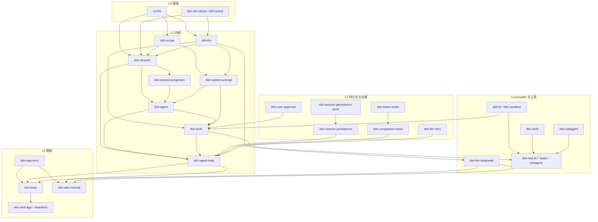
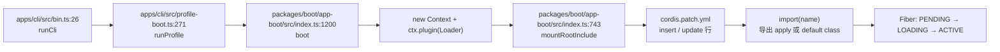
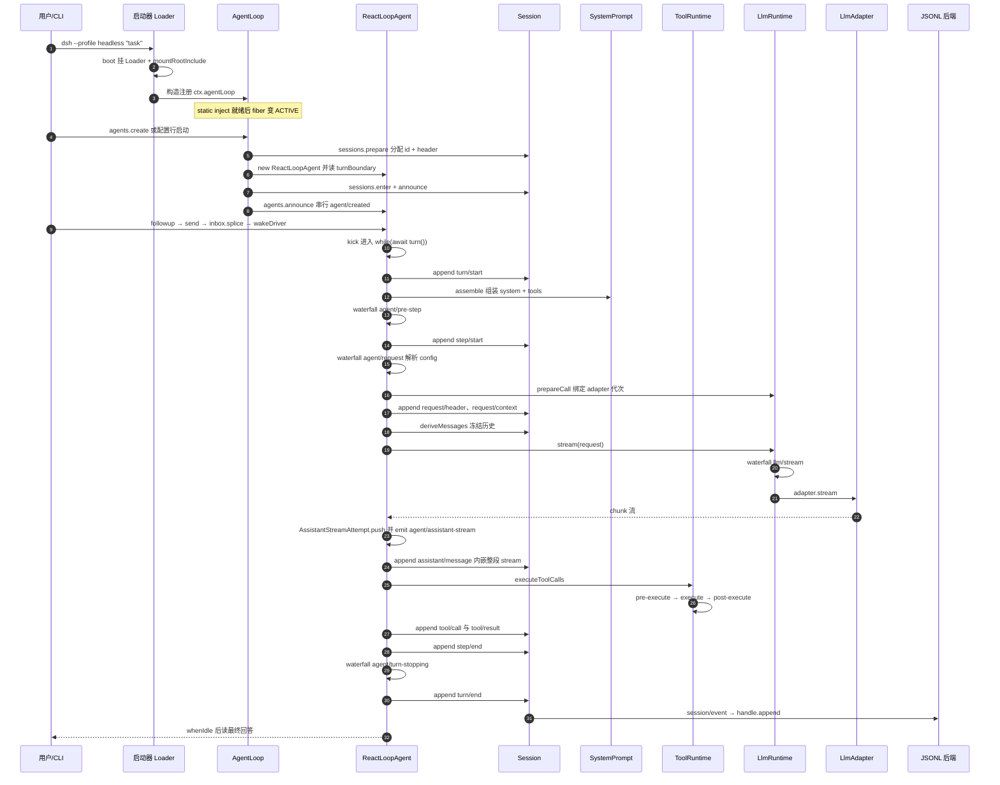

# deepseek-harness 架构笔记

> 仓库路径：`D:/AgentABC/deepseek-harness`
> 上游：`https://github.com/LukeLi-EBD/deepseek-harness.git`（各子包 `package.json` 的 `repository.url` 指向 `github.com/deepseek-ai/deepseek-harness`，即官方仓库镜像）
> 语言与规模：TypeScript（纯 ESM）；`git ls-files` 16083 文件 / 约 198 MB / 5751 个 `.ts(x)`（5101 `.ts` + 650 `.tsx`）；`packages/*/*` 下 **336 个包**
> commit 与日期：`571902028a75c64c1d767f4ae5fd099485f0ddf0`，`Wed Oct 14 21:15:15 2026 +0800`
> 分析时间：2026-11-04

## 1. 一句话定位

**dsh 是一个"内核为空"的 agent harness：它不提供 agent 的实现，而是提供 agent 运行所需的那个"世界"——并把这个世界压缩成一条只能追加、可完整回放的会话日志。**

三个易混词的差别在"抽象的是谁"：

| | 抽象对象 | 典型代表 | 你得到什么 |
|---|---|---|---|
| **agent framework** | 帮你**写** agent 的 API 表面（node/graph/chain） | LangGraph、AutoGen | 一套编排 DSL |
| **agent runtime** | agent 跑起来的**执行环境**（进程、沙箱、PTY、会话生命周期） | 各家 sandbox 服务 | 隔离与资源管理 |
| **agent harness** | agent 运行所需的**整个装配体**：模型适配 + 循环 + 工具 + 日志 + 上下文治理 + UI 载体 | dsh、Claude Code、Codex CLI | 一个能跑、能换零件、能回放的成品 |

harness 这一层真正抽象掉的是四件事：

1. **一次 turn 的边界**——什么算"模型欠一个回答"、什么算"轮次可关闭"。dsh 把它写成 `turn/start → step/start → step/end → turn/end` 四个持久事件（`packages/core/agent-loop/src/agent.ts:298` `turn()`、`:400` `step()`）。
2. **模型请求的构造**——请求不是函数参数，而是"从日志投影的历史 + 一份被冻结的 header"（`packages/core/agent-loop/src/agent.ts:616` `buildRequest()` 里的 `session.deriveMessages()`）。
3. **工具执行的可拦截性**——不是 `if (name === 'bash')`，而是"schema + 输出契约 + 三级 waterfall"（`packages/core/tools/src/index.ts:224`、`:1501`）。
4. **可替换性本身**——连"agent 循环"都是插件：`AgentLoop` 只是一个实现了 `AgentFactory` 的 Cordis `Service`（`packages/core/agent-loop/src/index.ts:341`）。

所以内核不是某个目录，而是**三条硬约定**（`AGENTS.md:133-138`）：`Registrations are effects`（注册必须走 `ctx.effect()`/`ctx.on()`，返回 disposer）、`Model-visible ⟺ logged`（进模型的必须能从日志重建）、`Plugins, not loop changes`（新行为挂扩展点，改 loop 必须同步改文档）。三条之外一切可换，三条之内一行不让。

## 2. 技术栈与工程结构

### 2.1 技术栈

| 维度 | 选型 | 证据 |
|---|---|---|
| 包管理器 | **pnpm 11.28.5**，`workspaces` + `pnpm-workspace.yaml` 双写 | `package.json:7` |
| Node | `^22.19.0 \|\| >=24.0.0` | `package.json:8-10` |
| 语言 | TS `^6.0.3`，`target es2024`，`module esnext`，`moduleResolution bundler`，`strict` + `noUncheckedIndexedAccess` + `exactOptionalPropertyTypes` | `tsconfig.base.json:6-22` |
| 构建 | `tsc -b` 项目引用（host/client 双面）+ **tsdown** 打包 | `package.json` 的 `build:lib:host/client` |
| DI 框架 | **Cordis 4.0.5-alpha.2**，源码 vendored 在 `vendor/cordis`，作为 workspace 成员由 `workspace:~` 引用 | `vendor/cordis/package.json:4` |
| 配置 schema | `schemastery`（Cordis 生态，`static Config`）+ `zod@4` 做线上/持久化校验 | `packages/core/agent-loop/src/index.ts:345`、`:46` |
| 测试 | **vitest 4**，unit/e2e/snapshot/web/bench/expected 多套 config；覆盖率 **perFile 100%** | `vitest.config.ts:391-399` |
| Lint / 自检 | oxlint + lefthook；另有 60+ 个 `verify-*` 脚本（mermaid、包依赖、文档引用、CLI help…） | `package.json` scripts |

**Cordis 在项目里的四种用法**（理解全仓库的钥匙）：

```ts
// 1) 服务 = class，构造即注册
export class AgentRegistry extends Service {
  constructor(ctx: Context) { super(ctx, 'agents') }   // → ctx.reflect.provide
}
// vendor/cordis/src/service.ts:42

// 2) 依赖用静态字段声明，Loader 据此排序
static inject = ['agents', 'sessions', 'llm', 'tools', 'systemPrompt', 'sessionProjections']
// packages/core/agent-loop/src/index.ts:342

// 3) 副作用用生成器 effect 表达，卸载时逆序回滚
ctx.effect(function* () {
  yield ctx.sessionProjections.register(turnBoundaryProjectionDefinition)
  yield () => ownership.dispose()
}, 'agentLoop.transactions()')       // packages/core/agent-loop/src/index.ts:377

// 4) 事件有 5 种派发语义：emit / parallel / serial / waterfall / bail
// vendor/cordis/src/events.ts:44-88
```

`waterfall` 是中枢：签名 `(payload, next) => …`，**必须显式 `next()` 才会继续**。被点名的 waterfall 有 `agent/pre-step`、`agent/request`、`agent/request-error`、`llm/stream`、`tools/pre-execute|execute|post-execute`；只有 `agent/turn-stopping` 是 `serial`（`packages/core/agent/src/runtime-types.ts:318-381` 的 `@mode` 注释）。

### 2.2 monorepo 组织方式

- **workspace 配置**：`pnpm-workspace.yaml` 列出 `vendor/*`、`packages/*/*`、`native/system`、`native/system/packages/*`、`apps/*`、`benchmarks`、`website`、`python/sdk-runtime`。
- **两层目录即命名空间**：`packages/<group>/<name>` → `@deepseek-ai/dsh-<group>-<name>`（例外：`core/agent` → `dsh-agent`，`llm/llm` → `dsh-llm`，`core/scope` → `dsh-scope`）。
- **依赖方向严格单向**：`util` ← `core` ← 能力 seam（fs/shell/sandbox/web/storage…）← provider/工具 ← `bundle` ← `apps`。`core/agent` 不认识 `core/tools`，反过来可以（工具要拿 `exec.agent`）。由 `scripts/verify-package-dependencies.ts` 强制。
- **包内一律 `peerDependencies: workspace:*`**：运行时由 Loader 解析、构建期靠 tsconfig 项目引用，避免同一服务装两份（`dsh-brand`、`dsh-util-values` 就是为"重复安装安全"存在的）。
- 336 个包的分组：`client` 64、`experimental` 46、`session` 21、`util` 17、`api` 10、`shell` 10、`host` 9、`llm` 9、`subagent` 9、`core` 8……**真正的内核只有 `core` 的 6 个包 + `llm/llm` + `session/session-projection`**。

### 2.3 包清单表

> "内核"= 抽掉它任何 profile 都起不来；"依赖了谁"只列 workspace 内部依赖（省略 `@deepseek-ai/` 与 `cordis`/`schemastery`）。

**内核**

| 包名 | 一句话职责 | 是否内核 | 依赖了谁 |
|---|---|---|---|
| `dsh-scope` | 作用域原语：scope tag、事件路由 carrier、按 agent 过滤 | ✅ | cordis |
| `dsh-session` | 事件溯源日志、内存 store、`deriveMessages()` 投影 | ✅ | dsh-llm, dsh-brand, dsh-util-values, dsh-scope |
| `dsh-llm` | 消息/流式词汇表与 `LlmAdapter` seam | ✅ | dsh-brand, dsh-util-values, dsh-util-crypto, dsh-timeout, dsh-typert-protocol |
| `dsh-system-prompt` | 提示词片段/变量注册与 `assemble()` | ✅ | dsh-llm, dsh-scope |
| `dsh-tools` | 工具注册表 + 三级执行流水线 + 权限 gate | ✅ | dsh-agent, dsh-llm, dsh-scope, dsh-session, dsh-system-prompt, dsh-sandbox(-policy), dsh-user-approval, dsh-working-directory, dsh-ptc-runtime |
| `dsh-agent` | `Agent` 接口、活跃注册表、initiator 作用域、`agent/*` 事件 | ✅ | dsh-llm, dsh-scope, dsh-session, dsh-session-projection, dsh-system-prompt, dsh-typert-protocol, dsh-util-values |
| `dsh-agent-loop` | 唯一的具体驱动器（`ReactLoopAgent` + `AgentLoop` 工厂） | ✅ | dsh-agent, dsh-llm, dsh-scope, dsh-session, dsh-session-persistence, dsh-session-projection, dsh-system-prompt, dsh-tools |
| `dsh-session-projection` | 投影 seam：已提交事件增量折成 per-session 状态 | 半 | dsh-session |

**能力 / 策略**

| 包名 | 一句话职责 | 是否内核 | 依赖了谁 |
|---|---|---|---|
| `dsh-session-persistence` | 持久化 seam（`create`/`open`/`flush`/`stat`/`list`） | 半 | dsh-session |
| `dsh-session-persistence-jsonl` | JSONL 后端：header + 逐行事件，generation 不可变发布 | | dsh-session(-persistence), dsh-session-format(-catalog), dsh-session-format-v3-to-v4 |
| `dsh-compaction` / `-basic` | 压缩 seam / tokenMeter 压力触发 + LLM 摘要 + surface `replace` | | dsh-agent, dsh-compaction(-tool-result-pruner), dsh-llm, dsh-session |
| `dsh-token-meter` | 可回放的 token 计量（含图片计价） | | dsh-llm(-retry), dsh-session(-projection), dsh-compaction |
| `dsh-llm-retry` | provider 路由的重试策略 | | dsh-agent, dsh-llm, dsh-session(-projection), dsh-timeout |
| `dsh-user-approval` | `ask` 决策背后的审批服务（`allowed-once`） | | dsh-agent, dsh-llm, dsh-scope, dsh-session, dsh-system-prompt |
| `dsh-sandbox` / `-policy` | 进程沙箱 seam + 每调用策略解析 | | dsh-llm, sandbox-windows-acl |
| `dsh-subagent` / `dsh-skill` | 子 agent 委派 seam / skill 提供者注册表 | | dsh-agent, dsh-session / dsh-working-directory |

**适配（provider）**

| 包名 | 一句话职责 | 是否内核 | 依赖了谁 |
|---|---|---|---|
| `dsh-llm-deepseek` | DeepSeek Messages 协议适配器（直连 fetch） | | dsh-llm, dsh-fs, dsh-attachment, dsh-deepseek-llm-api-extensions, dsh-launch-environment |
| `dsh-llm-deepseek-api-key` | API-key 认证与模型发现 | | dsh-llm(-deepseek), dsh-credentials |
| `dsh-llm-pi-ai` | pi-ai 库支撑的适配器（设计验证孪生体） | | dsh-llm, dsh-attachment, dsh-authorization, dsh-credentials, dsh-fs |
| `dsh-fs` / `-local` | 文件系统 seam + 本地实现（原子写、版本守卫） | | dsh-llm, dsh-sandbox |
| `dsh-shell` / `bash-local` | shell 执行 seam + bash/pwsh 后端 | | dsh-subprocess, dsh-sandbox |
| `dsh-subprocess` / `-local` | 子进程 seam：进程组、溢出落盘、升级 kill | | dsh-http-proxy |
| `dsh-terminal` / `-bash` | 持久 PTY seam + 实现（node-pty / ConPTY） | | dsh-agent, dsh-sandbox(-policy), dsh-subprocess |

**工具**

| 包名 | 一句话职责 | 是否内核 | 依赖了谁 |
|---|---|---|---|
| `dsh-tool-fs` | 读/写/编辑/搜索文件 | | dsh-fs, dsh-sandbox-policy, dsh-attachment, dsh-session, dsh-system-prompt |
| `dsh-tool-bash` / `-persistent` | 一次性 / 持久 shell 工具 | | dsh-shell, dsh-shell-env, dsh-sandbox, dsh-jobs, dsh-user-approval, dsh-tools |
| `dsh-tool-subagent` / `-control` | 派生子 agent、查询/控制 | | dsh-subagent, dsh-agent-preset-registry, dsh-session |
| `dsh-tool-todo` | 会话内 TODO（走 projection 持久化） | | dsh-agent, dsh-session(-projection), dsh-tools |
| `dsh-tool-web` | `web_search` / `web_fetch` | | dsh-web, dsh-tools, dsh-system-prompt |

**装配 / 基础设施**

| 包名 | 一句话职责 | 是否内核 | 依赖了谁 |
|---|---|---|---|
| `dsh-app-boot` | `boot()`：new Context、挂 Loader、mount include、audit、fail-loud | | cordis-plugin-loader, -include |
| `dsh-base` | 共享第一层 patch bundle（95 个插件行 / 522 行 YAML） | | 几乎所有 |
| `dsh-sdk-minimal` | 例外：**不叠 base** 的完整独立树（172 行 YAML / 35 个插件行） | | 见 §3.2 |
| `dsh-web-app` / `dsh-headless` | 浏览器载体 / 一次性运行器 | | dsh-base + host/client |

## 3. 整体架构

### 3.1 包依赖拓扑图

只画内核 + seam + 适配 + 装配；`client/*`、`api/*`、`host/*`、`experimental/*` 省略（它们挂在最右侧，不反向依赖内核）。



读图要点：

- **箭头只朝一个方向**：`dsh-agent` 不认识 `dsh-tools`，所以"给 agent 加能力"永远不用改 agent。
- **`dsh-tools` 是内核里唯一的胖子**（1993 行）：它同时依赖 `agent`（拿 `exec.agent`）、`session`、`system-prompt`（schema 进提示词）、`sandbox(-policy)`（call 级策略）。
- **`dsh-agent-loop` 是"汇"**：所有能力最终都在这里被调用一次，但它自己只有 1634 行。

### 3.2 内核最小集：没有它就跑不起来

按"能不能跑出一个 turn"判定（不是"能不能编译"）：

```text
cordis
 └─ dsh-scope               ← ReactLoopAgent 构造时 createScope()，否则拿不到 scoped ctx
    └─ dsh-session          ← 日志；没有它就没有 turn/step/消息，也没有 deriveMessages
       ├─ dsh-llm           ← Message 类型与 stream
       ├─ dsh-system-prompt ← preStep 调 systemPrompt.assemble()，缺了直接抛
       ├─ dsh-session-projection ← AgentLoop.static inject 点名，缺了不激活
       └─ dsh-tools         ← 同上
          └─ dsh-agent      ← AgentRegistry + 事件词汇
             └─ dsh-agent-loop ← 唯一驱动器
```

**结论：内核最小集 = `dsh-scope`、`dsh-session`、`dsh-llm`、`dsh-system-prompt`、`dsh-session-projection`、`dsh-tools`、`dsh-agent`、`dsh-agent-loop`（8 个）**，外加**一个模型适配器**（`dsh-llm-deepseek` 或 `dsh-llm-pi-ai`）——否则 `prepareCall()` 抛 `NO_ADAPTER`（`packages/core/agent-loop/src/agent.ts:606-610` 允许中间件先接管，但最终 `stream()` 仍无路可走）。

持久化**不在最小集里**：`createStoredSession()`（`packages/core/agent-loop/src/index.ts:715`）在没有 `ctx.sessionPersistence` 时直接 `return undefined`，会话纯内存，进程退出即丢。这也解释了为什么 `sdk-minimal` 的 YAML 里 persistence 是最后一行、可以整行删。

`sdk-minimal` 实际最小树（`packages/bundle/sdk-minimal/cordis.patch.yml`，172 行 / 35 个插件行）印证了这一点：llm → session → session-projection → system-prompt → tools → agent → agent-loop → persistence-jsonl，其余全是"让 loop 有用"的外围（fs、sandbox、terminal、tool-fs、compaction、token-meter、retry、title）。

### 3.3 插件机制

**两种合法写法**：

```ts
// ① 函数式（最轻，能力/工具首选）—— packages/session/tool-working-directory/src/index.ts:11-42
export const name = 'tool-working-directory'
export const inject = ['tools', 'workingDirectory']
export function apply(ctx: Context): void {
  ctx.tools.register(defineTool({ /* ... */ }))
}

// ② 类式（需要服务、配置、生命周期）—— packages/core/agent-loop/src/index.ts:341-388
export class AgentLoop extends Service implements AgentFactory {
  static inject = ['agents', 'sessions', 'llm', 'tools', 'systemPrompt', 'sessionProjections']
  static Config = z.object({ agents: z.array(...).default([]), maxParallelToolCalls: ... })
  constructor(ctx: Context, config: Config) {
    super(ctx, 'agentLoop')
    ctx.effect(function* () { /* ... */ }, 'agentLoop.transactions()')
    ctx.agents.setFactory(this)
  }
}
```

**如何被加载**：



- **patch 语法**：`cordis.patch.yml` 是对条目列表的补丁，只有 `insert`（插入）和按 `id` 定位的 `update`（整段替换 config）。`sdk-minimal` 用一条 `insert` 装下整棵树，注释写明 "this insert is the complete Cordis tree"。
- **层序**：profile 的 bundle 顺序 → bundle 的 `cordis.patch.yml` → 用户 `$DSH_HOME` patch → `--patch` overlay；`preset` patch 还能钻进某条目的 `config.plugins` 继续打补丁。
- **id 是稳定标识**：根 include 固定 id `'include'`，因为它会出现在 Loader 失败链里，随机 id 会让启动诊断不稳定（`packages/boot/app-boot/src/index.ts:769-771` 注释）。

**生命周期钩子**：没有 `onInit`/`onDestroy` 这种字符串钩子，只有三种原语（`vendor/cordis/src/fiber.ts`、`events.ts`、`service.ts`）：

| 原语 | 语义 | 位置 |
|---|---|---|
| `ctx.effect(fn)` | fn 可为生成器，`yield` 的 disposer 卸载时**逆序**执行 | `vendor/cordis/src/fiber.ts:77` 起 |
| `ctx.on(event, cb)` | 订阅并返回 disposer；scope 化后自动按 agent 过滤 | `vendor/cordis/src/events.ts:288` |
| `ctx.provide(name, v)` | 注册服务值，随 fiber 卸载撤销 | `vendor/cordis/src/service.ts:57` |
| `FiberState` | PENDING/LOADING/ACTIVE/UNLOADING/DISPOSED/FAILED，变化发 `internal/status` | `packages/core/agent-loop/src/index.ts:40-44` 用到 |

一个真实的逆序卸载（`packages/core/agent-loop/src/index.ts:377-387`）：

```ts
ctx.effect(function* () {
  const a = ctx.sessionProjections.register(turnBoundaryProjectionDefinition)
  yield a
  const b = ctx.sessionProjections.register(inboxProjectionDefinition)
  yield b
  yield () => ownership.dispose().finally(() => { b(); a() })
}, 'agentLoop.transactions()')
```

注释里"Cordis skips later disposers after a rejection"是关键：**disposer 链一旦某项 reject，后面的不会跑**，所以关键清理必须写在 `finally`。

**三种注册边界**：全局 ctx（共享）；`agent.ctx`（`createScope()`，`core/scope/src/index.ts:137`，只对该 agent 可见、随其销毁回滚）；`isolate` realm（`cordis:group`，让 provider+consumer 拥有独立服务实例，agent preset 用它换掉整个模型/沙箱栈）。

## 4. 端到端主链路

以 `dsh --profile headless "task"` 为例。



### 步骤 1：进程启动与配置树组装

- 入口：`apps/cli/src/bin.ts:26` `runCli()` → `apps/cli/src/profile-boot.ts:271` `runProfile()` → `packages/boot/app-boot/src/index.ts:1200` `boot()`
- 逻辑：`runCli` 用 `parseDshArgs` 解析出 profile 名与 `--patch`；`runProfile` 读 `$DSH_HOME/profiles/<name>`，按 `dsh.profile.bundles` 顺序叠加每个 bundle 的 patch；`boot()` 里 `new Context()` → `ctx.plugin(Loader)` → `mountRootInclude()`（`:743`）→ `loader.await()` → `auditStartupEntries()`。Loader 对每一行 `import(name)`，再 `apply(ctx, config)` 或 `new Class(ctx, config)`。
- 数据结构：`PatchOptions`、`Include.Config { path, patches }`、`Fiber.state`。

### 步骤 2：服务注册与依赖解析

- 入口：`vendor/cordis/src/service.ts:42`；`vendor/cordis/src/registry.ts`
- 逻辑：`super(ctx, name)` 立刻 `ctx.reflect.provide(name, this)`——**构造完成前服务已可见**；`static inject` 决定 fiber 何时从 PENDING 转 LOADING；动态依赖用 `ctx.inject([...], childCtx => …)` 返回可 `dispose()` 的 fiber（`packages/core/agent-loop/src/index.ts:411`）；服务名同时是 `declare module '@deepseek-ai/cordis'` 的类型键（`core/agent/src/index.ts:27-31`）。
- 事件：`internal/service`、`internal/status`、`internal/get`。

### 步骤 3：Agent 实例创建

- 入口：`core/agent/src/index.ts:393` `AgentRegistry.create()` → `packages/core/agent-loop/src/index.ts:750` `createAgent()`
- 逻辑：`create()` 取出已注册的 `AgentFactory`，用 `getTraceable(ownerCtx, target)` 把调用重新绑定到调用方 fiber（所有权跟随调用者，不跟随工厂）；`createAgent()` 先 `sessions.prepare()`（`core/session/src/index.ts:1143`）造出**未发布**的 Session；`prepare()`（`:497`）建"调用方取消 + owner 卸载 + 工厂拆除"三源合一的 abort，再 `new ReactLoopAgent(...)`（`packages/core/agent-loop/src/agent.ts:122`）；构造函数里做四件事——`agentEvents()` 建融合派发器、`createScope()` 建作用域、`new ReactLoopInbox()`、从 `turnBoundary` 投影读回 `lastTurn`（断点续跑的关键）；`initializeAgent()` 用 `runMaintenance()` 兜住整个发布过程；`publish()`（`:650`）依次 `sessions.enter` → `agents.enter` → `sessions.announce` → 串行 `agent/created`。
- 数据结构：`PreparedAgent { agent, signal, publish, dispose }`、`AgentEntry`。

### 步骤 4：消息进入

- 入口：`packages/core/agent-loop/src/agent.ts:163` `followup()` → `:154` `send()` → `:214` `wakeDriver()`
- 逻辑：`followup` = `send(msg,'next-turn',true)`；`steer` = `'next-step', true`；`inject` = `'next-step', false`——只差"投哪个边界"和"是否唤醒"。`send()` 会先把"在已 abort 活动上唤醒"改判为 `next-turn`（唤醒不能并入已取消的活动）。然后 `inbox.splice()`（`packages/core/agent-loop/src/inbox.ts:167`）写内存队列**并** append 持久事件（inbox 本身是 projection）；`wakeDriver()` 在 idle 时 `setPhase(running)` 并 `agents.withInitiator(this, () => this.kick())`，使整条异步链都能 `requireInitiator()` 拿到这个 agent。
- 事件：`agent/status`、`agent/inbox/claimed`、`agent/inbox/discarded`。

### 步骤 5：turn 开始

- 入口：`packages/core/agent-loop/src/agent.ts:298` `turn()`
- 逻辑：校验 phase 为 running，`turn = phase.turn + 1`，`session.append('turn/start', { turn })`。因为**任何后续失败都必须有配对 `turn/end`**，`turnEnds` 在 `finally` 里兜底（`packages/core/agent-loop/src/agent.ts:384-390`）。随后进入 `while (true)` 的 step 循环，`target` 初值 `'next-turn'`。
- 数据结构：`TurnEndReason = completed | max-tokens | blocked | aborted | error`。

### 步骤 6：pre-step 与上下文组装

- 入口：`packages/core/agent-loop/src/agent.ts:267` `preStep()`；`core/system-prompt/src/index.ts:614` `assemble()`
- 逻辑：`inbox.claim(target, turn)` 取这批消息；`systemPrompt.assemble()` 收集所有 section/variable，产出 `PromptAssembly`（system 文本 + context 片段 + tools schema）；`dispatch.waterfall('agent/pre-step', …)`，fallback 会 `renderContextSections` + `runtimeContext.project` 生成一条 `runtime-context` 消息；压缩插件就在这里插一脚（`compaction-basic/src/index.ts:158`），先 `compactIfNeeded` 再**无条件 `return next()`**——漏掉 `next()` 会静默切断整条链。`reject` 或"首次 enter 但消息为空"都不产生 step，直接关轮（`packages/core/agent-loop/src/agent.ts:319-329`）。
- 事件：`agent/pre-step`（waterfall，可 reject/enter/改 messages/声明 `startsRequestSeries`）。

### 步骤 7：请求构造

- 入口：`packages/core/agent-loop/src/agent.ts:400` `step()` → `:564` `prepareRequest()` → `:616` `buildRequest()`
- 逻辑：先算 seedConfig（首次用 `options.provider/model`，之后从 `requestHeader()` 折叠并剔除 adapter 填的默认值，见 `requestProposal()` `:64`）；`waterfall('agent/request')` 让插件换 config，缺 provider/model 直接抛（`:598-600`）；`llm.prepareCall(config, signal)`（`llm/llm/src/index.ts:956`）**绑定 adapter 代次**——把"模型元数据"和"真正发请求的函数"冻在一起，避免两次 await 之间设置变了导致"用 A 代的能力连 B 代的 endpoint"；`buildRequest` 里 `canonicalHeader` 与 `session.requestHeader()` 比较，变了就 append `request/header`（`reason: initial|resume|change|series`），工具集变了再 append 一条 `developer/message`（`tool-addition`/`tool-removal`）；最后 `deriveMessages()` 取历史、逐条 `deepFreeze`（`WeakSet` 记忆已冻结的）、`Object.freeze` 整个请求。
- 数据结构：`EpochHeader { config, adapterDefaults, tools }`、`GenerateOptions`、`PreparedLlmCall`。

### 步骤 8：模型调用与流式 chunk

- 入口：`packages/core/agent-loop/src/agent.ts:453`；`llm/llm/src/index.ts:1166` `stream()` → `:1170` `streamWithRegistration()`
- 逻辑：优先用**已绑定代次**的 `preparedCall.stream(request)`，没有再回落 `loopCtx.llm.stream()`；`llm.stream()` 只做一件事——`ctx.waterfall(this, 'llm/stream', options, () => this.adapterStream(...))`，重试/降级/计量/压缩触发全挂这里，**循环一行不改**；`adapterStream` 按 `options.provider` 找 `LlmAdapter` 并调 `stream()`（`:302`，唯一必须实现的方法）；回到循环 `for await (const chunk of stream) { signal.throwIfAborted(); live.push(chunk) }`；`live.push`（`packages/core/agent-loop/src/assistant-stream.ts:60`）把 chunk 同时喂给带时间戳的 `accumulator`（供持久化重放）和 `assembler`（拼 `ContentBlock`），并 emit `agent/assistant-stream` 给 UI。
- 数据类型：`StreamChunk = block-start | text-delta | reasoning-delta | tool-call-delta | block-end | usage | finish`（`packages/llm/llm/src/types.ts:470-482`）；`AssistantStreamFrame = start | chunk | end`（`core/agent/src/runtime-types.ts:128`）。
- 失败：`finish.kind === 'error' | 'aborted'` 时不直接抛，先走 `agent/request-error` 问"要不要 retry"，没人接才 `throw LlmError`（`packages/core/agent-loop/src/agent.ts:506-527`）。

### 步骤 9：落盘——"日志即真相"具体是什么

**是什么、写在哪**：模型历史不是内存里的 `messages[]`，而是**从一条只能 append 的事件日志投影出来的**（`Session.log: SessionEvent[]`，`core/session/src/index.ts:523`）。日志是唯一真相，其他都是投影。每条事件形如 `{ type:'assistant/message', seq:42, time, data:{ turn, step, message, usage, stream:[{time,chunk},…] }, surfaceOp:'append' }`——整段 provider 流带时间戳内嵌在消息里，这是"毫秒级重放"的代价。

**什么格式**：`SESSION_FORMAT_VERSION = 4`（`core/session/src/types.ts:90`）。磁盘上是 JSONL：第一行 header，之后一行一个事件；文件名 `session.v4.jsonl`（v0 例外叫 `session.jsonl`），可选 `.zstd`；路径 `$DSH_HOME/sessions/<projectKey>/<encoded-id>/`（`session-persistence-jsonl/src/format.ts:267-288`）。generation 文件**不可变**：迁移时在旧文件旁排他发布新版本命名的文件，绝不重命名/替换/删除。

**append 的硬约束**（`core/session/src/index.ts:798`）：数据必须无损 JSON（禁 BigInt/undefined/NaN/-0/Map/Set/Date/类实例/稀疏数组/循环引用），否则**在 append 点就抛**而不是等 flush；`seq = log.length` 连续无洞；凡是"产生消息"的事件（`user/system/developer/assistant/message`、`tool/result`）**必须带 `surfaceOp`**，否则编译期报错（`packages/core/session/src/types.ts:440-479` 条件类型）；append 后同步广播 `session/event`，监听器异常逐个吞掉（"日志一旦写入就提交，观察者失败不改变返回值"，`packages/core/session/src/index.ts:763-767`）。

**如何投影**：`deriveMessages()`（`:984`）沿 `surface.nodes` 走，把消息事件折成 `Message[]`，带缓存（纯尾部增长 O(new)，遇 `replace` 或消息投影则整体重建）。压缩**不改日志**，只 append 一个 `surfaceOp: { op:'replace', startSeq, endSeq }` 节点把中段从投影视图遮蔽——原文还在，只是模型看不见（`packages/core/session/src/surface.ts:510` `planSurfaceEvent()` / `:563` `applySurfacePlan()`）。

**如何回放**：`resume()` → `resumeWith()`（`packages/core/agent-loop/src/index.ts:852`）：`persistence.open(id,'write')` **先拿写租约**（排除同 id 并发恢复）→ `handle.read(0)` 冷读全部事件 → `interruptedTurnClosers()`（`core/session/src/repair.ts`）给被硬杀在半路的 turn 补合成收尾（缺失的 tool error、`step/end`、`turn/end`）→ `sessions.prepare(id,{ seed:[...persisted,...closers], meta: handle.header })` → `new ReactLoopAgent` 从 `turnBoundary` 投影直接读到 `lastTurn` → `deriveMessages()` 重建历史。**没有任何"重放执行"，只是重新折一遍日志。**

一句话：**replay 是 fold，不是 re-run。**

### 步骤 10：工具调用

- 入口：`packages/core/agent-loop/src/agent.ts:551` → `packages/core/agent-loop/src/tool-calls.ts:60` `executeToolCalls()`
- 逻辑：从 `message.content` 筛 `tool-call` 块，逐个 `parseArguments`（非法 JSON 保留原文，当"错误参数"传给工具而非丢弃）；`ctx.tools.executionMode()`（`packages/core/tools/src/index.ts:1311`）判并发——只有显式 `isConcurrencySafe(args) === true` 才是 `parallel`，其余 `exclusive`（barrier）；`runGroup`（`packages/core/agent-loop/src/tool-calls.ts:122`）用**有界滚动池**跑并发组，但 `prepare`（policy）与结果提交严格按模型顺序（`commitReady()` 只提交连续前缀）；单个调用三段式 `scheduler.prepare` → `dispatch` → `finalize`（`ToolRuntimeScheduler`，`packages/core/tools/src/index.ts:466-475`，注释直言 "not a plugin extension point"）；权限 `PreToolDecision = allow|deny|cancel|ask`（`packages/core/tools/src/index.ts:608`），`ask` 只有审批返回 `allowed-once` 才放行（`packages/core/tools/src/index.ts:1761`）；落盘先 `append('tool/call')` 拿 seq，再 `append('tool/result', …, { surfaceOp:'append', sourceEventSeqs:[callSeq] })`——**result 必须引用 call 的 seq**；取消时已启动的等 drain、未启动的补合成 error result（`packages/core/agent-loop/src/tool-calls.ts:250` `appendSkippedToolCall`），保证每个 call 都有配对的 result。

### 步骤 11：循环退出

- 入口：`packages/core/agent-loop/src/agent.ts:361-367`（step 内）、`:392-397`（turn 尾）、`:252-265`（kick 尾）
- 逻辑：一个 step 结束后若 `turnEnds !== null` 且 `inbox.nextStep` 为空 → `dispatch.serial('agent/turn-stopping')`；它是 **serial**（没有 `next()`），想阻止关轮只能 `agent.steer()` 往 inbox 塞消息，塞完 loop 重读、非空就再跑一个 step；再判一次才 `break`；`finally` 里 `append('turn/end', {turn, reason})` 后，`if (!inbox.hasPending) return false` 结束 `kick` 的 `while (await this.turn())`；`setPhase(idle)`，若有 latch 的 wake 且队列非空则重新 `wakeDriver()`；外部 `await agent.whenIdle()`（`:237`）用"替换检测"等到真正静止。
- 注意：`max-tokens` 是 **sticky** 的——任一步撞上限，后面正常完成也不能把 turn 结果降级（`:338-343` 两处注释重复强调）。

## 5. 核心代码路径清单

| 文件路径 | 关键类/函数 | 作用 | 优先级 |
|---|---|---|---|
| `core/agent-loop/src/agent.ts:252` | `ReactLoopAgent.kick()` | `while (await this.turn()) {}`，整个产品的心跳 | ★★★ |
| `core/agent-loop/src/agent.ts:298` | `turn()` | 开轮、step 循环、`turn/end` 兜底、max-tokens sticky | ★★★ |
| `core/agent-loop/src/agent.ts:400` | `step()` | 一次模型请求 + 流消费 + 工具执行 + 失败结算 | ★★★ |
| `core/agent-loop/src/agent.ts:564` | `prepareRequest()` | config waterfall + `prepareCall` 代次绑定 | ★★★ |
| `core/agent-loop/src/agent.ts:616` | `buildRequest()` | header 差分、tool-addition、冻结历史 | ★★★ |
| `core/agent-loop/src/agent.ts:267` | `preStep()` | 提示词组装 + `agent/pre-step` 瀑布 | ★★★ |
| `core/session/src/index.ts:798` | `Session.append()` | 日志唯一写入口：JSON 校验、surface 校验、广播 | ★★★ |
| `core/session/src/index.ts:984` | `deriveMessages()` | 从日志投影模型历史（带缓存） | ★★★ |
| `core/session/src/types.ts:463` | `SurfaceOp` | `append` / `replace{startSeq,endSeq}`，压缩不改日志的机关 | ★★★ |
| `core/session/src/repair.ts` | `interruptedTurnClosers()` | 崩溃后补合成收尾，让日志语义合法 | ★★★ |
| `core/agent/src/index.ts:245` | `AgentRegistry` | 活跃 agent 表 + initiator（`AsyncLocalStorage`） | ★★★ |
| `core/agent/src/index.ts:393` | `create()` / `resume()` | 委托工厂并重绑调用方 fiber | ★★ |
| `core/agent/src/dispatch.ts:107` | `agentEvents()` | 融合派发器：subject 与 scope carrier 不可分离 | ★★★ |
| `core/agent/src/runtime-types.ts:320` | `agent/pre-step` 声明 | 事件语义的权威定义（`@mode waterfall`） | ★★★ |
| `core/agent-loop/src/index.ts:341` | `AgentLoop` | 唯一工厂：`static inject` + 配置驱动启动 | ★★★ |
| `core/agent-loop/src/index.ts:497` | `prepare()` | 三源 abort、memoized teardown、发布前注册清理 | ★★ |
| `core/agent-loop/src/index.ts:852` | `resumeWith()` | 写租约 → 冷读 → 补 closers → seed 重建 | ★★★ |
| `core/agent-loop/src/tool-calls.ts:60` | `executeToolCalls()` | 有界并发池 + 模型序提交 + 取消补结果 | ★★★ |
| `core/tools/src/index.ts:224` | `ToolDefinition` | schema + output 契约 + 一个 gate | ★★★ |
| `core/tools/src/index.ts:466` | `ToolRuntimeScheduler` | prepare/dispatch/finalize/finish 四段式 | ★★★ |
| `core/tools/src/index.ts:1501` | `prepareExecution()` | `tools/pre-execute` + `ask` 审批 + guard | ★★★ |
| `core/tools/src/schema.ts:554` | `defineTool()` | 编译参数/输出 schema，生成 `ToolDefinition` | ★★★ |
| `llm/llm/src/index.ts:208` | `LlmAdapter` | 适配器基类（只要实现 `stream`） | ★★★ |
| `llm/llm/src/index.ts:956` | `prepareCall()` | 绑定 adapter 代次，防能力与端点错配 | ★★ |
| `llm/llm/src/index.ts:1166` | `stream()` | `llm/stream` waterfall，所有请求治理的挂点 | ★★★ |
| `core/system-prompt/src/index.ts:614` | `SystemPrompt.assemble()` | section/variable/tools 合成 `PromptAssembly` | ★★ |
| `core/scope/src/index.ts:137` | `createScope()` | agent 级注册边界 | ★★ |
| `compaction/compaction-basic/src/index.ts:158` | `agent/pre-step` 监听 | 压缩如何零改动插进循环 | ★★ |
| `boot/app-boot/src/index.ts:1200` | `boot()` | 造 Context、挂 Loader、mount、audit | ★★ |
| `bundle/headless/src/index.ts:311` | `run()` | 94 行驱动一个 agent 的最小样例 | ★★★ |

## 6. 关键设计点

### 6.1 为什么用 Cordis DI 而不是简单 hooks

**设计**：服务是对象、依赖是声明、注册是副作用、卸载是逆序回滚；没有全局 `registerTool()`，只有 `ctx.tools.register()` 返回的 disposer。

**为什么**：三个硬需求只有 DI 容器能同时满足——① **agent 级隔离**（同一个 `ctx.tools` 在不同 `agent.ctx` 下看到不同工具集）；② **可热插拔**（换插件不能泄漏 listener）；③ **可测试**（单测里 `new Context()` 挂三个真插件就能跑，不用 mock 全局）。hooks 是"在固定点跑回调"，无法表达"这段注册只属于 agent X"，也无法在卸载时精确撤销它注册的 17 个东西。`ctx.effect(function*(){ yield a; yield b })` 本质上是一个**结构化并发的资源栈**。

**代价**：学习曲线极陡。`packages/core/agent-loop/src/index.ts:544-591` 那个 48 行的 memoized teardown 就是实证——为了正确处理"创建中被打断"，要收集失败、等 publication settle、cancel、dispose scope、close handle、detach、untrack，一步不能少。

### 6.2 插件即包，以及 336 个包的粒度是否过度

**设计**：一个能力 = 一个 npm 包，`dsh.bundle`/`dsh.profile` 决定如何装配。

**为什么**：这是"可替换"落到工程上的唯一办法——只有包边界能强制"不许 import 别人的内部文件"，也只有包能在 `cordis.patch.yml` 里被一行 `name:` 换掉。

**代价**：解析成本（`benchmark:npm-resolution` 脚本的存在说明他们把 336 包的解析耗时当成持续测量的指标）、版本地狱（内部依赖全是 `workspace:*`，发布必须整族同步，`release:dsh` / `release:vendor` 两个 bump 家族）、认知成本（要读 30 个包才能拼出一次 turn）。

**粒度判断：内核不过度，外围过度。** 内核 8 个包的拆分是必要的——`session`/`llm`/`tools`/`agent`/`agent-loop` 之间确实存在真实且单向的依赖，任何合并都会让"换 loop"或"换 persistence"变得不可能。seam 与 provider 分离（`dsh-fs` vs `dsh-fs-local`）也必要，它正是"把 fs 指向远程沙箱，Bash/PTY/LSP 一起搬过去"的机制。过度的是 `client/*`（64 个）：六个设置页六个包（account/models/shell/agent-loop/subagent/web-search），好处是可独立发布，代价是 `packages/bundle/web-app/cordis.patch.yml` 膨胀到 89 个插件行 / 586 行，改一个设置项常要同时动 UI 包、host 包和 patch 行。另一个客观信号：`packages/experimental/` 有 46 个包，说明**拆分本身也被当成实验手段**——先拆出来，跑不通就删。

### 6.3 "日志即真相"对调试/回放/崩溃恢复的意义

**设计**：模型可见的一切必须能从日志重建；日志只 append；压缩只改投影；崩溃用合成 closers 修日志。

**为什么**：调试上，拿 `session.v4.jsonl` 就能离线复现"模型当时看到了什么"，不需要埋点或 traceId 串联——日志本身就是完整输入。回放上，`snapshots/` 下 1677 个快照文件、`test:snapshot`/`test:expected` 两套套件都建立在这条性质上，`dsh-llm-replay` 甚至能拿日志里的 stream 重放响应让 e2e 不花钱。崩溃恢复上，`kill -9` 后最后一条 `tool/call` 可能没有配对 result，`interruptedTurnClosers()` 会补一条 `TOOL_OUTCOME_UNKNOWN` 的合成结果。这里有个清晰分工：**物理合法**（每行能 parse）由持久化层负责，**语义合法**（每个 call 有 result、每个 turn 有 end）由 agent 层负责（`packages/core/agent-loop/src/index.ts:884-887` 注释明确划了这条线）。

**代价**：写放大——每条 `assistant/message` 内嵌整段 provider stream（每个 chunk 带时间戳），一条长回答可能几十 KB，这是为了毫秒级重放（v2 格式迁移的核心决策）。schema 演进困难——`SESSION_FORMAT_VERSION` 从 0 到 4，为此有 4 个迁移包 + 一个 catalog 包 + `verify-v3-event-vocabulary` 脚本，改一个事件字段的成本远高于改内部函数。还有一条隐性的："临时塞进 context 但不落盘"的捷径被彻底堵死，`agent.inject()` 也必须走 inbox 的持久 splice。

### 6.4 工具执行三段式，而不是一个 `execute()`

**设计**：`prepare`（policy/gate）→ `dispatch`（body）→ `finalize`（post-policy + 物化）；`prepare` 严格按模型序，只有 `dispatch` 可重叠。

**为什么**：权限判断必须串行（否则两个并发调用会同时通过一个"只剩一次"的审批），但 IO 可以并行。拆开后"策略有序 + 执行并发"才能同时成立，`commitReady()`（`tool-calls.ts:147`）只提交连续前缀正是这个不变量的实现。

**代价**：`ToolRuntime` 变成 1993 行，且暴露了一个 symbol 键的 `ToolRuntimeScheduler`（注释直言不是扩展点）。这是"内核为空"的一个例外——工具调度的顺序不变量无法下放到插件。

### 6.5 为什么取消这么复杂

**设计**：每 turn 一个 `AbortController`；`cancel()` 只 abort 不等待，await 交给 `whenIdle()`；取消原因 `user|parent|disposed|hook` 被**复制**进 `turn/end`（`packages/core/agent-loop/src/agent.ts:80-95`）。

**为什么**：取消必须可观测、可恢复、可归因。用户按 Esc、父 agent 撤子任务、进程退出、hook 拒绝——四种原因在日志里必须能区分，否则回放时无法解释"这轮为什么没回答"。注释还解释了一个 Node 坑：不能直接存 `signal.reason`，因为 fetch 会往 reason 上挂 `stack`，而日志只接受 JSON。

**代价**：`packages/core/agent-loop/src/index.ts:525-591` 那段"三源 abort 融合 + 失败收集 + 幂等拆解"几乎不可能被外部贡献者正确修改，是全仓库最需要"读注释才能懂"的 67 行。

### 6.6 配置即代码树，而不是代码里的 `if`

**设计**：所有装配写在 `cordis.patch.yml`，用 `insert`/`update` 表达；profile 是 patch 的有序列表；`--dump-config` 打印整棵树。

**为什么**：让"同一个二进制输出 5 种产品形态"成为可能——`web`/`headless`/`sdk`/`sdk-minimal`/`acp` 的差别**全在 YAML 里**，`apps/cli` 只有一个 `bin.ts`。

**代价**：YAML 错误只能启动时暴露，且信息常是"plugin tree failed to load"加一长串 cause 链，所以才需要 `auditStartupEntries()` 和 `installFailLoud()` 这类补偿机制。

## 7. 扩展点

### 7.1 写一个新插件

```ts
// packages/<group>/<name>/src/index.ts
import type { Context } from '@deepseek-ai/cordis'
export const name = 'my-plugin'
export const inject = ['tools']              // 声明依赖，Loader 据此排序

export function apply(ctx: Context): void {
  ctx.effect(() => {
    const off = ctx.on('session/event', (session, event) => {
      if (event.type === 'turn/end') { /* ... */ }
    })
    return () => off()
  }, 'my-plugin.watch()')
}
```

挂进产品：在某层 `cordis.patch.yml` 里加一行

```yaml
- id: my-plugin            # 稳定标识，会出现在失败链里
  name: '@acme/dsh-my-plugin'
  inject: [tools]
  config: {}
```

### 7.2 接一个新模型

只需实现 `LlmAdapter.stream()`（`llm/llm/src/index.ts:302`），然后注册：

```ts
import { LlmAdapter, type GenerateOptions, type StreamChunk } from '@deepseek-ai/dsh-llm'
export const name = 'my-llm'
export const inject = ['llm']

class MyAdapter extends LlmAdapter {
  async *stream(options: GenerateOptions): AsyncIterable<StreamChunk> {
    // 必须 honor options.signal；按 block-start → *-delta → block-end → finish 发
    yield { type: 'block-start', index: 0, blockType: 'text' }
    yield { type: 'text-delta', index: 0, text: '...' }
    yield { type: 'block-end', index: 0, block: { type: 'text', text: '...' } }
    yield { type: 'finish', reason: { kind: 'completed' } }
  }
  // 可选：providerInfo / listModels / resolveModel / prepareCall / providerRetryPolicy
}

export function apply(ctx: Context): void {
  ctx.effect(() => ctx.llm.registerAdapter(['my-provider'], new MyAdapter()))
}
```

参考实现：`llm/llm-deepseek/src/host.ts:55`（直连 fetch）、`llm/llm-pi-ai/src/index.ts:307`（库支撑，一次注册多路由）。

### 7.3 加一个新工具

```ts
import { defineTool } from '@deepseek-ai/dsh-tools'
export const name = 'tool-my-thing'
export const inject = ['tools']

export function apply(ctx: Context): void {
  ctx.tools.register(defineTool({
    name: 'my_thing',
    description: '...给模型看的一句话...',
    parameters: { path: { type: 'string', required: true, description: '...' } },
    output: {
      schema: { type: 'object', additionalProperties: false,
                properties: { ok: { type: 'boolean', required: true } } },
      render: (_args, value) => [{ type: 'text', text: String(value.ok) }],
    },
    isConcurrencySafe: () => true,     // 只有严格 true 才并行；不写就是独占
    timeoutMs: 30_000,                 // 需要 tool-call-timeout-policy 插件
    async execute(args, exec) {
      exec.signal.throwIfAborted()
      return { ok: true }              // 只返回 canonical JSON，不返回 ContentBlock
    },
  }))
}
```

三条规则：`output.schema` + `render` 必填（不给模型"自由文本"的口子）；`execute` 只返回 canonical JSON；`isConcurrencySafe` 必须是纯函数且只在能证明安全时返回 `true`。

### 7.4 换存储

实现 `SessionPersistence`（`session/session-persistence/src/index.ts:137`）的五个方法 `create(header, opts)` / `open(id, mode, opts)` / `flush()` / `stat(id, cwd?)` / `list()`，返回的 `SessionHandle` 需提供 `read(offset, limit)` / `append(events)` / `close()` / `header` / `inheritedEventCount`。然后把 patch 里 `session-persistence-jsonl` 那行换成你的包名——**agent-loop 一行不改**，它只认 `ctx.sessionPersistence`。两个契约要注意：`read` 从 seq 0 起必须连续；`append` 解析只保证批次被接受、按序且对本实例可见，崩溃安全由 `flush` 屏障负责（`SessionHandle.flush`）。

## 8. 本地跑起来 / 调试入口

```bash
pnpm install                          # postinstall 装 lefthook；pnpm 10+ 只允许白名单包跑构建脚本
pnpm run build                        # tsc -b 双面 + tsdown + desktop bundle
pnpm dsh web                          # 构建后直接复用产物；--no-open 只起服务
pnpm dsh --profile headless "列出当前目录的 ts 文件"   # 最小闭环，最适合调试
pnpm dsh --profile web --dump-config  # 打印整棵配置树，任何一行都能被 patch 换掉
pnpm mock:llm                         # 本地 mock 模型，另开一个终端
pnpm vitest run packages/core/agent-loop   # 单包测试
pnpm test:snapshot:record             # 快照录制
```

**断点打在这四处**：

1. `packages/core/agent-loop/src/agent.ts:315` —— `while (true)` 循环头，看每轮 step 的 `target` 与 `turnEnds`。
2. `packages/core/agent-loop/src/agent.ts:457` —— `for await (const chunk of stream)`，看模型到底吐了什么。
3. `core/session/src/index.ts:798` `append()` —— 所有持久事件的唯一入口，`console.log(type, seq)` 即得完整时间线。
4. `core/agent-loop/src/tool-calls.ts:174` —— `scheduler.dispatch()`，看工具参数与并发分组。

调试会话最快的方式不是断点，而是直接看磁盘：

```bash
ls $DSH_HOME/sessions/*/*/                       # 一个会话一个目录
zstd -dc session.v4.jsonl.zstd | head -3 | jq .  # 第一行是 header
```

## 9. 阅读路线

**半天（拿到"能改"的最小认知）**

1. `docs/architecture.zh.md`（30 分钟，中文且权威）
2. `core/agent-loop/src/agent.ts`（705 行，只读类定义 + `kick`/`turn`/`step`）
3. `core/session/src/index.ts` 的 `append()` + `deriveMessages()`（约 120 行）
4. `bundle/headless/src/index.ts:311-404`（94 行，看一个 agent 怎么被驱动）
5. `bundle/sdk-minimal/cordis.patch.yml`（172 行，看最小树长什么样）

**两天（能写插件）**

1. 上面 5 项；`core/tools/src/index.ts`：`ToolDefinition` / `PreToolDecision` / `ToolRuntimeScheduler` / `prepareExecution`
2. `llm/llm/src/index.ts`：`LlmAdapter` / `prepareCall` / `stream`
3. `core/agent/src/dispatch.ts` + `runtime-types.ts`（事件词汇全表）
4. `core/scope/src/index.ts`（agent 级隔离怎么实现）
5. 动手：写一个 `defineTool` 工具 + 插进某个 patch.yml，跑 headless profile

**一周（能改内核）**

1. 前两天全部；`core/agent-loop/src/index.ts`（929 行，重点 `prepare`/`publish`/`resumeWith` 的所有权与回滚）
2. `core/session/src/surface.ts`（712 行，surface 状态机）
3. `session/session-persistence-jsonl/src/{format,generation,index}.ts`（磁盘格式与崩溃一致性）
4. `core/agent-loop/src/tool-calls.ts`（并发调度与取消）
5. `.agents/notes/implemented/architecture/` 的决策记录（尤其 v2 embedded streams、session-projection 强制 seam）
6. `docs/agent-lifecycle.zh.md` + `docs/tool-execution-pipeline.zh.md`

## 10. 未覆盖 / 存疑

**没读的包（按未读体量排序）**

- `packages/client/*`（64）、`host/*`（9）、`api/*`（10）：Web/GUI 一侧，与内核通过 `session/event` + typert Remote 解耦，本笔记只点到接入位置。
- `packages/experimental/*`（46）：agent-team、browser-use、computer-use、worktree 等，全部未读。
- `subagent/*`（9）、`skill/*`（5）、`mcp/*`、`workflow/*`、`goal/*`、`schedule/*`、`lsp/*`、`ssh/*`：只读了 `package.json` 与 README 首段。
- `session/*` 中除 `session`/`session-persistence*`/`session-projection`/`session-format*` 外的 15 个（title、stats、turn-outline、telemetry…）。
- `apps/desktop*`、`native/system`、`python/` 完全未读；`vendor/*` 只读了 `cordis/src/{service,events,fiber,index}.ts` 的接口。
- `.agents/`（3828 文件的工作笔记）完全未读，只在注释里被反复引用。

**核实后与旧摘要（`_digest/AI-Agent核心摘要.md` §4）不一致之处**

| 旧摘要说法 | 实测 | 说明 |
|---|---|---|
| "TypeScript × **68 包**" | **336 个** `packages/*/*` 包（16083 文件 / 5101 个 `.ts`） | 差距最大的一处。"68"可能是早期口径或只数了 profile 激活的插件行，不应再引用 |
| `sdk-minimal/cordis.patch.yml` "**173 行**" | **172 行** | 差 1 行，可能是一次改动 |
| `agent.ts` kick 252-265 / turn 298-398 / step 400-561 / 流式 453-460 | **完全一致** | 逐行核对通过 |
| `packages/core/session/src/index.ts:984-1005` `deriveMessages()` | **一致** | ✅ |
| `packages/core/tools/src/index.ts:224` `ToolDefinition`、`1501-1547` 权限 gate | **一致**（`prepareExecution` 实际 1501-1547） | ✅ |
| Top10 行数（705/929/1993/1453/712/691/1218/691/290/452） | **全部一致** | ✅ |
| "`agent/turn-stopping` 是 serial" | **一致**（`packages/core/agent/src/runtime-types.ts:379` `@mode serial`） | ✅ |
| "`ask` 只接受 `allowed-once`" | **一致**（`packages/core/tools/src/index.ts:1761`，其余三种 deny） | ✅ |

**其他存疑**

1. **"无特权内核"的程度**：`ToolRuntimeScheduler` 用 symbol 键对外暴露（`packages/core/tools/src/index.ts:481`），注释自称不是扩展点，但类型上是导出的——工具调度的顺序不变量无法下放到插件，这是"内核为空"的例外。
2. **发布策略**：335 个包声明 `publishConfig.access: public`，只有 1 个 private。是否全部真的发到 npm 我未核实（`scripts/publish-npm-baseline.ts` 未读）。
3. `snapshots/` 下 1677 个文件是否全被 `vitest.snapshot.config.ts` 使用，我只确认了 `snapshots/**/*.snapshot.ts` 被 collect，未逐类核对。
4. `apps/cli/src/bin.ts` 顶部 `/* v8 ignore file */` 说明入口不计覆盖率，正确性依赖 e2e，未验证。
5. 所有行号基于 commit `5719020`，仓库处于 `0.2.1-alpha.3` 开发者预览，**行号会漂**；引用时以函数名为主、行号为辅。

---

## 修订记录

> 2026-11-04 对照本地仓库 `D:/AgentABC/deepseek-harness` 逐条核验。共核对代码路径/行号引用 100 处，其中失效/错位 43 处；另核对类名/函数名/配置项 30 个。结论：主链路与内核判断成立，问题集中在短路径被解析到同名异包文件、少数行号偏移与两处事实性指标。

| # | 位置 | 原表述 | 核实结果（源码依据） | 处理 |
|---|---|---|---|---|
| 1 | 文首 | `package.json` 的 `repository.url` 指向官方仓库 | 根 `package.json:2-7` 无 `repository` 字段；`vendor/cordis/package.json:10` 为 `git+https://github.com/deepseek-ai/deepseek-harness.git`，351 个子包同此 | 已改为"各子包" |
| 2 | 文首 | 5101 个 `.ts(x)` | `git ls-files` 实测 16083 文件、5101 `.ts` + 650 `.tsx` = 5751 | 已改为 5751 个（并注明构成） |
| 3 | §2.1 | 包管理器证据 `package.json:6` | `package.json:6` 实为 `"type": "module"`；`:7` 才是 `"packageManager": "pnpm@11.28.5"` | 已改为 `package.json:7` |
| 4 | §2.1 | Node 证据 `package.json:7-9` | `:8` `"engines": {`、`:9` `"node": "^22.19.0 \|\| >=24.0.0"`、`:10` `}` | 已改为 `package.json:8-10` |
| 5 | §2.1 | Cordis 用 pnpm `link:` 覆盖上游，证据 `pnpm-workspace.yaml` overrides | `pnpm-workspace.yaml:17-20` overrides 只有 cosmokit/schemastery；`vendor/cordis/package.json:4` 为 `4.0.5-alpha.2`，`packages/core/agent/package.json:45` 以 `workspace:~` 引用 | 已改为 workspace 成员 + `vendor/cordis/package.json:4` |
| 6 | §2.1 | `agent-loop/index.ts:345`、`:46` | `packages/core/agent-loop/src/index.ts:345` `static Config...`；`:46` `turnBoundaryProjectionSchema` | 已补全包路径 |
| 7 | §2.3、§7.4 | persistence 五方法含 `export` | `packages/session/session-persistence/src/index.ts:137` `export abstract class SessionPersistence`；抽象方法含 `open`（`:167`）、`flush()`（`:180`）、`stat/list`，无 `export` | 已改为 `flush` |
| 8 | §2.3、§3.2 | sdk-minimal 37 个插件行 | `packages/bundle/sdk-minimal/cordis.patch.yml` 172 行，`^\s+- id:` 35 条 | 已改为 35 |
| 9 | §3.2 | `agent.ts:606-610` 抛 `NO_ADAPTER` | `packages/core/agent-loop/src/agent.ts:604` `prepareCall(...)`；`:606-610` catch 后 `if (... code !== 'NO_ADAPTER') throw`，回退 `config = proposedConfig` | 已补全路径 |
| 10 | §3.2 | `agent-loop/index.ts:715` | `packages/core/agent-loop/src/index.ts:715` `private async createStoredSession(...)`；`:717` `if (persistence === undefined) return undefined` | 已补全路径 |
| 11 | §3.3 mermaid | `apps/cli/bin.ts`、`profile-boot.ts`、`app-boot index.ts:1200`、`mountRootInclude:743` | 实际为 `apps/cli/src/bin.ts:26` `runCli`、`apps/cli/src/profile-boot.ts:271` `runProfile`、`packages/boot/app-boot/src/index.ts:1200` `boot`、`:743` `mountRootInclude` | 已补全 `src/` 与包路径 |
| 12 | §3.3 | `app-boot/index.ts:776-782` 注释 | `packages/boot/app-boot/src/index.ts:769-771` 才是 "Pinned id..." 三行注释；`:776-782` 是 `includeConfig`/`rootInclude` 代码 | 已改为 `:769-771` |
| 13 | §3.3 | `events.ts:256` 附近 | `vendor/cordis/src/events.ts:288` `on(name, listener, options)`；`:256` 属 `register()` 的 effect 实现 | 已改为 `vendor/cordis/src/events.ts:288` |
| 14 | §3.3 | `service.ts:57` | `vendor/cordis/src/service.ts:57` `self.ctx.reflect.provide(name, self, ...)` | 已补 `vendor/cordis/src/` |
| 15 | §3.3 | `agent-loop/index.ts:40-44`、`377-387` | `packages/core/agent-loop/src/index.ts:40` `const INACTIVE_STATES...`；`:377` `ctx.effect(function* () {`，`:378-385` 注册/反向释放两个 projection | 已补全路径 |
| 16 | §4 步骤1 | `app-boot/index.ts:1200` | `packages/boot/app-boot/src/index.ts:1200` `export async function boot(` | 已补全路径 |
| 17 | §4 步骤2 | `agent-loop/index.ts:411` | `packages/core/agent-loop/src/index.ts:411` `const fiber = ctx.inject(['sessionPersistence'], ...)` | 已补全路径 |
| 18 | §4 步骤3 | `agent-loop/index.ts:750`、`agent.ts:122` | `.../index.ts:750` `async createAgent(...)`；`.../agent.ts:122` `constructor(` | 已补全路径 |
| 19 | §4 步骤4 | `agent.ts:163`、`inbox.ts:167` | `.../agent.ts:163` `followup(input)`；`.../inbox.ts:167` `splice(target, start, deleteCount, inserted)` | 已补全路径 |
| 20 | §4 步骤5 | `agent.ts:298`、`384-390` | `.../agent.ts:298` `private async turn()`；`:384-391` `finally { … append('turn/end' …) }` 兜底 | 已补全路径 |
| 21 | §4 步骤6 | `agent.ts:267`、`319-329` | `.../agent.ts:267` `private async preStep(...)`；`:319-329` reject 返回 false / 首次空消息直接关轮 | 已补全路径 |
| 22 | §4 步骤7 | `agent.ts:400` | `.../agent.ts:400` `private async step(...)` | 已补全路径 |
| 23 | §4 步骤8 | `agent.ts:453`、`assistant-stream.ts:60`、`llm/types.ts:470-482`、`agent.ts:506-527` | `.../agent.ts:453` `const stream = ...`；`.../assistant-stream.ts:60` `push(chunk: StreamChunk)`；`packages/llm/llm/src/types.ts:470` `export type StreamChunk =`；`.../agent.ts:506-527` `agent/request-error` 重试/最终 `throw error` | 已补全并纠正到同名文件 |
| 24 | §4 步骤9 | `types.ts:440-479`、`index.ts:763-767` | `packages/core/session/src/types.ts:440-479` 为 surface 类型；`packages/core/session/src/index.ts:763-767` 为 append 广播与观察者异常隔离注释 | 已补全 |
| 25 | §4 步骤9 | `surface.ts:417` `applyReplace` | `packages/core/session/src/surface.ts` 无 `applyReplace`；`:510` `planSurfaceEvent(...)`、`:563` `applySurfacePlan(...)`，`:569-570` 处理 `kind:'replace'` | 已改为 `:510` / `:563` |
| 26 | §4 步骤9 | `agent-loop/index.ts:852` | `packages/core/agent-loop/src/index.ts:852` `private resumeWith(...)`；`:879` `persistence.open(id,'write')` | 已补全路径 |
| 27 | §4 步骤10 | `agent.ts:551`、`tools/index.ts:1311/466-475`、`runGroup :122`、`:608`、`:1761`、`:250` | `.../agent.ts:551` `const { concluded } = await executeToolCalls(`；`packages/core/tools/src/index.ts:1311` `executionMode(...)`、`:466` `interface ToolRuntimeScheduler`、`:608` `PreToolDecision`、`:1761` `case 'allowed-once'`；`.../tool-calls.ts:122` `runGroup(...)`、`:250` `appendSkippedToolCall(...)` | 已全部补全 |
| 28 | §4 步骤11 | `agent.ts:361-367` | `.../agent.ts:361-366` `if (turnEnds && inbox.nextStep.length === 0) dispatch.serial('agent/turn-stopping')` | 已补全路径 |
| 29 | §5 | headless `run()` "40 行" | `packages/bundle/headless/src/index.ts:311-404`，`:311` `async function run(...)` 至 `:404` 函数结束 = 94 行 | 已改为 94 行 |
| 30 | §6.1 | teardown "47 行" | `.../agent-loop/src/index.ts:544-591` `const teardown = (): Promise<void> => ...` = 48 行 | 已改为 48 行 |
| 31 | §6.2 | `dsh-web-app/cordis.patch.yml` | 实际路径 `packages/bundle/web-app/cordis.patch.yml`（586 行 / 89 个 `- id:`） | 已改路径 |
| 32 | §6.3 | `agent-loop/index.ts:884-891` 注释 | `.../index.ts:884-887` 注释 "Semantic crash repair is the agent layer's job…"；`:888` 才是 `handle.read(0)` | 已改为 `:884-887` |
| 33 | §6.5 | `agent.ts:80-95` | `packages/core/agent-loop/src/agent.ts:80` `function abortedCancelCause(signal)`；`:84-93` switch `user/parent/disposed/hook` | 已补全路径 |
| 34 | §6.5 | "60 行" | `.../index.ts:525-591` = 67 行 | 已改为 67 行 |
| 35 | §7.4 | "`append` 必须'先持久化再返回'" | `packages/session/session-persistence/src/handle.ts:86-91`：append 解析只保证 accepted/ordered/visible，**仅 resolved `flush` 承诺崩溃后存活** | 已改为 flush 屏障语义 |
| 36 | §8 | `agent.ts:457` | `packages/core/agent-loop/src/agent.ts:457` `for await (const chunk of stream) {` | 已补全路径 |
| 37 | §9 | headless "40 行" | 同 #29，`:311-404` = 94 行 | 已改为 94 行 |
| 38 | §10 | `session/index.ts:984-1005`、`tools/index.ts:224/1761/481` | `packages/core/session/src/index.ts:984` `deriveMessages()`；`packages/core/tools/src/index.ts:224` `export interface ToolDefinition extends ToolSchema`、`:1761` `case 'allowed-once'`、`:481` `export const TOOL_RUNTIME_SCHEDULER` | 已补全 |
| 39 | §10 | 权限 gate "实际 1501-1550，差 3 行" | `packages/core/tools/src/index.ts:1501` `private async prepareExecution<T>(`，`:1547` 方法结束，即 1501-1547 | 已改为"一致（1501-1547）" |

**核验通过、未改动的关键判断**：
- 启动链：`apps/cli/src/bin.ts:26` `runCli` → `apps/cli/src/profile-boot.ts:271` `runProfile` → `packages/boot/app-boot/src/index.ts:1200` `boot` → `:743` `mountRootInclude`，逐跳存在且方向一致。
- 一次 turn 的四个持久边界确实落在 `packages/core/agent-loop/src/agent.ts:307`（turn/start）、`:331`（step/start）、`:358`（step/end）、`:387`（turn/end）。
- LLM 链：`LlmAdapter`（`packages/llm/llm/src/index.ts:208`）→ `prepareCall`（`:956`）→ `stream`（`:1166`）/`streamWithRegistration`（`:1170`）→ 抽象 `stream`（`:302`），全部真实存在。
- 工具链：`ToolDefinition`（`packages/core/tools/src/index.ts:224`）→ `executionMode`（`:1311`）→ `prepareExecution`（`:1501`）→ `executeToolCalls`（`agent-loop/src/tool-calls.ts:60`）→ `runGroup`（`:122`）→ `appendSkippedToolCall`（`:250`），方向正确。
- 持久化：`Session.append`（`packages/core/session/src/index.ts:798`）、`SESSION_FORMAT_VERSION = 4`（`types.ts:90`）、`sessionDir/generationLogPath`（`session-persistence-jsonl/src/format.ts:267-288`）、`interruptedTurnClosers`（`core/session/src/repair.ts:209`）均与描述一致。
- Cordis 三原语：`Service` 构造即 `provide`（`vendor/cordis/src/service.ts:57`）、`ctx.on`（`events.ts:288`）、`ctx.effect`（`fiber.ts:77`），确有 `INACTIVE_STATES`（`agent-loop/src/index.ts:40`）。
- 规模/版本：16083 文件、336 个 `packages/*/*`、commit `5719020`、`pnpm@11.28.5` 均与仓库一致；base 补丁 522 行/95 个插件行、web-app 586 行/89 个插件行。

**未解决/存疑**：
- 文首"约 198 MB"口径不明：`git ls-tree -r -l HEAD` 求和的跟踪内容约 125.7 MB（未含 `.git` 与 4K 簇开销），未改。
- `sdk-minimal` 最小树的文字顺序（`llm → session → session-projection …`）与 YAML 实际行序不同（`session-projection` 在 `:59`、`llm` 在 `:101`）；可能按依赖序描述，未改正文，留待汇总。
- `dsh-web-app` 的 89 个插件行/586 行已核对，但未逐行核对每个插件是否被 web profile 实际加载。
