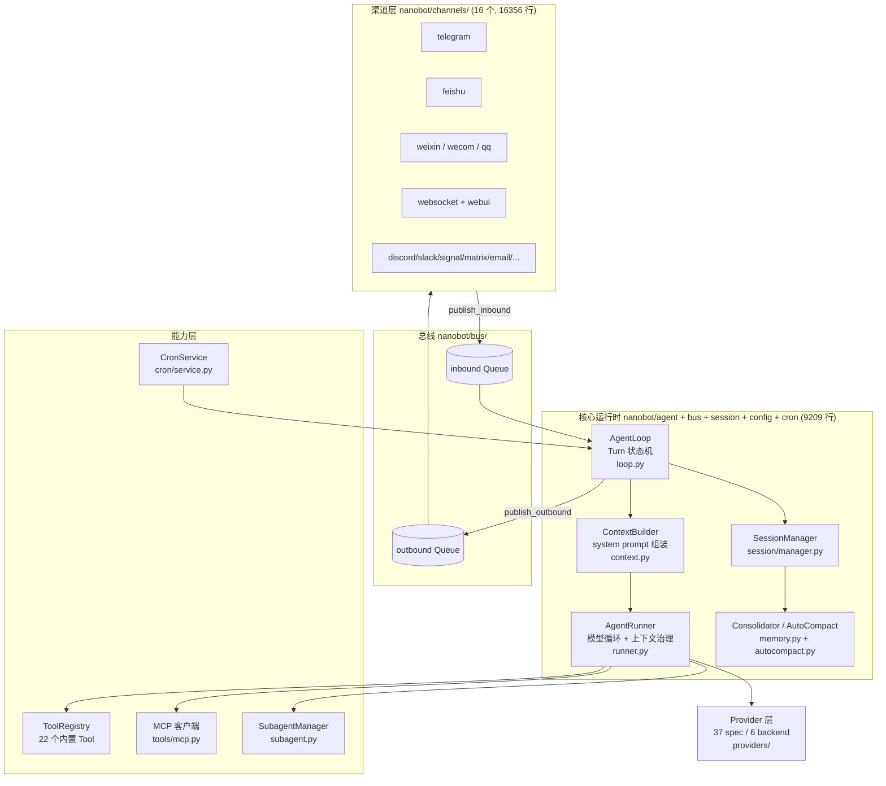
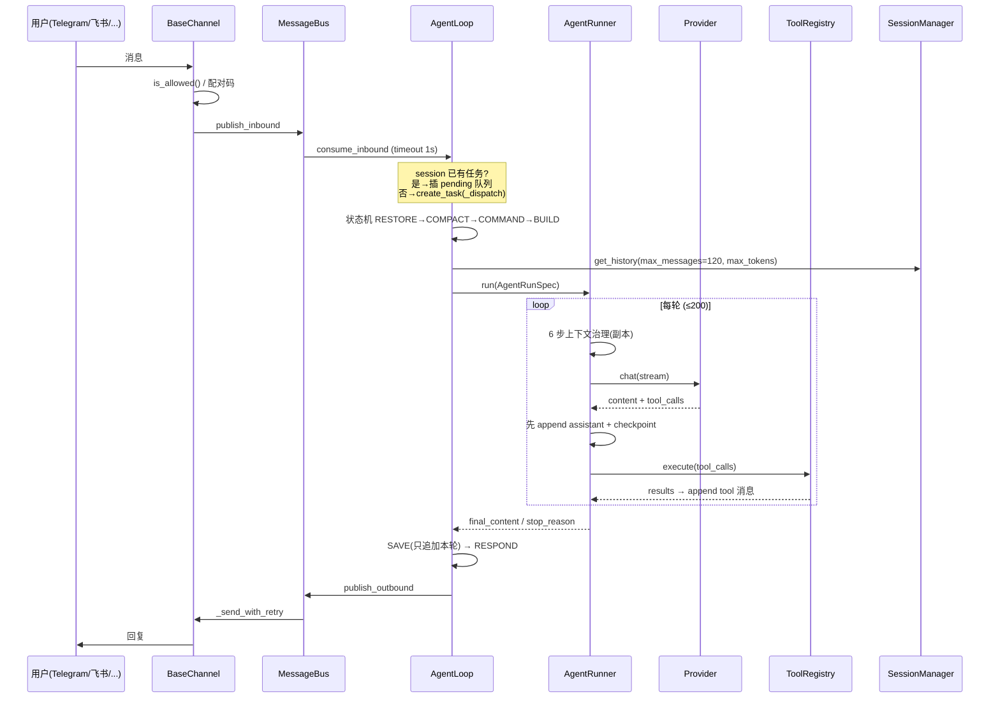

# nanobot 架构笔记

> 仓库路径：`D:/AgentABC/nanobot`
> 上游：`git@codeup.aliyun.com:agentllm/nanobot.git`（origin，内网 codeup，非公网 GitHub）
> 语言与规模：Python 3.11+，597 个 git 跟踪文件（磁盘 604 个）/ 85 MB，其中 381 个 `.py`、226 个测试文件
> commit：`b2ae5d936f544ccd02396d12c51eb4e3284ece62`（2026-06-02 18:18:52 +0800，`fix(email): bound outbound attachment handling`）
> 分析时间：2026-11-04

---

## 1. 一句话定位

**以聊天渠道为入口的常驻个人 agent 运行时**：一个 `asyncio` 事件循环把 16 个 IM 渠道收进来的消息变成"一次 Turn"，Turn 内部走一个显式的状态机 + 一个工具调用循环，回复再经消息总线送回原渠道。

它和 coding agent 的关键差别：**没有"当前目录"这个概念**，只有"当前渠道 / 当前会话 / 当前 workspace scope"；也没有 REPL 作为主形态——CLI 只是 16 个渠道之一。

---

## 2. 技术栈与工程结构

### 2.1 技术栈

| 层 | 选型 | 证据 |
|---|---|---|
| 运行时 | Python 3.11+ / `asyncio` | `nanobot/agent/loop.py:846` 的 `while self._running` + `asyncio.wait_for(consume_inbound(), 1.0)` |
| 打包 | `hatch_build.py` + `pyproject.toml` | 根目录 |
| 配置 | Pydantic v2（`Base` + `validation_alias`/`serialization_alias` 双写 camelCase） | `nanobot/config/schema.py:114` `class AgentDefaults(Base)` |
| HTTP | 各 provider 自带 client，统一在 `providers/base.py` 收口 | `nanobot/providers/base.py:92` |
| 日志 | `loguru` | 全仓 `logger.bind(channel=...)` |
| 前端 | 独立 `webui/`（打包后由 `websocket` 渠道托管） | `nanobot/channels/manager.py:24` `_default_webui_dist()` |
| 测试 | pytest，226 个测试文件 | `tests/` |
| 第三方依赖策略 | **渠道 SDK 惰性导入**：只 import 已启用的渠道 | `nanobot/channels/registry.py:27` 的 `load_channel_class()` 按名导入 |

### 2.2 目录结构表

| 目录 | 职责 | 是否核心 |
|---|---|---|
| `nanobot/agent/` | Turn 状态机 `loop.py`、模型循环 `runner.py`、记忆压缩 `memory.py`、上下文组装 `context.py`、子 agent `subagent.py`、hook | **核心** |
| `nanobot/bus/` | 两条 `asyncio.Queue`（inbound/outbound）+ 事件 dataclass | **核心** |
| `nanobot/session/` | `Session`/`SessionManager`，JSONL 落盘、历史切片、checkpoint 恢复 | **核心** |
| `nanobot/config/` | Pydantic schema、加载、路径 | **核心** |
| `nanobot/cron/` | 定时任务服务（常驻 agent 的"主动说话"能力） | **核心** |
| `nanobot/agent/tools/` | 22 个 `Tool` 子类 + 注册表 + 自动发现 | 是（但脚本口径里单列） |
| `nanobot/providers/` | 37 个 `ProviderSpec` / 6 种 backend，7468 行 | 是（脚本口径里**没算**） |
| `nanobot/channels/` | 16 个渠道适配器，16356 行，占全仓最大头 | 是（脚本口径里单列） |
| `nanobot/cli/` | 命令行入口、onboard、流式渲染 | 否 |
| `nanobot/api/` | OpenAI 兼容 HTTP API（把 bot 当模型服务暴露） | 否 |
| `nanobot/command/` | 斜杠命令路由（`/new`、`/stop`…） | 否 |
| `nanobot/skills/` | 内置 skill 的 `SKILL.md` + 脚本 | 否 |
| `nanobot/pairing/` | DM 配对码（陌生人第一次私聊要过一次码） | 否 |
| `nanobot/security/` | 路径/命令沙箱辅助 | 否 |
| `webui/`、`bridge/`、`case/`、`images/`、`tests/` | 前端、桥接、样例、素材、测试 | 否 |

---

## 3. 整体架构

### 3.1 分层图



### 3.2 核心组件职责表

| 组件 | 代码位置 | 职责 |
|---|---|---|
| `BaseChannel` | `nanobot/channels/base.py:21` | 渠道契约：`start/stop/send` 三个抽象方法 + `_handle_message()` 统一鉴权后投总线 |
| `ChannelManager` | `nanobot/channels/manager.py:43` | 启动全部渠道、消费 outbound 队列、按渠道重试、流式 delta 合批 |
| `MessageBus` | `nanobot/bus/queue.py:8` | 两条 `asyncio.Queue`，渠道与 agent 之间唯一的耦合点 |
| `InboundMessage` / `OutboundMessage` | `nanobot/bus/events.py:20` / `:39` | 跨渠道统一消息；`session_key` 由 `f"{channel}:{chat_id}"` 派生（`:33-35`） |
| `AgentLoop` | `nanobot/agent/loop.py:133` | 产品层：Turn 状态机、会话锁、任务派发、checkpoint、命令路由 |
| `TurnState` + `_TRANSITIONS` | `nanobot/agent/loop.py:76` / `:163` | 7 状态显式迁移表，driver 在 `:1221-1266` |
| `AgentRunner` | `nanobot/agent/runner.py:127` | 纯模型循环：上下文治理 → 请求 → 工具 → 落消息，不含产品语义 |
| `ContextBuilder` | `nanobot/agent/context.py:51` | system prompt 分段组装（identity / bootstrap / tool_contract / memory / skills / recent_history / summary） |
| `Consolidator` | `nanobot/agent/memory.py:449` | 按 token 预算把老消息摘要归档成文件 |
| `AutoCompact` | `nanobot/agent/autocompact.py:17` | 空闲会话压缩，`check_expired()` 在总线空闲（超时 1s）时被调用 |
| `ToolRegistry` | `nanobot/agent/tools/registry.py:8` | 注册/查找/校验/执行；`get_definitions()` 稳定排序以命 prompt cache |
| `ToolLoader` | `nanobot/agent/tools/loader.py:20` | `pkgutil.iter_modules` 扫包内所有非抽象 `Tool` 子类，import 即注册 |
| `LLMProvider` | `nanobot/providers/base.py:92` | 所有厂商差异的收口：`chat()` 抽象方法（`:268`）+ 重试/角色交替修复/429 分类 |
| `ProviderSpec` / `PROVIDERS` | `nanobot/providers/registry.py:22` / `:93` | 37 条元数据即注册表，`backend` 字段决定用哪个实现 |
| `SubagentManager` | `nanobot/agent/subagent.py:74` | 子 agent 生成、独立 hook、结果回注主会话 |

---

## 4. 端到端主链路

一次聊天消息的完整路径，按代码顺序：

### 4.1 入站：渠道 → 总线

`nanobot/channels/base.py:212` → `_handle_message()` → 3~6 句逻辑：
先把 `sender_id` 过一遍 `is_allowed()`（`:197`，优先级 star > allowlist > pairing 存储）；不在名单且是私聊，就回一条配对码（`:224-238`），公开群则只记 warning 直接丢弃；通过后组装 `InboundMessage`，若渠道支持流式就塞 `_wants_stream` 标记（`:247`）；最后 `bus.publish_inbound(msg)`（`:260`）。**渠道适配器到此为止，它不知道 agent 存在**。

### 4.2 总线 → Turn：`asyncio` 单消费者

`nanobot/agent/loop.py:840` → `run()`：
主循环用 `asyncio.wait_for(consume_inbound(), timeout=1.0)` 取消息，**超时就顺手做空闲压缩**（`:849-854`）；收到消息先过 runtime control（MCP reload 之类，`:867`）和 priority 命令；**关键分支在 `:878`**：若该 `session_key` 已有 pending queue（说明正有一轮在跑），新消息不新建任务，而是 `put_nowait` 进队列做"轮内插话"；否则 `asyncio.create_task(self._dispatch(msg))`。

`loop.py:917` → `_dispatch()`：注释写得很清楚——**"per-session serial, cross-session concurrent"**。按 `session_key` 取 `asyncio.Lock`（`:922`），全局再叠一个 `_concurrency_gate`；锁内建 `asyncio.Queue(maxsize=20)` 作本轮插话管道；结束时把没消费完的消息**重新 publish 回 inbound**（`:1038-1051`），不丢消息。

### 4.3 Turn 状态机（这是它最像"系统"的地方）

`nanobot/agent/loop.py:1221` → `while ctx.state is not TurnState.DONE`：
handler 名由状态名拼出来（`f"_state_{state.name.lower()}"`，`:1222`），返回值是一个 event 字符串，再用 `_TRANSITIONS[(state, event)]` 查下一状态（`:1260`）。查不到就抛 `RuntimeError`——**状态机是封闭的，不许隐式跳转**。每步耗时记进 `ctx.trace`，这就是 WebUI 上那条状态时间线。

七个状态各自干什么：

| 状态 | handler | 做什么 |
|---|---|---|
| `RESTORE` | `:1308` | 处理媒体/文档、恢复上次崩溃留下的 runtime checkpoint 和 pending user turn |
| `COMPACT` | `:1344` | 只做一件小事：`auto_compact.prepare_session()` 取出"上次归档的摘要文本" |
| `COMMAND` | `:1349` | 斜杠命令；命中就 `shortcut` 直接进 DONE（并补落盘，`:1357-1370`） |
| `BUILD` | `:1374` | 真正重的一步：token 级 consolidate → 绑工具上下文 → `session.get_history()` → `context.build_messages()` |
| `RUN` | `:1418` | 交给 `runner.run()`，跑完可能触发 `turn_continuation.maybe_continue_turn()` |
| `SAVE` | `:1450` | `_save_turn()` 只追加本轮新增消息；`enforce_file_cap()`；清 checkpoint；后台再 consolidate |
| `RESPOND` | `:1486` | 组装 `OutboundMessage`，并处理 `MessageTool` 已直发导致的抑制（`:1288`） |

### 4.4 模型循环与**上下文治理**（本项目的技术核心）

`nanobot/agent/runner.py:272` → `run()`。`for iteration in range(spec.max_iterations)`（`:289`），默认 200 轮（`config/schema.py:128`）。

每轮开头 6 行就是全部治理逻辑（`:295-302`），注释（`:291-294`）说明了原则：**`messages` 这份落盘历史一个字节都不动，所有修补只作用在 `messages_for_model` 副本上**：

```python
295  messages_for_model = self._drop_orphan_tool_results(messages)
296  messages_for_model = self._backfill_missing_tool_results(messages_for_model)
297  messages_for_model = self._microcompact(messages_for_model)
298  messages_for_model = self._apply_tool_result_budget(spec, messages_for_model)
299  messages_for_model = self._snip_history(spec, messages_for_model)
301  messages_for_model = self._drop_orphan_tool_results(messages_for_model)
302  messages_for_model = self._backfill_missing_tool_results(messages_for_model)
```

六步逐条：

**① 去孤儿 tool result** `runner.py:1142` `_drop_orphan_tool_results()`
扫一遍历史，收集所有 `assistant.tool_calls[].id` 到一个 `set`；遇到 `role=="tool"` 但 `tool_call_id` 不在集合里的，直接删。作用是修历史被外部编辑/截断后留下的"没有对应调用的工具结果"——大多数 OpenAI 兼容 API 遇到这种会 400。

**② 补缺失 tool result** `runner.py:1168` `_backfill_missing_tool_results()`
反方向：有 `tool_calls` 声明但没等到结果的，在 assistant 消息之后**插入**一条合成结果，内容固定为 `_BACKFILL_CONTENT`（`:74`，`"[Tool result unavailable — call was interrupted or lost]"`）。插入点会跳过已有 tool 消息（`:1197`），保证顺序合法。注释点明了场景：**调用被中断/丢失**。

**③ microcompact** `runner.py:1209` `_microcompact()`
只挑 `_COMPACTABLE_TOOLS` 里的工具（`:68-71`：`read_file`、`exec`、`grep`、`find_files`、`web_search`、`web_fetch`、`list_dir`、`list_exec_sessions`）；**保留最近 10 条**（`_MICROCOMPACT_KEEP_RECENT`，`:66`），更早的、且内容长度 ≥ **500 字符**（`_MICROCOMPACT_MIN_CHARS`，`:67`）的，正文替换成一行 `"[{name} result omitted from context]"`（`:1227`）。这是**零成本**的压缩——不调模型，只删字。

**④ 工具结果预算** `runner.py:1234` `_apply_tool_result_budget()`
对每条 tool 消息重跑 `_normalize_tool_result()`（`:1111`）：先 `maybe_persist_tool_result()` 把超长结果**落文件**，再把上下文里的内容换成"已存到某路径 + 前 N 字符"的存根；超过 `max_tool_result_chars`（默认 **16000**，`config/schema.py:130`）再硬 `truncate_text()`。豁免名单只有 `read_file`（`:73`），注释解释了原因：**否则会形成 persist → read → persist 的死循环**。

**⑤ 剪历史** `runner.py:1255` `_snip_history()`
真正按 token 预算裁剪的一步，阈值算得很直白（`:1267`）：

```
budget = context_block_limit or (context_window_tokens - max_output - _SNIP_SAFETY_BUFFER)
```

其中 `_SNIP_SAFETY_BUFFER = 1024`（`:65`），`max_output` 取 `spec.max_tokens`，缺省回落到 provider 的 `generation.max_tokens` 再回落到 4096（`:1263-1266`）；`context_window_tokens` 默认 **65536**（`config/schema.py:124`）。用 `estimate_prompt_tokens_chain()`（估算链：provider 自己的计数 → tiktoken → 字符启发式）算总 token，**没超就直接返回**（`:1279`）。

超了才动手，策略是"保 system、从尾巴往回塞"：先切出 system 段并算它的固定开销（含 tool definitions，`:1288`），剩余预算给非 system 消息；**从最新一条往前累加**，装不下就停（`:1297-1303`）；然后要求窗口必须以 `user` 开头（`:1306-1309`），实在没有就从窗口外把最近一条 user 拉回来——注释承认**这会超预算，但"oversized beats invalid"**（`:1311-1313`，理由是 GLM 会因 `system→assistant` 报 1214）；最后 `find_legal_message_start()` 保证不从半截工具轮开始（`:1320`）。

**⑥ 再清一次孤儿**：⑤ 可能剪掉半截工具轮，所以 ① ② 要重跑。**治理失败时**（`:303-313`）降级为"只做 ①②"，再失败就原样发出去——**宁可发脏上下文，也不要这一轮直接挂**。

**另一层：跨轮次的持久压缩**（和上面每轮的副本治理是两件事）

- `agent/memory.py:675` `maybe_consolidate_by_tokens()`：`budget = _input_token_budget`，`target = int(budget * consolidation_ratio)`（`:699`，ratio 默认 **0.5**，`config/schema.py:155`）；超了就在 `_MAX_CONSOLIDATION_ROUNDS` 内循环，每轮 `pick_consolidation_boundary()` 找一个安全切点，把 `session.messages[last_consolidated:end_idx]` 交给 `archive()`（`:755`）用小模型摘要，然后把 `session.last_consolidated` 前移（`:762`）**并立即落盘**——摘要失败也会前移游标，正文已经被 `raw_archive()` 兜底（`:670-673`）。
- `agent/autocompact.py:17` `AutoCompact`：管"没人说话的会话"。`check_expired()`（`:40`）在总线空闲时被调用，跳过正在跑的会话（`:48`），对超 TTL 的调 `compact_idle_session()`（`:56`，保留尾部 8 条，`_RECENT_SUFFIX_MESSAGES`，`:18`）。摘要走内存 dict 热路径、metadata 冷路径两条（`:76-83`），进程重启也不丢。

### 4.5 模型调用与工具执行

`runner.py:629` `_request_model()`：包一层 `chat_stream_with_retry` / `chat_with_retry`（`providers/base.py:560` / `:609`），重试延迟 `(1, 2, 4)`（`base.py:97`），`persistent` 模式最长 60s。落消息的顺序是**先落盘再执行**：`:339` 先 `build_assistant_message()`、`:345` `messages.append()`、`:347` `_emit_checkpoint(phase="awaiting_tools")`，然后 `:361` 才 `_execute_tools()`。`_execute_tools()`（`:801`）内部按 `_partition_tool_batches()`（`:1330`）分批：`concurrent_tools=False` 时一批一个；否则连续 `concurrency_safe` 的工具并成一批并发跑，遇到非并发安全的就切开（`Tool.concurrency_safe` = `read_only and not exclusive`）。

### 4.6 出站

`loop.py:972` `bus.publish_outbound(response)` → `channels/manager.py:305` `_dispatch_outbound()`：按 metadata 分流（推理流 `_reasoning_*`、进度 `_progress`、重试等待 `_retry_wait`），连续 `_stream_delta` 用 `_coalesce_stream_deltas()`（`:412`）合批减少 API 调用，最终 `_send_with_retry()`（`:462`）。

### 4.7 主链路图



---

## 5. 核心代码路径清单

| 文件路径 | 关键类/函数 | 作用 | 优先级 |
|---|---|---|---|
| `nanobot/agent/runner.py` | `AgentRunner.run` `:272` | 模型循环主体；6 行治理调用是全文精髓 | P0 |
| `nanobot/agent/runner.py` | `_snip_history` `:1255` | token 预算裁剪（阈值 65536−max_tokens−1024） | P0 |
| `nanobot/agent/runner.py` | `_microcompact` `:1209` | 零成本压缩（留 10 条、≥500 字符才替换） | P0 |
| `nanobot/agent/runner.py` | `_drop_orphan_tool_results` `:1142` / `_backfill_missing_tool_results` `:1168` | 历史合法性双向修补 | P0 |
| `nanobot/agent/runner.py` | `_apply_tool_result_budget` `:1234` / `_normalize_tool_result` `:1111` | 超长结果落文件 + 16000 字符上限 | P1 |
| `nanobot/agent/loop.py` | `TurnState` `:76` / `_TRANSITIONS` `:163` | 7 状态显式迁移表 | P0 |
| `nanobot/agent/loop.py` | `_process_message` `:1181` | 状态机 driver（`:1221`） | P0 |
| `nanobot/agent/loop.py` | `run` `:840` / `_dispatch` `:917` | 总线消费、会话锁、轮内插话 | P0 |
| `nanobot/agent/loop.py` | `_state_build` `:1374` / `_state_save` `:1450` | 组装 vs 落盘的边界 | P1 |
| `nanobot/agent/memory.py` | `Consolidator.maybe_consolidate_by_tokens` `:675` | 跨轮次 token 级归档（target=budget×0.5） | P0 |
| `nanobot/agent/autocompact.py` | `AutoCompact.check_expired` `:40` / `prepare_session` `:72` | 空闲会话压缩 | P1 |
| `nanobot/agent/context.py` | `ContextBuilder.build_system_prompt` `:66` | system prompt 分段拼装（8 段） | P0 |
| `nanobot/channels/base.py` | `BaseChannel._handle_message` `:212` | 渠道 → 总线唯一入口（含鉴权/配对） | P0 |
| `nanobot/channels/manager.py` | `_dispatch_outbound` `:305` / `_send_with_retry` `:462` | 出站分流、流式合批、重试 | P1 |
| `nanobot/providers/base.py` | `LLMProvider` `:92` / `chat` `:268` | 厂商差异收口 + 重试/角色交替修复 | P0 |
| `nanobot/providers/registry.py` | `ProviderSpec` `:22` / `PROVIDERS` `:93` | 37 provider / 6 backend 的声明式注册表 | P1 |
| `nanobot/agent/tools/registry.py` | `get_definitions` `:48` | 内置工具稳定排序在前、`mcp_*` 在后（为 cache）；`loader.py:30` 负责扫包注册 | P1 |
| `nanobot/bus/queue.py` | `MessageBus` `:8` | 两条 Queue 的极简总线 | P0 |

---

## 6. 关键设计点

### 6.1 副本治理：落盘历史永不被改写

**设计**：`runner.run()` 里 `messages` 是"账本"，`messages_for_model` 是"投影片"。每一轮都从账本重新投影，投影可以任意删改（`runner.py:291-302`）。

**为什么**：`_save_turn()` 只追加 `all_messages` 里本轮新增的部分（`loop.py:1466`），如果治理时原地改了 `messages` 的长度，追加边界就错位，历史会被写坏。注释（`:291-294`）明确写了这个动机。

**代价**：每轮都要把整段历史深拷贝并重算 token 估算。长会话下这是可测的 CPU 开销——它宁可多算也不缓存投影。

### 6.2 压缩分四档，越贵越晚用

**设计**：microcompact（删字，免费）→ 工具结果落文件（免费，换 IO）→ 剪历史（免费，损失信息）→ LLM 摘要归档（花钱）。前三个在每轮做，第四个只在跨轮次超预算或空闲时做。

**为什么**：个人 agent 跑在用户自己的 API key 上，摘要调用是真实成本。能靠"删字"解决的绝不上模型。

**代价**：microcompact 的替换是**不可逆的信息丢失**——被替换的 tool result 在后续轮次里再也拿不回来（除了让模型重新调用工具）。`read_file` 被列入「工具结果落文件」的豁免清单（`_TOOL_RESULT_OFFLOAD_EXEMPT_TOOLS`，`runner.py:73`），不参与落文件/截断，就是为了保留恢复路径。

### 6.3 Turn 用显式状态机，而不是一个长函数

**设计**：7 个 `_state_*` handler + 一张 `_TRANSITIONS` 表（`loop.py:163-172`），handler 只返回 event 字符串。

**为什么**：一个 Turn 混了 6 类关注点（恢复、压缩、命令、组装、跑模型、落盘）。拆开后每步耗时和 event 都能记进 `ctx.trace`，UI 直接显示"正在恢复/压缩/思考"，命令也能在 `COMMAND` 处短路。

**代价**：handler 通信用 `str` 而非枚举，拼错只有运行时才炸（`:1262`）；`TurnContext` 变成 26 个字段的大对象，隐式依赖变多。

### 6.4 渠道只到总线为止

**设计**：16 个渠道适配器全部只依赖 `BaseChannel` + `InboundMessage`/`OutboundMessage`（`channels/base.py`）。能力差异（流式、推理展示、文件编辑事件）通过**可选方法 + 默认空实现**表达：`send_delta`、`send_reasoning_delta`、`send_file_edit_events` 都是 no-op 默认（`:118-169`），渠道自己覆盖。

**为什么**：16356 行渠道代码如果不隔离，任何一家 SDK 升级都会污染核心。反过来，`supports_streaming` 用 `type(self).send_delta is not BaseChannel.send_delta` 判断（`:195`）——**"有没有覆盖"就是能力声明**，不需要额外注册。

**代价**：能力探测靠反射，静态类型检查帮不上忙；渠道间的行为差异只能靠人工保证。

### 6.5 每步先落盘再执行

**设计**：`runner.py:339-357` 先把 `assistant(tool_calls)` 追加进 `messages` 并 `_emit_checkpoint(phase="awaiting_tools")`，`:361` 才真正执行工具。工具跑完再 `_emit_checkpoint(phase="tools_completed")`。

**为什么**：进程被杀、用户 `/stop`、模型报错都能从 checkpoint 恢复。`loop.py:988-1013` 的 `CancelledError` 分支就是消费者——把 checkpoint 物化进 session，用户下一轮还能看到"刚才跑到哪了"。

**代价**：checkpoint 要写进 session metadata 并 `save()`，一轮里至少多两次磁盘写。

---

## 7. 扩展点

| 想加什么 | 改哪里 | 说明 |
|---|---|---|
| 新聊天渠道 | `nanobot/channels/` 下加一个模块，继承 `BaseChannel` | `registry.py:16` 自动发现；也可走 entry_points 做外部插件（`discover_plugins`） |
| 新 LLM 厂商 | `providers/registry.py:93` 加一条 `ProviderSpec` + `config/schema.py` 加字段 | 若 OpenAI 兼容则 `backend="openai_compat"` 即可，零代码 |
| 新工具 | `agent/tools/` 加一个 `Tool` 子类 | `loader.py:30` 扫包注册；也可直接 `registry.register()` |
| 新斜杠命令 | `nanobot/command/builtin.py` | `command/router.py` 分发 |
| 新 skill | `nanobot/skills/<name>/SKILL.md` | `agent/skills.py` 加载，system prompt 里列摘要 |
| Hook 注入 | 继承 `AgentHook`（`agent/hook.py`） | `CompositeHook` 组合，见 `loop.py:701` |
| 定时任务 / 当模型用 | `cron/service.py` + `tools/cron.py`；`nanobot/api/server.py` | 模型可自建定时任务；API 层把 bot 包成 OpenAI 兼容 HTTP 面 |

---

## 8. 本地跑起来 / 调试入口

```bash
# 1. 安装
cd D:/AgentABC/nanobot
pip install -e .             # 或 uv sync；渠道 SDK 是 extras

# 2. 交互式配置（选 provider、填 key、开渠道）
nanobot onboard

# 3. 命令行直接聊（不需要任何 IM）
nanobot            # 或 python -m nanobot

# 4. 只跑某个渠道 / 看状态
nanobot status
nanobot channels
```

调试入口（按有用程度）：

1. **不开渠道直接走主链路**：`AgentLoop.process_direct()`（`loop.py:1713`）绕开总线，仍复用同一把 session 锁和同一个状态机。SDK 用法见 `docs/python-sdk.md:5-19`，`Nanobot.from_config()` 在 `nanobot/nanobot.py:37`。
2. **看一轮到底走了哪些状态**：`_process_message` 里的 `logger.debug("[turn {}] State {} took ...")`（`loop.py:1252`），把 loguru 级别调到 DEBUG。
3. **看治理是否真的生效**：`runner.py` 里治理前后都没有 info 日志，最快的办法是在 `:302` 之后打一条 `logger.info(len(messages_for_model), estimate...)`。
4. **回归**：`pytest tests/agent -x`（`tests/` 共 226 个文件）。

---

## 9. 阅读路线

### 半天（只求理解主干，约 4 小时）

1. `bus/queue.py`（44 行）+ `bus/events.py`（53 行）——先搞清两个队列和消息结构。
2. `channels/base.py:212-260`——渠道怎么进总线，鉴权和配对码在哪。
3. `agent/loop.py:76-172` 与 `:1181-1273`——`TurnState` 迁移表 + driver，先建立"一轮有 7 步"的心理模型。
4. `agent/runner.py:272-330`——**最重要**：6 行治理 + 请求。
5. `agent/runner.py:1142-1328`——五个治理函数的完整实现。
6. `agent/context.py:66-109`——system prompt 拼了哪 8 段。

### 两天（连"为什么"一起看）

- 第 1 天上午：上面 6 条 + `agent/memory.py:675-782`（跨轮次归档）。
- 第 1 天下午：`agent/autocompact.py` 全文（84 行）+ `session/manager.py:92-240`（`Session.get_history` 与 `last_consolidated` 的关系）+ `loop.py:1450-1500`（SAVE 只追加）。
- 第 2 天上午：`providers/base.py` 的重试与 429 分类（`:97-397`）+ `providers/registry.py:93-`（37 条 spec 怎么读）。
- 第 2 天下午：`agent/tools/registry.py` + `agent/tools/base.py`（`cast_params`/`validate_params`）+ `agent/subagent.py` + `channels/manager.py:305-490`（出站分流与重试）。

---

## 10. 未覆盖 / 存疑

1. **旧摘要里的"597 文件"与"604 文件"都对**：`git ls-files` 是 597，磁盘上 604（多为未跟踪的 IDE/构建产物）。用哪个都行，但要说明口径。
2. **旧摘要的核心行数结论复述正确，但漏了脚本自己的注释**：`core_agent_lines.sh` 末尾的 `Notes` 自己写明四条口径——`agent/` 只算顶层 `.py`、`tools/` 单列、`skills/` 把 `.md/.py/.sh` 都算、**`command/ providers/ security/ templates/ nanobot.py` 及根文件完全不计**。旧摘要只提到"排除 providers 和 agent/tools"，其实排除得更多。本次实测仍为 `core total 9209` / `extra total 33985`。
3. **`max_iterations` 默认 200，不是 500**：`config/schema.py:128` `max_tool_iterations: int = 200`。
4. **`_snip_history` 并不真的"保证不超预算"**：`:1311-1313` 的注释明说，为了避开 GLM 1214 错误会故意超预算。且 `estimate_prompt_tokens_chain` 的估算实现在 `utils/helpers.py`，本次未读——文中 token 数字都是**估算**，不是 API 返回的真实 usage。
5. **16 个渠道只读了契约，没读实现**：`channels/*.py` 里除 `base/manager/registry/__init__` 外共 16 个模块（feishu 1917、weixin 1546、telegram 1453、signal 1402、websocket 1125、matrix 1022、mochat 943、msteams 822、discord 818、dingtalk 759、email 734、slack 729、qq 690、napcat 579、wecom 554、whatsapp 383）。
6. **22 个 `Tool` 子类**按 `^class .*Tool\(` 静态统计，`mcp.py` 里动态生成的 MCP 工具不计入；真实注册数随 config 变化（`loop.py:501` 那行日志能打出来）。**"9209 行核心"只在脚本口径内成立**——它连一次模型调用都发不出去（`providers/` 7468 行没算）。
7. **`webui/` 未读**：只知道它由 `websocket` 渠道托管（`manager.py:24`），前后端协议（`nanobot/apps/protocol.py`）没细看。**`dream`（`config/schema.py:162` `DreamConfig`）未展开**：`memory.py` 里有 `get_last_dream_cursor()`，像是"离线整理记忆"的第二个后台任务。

---

## 这个项目值得抄的一点

**"账本 / 投影"两分**：`messages` 只追加、永不改写，每轮从它重新投影出 `messages_for_model` 做任意删改。这一条同时解决了三个问题——落盘边界不会错位、压缩可以随时回退、崩溃恢复有确定的历史。外加它落地时配的 6 步固定顺序（去孤儿 → 补缺失 → microcompact → 预算 → 剪历史 → 再去孤儿），把"上下文治理"从一堆散落的 if 变成了可枚举的流水线。

---

## 修订记录

> 2026-11-04 对照本地仓库 `D:/AgentABC/nanobot` 逐条核验。共核对代码路径/行号引用 64 处，其中失效/错位 5 处；另核对类名/函数名/配置项 26 个。结论：§4 主链路每一步入口与行号均真实存在，另有 5 处描述性表述与源码不符，已就地修正，属小修。

| # | 位置 | 原表述 | 核实结果（源码依据） | 处理 |
|---|---|---|---|---|
| 1 | §3.1 | 核心运行时 `nanobot/agent + session + config + cron`（9209 行） | `core_agent_lines.sh` 的 `core_total` = agent+bus+config+cron+session；实测 agent 顶层 5650 + bus 424 + config 810 + cron 765 + session 1560 = 9209 | 标签补上 `bus` |
| 2 | §3.2 | `nanobot/bus/events.py:24` / `:42`；`session_key` 派生 `:36` | `events.py:24` 是 `sender_id: str`；`class InboundMessage` 在 `:20`、`class OutboundMessage` 在 `:39`、`@property session_key` 在 `:33-35` | 改为 `:20` / `:39` / `:33-35` |
| 3 | §3.2 / §5 / §9 | system prompt 分段列表缺 `recent_history`，两处写“7 段” | `context.py:75-107` 依次 append identity、bootstrap、tool_contract、memory、Active Skills、skills_section、Recent History、session_summary，最多 8 段 | 列表补 `recent_history`，两处 `7 段` 改 `8 段` |
| 4 | §4.2 | `nanobot/agent/loop.py:846` → `run()` | `loop.py:846` 实际是 `while self._running:`；`async def run` 在 `:840` | 改为 `:840` |
| 5 | §6.2 | `read_file` 被排除在 microcompact 的 compactable 集合之外 | `runner.py:68-71` 的 `_COMPACTABLE_TOOLS` 明确含 `"read_file"`；`:73` 的豁免清单是 `_TOOL_RESULT_OFFLOAD_EXEMPT_TOOLS`（落文件/截断） | 改为“不参与工具结果落文件” |
| 6 | §6.3 | `TurnContext` 变成 30 多字段 | `loop.py:97-131` 的 `TurnContext` 共 26 个字段 | 改为 26 个字段 |
| 7 | §8 | `pip install -e ".[all]"` | `pyproject.toml:67-108` 的可选依赖只有 api/wecom/weixin/msteams/matrix/discord/langsmith/pdf/olostep/dev，无 `all`；`README.md:184` 为 `pip install -e .` | 改为 `pip install -e .` |
| 8 | §10.6 | `loop.py:496` 那行日志 | `loop.py:496` 是 `self.tools.register(`；工具注册日志在 `:501` `logger.info("Registered {} tools: {}", ...)` | 改为 `:501` |

**核验通过、未改动的关键判断**：
- §4.1 渠道入口 `channels/base.py:212 _handle_message`、`:197 is_allowed`、`:224-238` 配对码、`:260 bus.publish_inbound` 与源码一致。
- §4.2 总线消费 `loop.py:840 run`、`846 while`、`849-854` 空闲压缩、`878` 插话分支、`917 _dispatch`、`922` 会话锁、`1038-1051` 回投，逐步命中。
- §4.3 状态机 driver `:1221`、handler 名 `:1222`、`:_TRANSITIONS :163-172`，以及 7 个 handler `:1308/1344/1349/1374/1418/1450/1486` 全部正确。
- §4.4 治理常量与阈值：`runner.py:65/66/67/68-71/73/74/1234/1255` 与 `config/schema.py:124/128/130/155`（65536 / 200 / 16000 / 0.5）一致；`memory.py:675-782`、`autocompact.py:40/56/72` 一致。
- §4.5 `runner.py:629 _request_model`、`:339/345/347/361` 落盘顺序、`:801 _execute_tools`、`:1330 _partition_tool_batches`，以及 `providers/base.py:92/97/268/560/609` 一致。
- 规模与版本：597 tracked / 604 磁盘 / 381 `.py` / 226 个 `tests/*.py`，channels 16356 行、providers 7468 行、core 9209 / extra 33985、37 个 `ProviderSpec` / 6 个 backend、16 个渠道适配器（含各自行数）全部复核一致。
- commit `b2ae5d9` 与作者时间 `2026-06-02 18:18:52 +0800` 一致（committer 时间为 21:17:31，文档采用的是 author date）。

**未解决/存疑**：① 仓库磁盘总量实测约 83 MB（含 `.git` 44.7 MB），文档写 85 MB，口径不明，未改；② 证据包把 `base.py:97`、`registry.py:16`、`manager.py:24` 解析到 `agent/tools/` 下同名文件，属缩写/同名歧义，文档实际指向 `providers/base.py:97`、`channels/registry.py:16`、`channels/manager.py:24`，均无误。
