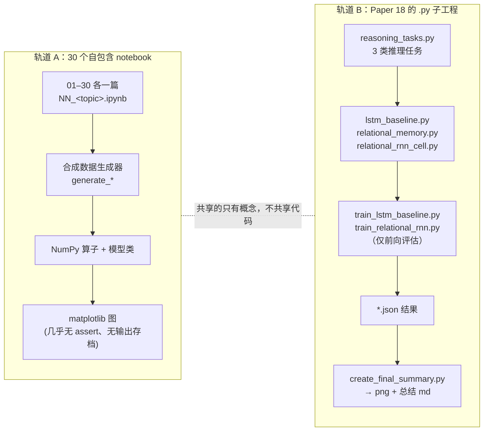

# sutskever-30-implementations 架构笔记

> 仓库路径：`D:/agentABC/sutskever-30-implementations`
> 上游：`https://github.com/LukeLi-EBD/sutskever-30-implementations.git`（fork；README 与 `GITHUB_PUSH_SUMMARY.md` 中仍写着原作者仓库 `github.com/pageman/sutskever-30-implementations`）
> 语言与规模：Python + Jupyter；**87 个文件 / 3.76 MB** = 30 个 `.ipynb`、17 个 `.py`、18 个 `.md`、17 个 `.png`、3 个 `.npz`、2 个 `.json`。Notebook 代码合计 **16 227 行**，`.py` 合计 **6 374 行**（非空 5 117）
> commit 与日期：`10464c92f16f6acc756284a7f3c74ff28f7600a4`，`2025-12-10 20:48:37 +0800`，分支 `main`
> 分析时间：2026-11-04

## 1. 一句话定位

**这是一份"用 notebook 当课本"的论文复现集：30 个自包含 notebook，一个主题一篇，全部用 NumPy 手写算子；另有一套只为 Paper 18（Relational RNN）准备的 `.py` 子工程，作为可被脚本调用的版本。**

它和常见"实现仓库"的差别在三件事上：

| 判断项 | 本仓库的事实 | 意味着什么 |
|---|---|---|
| 有没有统一的库/包 | 没有 `pyproject.toml`、`requirements.txt`、`__init__.py`，没有 `src/` 分层 | 不能 `pip install`，也不能在一个项目里 import 复用 |
| 有没有 30 个独立目录 | 没有。**所有 notebook 平铺在仓库根目录**，命名 `NN_<topic>.ipynb`（01–30 连续无缺号） | "30 个实现"是 30 个文件，不是 30 个子工程 |
| 有没有训练/评测流水线 | 只有 Paper 18 有 `.py` 脚本与 JSON 结果；notebook 全部以"运行一次、看图"结束 | 定位是教学演示，不是可复现实验基准 |

`IMPLEMENTATION_TRACKS.md` 为 30 篇论文各自写了一节 implementation track（`## 1`–`## 30`），Paper 18 内部再按 Phase/Task 拆（P1-T2、P1-T3、P2-T1、P2-T2、P2-T3、P3）；但落到代码上，只有 Paper 18（以及相邻的 LSTM、训练工具）真的被拆成 17 个 `.py` 文件，其余 29 篇都只有一个 notebook。

## 2. 技术栈与工程结构

### 2.1 技术栈

| 维度 | 选型 | 证据 |
|---|---|---|
| 运行形态 | Jupyter Notebook（30 个），一个 kernel 里自上而下执行 | 每个 notebook 的 cell 0 是 `import numpy as np` / `matplotlib` |
| 数值计算 | **NumPy 手写前后向**，无 PyTorch/TensorFlow/JAX | `README.md:402` 自述 "deliberately avoid PyTorch/TensorFlow"；全仓库无实际 `import torch` / `tensorflow`（仅在 08、26、18 的说明文字里提到"上生产请换 PyTorch"）；`02_char_rnn_karpathy` 有 `VanillaRNN.backward` |
| 统计 | SciPy，仅少量使用 | `01_complexity_dynamics` 用 `scipy.stats`；`18_relational_rnn` 用 `scipy.special.softmax/log_softmax` |
| 图算法 | **networkx**，仅 `12_graph_neural_networks` 使用 | 该 notebook 的 import 列表里出现 `networkx`；README 的安装命令没列它 |
| 可视化 | matplotlib（静态图为主） | 每个 notebook 末尾若干 `plt.subplot`/`savefig` |
| 依赖声明 | 无。README 只写 `pip install numpy matplotlib scipy` | 无 lock 文件、无版本约束 |
| 测试 | 4 个 `test_*.py`，是"打印 + `assert`"的演示脚本，不是 pytest 用例 | 无 `pytest.ini`/`conftest.py`；`test_relational_rnn_demo.py` 内 0 个 `assert` |
| 数据 | **全部合成**，无数据集下载 | 每个 notebook 自带 `generate_*`；`26_cs231n_cnn_fundamentals` 的 `generate_synthetic_cifar` 即是"假 CIFAR" |

### 2.2 目录组织

仓库是**完全平铺**的，没有子目录（除 `.git`）：

| 位置 | 内容 | 作用 |
|---|---|---|
| `*.ipynb`（30） | 01–30 论文主题 | 主交付物；每篇自带数据生成、模型、可视化 |
| `*.py`（17） | Paper 18 子工程 | 唯一可被命令行调用的实现层（见 2.3） |
| `*.md`（18） | README、PROGRESS、各 Task 的交付说明 | 汇报/索引层；与代码存在口径不一致（见 §10） |
| `*.png`（17） | 训练曲线、任务样例图 | 历史运行产物 |
| `*.npz`（3） | `lstm_tracking_model.npz`、`lstm_matching_model.npz`、`lstm_babi_model.npz` | 权重快照；**仓库内无任何 `np.savez` 调用**，属孤儿产物 |
| `*.json`（2） | `lstm_baseline_results.json`、`relational_rnn_results.json` | `train_*.py` 写出的评测结果 |

### 2.3 17 个 `.py` 的三层分工

| 层 | 文件 | 入口/关键符号 | 行数（非空） |
|---|---|---|---|
| 核心实现（6） | `attention_mechanism.py` | `scaled_dot_product_attention:14`、`split_heads:91`、`combine_heads:116`、`multi_head_attention:139`、`init_attention_params:247`、`create_causal_mask:284`、`main:595` | 499 |
| | `lstm_baseline.py` | `orthogonal_initializer:17`、`xavier_initializer:37`、`LSTMCell:52`、`LSTM:160`、`test_lstm:307` | 360 |
| | `relational_memory.py` | `layer_norm:21`、`gated_update:64`、`init_memory:110`、`RelationalMemory:130` | 606 |
| | `relational_rnn_cell.py` | `RelationalMemory:24`、`RelationalRNNCell:190`、`RelationalRNN:330`、`main:825` | 709 |
| | `reasoning_tasks.py` | `generate_object_tracking:22`、`generate_pair_matching:103`、`generate_babi_simple:196`、`create_train_test_split:298`、`create_batches:328`、`visualize_example:384`、`test_all_tasks:578` | 570 |
| | `training_utils.py` | `cross_entropy_loss:28`、`mse_loss:69`、`softmax:98`、`accuracy:114`、`compute_numerical_gradient:145`、`compute_numerical_gradient_fast:212`、`clip_gradients:263`、`EarlyStopping:321`、`train_step:387`、`evaluate:448`、`train_model:529`、`plot_training_curves:659` | 853 |
| 跑数/演示（7） | `train_lstm_baseline.py`、`train_relational_rnn.py` | 各 39 / 45 行，纯脚本无函数 | 7 个文件合计 771 |
| | `create_final_summary.py` | 读两个 JSON，画对比柱状图 + 写总结 md | 82 |
| | `lstm_baseline_demo.py`、`relational_memory_demo.py`、`training_demo.py`、`lstm_params_info.py` | `demo_sequence_classification:11`、`main:13`、`demo_basic_training:64` 等 | 216 / 89 / 284 / 16 |
| 测试/校验（4） | `test_reasoning_tasks.py`、`test_relational_memory_integration.py`、`test_relational_rnn_demo.py`、`test_training_utils_quick.py` | `demonstrate_solvability:21`、`analyze_task_statistics:119`、`test_integration:14`、`quick_test:23` | 749（合计） |

**关键结构事实：notebook 与 `.py` 互不引用。** 30 个 notebook 里没有任何 `from relational_rnn_cell import ...` 之类的语句，`.py` 也不读 notebook。因此 Paper 18 的同一套 attention/relational memory 被写了两遍：notebook 的 Section 11（`18_relational_rnn.ipynb`）自带反向传播，而 `.py` 版本只有前向。

## 3. 整体架构

### 3.1 两条互不相交的轨道



两轨的共同点只有"NumPy 从头写 + 合成任务"；代码上一行都不共享（`softmax` 在 notebook 和 `training_utils.py` 中各写一份）。

### 3.2 组件职责

| 组件 | 文件 | 职责 | 依赖 |
|---|---|---|---|
| 任务生成 | `reasoning_tasks.py` | 生成 object tracking / pair matching / bAbI 三类序列推理样本，并断言形状 | numpy、matplotlib |
| 模型 A | `lstm_baseline.py` | 正交初始化的 LSTM 单元与整层，`forward` 返回序列或末状态 | numpy |
| 模型 B | `relational_memory.py` | 带 LayerNorm 与门控的多槽 relational memory | numpy |
| 模型 C | `relational_rnn_cell.py` | 把 LSTM proposal 送进多槽 attention memory 的 cell 与整层 | numpy |
| 训练工具 | `training_utils.py` | 损失/softmax/数值梯度/梯度裁剪/LR 衰减/早停/训练循环/画图 | numpy、matplotlib |
| 驱动 | `train_*.py` | 构造任务 → 随机初始化模型 → 前向 → 记录 loss → 写 JSON | 上述模块 |
| 汇总 | `create_final_summary.py` | 读 JSON → 对比图 → 生成文字总结 | matplotlib |

### 3.3 Paper 18 的 Phase/Task 编号如何落到文件

文档层的拆分（`P1_T3_DELIVERABLES.md`、`P2_T1_DELIVERABLES.md`、`TASK_P2_T3_SUMMARY.md`、`PHASE_3_TRAINING_SUMMARY.md`）与实际文件对应关系：

| 文档编号 | 交付内容 | 实际文件 |
|---|---|---|
| P1（attention 基础） | 多头注意力算子 | `attention_mechanism.py` |
| P1-T3（LSTM 基线） | LSTM cell/层 + 参数量统计 | `lstm_baseline.py`、`lstm_baseline_demo.py`、`lstm_params_info.py` |
| P2-T1（relational memory） | 多槽记忆 + LayerNorm + 门控 | `relational_memory.py`、`relational_memory_demo.py` |
| P2-T2（relational cell） | cell/整层 + 消融对比 | `relational_rnn_cell.py`、`test_relational_rnn_demo.py` |
| P2-T3（训练工具） | 数值梯度、早停、训练循环 | `training_utils.py`、`training_demo.py`、`test_training_utils_quick.py` |
| P3（训练与汇总） | 两条 train 脚本 + 最终对比 | `train_lstm_baseline.py`、`train_relational_rnn.py`、`create_final_summary.py` |
| P1-T1（任务） | 三类推理任务 | `reasoning_tasks.py`、`test_reasoning_tasks.py` |

## 4. 核心代码路径

### 4.1 轨道 A：一个 notebook 的典型执行链（以 13 为例）

`13_attention_is_all_you_need.ipynb`（341 行代码、9 个 code cell、0 个已保存输出）的 cell 顺序即调用链：

1. 导入 `numpy` / `matplotlib`；
2. 定义 `softmax` 与 `scaled_dot_product_attention`（含 `mask` 参数）；
3. 定义 `MultiHeadAttention`（内部用 `split_heads`/`combine_heads` 的同样思路，但 notebook 内为独立实现）；
4. 定义 `positional_encoding`；
5. 定义 `FeedForward`、`LayerNorm`、`TransformerBlock`；
6. 用可解释的 toy 输入跑一次前向，画 attention 热力图。

运行方式就是"打开 notebook，Run All"：没有 CLI、没有参数。所有 notebook 都必须**在同一个 kernel 内从上到下跑**，因为后面 cell 依赖前面 cell 的全局命名；`18_relational_rnn.ipynb` 甚至把 12 个 code cell 写成"每节一个巨大字符串 cell"，顺序错位就会 NameError。

30 个 notebook 里，手写 `backward` 的只有少数：`02_char_rnn_karpathy`（`VanillaRNN.backward`）、`09_gpipe`（4 个 `backward`）、`10_resnet_deep_residual`（4 个 `backward`）、`18_relational_rnn`（16 个 `backward`）。另有几篇用解析梯度做真实 SGD（`26_cs231n_cnn_fundamentals` 的 `Optimizer`/`SGD`、`27_multi_token_prediction`、`22_scaling_laws`、`23_mdl_principle`），其余多为前向演示或"模拟训练"。

### 4.2 轨道 B：Paper 18 的真实命令行链路

```powershell
# 1) 生成三类任务并自检（形状断言在 reasoning_tasks.test_all_tasks）
python reasoning_tasks.py

# 2) LSTM 基线：构造任务 → 随机初始化 → 前向 loss → 写 json
python train_lstm_baseline.py      # -> lstm_baseline_results.json

# 3) Relational RNN：同结构对比
python train_relational_rnn.py     # -> relational_rnn_results.json

# 4) 读两个 json，出对比图与总结
python create_final_summary.py     # -> paper18_final_comparison.png + PAPER_18_FINAL_SUMMARY.md
```

> 注意：第 1 步在非 macOS 机器上会在画图处中断（`savefig` 写死 macOS 路径），详见 §8 的"坑"。

数据流（真实形状，来自 `reasoning_tasks.test_all_tasks` 的 assert）：

| 任务 | 输入 | 输出 | 语义 |
|---|---|---|---|
| object tracking | `(100, 16, 5)` | `(100, 2)` | 16 步（15 步观测 + 1 步查询），5 = 3 物体 + 2 坐标 |
| pair matching | `(100, 10, 21)` | `(100, 20)` | 20 词表 one-hot + 1 个查询位 |
| bAbI-style QA | `(100, 6, 12)` | `(100, 4)` | 12 = 5 实体 + 4 地点 + 2 事实类型 + 1 问题位 |

`train_*.py` 的实际动作只有三件事：`np.random.seed` → 建模型 → 10 个 epoch 的**前向** `mse_loss` 记录 → `json.dump`。两个 JSON 的 `note` 字段都写着 `Baseline evaluation - no gradient updates (demo only)`，"training" 只是命名。因此 `relational_rnn_results.json` 里 `object_tracking` 的 `final_test_loss`（MSE）0.26942（LSTM）与 0.25934（relational，`num_slots=4`、`slot_size=32`、`num_heads=2`）——差值约 3.7%——来自**未训练的随机初始化**，不是训练收益。

### 4.3 `training_utils.py` 的"真训练"能力与断点

`training_utils.py` 确实实现了完整循环：`train_step`（第 387 行）→ `compute_numerical_gradient_fast`（212 行，中心差分）→ `clip_gradients`（263 行）→ `set_params`，外层 `train_model`（529 行）带 `learning_rate_schedule` 与 `EarlyStopping`。

但接口有硬缺口：`train_step` 依赖 `model.get_params()/set_params()`，而仓库的**真实模型里只有 `lstm_baseline.LSTM` 实现了这两个方法**（`get_params` 259 行、`set_params` 279 行；`training_utils.py:933` 另有一个仅用于自测的 dummy 模型）；`relational_rnn_cell.py` 里的 `RelationalRNN` 只有 `init_memory`/`forward`。把 `RelationalRNN` 直接喂给 `train_model` 会在 `train_step` 第一行抛 `AttributeError`。也就是说，"Relational RNN 训练"在本仓库从未真正跑通；能跑通的是 notebook 18 里另写的一套 autodiff（见 6.5）。

## 5. 30 项清单

统计口径：代码行数 = 该 notebook 全部 code cell 的行数合计（含空行，按 `splitlines()` 计数）；`cell` 数为 code cell 个数；最后一列是实际存在的顶层符号（类名/函数名）。

| # | 主题 | Notebook | 代码行 | cell | 关键符号（实测） |
|---|---|---|---|---|---|
| 01 | 复杂度与元胞自动机 | `01_complexity_dynamics.ipynb` | 156 | 4 | `rule_30`、`evolve_ca`、`measure_entropy_over_time`、`measure_spatial_complexity`、`diffusion_2d` |
| 02 | Char-RNN（Karpathy） | `02_char_rnn_karpathy.ipynb` | 246 | 7 | `VanillaRNN`、`train_rnn` |
| 03 | LSTM 直觉与梯度 | `03_lstm_understanding.ipynb` | 314 | 7 | `sigmoid`、`LSTMCell`、`LSTM`、`generate_long_term_dependency_data`、`VanillaRNNCell`、`process_with_vanilla_rnn` |
| 04 | RNN 正则化 | `04_rnn_regularization.ipynb` | 241 | 6 | `dropout`、`RNNWithDropout`、`RNNWithVariationalDropout`、`draw_rnn_cell` |
| 05 | 网络剪枝 | `05_neural_network_pruning.ipynb` | 385 | 11 | `SimpleNN`、`generate_classification_data`、`train_network`、`prune_by_magnitude` |
| 06 | Pointer Networks | `06_pointer_networks.ipynb` | 292 | 6 | `PointerAttention`、`PointerNetwork`、`generate_convex_hull_data`、`generate_sorting_data` |
| 07 | AlexNet | `07_alexnet_cnn.ipynb` | 412 | 8 | `conv2d`、`max_pool2d`、`AlexNetSimplified`、`generate_simple_images`、`random_flip` |
| 08 | Seq2Seq for Sets | `08_seq2seq_for_sets.ipynb` | 790 | 11 | `SetEncoder`、`LSTMEncoder`、`Attention`、`LSTMDecoder`、`Set2Seq`、`Seq2Seq` |
| 09 | GPipe | `09_gpipe.ipynb` | 969 | 11 | `Layer`、`Partition`、`partition_model`、`split_into_microbatches`、`compute_bubble_fraction` |
| 10 | 深度残差网络 | `10_resnet_deep_residual.ipynb` | 299 | 7 | `relu_derivative`、`PlainLayer`、`ResidualBlock`、`PlainNetwork`、`ResidualNetwork` |
| 11 | 空洞卷积 | `11_dilated_convolutions.ipynb` | 174 | 5 | `dilated_conv1d`、`dilated_conv2d`、`MultiScaleContext` |
| 12 | 图神经网络（MPNN） | `12_graph_neural_networks.ipynb` | 290 | 7 | `Graph`、`MessagePassingLayer`、`MPNN`、`sum_aggregation`、`mean_aggregation`、`max_aggregation` |
| 13 | Transformer | `13_attention_is_all_you_need.ipynb` | 341 | 9 | `scaled_dot_product_attention`、`MultiHeadAttention`、`positional_encoding`、`FeedForward`、`LayerNorm`、`TransformerBlock` |
| 14 | Bahdanau Attention | `14_bahdanau_attention.ipynb` | 322 | 10 | `EncoderRNN`、`BahdanauAttention`、`AttentionDecoder`、`Seq2SeqWithAttention`、`fixed_context_attention` |
| 15 | Identity Mappings | `15_identity_mappings_resnet.ipynb` | 345 | 8 | `batch_norm_1d`、`OriginalResidualBlock`、`PreActivationResidualBlock`、`compute_gradient_flow`、`DeepResNet` |
| 16 | 关系推理（Relation Network） | `16_relational_reasoning.ipynb` | 412 | 10 | `MLP`、`RelationNetwork`、`SortOfCLEVR`、`visualize_scene`、`encode_object` |
| 17 | VAE | `17_variational_autoencoder.ipynb` | 295 | 8 | `VAE`、`generate_patterns` |
| 18 | Relational RNN（**含手写 autodiff**） | `18_relational_rnn.ipynb` | **1 955** | 12 | `multi_head_attention`、`RelationalMemory`、`RelationalRNNCell`、`LSTMBaseline`、`run_model_verification`；Section 11：`Tensor`、`ComputationGraph`、`MultiHeadAttentionWithGrad`、`LSTMCellWithGrad`、`RelationalMemoryWithGrad`、`SGDOptimizer`、`AdamOptimizer`、`gradient_check`、`train_model_with_backprop` |
| 19 | 咖啡自动机（熵/混合） | `19_coffee_automaton.ipynb` | 1 310 | 11 | `initialize_coffee_cup`、`diffusion_step`、`simulate_coffee_mixing`、`compute_shannon_entropy`、`compute_mixing_quality` |
| 20 | Neural Turing Machine | `20_neural_turing_machine.ipynb` | 305 | 6 | `Memory`、`content_addressing`、`interpolation`、`convolutional_shift`、`cosine_similarity` |
| 21 | CTC 语音 | `21_ctc_speech.ipynb` | 267 | 9 | `collapse_ctc`、`generate_audio_features`、`AcousticModel`、`ctc_loss_naive`、`greedy_decode` |
| 22 | Scaling Laws | `22_scaling_laws.ipynb` | 307 | 8 | `power_law`、`scaling_law_params`、`SimpleLanguageModel` |
| 23 | MDL 原则 | `23_mdl_principle.ipynb` | 993 | 11 | `universal_code_length`、`real_code_length`、`probability_code_length`、`fit_polynomial` |
| 24 | 机器超级智能 | `24_machine_super_intelligence.ipynb` | 1 200 | 23 | `extract_g_factor`、`SimpleProgramEnumerator`、`ToyGridWorld`、`SimpleMCAIXI`、`SelfImprovingAgent` |
| 25 | Kolmogorov 复杂度 | `25_kolmogorov_complexity.ipynb` | 765 | 11 | `estimate_kolmogorov_via_compression`、`berry_paradox_demonstration`、`compare_compressors`、`shannon_entropy` |
| 26 | CS231n CNN 基础 | `26_cs231n_cnn_fundamentals.ipynb` | 1 335 | 11 | `generate_synthetic_cifar`、`KNearestNeighbor`、`LinearClassifier`、`Optimizer`、`SGD`、`TwoLayerNet`、`SimpleCNN` |
| 27 | 多 Token 预测 | `27_multi_token_prediction.ipynb` | 369 | 10 | `SingleTokenRNN`、`MultiTokenRNN`、`train_single_token`、`train_multi_token` |
| 28 | Dense Passage Retrieval | `28_dense_passage_retrieval.ipynb` | 415 | 9 | `SimpleTextEncoder`、`SimpleTokenizer`、`retrieve_top_k`、`contrastive_loss`、`project_2d` |
| 29 | RAG | `29_rag.ipynb` | 368 | 8 | `SimpleRetriever`、`SimpleGenerator`、`RAGSequence`、`RAGToken`、`draw_rag_variant` |
| 30 | Lost in the Middle | `30_lost_in_middle.ipynb` | 355 | 7 | `Document`、`SimpleLM`、`test_all_positions`、`test_varying_lengths`、`order_documents` |

合计 16 227 行，平均 541 行/篇；超过 900 行的有 18（1 955）、19（1 310）、26（1 335）、24（1 200）、23（993）、09（969）。行数分布本身就说明"深度"不均：多数篇是单文件小 demo。

## 6. 关键实现手法

**6.1 多数篇是同一套五段式。** 概念/公式 → 最小算子 → 模型类 → 合成任务 → 可视化。读任意一篇都能在 5 分钟内看到"输入什么形状、输出什么形状、图长什么样"。

**6.2 关键函数的形状写在 docstring 里。** 例如 `attention_mechanism.py:14` 的 `scaled_dot_product_attention(Q, K, V, mask=None)`、`lstm_baseline.py:52` 的 `LSTMCell` 都在注释中标注 `(batch, seq_len, d_model)`。这是"没有类型系统时的类型系统"，也是这套代码最值得抄的部分。

**6.3 关键算子手写，部分带反向。** `09_gpipe` 用 4 个 `backward` 模拟流水线各段的梯度；`10_resnet` 用 4 个 `backward` 对比 plain 与 residual 的梯度流；`02_char_rnn` 手写 BPTT；`18` 的 Section 11 甚至实现了完整的 `Tensor`/`ComputationGraph`。这让"为什么 ResNet 不退化"这类论点有可运行的证据，而不是只贴公式。

**6.4 用"图"代替断言。** 30 个 notebook 全部没有保存输出（0 个 code cell 带 `outputs`），`assert` 全仓库仅 2 处（`13`、`18` 各 1），正确性靠人眼看曲线/热力图。反面代价是：notebook 不能当 CI 用，任何回归都发现不了。

**6.5 Paper 18 存在两套实现，能力不同。**

| | `18_relational_rnn.ipynb` | `*.py` 子工程 |
|---|---|---|
| 反向传播 | 有：Section 11 的 `Tensor`/`ComputationGraph` + 各 `*WithGrad` 类 + `SGDOptimizer`/`AdamOptimizer` + `gradient_check` | 无：只有 `forward` |
| 训练 | `train_model_with_backprop` | `train_*` 仅前向评估 |
| 用途 | 讲"梯度怎么流" | 讲"模块怎么拆、形状怎么对" |

**6.6 没有共享核心库，重复是设计选择。** 全仓库有 23 处 `def softmax` / `def relu` / `def sigmoid`，分散在各 notebook。对教学是优点（每篇可独立阅读），对复用是缺点（改一个 bug 要改十几处）。

## 7. 可复用点

| 可复用件 | 位置 | 适合拿来做什么 |
|---|---|---|
| 带 mask 的缩放点积注意力 + head 拆分/合并 | `attention_mechanism.py:14`、`:91`、`:116`、`:139`、`:284` | 教学、面试白板、嵌入式小模型原型 |
| 正交初始化 + Xavier 初始化 | `lstm_baseline.py:17`、`:37` | 任何 NumPy RNN 的初始化基线 |
| 多槽 relational memory（LayerNorm + 门控） | `relational_memory.py:21`、`:64`、`:130` | "用 attention 维护固定槽记忆"的最小参考实现 |
| 数值梯度 + 梯度裁剪 + 早停 | `training_utils.py:145`、`:212`、`:263`、`:321` | 给任意 `forward` 模型加训练能力（前提：实现 `get_params/set_params`） |
| 三类序列推理任务生成器 | `reasoning_tasks.py:22`、`:103`、`:196` | 小模型记忆/关系推理的合成评测 |
| 微型 autodiff（Tensor + ComputationGraph） | `18_relational_rnn.ipynb` Section 11 | 讲 reverse-mode autodiff 的 40 分钟教材 |
| 消息传递 GNN 的三种聚合 | `12_graph_neural_networks.ipynb` 的 `sum/mean/max_aggregation` | MPNN 的最小骨架 |

## 8. 本地跑起来

```powershell
# 依赖（README 的三件套 + 12 号 notebook 额外需要的 networkx）
pip install numpy matplotlib scipy networkx

# 轨道 A：任选一篇
jupyter notebook 13_attention_is_all_you_need.ipynb

# 轨道 B：必须按顺序跑（create_final_summary 依赖两个 json）
python reasoning_tasks.py
python train_lstm_baseline.py
python train_relational_rnn.py
python create_final_summary.py

# 各模块自检
python attention_mechanism.py
python relational_memory.py
python relational_rnn_cell.py
python training_utils.py
python test_relational_memory_integration.py
```

坑：`python reasoning_tasks.py` 在 Windows/Linux 上会在 `visualize_all_tasks` 处失败，因为 `savefig` 的目标目录写死成 macOS 路径 `/Users/paulamerigojr.iipajo/sutskever-30-implementations/`（`reasoning_tasks.py:661`、`:668`、`:675`；`test_reasoning_tasks.py:232`、`:258`、`:264`、`:270` 同样）。断言部分在此之前已跑完，但三张任务图与后续打印会中断。

## 9. 阅读建议

| 目标 | 路线 |
|---|---|
| 30 分钟看懂全仓库 | `README.md` → `PROGRESS.md` 的 checklist → 任选 `13` 一篇跑通 |
| 想学"怎么用 NumPy 写 Transformer" | `13_attention_is_all_you_need.ipynb` → `attention_mechanism.py`（两者对照，看"讲义版"与"模块版"的差别） |
| 想学 RNN 记忆机制 | `03_lstm_understanding.ipynb` → `relational_memory.py` → `18_relational_rnn.ipynb` Section 2/3/11 |
| 想抄训练工具 | `training_utils.py` 的 `train_step`/`train_model`/`EarlyStopping`，注意 `get_params` 契约 |
| 想找可改造的"真代码" | 只读 17 个 `.py`；30 个 notebook 更适合当参考读物，不适合当依赖 |

## 10. 未覆盖与存疑

1. **文档口径互相冲突。** `README.md:13` 与 `IMPLEMENTATION_TRACKS.md:5`（及 `:656`）写 "30/30 papers (100% complete)"，`PROGRESS.md:3` 与 `GITHUB_PUSH_SUMMARY.md:18` 只写 23/30（77%）。实测 30 个 notebook 文件都在，23/30 是旧快照。
2. **代码量口径相差 2 倍多。** `IMPLEMENTATION_TRACKS.md:661` 称 "~50,000+ educational code"，`GITHUB_PUSH_SUMMARY.md:96-97` 称 "15,000+ lines" 与 "75+ tests"；实测 notebook 16 227 行 + `.py` 6 374 行 ≈ 22.6k，测试只有 4 个打印式脚本（其中 1 个 0 断言）。
3. **"训练"名不副实。** `train_lstm_baseline.py`/`train_relational_rnn.py` 无梯度更新，`relational_rnn_results.json` 的 3.7% 差异不能当训练结论；`RelationalRNN` 也缺 `get_params/set_params`，无法接入 `training_utils.train_model`。
4. **notebook 未验证可运行。** 30 个 notebook 全部 0 输出，我只做了静态阅读与符号/行数核对，没有实际执行；`19_coffee_automaton` 的 `FuncAnimation`、`12` 的 networkx 依赖均未实测。
5. **notebook 与 `.py` 不一致。** 同一 Paper 18，notebook 有完整 autodiff，`.py` 没有；接口也不同：`.py` 的 `RelationalRNN.forward`（`:369`）默认只返回 `result`（`:427`），`return_state=True` 才返回 `(result, h_final, c_final, memory_final)`（`:420-425`），notebook 的 `RelationalRNNCell` 走 `step`/`forward` 的显式状态传递。
6. **孤儿产物。** 3 个 `.npz` 与部分 `.png` 在仓库内找不到生成代码（无 `np.savez` 调用），来历无法核实。
7. **移植性 bug。** 上述硬编码 macOS 路径会让 `reasoning_tasks.py` 的 `main` 在非 macOS 上中途失败；`LSTM_BASELINE_SUMMARY.md` 等文档也仍写该绝对路径。
8. **未做数学正确性审计。** 我只核对了"代码存在 + 张量形状断言 + 函数名"，没有逐篇验证公式推导（例如 `09_gpipe` 的 bubble 公式、`23_mdl` 的码长计算）。
