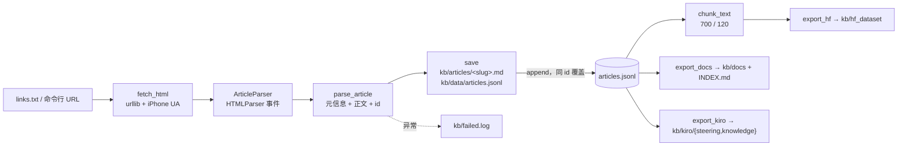

# wx2kb 架构笔记

> 仓库路径：`D:/agentABC/wx2kb`（**无 `.git`**，不在版本控制下）
> 语言与规模：Python 3.10+，**4 个文件**：`wx2kb.py` 19 076 字节 / 490 行（412 非空）、`README.md`、`links.txt`、`tests/fixture_article.html`
> 依赖：**纯标准库**（`argparse`、`hashlib`、`json`、`re`、`sys`、`time`、`urllib`、`datetime`、`html.parser`、`pathlib`），无 `requirements.txt`、无第三方包
> 分析时间：2026-11-04

## 1. 一句话定位

**`wx2kb` 是一个单文件 CLI：把你手动粘进来的公众号文章 URL 抓成 HTML，用标准库 `HTMLParser` 抽出「元信息 + 正文」，落成本地 `articles.jsonl` + 单篇 markdown，再导出成三种"喂给 LLM/IDE"的目录形态。**

它刻意不做爬虫平台的事（README 第 5–15 行写得很清楚）：微信没有开放"列出我关注的号 → 拉历史"的接口，批量采集违反平台协议，所以定位是"一篇篇喂、本地沉淀"，限速 1.5 s/篇，遇验证页只记录失败、不重试。

**它不适合当架构样本，原因是结构性的，不是篇幅问题：**

| 维度 | 事实 | 为什么不能当样本 |
|---|---|---|
| 模块边界 | 1 个 `.py`，解析/存储/导出/CLI 全在一个命名空间 | 没有可讨论的"层"与依赖方向 |
| 抽象 | 只有函数，没有接口/协议/仓储抽象 | 换存储（SQLite/向量库）要改动读写两处，无扩展点 |
| 并发/吞吐 | 串行 `for` + `sleep(1.5)` | 没有队列、重试、限流器、任务状态机 |
| 配置 | 常量写死在模块顶部（`TARGET`、`OVERLAP`、`UA`、`BLOCK`） | 无配置层、无环境区分 |
| 测试 | 只有 `tests/fixture_article.html` 一个 fixture，无测试代码 | 没有可回归的契约 |

它值得读的理由相反：**490 行里把"抓取 → 解析 → 去重落库 → 分块 → 多目标导出"这条真实数据链路走通了，且零依赖。** 当作"薄脚本的正确写法"参考，而不是架构参考。

## 2. 技术栈与工程结构

### 2.1 技术栈

| 维度 | 选型 | 证据 |
|---|---|---|
| 语言 | Python 3.10+（用了 `str \| None`、`list[str]`） | `wx2kb.py:21` 的 `from __future__ import annotations`；`:70` 的 `str \| None` |
| HTTP | `urllib.request`，伪装 iPhone 微信 UA | `UA` 常量 `:40-43`；`fetch_html:191` |
| 解析 | `html.parser.HTMLParser` 子类，事件式抽取 | `ArticleParser:55` |
| 存储 | JSONL（追加/按 id 覆盖）+ 每篇一个 `.md` | `save:239`、`load_articles:270` |
| 分块 | 段落感知 + 定长重叠 | `TARGET, OVERLAP = 700, 120`（`:281`） |
| CLI | `argparse` 子命令 | `main:467` |
| 导出 | 三个目标：HF dataset / 通用 docs / Kiro steering | `export_hf:303`、`export_docs:398`、`export_kiro:355` |

### 2.2 目录组织

```
wx2kb/
├── wx2kb.py                    # 全部实现（490 行）
├── README.md                   # 定位、三步用法、产出结构、后续 TODO
├── links.txt                   # 3 行注释，无真实链接（批量入口）
└── tests/
    └── fixture_article.html    # 离线样例页（手工验证解析用，无测试脚本）
```

运行产物目录 `kb/` **当前不存在**：要么没跑过，要么被清理过。所有产物路径都是运行时 `mkdir(parents=True, exist_ok=True)` 创建（`save:240-241`、`export_hf:308`）。

### 2.3 函数级分层（唯一的"层"）

| 段 | 行区间 | 内容 |
|---|---|---|
| 常量 | 35–47 | `ROOT`/`KB`/`ART_DIR`/`DATA_DIR`、`UA`、`BLOCK`、`HEAD`、`SKIP` |
| 1 解析 | 50–226 | `ArticleParser`（`handle_starttag:95`、`handle_endtag:153`、`handle_data:172`、`text:181`）、`fetch_html`、`parse_article` |
| 2 落库 | 229–274 | `slugify:234`、`save:239`、`load_articles:270` |
| 3 分块与导出 | 277–415 | `chunk_text:284`、`export_hf:303`、`export_kiro:355`、`export_docs:398` |
| 4 CLI | 418–490 | `cmd_add:423`、`cmd_fetch:446`、`cmd_stats:453`、`main:467` |

## 3. 整体架构

### 3.1 一条线性数据流



没有服务、没有队列、没有缓存层；每一步都是同步函数，失败只影响当前 URL。

### 3.2 数据模型（`parse_article` 返回的 dict）

| 字段 | 来源 | 规则 |
|---|---|---|
| `id` | `hashlib.sha1(url).hexdigest()[:10]`（`:215`） | 去重键；实测样例为 `e70dfdc361` |
| `url` | 入参 | 原样保存 |
| `title` | `#activity-name` / `.rich_media_title`，缺则 `og:title`，再缺则 `未命名-<id>` | 标题抓取见 `:116`、`:103-107` |
| `account` | `#js_name` / `.rich_media_meta_nickname` | `:119` |
| `published_at` | `#publish_time` | `:122` |
| `fetched_at` | 本地时区 ISO8601（秒级） | `:222` |
| `chars` | `len(text)` | 供 `stats` 与分块估算 |
| `images` | 正文内 `img` 的 `data-src`/`src`，**上限 30 条** | `:134-139`、`:224` |
| `text` | 标题转 `##`、列表转 `-`、图片转 ``，去掉公众号固定尾巴 | `:144-151`、`:181-188` |

正文容器判定：`id="js_content"` 或 class 含 `rich_media_content`（`:110`）；找不到时降级到整个 `<body>`（`_fallback`，`:130-132`）。固定尾巴清单在 `:186`：`预览时标签不可点`、`微信扫一扫`、`继续滑动看下一个`、`轻触阅读原文`、`阅读原文`。

### 3.3 CLI 契约

| 命令 | 行为 | 参数 |
|---|---|---|
| `add <url...>` | 逐个抓取、解析、落库；`#` 开头与空行跳过；每篇后 `sleep(1.5)` | `urls`（`nargs="+"`） |
| `fetch` | 读 `links.txt`（每行一个，`#` 注释）后转给 `cmd_add` | 无 |
| `export --for {hf,docs,kiro}` | 三选一导出，默认 `hf` | `--for` |
| `stats` | 打印文章数、总字数、chunk 估算数、按公众号分组计数 | 无 |

失败路径：异常捕获后写 `kb/failed.log`（`时间\tURL\t异常`），继续下一篇；`parse_article` 对风控页/已删除/参数错误分别抛 `RuntimeError`（`:200-206`），对"解析不到正文"也抛错（`:213`）。

## 4. 核心代码路径与运行方式

```powershell
# 单篇
python wx2kb.py add https://mp.weixin.qq.com/s/xxxx

# 批量（先把链接填进 links.txt）
python wx2kb.py fetch
python wx2kb.py stats

# 三种导出
python wx2kb.py export --for hf     # kb/hf_dataset/{README.md,data/{articles,chunks}.jsonl}
python wx2kb.py export --for docs   # kb/docs/*.md + INDEX.md
python wx2kb.py export --for kiro   # kb/kiro/.kiro/steering/wechat-kb.md + knowledge/
```

主链路调用顺序（真实函数）：

1. `main:467` → `cmd_add` / `cmd_fetch` / `export_*` / `cmd_stats`；
2. `cmd_add:423` → `fetch_html:191` → `parse_article:199` → `save:239`；
3. `save` → `slugify:234`（`<id>-<标题>`，标题先剔除 `\/:*?"<>|#` 与空白，截 48 字符）→ 写 md（带 YAML front-matter）→ 重写 jsonl（过滤同 `id` 后追加）；
4. `export_*` → `load_articles:270` → `chunk_text:284` → 写目标目录。

`export_hf` 产物细节：`data/articles.jsonl`（**剔除 `images` 字段**，`:312`）、`data/chunks.jsonl`（`chunk_id = <article_id>-<三位序号>`、`text`、`chars`）、dataset card `README.md`（声明 `articles`/`chunks` 两个 config、license、tags 与加载示例）。

`export_kiro` 的设计值得单独说：steering 文件只有索引（`inclusion: manual`），正文放在 `knowledge/`，靠 `#kb` 手动唤起。理由写在 `README.md:70`：几万字常驻上下文会挤掉项目文件、打爆 token。

### 4.1 实测（只读调用，未落盘）

用 `tests/fixture_article.html` 直接调 `parse_article` + `chunk_text`，得到：

| 字段 | 值 |
|---|---|
| `id` | `e70dfdc361` |
| `title` | `从零实现一个 Agent 内核` |
| `account` | `Agent 手艺人` |
| `published_at` | `2026-10-28 08:15` |
| `chars` | 238 |
| `images` | 1 条（`mmbiz.qpic.cn` 远程链接） |
| `chunk_text` | 1 个 chunk（238 字，未达 700 阈值） |

这证明解析链路在无网络条件下可复现；真实抓取路径（`fetch_html`）**未联网验证**。

## 5. 关键实现手法

**5.1 用 HTMLParser 而不是正则/第三方解析器。** 解析器只记几个状态：`_in_content`（在不在正文容器）、`_skip`（在不在 script/style）、`_grab`（正在抓哪个元信息字段，`_grab_depth` 记嵌套深度）、`_fallback`（没抓到正文容器时整页兜底）。规则很短：遇到 `BLOCK`/`HEAD` 先 `_flush()` 收口一个 block，`h1–h6` 加 `#` 前缀，`li` 加 `- `，`img` 直接写 markdown 链接。零依赖的最小正文抽取。

**5.2 去重靠"内容 id"而不是 URL 字符串。** `sha1(url)[:10]` 既做文件名前缀又做 jsonl 覆盖键，重复 `add` 同一链接会覆盖而不是追加（`save:259-266`）。代价是每次 `add` 都全量重写 jsonl（批量 n 篇时 O(n²)），在 1.5 s 限速下可以忽略。

**5.3 分块是"段落优先、定长兜底"。** 默认 700 字 / 120 重叠：能整段塞下就继续攒；放不下就收口，并把上一块的尾部 120 字带到下一块（`cur[-overlap:]`，`:293`）；单段本身超长时按 `target - overlap` 步长硬切（`:294-297`）。副作用有两个：带重叠后的 chunk 可能略超 700；硬切会产生重叠文本。对"给 LLM 做检索"够用，对严格 token 预算不够精确。

**5.4 多目标导出而不是一个"标准输出"。** 同一份 `articles.jsonl` 投影成 HF dataset（带 schema/config）、纯 md 索引（任何 IDE 可读）、Kiro steering（索引与正文分离）。这是本脚本唯一的"架构性"设计：**存储只存一份，导出按消费方投影。**

**5.5 主动放弃重试。** 遇到风控/删除/参数错误直接抛错并记日志，不在失败上做指数退避。这是合规选择（README 明确"不绕过登录/风控"），也意味着批量抓取的成功率完全取决于链接本身。

## 6. 可复用点

| 可复用件 | 位置 | 说明与前提 |
|---|---|---|
| HTMLParser 正文抽取骨架 | `ArticleParser:55`、`parse_article:199` | 换站点要改容器判定与元信息选择器；适合"结构稳定"的页面 |
| sha1 内容 id + jsonl 覆盖式去重 | `:215`、`save:239` | 小库够用；上千篇后应换 SQLite/索引 |
| 段落感知分块器 | `chunk_text:284` | 可独立拷走（无全局依赖），参数 `target/overlap` 可调 |
| 三目标导出投影 | `export_hf:303`、`export_docs:398`、`export_kiro:355` | 想接自己的 RAG/知识库时，照"一份存储、多份投影"的写法 |
| dataset card 生成 | `export_hf:333-350` | 直接可用的 HF 上传模板 |

## 7. 阅读建议

490 行、单文件，**30 分钟可读完**，顺序建议：

1. `wx2kb.py:1-48`（docstring + 常量，先看它承诺"只做三件事"）；
2. `save`/`load_articles`（`:239-274`，理解数据落地形态）；
3. `parse_article` + `ArticleParser`（`:55-226`，本项目唯一有状态机的部分）；
4. `chunk_text` + `export_hf`（`:281-353`，理解"投影"思路）；
5. 三个 `cmd_*` 与 `main`（`:423-490`，CLI 只是薄壳）。

不建议为了"分层"去读它；它没有分层。也不建议把它当爬虫模板照抄：真实的公众号页面结构、风控与登录态远超出这 490 行的处理范围。

## 8. 未覆盖与存疑

1. **未联网跑通全链路。** 只用 fixture 验证了 `parse_article`/`chunk_text`；`fetch_html` 的真实抓取、微信返回的编码/重定向、`kb/` 产物目录均未实测。当前目录也没有 `kb/`，无法确认历史运行结果。
2. **`_in_content` 只增不减。** `handle_starttag:111` 进入正文容器后没有对应的递减逻辑（`handle_endtag` 里对 `div/section` 是 `pass`，`:169-170`）。因此一旦进入 `js_content`，后续整页文本（含页脚、推荐区）都会被收进 block，只靠 `text()` 的固定尾巴替换兜底。这是可工作的简化，但对结构变化敏感。
3. **`links.txt` 是空的。** 只有 3 行注释，没有任何真实链接；因此 `fetch` 的实际效果无法从仓库内复现。
4. **`tests/` 不是测试。** 只有 fixture HTML，没有测试脚本、没有 CI；`README.md` 也没写如何验证。
5. **无 `.git`。** 无法核对作者、历史与变更动机；README 中 `cd D:\AgentABC\wx2kb` 的大小写与实际目录 `d:\agentABC` 不一致（Windows 下无影响，复制到别处可能踩坑）。
6. **已知未做项（README 自述）**：增量去重已有链接、本地 embedding 向量索引、TL;DR/标签、图片本地化。前三项是"能不能当 RAG 数据源"的关键缺口。
7. **合规边界**：脚本只抓"你自己能打开"的页面，不处理登录态；若页面需要登录或触发验证，`parse_article` 会抛 `RuntimeError` 并记 `failed.log`，不会绕过。
