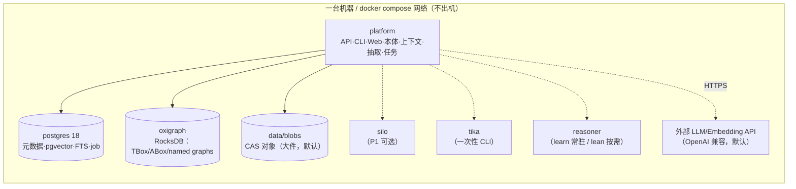

# 单机架构方案（Single-Box First）

> 文档编号：03 · 版本：v0.2（加固收敛稿）· 日期：2026-11-04
> 定位：**单机优先**，不是云中立。功能完善、可用、易用第一；性能与规模推到 P2。
> 阅读路径：§0 决策台账 → §1–§2 架构 → §3 组件 → §5 图 → §10 路线（约 20 分钟）。实现级细节不在本文：**存储 → 07；运行形态/推理 → 05；候选矩阵 → 06；端口 IDL → 04**。
> 取代关系：《01-云中立架构方案.md》《02-接口契约清单.md》已被本文与 04 取代，仅作历史参考。
> 范围：只做设计与评估，不写实现代码。

| 文档 | 内容 | 何时读 |
|---|---|---|
| **03（本文）** | 决策台账、架构叙事、组件取舍、图存储结论、配置与加固 | 评审主线 |
| 04 | 端口 IDL、错误模型、能力标志位、配置 Schema、校验规则 | 实现前 |
| 05 | 生命周期（一次性/间歇/常驻）、开关、compose profiles、推理器选型 | 讨论“谁常驻、OWL 怎么办” |
| 06 | 四套实现候选、候选矩阵（元数据/对象/解析/PG 图） | 选实现形态 |
| 07 | 存储分层规格：CAS 布局、PG DDL、写入/读取/回收/核对/备份/迁移 | 写存储代码前 |

---

## 0. 决策台账

> **唯一口径。** 本文与 04–07 冲突时以本表为准；“详见”列给出实现级出处。新增决策必须先进本表，再改正文。

| # | 决策项 | 当前结论 | 依据（事实 / 用户要求 / 实测） | 详见 |
|---|---|---|---|---|
| D1 | 定位 | 单机多容器（compose）、功能优先、易用优先；性能与规模推到 P2 | 用户要求 | §1、§10 |
| D2 | 图存储 | **Oxigraph + RocksDB（进程内嵌入式）**，是全系统**唯一**图引擎 | 事实：Oxigraph `Store` 只有 `MemoryStore` 与 `RocksDbStore`，无 SQL/PG 后端；RocksDB 随二进制打包，无独立守护进程/端口 | §5.1–§5.2、07 |
| D3 | 图不落 PG | PG **不承担图查询**；PG+AGE 仅作 P2 降级 `graph.provider=age`（`sparql=false, gsp=false, owl=false`） | 能力矩阵：PG 无 RDF 类型/SPARQL/property path/GSP；AGE 是 openCypher 子集、单会话单图、与 PG 大版本强绑定 | §5.6、04 §4.2 |
| D4 | 对象存储 | **按大小分流**：小工件（≤`pg_blob_max_file_mb`，默认 10MB）进 PG（L1）；大件进 **`fs` CAS**（`blobs/<hh>/<sha256>`，temp+fsync+rename）；`pg`（全 PG）、`silo`（P1）可选 | P0 单机低频、无对外 S3 消费者、无预签名需求（§3.4 逐项判定） | §3.4、§3.4.1、07 |
| D5 | 生命周期 | `init` 一次性作业；`platform`/`postgres`/`oxigraph` 常驻；`reasoning` 在 `learn` 档**常驻**、`lean` 档 profile；`llm`/`parse`/`silo` 为 profile 开关 | 低频作业不该常驻（用户要求 + 资源现实）；learn 例外见 D17 | 05 §1 |
| D6 | 推理 | RDFS 闭包默认 + ELK 做 EL 物化 + HermiT/Konclude 做 DL 校验；**离线物化**，不做查询代理；产物只写 `urn:platform:inferred:<version>` | 事实：HermiT/ELK/Konclude 均为 Java/C++，Python 无原生等价物 | §4.1、05 §2 |
| D7 | 解析 | `pypdfium2` + `pdfplumber` + `MarkItDown`；Tika 仅一次性 CLI fallback；**避开 PyMuPDF（AGPL）**；OCR 默认关（见 D22） | 事实：PyMuPDF 为 AGPL；Tika 为 1–2 GB JVM/冷启动；COA 实际用 unstructured+Textract（无 Tika） | §3.4.7、06 §2.3 |
| D8 | 元数据库 | **不换库**：保留 PostgreSQL 18（≥18.6），只做参数调优；参数基线参考 **Pigsty**（只用其 PG 调优经验，不引入其编排/监控栈）；tmpfs/`unlogged` 仅限可重建数据 | 事实：无同时满足“PG 协议 + 纯内存 + 成熟开源 + 单机自部署”的产品 | §3.7、06 §2.1 |
| D9 | Iceberg | **不做**；用 PG 元数据 + Parquet + 文件清单表 | 单写者、单引擎、低频分析 | §3.6 |
| D10 | 任务/事件分发 | **不做队列/事件总线**；PG `job` 表 + 进程内执行器 + PG advisory lock | 单机无跨进程消费者；多一个中间件即多一个有状态服务 | §7.2、05 §1.4、§16.2 |
| D11 | embedding | **`embedding.provider=local-bge`（默认）**：本地 BGE-M3，`dim=1024`，独立小服务；外部 embedding 需显式切换；**取消 `auto`** | 事实：DeepSeek 无 embedding 接口；BGE-M3 MIT/1024 维/8192 token/CPU 可跑/零 key；外部 embedding 会引入第二个 key 与维度漂移风险 | §3.5、04 §11.4 |
| D12 | 外部服务白名单 | 只允许 **Textract / 重型 embedding（远程） / OWL DL 推理（外部 JVM）**（+ 更强 LLM）；默认关闭，开启即标 `degraded` 并视为“数据出机” | 用户要求 + 数据不出机原则 | §9 |
| D13 | 端口契约 | 保留 14 个端口、删除 7 个（TaskQueue/EventBus/WorkflowEngine/JobRunner/TableCatalog/DatastoreDAO/Notifier）；SPARQL-first；能力缺失必须显式 `Unsupported` | 未来换实现不改语义 | 04 |
| D14 | 存储分层 | L0–L3：PG 小工件(L1)、CAS FS(L2)、Silo(L3 可选)；删除走“摘引用 + 软删 + 48h 宽限 + GC” | 误删防护与读竞争 | 07 §1–§6 |
| D15 | 平台边界 | **Windows 为开发环境、Linux 为生产**；不支持 tmpfs/NFS/同步盘作为权威存储 | 文件锁、rename、路径长度语义差异 | §16.7、07 §12 |
| D16 | LLM | 默认 **外部 OpenAI 兼容 API**（DeepSeek / 火山方舟 coding plan / OpenAI 等）；Ollama 与本地模型目录**不是默认项**，仅 `local-llm` profile | 用户要求：默认形态在没有 GPU 的普通机器上可跑通 | §3.1、05 §3 |
| D17 | 运行模式 | **两档 `runtime.mode`：`learn`（P0 默认，能力常驻且全开）/ `lean`（作业化、按需）**；功能完全等价，只差"常驻 vs 按需"；切换只改配置与 compose profile | 用户要边用边学、随时看日志与物化状态；**功能优先于内存节省** | §2.2、§16.5、§16.8、05 §1.6 |
| D18 | 代码边界 | **只写胶水，不自研关键模块**；唯一例外是 Web 层。有算法一律调用库/服务；换 provider 只改单个 adapter | 用户原则：避免长期维护自研内核；风险在 algorithm 而非接口 | §0.2、§6.5、04 §1 |
| D19 | 融合排序 | **RRF，`k=60` 写死**（`Σ 1/(60+rank)`）；禁止加权/学习型排序 | 主流引擎原生公式、无可训练参数，是“固定公式”不是算法；与判据二不冲突 | §6.5、04 §11.6 |
| D20 | 跨版本图叠加 | **默认只读最新版本**；`version=` 显式读历史；对比由调用方跑两次查询 | 并集产生矛盾公理→推理器 `inconsistent` 且无法定位；“哪个版本生效”必须可回答 | §6.5、04 §5.3 |
| D21 | 实体消解 | **P0 规则 + 人工队列**，不做概率模型；Splink 为量化触发后的升级路径 | 概率模型需训练/调参/评估/漂移监控，违背胶水原则与低频定位 | §6.5、04 §11.6 |
| D22 | OCR | **默认关闭**（`ocr.enabled=false`）；扫描件不静默返回空文本，而是 `warn: NO_OCR_ENABLED` 并标 `degraded`；开启需 `ocr.enabled=true` + `parse` profile | 无扫描件/图片资料；PaddleOCR/Tesseract 各带 100–200 MB 级模型与每页 0.5–3 s 开销（估算），开即增常驻/冷启动成本 | §3.4.7、04 §5.6 |
| D23 | LLM 供应商 | **`openai_compatible` 单一 adapter + 多预设**：默认 **DeepSeek**（`deepseek-chat`），备选 **火山方舟 coding plan**（Ark 网关），本地 Ollama 仅 `local-llm` profile 降级 | 同一协议三元组（`base_url`/`api_key_env`/`model`）切换，不新增 adapter；Ollama 质量不承诺云端同等 | 05 §3、04 §10.1 |
| D24 | 体量与存储默认 | **资料总量 20–50GB（几十 GB，已确认）**；`small_object_provider=pg`、`large_object_provider=fs`、`small_object_max=10MB` **定死不变**；PG-only 有护栏（>30GB 拒启） | 备份窗口是真正约束：PG 只放元数据+小件时库约 1–3GB、dump 20–60s；CAS 内容寻址适合 `rsync`/`restic` 增量 | §3.4.4、§3.4.5、07 §9–§12 |
| D25 | 图存储双实现 | **默认 Oxigraph；Jena Fuseki/TDB2 为次优实现，预留兼容但当前不切换**；一个 `GraphStore` 端口两个 adapter，`graph-fuseki` profile 互斥；只用共同子集 | 避免锁死单一引擎；但双实现=两套备份/镜像/迁移脚本，成本如实列出；共同子集防“换库行为漂移” | §5.2.1、04 §4.2/§11.2 |

### 0.1 评审摘要（一页版）

| # | 结论 | 一句话理由 |
|---|---|---|
| 1 | **P0 默认 `runtime.mode=learn`：5 个常驻容器**（`platform`+`postgres`+`oxigraph`+`reasoner`+`embedding`） | 对象按大小分流：小工件（≤`small_object_max`，默认 10MB）与元数据同库进 PG，大件进本地 CAS（目录，不占容器）；embedding 默认本地 BGE-M3（占 1 个容器）；`lean` 档回到 3 |
| 2 | **大件层默认 FS CAS，Silo 不是硬需求** | 单机低频、无 S3 消费者时，FS 满足读写/原子写/列举 |
| 3 | **Iceberg 删除** | 单机单写者，PG 元数据 + Parquet 已够 |
| 4 | **不自研图引擎**：Oxigraph + pySHACL + rdflib + morph-kgc | 解析器/优化器/推理机是多年工程 |
| 5 | **embedding 走独立小服务** | 不把 torch/模型塞进内核进程 |
| 6 | **契约按 AWS 级设计，单机只是当前唯一实现** | 未来加分布式实现不改端口语义 |
| 7 | **能力分三类形态 + 一能力一开关；learn 档默认全开** | 初始化/物化/校验默认常驻便于观察，`lean` 才按需关闭 |
| 8 | **OWL DL 必须有，但离线物化到独立命名图** | 主推 RDFS + ELK 物化 + HermiT 校验 |

---

## 0.2 设计原则 0：胶水而非内核（前置原则）

> **一句话：本次改造只做胶水代码，不自研任何关键模块；唯一例外是 Web 层（API/UI/编排外壳）。** 本节先于所有选型，冲突时以本节为准。

### 判据一：有算法就不写

| 绝不自研 | 用谁 |
|---|---|
| 图存储与 SPARQL 求值 | Oxigraph（备选 Jena/Fuseki） |
| OWL 推理（分类/一致性/物化） | ROBOT / ELK / HermiT / Konclude |
| PDF/DOCX/HTML 解析 | pypdfium2、pdfplumber、MarkItDown |
| 向量索引与相似度 | pgvector（HNSW/IVFFlat） |
| 任务队列 | pgmq 或 PG 任务表 |
| OCR | PaddleOCR / Tesseract |
| embedding 模型 | 外部 API（默认）或本地 BGE |
| 对象存储/去重 | 本地 CAS / Silo |
| LLM 协议 | OpenAI 兼容 SDK / Anthropic SDK |

### 判据二：只写声明式代码

我们的产出形态：**配置（yaml/env）、R2RML 映射、SHACL 约束、规则集、流水线调用顺序、SQL/SPARQL 文本**。
出现“遍历 / 回溯 / 打分 / 剪枝 / 聚类 / 相似度计算”这类过程逻辑，即视为越界，改为库调用或交给查询引擎求值。
> 例外仅限**固定常数公式**（如 RRF `k=60`，见 D19）：无参数、无训练、无回归，属声明式常量，不算过程逻辑。

### 判据三：换 provider 只改一个文件

| 替换 | 允许的改动范围 |
|---|---|
| Oxigraph → Jena/Fuseki | 只改 `GraphStore` adapter |
| pgvector → OpenSearch | 只改 `VectorStore` adapter |
| 外部 LLM → Ollama | 只改 `LLMClient` adapter（协议差异在 adapter 内抹平） |

**扩散到三处以上 = 抽象漏了，视为设计缺陷：修端口，不修调用点。**

### 我们确实要写（边界清单）

| 要写 | 形态 | 不包含 |
|---|---|---|
| 端口定义 + 薄适配器 | 协议转换、错误映射、`capabilities()` 上报 | 算法、缓存策略内核、重试算法 |
| 配置装配与校验 | Schema、默认值、非法组合、fail-fast | 调参优化 |
| 流水线编排 | 顺序、幂等、重试、失败语义 | 抽取/消解算法 |
| Web / API / UI | 路由、鉴权、SSE、页面 | 业务算法 |
| 本体内容 | T-Box、R2RML、SHACL、规则集 | 推理机 |
| 治理流程 | 提案/审批/发布状态机 | 版本 diff 算法（用 SPARQL 算） |

### 代码量预算（估算，不是承诺）

假设：Python/FastAPI、14 个端口、每 adapter 150–400 行、无自研前端框架、契约测试另计。
**胶水层 ≈ 8k–20k 行（±50%）**；对应内核（Oxigraph/ELK/PDF 解析器）是十万–百万行级。
真正的工作量不在行数，而在每个 adapter 的**错误映射与契约测试**（约 1:1–2:1），以及失败语义。

---

## 1. 目标与非目标

### 1.1 目标

1. **功能完善**：本体建模、抽取、审批、校验、版本、上下文、子图查询、语义检索、影响面分析全链路可用。
2. **单机自足**：默认零外部中间件；断网可跑（本地模型时）。
3. **易用**：一个配置文件、一条启动命令、一个数据目录。
4. **短小精悍**：能进程内就不拆服务；能 PG 就不引入中间件。
5. **契约不缩水**：错误语义、幂等、能力探测、版本化、扩展点。

### 1.2 非目标（P0 明确不做）

| 不做 | 原因 | 推到 |
|---|---|---|
| 性能优化（高 QPS、低延迟 SLA） | 单机低频，先要正确性 | P2 |
| 规模（千万级以上三元组、海量文档） | 先验证功能闭环 | P2 |
| 多租户与鉴权 | 单机默认单用户/单团队 | P2 |
| 高可用/容灾/多副本 | 允许重启恢复；备份只做最小集 | P2 |
| 分布式任务/事件流 | 本地进程 + PG 任务表足够 | P2 |
| 监控/告警平台 | 不在范围；只保留“能自己诊断”的出口 | — |
| 云部署/IaC | 不做 CDK/K8s/Helm | — |

### 1.3 设计原则

1. **单机多容器是默认**：所有容器同机、同一 compose 网络、端口只绑 127.0.0.1。
2. **不手搓重要组件**：图→Oxigraph，SHACL→pySHACL，RDF→rdflib，映射→morph-kgc。
3. **PG 只做业务元数据**：版本/审批/任务/pgvector/FTS；**图不在 PG 里重复实现**。
4. **内存优先但可持久**：缓存/锁/模板在进程内；图落 RocksDB；重启从 Oxigraph/PG/CAS 恢复。
5. **接口是护栏**：GraphStore 暴露 SPARQL，但平台层做只读、超时、行数、禁 SERVICE、graph 白名单。
6. **派生索引可重建**：向量、FTS、实体视图都是派生数据。
7. **端口先于实现**：换实现只新增适配器。

---

## 2. 总体架构

### 2.1 单机多容器



**原则：** 业务逻辑全在 `platform`；只有“重依赖、异构语言栈、需要隔离”的能力才拆容器。默认不是单进程，也不是多机。

### 2.2 服务、端口、卷、启动顺序

| 服务 | 镜像/版本（评审时锁 digest） | 端口（仅 127.0.0.1） | 卷 | 必需 | 启动顺序 |
|---|---|---|---|---|---|
| `platform` | 自建 `platform:0.1` | 8080 | `./data:/data` | 是 | 等 `postgres` healthy；`oxigraph` 用 `service_started`（distroless 无 healthcheck，图探针由平台自检承担）；`init` 启用时等 `init-job` 成功（`condition: service_completed_successfully`），`ontology.init_mode=off` 时直接起 |
| `postgres` | `pgvector/pgvector:pg18-trixie` | 5432 | `pgdata` | 是 | 第一个（`pg_isready`） |
| `oxigraph` | `oxigraph/oxigraph:0.5.7` | 7878 | `oxigraph-data` | 是（除非 pyoxigraph） | 无依赖，可与 PG 并行 |
| `silo` | `<silo 镜像>`（锁 digest） | 9000/9001 | `./silo-data:/data`（本地盘） | 否（profile `silo`，P1） | 并行；启用时 healthy 后可用 |
| `tika` | `apache/tika`（锁 digest） | 9998 | 无 | 否（一次性 CLI，不常驻） | 按需 |
| `init-job` | 同 platform 镜像，批处理入口 | 无 | `./data:/data` | 否（profile `init`） | PG/Oxigraph healthy 之后、platform 之前，跑完退出 |
| `reasoner` | ROBOT/ELK/HermiT 镜像 | 无 | `./data/owl:/work` | 是（learn 档常驻）/ 否（lean 用 `run --rm`） | init 后启动，与 platform 并行 |
| `embedding` | BGE-M3 小服务（`embedding.provider=local-bge`，默认） | 8090 | `./data/models` | 是（learn 档常驻；lean 按需） | 与 platform 并行，须 healthcheck |

**容器数口径：**

- **最小 3 个**：`platform` + `postgres` + `oxigraph`（对象按大小分流：小工件进 PG，大件用 FS CAS）；即 `lean` 档常驻数。
- **learn 档（P0 默认）= 5 个常驻**：再加 `reasoner` 与 `embedding`（BGE-M3，默认 `local-bge`）。`init-job` 是 one-shot（跑完退出），不计入常驻。
- **LLM 不占容器**：默认走外部 OpenAI 兼容端点（DeepSeek / 火山方舟）。
- **启用本地 LLM**：+1（`--profile local-llm`，仅离线/无外网时），见 §2.5。
- **启用 Silo（P1）**：+1 → learn 6 / lean 4。
- **全功能**：再加 `tika`（CLI）与 `init-job`（作业 profile，不常驻）。
- **pyoxigraph 进程内**：可去掉 oxigraph 容器 → learn 4；代价是图与内核同生命周期。

**卷布局：**

```text
./data/
  blobs/          # 默认 FS CAS：blobs/<hh>/<sha256>（hh = sha256 前 2 位，256 桶）
  tmp/            # 与 blobs 必须同卷（rename 原子性）
  exports/        # 导入导出临时/成品
  backups/        # pg_dump / oxigraph dump 落点
  owl/            # OWL DL 离线任务输入输出
  platform.yaml   # 单文件配置
pgdata/           # 命名卷
oxigraph-data/    # RocksDB 目录
silo-data/        # 仅 --profile silo
```

> 资源细化与两档配置见 §16.5；profiles 与启动依赖的完整写法见 05 §1.3；卷/DDL 细节见 07 §2–§3。

### 2.3 数据流（P0 闭环）

```text
文档/CSV/SQL → ObjectStore（原件）→ DocumentParser（文本/表格/页码）
  → ExtractionPipeline（**仅编排**：规则顺序 + 可选 LLM 候选）→ pySHACL + RDFS 闭包校验
  → OntologyRegistry（**仅状态机**：术语/关系确认，绑定版本）→ GraphStore（写事实，带 provenance/命名图）
  → Indexer（pgvector + FTS 派生）→ ContextResolver（**仅编排**：术语归一 → SPARQL 子图 → 向量/FTS 召回 → RRF）
  → LLMClient（带引用回答；可关闭）
```

### 2.4 纯内存 vs 落盘

| 数据 | 位置 | 理由 |
|---|---|---|
| 请求上下文、查询计划缓存、LRU | 进程内存 | 可丢，重建成本低 |
| 作业状态/任务队列 | PG `job` 表 | 重启可恢复；不用内存队列 |
| **TBox/ABox、named graphs、推理产物图** | **Oxigraph（RocksDB）** | 权威图数据；SPARQL 1.1；可 dump |
| 业务元数据、版本、审批、审计 | PG | 事务/状态机 |
| 向量、FTS | PG（pgvector / tsvector） | 派生可重建 |
| 对象字节 | 按大小分流：**小工件 → PG（L1）**；**大件 → `fs` CAS（L2，默认）**；`silo`(P1) | 阈值 `pg_blob_max_file_mb`；大对象不进 PG 行内；见 §3.4 |
| Oxigraph 内存模式 | 进程内存 | **仅测试/可重建**，不作权威 |

### 2.5 可选本地推理（非默认）

默认形态**不依赖 GPU**：LLM 走外部 OpenAI 兼容 API（默认 DeepSeek），embedding 默认本地 BGE-M3（需要一份模型盘约 2.3 GB）。

只有“离线/无外网/数据不允许出机”时才启用 `--profile local-llm`：

| 项 | 内容 |
|---|---|
| 服务 | `ollama`（端口 11434，锁 digest） |
| 卷 | `ollama-models/`（模型缓存，只在启用该 profile 时创建） |
| 资源 | BGE-M3 约 2–3 GB 内存；7B/8B chat 模型需 8–16 GB（CPU 或 GPU） |
| 降级 | 不启用时 `llm.provider` 仍为外部 API；无外部配置且无本地服务 → 抽取走规则、语义检索退 FTS（`degraded=true`） |

---

## 3. 组件清单与最小组件集

### 3.1 逐项论证

| # | 组件 | 要什么 | 为什么 | 能不能不要 | 最小实现 |
|---|---|---|---|---|---|
| 1 | `platform` 内核 | API/CLI/Web、本体、上下文、抽取、任务 | 没有它就没有服务 | 不能 | 一个容器，内嵌 HTTP server |
| 2 | PostgreSQL | 元数据、版本、审批、pgvector、FTS、job 表 | 事务/状态机/向量；**不承担图** | 不能（SQLite 仅单测） | `pgvector/pgvector:pg18-trixie` |
| 3 | Oxigraph | RDF 图 + SPARQL 1.1 | 本体/事实权威存储与查询 | 不能（除 pyoxigraph） | `oxigraph/oxigraph:0.5.7` |
| 4 | 对象存储（按大小分流） | 小工件 → PG（L1）；大件 → CAS（L2） | 零外部依赖；小工件与元数据同事务 | 不能（P0） | 阈值 `pg_blob_max_file_mb`=10；大件 `blobs/<hh>/<sha256>`，PG 存元数据 |
| 4b | Silo（P1） | 同上 + S3 API/预签名/版本化 | 需要外部 S3 消费者时 | 能（默认不启用） | `--profile silo` |
| 5 | Embedding（`local-bge`） | 向量化 | 语义检索/消歧 | 能（退化为 FTS） | 本地 BGE-M3 独立小服务（1024 维，§3.5） |
| 6 | LLM（外部 OpenAI 兼容） | 抽取、归一、回答 | 提升抽取质量 | 能（规则 + 模板） | 默认 DeepSeek；火山方舟 coding plan 备选；Ollama 仅 `local-llm` |
| 7 | 文档解析 | PDF/Office/HTML → 块 | 抽取输入 | 能（仅纯文本/CSV） | pypdfium2 + pdfplumber + MarkItDown（§3.4.7） |
| 8 | 全文检索 | 关键词/混合检索一路 | 无模型时的基础检索 | 能 | PG `tsvector` + `pg_trgm` |
| 9 | 缓存 | 热点实体/片段 | 降重复查询成本 | 能 | 进程内 LRU（容量+TTL） |
| 10 | 密钥/配置 | 连接串、API Key | 不落明文 | 能（仅 env） | `SecretProvider`：env/file |
| 11 | 任务执行 | 抽取/重建索引/导入 | 长任务不阻塞请求 | 能（同步，体验差） | PG `job` 表 + 线程池 + 子进程 |
| 12 | RDF 工具链 | SHACL/R2RML/序列化 | 校验/映射/导入导出 | 不能（自研成本高） | pySHACL + rdflib + morph-kgc（库，非服务） |
| 13 | MCP/Agent 入口 | 对外工具面 | 集成与易用 | 能（P1） | 进程内路由，复用现有端口 |

### 3.2 最终最小组件集

**核心三件（必须）：** ① `platform` 容器；② `postgres` 容器（元数据 + pgvector + FTS + job）；③ `oxigraph` 容器（RDF + SPARQL；或 pyoxigraph 进程内）。

**learn 档（P0 默认）：** 常驻再加 `reasoner`（ELK/HermiT，`-Xmx`/`mem_limit` 上限见 §16.5）与 `embedding`（本地 BGE-M3）→ **5 个常驻容器**；`init-job` 仍为 one-shot。

**对象存储：** P0 大件用数据目录内 `fs` CAS；小工件（≤`small_object_max`，默认 10MB）与元数据同库进 PG（L1），**不额外占容器**；`large_object_provider` 可切 `pg`/`silo`。

**默认不加容器：** LLM 走外部 API（`llm.provider=openai_compatible`，预设 DeepSeek / 火山方舟）；embedding 默认 `local-bge`（占 1 个容器，模型盘约 2.3 GB）。

**可选（lean 档 profile，非常驻）：** `local-llm`（Ollama，离线场景，§2.5）、`init-job`、`reasoner`（lean 用 `run --rm`）、`tika`（CLI）、`silo`(P1)。

> 取舍：**成熟组件 + 单机 compose**。图→Oxigraph；SHACL→pySHACL；RDF→rdflib；映射→morph-kgc；队列→PG 任务表；向量→pgvector；搜索→FTS；缓存→LRU。代价是容器数高于单进程，但**不自研关键引擎**。

### 3.3 被删除组件：理由、替代、损失

| 删除组件 | 原职责 | 删除理由 | 功能替代 | 损失 |
|---|---|---|---|---|
| Iceberg + Catalog | 多引擎共享表、快照、增量扫描 | 单机单写者、单引擎、低频 | PG 元数据 + Parquet + 文件清单表 | 无跨引擎共享；时间旅行/增量自建 |
| Kafka/Redpanda/SQS/SNS/Kinesis/EventBridge | 事件流、队列、通知 | 无多消费者组与跨进程扇出 | 进程内观察者 + PG `job`/`event_log` | 无流式重放；需自做重试与可见性超时 |
| Step Functions/Temporal/Airflow | 工作流编排 | 代码状态机足够；引擎即多一个有状态服务 | 代码状态机 + `job`/`run` 表 + 重试 | 无可视化编排/补偿 |
| ECS/EKS/Batch/EMR（JobRunner） | 分布式作业执行 | 单机就是本地进程/子进程 | 线程池 + 子进程 + 资源限制 | 无集群弹性 |
| 自研图查询层（三元组表 + 递归 CTE） | 图/本体查询 | 自研解析器/优化器必然长成不合格子集 | Oxigraph | 无（反而得到标准 SPARQL） |
| Neptune | 托管 RDF 图库 | **只能托管，无法单机** | Oxigraph | 无托管伸缩/多副本（单机不需要） |
| Neo4j（默认不选） | 外部属性图服务 | 无原生 RDF/SPARQL；n10s 映射丢 named graph/blank node 语义 | Oxigraph；P2 再评估 | 无 GDS 算法/原生向量索引 |
| OpenSearch/AOSS | 向量+BM25 混合 | pgvector + FTS 够单机 | pgvector + PG FTS + RRF | 混合检索质量/规模下降 |
| DynamoDB | COA 元数据 DAO | PG 已承担元数据 | `MetadataStore.records`（JSONB/关系表） | 无条件写/分页语义 |
| Redis/ElastiCache | 分布式缓存/锁 | 进程内 LRU + PG advisory lock | 同上 | 无跨进程共享缓存 |
| Vault/Secrets Manager | 密钥管理 | env/file 足够 | `SecretProvider` | 无集中轮换/审计 |
| ALB/CDK/IaC/AgentCore | 云入口与托管 | 单机不用云部署 | 内嵌 HTTP server + 一个配置文件 | 无 TLS 终止/限流/声明式部署（可外置，P1） |
| 独立向量数据库 | 向量检索 | pgvector 覆盖单机 | pgvector（HNSW/IVFFlat） | 超大规模/高并发检索（P2） |

**原则：** 删除必须同时给出“功能替代 + 损失”；没有替代的能力不能删。

### 3.4 对象存储：Silo 是否必需（判定）

**结论：在本项目 P0（单机、低频、少用户、本体为核心、无对外 S3 消费者）下，Silo 不是硬需求。P0 大件用本地 FS（CAS），小工件仍进 PG；Silo 是 P1 可选 profile。**

| 能力 | 本地 FS | Silo 独有价值 | P0 判定 |
|---|---|---|---|
| 写入/读取 | ✅ | 无本质差异 | FS 够用 |
| 原子性 | ✅ 同卷 `rename` | 对象级事务/纠删码 | FS 够用 |
| 并发（低频少用户） | ✅ 单写者 + 原子 rename | 多客户端锁与版本 | FS 够用 |
| 大文件分片上传 | △ 平台分块写临时文件再合并 | 原生 multipart | 低频大文件少 → 够用 |
| 预签名 URL | ❌ | ✅ 原生直传/直下 | 后面流式代理即可，**不必须** |
| 版本化/不可变 | ❌（CAS 以内容哈希近似） | ✅ 桶版本/对象锁 | P0 不需要对象锁 |
| 元数据与列举 | ✅ PG 元数据 + 目录分桶 | ✅ 桶/前缀列举 API | FS + PG 够用 |
| 外部工具互通（dbt/Spark/Trino/COA 直连 S3） | ❌ | ✅ 标准 S3 端点 | **P0 无外部 S3 消费者** |
| 万级对象 | ✅ 两级分桶无压力 | — | FS 够用 |
| 百万级对象 | △ 目录扫描与备份变慢 | ✅ 对象索引稳定 | 超阈值再启用 |
| 运维/备份/迁移 | ✅ `rsync`/快照最直接 | △ 需 mcli/桶级工具 | FS 更简单 |
| 本地盘 vs NFS | ✅ 本地盘强一致 | NFS 同样破坏一致性 | 只允许本地盘 |

**Silo 何时变成必需（满足任一即启用）：**

1. 需要给外部系统一个 **S3 API 端点**直连（dbt/Spark/Trino/COA/第三方采集）。
2. 需要**预签名 URL** 前端/第三方直传直下，且不接受后端代理。
3. 需要**桶级版本化/对象锁/保留策略**（合规、审计、防篡改）。
4. 对象数超过**实测拐点**（不是拍脑袋阈值：以 `storage verify` 的列举耗时与备份耗时为准，见 §3.4.5）。
5. 需要**多进程/多机共享**同一对象存储（FS 做不到）。

**Silo 启用时才需核对的硬性依赖（P1）：**

| 依赖项 | 是否必需 | 不满足会怎样 | 取舍 |
|---|---|---|---|
| 单节点单盘（SNSD） | 存在且文档化（官方定位 dev/evaluation） | 无冗余；单盘坏即丢 | P1 可接受，靠备份 |
| 外部元数据库 | **不需要**（元数据随对象落盘） | — | 少一个组件 |
| 裸盘/块设备 | **不需要**，给目录即可 | — | 挂 `./silo-data:/data` |
| 文件系统 | 官方推荐 XFS，不建议 ext4/RAID/LVM | 性能/一致性下降（非不能用） | Linux 生产用 XFS |
| NFS/CIFS | **不支持严格一致**（破坏 read-after-write/list-after-write） | 列表滞后、并发异常 | 禁止网络盘 |
| 内核/内存 | 生产清单要求 Linux 6.6+；单节点预分配 1 GiB | 老内核不承诺；低于内存不稳 | 预留 ≥ 2 GiB |
| 端口 | 9000（S3）/9001（Console） | 冲突 | 仅绑 127.0.0.1 |
| KMS/事件通知 | 可选 | 无 SSE-KMS/通知 | 不需要（用 PG `job`/`event_log`） |
| License | **AGPLv3** | 修改后通过网络提供服务需开源修改 | 不修改、只作独立进程调用 |

> Silo 要求对数据目录**独占访问**，禁止其他进程直接改/删/搬其中文件。

### 3.4.1 P0 大件对象实现：FS + CAS（小工件仍走 PG，见 §3.4.4）

```text
布局：<storage.root>/blobs/<sha256 前 2 位>/<sha256>
写入：<storage.root>/tmp/<uuid>.part → fsync → rename 到 blobs/<hh>/<sha256>（同卷原子）
读取：按 key（= sha256）直读；Range 由 platform 实现
元数据：PG 表 blob(hash, size, content_type, refcount, state, path, ...) + blob_ref
引用：Oxigraph 中以 IRI（urn:platform:object:<sha256>）引用，不存字节
```

| 特性 | 做法 |
|---|---|
| 去重 | 内容寻址天然去重；同 sha256 只存一份 |
| 不可变 | 写入后不修改；更新 = 新 sha256 |
| 删除 | 摘引用 → 软删 → `refcount=0` 且超 `gc_grace_hours`（默认 48h）才物理删 |
| 列举 | 走 PG 元数据分页，不扫目录 |
| 大文件 | 分块写临时文件 → 合并 → 校验 sha256 → rename |
| 预签名 | 不支持；外部访问走后端流式代理 `GET /objects/{hash}` |

> 写入/读取/删除/核对/备份的逐步崩溃恢复、DDL、GSP 式迁移，见 07 §3–§8。

### 3.4.2 三处一致性（文件 / PG / Oxigraph）

| 步骤 | 规则 | 失败处理 |
|---|---|---|
| 1 写 blob | `tmp/*.part` → fsync → rename | 失败：删临时文件，不写 PG |
| 2 写 PG 元数据 | `state: pending → committed`，记 hash/size/refcount | 失败：blob 成孤儿，由 reconciler 隔离 |
| 3 写图引用 | Oxigraph 写 `urn:platform:object:<sha256>`（与事实同批） | 失败：PG 行标 `orphan_ref`，不对外可见，重试补齐 |
| 读 | 以 PG `committed` 为准；图里只有 IRI | — |
| 删除 | 先解引用（图）→ `refcount--` → 归零且过宽限才删 blob | 任一步失败：保留 blob，重试 |
| 孤儿回收 | 扫 `tmp/` 与 `blobs/` 中无行/无引用对象 | 只处理“超宽限 + 无引用”；先进 `quarantine/` |
| 备份顺序 | **PG dump → Oxigraph dump → blobs 快照**（先元数据后字节，便于对账） | 恢复按 sha256 双向核对 |
| 恢复校验 | 抽样 sha256；PG 行 ↔ blob ↔ 图 IRI 三方比对 | 不一致进修复队列，不自动覆盖 |

**核心规则：单向派生。** 字节 → PG 元数据 → 图 IRI；**禁止**从图反向写字节、从字节猜元数据。文件是“不可变内容”，PG 是“权威元数据”，图是“引用者”。

### 3.4.3 Windows 现实约束（摘要）

| 事项 | 风险 | 处理 |
|---|---|---|
| 路径长度 | 未启 LongPaths 时 260 字符 | 短根（如 `D:\agentABC\data`）+ 两级分桶；原始文件名只存 PG |
| 大小写不敏感 | `A.ttl`/`a.ttl` 冲突 | key 一律小写 sha256 |
| 文件锁/并发写 | 打开中的文件不能删除/改名 | 唯一临时名写入；读用短生命周期句柄；删除走“标记 + 延迟清理” |
| rename 原子性 | 跨卷不原子 | `tmp/` 与 `blobs/` 同卷；启动检查卷相同 |
| 容器挂载 | 无 POSIX uid，性能较低 | 开发可绑挂；生产用 Linux 命名卷/本地盘 |

> 完整边界（tmpfs、WSL2、行尾、ACL）见 §16.7 与 07 §12。**口径：Windows = 开发环境，Linux = 生产；不要用 Windows 目录的 IO 数据做容量/性能结论。**

### 3.4.4 第三候选：把大件也放进 PostgreSQL（`large_object_provider=pg`）

**结论：默认 `large_object_provider=fs`；PG 只接小工件。** 已确认前提是**资料总量几十 GB（约 20–50GB 量级）**，不需要也不应该把大件放进 PG（见 D24）。

**参数命名（消除“二选一”的误导）：**

| 键 | 默认 | 可选 | 作用 |
|---|---|---|---|
| `storage.small_object_provider` | `pg` | `pg` / `fs` | 小工件层（≤`small_object_max`） |
| `storage.large_object_provider` | `fs` | `fs` / `silo` / `pg` | 大件层 |
| `storage.provider` | 不设 | 同上两者 | **简写**：显式设置时同时覆盖两层；启动日志打印最终生效的两层值 |

**为什么默认不是 PG-only（三条机制性代价）：**

1. 每写一次大件都会产生等量级的 WAL（写放大直接转成备份与复制成本）。
2. `pg_dump`/恢复时间随库总量线性增长；几十 GB 的 dump 是十几分钟到半小时，恢复更久。
3. TOAST 行重写会整块复制，不适合频繁更新的大对象。

**若显式改成 `large_object_provider=pg` 的硬护栏：**

- 启动自检查询 `pg_database_size`、`blob` 表总字节与最大单文件，给出“当前库大小 / 近 90 天增长率 / 预计 `pg_dump` 体积”估算。
- 阈值（估算，假设元数据 1–5 KB/份、抽取文本为原件的 10–20%）：库总量 > **15 GB** 或单文件 > **50 MB** 时告警；> **30 GB** 时**拒绝启动**（需 `--force` 才继续），并打印三条代价。
- 备份策略必须同步改为“LO 单独导出 + 更长窗口”，否则视为配置错误。

| 存储方式 | 机制 | 容量/限制 | 适用 | 坑 |
|---|---|---|---|---|
| `bytea` | 行内列，TOAST 压缩/外存 | 单值通常 ≤ 1 GB | 抽取文本、缩略图、manifest、小配置 | 全量读入内存；无 Range；行变胖、WAL 放大 |
| Large Object (`lo`) | `lo_create/lo_import`，64 KB 页分块流式 | 受 PG 与磁盘限制，更大 | 中等二进制、需分块/Range | 需显式 `lo_unlink`；`pg_dump` 默认含 LO，但 `--schema/--table/--schema-only` 不含，需 `lo_export` |
| 表内版本行（`blob_bytea` 版本表） | 多行 + `is_latest` | 小工件多版本 | 需要版本化的小工件 | 版本表膨胀；需归档策略 |

**能力差异一句话：** `fs` 支持 Range/流式/超大对象但不与元数据同事务；`pg` 唯一硬优势是“文件+元数据+引用同事务”，代价是 WAL/VACUUM/备份膨胀与连接池压力；`silo` 提供 S3 API 与预签名但多一个容器。逐项能力矩阵见 06 §2.2、04 §4.1。

**按总量选默认（经验估算，不是让用户做技术选择）：**

| 资料总量 | 建议 | 理由 |
|---|---|---|
| **< 5 GB** | 可全放 PG | 单份备份、单事务、无孤儿文件；库小，`pg_dump` 秒级–分钟级 |
| **5–50 GB（本项目）** | **小件 PG + 大件 FS（默认）** | 库保持 1–3 GB，备份窗口可控；CAS 增量备份更省 |
| > 100 GB | 大件必须出 PG | 备份/恢复窗口不可接受 |

> 真正的约束是**备份窗口**，不是磁盘。默认值不变（D24）。

**判据（全部可配置，默认值均为经验默认，不是物理上限）：**

| 维度 | 放 `pg` | 走 `fs` |
|---|---|---|
| 单文件 | ≤ `storage.pg_blob_max_file_mb`（默认 10） | 超过；或超 `storage.fs_hard_max_file_mb`（默认 256）一律 FS |
| 总量 | ≤ 数据盘可用空间的 `storage.pg_blob_max_total_pct`%（默认 20） | 超过 |
| 数量 | ≤ `storage.pg_blob_max_count`（默认 100000） | 超过（VACUUM/备份不划算） |
| 类型 | 抽取文本、缩略图、manifest、小配置 | PDF/图片/视频/模型权重/归档包 |
| 访问方式 | 整体读 | 需要 Range（`storage.require_range_read=true` 时一律 FS） |
| 一致性 | 必须与元数据同事务 | 可接受两阶段 + 对账 |

**推荐策略（默认口径）：**

1. 小工件进 PG（`bytea`，`content_hash UNIQUE`）；大原件走 CAS FS。
2. 统一 `ObjectStore` 接口；两个 provider 键各管一层，`storage.routing` 只决定按 `size`/`content_type` 的分流细节。
3. **若坚持全放 PG**：必须接受上述三条代价，并补“定期 VACUUM/REINDEX、LO 单独导出、下载限并发”。

**CAS 侧备份（与 PG 分开）：** 内容寻址 + 不可变 → `rsync --checksum` 或 `restic` 增量；首次全量、之后仅新增（几十 GB 语料首次约 10–30 分钟，增量通常 < 2 分钟，估算，取决于磁盘与网络）。**恢复顺序：图 → 元数据 → 文件**；恢复后必须跑一次 `reconciler` 零差异校验（见 07 §7–§9）。

**一致性边界（不许过度承诺）：**

| 项 | PG 方案 |
|---|---|
| 文件 + 元数据 + 引用 | ✅ 同一事务，无孤儿文件 |
| 与 Oxigraph 图 | ❌ **仍在事务之外**：图 IRI 是另一个系统，跨库无事务 |
| 因此只能宣称 | “对象与其元数据强一致，图引用最终一致” |

### 3.4.5 容量估算模型（按“几十 GB”已确认前提）

> **前提（已确认）：** 文档资料总量**几十 GB（约 20–50GB 量级）**，没有上百 GB。下面的模型用于**核对容量与备份窗口**，不是“再决定存储方案”的开关（方案已由 D24 定死）。

**口径：**

```text
三元组数 ≈ (3–5)×类数 + (6–10)×属性数 + (1–3)×公理数
图占用   ≈ 三元组数 × (100–200) 字节（含 SPO/POS/OSP 索引，RocksDB；经验值，误差 ±2–3×）
实例占用 ≈ 裸数据 × (1.5–2)（LSM 写放大/compaction 余量；经验值）
文档量   ≈ 文档数 × 平均大小 × (1.2–1.5)（抽取文本/缩略图/清单/多版本放大；经验值）
元数据   ≈ 文档数 × (1–5 KB)（对象行/版本/审批/任务/索引开销；经验值）
```

| 本体规模档 | 类 / 属性 / 公理 | 三元组（估算） | Oxigraph 占用 |
|---|---|---|---|
| 小（单领域） | 2,000 / 5,000 / 30,000 | 6.6 万–15 万 | 约 7–30 MB |
| 中（多领域） | 20,000 / 50,000 / 300,000 | 120 万–240 万 | 约 120–480 MB |
| 大（行业本体） | 200,000 / 500,000 / 3,000,000 | 1,200 万–2,400 万 | 约 1.2–4.8 GB |

| 实例三元组 | 裸数据 | 含 LSM/索引（1.5–2×） | 说明 |
|---|---|---|---|
| 100 万 | 100–200 MB | 150–400 MB | 单机舒适区 |
| 1,000 万 | 1–2 GB | 1.5–4 GB | 本项目上限估算，需调内存与限额 |
| 1 亿 | 10–20 GB | 15–40 GB | 超出本项目前提，不预留 |

| 文档数 × 平均大小 | 原始量 | 含派生/临时（1.2–1.5×） | 元数据行（1–5 KB/份） |
|---|---|---|---|
| 1,000 × 3 MB | 3 GB | 3.6–4.5 GB | 1–5 MB |
| 10,000 × 3 MB | **30 GB** | 36–45 GB | 10–50 MB |
| 20,000 × 3 MB | 60 GB | 72–90 GB | 20–100 MB |

> 平均 3 MB 是**假设**（PDF/Office 常见 0.5–10 MB，误差 ±3 倍）。**本项目取 20–50GB**，对应约 0.7 万–1.7 万份文档。

**预期 PG 大小（估算，假设元数据 1–5 KB/份、抽取文本为原件 10–20%、小工件 ≤10MB）：** 20–50GB 语料下 PG 约 **1–3 GB**，`pg_dump` 约 **20–60 秒**；恢复同量级。这就是默认不把大件放 PG 的原因。

**实测替代（部署后一周内跑一次，按实测调参）：**

```sql
SELECT pg_size_pretty(pg_database_size(current_database())) AS db_size,
       pg_size_pretty(pg_total_relation_size('blob')) AS blob_table_size;
SELECT count(*) AS blobs, pg_size_pretty(coalesce(sum(size),0)) AS bytes,
       pg_size_pretty(max(size)) AS max_blob,
       percentile_cont(0.95) WITHIN GROUP (ORDER BY size) AS p95
FROM blob;
```
```bash
du -sh data/blobs && find data/blobs -type f | wc -l      # Linux
du -sh data/oxigraph-data
```
```powershell
Get-ChildItem -Recurse data\blobs | Measure-Object -Property Length -Sum   # Windows
```

**原则：默认值已定死（D24）；实测只用于“是否触发告警/调参”，不用于推翻默认。**

**阈值参数（全部可配；默认值为经验默认）：**

| 参数 | 默认 | 性质 | 作用 |
|---|---|---|---|
| `storage.small_object_provider` | `pg` | 默认 | 小工件层；`fs` 为可选 |
| `storage.large_object_provider` | `fs` | 默认 | 大件层；`pg`/`silo` 显式开启（有护栏） |
| `storage.provider` | 不设 | 简写 | 显式设置时同时覆盖两层 |
| `storage.pg_blob_max_file_mb` | `10` | 经验默认 | 超此值路由到 CAS FS（DDL 列名 `small_object_max_bytes`） |
| `storage.pg_blob_max_total_pct` | `20` | 经验默认 | blob 总量超可用空间此比例即拆 FS（DDL `pg_max_total_ratio`=0.2） |
| `storage.pg_blob_max_count` | `100000` | 经验默认 | 超此对象数后 PG 表 VACUUM/备份不划算 |
| `storage.require_range_read` | `true` | 能力判据 | 需要 Range 的对象一律走 FS |
| `storage.gc_grace_hours` | `48` | 经验默认 | 删除宽限（24–72h 可调） |

**磁盘规划建议（估算；假设 1 份本地全量备份 + 1 份增量/轮换，压缩后语料按 0.9–1×）：**

| 档 | 组成 | 起步（20GB 语料） | 舒适（50GB 语料） |
|---|---|---|---|
| 语料 CAS（L2） | 原件 + 派生（1.2–1.5×） | 约 30 GB | 约 70 GB |
| PG（元数据+小件+向量+WAL） | 1–3 GB + 增长余量 | 约 10 GB | 约 15 GB |
| Oxigraph | 图数据 + compaction 余量 | 约 5 GB | 约 10 GB |
| 本地备份（1 全量 + 1 增量） | PG dump + CAS 增量 | 约 30 GB | 约 70 GB |
| 余量（临时/导出/日志/模型） | 15–25% | 约 20 GB | 约 35 GB |
| **合计** | — | **约 100 GB（起步盘 128GB 可用）** | **约 200 GB（建议 256–512GB 盘）** |

> 备份份数每 +1 全量，按语料大小再加约 1× 空间。若只保留 1 份增量，可按上表下限取。

### 3.4.6 按更新频率选存储（判据表）

| 数据特征 | 推荐层级 | 理由 |
|---|---|---|
| 写入后不可变（原件、图片、模型权重、导出快照） | **CAS FS（L2）** | 天然去重；无 WAL/VACUUM；支持 Range/流式 |
| 高频小对象、需与元数据同事务（抽取文本、manifest、缩略图） | **PG blob（L1）** | 一次事务提交，无孤儿；体量小 |
| 需要 S3 API/预签名/版本化对象锁 | **Silo（L3，P1）** | FS/PG 都替代不了 |
| 只读一次、可重建的派生数据 | 任意（甚至 tmpfs） | 丢了可重建 |
| 权威业务元数据（版本、审批、任务、对象元数据） | **PG 磁盘** | **绝不放 tmpfs/unlogged** |

> 几十 GB 量级的落地建议（独立数据盘、按年月暂存、`rsync`/`robocopy` 增量、sha256 清单）已下沉到 07 §10–§12，本文不重复。

### 3.4.7 文档解析链路（DocumentParser）

**COA 事实（已核查）：** COA **不含 Tika**（全仓 0 命中）；实际是 `unstructured[pdf,docx]` + Amazon Textract；只支持 `.txt/.md/.docx/.pdf`，**HTML 不支持**。（详见 06 §2.3）

| 组件 | 职责 | License | 备注 |
|---|---|---|---|
| **pypdfium2** | PDF 文字抽取 + 扫描判定（每页字符阈值） | Apache-2.0/BSD 系 | 轻、快；不做复杂版面 |
| **pdfplumber** | 表格抽取 | MIT | 按需调用 |
| **MarkItDown** | docx/pptx/xlsx/html → Markdown | MIT | 补 COA 的 HTML 缺口 |
| **PaddleOCR / Tesseract(chi_sim)** | 扫描件 OCR，**默认关闭**（`ocr.enabled=false`） | Apache-2.0 | 需 `parse` profile + `ocr.enabled=true`；模型约 100–200 MB，每页 0.5–3 s（估算，CPU/分辨率相关） |
| **Tika（一次性 CLI）** | 冷门/老旧格式批量导入 | Apache-2.0 | `docker run --rm` 或 `tika-app.jar --text`；**不常驻**（1–2 GB JVM、5–15 s 冷启动） |

**OCR 关闭时的行为（验收点，D22）：**

- PDF 只走文字层（pypdfium2 `strategy="fast"`）；若判定“无文字层”（每页字符数低于阈值），**不得静默返回空文本**，而是返回 `warn: {code: "NO_OCR_ENABLED", message: "文档疑似扫描件，当前未启用 OCR；如需处理请开启 ocr.enabled=true 并启用 parse profile"}`，并标 `degraded=true`（`warning` 不影响退出码）。
- `DocumentParser.capabilities()` 必须如实上报 `ocr=false`；`ParseOptions.ocr=true` 时返回 `Unsupported`（错误信息指向上述开关），而不是假装成功。

**避开 PyMuPDF**（AGPL，商用分发有污染风险）。

**端口形态：** `DocumentParser` 只暴露 `ParsedDocument`（`pages/blocks/tables/metadata/provider/warnings`）+ `capabilities()`；内部按“格式 → 引擎”链式路由。换实现只改装配。

### 3.5 Embedding 怎么跑（默认本地 BGE-M3，维度一致性强制校验）

**事实：** BGE-M3 为 MIT，dense **1024 维**、最大 **8192 token**、100+ 语言；模型约 2.27 GB，推理内存约 1 GB 量级（随批次/精度变化）。平台只用 dense，sparse 由 PG FTS 承担。**D11 核实：dim=1024 与官模型卡一致。**

**默认口径：`embedding.provider=local-bge`**，`model=BGE-M3`，`dimensions=1024`。**取消旧的 `auto`**（外部优先会引入第二个 key 与维度漂移风险）。外部 embedding 仅在显式配置时启用，且视为数据出机。

| 方式 | 依赖 | 优点 | 缺点 | 场景 |
|---|---|---|---|---|
| **本地 BGE 独立服务（默认）** | 一个二进制或 Python 服务 + 模型（2.3 GB 盘） | 离线可用；零 key；维度稳定；隔离内存/崩溃 | 多一个进程；占 2–3 GB 内存 | **`local-bge`**，learn 档常驻 |
| 外部 API | 网络 + API Key | 不占本机资源 | 第二个 key；维度可能不同；数据出机 | 显式 `openai_compatible` |
| 进程内 | torch + 模型 | 零 IPC | 内存/GIL 拖累内核；崩溃拖垮主进程 | **仅测试**（fake/tiny） |

**强制一致性规则（写死，禁止静默混用）：**

1. 向量表（`chunk`/`embedding`）必须记录 `embedding_model` 与 `dim`（见 07 §4 DDL）。
2. 启动自检比对“配置模型+维度”与库中记录；不一致 → **默认拒绝启动**（78），错误必须给出两条出路：`切回旧模型` 或 `执行重建索引作业`。
3. 重建索引是独立作业（`platform index rebuild --embeddings`），期间语义检索**不可用**（降级 FTS，标 `degraded=true`）；耗时按 20–50GB 语料估算为**分钟级到 1–2 小时**（CPU/批量大小相关，标估算）。
4. 换模型 = 新建索引 + 回填 + 切别名，不混写；维度不符一律 `InvalidArgument`。

```text
E_EMBED_MODEL_MISMATCH  configured={model:BGE-M3, dim:1024}  indexed={model:bge-small-zh-v1.5, dim:512}
  impact: 语义检索不可用（拒绝启动，防止混用向量）
  fix:    a) 把 embedding.model 切回 bge-small-zh-v1.5（dim=512）；或
          b) 执行 platform index rebuild --embeddings（期间检索降级 FTS）
  exit:   78 (EX_CONFIG)
```

- 服务不可用 → `Unavailable`，语义检索降级 FTS，响应标 `degraded=true`。

### 3.6 Iceberg：为什么单机不要

Iceberg 承担四件事：多引擎共享表、快照/时间旅行、manifest 级增量扫描、Catalog 原子提交。单机场景下：只有一个写者与一个引擎（PG 事务即可）、数据量小（文件清单 + 时间戳即可增量）、无跨引擎共享（导出 Parquet 给 DuckDB 即可）。

| 能力 | 损失 | 替代 | 可接受 |
|---|---|---|---|
| 跨引擎 ACID 表 | 无 | 导出 Parquet + 文件清单 | P0/P1 可接受 |
| 表级快照/时间旅行 | 无 | 文件版本表 + 不可变 key | 可接受（低频） |
| manifest 增量扫描 | 无 | `file` 表 `created_at/content_hash` + 水位线 | 可接受 |
| Catalog 原子提交 | 无 | PG 事务 + 单写者 | 可接受 |

**结论：** 删 Iceberg 是去掉一层单机用不上的表格式/catalog 复杂度，不是砍功能。P2 若真有“多引擎共享 + 大数据量 + 增量处理”，再以 `TableCatalog` 端口引入。

### 3.7 元数据库要不要换「PG 系的内存库」

**结论：没有满足全部四个条件（PG 协议/PG 同源 + 纯内存 + 成熟开源 + 可单机自部署）的产品。保留 PostgreSQL，不换库。**

| 候选 | PG 协议 | 开源/单机 | 内存模型 | 结论 / 硬伤 |
|---|---|---|---|---|
| **PG + tmpfs/RAM disk + `unlogged`** | ✅ | ✅ | 文件系统在内存 | 唯一“零新组件”近似；硬伤：断电即失（`unlogged` 崩溃后 truncate）；**只能放可重建数据** |
| Hologres / SingleStore | ✅ / △ | ❌ 商业 | 内存+列存 | 不能单机自部署 / 非 PG 原生 |
| CockroachDB / YugabyteDB | ✅ | △ BSL / ✅ Apache | 磁盘优先（LSM） | 分布式、非内存优先，单机反而更重 |
| DuckDB | ❌ 服务端 | ✅ | 列存 | 单写者、分析型，不适合在线元数据 |
| Ignite / Redis 系 | ❌ | ✅ | 纯内存 | SQL/持久化能力不足，只能做缓存 |
| Timescale / Neon | ✅ | ✅ / △ | 磁盘优先 | 时序扩展 / 托管云优先，与本问题无关 |

**为什么不换：** 本项目元数据是**几 GB 量级**、访问**低频少用户**，瓶颈在解析/图查询/LLM，不在元数据读写；换库等于“为不存在的问题增加组件 + 新备份路径 + 许可风险”。**触发信号（需≥2 条实测证据）**：`pg_database_size` > 本机 RAM 2 倍且 page cache 命中持续走低；p95 延迟随磁盘 IO 上升且 `EXPLAIN (ANALYZE, BUFFERS)` 显示大量 read；持续数百 QPS 元数据读写；写冲突/锁等待成为常态。

**最小建议（配置级，不新增组件）：**

```text
shared_buffers = 4GB            # 约 25% RAM（16 GB 机器示例）
effective_cache_size = 10GB     # 优化器估算，不实际占用
wal_compression = on; checkpoint_timeout = 15min; max_wal_size = 4GB
random_page_cost = 1.1          # SSD/本地盘
```

- 可选“内存感”：把**可重建**数据（派生 `tsvector`、临时表、缓存表）放 tmpfs 或用 `UNLOGGED`。
- **红线：不可重建数据（版本、审批、对象元数据、任务状态）绝不放 tmpfs/unlogged。**
- Windows 无 tmpfs（Docker Desktop 走 WSL2 可 `--tmpfs`），但**不要**把权威数据放进去；Windows 上只做参数调优。

---

## 4. 本体核心能力清单（对标 COA）

> 基线：OWL 2 QL T-Box、R2RML、提案/审批/supersede、SHACL + HermiT、分层查询、MCP。COA 仓库在 `D:\agentABC\coa`，识别报告见 `coa\luke_doc\COA-识别报告.md`。本节只写“单机怎么做”。

| # | 能力 | COA 基线 | 单机实现 | 依赖 | 差距 |
|---|---|---|---|---|---|
| 1 | T-Box 建模 | OWL 2 QL、Turtle、named graph | 每版本一个 named graph；Turtle/TriG/JSON-LD 导入 Oxigraph；版本元数据在 PG | Oxigraph、rdflib | 不做 OWL DL；常用构造够 |
| 2 | 类层次/属性约束 | subClassOf、domain/range、基数 | `subClassOf*` 属性路径 + RDFS 闭包预计算；基数/值域用 SHACL | Oxigraph、pySHACL | 类表达式蕴含缺失（§4.1） |
| 3 | R2RML/RML 映射 | Ontop 查询期虚拟化 | morph-kgc 物化（SQL/CSV/JSON → RDF）写 named graph | morph-kgc | 源变更需重跑 |
| 4 | 抽取与实例化 | LLM 双通道 + 人工审批 | 文档 → 候选三元组；实体消解 = 别名表精确匹配 + pgvector top-k（阈值配置）；审批后入图 | ExtractionPipeline（仅编排） | 物化 A-Box（换新鲜度） |
| 5 | 提案-审批-supersede | proposal/steward/accept | PG 状态机 + 不可变版本；发布写独立 named graph | OntologyRegistry（状态机） | 权限简化 |
| 6 | SHACL 校验 | compile_to_shacl + pyshacl | pySHACL 直接跑；输出标准 `ValidationReport` | pySHACL | 受 Oxigraph 查询能力约束 |
| 7 | 一致性检查 | HermiT | 默认 RDFS + SHACL + 冲突规则；EL/DL 由 reasoner 容器按需 | ReasoningService（驱动外部推理器） | Python 栈无原生 DL |
| 8 | 上下文/子图 | Tier1/2/3 + agentic | 归一 → 链接 → SPARQL 子图（`FROM`/`FROM NAMED` 由 Oxigraph 求值）→ 向量/FTS → RRF → token 预算 → citations | ContextResolver（仅编排） | 不做 Ontop 分层 |
| 9 | 语义检索 | AOSS k-NN + BM25 | pgvector + FTS + RRF；按 namespace/model/version 隔离 | pgvector | 规模/质量低于 AOSS |
| 10 | 影响面分析 | 图遍历 | 反向查询模板（`?x ?p <term>` + 属性路径），由 Oxigraph 求值 | Oxigraph | 无跨系统血缘 |
| 11 | 版本与回滚 | 版本 + supersede | 版本=独立 named graph + PG 版本目录；回滚=切读指针 | OntologyRegistry | 无跨版本自动重写 |
| 12 | 导入导出 | S3 制品 + Turtle | rdflib 多格式；大文件流式；原件进对象存储 | rdflib、ObjectStore | 不全格式覆盖（P1） |
| 13 | MCP 对外 | FastMCP 6 工具 | 进程内 MCP 路由复用现有端口 | 平台模块 | P1；不做托管 |

**关键取舍：A-Box 物化 vs 虚拟化。** COA 靠 Ontop 把 SPARQL 转 SQL、A-Box 不落图；单机选择**物化到 Oxigraph**：查询是标准 SPARQL、无需 JVM、可 dump/restore；代价是源变更需重跑。若 P1 出现“源库频繁变更、不能物化”，再评估虚拟化。

### 4.1 OWL 推理的现实约束

**事实：** 完整 OWL DL 推理的主流实现（HermiT、ELK、Konclude、Openllet）都是 Java/C++；Python 单机栈无原生等价物。`owlready2` 本质是拉起 JVM，LGPL + 版本耦合，不适合进主进程。

| 能力 | 默认 | 开启后 | 说明 |
|---|---|---|---|
| RDFS 闭包 | ✅ | — | 属性路径或离线物化 |
| SHACL 校验 | ✅ | — | pySHACL |
| 轻量冲突检查 | ✅ | — | 函数属性/不相交声明/循环 |
| OWL 2 EL 物化 | off | ✅ ELK（秒级） | 类层次/存在量词；逆属性/并补不支持 |
| OWL 2 DL 一致性/分类/蕴含 | off | ✅ HermiT（或 Konclude） | 等价类/不相交/属性链/个体推断 |
| 解释（justification） | off | △ | 不作承诺 |

**不开启 DL 时必须承认的缺口：** 类表达式蕴含、不相交性推导、等价类/属性链/逆属性完整语义、一致性检查完备性。**承诺方式：** 由外部推理容器提供、默认关闭、产物写 `urn:platform:inferred:<version>`、不做在线查询代理；不开启时 UI/文档显式标注。推理器对比见 05 §2.2–§2.6。

---

## 5. 图/本体存储与查询：Oxigraph，不自研

### 5.1 选型结论

| 方案 | 表达力 | 实现成本 | 单机适配 | 结论 |
|---|---|---|---|---|
| A 自研三元组表 + 递归 CTE | 受控子集，缺解析器/优化器 | 高 | 可控但长期维护差 | **否决** |
| **B Oxigraph（HTTP 容器 / pyoxigraph）** | **SPARQL 1.1 Query/Update + named graph** | **低** | **好**：RocksDB 持久化，可 dump | **采用** |
| C Neo4j / Neptune | 图算法强 | 中/高 | 差（Neo4j RDF 保真不足；Neptune 不可单机） | 仅外部备选/P2 |

理由：① SPARQL 解析/优化/named graph/序列化/事务隔离是成熟工程；② Oxigraph 是“磁盘持久化 + 内存缓存”，不是全内存；③ 标准 SPARQL 让 pySHACL/morph-kgc/rdflib 天然互通；④ 保留 `GraphStore` 端口，未来换实现不改上层。

### 5.2 Oxigraph 定位与能力边界

| 能力 | 说明 |
|---|---|
| SPARQL 1.1 Query/Update | SELECT/ASK/CONSTRUCT/DESCRIBE；含属性路径；按 named graph 更新 |
| Named Graph | 每版本/数据源一个 graph，天然版本隔离 |
| 序列化 | Turtle、TriG、N-Triples、N-Quads、RDF/XML；JSON/XML 结果 |
| 持久化 | RocksDB；`Store` 提供 repeatable-read；支持 dump/restore |
| 嵌入式 vs 服务 | `pyoxigraph` 进程内（dev/测试/小规模）；容器暴露 HTTP（默认 7878） |

**存储后端事实（核实口径，2026-11）：**

| 项 | 事实 | 依据/说明 |
|---|---|---|
| 可选后端 | 只有两种：`MemoryStore`（未给 `--location` 时的默认）与 `RocksDbStore`（`--location <dir>`） | Oxigraph `store` 模块与 server/CLI 文档 |
| RocksDB 形态 | **进程内嵌入式 C/C++ 库**，静态链接随二进制/镜像打包；**无独立守护进程、无端口、无外部元数据服务** | Rust `rocksdb` 绑定 |
| SQL/PG 后端 | **没有** | `Store` 实现只有内存与 RocksDB |
| “多一个 RocksDB 组件”吗 | **不是**；要管的是**数据目录**（卷挂载）、**备份方式**、**LSM 写放大/空间余量** | 见下两行 |
| 备份 | 停机拷贝数据目录，或 `oxigraph dump` / SPARQL dump 出 N-Quads；**运行中不要直接 `cp`**（SST 不一致） | CLI `dump` |
| 压缩/写放大 | LSM：memtable → SST → compaction；磁盘余量建议 1.5–2×（经验值） | RocksDB 文档 |
| 平台 | Windows/NTFS 本地盘可用；避免网络盘/同步盘；Linux ext4/XFS 均可 | §16.7 |

**不做/不承诺（必须显式声明）：**

| 不做 | 说明 | 替代 |
|---|---|---|
| OWL DL 推理 | 无 reasoner | 外部 `reasoner` 容器 |
| 平台级联邦 | 契约不启用 `SERVICE`、不承诺跨源 | 应用层分别查询后合并 |
| GSP 全协议 | `/store` 实现 GSP：**GET/POST/PUT** + `?graph=<IRI>` / `?default`；整数据集可用 TriG/N-Quads；**契约不启用**（DELETE 与直接图标识未文档化，待实测） | `load/dump` + SPARQL Update |
| 图算法 | 不在范围 | 导出 NetworkX/DuckDB（P2） |
| 跨库事务 | 与 PG 无分布式事务 | 幂等发布 + 对账/重放 |

**GSP 结论（对应“必须原生 GSP”的要求，不含糊）：** Oxigraph 的 `/store` 已覆盖 GSP 的**读**与**整图替换**（GET/POST/PUT，`?graph=`/`?default`）；`DELETE` 与“直接图标识”未文档化，因此**不能称“完整原生 GSP”**。两条满足路径：(a) **P0 契约不依赖 GSP**，等价能力由 `GraphStore.load/dump` + SPARQL 1.1 Update 提供（版本管理用命名图 + PG 指针，见 §5.4）；(b) 若验收强制“GSP 全协议”，在 `GraphStore` adapter 内加一层 30–80 行的 GSP→Update 映射（DELETE 映射为 `DROP/CLEAR GRAPH`），或换 Jena/Fuseki（原生完整 GSP）。两种都只改一个 adapter，不引入自研图引擎。

### 5.2.1 双实现边界与迁移（D25）

**一个端口、两个适配器、互斥运行：**

| 项 | Oxigraph（默认） | Jena Fuseki/TDB2（备选） |
|---|---|---|
| `graph.provider` | `oxigraph-http` / `pyoxigraph` | `fuseki` |
| compose | 常驻 `oxigraph` | profile `graph-fuseki`（与 `oxigraph` **互斥**） |
| 存储目录 | `oxigraph-data/`（RocksDB） | `tdb2-data/`（TDB2） |
| 备份 | 目录/`oxigraph dump` | `tdbloader` 导出或 TDB2 目录快照 |
| 当前状态 | **默认启用** | **预留，不切换**（仅在实测/演练时启用） |

**共同子集（应用层只准用这些）：** 命名图整体替换/清空；`INSERT DATA`/`DELETE DATA`；`SELECT`/`CONSTRUCT`；基本 property path（`/`、`^`、`+`、`*`、`?`）；`FROM`/`FROM NAMED`；空图/不存在图语义。**超出子集（GSP 直连语义、全文索引、`SERVICE` 联邦）必须走兼容层或 `Unsupported`。**

**能力上报：** `capabilities()` 增 `GSP_SUPPORT=none|partial|full`、`GSP_GET/PUT/POST/DELETE`、`TEXT_INDEX`、`FEDERATION_SERVICE`、`GRAPH_REPLACE`、`GRAPH_CLEAR`、`FROM_NAMED`、`PROPERTY_PATH`；启动自检按“任务→必需能力”矩阵校验（见 04 §10.3）。

**迁移路径（示意；迁移期间不可用，不承诺在线无缝）：**

```bash
# 0) 停写（只读或停机）
platform maintenance enter --mode readonly

# 1) 导出（N-Quads，含命名图）
platform graph dump --format nquads --out /backup/graph-<ts>.nq     # 图 <5GB：约 1–5 分钟（估算）

# 2) 导入 TDB2
tdb2.tdbloader --loc /data/tdb2 /backup/graph-<ts>.nq                     # 同量级：约 2–10 分钟（估算）
# 或分图导入：curl -X POST 'http://fuseki:3030/ds?graph=urn:platform:tbox' --data-binary @tbox.trig

# 3) 校验：每图三元组数 + 排序后 N-Quads 的 sha256 + 抽样 1000 条逐条比对
platform graph verify --target fuseki --manifest /backup/manifest-<ts>.json

# 4) 重映射版本指针（PG）
UPDATE platform.graph_pointer SET backend='fuseki' WHERE backend='oxigraph';

# 5) 回滚：保持 RocksDB 目录不动，切回 graph.provider=oxigraph 即可
```

**双实现的真实成本（不是“零成本预留”）：** 两套镜像（`oxigraph` + `fuseki`，各 ~200–500 MB）；两套备份与恢复流程（RocksDB 目录 vs TDB2 目录）；迁移脚本与校验工具需长期维护；契约测试每个用例双跑（时间翻倍）；文档/培训两套。**实测对比**（性能/内存/加载时间）以 `D:\agentABC\_refs\graph-store-对比.md` 为准，本稿不复制未经核实的数字。

**规模口径（估算，需基准测试）：** ≤100 万三元组舒适（1–2 GB）；100 万–1000 万可用需调优（2–8 GB）；>1000 万不承诺（需基准 + 考虑 P2 外挂）。这些是工程估算，不是 SLA。

### 5.3 多跳遍历与内存

| 事实 | 解释 |
|---|---|
| 内存/指针遍历确实快 | 深跳省掉递归扫描/临时表 |
| 但“靠谱”取决于 | 能否全量驻留；崩溃恢复/持久化；内存成本 |
| 全内存无持久化 = 不可靠 | 进程一挂就丢；`pyoxigraph.Dataset` 还无 GC、字符串驻留 |
| **推荐形态** | **Oxigraph RocksDB（磁盘持久 + 内存缓存）**；纯内存仅可重建/测试 |

**结论：** 深跳性能靠有界路径、预计算闭包、结果缓存、限制扇出，不是靠“把数据全塞内存”。

### 5.4 Neo4j vs Neptune（针对本项目）

| 维度 | Neo4j | Neptune | 本项目需要 |
|---|---|---|---|
| 原生模型 | LPG | RDF（+openCypher/Gremlin） | **RDF 原生更重要** |
| SPARQL | 无原生（n10s 映射） | 原生 SPARQL 1.1 | 需要 |
| Named Graph | 映射后语义弱化 | 原生 | 版本隔离需要 |
| Blank Node | 映射后身份/作用域丢失 | 原生 | 本体/映射会遇到 |
| OWL 推理 | 不做 | 不做 | 都不满足 |
| 图算法/向量 | GDS（强）/原生向量 | Neptune **Analytics** 才有 | P2 才需要 |
| 部署 | 可自托管 | **只能托管** | **单机优先 → Neptune 出局** |

**结论：** Neptune 出局；Neo4j 只在“后来接外部图服务”时备选（RDF 保真不足，不能当本体权威）；Oxigraph 是单机主选。

### 5.5 换图库判据

| 触发条件 | 建议 |
|---|---|
| 三元组 >1000 万且复杂查询频繁（有基准、超 SLA） | 先 Oxigraph 调优/预计算；仍不够再评估 Neptune Analytics/Neo4j |
| 需要 PageRank/社区发现/Louvain | 导出 NetworkX；或 Neptune Analytics（若已在 AWS） |
| 需要多机 HA/读写分离 | Neptune（托管）或 Neo4j 集群；Oxigraph 单机不承诺 |
| 需要原生向量+图混合的超大规模 | Neptune Analytics / Neo4j + 向量；P2 |

**判据不是“感觉慢”，而是有基准、有 SLA、有增长曲线。** 详细对比见 06 §4。

### 5.6 PG 能不能承担图存储：能力评估与结论

**结论：PG 不能作为图的主实现。用 PG 承担图 = 放弃 SPARQL/OWL 与 COA 兼容性。全系统只有一个图引擎 = Oxigraph；PG 只承担业务元数据、作业/状态、以及可选向量（pgvector）。`graph.provider=age` 仅作 P2 降级。**

#### 5.6.1 职责边界（谁存什么）

| 数据类别 | 存放位置 | 理由 |
|---|---|---|
| T-Box / A-Box、named graph、版本图、推理产物图 | **Oxigraph** | RDF 原生（IRI/literal/datatype/blank node/quad）；SPARQL 1.1；可 dump 迁移 |
| 版本状态、审批、任务、对象元数据、审计 | **PG** | 事务、状态机、唯一约束；不是图数据 |
| embedding 向量 | **PG（pgvector）**，主键 = IRI（或其 sha256） | 向量索引放 PG；实例与关系仍在 Oxigraph |
| 全文索引、别名、展示字段 | PG（派生表/物化视图） | 查询便利，全是派生数据 |
| 对象字节 | `fs` CAS / `pg` 小工件 / `silo`（§3.4） | 大对象不进图、不进元数据行 |

**一致性口径（embedding 在 PG、实例在 Oxigraph）：**

1. **以 IRI 为锚点**：PG 侧向量主键是 IRI（或 IRI 的 sha256），不另造实体 ID。
2. **单向派生**：图 → PG（Indexer 生成向量/全文/展示字段）；PG → 图只通过 GraphStore 受控写事实。
3. **禁止双向写入**：不允许在 PG 直接改图事实，也不允许图侧直接改 PG 业务状态。
4. **删除口径**：图删 IRI → PG 派生行标 `stale`，回收任务清理；“PG 有行、图无实体”不算实体存在，**查询以图为准**。

#### 5.6.2 PG 原生能力评估

| 能力 | PG 原生 | 说明 |
|---|---|---|
| RDF 数据类型 | ❌ | 只有 `text/jsonb`，无 IRI/literal/datatype/blank node 语义 |
| SPARQL 1.1 / property path | ❌ | 无 Query/Update、无 `*`/`+`/`?`/alternation/inverse |
| GSP（命名图 HTTP 协议） | ❌ | 命名图只能“表名/分区”模拟，不是协议级 |
| 递归 CTE | △ | 只能做邻域/可达；无法自然表达多谓词路径、交替、反向、量词组合，且无图统计/优化 |

#### 5.6.3 PG + Apache AGE 方案评估

AGE 是 PG 扩展，提供 `ag_catalog` + `agtype`，支持 **openCypher 子集**与属性图。已知限制必须写清：

| 限制 | 具体表现 | 影响 |
|---|---|---|
| Cypher 覆盖是子集 | 部分子句/函数/路径语义缺失 | 复杂查询要改写或降级 |
| 单会话单图 | 靠 `search_path`/`load_graph` 选图 | 多版本图（每版本一个 graph）难隔离 |
| 与 PG 大版本强绑定 | 按目标 PG 版本编译安装 | **版本兼容性需按目标 PG 版本实测**；升级有风险 |
| 遍历性能与优化器弱 | VLE 展开、缺图级统计 | 多跳/大扇出不如 RDF 引擎 |
| 生态薄 / 维护风险 | 驱动、可视化、迁移工具少；发行节奏有限 | 长期可用性需评估 |
| RDF 语义需自建映射 | IRI 变成顶点字符串属性 | **丢 datatype/blank node/named graph**，无法保真 |

#### 5.6.4 功能完善度打分

| 维度 | Oxigraph | PG + AGE | PG + 递归 CTE 手写 |
|---|---|---|---|
| 属性图基本遍历 | **高**（BGP + 属性路径，原生索引） | **中**（openCypher 可用，优化器弱） | **中**（可达可写，深度/多谓词受限） |
| RDF 模型保真 | **高**（quad/IRI/datatype/bnode/命名图全保真） | **低**（LPG，IRI 变字符串） | **低**（三元组表 + 约定） |
| SPARQL 1.1（含 property path） | **高**（Query/Update 完整） | **低**（无 SPARQL） | **低**（无 SPARQL） |
| GSP 命名图与版本化 | **中**（named graph 有；`/store` 部分支持、**契约不启用**） | **低**（无 GSP，单会话单图） | **低**（表模拟，无协议） |
| OWL DL 前置（直接喂 HermiT/ELK） | **高**（RDF 原样导出 RDF/XML） | **低**（LPG 需转 RDF，语义不可逆） | **低**（同上） |
| 生态工具（Protégé/pySHACL/morph-kgc） | **高**（标准 RDF 直接互通） | **低**（需转换层） | **低**（需转换层） |

**判定：** Oxigraph 只在 GSP 一列不是“高”（且该能力不在契约内），其余全部为高。PG+AGE 仅“属性图遍历”能到中，**RDF 保真/SPARQL/GSP/OWL 前置/生态全部为低**——而这正是 COA 兼容性所依赖的部分。

#### 5.6.5 降级选项：`graph.provider=age`（P2，默认关闭）

- **定位**：仅当产品明确“不需要 RDF/SPARQL/OWL”、只要属性图遍历时，作为 P2 降级；不作默认。
- **接口不变**：`GraphStore` 端口与调用形状不变，只换适配器。
- **能力矩阵必须显式声明**：`sparql=false, gsp=false, owl=false, named_graphs=false, cypher=true`；未声明能力返回 `Unsupported`，**禁止把 Cypher 结果伪装成 SPARQL**。
- **切换代价**：① 重写 `GraphStore` 适配器（SPARQL → Cypher）；② 重写查询模板 T1–T8；③ **已物化的推理图（RDF）无法迁移**，需重建或放弃；④ COA 的 SPARQL 契约不再兼容。

#### 5.6.6 现成的“RDF 存进 PG”方案

| 方案 | 形态 | 现状/依据 | 为什么不选 |
|---|---|---|---|
| RDF4J PostgreSQL Store | RDF 存 PG 表；**SPARQL 由 RDF4J 在 JVM 内执行**，PG 只当存储 | 存在但使用面窄（RDF4J `sail` 文档） | 查询退化为大量自连接；无图级优化；还要引入 JVM |
| Jena SDB | Jena 的 SQL 后端 | **已退役/归档**（官方推荐 TDB/TDB2） | 废弃组件不能作新项目基础 |
| 自建三元组表 | `spo/pos/osp` + 手写 SQL | 无成熟实现 | 等于自研 SPARQL 引擎 |

**结论：** PG 存 RDF 是“能存”，但**查询质量、维护状态、生态**都不过关——这正是保留 Oxigraph 的理由。

---

## 6. 不自研图查询层

### 6.1 三个候选

| 候选 | 本质 | 代价 | 结论 |
|---|---|---|---|
| A 自研 RDF 表 + SQL/递归 CTE | 手写解析器/优化器/事务 | 半年内必长成“不合格的 SPARQL 子集”；语义边界说不清 | 否决 |
| **B 嵌入库（Oxigraph/pyoxigraph）** | 进程内/容器内的成熟引擎 | 受其能力边界约束（GSP 仅部分、无推理） | **采用** |
| C 外部图服务（Stardog/GraphDB/Neptune） | 独立服务 | 许可/成本/不能单机 | 不采用（P2 备选） |

### 6.2 组件职责（谁负责什么）

| 组件 | 职责 | 不负责 |
|---|---|---|
| Oxigraph | RDF 存储、SPARQL 解析/执行、命名图、事务 | 推理、联邦、图算法 |
| pySHACL | SHACL 校验、`ValidationReport` | 生成形状（由平台编译） |
| rdflib | 序列化/解析、格式转换、小规模内存操作 | 作为生产存储/查询引擎 |
| morph-kgc | R2RML/RML 物化 | 增量/虚拟化查询 |
| 平台 | 模板登记、护栏（只读/超时/行数/图白名单）、结果映射、版本 | 解析器、优化器、推理机 |

### 6.3 护栏与查询模板

**护栏（对 `GraphStore` 的调用一律经过）：**

1. 只读：业务路径禁用 `update`；写入只走 `upsertStatements`（带校验与 provenance）。
2. 超时：默认 `query_timeout_ms=30000`；超时返回 `DeadlineExceeded`，不返回半截结果。
3. 行数：`max_rows=10000`（超限 `ResourceExhausted`，提示加过滤/分页）。
4. 图白名单：只能读 `defaultGraphs/namedGraphs` 声明的图；禁 `SERVICE`/`FROM` 远程。
5. 模板优先：上层调用便利方法，不拼字符串；新增模板需评审 + 测试。
6. 解释器不暴露给 LLM：LLM 只能产出结构化参数，不能直接产出 SPARQL 字符串执行。

| 模板 | 语义 | 备注 |
|---|---|---|
| T1 `describe` | 实体视图（标签/类型/关键属性/来源） | 带版本过滤 |
| T2 `neighbors` | 一跳/多跳邻域（谓词白名单、方向、深度上限） | 深度 ≤3 默认 |
| T7 `subgraph` | 上下文子图（种子 + 预算） | 供 ContextResolver |
| T5 `impact` | 反向影响面（`?x ?p <term>` + 路径） | 输出计数 + 受影响实体 |
| T3 `hierarchy` | 类/属性层级（`subClassOf*`） | 结果缓存 |
| T4 `search_by_label` | 标签/别名前缀 + 精确 | 与 FTS 互补 |
| T6 `provenance` | 三元组来源/版本/置信度 | 审计 |
| T8 `validate_target` | 待校验子图导出（喂 pySHACL） | 流式 |

### 6.4 反模式（明确禁止）

| 反模式 | 为什么错 | 正确做法 |
|---|---|---|
| 把 SPARQL 字符串交给 LLM 生成并直接执行 | 注入、全表扫描、绕护栏 | LLM 只出参数，模板执行 |
| 用图库做全文检索/聚合报表 | 表达力/性能都不对 | FTS + PG 聚合 |
| 把大对象（PDF/图片）塞进图 | 图不是 blob 存储 | CAS + IRI 引用 |
| 用递归 CTE 复刻 SPARQL | 语义残缺、维护黑洞 | Oxigraph |
| 在多处各存一份“实体视图” | 一致性地狱 | 派生索引可重建，单一权威 |
| 业务代码直接依赖 Oxigraph 专有行为 | 换库即重写 | 只经 `GraphStore` 端口 |

### 6.5 已定的自研边界（D19–D21）

> 原三项“待确认”已按**复杂度 / 成熟替代 / 长期维护成本**拍定：不引入算法，不引入概率模型，不留调参空间。

#### D19 融合排序：RRF，常数写死

- 公式：`score(d) = Σ_i 1 / (60 + rank_i(d))`，分数**降序**（越大越相关）；`k=60` 写死，不暴露给用户，不做权重学习。
- 为何不违反判据二：Elasticsearch/OpenSearch 原生即此公式，**无可训练参数**，属“固定公式/常量”，不是过程逻辑（§0.2 判据二）。
- 契约测试 pin：`k=60`、分数方向、并列名次、单路退化（缺一路时按单路计算）。见 04 §11.6。
- **禁止静默演化**：加权线性融合（向量分×α + BM25×β）需按语料回归调参，**属越界**；学习型排序须独立评审并新增 `Ranker` 端口。
- 反面例子：为提升某语料效果调整 α/β 或训练权重 = 越界。

#### D20 跨版本图叠加：默认只读最新版本

- 默认按 `graph_pointer` 取**单一** T-Box 图；`version=<v>` 显式读历史版本；版本对比作为独立接口跑两次查询，由调用方比对（或用 `MINUS` 在同一查询内做差，仍由 Oxigraph 求值）。
- 不做默认并集：并集会产生矛盾公理（如属性基数从“必需 3 个”变“必需 2 个”），推理器直接 `inconsistent` 且无法定位来源；“哪个版本在生效”必须永远可回答。
- 实现：SPARQL dataset 的 `FROM`/`FROM NAMED` 交 Oxigraph 求值；应用层**不做结果集合并**（与 `ContextResolver` 边界一致）。

#### D21 实体消解：规则 + 人工队列（P0）

| 维度 | 规则方案（P0，采用） | Splink（升级路径） |
|---|---|---|
| 复杂度 | 低：唯一键 + 类型/域约束 + 别名表 + pgvector 召回 | 中高：匹配规则 + 训练/EM + 阈值 + 评估集 + 漂移监控 |
| 维护 | ≈0（只改配置与别名表） | 持续投入（重训、阈值回归） |
| 可解释/可审计 | 每条判定可回溯到规则与命中证据 | 概率分可解释性弱，需额外解释层 |
| 单机可行性 | 原生 | 可 DuckDB 后端，但等于内置一条 ML 流水线 |
| 许可 | 自有代码极少 | MIT（UK MoJ 出身） |

- P0 管线：唯一键精确匹配 → 类型/域约束 → 别名表 → pgvector top-k（阈值配置）→ **人工确认队列**；不承诺自动消歧准确率，匹配不上进队列，判定可解释、可审计、可回滚。
- **升级触发（估算，假设日增 1k–1 万实体、重复率 3–10%）**：① 实体实例 ≥ 50 万或年新增 ≥ 10 万，且抽样重复率 > 5%；② 人工队列周新增 > 500 条或 P50 等待 > 3 个工作日，连续 4 周；③ 出现“必须自动化且需量化准确率”的合规/验收要求。任一命中 → 立项评估 Splink（需 500–1000 条标注评估集，目标 F1 ≥ 0.9，并设漂移监控），不自动切换。

---

## 7. 接口契约摘要（全文见 04）

### 7.1 保留的 14 个端口

| # | 端口 | 单机实现 | 关键能力 |
|---|---|---|---|
| 1 | `ObjectStore` | `fs` CAS（默认）/ `pg` / `silo` | put/get/head/list；`presign=false`（fs/pg） |
| 2 | `GraphStore` | Oxigraph | SPARQL 1.1、named graph、dump/load；`gsp=false`（契约不启用） |
| 3 | `VectorStore` | pgvector | upsert/query(filter,topK,threshold)、维度校验 |
| 4 | `LLMClient` | 外部 OpenAI 兼容（默认）/ 本地 | chat/stream/tools/usage |
| 5 | `EmbeddingClient` | `local-bge`（默认）/ `openai_compatible` / `disabled` | embed(batch)、dimensions()、modelId() |
| 6 | `MetadataStore` | PG | 事务、记录、分页 |
| 7 | `OntologyRegistry` | PG 状态机（无算法） | 提案/审批/发布/回滚 |
| 8 | `ContextResolver` | 进程内编排（查询由 GraphStore/pgvector 求值） | context pack + citations |
| 9 | `ExtractionPipeline` | 进程内编排 + job 表 | 候选三元组 + 幂等 |
| 10 | `SearchIndex` | PG FTS/trgm | 关键词/前缀、混合 |
| 11 | `DocumentParser` | 进程内库 / Tika CLI | 解析 + `capabilities` |
| 12 | `Cache` | 进程内 LRU | get/put/invalidate |
| 13 | `SecretProvider` | env/file | 读取密钥（不落日志） |
| 14 | `ReasoningService` | 可选容器 | 物化/校验，默认 off |

### 7.2 删除的端口与本地替代

| 删除端口 | 原职责 | 单机替代 | 说明 |
|---|---|---|---|
| `TaskQueue` | 消息队列、可见性超时、重试 | PG `job` 表 + `FOR UPDATE SKIP LOCKED` | 无扇出/无重放 |
| `EventBus` | 跨进程事件 | 进程内 observer + `event_log` 表 | 无跨进程订阅 |
| `WorkflowEngine` | DAG 编排/补偿 | 代码状态机 + `run` 表 | 无可视化编排 |
| `JobRunner` | 分布式执行 | 线程池 + 子进程 + 限额 | 无集群弹性 |
| `TableCatalog` | Iceberg/Hive 元数据 | PG 表 + Parquet 文件清单 | 无跨引擎 ACID |
| `DatastoreDAO` | DynamoDB 抽象 | PG JSONB/关系表 | 无单表无限扩展 |
| `Notifier` | 通知（SNS 等） | 结构化日志 + Webhook（可选） | 无托管投递 |

---

## 8. 配置与装配

### 8.1 配置样例（`platform.yaml`，默认值形态）

```yaml
mode: single                     # single | test
config_version: 1

http: { port: 8080, bind: 127.0.0.1 }
data_dir: /data                  # 单机绝对路径

database:
  url: postgresql://platform@postgres:5432/platform
  pool_max: 10

graph:
  provider: oxigraph             # oxigraph | age(P2)
  endpoint: http://oxigraph:7878
  query_timeout_ms: 30000
  max_rows: 10000

storage:
  small_object_provider: pg      # pg(默认) | fs        小工件层（≤ pg_blob_max_file_mb）
  large_object_provider: fs      # fs(默认) | silo | pg  大件层
  # provider: fs                 # 简写：显式设置时同时覆盖两层；启动日志打印最终值
  root: /data                    # blobs/ tmp/ 在其下；tmp 必须同卷
  tmp_dir: /data/tmp
  min_free_pct: 10
  gc_grace_hours: 48
  require_range_read: true
  pg_blob_max_file_mb: 10        # 经验默认（DDL: small_object_max_bytes）
  pg_blob_max_total_pct: 20      # 经验默认（DDL: pg_max_total_ratio=0.2）
  pg_blob_max_count: 100000      # 经验默认
  pg_mode: auto                  # auto | bytea | lo

llm:
  provider: openai_compatible    # openai_compatible(默认) | anthropic | local
  preset: deepseek               # deepseek(默认) | volcano-ark | ollama | custom
  base_url: https://api.deepseek.com/v1
  model: deepseek-chat
  api_key_env: LLM_API_KEY       # 经 SecretProvider，不落盘明文
  timeout: 60s
  max_retries: 2
  capabilities: {stream: true, tools: true, json_mode: true}   # 预设默认；启动自检可实测覆盖

embedding:
  provider: local-bge            # local-bge(默认) | openai_compatible | disabled
  base_url: http://embedding:8090/v1
  model: BGE-M3
  dimensions: 1024               # 必须与库中索引记录一致，否则拒绝启动（E_EMBED_MODEL_MISMATCH）

ocr:
  enabled: false                 # 默认关（D22）；开启需 --profile parse
  engine: paddleocr              # paddleocr | tesseract
  lang: chi_sim+en

ontology: { init_mode: watch, init_source: /data/ontology/bootstrap.ttl }
reasoning: { mode: rdfs, service_enabled: true, engine: elk }
search: { enabled: true }
jobs: { workers: 2 }
log: { level: info, format: json }
runtime: { mode: learn }          # learn(默认，能力常驻) | lean(作业化)
```

> 完整 Schema、字段类型与校验规则见 04 §10；本文只保留影响架构的键。

### 8.1.1 compose 骨架（默认 3 服务）

```yaml
services:
  # PG 18+ 官方镜像：PGDATA 位于 /var/lib/postgresql/18/docker，卷只挂 /var/lib/postgresql
  postgres:  { image: pgvector/pgvector:pg18-trixie, volumes: [pgdata:/var/lib/postgresql],
               healthcheck: { test: ["CMD-SHELL", "pg_isready -U platform -d platform"], interval: 5s } }
  oxigraph:  { image: oxigraph/oxigraph:0.5.7, command: ["serve", "--location", "/data", "--bind", "0.0.0.0:7878"],
               volumes: [oxigraph-data:/data], ports: ["127.0.0.1:7878:7878"] }
  platform:  { image: platform:0.1, ports: ["127.0.0.1:8080:8080"],
               volumes: ["./data:/data"], depends_on: [postgres, oxigraph] }

profiles:
  init:      [init-job]     # 跑完退出
  reasoning: [reasoner]     # ELK/HermiT
  local-llm: [ollama]       # 仅离线
  silo:      [silo]         # P1
  parse:     [tika]         # 一次性 CLI（OCR 需 ocr.enabled=true）
volumes: { pgdata: {}, oxigraph-data: {} }
```

**注意：** `platform` 的 `depends_on` 只含 `postgres`/`oxigraph`；`silo` 是 profile，**不能**放进无条件依赖（否则默认启动 compose 直接报依赖缺失）。Oxigraph 镜像为 distroless（无 shell/curl），**不能**在容器内做 HTTP healthcheck；`depends_on` 用 `service_started`，真实图探针由平台启动自检（§16.1 第 5 项）与 `/readyz` 承担。

### 8.2 默认值表

| 键 | 默认 | 类型 | 说明 |
|---|---|---|---|
| `mode` | `single` | enum | `test` 才允许内存替身 |
| `runtime.mode` | `learn` | enum | `learn`=能力常驻全开；`lean`=作业化按需（§16.5、05 §1.6） |
| `http.port` | `8080` | int | 仅绑 `127.0.0.1` |
| `database.url` | 无（必填） | string | 缺失即 fail-fast |
| `postgres.image` | `pgvector/pgvector:pg18-trixie` | string | 锁 PG 18.x（≥18.6）；升级规则见 §16.4 |
| `graph.provider` | `oxigraph` | enum | `age` 仅 P2 |
| `graph.query_timeout_ms` / `max_rows` | `30000` / `10000` | int | 护栏，不可由请求方放大 |
| `storage.small_object_provider` | `pg` | enum | 小工件层；`fs` 可选 |
| `storage.large_object_provider` | `fs` | enum | 大件层；`pg` 有护栏（>30GB 拒启），`silo`=P1 |
| `storage.provider` | 不设 | enum | 简写：显式设置时同时覆盖两层（兼容旧配置） |
| `storage.min_free_pct` | `10` | int | 低于此值 → 拒写（503/`ResourceExhausted`） |
| `storage.gc_grace_hours` | `48` | int | 删除宽限 |
| `storage.pg_blob_max_file_mb` | `10` | int | 经验默认 |
| `storage.pg_blob_max_total_pct` | `20` | int | 经验默认 |
| `storage.pg_blob_max_count` | `100000` | int | 经验默认 |
| `storage.fs_hard_max_file_mb` | `256` | int | 经验默认；超过一律走 FS |
| `storage.require_range_read` | `true` | bool | 为真时 PG 须用 `lo` |
| `storage.pg_mode` | `auto` | enum | 小对象 `bytea`，大对象 `lo` |
| `llm.provider` | `openai_compatible` | enum | `anthropic` 需独立 adapter |
| `llm.preset` | `deepseek` | enum | `deepseek` \| `volcano-ark` \| `ollama` \| `custom`；只切三元组 |
| `llm.timeout` / `max_retries` | `60s` / `2` | duration/int | 幂等请求才重试 |
| `embedding.provider` | `local-bge` | enum | 本地 BGE-M3 独立服务；`openai_compatible` 需显式开启 |
| `embedding.model` | `BGE-M3` | string | 与索引记录一致，否则拒绝启动 |
| `embedding.dimensions` | `1024` | int | 必须与索引一致 |
| `ontology.init_mode` | `watch` | enum | learn 档 `watch`（启动导入后监听）；lean 档 `once`；取值 `off\|once\|watch` |
| `reasoning.mode` | `rdfs` | enum | `off\|rdfs\|materialize\|validate` |
| `reasoning.service_enabled` | `true` | bool | learn 档常驻；lean 档 `false` |
| `search.enabled` | `true` | bool | FTS/混合检索 |
| `embedding.service_enabled` | `true` | bool | 允许在线 embedding；lean 档按需 |
| `ocr.enabled` | `false` | bool | 默认关；扫描件返回 `NO_OCR_ENABLED` 告警（D22） |
| `jobs.workers` | `2` | int | 0 = 同步执行 |
| `log.format` | `json` | enum | 结构化日志 |

### 8.3 配置校验

**三层顺序：** ① 语法/类型（YAML → Schema）→ ② 语义（非法组合）→ ③ 能力（requirements × provider manifest）。任一层失败 → 打印错误 + **退出码 78**，不启动。

**必填：** `database.url`、`storage.root`、`graph.endpoint`（provider=oxigraph 时）、`llm.base_url`+`llm.model`（provider≠local 时）、`ontology.init_source`（`init_mode=once` 时）、`storage.silo.endpoint/bucket/access_key/secret_key`（provider=silo 时）。

**类型与范围：** 端口 1–65535；`*_ms` ≥ 0；`*_pct` 0–100；`dimensions` 必须 ∈ 该 embedding 模型声明值；`query_timeout_ms` ≤ 300000；`jobs.workers` ≥ 0。

**非法组合（incompatible）：**

| 组合 | 判定 | 提示 |
|---|---|---|
| `storage.large_object_provider=pg` + `require_range_read=true` + `pg_mode=bytea` | ❌ | `E_CONFIG_E011: range_read requires pg_mode=lo (or set require_range_read=false)` |
| `storage.large_object_provider=fs` + `tmp_dir` 与 `root/blobs` 不同卷 | ❌ | `E_CONFIG_E012: tmp and blobs must be on the same volume (rename atomicity)` |
| `graph.provider=age` + `requirements.sparql_query` 未在 allow | ❌ | `E_CAP_MISSING: task=sparql_query requires graph.sparql; provider=age declares sparql=false` |
| `mode=single` + `large_object_provider=in-memory` / `graph.provider=memory` | ❌ | 内存实现只允许 `mode=test` |
| `reasoning.service_enabled=true` + `reasoning.mode=off` | ❌ | 常驻服务无模式 |
| `ontology.init_mode=once` + 缺 `init_source` | ❌ | 必填缺失 |
| `storage.large_object_provider=pg` 且库总量 > 30GB | ❌ | 需 `--force`；打印三条机制性代价（WAL/备份/TOAST） |
| `embedding.model/dimensions` ≠ 库中 `embedding_model/dim` | ❌ | `E_EMBED_MODEL_MISMATCH`；给出“切回旧模型 / 重建索引”两条出路 |
| `ocr.enabled=false` + 文档判定无文字层 | ⚠️ | 不退出；返回 `warn: NO_OCR_ENABLED`，标 `degraded=true`（不返回空文本） |
| `llm.provider=openai_compatible` + `base_url` 不可达 | ⚠️ | 启动不阻塞；首调用 `Unavailable`，抽取退规则 |
| `storage.pg_blob_max_file_mb > 1024` | ⚠️ | 超过 bytea 单值上限，强制走 `lo` |

**能力需求与降级白名单（必须可配置，不能只写在文档里）：**

```yaml
requirements:                    # 任务 → 必需能力
  semantic_search:  [vector.search, embedding]
  hybrid_search:    [vector.search, search.fts]
  sparql_query:     [graph.sparql]
  fact_write:       [graph.update]
  large_download:   [object.range_read]
  presign_upload:   [object.presign]
  object_versioning:[object.versioning]
  owl_dl_check:     [reasoning.owl_dl]
  pdf_parse:        [parse.pdf]
  llm_extraction:   [llm.generate]

degradation:
  allow:                         # 缺失能力时允许走的退化路径
    semantic_search:  [lexical]
    hybrid_search:    [lexical]
    owl_dl_check:     [rdfs_shacl]
    llm_extraction:   [rule_based]
    large_download:   [buffered_proxy]
    presign_upload:   [platform_proxy]      # 外部直链场景不要加
    object_versioning:[content_hash]
  deny:                          # 宁可失败也不降级
    - sparql_query
    - fact_write
    - pdf_parse
```

**启动时求交集：** `需求能力 ∩ provider.capabilities`。缺一项时：任务在 `deny` → **fail-fast（78）**；在 `allow` → 记 `DEGRADED` 并注册退化路径；都不在 → fail-fast。

**错误信息样例（可读、指出缺什么、影响谁）：**

```text
E_CAP_MISSING  task=semantic_search  missing=[embedding]  providers={vector:pgvector, embedding:absent}
  impact: 语义检索将退化为词法检索（FTS），响应标 degraded=true
  fix:    start the local-bge service (embedding.provider=local-bge), or configure embedding.base_url, or add semantic_search to degradation.deny
  exit:   78 (EX_CONFIG)
```

**配置优先级（08 复评 R6）：** CLI 参数 > 环境变量（`PLATFORM__STORAGE__PROVIDER`，双下划线映射）> `platform.yaml` > 内置默认。启动日志打印“生效来源”，禁止隐式覆盖。

### 8.4 装配与测试替身

**规则：替身与真实实现跑同一套契约测试（04 §11）；替身只允许在 `mode=test` 下装配。**

| 端口 | 真实现 | 测试替身 | 契约测试 |
|---|---|---|---|
| `ObjectStore` | fs / pg / silo | `mem-object` | 04 §11.1 |
| `GraphStore` | Oxigraph | `mem-graph`（pyoxigraph 内存） | 04 §11.2 |
| `VectorStore` | pgvector | `mem-vector`（暴力余弦） | 04 §11.3 |
| `MetadataStore` | PG | `mem-metadata`（SQLite/内存） | 04 §11.6 |
| `LLMClient` | openai_compatible | `fake-llm`（脚本化响应 + 流式分片） | 04 §11.5 |
| `EmbeddingClient` | 外部/本地 BGE | `fake-embedding`（确定性 hash 向量） | 04 §11.4 |
| `DocumentParser` | pypdfium2/pdfplumber/MarkItDown | `fake-parser`（固定样例块） | 04 §11.6 |
| `SearchIndex` | PG FTS | `mem-search` | 04 §11.6 |
| `OntologyRegistry` / `ContextResolver` / `ExtractionPipeline` / `Cache` / `SecretProvider` | PG/进程内 | 内存状态机 / 直通 / 假时钟 | 04 §11.6 |
| `ReasoningService` | 可选容器 | `fake-reasoner`（固定闭包） | 04 §11.7 |

**装配口径：** 全部 14 个端口都有替身；`mode=test` 下必须能**零外部依赖**跑完整链路（含抽取→校验→入图→检索→回答）。

---

## 9. 外部服务白名单

**默认：所有数据不出机（除显式配置的 LLM/embedding 外部端点）。**

| 外部服务 | 用途 | 默认 | 开启后 | 风险 |
|---|---|---|---|---|
| 外部 LLM API（OpenAI 兼容） | 抽取/归一/回答 | **开**（`llm.provider` 默认） | 请求含片段文本 | 数据出机；需脱敏/摘要 |
| 外部 embedding API | 向量化 | **关**（默认 `local-bge`） | 文本出机；引入第二个 key/维度漂移 | 同上 |
| Amazon Textract | 扫描件 OCR/表单 | 关 | 原件出机 | 合规；成本 |
| 重型 embedding（远程大模型） | 高质量向量 | 关 | 文本出机 | 同上 |
| OWL DL 外部推理 | DL 校验 | 关 | 本体出机（若外部服务） | 优先本地容器 |
| 其它任何 SaaS | — | **不允许** | — | 需评审进白名单 |

**规则：** ① 白名单外一律拒绝（启动校验）；② 开启即标 `degraded=true` 并在状态页显示“数据出机”；③ 密钥只经 `SecretProvider`；④ 调用日志不含明文内容；⑤ 批量发送前做实体脱敏。

---

## 10. 路线（P0 / P1 / P2）

| 阶段 | 目标 | 交付 | 退出条件 |
|---|---|---|---|
| **P0-0 契约与能力** | 先把“能力需求/降级”落到 Schema 与测试 | 04 §10–§11 冻结；14 端口替身齐备；requirements×capabilities 启动校验可跑 | 契约测试全绿；fail-fast 有单测 |
| **P0-1 最小闭环** | learn 档 5 容器跑通 CRUD→抽取→校验→入图→查询 | compose + `init` + `platform` + Oxigraph + `reasoner` + `embedding` + PG | 一份 PDF 端到端出上下文包 |
| **P0-2 检索与上下文** | 混合检索 + citations | pgvector + FTS + RRF + 模板 T1/T2/T7 | 召回/引用可评测 |
| **P0-3 版本与审批** | 版本图、审批流、回滚 | `OntologyRegistry` + 命名图指针 | 回滚演练通过 |
| **P0-4 加固** | 自检/幂等/备份/恢复/核对 | §16 全部落地；`storage verify` 可用 | 断盘/断 PG/迁移中断演练 |
| **P1** | OWL EL/DL、Silo、Web UI、MCP、多格式解析、嵌入模型可选 | profiles 化 | 按需启用 |
| **P2** | 规模/性能、HA、多机、`graph.provider=age`、Iceberg | 有基准与 SLA 才启动 | — |

---

## 11. 相对 COA/AWS 的差距与优势

**差距（P0 承认）：**

| # | 差距 | 影响 | 计划 |
|---|---|---|---|
| 1 | 无 Ontop 式查询期虚拟化 | A-Box 需物化，源变更要重跑 | P1 评估 |
| 2 | 无 OpenSearch 级混合检索 | 大规模召回质量较低 | P2 |
| 3 | 无查询期推理（只物化） | T-Box 变更后需重物化 | learn 档 `reasoner` 常驻 + `watch` 自动重物化 |
| 4 | 无 Textract 级 OCR | 扫描件质量差 | 默认关，白名单可开 |
| 5 | 无多租户/鉴权 | 单团队 | P2 |
| 6 | 无跨系统血缘 | 影响面只在图内 | P2 |

**优势（相对云中立基线）：** 组件少、单机可跑、断网可用、备份简单、无托管锁定、调试链路短。

---

## 12. 风险与待确认

| # | 风险 | 触发 | 缓解 |
|---|---|---|---|
| 1 | 图库单机无 HA | 磁盘/进程故障 | dump + 停机快照；可接受重启 |
| 2 | RocksDB 写放大/空间 | 大量写入 | 预留 1.5–2×；监控目录大小 |
| 3 | PG 单点 | 崩溃 | 备份 + PITR（最小集） |
| 4 | 抽取质量依赖 LLM | 模型变更 | 模板化 prompt + 评测集 + 规则兜底 |
| 5 | CAS 孤儿/悬挂引用 | 写入中断 | reconciler + 宽限 + 三方对账 |
| 6 | 推理作业 OOM | 大本体 | `mem_limit` + 分块/抽样 |
| 7 | 网络盘误用 | 有人把 data 放 NFS/SMB | 启动检查拒绝；文档口径 |
| 8 | Windows 开发差异 | 路径/锁/性能 | §16.7；生产 Linux |
| 9 | 外部 API 不可用/限流 | 网络/配额 | `Unavailable` + 退避 + 规则兜底 |
| 10 | Silo（P1）维护/许可 | 启用后 | 不启用即无风险；启用前复核 AGPL 与版本 |
| 11 | 图与 PG 无跨库事务 | 双写 | 幂等 + 对账 + 单一写入口 |
| 12 | 配置漂移 | 手工改 yaml | `config_version` + 启动打印生效值 |

**已收口（不再待确认）：**

| 项 | 结论 | 决策 |
|---|---|---|
| embedding 默认 | **本地 BGE-M3**（`local-bge`，1024 维），强制模型/维度一致性校验 | D11 |
| LLM 供应商 | **DeepSeek 默认**，火山方舟 coding plan 备选；Ollama 仅降级 | D23 |
| OCR | **默认关闭**；扫描件返回 `NO_OCR_ENABLED` 告警，不静默空文本 | D22 |
| 资料体量与存储 | **20–50GB**；小件 PG + 大件 FS；默认值定死 | D24 |
| Windows 定位 | **只作开发，生产 Linux** | D15 |

**仍需用户拍板（不影响 P0-0/P0-1 启动）：**

1. 单机备份保留份数与窗口（影响磁盘预算，见 §3.4.5 磁盘规划）。
2. 是否在 P0 就启用 Silo（当前默认不做，P1）。

---

## 13. 依据与待核实

| # | 事实 | 依据 | 状态 |
|---|---|---|---|
| 1 | Oxigraph 仅 MemoryStore/RocksDbStore，无 SQL 后端 | 仓库 `store` 模块 / server `--location` 文档 | 已核实 |
| 2 | RocksDB 为进程内嵌入式，无独立服务 | Rust `rocksdb` 绑定 | 已核实 |
| 3 | Oxigraph 支持 SPARQL 1.1 Query/Update、named graph、多种序列化 | 官方文档/README | 已核实 |
| 4 | BGE-M3：MIT、1024 维、8192 token、2.27 GB | 模型卡 | 已核实 |
| 5 | PyMuPDF 为 AGPL | 官方 license | 已核实 |
| 6 | COA 不含 Tika；用 unstructured + Textract；仅 txt/md/docx/pdf | `coa` 仓检索 0 命中 + 解析代码 | 已核实 |
| 7 | HermiT/ELK/Konclude 为 Java/C++，Python 无原生等价 | 各项目仓库 | 已核实 |
| 8 | PG 无 RDF/SPARQL；AGE 为 openCypher 子集、单会话单图、绑 PG 版本 | PG 文档 / AGE 文档 | 已核实 |
| 9 | Jena SDB 已退役；RDF4J PG Store 查询在 JVM 内执行 | 项目归档/文档 | 已核实 |
| 10 | `pg_dump` 默认包含 Large Object | PG 文档 | 已核实 |

**仍待核实：** ① Silo 的 AGPL 与商用边界（P1 才需）；② Oxigraph `/store` 的 DELETE 与直接图标识（未文档化）；③ pgvector HNSW 在本机规模下的实际召回/延迟；④ 目标 LLM 供应商 tools schema 兼容性（逐家实测）；⑤ Arm64 镜像可用性。

---

## 14. 生命周期与运行形态（详见 05）

| 形态 | 内容 | 是否常驻 |
|---|---|---|
| 一次性 | `init`（T-Box/实例/首次物化）、导入导出、快照/迁移 | 否（跑完退出） |
| 间歇 | 增量抽取、增量推理、重建索引、备份、对账、GC | 否（cron/触发） |
| 常驻 | `platform`、`postgres`、`oxigraph`、`reasoner`（learn 档；lean 档去掉） | 是 |

**开关：** `ontology.init_mode`、`reasoning.mode`/`service_enabled`、`embedding.service_enabled`、`search.enabled`、`jobs.workers`；**关闭必须显式降级**并打印 `DEGRADED` 清单。

**profiles：** `init`、`reasoning`、`local-llm`、`silo`、`parse`。推理产物只写 `urn:platform:inferred:<version>`，发布=切指针。完整规则（作业幂等、失败清理、成本对比）见 05 §1–§2。

---

## 15. 实现候选（详见 06）

四套候选：A 纯 Python 极简、B JVM 重栈、C 混合（推荐）、D 最小可用。单机推荐 C：`platform`（Python）+ PG + Oxigraph + 外部 LLM/Embedding；本地推理与 JVM 推理按 profile。切换成本与判据见 06 §3–§4。

---

## 16. 加固

### 16.1 启动自检与 fail-fast

| # | 检查 | 失败表现 | 退出码 |
|---|---|---|---|
| 1 | 配置解析 + Schema 校验 + `config_version` | 打印键/行号/期望值 | **78** |
| 2 | `data_dir`、`storage.root`、`tmp` 存在且可写；tmp 与 blobs 同卷 | `E_IO_PERM` / `E_IO_VOLUME` | **73/74** |
| 3 | 磁盘余量 ≥ `min_free_pct`（默认 10%） | `E_DISK_LOW available=… required=…` | **74** |
| 4 | PG 连接 + `schema_version` 匹配 | `E_DB_UNAVAILABLE` / `E_DB_MIGRATION_MISMATCH` | **69/78** |
| 5 | Oxigraph `ASK{}` + 写探针（临时图写读删） | `E_GRAPH_UNAVAILABLE` / `E_GRAPH_READONLY` | **69** |
| 6 | storage 探针：put→head→get→delete（校验 sha256） | `E_STORAGE_*` | **69/74** |
| 7 | 能力交集（§8.3）：requirements × manifests | `E_CAP_MISSING` | **78** |
| 8 | SHACL 形状目录可读、pySHACL 可初始化 | `E_SHACL_INIT` | **70** |
| 9 | embedding 维度与索引一致（启用时） | `E_EMBED_DIM_MISMATCH` | **78** |
| 10 | LLM 健康（可选，不阻塞） | 标 `DEGRADED` | 不退出 |
| 11 | `job` 表读写 + advisory lock 可用 | `E_JOB_INIT` | **70** |
| 12 | `init` 结果（learn 档启动前） | T-Box 缺失或 schema migration 失败 → **阻断**（78/69）；实例数据为空 → 不阻断，标 `DEGRADED` | 78/69 |

**统一错误格式：**

```text
E_<DOMAIN>_<CODE> stage=<config|io|db|graph|storage|capability> key=<config_key> provider=<name>
  detail: <人话>
  hint: <下一步动作>
  log_id: <uuid>   exit: <code>
```

**退出码：** `0` 正常；`2` CLI 用法错误；`69` 依赖不可用；`70` 内部错误；`73` 无法创建；`74` IO/磁盘；`78` 配置/能力不满足。

### 16.2 幂等与重入

| 作业 | 幂等键 | 并发保护 | 重入语义 |
|---|---|---|---|
| `init`（T-Box/实例） | `kind + ontology_version + content_hash` | PG advisory lock（key = hash(目标图)） | 同键成功且哈希未变 → `skipped`；变更 → 写 staging 图，成功后切指针 |
| 抽取 | `document_id + sha256 + extractor_version + prompt_version` | `job` 行唯一约束 + `FOR UPDATE SKIP LOCKED` | 结果按幂等键 upsert 到候选表；重复跑不产生重复候选 |
| 推理物化 | `hash(tbox + abox + profile)` | advisory lock（target_graph） | 先清 `target_graph`（或写 `:staging` 后切指针）；中断残留由下次运行覆盖 |
| GC / reconciler | 无（可重复执行） | advisory lock（单飞） | 只处理“超宽限 + 无引用”；重复执行安全 |
| 迁移（fs↔pg↔silo） | `migration_id + blob_hash` | advisory lock（全局迁移键） | 按 `blob.tier/state` 续跑；已迁移先校验 sha256 再跳过 |
| 备份 | `backup_id` | advisory lock | 写 `backups/<ts>/`，不覆盖既有备份；中断留 `.partial` |

**单机锁口径：** 需要与 DB 状态一致的操作**一律用 PG advisory lock**（`pg_advisory_lock(hashtext(key))`，会话级，连接断开自动释放）；文件锁只用于**无 DB 参与的离线命令**（`storage verify`、`oxigraph dump`），且必须在文档中写明。**不要用文件锁替代 advisory lock**——Windows 语义差异会引入跨平台 bug。

### 16.3 失败模式与恢复

| 故障 | 第一反应 | 恢复步骤 |
|---|---|---|
| 磁盘满 | 停止写入；返回 `ResourceExhausted` | ① `storage verify` 找孤儿/临时；② 清理 `tmp/` 与超期 `quarantine/`；③ 扩容或迁移 blob 到 `pg`/`silo`；④ 重放失败作业 |
| Oxigraph 目录损坏 | 图查询报错；启动自检失败 | ① 停机；② 保留现场目录；③ 从最近 dump 恢复到新目录；④ 用 PG 事实/对象做对账；⑤ 切换目录启动 |
| PG 崩溃 | platform 返回 `Unavailable` | ① 重启 PG；② 检查 `job` 表 running→failed；③ 重跑失败作业；④ 必要时 PITR；⑤ 校验对象引用 |
| 备份中断 | `backups/<ts>/.partial` | ① 删除 `.partial`；② 重新执行（PG → 图 → blob 顺序）；③ 用 `sha256` 抽样校验 |
| 迁移中断 | 同一 blob 两处存在 | ① 查 `blob.tier/state`；② 校验两侧 sha256 一致后再切 tier；③ 不一致则以旧 tier 为准并隔离新副本 |
| 推理作业 OOM | job `failed`，目标图为空 | 限内存/分批；清 `target_graph` 后重跑；不影响源图 |
| 误删对象 | 引用已摘、未物理删 | 48h 宽限内从 `quarantine/` 恢复并重建引用 |

**恢复总原则：** 先保现场（只读/停机），再恢复，最后对账；**不要**用“删数据重跑”掩盖不一致。

### 16.4 版本升级与回滚

| 对象 | 版本载体 | 升级方式 | 回滚边界 |
|---|---|---|---|
| PG schema | `schema_version` 表 + 前向 migration（`V<n>__*.sql`） | 启动前自动/手动执行；失败即停 | **不可自动回滚**（只能恢复备份） |
| PG 大版本 | 数据目录 `PG_VERSION`（锁 18.x） | 小版本：停止→换二进制→启动；**跨大版本只走 `pg_upgrade`**（不可逆） | 大版本回滚=恢复备份；扩展需按新版重装并 `REINDEX`（18.6 已修 `btree_gist`/GIN 问题） |
| 图 | 命名图 `urn:platform:graph:<kind>:<version>` + PG `graph_pointer` | 写新版本图 → 切指针 | 切回旧指针即可 |
| 配置 | `config_version` | 文件版本 > 支持版本 → fail-fast；< → 补默认（不写回） | 保留旧配置文件即回滚 |
| 应用 | 镜像 tag + digest | 滚动/重启 | 切回旧 digest |
| 派生索引 | `index_alias`（`model/dimensions` 绑定） | 新建索引 → 回填 → 切别名 | 切回旧别名 |

**升级顺序（必须）：** 备份（PG dump → 图 dump → blob 快照）→ 停写入 → PG migration → 图版本发布 → 切配置 → 启动自检 → 抽样对账。
**红线：** 重大升级前必须有可恢复备份；没有备份不做 migration。

### 16.5 单机资源预算（估算，不是保证）

```text
假设：本体 50–100 万三元组、文档 0.7–1.7 万份（20–50GB 语料）；ELK 物化分钟级、HermiT 校验 2–10 分钟（估）；下为 RSS 非 heap。
内存 ≈ platform(0.8–1.5G) + PG(shared_buffers + 0.5–1G) + Oxigraph(cache + 0.3–0.5G)
       + reasoner JVM(heap + 0.5–1G native) + 本地 BGE(2.5–3.5G，默认常驻)
磁盘 ≈ 图(三元组×100–200B×1.5–2) + PG(元数据+WAL≈1.3×) + blob(文档×1.2–1.5) + 备份 N 份
```

| 档位 | learn 档（默认常驻）分配 | 结论 | 磁盘建议（见 §3.4.5） |
|---|---|---|---|
| **16 GB** | PG `shared_buffers=2G`/`effective_cache_size=6G`；Oxigraph 1G；platform 1–1.5G；reasoner `-Xmx2g`；本地 BGE 常驻（2.5–3.5G）；WSL2 上限 ≥14G | **可行但紧**（RSS ≈11–13G + 容器/OS 开销）；最容易被挤：① reasoner JVM（heap 不足→校验超时/OOM）② page cache 被挤→Oxigraph/PG 变慢 | 起步 ≈100GB |
| **32 GB** | PG `shared_buffers=4G`/`effective_cache_size=12G`；Oxigraph 2–4G；platform 1.5G；reasoner `-Xmx4g`；本地 BGE 常驻；WSL2 上限 ≥24G | 舒适（RSS ≈16–20G）：learn 全常驻 + 构建索引并行可行 | 舒适 ≈200GB |

**learn 档兜底：** reasoner 必须设 `-Xmx`（2G/4G）与 `mem_limit`；`memswap_limit` ≈ 内存上限（防 swap 抖动）；16G 档若 BGE 挤占过多，临时把 `reasoning.service_enabled=false`（lean 语义）而不是关 embedding。
**lean 档（后续）：** 去掉 reasoner/embedding 常驻后 16G 档 RSS ≈6–8G，余量给 page cache。

**标注：** 均为经验估算（误差 ±30–50%），必须用 §3.4.5 的实测命令校准；`min_free_pct` 触发即扩容。

### 16.6 最小可观测性（只求“能自己诊断”）

| 出口 | 内容 | 何时看 |
|---|---|---|
| `GET /healthz` | 进程存活 | 容器探针 |
| `GET /readyz` | PG / Oxigraph / storage / 能力交集 | 启动与重启 |
| `GET /status` | 版本、`config_version`、providers+capabilities、DEGRADED 清单、磁盘余量、对象/三元组计数、最近 10 个作业 | 出问题时第一站 |
| 结构化日志 | `ts/level/request_id/job_id/port/provider/error_code/duration_ms` | 定位单次失败 |
| `platform storage verify` | `missing_blob / orphan_blob / dangling_iri / hash_mismatch` 报告（默认 dry-run） | 备份后、迁移后、疑似丢文件 |
| `platform reconciler --dry-run` | 待清理/待修复清单 | 每周或异常后 |
| `platform graph stats` | 各命名图三元组数、`inferred` 数量 | 推理/版本发布后 |

**不写监控体系**：不引入 Prometheus/Grafana/告警平台；需要时外置采集（P2）。

### 16.7 Windows 支持边界

| 能力 | Windows | 说明 / 处理 |
|---|---|---|
| 权威存储（CAS） | ✅ 本地 NTFS | 短根路径 + 两级分桶；不使用网络盘/同步盘 |
| `tmp→blobs` 原子 rename | ✅ 同卷 | 启动检查同卷；跨卷直接失败 |
| tmpfs / `unlogged` 加速 | ❌ | 无 tmpfs；**不要**用 RAM disk 放权威数据 |
| 文件锁 | △ | 打开中的文件不能改名/删除；用短句柄 + 延迟删除 |
| 路径长度 | △ | 260 字符上限（未启 LongPaths）；原始文件名只进 PG |
| 大小写 | △ | 不敏感；key 用 sha256 规避 |
| 容器挂载宿主机目录 | △ | 权限/性能弱于 Linux 卷；仅开发 |
| 行尾/编码 | △ | 导入文本统一 UTF-8 + `\n` 归一 |
| 生产部署 | ❌ | **Windows=开发，Linux=生产**（ext4/XFS 本地盘） |

**口径：** 不要用 Windows 目录的 IO 数据做容量/性能结论；性能与规模判断在 Linux 上做。

### 16.8 观察能力（learn 档的核心价值）

| 组件 | 日志 / 健康 | 看状态 | 手工动作 |
|---|---|---|---|
| `platform` | `docker compose logs -f platform`；`/healthz` `/readyz` `/status` | `/status`：providers、DEGRADED、磁盘、最近 10 个作业 | `platform graph stats`、`platform ontology status` |
| `postgres` | `docker compose logs postgres`；`pg_isready` | `platform.job`（queued/running/failed）、`graph_pointer`、`pg_stat_activity` | `platform job retry <id>` |
| `oxigraph` | `docker compose logs oxigraph`；`curl :7878/query?query=ASK{}` | 各命名图三元组数（`GROUP BY ?g`）、`graph stats` | `platform graph dump <graph>` |
| `reasoner` | `docker compose logs -f reasoner` | 空闲/运行/失败；当前 `inferred` 版本 = `graph_pointer` | `platform reasoning materialize` / `validate` |
| `embedding` | `curl :8090/healthz` + 维度探针 | `embedding.dimensions` 与索引一致 | `platform index rebuild` |
| `init/watch` | `docker compose logs -f init-job`（one-shot） | `platform ontology status`（源哈希/版本） | `docker compose run --rm init-job` |

**看 inferred 版本：** `SELECT kind, version, graph, updated_at FROM platform.graph_pointer;`
**看图规模：** `SELECT ?g (COUNT(*) AS ?n) WHERE { GRAPH ?g { ?s ?p ?o } } GROUP BY ?g ORDER BY DESC(?n)`

**与“初版忽略可观测性”的口径调和（必须显式）：**

| 类别 | 是否 P0 必需 | 手段 | 说明 |
|---|---|---|---|
| **学习必需**（learn 档） | ✅ 是 | `docker compose logs`、`/healthz` `/readyz` `/status`、`graph_pointer`、`platform ontology status`、`graph stats` | 目的是“看见每个环节在做什么”，不引入 Prometheus/Grafana/Loki |
| **运维监控**（指标/告警/追踪/仪表盘） | ❌ 延后（P2） | 无 | 不装 Agent、不做告警规则、不做日志聚合 |
| **审计/合规日志** | ❌ P2 | 仅保留 `event_log` 表 | 不承诺留存周期与不可篡改 |

> 因此“忽略可观测性”指**不建监控体系**，不是“不允许看日志/状态”；上表左侧三行是**诊断出口**，属功能可验证的一部分（验收点），不属运维监控范围。

### 16.9 批处理备选入口（learn 档仍可用；lean 即默认形态）

| 动作 | 命令 | 预期耗时（估算） |
|---|---|---|
| 本体重导入 | `docker compose run --rm init-job`（`init_mode=once` 手工重跑） | 万级三元组：秒级–1 分钟 |
| EL 物化 | `docker compose exec platform platform reasoning materialize --profile el` | 百万三元组：1–5 分钟 |
| DL 校验 | `docker compose exec platform platform reasoning validate --profile dl` | 小本体：2–10 分钟 |
| 停常驻推理 | `docker compose stop reasoner`（或 `runtime.mode=lean`） | 即时 |
| 全量 embedding | `platform index rebuild --embeddings` | 万级文档：10–40 分钟（受外部 API 限流） |

**规则：** learn 档常驻 reasoner 只做 `watch` 自动触发；手工作业走同一端口与 `job` 表，不绕过幂等键。

---

## 附录 A：结构迁移（原 03 小节 → 新位置）

| 原小节 | 原内容 | 现在位置 |
|---|---|---|
| §2.2（全量服务清单/资源） | 含 ollama 默认、多容器、依赖 silo | 本文 §2.2 精简（learn 5、lean 3）+ §2.5 本地推理 + 05 §1.3 profiles |
| §3.4.1 CAS 布局 | 路径/写入/读取全部细节 | 本文一行摘要 → **07 §2–§3** |
| §3.4.2 三处一致性 | 崩溃恢复逐步 | 规则表留本文 → **07 §4**（步骤/事务边界） |
| §3.4.3 Windows | 6 条注意事项 | 摘要 → **§16.7** + 07 §12 |
| §3.4.4 PG 对象细节 | bytea/lo 坑、DDL、回收 | 结论+判据留本文 → **07 §6** |
| §3.4.5 估算与实测 | 公式/三表/命令 | 留本文（决策依据）→ 07 §11 |
| §3.4.6 更新频率 | 几十 GB 落地建议 | 判据表留本文 → **07 §10** |
| §3.4.7 解析链路 | 引擎细节/OCR | 选型表留本文 → **06 §2.3** |
| §3.5 embedding | 运行方式细节 | 默认口径留本文 → 05 §1.2 开关 |
| §4.1 推理约束 | 选型/模式/成本 | 缺口表留本文 → **05 §2** |
| §5.2–§5.5 图库对比 | 逐库评测 | 结论留本文 → **06 §4** |
| §5.6 PG 图 | 评测/降级 | 保留（决策）→ 04 §4.2 |
| §6 不自研 | 模板/反模式 | 保留 → 04 §6（护栏实现） |
| §8.1 配置全文 | 全量 yaml | 精简 → **04 §10**（完整 Schema） |
| §14 生命周期摘要 | 三形态表 | 指针 → **05 §1**（原文已下沉） |
| §15 实现候选摘要 | 四套栈对比 | 指针 → **06 §3**（原文已下沉） |

---

## 附录 B：删除 / 改写清单

| 原文要点 | 改后 | 原因 |
|---|---|---|
| “Silo 是必需常驻服务 / 没有 Silo 不启动” | 默认 `fs`；Silo 为 P1 profile | 用户改判：P0 无 S3 消费者 |
| “单机不能用 FS / 本地 FS 只允许 dev” | FS CAS 即 P0 标准形态 | 判定表证明 FS 满足 P0 |
| “dev 用 FS、生产用 Silo”的特例 | 删除；dev/prod 同形态，只差盘类型 | 消除双路径与测试差异 |
| “4 个容器（含 ollama）”/“默认需模型盘” | **learn 5 容器**（含本地 BGE）/ **lean 3 容器**；本地 LLM 仅 `local-llm` | embedding 默认本地 BGE；LLM 默认外部 API |
| `ollama-models/` 出现在目录树/compose | 只在 §2.5 出现 | 非默认项不能出现在默认配置 |
| “云中立 / 多云可移植”叙事 | 删除；明确“单机优先，不是云中立” | 01/02 已归档 |
| Iceberg 章节（表格式/ catalog/ manifest） | 压成 §3.6 的 4 行“删除理由+替代” | 单机不做，无需长篇 |
| 队列/事件总线（Kafka/SQS/SNS/EventBridge） | §3.3 一行删除项 + §7.2 PG 替代 | 单机无跨进程消费者 |
| “PG 承担图查询 / 三元组表 + CTE 作主实现” | §5.6 明确 PG 不做图，仅 P2 降级 | 能力矩阵判定 |
| “Neptune 可作主存储” | §5.4 列为出局（只能托管） | 单机不可用 |
| “几十 GB / ≤5 GB / ≤8 MB / >256 MB”等阈值 | §3.4.5 参数化 + 估算模型；256 MB 变 `fs_hard_max_file_mb` | 无依据的魔法数字 |
| “PG 也能做，只是性能差”式模糊结论 | §5.6.4 六维打分（高/中/低 + 依据） | 需可判定 |
| “Oxigraph GSP 完整”暗示 | 明确“`/store` 支持 GET/POST/PUT + `?graph=`/`?default`，DELETE/直接图标识未文档化，契约不启用”，打分“中” | 端点存在 ≠ 全协议 |
| `objects/` 与 `blobs/` 两种 CAS 路径 | 统一 `blobs/<hh>/<sha256>` | 03/07 不一致 |
| `pg_blob_max_file_mb` 默认 8 与 10 两处 | 统一 10 | 默认值冲突 |
| 推理“在线查询代理”表述 | 明确离线物化 + 切指针 | 单机不做常驻推理 |
| `silo` 写进 `platform.depends_on` | 移出；profile 服务不能作无条件依赖 | 默认启动会直接失败 |

---

## 附录 C：一致性交叉核对

核对项：端口名与数量、能力标志位、`storage.small_object_provider/large_object_provider` 取值、CAS 路径、阈值参数名与默认、profile 名、配置键风格、默认 LLM/embedding、容器数、端口号、超时/行数默认。

| # | 不一致 | 处理 |
|---|---|---|
| 1 | CAS 路径：03 `objects/` vs 07 `blobs/` vs 04 root 注释 | 统一 `blobs/<hh>/<sha256>`（03/04/07 已改） |
| 2 | `pg_blob_max_file_mb`：03 §3.4.4 = 8 vs §3.4.5.5/04/07 = 10 | 统一 **10** |
| 3 | 参数名分裂：04 `pg_blob_max_file_mb/pg_blob_max_total_pct/require_range_read` vs 07 `small_object_max/pg_max_total_ratio/range_read` | 统一 04 命名；07 §10 增补映射说明 |
| 4 | 配置键风格：04/03 `ontology.init_mode`、`reasoning.service_enabled` vs 05 `ontology.init.mode`、`reasoning.service.enabled` | 统一**扁平 snake_case**（05 已改） |
| 5 | 04 §10.1 中 `embedding:` 重复键（YAML 非法） | 合并为一块，补 `service_enabled` |
| 6 | OCR profile：06 `--profile ocr` vs 05 仅 `parse` | 统一 `parse`；OCR 由 `ocr.enabled` 控制 |
| 7 | GSP 打分：03 §5.2“不承诺” vs §5.6.4“高” vs 06“△” | 统一“中（`/store` 部分支持；契约不启用）” |
| 8 | 容器数：03 §2.2“默认 4” vs §0.1/§3.2“3” vs 06 | 统一：**learn 5**（含本地 BGE）/ **lean 3** |
| 9 | 空载内存：03 “8–16 GB” vs 06 “2–3 GB” | 统一：learn 4.5–6.5 GB / lean 3–4 GB（含本地 BGE），见 §16.5 |
| 10 | 环境键：04 `database.url` vs 03 `PG_URL`（旧示例） | 统一 `database.url`（env 映射 `PLATFORM__DATABASE__URL`） |
| 11 | 宽限：07 `gc_grace_hours=48` vs 03 未定义 | 补入 §8.2 默认值表 |
| 12 | profile 名：03 旧文 `llm` vs 05 `llm` vs 默认改为 `local-llm` | 统一 `local-llm`（05/06 已改） |
| 13 | 08 复评 R1/R2/R3：requirements/降级 Schema、VectorStore 契约测试、替身覆盖 | 已并入 §8.3、§8.4 与 04 §10–§11 |

> `08-云中立方案复评.md` 已存在，已吸收其 R1（能力需求/降级）、R2（VectorStore 契约测试）、R3（替身全覆盖）、R4（阶段 0）、R5（limits 硬约束）、R6（配置优先级）；**未吸收**其历史叙事与 01/02 对比章节（已归档，与单机主线无关）。

---

## 附录 D：本次加固变更记录

| 动作 | 对象 | 为什么 |
|---|---|---|
| **新增** | §0 决策台账（D1–D16） | 反复改需求后口径分散；先立唯一口径 |
| **改写** | 默认 LLM 改为外部 OpenAI 兼容 API；`ollama`/模型盘移出默认，仅 `local-llm` profile（`embedding` 默认后续改为 `local-bge`，见下） | 用户补充决策（无 GPU 也能跑） |
| **补入** | 08 复评 R1（requirements + `degradation.allow/deny` 落 Schema）、R2（VectorStore 契约测试 7 条含 pin 容差）、R3（14 端口替身全员覆盖） | 08 指出的 P0 前硬缺口 |
| **新增** | §2.5 可选本地推理 | 默认走外部 API 后，本地模型要有明确归属 |
| **新增** | §8.2 默认值表、§8.3 配置校验（必填/类型/非法组合/能力交集/退出码/错误样例/配置优先级） | 原 03 只有示例 yaml，无法据此实现与排错 |
| **新增** | §8.4 测试替身（14 端口全覆盖 + 同一契约测试） | 08 复评 R3；避免“替身能跑、真实现不兼容” |
| **新增** | §16.1 启动自检与 fail-fast（11 项 + 退出码） | 加固核心缺口：坏配置应当启动即死 |
| **新增** | §16.2 幂等与重入（6 类作业 + advisory lock 口径） | 原稿只说“幂等可重跑”，未定义键与锁 |
| **新增** | §16.3 失败模式与恢复（7 种） | 单机也会坏；要写第一反应 |
| **新增** | §16.4 版本升级与回滚边界 | 原稿无升级策略 |
| **新增** | §16.5 资源预算（16G/32G 两档，标注估算） | 替代原来的“8–16 GB”拍脑袋 |
| **新增** | §16.6 最小可观测性（healthz/readyz/status/log/verify/reconciler） | 只求能自己诊断，不建监控体系 |
| **新增** | §16.7 Windows 支持边界 | 开发机是 Windows，不能假设 Linux |
| **新增** | §6.5 三条定论 D19 RRF(k=60)/D20 单版本/D21 规则+人工队列 | 原“待确认”按复杂度、替代品、维护成本拍定，并写清升级路径 |
| **新增** | D18「胶水而非内核」前置原则（03 §0.2），并做自研残留审计（§2.3、§7.1、04 §4.5/§5.2–5.4） | 用户原则：不自研关键模块，唯一例外 Web 层；审计三处端口边界与「FS 需自研」措辞 |
| **新增** | D17 两档运行模式（`learn` 默认常驻 / `lean` 作业化） | 03 §0、§2.2、§8.1–§8.2、§16.5、§16.8、§16.9；05 §1.2–§1.6 |
| **新增** | §16.5 按 learn 档重算预算（16G 够用但紧，兜底 `-Xmx`） | 常驻 reasoner 后 RSS 与 WSL2 上限重估 |
| **新增** | §16.8 观察能力、§16.9 批处理备选入口 | learn 档要能随时看日志/状态/手工触发 |
| **改写** | §2.2 服务表/卷布局/容器数 | 去 ollama 默认、去 `depends_on: silo`；统一 **learn 5 / lean 3**（D11 后含本地 BGE） |
| **新增** | D22 OCR 默认关闭 + `NO_OCR_ENABLED` 告警（不返回空文本）；D23 LLM 预设（DeepSeek/火山方舟，Ollama 仅降级）；D11 改为默认 `local-bge` + 模型/维度一致性校验（拒绝启动） | 用户答复：无扫描件；LLM 先用 DeepSeek + 火山方舟；embedding 必须本地并锁维度 |
| **新增** | 存储参数拆分 `small_object_provider=pg` / `large_object_provider=fs`（保留 `storage.provider` 简写），PG-only 硬护栏（>15GB 告警、>30GB 拒启） | 单一 `storage.provider` 让人误以为要二选一；能力本就有 |
| **新增** | D24 体量定为 20–50GB；全库清扫 300GB/上百 GB 假设（03 §3.4.5–§3.4.6、§16.5、附录；04/05/06/07 同步）；补磁盘两档（起步 ~100GB / 舒适 ~200GB）与备份耗时估算 | 用户给出真实体量，删除无用扩展复杂度 |
| **新增** | D25 图存储双实现：默认 Oxigraph、Jena Fuseki 备选（`graph-fuseki` profile 互斥）；共同子集 + 双跑契约测试 + 迁移/回滚/成本 | 用户拍板；预留兼容但不切换 |
| **订正** | PG 16 → 18：03 §0 D8、§2.2、§3.2、§8.1.1、§8.2、§16.4；04 §2.4；06 §2.1；07 §1.1 | Pigsty v4.5 默认 `pg_version=18`；pgvector 0.8.5、pgmq 1.13.1 均有 18 包；18.6 已修 GIN/`btree_gist` |
| **改写** | §3.4（判定/硬依赖/PG 对象/估算/频率/解析） | 压缩 + 参数化 + 去魔法数字 |
| **改写** | §5.2（RocksDB 事实）与 §5.6（PG 图打分） | 校正 GSP 口径；补 AGE 与 RDF4J/SDB 结论 |
| **删除** | 原 §14/§15 摘要正文 | 与 05/06 重复 |
| **下沉** | CAS/一致性/PG 对象/备份/迁移细节 → 07；profiles/推理 → 05；候选 → 06；IDL → 04 | 03 只留叙事与决策 |
| **纠正** | 13 处跨文档不一致（附录 C） | 同一参数/端口/profile 在多文档必须一致 |

