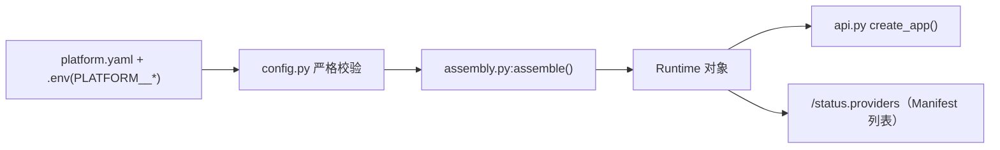
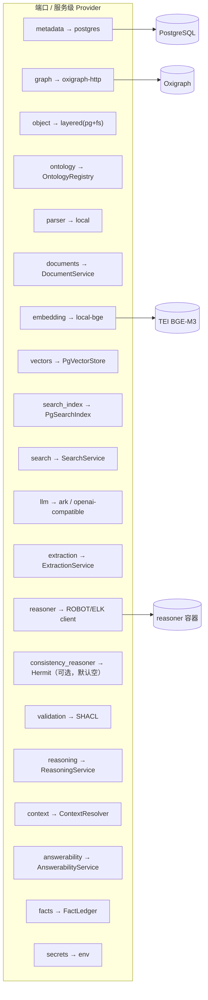
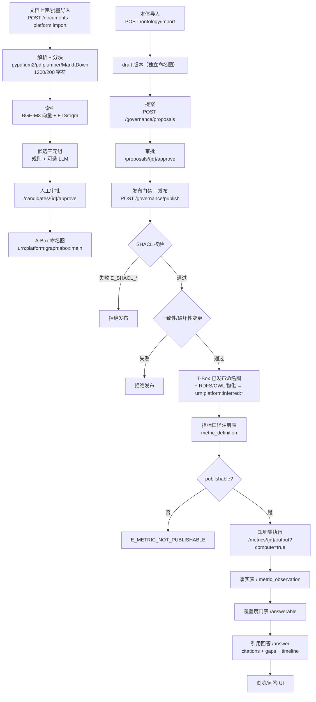

# 产品架构介绍：COA 本体平台（单机版）

> 代码基线：`platform` 0.1.0，运行切片 `S13`（`GET /status`），数据库 `schema_version=43`（`V43__source_ref_stale_mark.sql`；2026-11-07 20:48 换栈复核，代码 `metadata_pg.py` L19 与库内 `schema_version` 均为 43；换栈前为 42。原文写 28，属 V28 时点，已勘误）。
> 本文只描述**当前代码与实测运行行为**；与代码不符的历史说法（如 RUN.md 里的 “V20”）以代码为准并单独标注。
> 所有概念均可跳到 [46-使用说明书](46-使用说明书.md) 的对应操作步骤，形成“概念 ↔ 操作”双向索引；组件级实现见 [48-技术说明书](48-技术说明书.md#components) 的组件目录。

---

## 0. 概念索引

| 概念 | 一句话 | 概念条目 | 用在哪些步骤 |
|---|---|---|---|
| 本体 | 一套可被机器读取的概念、关系与约束 | [概念：本体](#concept-ontology) | [导入本体](46-使用说明书.md#step-import-ontology)、[发布](46-使用说明书.md#step-publish) |
| T-Box | 本体中的“定义层”（类/属性/约束） | [概念：T-Box](#concept-tbox) | [导入本体](46-使用说明书.md#step-import-ontology)、[本体浏览](46-使用说明书.md#step-browse) |
| A-Box | 本体中的“实例层”（具体对象与关系） | [概念：A-Box](#concept-abox) | [审批入图](46-使用说明书.md#step-approve)、[实例浏览](46-使用说明书.md#step-browse) |
| RDF 三元组 | 主-谓-宾的最小事实表达 | [概念：RDF 三元组](#concept-rdf) | [三元组浏览](46-使用说明书.md#step-browse)、[SPARQL](46-使用说明书.md#step-sparql) |
| OWL 类与属性 | 给三元组词汇表加逻辑语义 | [概念：OWL 类与属性](#concept-owl) | [导入本体](46-使用说明书.md#step-import-ontology) |
| 命名图 | 给三元组分组、分版本、分权限 | [概念：命名图](#concept-named-graph) | [发布与回滚](46-使用说明书.md#step-publish) |
| SPARQL 1.1 | RDF 的标准查询/更新语言 | [概念：SPARQL 1.1](#concept-sparql) | [SPARQL 查询](46-使用说明书.md#step-sparql) |
| SHACL 形状 | 对 RDF 数据做结构校验的规则 | [概念：SHACL 形状](#concept-shacl) | [发布门禁](46-使用说明书.md#step-publish-gates) |
| 推理 | 由已有三元组推出新三元组 | [概念：推理](#concept-reasoning) | [发布门禁](46-使用说明书.md#step-publish-gates) |
| SKOS 术语层 | 业务说法到本体类的同义词表 | [概念：SKOS 术语层](#concept-skos) | [术语层](46-使用说明书.md#step-browse)、[覆盖度](46-使用说明书.md#step-coverage) |
| 语义层 | 口径/维度/事实/指标的统一约定 | [概念：语义层](#concept-semantic-layer) | [指标口径](46-使用说明书.md#step-metric)、[出数](46-使用说明书.md#step-output) |
| 指标口径与变体 | 指标怎么算，以及同一指标的不同口径 | [概念：指标口径与变体](#concept-metric-variant) | [指标口径](46-使用说明书.md#step-metric)、[出数](46-使用说明书.md#step-output) |
| 事实表与观测行 | 算指标用的原始/派生数据行 | [概念：事实表与观测行](#concept-fact-observation) | [出数](46-使用说明书.md#step-output)、[事实浏览](46-使用说明书.md#step-facts) |
| 值级溯源 | 每个值可回到具体表、行、字段 | [概念：值级溯源](#concept-src) | [事实浏览](46-使用说明书.md#step-facts) |
| PROV-O 判定溯源 | 每次判定“谁、用什么、得出什么” | [概念：PROV-O 判定溯源](#concept-prov) | [方案溯源/出数](46-使用说明书.md#step-output) |
| 端口与装配 | 实现可替换，选择集中在一处 | [概念：端口与装配](#concept-port) | [首次启动](46-使用说明书.md#step-start)、[配置](46-使用说明书.md#step-config) |

---

## 1. 定位与目标用户

**一句话定位**：把“文档 → 本体 → 治理 → 指标口径 → 事实 → 可引用问答”做成一套**单机可运行、依赖可替换、治理链路可审计**的本体驱动平台。

| 维度 | 事实（依据） |
|---|---|
| 形态 | 单机 Docker Compose，不依赖 K8s/消息队列/外部缓存 |
| 核心资产 | T-Box 本体（版本化命名图）+ 指标口径注册表 + 事实账本 + 文档/向量索引 |
| 实现可换 | 所有外部能力经 Port/Provider 边界；装配集中在 `assembly.py` |
| 功能优先 | 先保证链路完整（导入、治理、出数、问答、导出），再谈扩展与性能 |
| 目标用户 | 数据治理/指标口径负责人、本体工程师、业务分析师、单机交付/迁移实施人员 |

**不面向**：多租户 SaaS、高并发在线服务、需要水平扩展的图计算集群。

---

## 2. 逻辑架构

```mermaid
flowchart TB
  subgraph UI["Web UI（原生 HTML，无前端构建链）"]
    U1["总览 /ui/index.html"]
    U2["本体浏览 /ui/browse.html"]
    U3["文档 /ui/documents.html"]
    U4["检索问答 /ui/search.html"]
    U5["审批队列 /ui/approvals.html"]
    U6["本体治理 /ui/ontology.html"]
    U7["治理台 /ui/governance.html"]
  end

  subgraph API["API 层 api.py（FastAPI，端口 8080）"]
    A1["REST/JSON + multipart"]
    A2["统一错误封套 provider_code"]
    A3["/healthz /readyz /status"]
    A4["/ui/api/* 只读视图聚合"]
  end

  subgraph CORE["平台核心 platform_core（编排，不含算法实现）"]
    C1["config.py 严格校验 + PLATFORM__ 环境覆盖"]
    C2["bootstrap.py 自检 → 迁移 → 装配"]
    C3["assembly.py 唯一装配点 → Runtime"]
    C4["ports.py Port 协议 + Manifest"]
    C5["领域服务：documents / search / extraction / reasoning / metrics / facts / bundle"]
  end

  subgraph ADP["适配器 adapters/ 与同级实现"]
    D1["graph_oxigraph / graph_fuseki"]
    D2["metadata_pg / vector_pg / search_pg"]
    D3["parsers(LocalDocumentParser) / embedding / llm"]
    D4["reasoner_robot / reasoner_hermit / validation(SHACL)"]
    D5["object: LayeredObjectStore(pg+fs)"]
  end

  subgraph ST["存储（两个进程内服务）"]
    S1["PostgreSQL 18 + pgvector：元数据/口径/事实/向量/FTS"]
    S2["Oxigraph 0.5.7：T-Box/A-Box/推理命名图（仅容器内网）"]
  end

  UI --> API --> CORE --> ADP --> ST
```



| 层 | 位置 | 职责 | 明确不做 |
|---|---|---|---|
| API 层 | [api.py](file:///D:/agentABC/coa/platform/src/platform_core/api.py) + [webui.py](file:///D:/agentABC/coa/platform/src/platform_core/webui.py) | 路由、参数校验、HTTP 状态映射、UI 只读聚合 | 不写三元组、不复制检索融合逻辑 |
| 平台核心 | `platform_core/*.py` | 配置、启动自检、装配、状态机与编排 | 不内置推理机/向量库 |
| 适配器 | `platform_core/adapters/*` 及同级 | SPARQL、PG、TEI、ROBOT、SHACL 的具体协议实现 | 不含业务规则 |
| 存储 | PostgreSQL、Oxigraph | 关系/向量/事实；RDF 命名图 | Oxigraph 不映射宿主端口 |
| UI | `platform/web/*` | 浏览器直读 `/ui/api/*` 与 REST | 不写数据（除上传/审批/治理动作） |

---

## 3. 模块清单

| 模块 | 主要文件 | 说明 |
|---|---|---|
| 启动与自检 | `bootstrap.py`、`cli.py` | 配置加载 → 迁移 → 依赖自检 → `uvicorn` |
| 配置 | `config.py` | Pydantic 严格模型（`extra=forbid`），环境变量前缀 `PLATFORM__` |
| 装配 | `assembly.py` | `assemble(config) → Runtime`，唯一替换点 |
| 端口协议 | `ports.py` | `GraphStorePort`/`ObjectStorePort`/`MetadataStorePort` + `Manifest` |
| 文档 | `documents.py`、`importer.py`、`parsers.py` | 入库、分块、批量导入、PDF/Office 解析 |
| 检索 | `search.py`、`adapters/search_pg.py`、`adapters/vector_pg.py` | FTS + pg_trgm + pgvector，RRF 融合 |
| 抽取 | `extraction.py`、`rules.py` | 规则 + 可选 LLM 候选，人工审批后入 A-Box |
| 本体 | `ontology.py`、`adapters/ontology_pg.py`、`ontology_import.py` | 版本状态机、导入、提案/审批/发布/回滚 |
| 推理与校验 | `reasoning.py`、`validation.py`、`adapters/reasoner_robot.py`、`reasoner_hermit.py` | RDFS 闭包、OWL 物化、SHACL 门禁、一致性检查 |
| 事实账本 | `facts.py`、`prov.py`、`source_ref.py` | 事实事件、哈希链、行级溯源 |
| 指标 | `metrics.py`、`rules.py`、`metric_compiler.py`、`metric_facts.py` | 口径注册、可发布门禁、规则集出数 |
| 问答 | `context.py`、`answer.py`、`answerability.py` | 覆盖度门禁、上下文装配、引用回答 |
| 迁移包 | `bundle.py` | 导出/校验/导入（schema 强匹配） |
| 合成数据 | `datagen.py`、`datagen_audit.py` | 写入 `data_source='synthetic'` 的测试数据 |
| UI | `webui.py` + `web/` | 7 个页面，无构建依赖 |
| 迁移脚本 | `sql/V1__s0.sql … V34__metrics_core_m01_m06.sql` | 启动时自动迁移，版本必须匹配（当前 34） |

---

## 4. 核心概念

> 每个概念按“定义 → 为什么需要 → 平台落点 → FS-LDM 实例”四行说明。实例均来自本仓库种子或实测接口，可在对应页面复现。

<a id="concept-ontology"></a>
### 4.1 概念：本体

- **定义**：用机器可读的方式描述某个领域的**概念、关系与约束**，让“授信协议”“逾期天数”这类词有唯一 IRI 和明确含义。
- **为什么需要**：没有本体，文档抽取出的实体无法对齐，指标口径无法挂到统一概念上，问答也无法解释“你说的客户是不是指借款主体”。
- **平台落点**：每个版本一个 T-Box 命名图（`urn:platform:graph:tbox:<versionId>`），由 `OntologyRegistry` 管理提案/审批/发布；UI 为“本体浏览”和“本体治理”两页。
- **FS-LDM 例**：`https://w3id.org/fsldm/agreement#CreditAgreement`（授信协议）、`https://w3id.org/fsldm/agreement#Account`（帐户）——均来自种子术语表 `entry-A01/A02`，可在 [本体浏览](46-使用说明书.md#step-browse) 看到中文标签。

<a id="concept-tbox"></a>
### 4.2 概念：T-Box（定义层）

- **定义**：本体里的“模式”部分：`owl:Class`、`owl:ObjectProperty`、`rdfs:subClassOf`、`rdfs:domain/range` 等，只描述“有哪些类型、怎么连”，不含具体实例。
- **为什么需要**：它决定 A-Box 能写什么、SHACL 校验什么、推理能推出什么；发布一次 T-Box 等于升级全平台的“词汇表”。
- **平台落点**：版本化命名图 + `reasoning.abox_graphs` 指向实例图；`GET /browse/ontology/tree` 读当前指针的 T-Box；发布走 `/governance/publish`。
- **FS-LDM 例**：`fsldm:org#partOfOrganization`（上级机构），`rdfs:domain` 与 `rdfs:range` 都是 `fsldm:party#Organization`；这条声明来自实测 SPARQL 查询结果。

<a id="concept-abox"></a>
### 4.3 概念：A-Box（实例层）

- **定义**：本体里的“数据”部分：具体对象及其关系，如“某笔贷款属于某客户”“上海位于中国”。
- **为什么需要**：只有 T-Box 只是词典；有了 A-Box 才能回答“这笔业务到底属于谁、在哪个机构”。
- **平台落点**：默认实例图 `urn:platform:graph:abox:main`（`reasoning.abox_graphs`）；候选三元组经人工审批后才写入（`POST /candidates/{id}/approve`）。
- **FS-LDM 例**：审批队列里的候选 `urn:platform:entity:上海 → urn:platform:rel:locatedIn → urn:platform:entity:中国`（置信度 0.9，见截图 12）。**当前 `aboxTriples=0`**，说明这些候选尚未批量入图，属真实进度而非缺陷。

<a id="concept-rdf"></a>
### 4.4 概念：RDF 三元组

- **定义**：一切事实写成“主语—谓语—宾语”三部分，例如 `<授信协议> rdfs:label "授信协议"`。
- **为什么需要**：统一结构让不同来源的数据可以合并、查询、校验；也是 SPARQL、SHACL、推理的共同输入。
- **平台落点**：Oxigraph 存储；`GET /browse/triples` 分页浏览（可按主语/谓语/宾语/命名图过滤），`POST /browse/sparql` 查询。
- **FS-LDM 例**：`<https://w3id.org/fsldm/agreement#CreditAgreement> <http://www.w3.org/2000/01/rdf-schema#label> "授信协议"`；三元组浏览里还可看到 smoke 测试命名图的残留行，说明浏览是**跨命名图**的。

<a id="concept-owl"></a>
### 4.5 概念：OWL 类与属性

- **定义**：`owl:Class` 定义类型，`owl:ObjectProperty` 定义“对象到对象”的关系，`owl:DatatypeProperty` 定义“对象到字面值”的属性；可带 `domain/range` 约束。
- **为什么需要**：区分“上级机构”这种实体关系与“帐户名称”这种字符串属性，推理和校验才能按正确语义工作。
- **平台落点**：T-Box 里的 `?p a owl:ObjectProperty` 被 `/browse/ontology/tree` 转成“属性”面板；SHACL 的 `sh:targetSubjectsOf` 也依赖属性 IRI。
- **FS-LDM 例**：`fsldm:org#partOfOrganization` 是 `owl:ObjectProperty`，中文标签“上级机构”，`domain=range=fsldm:party#Organization`；对比 `fsldm:.../name` 这类 `owl:DatatypeProperty` 指向 `xsd:string`。

<a id="concept-named-graph"></a>
### 4.6 概念：命名图

- **定义**：给一组三元组起一个图 IRI，使同一套 RDF 存储里可以按“版本/来源/用途”分区。
- **为什么需要**：发布新本体不能覆盖旧版本；事实、推理结果、判定溯源也必须隔离，否则回滚和审计都做不了。
- **平台落点**：`urn:platform:graph:tbox:<versionId>`（每版 T-Box）、`urn:platform:graph:abox:main`（实例）、`urn:platform:inferred:*`（推理）、`urn:platform:prov`（判定溯源）；回滚只切读指针，不删图。
- **FS-LDM 例**：实测读指针 `ont-3f57d8ce6636` 对应图 `urn:platform:graph:tbox:ont-3f57d8ce6636`（semver 1.1.0）；历史版本各自保留，可在“本体治理”页看到 `superseded` 版本。

<a id="concept-sparql"></a>
### 4.7 概念：SPARQL 1.1

- **定义**：RDF 的标准查询语言，支持 `SELECT/ASK/CONSTRUCT`、`GRAPH`、`FROM NAMED`、属性路径等；平台还支持受控 `UPDATE`。
- **为什么需要**：浏览、覆盖度、问答的上下文子图都靠它取数；标准化也让换图库时上层查询模板不必重写。
- **平台落点**：`GraphStore` 端口；平台侧加只读/超时/行数/图白名单护栏（非 `urn:platform:` 图 IRIs 会被拒，`E_GRAPH_GRAPH_NOT_ALLOWED`）。UI 在“本体浏览 → SPARQL”页执行。
- **FS-LDM 例**：截图 07 使用的真实查询：

```sparql
SELECT ?g (COUNT(*) AS ?n)
WHERE { GRAPH ?g { ?s ?p ?o } }
GROUP BY ?g
```

  它按命名图统计三元组数，用于核对 T-Box/ABox/推理图各自规模。

<a id="concept-shacl"></a>
### 4.8 概念：SHACL 形状

- **定义**：用 `sh:NodeShape` 描述“什么样的 RDF 数据算合法”，如“每个 owl:Class 必须有 rdfs:label”。
- **为什么需要**：发布前拦截结构错误，避免把缺标签、错类型的本体推给全平台；比人工评审稳定。
- **平台落点**：`shapes_dir=/data/shapes` 下的 `core.ttl`、`fsldm/shapes.ttl`；发布时 `ShaclValidator` 执行，失败返回 `E_SHACL_VIOLATION`；也可单独调 `POST /validation/run`。
- **FS-LDM 例**：种子 `fsldm:ClassLabelShape`（`sh:targetClass owl:Class`，`sh:minCount 1` 强制 `rdfs:label`）；`urn:platform:shape:LocatedInObject` 强制 `locatedIn` 的宾语必须是 IRI（不接受字面量）。

<a id="concept-reasoning"></a>
### 4.9 概念：推理（RDFS 闭包 / ELK / HermiT）

- **定义**：从已有三元组按规则推出隐含三元组。RDFS 闭包处理 `subClassOf/subPropertyOf/domain/range` 的传递；ELK 做 OWL EL 分类；HermiT 做更强的 DL 一致性检查。
- **为什么需要**：业务只录入“授信协议是协议的子类”，系统应自动知道“这笔授信协议也是协议”，否则查询会漏。
- **平台落点**：`reasoning.mode=materialize`（默认）→ RDFS 闭包 → OWL 物化 → SHACL 门禁；`engine=robot` 走 ROBOT/ELK 容器，`engine=hermit` 额外装配 HermiT 做一致性；产物写 `urn:platform:inferred:*`。容器不可用时返回 `E_REASONER_UNAVAILABLE`，平台其余功能不受影响。
- **FS-LDM 例**：发布 `fsldm:agreement#CreditAgreement` 后，推理图会补出它与父类的传递关系；截图 09 的“步骤时间线”显示推理/口径/事实各步耗时，可核对哪一步退化。

<a id="concept-skos"></a>
### 4.10 概念：SKOS 术语层

- **定义**：用 `skos:prefLabel/altLabel` 等表达“业务说法 ↔ 本体类”的同义词与别名，并标注证据强度（`evidenced`/`inferred`）。
- **为什么需要**：文档里写“商业保单”“保单”，本体类叫 `CommercialInsurancePolicy`；没有术语层，覆盖度会误判为“答不了”。
- **平台落点**：T-Box 内的 `terms#TermEntry` 个体（`entry-A01` 等）；`GET /browse/terms` 列出锚定类/别名；`AnswerabilityService` 用它算术语覆盖率，`ContextResolver` 用它做查询扩展。
- **FS-LDM 例**：`entry-A01`：`Account` → “帐户”（evidenced）；`entry-B09`：`CommercialInsurancePolicy` → “商业保单”（inferred, medium, 带 `guardRegex` 限定上下文），见 [术语层](46-使用说明书.md#step-browse)。

<a id="concept-semantic-layer"></a>
### 4.11 概念：语义层（口径 / 维度 / 事实 / 指标）

- **定义**：把“业务指标”拆成四件可管理的东西：口径（怎么算）、维度（按什么分组）、事实（用什么数据算）、指标（算出来的结果）。
- **为什么需要**：同一句“逾期率”在不同部门的算法不同；不拆开就会各算各的，无法审计。
- **平台落点**：口径表 `platform.metric_definition`（`display_name/definition/formula_text/observation_period/grain/unit/publishable`）；维度即 `grain`（如 `agreement`）与 `domain`；事实表由 `fact_source_key` 注册；指标结果表 `metric_observation`。
- **FS-LDM 例**：`FIN-BANK-001`（逾期天数 DPD）：口径 `max(观察日 − 应还款日, 0)`，单位“天”，粒度 `agreement`（单笔贷款协议），观察期 `instant`；口径可发布（`publishable=true`）。

<a id="concept-metric-variant"></a>
### 4.12 概念：指标口径与变体（`-v1` / `-v2`）

- **定义**：同一指标可有多个口径版本，用 `variantOf` 指向主口径，`metricId` 加 `-v1/-v2` 后缀区分。
- **为什么需要**：宽限期口径与自然月口径算出的继续率不同，必须并存、各自标注、各自判断可发布性。
- **平台落点**：`metric_definition.variant_of` + `definition_version`；`GET /browse/metrics?publishable=true` 可筛选；出数按 `metricId` 精确取口径，避免“同名不同算”。
- **FS-LDM 例**：`FIN-INS-022`（13 个月保费继续率）的两个变体：`FIN-INS-022-v1`“宽限期口径”、`FIN-INS-022-v2`“自然月口径”，二者当前 `publishable=false`（证据未达标），出数会被 `E_METRIC_NOT_PUBLISHABLE` 拒绝。

<a id="concept-fact-observation"></a>
### 4.13 概念：事实表与观测行

- **定义**：事实表存明细（如每笔贷款的余额、DPD），观测行存“某口径在某时间窗口算出的值”。
- **为什么需要**：明细可重算、可追溯；观测行让趋势查询不必每次扫全表。两者分开才能区分“数据没到”和“算错了”。
- **平台落点**：事实表注册在 `platform.fact_source_key`（如 `platform.bank_loan_account`，主键 `account_id/as_of/data_source`）；观测行在 `platform.metric_observation`；`GET /browse/facts?table=...` 抽样，`GET /metrics/{id}/output` 出数。
- **FS-LDM 例**：`LN-SYN-00000`，`as_of=2025-12-31`，`data_source=synthetic`，余额与 DPD 字段齐全；当前 `metric_observation` 为 0 行，因此 `FIN-BANK-001` 计算出数返回 `E_METRIC_NO_DATA`。

<a id="concept-src"></a>
### 4.14 概念：值级溯源（`src://`）

- **定义**：每个可展示的值都带一个 `src://` 引用，指向具体表、主键行与数据来源，可反查。
- **为什么需要**：客户问“这个数从哪来”，必须能定位到行，而不是只给一句“系统算的”。
- **平台落点**：`source_ref.py` 生成 `sourceRef`（`type=fact_row`、`targetTable`、`locator`、`resolveUrl`）；`GET /browse/facts` 每行附带，`GET /source/resolve?ref=` 反解，`GET /documents/{id}/source` 回读原文。
- **FS-LDM 例**：真实引用 `src://fact/platform.bank_loan_account?account_id=LN-SYN-00000&as_of=2025-12-31&data_source=synthetic`，对应 `/source/resolve?ref=...` 可返回该行快照。

<a id="concept-prov"></a>
### 4.15 概念：PROV-O 判定溯源

- **定义**：用 W3C PROV-O 记录判定过程：`prov:Activity`（一次判定）、`prov:Entity`（依据与结论）、`prov:Agent`（人或系统），关系为 `used/wasGeneratedBy/wasDerivedFrom/wasAttributedTo`。
- **为什么需要**：口径判定、规则触发、拒答都要能回答“谁在什么时候、依据哪段原文、得出什么结论”。
- **平台落点**：只写 `urn:platform:prov` 图，禁止混入 T-Box/A-Box（`E_PROV_GRAPH_MIXING`）；同时追加 `platform.prov_event` 哈希链；`GET /prov/decisions|rules|refusals`、`GET /prov/verify`。
- **FS-LDM 例**：`FIN-BANK-001` 的“Grade A：可定位监管原文/条款”就是一次 decision 型 Activity；截图 09 的引用列表展示口径定义与规则集来源，可与 `/prov/decisions` 对照。

<a id="concept-port"></a>
### 4.16 概念：端口依赖倒转与配置装配

- **定义**：上层只依赖“端口”（接口契约），具体实现由装配层按配置注入；换实现不改业务代码。
- **为什么需要**：客户环境可能没有 Oxigraph、必须用内网 LLM、或只能跑 CPU 向量；把选择集中到一处，交付风险最低。
- **平台落点**：`ports.py` 定义协议与 `Manifest`；`config.py` 校验取值；`assembly.py` 唯一装配点；`/status.providers` 暴露实际装配结果与 `degraded` 原因。
- **FS-LDM 例**：同一套代码可切 `graph.provider=oxigraph-http|fuseki`、`embedding.provider=local-bge|ark|disabled`、`reasoning.engine=robot|hermit`；本环境实测为 Oxigraph + BGE-M3 + ROBOT，Fuseki 与 HermiT **未验证**。

---

## 5. 依赖倒转与端口

### 5.1 装配链



- 唯一的“具体实现选择点”在 `assembly.py`：换实现 = 改装配 + 改配置，不碰领域服务。
- 配置校验把“未知 provider”与“已知但无适配器”分开：`E_PROVIDER_INVALID` / `E_PROVIDER_NOT_IMPLEMENTED`。
- `/status` 会把每个 Provider 的 `provider / port / capabilities / limits / notes` 原样暴露，便于替换前评估。

<a id="ports-14"></a>
### 5.2 设计基线的 14 个端口（与当前代码实现对照）

| # | 端口 | 当前实现（实测/代码） | 配置开关 | 备注与验证状态 |
|---|---|---|---|---|
| 1 | `ObjectStore` | `LayeredObjectStore`：≤10MB 进 PG，超限进 fs CAS `/data/blobs` | `storage.small_object_provider=pg/fs`、`large_object_provider=fs/pg` | `silo` 明确未实现；PG 大对象仅 `pg_mode=lo` 可开 range read |
| 2 | `GraphStore` | `OxigraphHttpStore`（默认）；`FusekiHttpStore` 可选 | `graph.provider=oxigraph-http/fuseki` + `graph-fuseki` profile | 本环境只实测 Oxigraph；Fuseki 切换**未验证** |
| 3 | `VectorStore` | `PgVectorStore`（pgvector，按模型维度分区） | `embedding.dimensions`、`reindex --provider` | 维度不一致会拒绝混用 |
| 4 | `LLMClient` | `LlmClient`（OpenAI 兼容；Ark coding 端点） | `llm.provider=openai-compatible/ark/disabled`、`llm.preset` | 无 key 时 `llm:unconfigured(rules_only)` |
| 5 | `EmbeddingClient` | `local-bge`（TEI BGE-M3 1024 维，默认） | `embedding.provider=local-bge/openai-compatible/ark/fake/disabled` | `ark` 为 2048 维实验适配器，不与 BGE 混用 |
| 6 | `MetadataStore` | `MetadataPg`（psycopg3，PG18） | `database.url` | 事务、advisory lock、迁移 |
| 7 | `OntologyRegistry` | `OntologyRegistry`（PG 状态机 + Oxigraph 命名图） | `ontology.init_mode`、`reasoning.abox_graphs` | 提案/审批/发布/回滚 |
| 8 | `ContextResolver` | `ContextResolver`（编排） | `context.*` | 术语归一 → 子图 → 向量/FTS → RRF |
| 9 | `ExtractionPipeline` | `ExtractionService`（规则 2 条 + LLM 可选） | `extraction.enabled`、`extraction.rules` | 审批后写入 A-Box |
| 10 | `SearchIndex` | `PgSearchIndex`（FTS simple + pg_trgm） | `search.enabled/top_k/candidate_k/min_similarity` | RRF `k=60` |
| 11 | `DocumentParser` | `LocalDocumentParser`（pypdfium2/pdfplumber/MarkItDown） | `documents.parser` 仅接受 `local` | Tika 仅存在于历史说明，**当前未装配** |
| 12 | `Cache` | `UnsupportedPort("Cache","S3")` | 无 | **未实现**：任何调用返回 `Unsupported`（不造数据） |
| 13 | `SecretProvider` | `EnvSecretProvider`（只读环境变量） | 环境变量名由 `llm.api_key_env` 等指定 | 不支持 Vault/file 轮换 |
| 14 | `ReasoningService` | `ReasonerClient`(ROBOT/ELK) + `ShaclValidator` + `ReasoningService` | `reasoning.mode/engine/profile/endpoint` | `engine=robot` 默认；`engine=hermit` 额外装配一致性客户端 |

> 依据：`ports.py` 只定义 3 个 `Protocol`（Graph/Object/Metadata）+ `SecretProvider` 实现 + `Cache` 占位；其余端口以服务类形式存在于 `assembly.py`。上表“14 端口”沿用设计基线 `_design/03-单机架构方案.md` §7.1，不代表 14 个独立 Protocol。

### 5.3 代码实际注册的 Provider（`/status.providers`，20 个键）



- `documents / answerability / facts` 是**服务级 Manifest**，不属于 14 端口清单，但在 `/status` 可见；
- `consistency_reasoner` 仅在 `reasoning.engine=hermit` 时非空；
- `Cache` 与 `silo` 不在运行时提供，属于“显式不可用”。

### 5.4 如何切换（可复制的判定）

| 想换 | 改哪里 | 生效方式 | 风险 |
|---|---|---|---|
| 图库 Oxigraph → Fuseki | `.env`：`PLATFORM__GRAPH__PROVIDER=fuseki`、`PLATFORM__GRAPH__ENDPOINT=http://fuseki:3030`；`COMPOSE_PROFILES` 增 `graph-fuseki` | 重启 platform | 两者不可同时写；**本环境未实测** |
| 向量模型 BGE-M3 → Ark | `platform reindex --provider=ark` 建新分区后切指针 | 命令行 | 2048 vs 1024 维，不可混用 |
| LLM 关闭 | `PLATFORM__LLM__PROVIDER=disabled` | 重启 | 抽取退化为规则，问答/摘要受限 |
| 推理关闭 | `reasoning.mode=off` 或 `service_enabled=false` | 重启 | 发布门禁中的推理项按配置跳过 |
| 对象存储分层 | `storage.pg_blob_max_file_mb`、`small/large_object_provider` | 重启 | 迁移已有 blob 不在自动范围 |

---

## 6. 数据与治理链路



### 6.1 各段落的真实落点

| 阶段 | 入口 | 写入位置 | 关键错误码 |
|---|---|---|---|
| 文档入库 | `POST /documents`（multipart `file`、可选 `filename/metadata`） | `platform.document / document_page / document_chunk / blob` | `E_DOC_PDF_ENCRYPTED`、`E_DOC_PARSE_FAILED`、`E_DOC_EMPTY` |
| 索引 | `POST /documents/{id}/index?max_batches=` | `chunk_embedding` + FTS | `E_EMBED_MODEL_MISMATCH`、`E_EMBED_UNAVAILABLE` |
| 本体导入 | `POST /ontology/import`（file / JSON / 原始 TTL） | 导入记录 + draft 版本图 | `E_ONTOLOGY_IMPORT_SOURCE/BODY` |
| 提案 | `POST /governance/proposals`（`versionId`、`changeSummary`） | proposal 表 + diff/impact | `E_ONTOLOGY_VERSION_REQUIRED`、`E_ONTOLOGY_SUMMARY_REQUIRED` |
| 审批 | `POST /governance/proposals/{id}/approve` | 提案状态机 | — |
| 发布 | `POST /governance/publish`（`dryRun` 可预检） | 切换读指针 + 发布命名图 | `E_SHACL_VIOLATION`、`E_SHACL_ENGINE_MISSING`、`E_SHACL_NOT_DEPLOYED` |
| 回滚 | `POST /governance/rollback-to` 或 `/ontology/rollback` | 指针切换/新版本 | `E_ONTOLOGY_VERSION_REQUIRED` |
| 口径 | `GET /browse/metrics`、`/browse/metrics/{id}` | `metric_definition` | `E_METRIC_NOT_FOUND` |
| 出数 | `GET /metrics/{id}/output?compute=true` | `metric_observation` / 事实表 | `E_METRIC_NOT_PUBLISHABLE`、`E_METRIC_NO_DATA`、`E_METRIC_DENOM_ZERO` |
| 覆盖度 | `GET/POST /answerable` | 只读（术语/口径/事实三层） | 无（返回 `answerable/valueAnswerable/reasonCode`） |
| 问答 | `GET/POST /answer` | 只读；判定写 PROV | 引用缺失时返回 `missing` 与 `gaps` |

### 6.2 事实与口径分离（本平台的核心约束）

- **口径**（`metric_definition`）：名称、公式、观察期、粒度、分子/分母、`publishable`、`evidence_basis`——回答“这个指标怎么算”。
- **事实**（`ins_payment_record`、`loan_installment_plan`、`metric_observation` 等）：回答“这个指标这次是多少”。
- 二者**不互相伪造**：口径存在但事实缺失时，出数返回 `E_METRIC_NO_DATA`，问答返回“定义型回答 + 缺口说明”，不会给出数字。截图 09 即该行为的真实记录。
- 判定事件 `prov_event` 有哈希链（`/prov/verify` 校验）；事实断言/撤回另有 `fact_event` 审计表（无哈希链）。行级溯源用 `src://`（`/source/resolve`、`/browse/facts` 的 `sourceRef`）。

---

## 7. 关键设计取舍

| 取舍 | 结论 | 理由 | 代价 |
|---|---|---|---|
| 单机而非集群 | Compose 起 3 个常驻服务（PG/Oxigraph/platform）+ 2 个 learn 服务（embedding/reasoner） | 交付/迁移简单，验收可复现 | 无水平扩展；重活需重型锁排队 |
| 图库默认 Oxigraph | `graph.provider=oxigraph-http` | 标准 SPARQL 1.1 + 命名图，磁盘持久化，镜像小 | 无鉴权 → **不映射宿主端口**；无全文索引 |
| 推理用 ROBOT/ELK 容器 | `reasoning.engine=robot`，`mode=materialize` | Python 栈无原生 DL；ROBOT 成熟 | 依赖 4g 内存容器；未启动时推理接口 `E_REASONER_UNAVAILABLE`，其余功能不受影响 |
| 事实与口径分离 | 两套表 + 两道门禁 | 防止“有定义就当能出数” | 口径齐全不代表可出数（当前 `metric_observation=0`） |
| 合成数据显式标记 | 每行 `data_source='synthetic'`；`datagen.allow_official_schema` 默认 `false`，未开启时拒绝写 `platform` schema，隔离到 `synthetic` | 避免污染真实业务数据 | 本测试环境显式设为 `true` 才允许写 `platform` 事实表 |
| 治理强制走提案 | 发布需 proposal + 门禁；回滚切指针 | 可审计、可回退 | 多一步操作；紧急变更需显式 `acknowledgeBreaking` |

---

## 8. 部署形态与运行边界

| 服务 | 镜像 | 端口（宿主） | 作用 | 依赖关系 |
|---|---|---|---|---|
| `platform` | `agent-platform:0.1-s5` | `127.0.0.1:8080` | API + UI | 等 PG healthy、Oxigraph started |
| `postgres` | `pgvector/pgvector:pg18-trixie` | `127.0.0.1:5432` | 元数据/向量/事实 | 健康检查 `pg_isready` |
| `oxigraph` | `oxigraph/oxigraph:0.5.7` | **不映射** | RDF 命名图 | 无健康检查，由 `/readyz` 证明 |
| `embedding` | TEI `cpu-1.8`（BGE-M3） | `127.0.0.1:8081` | 向量化 | learn profile；挂了则检索退化并标注 |
| `reasoner` | `agent-reasoner:0.1-s5` | `127.0.0.1:7879` | ROBOT/ELK、SHACL | learn profile；挂了不影响浏览 |
| `fuseki` | `agent-fuseki:0.1-s5` | `127.0.0.1:3030` | 备选图库 | `graph-fuseki` profile，互斥 |
| `rdfs` | `agent-rdfs:0.1-s5` | 无 | 一次性 RDFS 闭包 | `job` profile |

`/readyz` 只检查 database / graph / storage；embedding、reasoner 不可用**不会**让就绪检查失败，但会在 `/status.providers.degraded` 与页面提示中标注。

---

## 9. 当前实测状态与已知边界（2026-11-06）

| 项 | 实测值 | 说明 |
|---|---|---|
| 文档 | 2554，degraded 35 | 最近失败 9 项见 UI（加密 PDF/损坏/空文件） |
| 分块 | 14706 | 索引在持续补齐 |
| 候选三元组 | pending 428 / approved 277 / rejected 92 | A-Box 三元组仍为 0（未批量审批入图） |
| 指标观测 | 37,477 行 / 57 条指标 | 2026-11-07 复核，全部 `data_source=synthetic`；2026-11-06 时为 0，故那时出数返回 `E_METRIC_NO_DATA` |
| 本体读指针 | 截图期间多次被 smoke 版本切换 | 页面类树会随指针变化，这是 smoke 写入独立命名图的副作用，不是产品缺陷 |
| reasoner | 截图时不可用 | `/status` 记录 `E_REASONER_UNAVAILABLE`；浏览/检索不受影响 |
| 磁盘 | 可用 33.11% | 低于 `min_free_pct=10` 时 `/readyz` 失败 |

**指标三分口径（2026-11-06 勘误，首次出现处说明三者区别）**

| 口径 | 条数 | 含义 | 依据 |
|---|---|---|---|
| 结构可算 | **74** | 公式可编译、字段绑定齐全、可执行；只表示“结构上算得出来”，不等于库内有观测值 | `GET /metrics/report/manifest`（2026-11-06 复核）：`count=85`，`structurally_computable=74`、`blocked_semantics=8`、`blocked_external=3` |
| 有效测数据可算 | **57** | 按 `platform.metric_observation` 实际行数计算；有观测行的指标才可能返回值 | `select count(distinct metric_id) from platform.metric_observation` = 57，总行数 37,477（2026-11-07 复核，全部 `synthetic`） |
| 对外可出数 | **43** | 对外资格（`publishable`）且运行时判定可执行（`executable=true`）；当前 43 条全部依赖 `synthetic` 观测，0 条业务数据。**42 为 2026-11-07 20:48 换栈前历史值**，换栈后 43，成因 `7cb5ac6`（compute 白名单扩展）+ `CUST-009`（`metric_kind=count`）由不可执行变可执行 | `GET /metrics/report/manifest` 逐条 `publishable && executable` = 43（2026-11-07 20:48 换栈后复核） |

> 历史表述「4/79 可发布出数」「4/85 全行口径」指“对外资格 + 结构可算”的组合，**不是现在能返回数值**；2026-11-06 统一回写为上述三分口径。当前另有 `publishable=60`、**对外候选 35 条 = 28 compute + 7 rule_set + 0 不可计算**（仅有对外资格，不等于可出数）。审计报告所称“82 条可算”实为运行时审计候选（74 结构可算 + 5 语义阻塞 + 3 外部阻塞），见 `47` §4.3。

---

## 10. 出处索引（便于核对）

| 结论 | 出处 |
|---|---|
| 14 端口基线 | `_design/03-单机架构方案.md` §7.1 |
| 端口协议与 `UnsupportedPort` | [ports.py](file:///D:/agentABC/coa/platform/src/platform_core/ports.py) |
| 实现装配 | [assembly.py](file:///D:/agentABC/coa/platform/src/platform_core/assembly.py) |
| 配置项与校验 | [config.py](file:///D:/agentABC/coa/platform/src/platform_core/config.py) |
| 启动顺序/自检 | [bootstrap.py](file:///D:/agentABC/coa/platform/src/platform_core/bootstrap.py) |
| 路由与错误映射 | [api.py](file:///D:/agentABC/coa/platform/src/platform_core/api.py) |
| PROV-O 写入规则 | [prov.py](file:///D:/agentABC/coa/platform/src/platform_core/prov.py) |
| 值级溯源 `src://` | [source_ref.py](file:///D:/agentABC/coa/platform/src/platform_core/source_ref.py) |
| SHACL 种子 | `platform/seed/shapes/core.ttl`、`seed/shapes/fsldm/shapes.ttl` |
| 迁移版本 | 当前已应用/已支持的最高迁移 `platform_core/sql/V34__metrics_core_m01_m06.sql`；`metadata_pg.SUPPORTED_SCHEMA_VERSION=34`（`metadata_pg.py` L19）；库内 `max(version)=34`（2026-11-06 复核） |
| 部署与已知限制 | `platform/RUN.md` §3/§6/§7（其中 “V20” 为历史值；原文“当前为 28”为 V28 时点，2026-11-06 勘误为 34） |

---

## 11. 与设计文档的关系

本文是**对外产品视角**的架构说明；内部设计取舍、备选矩阵与实施路线仍以 `_design/01–44` 为准。若两者冲突，以当前代码与 `/status` 实测为准，并在下一次修订中回写设计文档。
