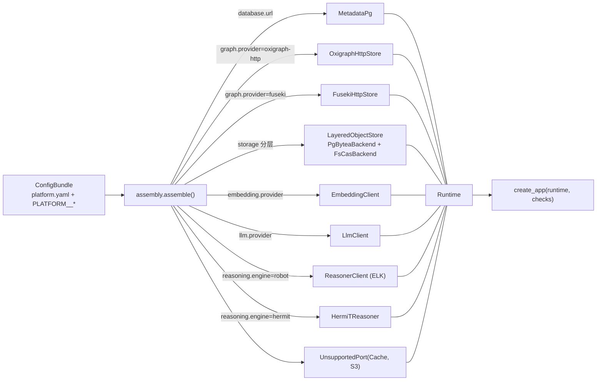
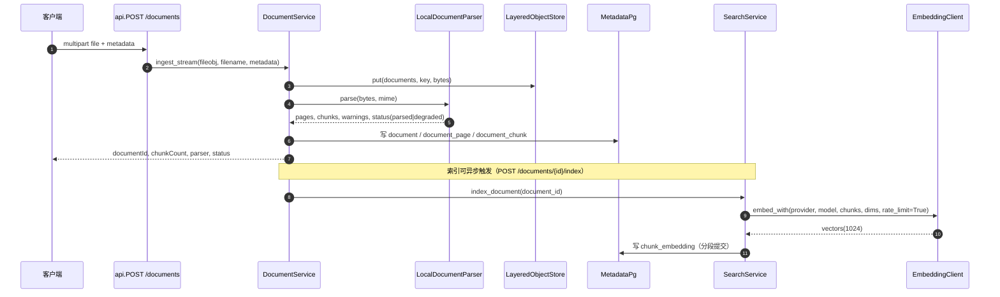
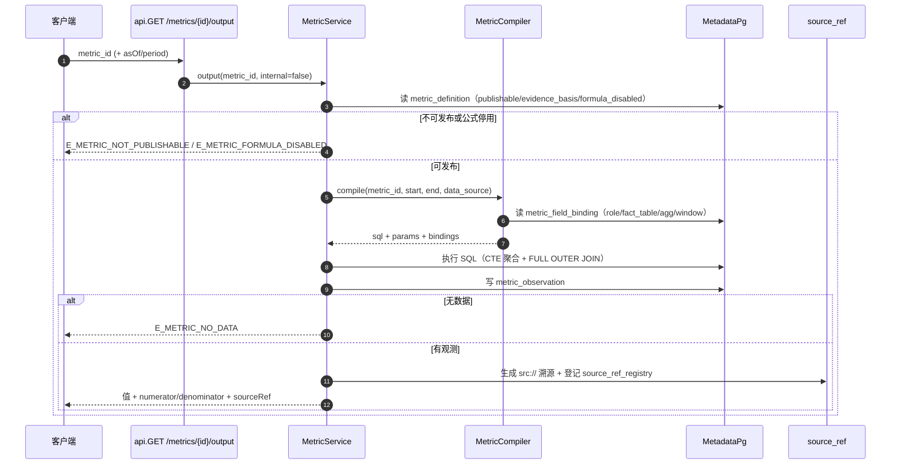
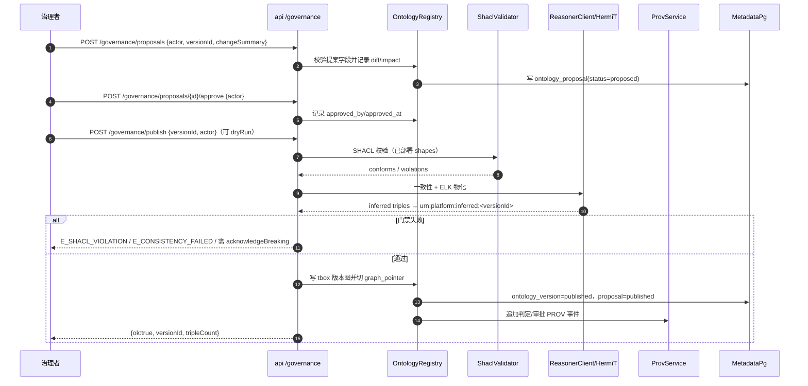

# 技术说明书：COA 本体平台（单机版）

> 适用版本：`platform` **0.1.0**，切片 **S13**，`schema_version=28`（实测 `GET /status`，2026-11-06）。
> 面向读者：二次开发者（要改适配器、加端口、加口径）与运维（要排障、迁移、验收）。
> 配套文档：产品与概念见 [45-产品架构介绍](45-产品架构介绍.md)；操作步骤见 [46-使用说明书](46-使用说明书.md)。
> **一致性纪律**：本文所有端点、字段、方法签名、错误码均来自 `D:\agentABC\coa\platform\src\platform_core` 的当前代码或真实运行返回。无法在当前环境验证的（Fuseki、HermiT、Tika、PyOxigraph、Silo 等）逐条标 **未验证**，不做推测性描述。示例中的返回值均为真实采集或代码中确定的字段名，未编造数值。

---

<a id="components"></a>
## 1. 组件目录

44 个模块里，本表覆盖用户点名的 22 个，另补 `search.py`、`prov.py`，以及入库/溯源辅助三件套合并为 1 行，共 **25 行**。

| 组件 | 所在文件 | 用途（一句话） | 关键接口/方法 | 依赖端口 | 相关配置键 | 主要错误码 | 详见 |
|---|---|---|---|---|---|---|---|
| `ports.py` | `src/platform_core/ports.py` | 定义端口契约与 Provider 自描述 | `GraphStorePort`、`ObjectStorePort`、`MetadataStorePort`、`EnvSecretProvider.get`、`UnsupportedPort` | 无（纯契约） | — | `E_PORT_NOT_IMPLEMENTED`、`E_SECRET_NOT_FOUND` | [2.1](#comp-ports) |
| `assembly.py` | `src/platform_core/assembly.py` | 唯一的“配置 → 具体实现”装配点 | `assemble(bundle) -> Runtime`、`Runtime.close()` | 全部 | 所有 `*.provider` | `E_PROVIDER_NOT_IMPLEMENTED`（由 config 前置拦截） | [2.2](#comp-assembly) |
| `config.py` | `src/platform_core/config.py` | 加载/合并/校验配置，失败即退出 | `load_config(path, environ=None) -> ConfigBundle` | 无 | `platform.yaml` 全部键、`PLATFORM__*` 环境变量 | `E_CONFIG_*`、`E_PROVIDER_*` | [2.3](#comp-config) |
| `bootstrap.py` | `src/platform_core/bootstrap.py` | 启动自检与 `/readyz` 结果来源 | `run_self_check(runtime, retry_seconds=60.0)`、`CheckResult.to_dict()` | 全部 | `database.*`、`graph.*`、`storage.*`、`embedding.*` | `E_DB_UNAVAILABLE`、`E_GRAPH_UNAVAILABLE`、`E_STORAGE_*`、`E_EMBED_*` | [2.4](#comp-bootstrap) |
| `api.py` | `src/platform_core/api.py` | HTTP 面：文档、指标、治理、浏览、问答 | `create_app(runtime, checks) -> FastAPI`、`_HTTP_STATUS` 映射 | 全部 | `http.bind`、`http.port` | `E_BROWSE_*`、`E_ANSWER_*`、`E_GOVERNANCE_*`、`E_DOC_*` | [2.5](#comp-api) |
| `reasoning.py` | `src/platform_core/reasoning.py` | SHACL 校验 + 推理物化的编排与作业记录 | `validate(target="abox")`、`materialize(profile=None, force=False, abox_graphs=None)`、`check_consistency(tbox_nt)`、`status()` | GraphStore、MetadataStore、Reasoner | `reasoning.*` | `E_REASONER_*`、`E_CONSISTENCY_*`、`E_VALIDATE_TARGET` | [2.6](#comp-reasoning) |
| `metrics.py` | `src/platform_core/metrics.py` | 口径注册表读取与对外出数 | `list(domain=None)`、`get(metric_id)`、`variants(metric_id)`、`output(metric_id, internal=False)`、`compute(metric_id, internal=False, as_of=None, …)` | MetadataStore | 指标由 SQL 种子写入，无独立配置键 | `E_METRIC_NOT_FOUND`、`E_METRIC_NOT_PUBLISHABLE`、`E_METRIC_NO_DATA` | [2.7](#comp-metrics) |
| `metric_compiler.py` | `src/platform_core/metric_compiler.py` | 口径公式 → 单方言 SQL，并执行 | `MetricCompiler.compile(metric_id, *, start=None, end=None, internal=False, data_source="fixture")`、`execute(...)` | MetadataStore | 绑定读 `metric_field_binding` | `E_METRIC_EXPR_UNSUPPORTED`、`E_METRIC_BINDING_MISSING/INVALID` | [2.8](#comp-metric-compiler) |
| `rules.py` | `src/platform_core/rules.py` | 规则集型指标的判定执行器 | `RuleExecutor.execute(metric_id, facts, as_of=None)` | MetadataStore | 无（规则来自 `metric_definition.rule_set_json`） | `E_METRIC_NOT_RULE_SET`、`E_METRIC_RULE_INVALID` | [2.9](#comp-rules) |
| `bundle.py` | `src/platform_core/bundle.py` | 导出/校验/恢复迁移包 | `export_bundle(runtime, out_root, tag, include_blobs=False)`、`verify_bundle(bundle_dir, expected_schema=None)`、`import_bundle(bundle, bundle_dir, database="platform_restore_test", …)` | MetadataStore、GraphStore、ObjectStore | `database.url`（取库名）、`reasoning.abox_graphs` | `E_BUNDLE_*` | [2.10](#comp-bundle) |
| `datagen.py` | `src/platform_core/datagen.py` | 模式驱动的合成事实数据生成与校验 | `generate(meta, *, seed=42, scale=1.0, target_schema="platform", allow_official=False, rows_per_table=1000, clean=False, dry_run=False)` | MetadataStore | `datagen.allow_official_schema` | `E_DATAGEN_*` | [2.11](#comp-datagen) |
| `adapters/graph_oxigraph.py` | `src/platform_core/adapters/graph_oxigraph.py` | Oxigraph HTTP 图库适配（默认实现） | `OxigraphHttpStore(endpoint, timeout_ms=30000, max_rows=10000, allowed_graph_prefixes=("urn:platform:",))`；`query/ask/update/clear_graph/load/export_graph/count_graph/probe` | GraphStore | `graph.provider=oxigraph-http`、`graph.endpoint`、`graph.timeout_ms`、`graph.max_rows` | `E_GRAPH_BAD_IRI`、`E_GRAPH_BAD_REQUEST`、`E_GRAPH_GRAPH_NOT_ALLOWED`、`E_GRAPH_TIMEOUT` | [2.12](#comp-graph-oxigraph) |
| `adapters/graph_fuseki.py` | `src/platform_core/adapters/graph_fuseki.py` | Jena Fuseki 图库适配（可选） | `FusekiHttpStore(endpoint, dataset="ds", timeout_ms=30000, max_rows=10000, …)`；方法同名 | GraphStore | `graph.provider=fuseki`、`graph.endpoint` | 同上 | [2.13](#comp-graph-fuseki) |
| `adapters/reasoner_hermit.py` | `src/platform_core/adapters/reasoner_hermit.py` | DL 一致性/分类客户端（OWL 2 DL 校验） | `HermitReasoner(endpoint, timeout_ms=300000)`、`check_consistency(tbox_nt, abox_nt=b"")`、`classify(...)` | Reasoner | `reasoning.engine=hermit`、`reasoning.profile=OWL2DL`、`reasoning.mode=validate` | `E_CONSISTENCY_FAILED/TIMEOUT/UNAVAILABLE` | [2.14](#comp-hermit) |
| `adapters/object_layered.py` | `src/platform_core/adapters/object_layered.py` | 按大小分层路由（PG bytea / FS CAS） | `LayeredObjectStore(config, metadata, fs_backend, pg_backend)`；`put/get/head/delete/list` | ObjectStore、MetadataStore | `storage.small_object_provider`、`large_object_provider`、`root`、`min_free_pct` | `E_STORAGE_DISK`、`E_DISK_LOW` | [2.15](#comp-object-layered) |
| `adapters/object_pg.py` | `src/platform_core/adapters/object_pg.py` | PG `bytea` 小对象层 | `PgByteaBackend(metadata)`；`write(tx, hash_hex, data)`、`read`、`exists` | ObjectStore | `storage.small_object_provider=pg`、`pg_mode` | `E_STORAGE_HASH_MISMATCH` | [2.16](#comp-object-pg) |
| `adapters/embedding.py` | `src/platform_core/adapters/embedding.py` | 文本向量化客户端（TEI / OpenAI 兼容 / fake） | `EmbeddingClient(config, secrets)`；`embed(texts, model=None)`、`embed_with(provider, model, texts, dimensions, rate_limit=True)` | —（HTTP） | `embedding.*` | `E_EMBED_TIMEOUT`、`E_EMBED_DIM_MISMATCH`、`E_EMBED_UNAVAILABLE` | [2.17](#comp-embedding) |
| `adapters/llm_openai.py` | `src/platform_core/adapters/llm_openai.py` | OpenAI 兼容 / Ark 的 JSON 抽取客户端 | `LlmClient(config, secrets)`；`complete_json(system, user) -> dict`、`configured()` | SecretProvider | `llm.provider`、`base_url`、`model`、`preset`、`max_retries` | `E_LLM_NOT_CONFIGURED`、`E_LLM_TIMEOUT`、`E_LLM_AUTH`、`E_LLM_BAD_RESPONSE` | [2.18](#comp-llm) |
| `adapters/search_pg.py` | `src/platform_core/adapters/search_pg.py` | 词法检索（FTS + pg_trgm） | `PgSearchIndex(metadata, config)`；`search(query, limit)` | MetadataStore | `search.min_similarity`、`search.candidate_k` | 无独立错误码（异常落 `Unavailable`） | [2.19](#comp-search-pg) |
| `adapters/metadata_pg.py` | `src/platform_core/adapters/metadata_pg.py` | PostgreSQL 元数据与事务 | `MetadataPg(url, pool_max=10, statement_timeout_ms=None, trgm_word_similarity_threshold=None)`；`query/execute/tx/advisory_lock/migrate/health` | MetadataStore | `database.url`、`database.pool_max` | `E_DB_CONNECT`、`E_DB_MIGRATION` | [2.20](#comp-metadata-pg) |
| `adapters/ontology_pg.py` | `src/platform_core/adapters/ontology_pg.py` | 本体版本、导入暂存、治理发布 | `OntologyRegistry(metadata, graph, objects, config)`、`build_import_document`、`parse_import_document`、`persist_import`、`publish_import` | GraphStore、MetadataStore、ObjectStore | `ontology.*` | `E_ONTOLOGY_*`、`E_IMPORTS_*` | [2.21](#comp-ontology-pg) |
| `cli.py` | `src/platform_core/cli.py` | 命令行入口与退出码 | `serve`、`check-config`、`probe`、`ontology`、`import`、`reindex`、`metrics`、`datagen`、`export-bundle`、`import-bundle`、`smoke-*` | 全部 | `--config`（默认 `/data/platform.yaml`） | 退出码 `0/2/69/70/73/74/78` | [2.22](#comp-cli) |
| `search.py` | `src/platform_core/search.py` | 向量 + 词法双路召回与 RRF 融合、分段提交 | `SearchService.hybrid_search(...)`、`index_document(document_id, max_batches=None)`、`index_all(limit=100, offset=0)`、`counts()` | MetadataStore、Embedding | `search.*`、`embedding.*` | `E_EMBED_*`（透传） | [2.23](#comp-search) |
| `prov.py` | `src/platform_core/prov.py` | PROV-O 判定账本与哈希链校验 | `ProvService`；写 `urn:platform:prov` 图与 `platform.prov_event` | GraphStore、MetadataStore | `reasoning.*`（只读口径） | `E_PROV_APPEND_ONLY`、`E_PROV_GRAPH_MIXING`、`E_PROV_NOT_FOUND` | [2.24](#comp-prov) |
| `documents.py` / `parsers.py` / `source_ref.py` | `src/platform_core/` | 入库编排 / 本地解析 / 值级引用 | `DocumentService.ingest_stream`、`LocalDocumentParser.parse_path`、`source_ref.fact_row_ref` | ObjectStore、MetadataStore、GraphStore | `documents.*`（chunk 大小/重叠）、`sources.*`（引用列白名单） | `E_DOC_*`、`E_SOURCE_REF_*` | [2.25](#comp-documents) |

> **端口说明**：`ports.py` 实际只定义 3 个 `Protocol`（GraphStore / ObjectStore / MetadataStore）与 1 个 `SecretProvider` 实现。用户要求的“14 个端口”是设计基线（见 [45 §5.2](45-产品架构介绍.md#ports-14)），“端口”不等于“Protocol 类”。装配后的 `/status.providers` 实测注册 20 个键。

---

## 2. 组件详解

> 每节顺序固定：职责边界 → 关键方法与签名 → 实现清单与选择方式 → 真实示例 → 错误码 → 双向链接。
> HTTP 状态列取自 [api.py `_HTTP_STATUS`](file:///D:/agentABC/coa/platform/src/platform_core/api.py#L31-L46) 的映射；“—（CLI）”表示该码只出现在命令行/启动阶段。

<a id="comp-ports"></a>
### 2.1 `ports.py` —— 端口契约

**职责边界**：只放契约（Protocol）、`Manifest` 自描述、环境变量密钥实现、未实现端口的显式占位；**不做**任何 provider 相关逻辑、不读配置、不发 HTTP。

**关键接口**

| 类型 | 签名（抄自代码） |
|---|---|
| `GraphStorePort` | `manifest()`、`ask(sparql)`、`query(sparql)`、`update(sparql)`、`clear_graph(graph_iri)`、`probe()` |
| `ObjectStorePort` | `manifest()`、`put(bucket, key, body, content_type=…, metadata=None)`、`get(bucket, key)`、`head(bucket, key)`、`delete(bucket, key)`、`list(bucket, prefix="", limit=100)` |
| `MetadataStorePort` | `migrate()`、`query(sql, params=())`、`execute(sql, params=())` |
| `EnvSecretProvider` | `get(name)`：只读环境变量，缺失即 `E_SECRET_NOT_FOUND`；值永不写日志 |
| `UnsupportedPort` | `__getattr__` 一律抛 `Unsupported` / `E_PORT_NOT_IMPLEMENTED` |

**实现与选择方式**：`UnsupportedPort` 用于“已知但本切片不装配”的端口；装配层目前只登记 `Cache`（`assembly.py` 的 `placeholders`），调用即报 `E_PORT_NOT_IMPLEMENTED`。

**示例**（真实行为，来自 `ports.py` 第 57–85 行）

```python
from platform_core.ports import UnsupportedPort
cache = UnsupportedPort("Cache", "S3")
cache.get("k")   # PortError: code=Unsupported, provider_code=E_PORT_NOT_IMPLEMENTED
```

**错误码**

| 码 | 触发条件 | HTTP 状态 | 处理建议 |
|---|---|---|---|
| `E_PORT_NOT_IMPLEMENTED` | 调用 `UnsupportedPort` 任意方法 | 400（`Unsupported` 映射） | 换已实现的端口实现；`Cache` 未装配，不要依赖 |
| `E_SECRET_NOT_FOUND` | `EnvSecretProvider.get` 查询未设置的环境变量 | —（由调用方转译） | 补齐环境变量（如 `PLATFORM__LLM__API_KEY`） |

**双向链接**：架构 [分层架构](45-产品架构介绍.md#2-逻辑架构)、[端口依赖倒转](45-产品架构介绍.md#concept-port)；用法 [配置](46-使用说明书.md#step-config)（46 §2.3）。

<a id="comp-assembly"></a>
### 2.2 `assembly.py` —— 唯一装配点

**职责边界**：按配置选具体适配器、构造 `Runtime`、汇总 degraded 列表、统一 `close()`；**不做**业务逻辑，不在运行时热切换。

**关键方法**：`assemble(bundle: ConfigBundle) -> Runtime`；`Runtime` 字段含 `metadata/graph/objects/ontology/shapes/parser/documents/embedding/vectors/search_index/search/metrics/rules/prov/llm/facts/extraction/reasoner/consistency_reasoner/validator/reasoning/context/answerable/placeholders/degraded`。

**实现清单与选择方式**

| 端口/组件 | 可选值 | 选择键 | 未实现时 |
|---|---|---|---|
| 图库 | `oxigraph-http`（含别名 `oxigraph`）、`fuseki` | `graph.provider` | `pyoxigraph`/`pyoxigraph-memory`/`age` → `E_PROVIDER_NOT_IMPLEMENTED`（启动前） |
| 对象存储 | `pg + fs` 分层 | `storage.small_object_provider` / `large_object_provider` | `silo`、`large=pg` → `E_PROVIDER_NOT_IMPLEMENTED` |
| 推理 | `robot`（ELK 物化）、`hermit`（DL 校验） | `reasoning.engine` | `elk`/`konclude` → `E_PROVIDER_NOT_IMPLEMENTED` |
| Embedding | `local-bge`、`openai-compatible`、`ark`、`fake`、`disabled` | `embedding.provider` | `disabled` 时降级为纯词法 |
| LLM | `openai-compatible`、`ark`、`disabled` | `llm.provider` | 未配置 → `rules_only` 降级 |
| Cache | 无实现 | — | `UnsupportedPort("Cache","S3")` |

**示例**（真实调用方式，`cli.py` 中所有子命令共用）

```python
from platform_core.config import load_config
from platform_core.assembly import assemble
bundle = load_config("/data/platform.yaml")
runtime = assemble(bundle)
try:
    rt = runtime.reasoning.status()
finally:
    runtime.close()
```

**错误码**

| 码 | 触发条件 | HTTP 状态 | 处理建议 |
|---|---|---|---|
| `E_PROVIDER_NOT_IMPLEMENTED` | 配置声明了已知但未装配的实现 | —（启动退出 78） | 改为 `oxigraph-http` / `fs` / `robot` |
| `E_PROVIDER_INVALID` | provider 名未知 | —（启动退出 78） | 修名字，不是缺适配器 |

**双向链接**：架构 [依赖倒转与端口](45-产品架构介绍.md#5-依赖倒转与端口)；用法 [配置](46-使用说明书.md#step-config)。

<a id="comp-config"></a>
### 2.3 `config.py` —— 配置加载与校验

**职责边界**：YAML + `PLATFORM__*` 环境变量合并、Pydantic 严格校验（多余键直接拒绝）、语义交叉校验并给出 warnings；**不做**密钥存储（密钥走 `SecretProvider`，不进配置对象）。

**关键方法**：`load_config(path, environ=None) -> ConfigBundle`；`ConfigBundle.source_of(dotted_key)`；优先级 `内置默认 < platform.yaml < 环境变量`。

**实现清单与选择方式（关键键）**

| 配置键 | 默认值 | 可选值/约束 | 说明 |
|---|---|---|---|
| `http.port` / `http.bind` | `8080` / `0.0.0.0` | 1–65535 | 容器内监听；宿主映射在 compose |
| `graph.provider` | `oxigraph-http` | `oxigraph-http`、`fuseki`（`oxigraph` 为别名） | 其余已知值报未实现 |
| `reasoning.mode` | `materialize` | `off`、`rdfs`、`materialize`、`on-demand`、`validate` | `on-demand` 仅识别，运行时不可用 |
| `reasoning.engine` / `profile` | `robot` / `EL` | `robot`、`hermit` / `EL`、`OWL2EL`、`OWL2DL` | `OWL2DL` 必须配 `hermit` + `validate` |
| `embedding.provider` / `model` / `dimensions` | `local-bge` / `BAAI/bge-m3` / `1024` | — / — / 1–4096 | 维度必须与 `chunk_embedding` 分区一致 |
| `embedding.batch_size` / `max_chunks_per_sec` | `2` / `1.0` | 1–32 / 0–1000 | TEI CPU 下 batch≥4 会崩，默认取 2 |
| `search.candidate_k` / `top_k` / `rrf_k` | `30` / `10` / `60` | `candidate_k >= top_k` | RRF 融合参数 |
| `datagen.allow_official_schema` | `false` | `true`/`false` | 代码默认 false；本测试环境显式 true |

**示例**（真实命令与真实输出格式）

```powershell
PS> docker compose exec platform platform check-config --config /data/platform.yaml
OK config_version=1 mode=single runtime_mode=learn file=/data/platform.yaml
```

**错误码**

| 码 | 触发条件 | HTTP 状态 | 处理建议 |
|---|---|---|---|
| `E_CONFIG_FILE` | 配置文件不存在 | —（退出 78） | 挂载 `./data:/data` 或传对 `--config` |
| `E_CONFIG_YAML` | YAML 语法错误 / 顶层不是映射 | —（退出 78） | 修 YAML |
| `E_CONFIG_SCHEMA` | 未知键或类型/范围不符 | —（退出 78） | 删未知键；错误带 `key=<点路径>` |
| `E_CONFIG_REQUIRED` | 必填项为空（如 `graph.endpoint`） | —（退出 78） | 补值 |
| `E_CONFIG_VERSION` | `config_version` 高于支持版本（=1） | —（退出 78） | 降级配置或升级程序 |
| `E_CONFIG_REASONING` | 推理组合非法（如 `RDFS`、`OWL2DL` 配 `robot`） | —（退出 78） | 按提示改 `profile`/`engine`/`mode` |
| `E_CONFIG_CHUNK_OVERLAP` | `chunk_overlap_chars >= chunk_max_chars` | —（退出 78） | 调小 overlap |
| `E_OCR_UNSUPPORTED` | `ocr.enabled=true` | —（退出 78） | 保持 false；扫描件记为 degraded |
| `E_STORAGE_IN_MEMORY` | `storage.provider=in-memory` | —（退出 78） | 仅 `mode=test` 允许，而 `mode=test` 本身不支持 |
| `E_PROVIDER_INVALID` | provider 名未知 | —（退出 78） | 改名字 |
| `E_PROVIDER_NOT_IMPLEMENTED` | 已知但无适配器 | —（退出 78） | 换已装配实现 |

**双向链接**：架构 [关键设计取舍](45-产品架构介绍.md#7-关键设计取舍)；用法 [配置说明](46-使用说明书.md#step-config)、[首次启动](46-使用说明书.md#step-start)。

<a id="comp-bootstrap"></a>
### 2.4 `bootstrap.py` —— 启动自检

**职责边界**：开服前验证 IO、DB、图库、对象存储、解析器、embedding 身份、能力需求；**不做**修复、不写业务数据（存储检查使用临时键并在结束时删除）。

**关键方法**：`run_self_check(runtime, retry_seconds=60.0) -> list[CheckResult]`；`CheckResult(stage, status, detail, code)`，`to_dict()` 输出 `{"stage","status","detail","code"}`。

| stage | 检查内容 | 失败码（真实） |
|---|---|---|
| `config` | 配置自检（provider 组合、必填键） | `E_CONFIG_*` |
| `io` | 数据目录可读写、磁盘余量 | `E_STORAGE_*`（IO 阶段） |
| `db` | 连接 + 迁移可执行 | `E_DB_UNAVAILABLE` |
| `graph` | SPARQL ask/write/read/drop 往返 | `E_GRAPH_UNAVAILABLE` |
| `storage` | 大小两层各写读删一次 | `E_STORAGE_TIER`、`E_STORAGE_HASH_MISMATCH`、`E_STORAGE_DELETE`、`E_STORAGE_UNAVAILABLE` |
| `parser` | 本地解析器可解析最小样例 | 解析失败透传 |
| `embedding` | 模型/维度与服务一致 | `E_EMBED_DIM_MISMATCH`、`E_EMBED_UNAVAILABLE` |
| `capability` | `requirements` 中声明能力是否满足 | 缺失能力列出 |

**示例**（真实状态）

```powershell
PS> curl.exe -s http://127.0.0.1:8080/readyz -o NUL -w "%{http_code}`n"
200
```

**错误码**：见上表；`/readyz` 非 200 时响应体列出失败项，`/status.checks` 同源。

**双向链接**：架构 [部署形态](45-产品架构介绍.md#8-部署形态与运行边界)；用法 [健康检查](46-使用说明书.md#step-health)。

<a id="comp-api"></a>
### 2.5 `api.py` —— HTTP 面

**职责边界**：路由、参数校验、`PortError → HTTP` 映射、静态 UI 挂载；**不做**鉴权（单机版无鉴权，默认只监听内网/本机）、不做队列。

**关键方法**：`create_app(runtime, checks) -> FastAPI`；错误映射 `_HTTP_STATUS`：
`InvalidArgument→400`、`NotFound→404`、`Conflict/Aborted→409`、`PreconditionFailed→412`、`Unsupported→400`、`PermissionDenied→403`、`PolicyRejected→422`、`ResourceExhausted→413`、`DeadlineExceeded→504`、`Unavailable→503`。

**端点分组（真实路径）**

| 分组 | 端点（节选） |
|---|---|
| 健康 | `GET /healthz`、`GET /readyz`、`GET /status` |
| 文档 | `POST /documents`、`GET /documents`、`GET /documents/{id}`、`GET /documents/{id}/chunks`、`GET /documents/{id}/source`、`POST /documents/{id}/index` |
| 检索与问答 | `GET /search`、`GET /answerable`、`POST /answerable`、`GET /answer`、`POST /answer` |
| 指标 | `GET /metrics`、`GET /metrics/{id}`、`GET /metrics/{id}/output`、`POST /metrics/{id}/rules`、`POST /metrics/{id}/decision` |
| 溯源 | `GET /source/resolve`、`GET /prov/decisions`、`GET /prov/rules`、`GET /prov/refusals`、`GET /prov/verify` |
| 浏览（只读） | `GET /browse/metrics`、`/browse/metrics/{id}`、`/browse/ontology/tree`、`/browse/ontology/instances`、`/browse/triples`、`/browse/sparql`、`/browse/terms`、`/browse/facts` |
| 本体与治理 | `POST /ontology/import`、`GET /ontology/imports/{id}`、`POST /ontology/imports/{id}/publish`、`GET/PUT /ontology/shapes`、`POST /governance/proposals`、`POST /governance/proposals/{id}/approve`、`POST /governance/publish`、`POST /governance/rollback-to`、`POST /governance/bundle/export|import` |
| 事实 | `GET /facts`、`GET /facts/{id}`、`POST /facts`、`POST /facts/{id}/retract`、`POST /facts/{id}/restore`、`GET /facts/{id}/events` |
| UI | `GET /ui/`、`GET /ui/api/*`、`GET /`（302 到 UI） |

**示例**（真实响应字段，节选；完整字段见 `_metric_json`）

```bash
curl -s http://127.0.0.1:8080/metrics/FIN-BANK-001
```

```json
{"metricId":"FIN-BANK-001","nameZh":"逾期天数（DPD）","domain":"bank",
 "evidenceBasis":"regulatory","publishable":true,"inference":false,
 "formulaDisabled":false,"missing":null,"definitionStatus":"EVIDENCED",
 "unit":"天","definitionVersion":"v3.0","variantOf":null,"outputMode":null}
```

**错误码（HTTP 面专有）**

| 码 | 触发条件 | HTTP | 处理建议 |
|---|---|---|---|
| `E_BROWSE_IRI_REQUIRED` | 浏览接口缺 IRI 参数 | 400 | 补参数 |
| `E_BROWSE_BAD_IRI` | IRI 非绝对地址或含危险字符 | 400 | 用 `http(s)://` 或 `urn:` |
| `E_BROWSE_NOT_READ_ONLY` | `/browse/sparql` 收到非 `SELECT/ASK` 查询 | 400 | 只允许只读查询 |
| `E_ANSWER_QUERY_EMPTY` | 问答没给 `query/q/question/metric` | 400 | 补问题 |
| `E_ANSWER_STRATEGY_INVALID` | `strategy` 不在允许枚举 | 400 | 检查枚举值 |
| `E_ANSWER_NOT_COVERED` | 问题未被术语/口径覆盖 | 200（回答体内 `reasonCode`） | 补术语或换问法 |
| `E_DOC_METADATA` | 上传的 `metadata` 表单不是合法 JSON | 400 | 传合法 JSON |

**双向链接**：架构 [逻辑架构](45-产品架构介绍.md#2-逻辑架构)、[数据与治理链路](45-产品架构介绍.md#6-数据与治理链路)；用法 [附录 A 页面-端点速查](46-使用说明书.md#appendix-a)。

<a id="comp-reasoning"></a>
### 2.6 `reasoning.py` —— SHACL + 推理编排

**职责边界**：决定“校验哪个图”、调用 `ShaclValidator` 与 `ReasonerClient`/`HermiT`、把结果写 `reasoning_job` 与 `inferred_pointer`；**不做**推理算法本身（在 ROBOT/ELK 或 HermiT 服务里）。

**关键方法**

| 方法 | 签名 | 作用 |
|---|---|---|
| `validate` | `validate(target="abox")` | 目标可为 `abox`、`tbox`、`all` 或命名图（非法值 → `E_VALIDATE_TARGET`） |
| `materialize` | `materialize(profile=None, force=False, abox_graphs=None)` | 生成 `urn:platform:inferred:<versionId>` |
| `check_consistency` | `check_consistency(tbox_nt: bytes)` | DL 一致性优先 |
| `target_graph` | `target_graph(version_id)` | 返回 `urn:platform:inferred:<versionId>` |
| `status` / `last_job` | `status()`、`last_job()` | 供 `/reasoning/status` |

**实现清单与选择方式**：`reasoning.mode=materialize` + `engine=robot` 走 ELK（OWL 2 EL）；`mode=validate` + `engine=hermit` 走 DL 一致性/分类；`profile=RDFS` 不在服务内实现，由 compose 的 `rdfs` 一次性作业负责（代码注释与配置校验都如此说明）。`on-demand` 仅被识别，运行时报未实现。

**示例**（真实请求；当前环境 reasoner 不可用）

```bash
curl -s -X POST http://127.0.0.1:8080/validation/run \
  -H "Content-Type: application/json" -d '{"target":"abox"}'
```

真实返回含 `E_REASONER_UNAVAILABLE`（当前 `reasoner` 服务未起，见 `/status.reasoner`）。

**错误码**

| 码 | 触发条件 | HTTP | 处理建议 |
|---|---|---|---|
| `E_VALIDATE_TARGET` | `target` 非法 | 400 | 用 `abox`/`tbox`/`all`/命名图 |
| `E_SHACL_VIOLATION` | 数据不满足已部署形状 | 412/422（发布链上） | 修数据或改形状 |
| `E_SHACL_BAD_SHAPES` | 形状文件不可解析 | 400 | 修 Turtle |
| `E_SHACL_ENGINE_MISSING` | 环境缺 SHACL 引擎 | 503 | 装 `pyshacl`/镜像内依赖 |
| `E_SHACL_NOT_DEPLOYED` | 未部署形状就要求校验 | 412 | 先 `PUT /ontology/shapes` |
| `E_CONSISTENCY_FAILED` | DL 判定不一致 | 422 | 修 T-Box/实例 |
| `E_CONSISTENCY_TIMEOUT` | 推理超 `reasoning.timeout_ms` | 504 | 调超时或缩小输入 |
| `E_CONSISTENCY_UNAVAILABLE` / `E_REASONER_UNAVAILABLE` | 推理服务不可达 | 503 | 起 `reasoner` 服务 |
| `E_REASONING_DISABLED` | `reasoning.mode=off` 下调用 | 400 | 开 `mode=materialize` |

**双向链接**：架构 [推理概念](45-产品架构介绍.md#concept-reasoning)、[链路](45-产品架构介绍.md#6-数据与治理链路)；用法 [发布门禁](46-使用说明书.md#step-publish-gates)。

<a id="comp-metrics"></a>
### 2.7 `metrics.py` —— 口径注册表与出数

**职责边界**：读 `metric_definition`/变体族、做对外可发布性门禁、输出观测值；**不做**公式编译（交给 `metric_compiler.py`）、不做事实写入（交给 `facts`/`datagen`）。

**关键方法**

| 方法 | 签名 | 说明 |
|---|---|---|
| 列表/详情 | `list(domain=None)`、`get(metric_id)` | `domain` 取值 `bank`/`insurance`/`customer` |
| 变体 | `variants(metric_id)` | 以 `variantOf` 族索引，禁止直接按族索引取数（`E_METRIC_*`） |
| 出数 | `output(metric_id, internal=False)` | 对外要求 `publishable=true` |
| 计算 | `compute(metric_id, internal=False, as_of=None, period_start=None, period_end=None, entity_key=None, institution=None)` | 计算并落观测 |

**实现方式**：口径是数据不是代码——`metric_definition` 存公式/窗口/粒度/单位，`metric_field_binding` 存字段绑定；新口径通过 SQL 迁移或治理流程加行，**不改 Python**。

**示例**（真实：变体不可对外出数）

```bash
curl -s -o /dev/null -w "%{http_code}\n" \
  http://127.0.0.1:8080/metrics/FIN-INS-022-v1/output
403
```

对外变体 `FIN-INS-022-v1`（宽限期口径）/ `-v2`（自然月口径）均 `publishable=false`，故 403 `E_METRIC_NOT_PUBLISHABLE`；`FIN-BANK-001`（DPD）`publishable=true`。

**错误码**

| 码 | 触发条件 | HTTP | 处理建议 |
|---|---|---|---|
| `E_METRIC_NOT_FOUND` | 指标不存在 | 404 | 核对 `metric_id` |
| `E_METRIC_NOT_PUBLISHABLE` | 非发布口径被外部调用 | 403 | 加 `internal=true` 或走审批把口径转为可发布 |
| `E_METRIC_NO_DATA` | 无观测行/窗口内无数据 | 412 | 先算或导入事实 |
| `E_METRIC_DENOM_ZERO` | 分母为 0 | 412 | 检查绑定与过滤 |
| `E_METRIC_FORMULA_DISABLED` | `formula_disabled=true`（如 `FIN-INS-022`） | 422 | 按治理决定，不可强行出数 |
| `E_METRIC_RULE_SET_ONLY` | 规则集型走了标量接口 | 400 | 改调 `POST /metrics/{id}/rules` |

**双向链接**：架构 [语义层](45-产品架构介绍.md#concept-semantic-layer)、[口径与变体](45-产品架构介绍.md#concept-metric-variant)；用法 [查看口径](46-使用说明书.md#step-metric)、[出数](46-使用说明书.md#step-output)。

<a id="comp-metric-compiler"></a>
### 2.8 `metric_compiler.py` —— 公式到 SQL

**职责边界**：按 `metric_definition` + `metric_field_binding` 生成一段 PostgreSQL SQL（CTE 聚合 + 全外连接），并执行；**不做**跨方言支持（只此一种方言）、不做业务口径解释。

**关键方法**

```python
MetricCompiler(metadata)
compile(metric_id, *, start=None, end=None, internal=False, data_source="fixture")
execute(metric_id, *, start=None, end=None, internal=False, data_source="fixture")
```

`compile` 返回固定字段：`metricId`、`definitionVersion`、`metricKind`、`windowKind`、`window{start,end}`、`dataSource`、`sql`、`params`、`bindings`。

**实现清单与选择方式**：`window_mode=instant` 必须有 `asOf`（`start` 或 `end`）；`period` 必须给起止且天数 ≥ `min_window_days`。`agg` 允许 `sum/max/min/avg/count/count_distinct`；`data_source` 必须显式（`fixture` 或 `business`），默认 `fixture`，**不存在隐式默认业务数据**。

**示例**（真实函数调用；返回值字段见上）

```python
from platform_core.adapters.metadata_pg import MetadataPg
from platform_core.metric_compiler import MetricCompiler
mc = MetricCompiler(MetadataPg("postgresql://platform@db:5432/platform"))
plan = mc.compile("FIN-BANK-001", start="2025-12-31", data_source="business")
# plan["bindings"] == ["numerator"]；plan["sql"] 以 "WITH num AS (...)" 开头
```

**错误码**

| 码 | 触发条件 | HTTP | 处理建议 |
|---|---|---|---|
| `E_METRIC_EXPR_UNSUPPORTED` | 公式含不支持的算子/节点 | 422 | 改公式为四则运算 |
| `E_METRIC_BINDING_MISSING` | 缺 numerator/denominator 绑定 | 412 | 补 `metric_field_binding` |
| `E_METRIC_BINDING_INVALID` | 表/列/聚合名非法、表不在 `platform` schema、过滤含禁用词 | 422 | 修绑定 |
| `E_METRIC_WINDOW_INSUFFICIENT` | 周期窗口短于 `min_window_days` | 412 | 拉长窗口 |
| `E_METRIC_NOT_STRUCTURALLY_COMPUTABLE` | 四元组（公式/窗口/聚合/粒度）不全 | 422 | 补定义 |

**双向链接**：架构 [事实与口径分离](45-产品架构介绍.md#62-事实与口径分离本平台的核心约束)；用法 [出数](46-使用说明书.md#step-output)。

<a id="comp-rules"></a>
### 2.9 `rules.py` —— 规则集执行器

**职责边界**：执行 `output_mode=rule_set` 的指标（如分档、命中清单），输入是事实行列表；**不读**数据库事实表、不计算标量指标。

**关键方法**：`RuleExecutor.execute(metric_id: str, facts: list[dict], as_of: str | None = None) -> dict`。

**实现与选择**：规则存在 `metric_definition.rule_set_json`（JSON 数组）；非 `rule_set` 指标调用即 `E_METRIC_NOT_RULE_SET`；`facts` 为空时按代码返回空命中（不编造默认值）。

**示例**

```bash
curl -s -X POST http://127.0.0.1:8080/metrics/FIN-BANK-002/rules \
  -H "Content-Type: application/json" \
  -d '{"facts":[{"dpd":45}],"asOf":"2025-12-31"}'
```

> 当前该口径的 `rule_set_json` 是否存在以 `GET /metrics/FIN-BANK-002` 返回的 `ruleSet` 为准；若为空则返回 `E_METRIC_NOT_RULE_SET`。

**错误码**

| 码 | 触发条件 | HTTP | 处理建议 |
|---|---|---|---|
| `E_METRIC_NOT_FOUND` | 指标不存在 | 404 | 核对 id |
| `E_METRIC_NOT_RULE_SET` | 指标不是规则集型 | 400 | 改走 `/output` |
| `E_METRIC_RULE_INVALID` | 规则定义不合法（算子/字段缺失） | 422 | 修 `rule_set_json` |

**双向链接**：架构 [语义层](45-产品架构介绍.md#concept-semantic-layer)；用法 [出数](46-使用说明书.md#step-output)。

<a id="comp-bundle"></a>
### 2.10 `bundle.py` —— 迁移包

**职责边界**：把 T-Box、A-Box、指标定义/观测、事实账本、PROV 事件、向量文件、可选对象 blob 打成可校验目录；恢复只进“一次性测试库”，**绝不**直接写生产库（除非显式 `--into-empty-platform` 且目标为空）。

**关键方法**

```python
export_bundle(runtime, out_root, tag, include_blobs=False)      # 只读源，写 <out_root>/<tag>
verify_bundle(bundle_dir, expected_schema=None)                 # 只读校验
import_bundle(bundle, bundle_dir, database="platform_restore_test",
              replace=False, keep_db_on_failure=False,
              into_empty_target=False, dry_run=False)
```

**目录与校验**：`graph/tbox.ttl`、A-Box 合并、`metrics/*.jsonl`、`ledger/*.jsonl`、`vectors/`、`manifest.json`（含 `totals`、逐文件 SHA/行数）；恢复前先 `verify_bundle`，任一项不符即拒绝。

**示例**（真实命令，来自 `cli.py` 参数）

```powershell
PS> docker compose exec platform platform export-bundle --config /data/platform.yaml `
      --out /freeze --tag v1-20261106
PS> docker compose exec platform platform import-bundle --config /data/platform.yaml `
      --bundle /freeze/v1-20261106 --database platform_restore_test
```

**错误码**

| 码 | 触发条件 | HTTP | 处理建议 |
|---|---|---|---|
| `E_BUNDLE_TAG` / `E_BUNDLE_EXISTS` | tag 非法 / 目录非空 | 409 | 换 tag 或先清理 |
| `E_BUNDLE_NO_TBOX` | 没有已发布 T-Box 指针 | 412 | 先发布本体 |
| `E_BUNDLE_MANIFEST` / `E_BUNDLE_FORMAT` | manifest 缺失/格式错 | 422 | 重新导出 |
| `E_BUNDLE_SCHEMA_MISMATCH` | bundle 的 schema 版本与目标不符 | 412 | 对齐 `schema_version` |
| `E_BUNDLE_SHA` / `E_BUNDLE_LINES` / `E_BUNDLE_SIZE` | 文件哈希/行数/大小不符 | 422 | 重新导出，勿手改 bundle |
| `E_BUNDLE_LEDGER_CHAIN` | 账本哈希链断裂 | 422 | 说明导出期间被写；重导 |
| `E_BUNDLE_VECTOR_DIM` / `E_BUNDLE_VECTOR_COUNT` | 向量维度/数量不符 | 422 | 检查 embedding 分区 |
| `E_BUNDLE_PROD_TARGET` / `E_BUNDLE_TARGET_NOT_EMPTY` | 目标库是生产库/非空 | —（CLI） | 用一次性库或空栈 |

**双向链接**：架构 [值级溯源](45-产品架构介绍.md#concept-src)、[PROV-O](45-产品架构介绍.md#concept-prov)；用法 [bundle 导出/导入](46-使用说明书.md#step-bundle)、[迁移演练](46-使用说明书.md#step-drill)。

<a id="comp-datagen"></a>
### 2.11 `datagen.py` —— 合成数据生成

**职责边界**：按 `platform` schema 自省表结构、固定种子生成可复现的合成事实、可清理、可审计；**不写**真实业务数据、不碰 A-Box/T-Box。

**关键方法**

```python
generate(meta, *, seed=42, scale=1.0, target_schema="platform",
         allow_official=False, rows_per_table=1000, clean=False, dry_run=False)
```

**实现与安全开关**：`ensure_target` 校验目标 schema；`target_schema=platform` 且 `allow_official=false` 时拒绝写入，隔离到 `synthetic`；每行写 `data_source='synthetic'`；`--clean-only` 只删 `data_source='synthetic'` 并断言未误删其他行（`E_DATAGEN_CLEAN_ASSERT`）。

**示例**（真实运行口径与真实结果）

```powershell
PS> docker compose exec platform platform datagen --config /data/platform.yaml `
      --seed 42 --scale 1.0 --schema platform --rows-per-table 1000 --clean --verify
```

当前环境中 `datagen.allow_official_schema=true`（`D:\agentABC\data\platform.yaml` 显式设置，代码默认为 false）；生成后 `platform.bank_loan_account` 实测 5020 行，样本 `LN-SYN-00000`，`as_of=2025-12-31`，`data_source=synthetic`。

**错误码**

| 码 | 触发条件 | HTTP | 处理建议 |
|---|---|---|---|
| `E_DATAGEN_TARGET_FORBIDDEN` | 未开 `allow_official_schema` 却写 `platform` | —（CLI） | 显式开启（仅测试环境）或改 `--schema synthetic` |
| `E_DATAGEN_NO_TABLES` | 目标 schema 没有可生成表 | — | 先跑迁移 |
| `E_DATAGEN_TABLE_UNSUPPORTED` | 表缺少合成配方 | — | 补配方或排除该表 |
| `E_DATAGEN_SCHEMA_DRIFT` | 各批次列集合不一致 | — | 重建目标表 |
| `E_DATAGEN_CLEAN_ASSERT` | 清理误删非合成行/残留合成行 | — | 停止生成，人工核对 |
| `E_DATAGEN_METRIC_COVERAGE` / `E_DATAGEN_REPRO_MISMATCH` | 覆盖/复现校验失败 | — | 看 `--audit` 报告 |

**双向链接**：架构 [合成数据标记](45-产品架构介绍.md#7-关键设计取舍)、[事实表与观测行](45-产品架构介绍.md#concept-fact-observation)；用法 [准备](46-使用说明书.md#step-prepare)、[已知限制](46-使用说明书.md#known-limits)。

<a id="comp-graph-oxigraph"></a>
### 2.12 `adapters/graph_oxigraph.py` —— Oxigraph 适配（默认）

**职责边界**：HTTP 读写 SPARQL 与命名图、图白名单防护、行数上限、超时映射；**不做**推理、不解析业务语义。

**关键方法**

```python
OxigraphHttpStore(endpoint, timeout_ms=30000, max_rows=10000,
                  allowed_graph_prefixes=("urn:platform:",), allowed_graphs=())
query(sparql) -> {"bindings": [{"values": {"s": {"kind":"iri","iri":...}}}]}
ask/update/clear_graph/load/export_graph/count_graph/probe/replace_graph
```

**实现清单与选择方式**：`graph.provider=oxigraph-http`（`oxigraph` 是别名）；默认只允许 `urn:platform:` 前缀的图，显式 `allowed_graphs` 可加白名单；非白名单图 → `E_GRAPH_GRAPH_NOT_ALLOWED`；`max_rows` 截断由适配器控制。

**示例**（真实只读查询）

```bash
curl -s "http://127.0.0.1:8080/browse/sparql?query=PREFIX%20rdfs:%20%3Chttp://www.w3.org/2000/01/rdf-schema%23%3E%20SELECT%20%3Fs%20%3Fl%20FROM%20%3Curn:platform:graph:tbox:ont-3f57d8ce6636%3E%20WHERE%20%7B%3Fs%20rdfs:label%20%3Fl%7D%20LIMIT%202"
```

返回 `bindings` 数组，元素形如 `{"values":{"s":{"kind":"iri","iri":"..."},"l":{"kind":"literal","value":"..."}}}`（字段名由 `api.py::_binding` 读取，已核对）。

**错误码**

| 码 | 触发条件 | HTTP | 处理建议 |
|---|---|---|---|
| `E_GRAPH_BAD_IRI` | 目标图 IRI 非法 | 400 | 用 `urn:platform:...` |
| `E_GRAPH_BAD_REQUEST` | SPARQL 语法/请求被图库拒绝 | 400 | 修查询 |
| `E_GRAPH_GRAPH_NOT_ALLOWED` | 图不在白名单前缀 | 403 | 加白名单或改前缀 |
| `E_GRAPH_TIMEOUT` | 超过 `graph.timeout_ms` | 504 | 缩小查询或调超时 |
| `E_GRAPH_UNAVAILABLE` | 图库不可达 | 503 | 起 `oxigraph` 服务 |

**双向链接**：架构 [命名图](45-产品架构介绍.md#concept-named-graph)、[取舍：为何默认 Oxigraph](45-产品架构介绍.md#7-关键设计取舍)；用法 [SPARQL 查询](46-使用说明书.md#step-sparql)。

<a id="comp-graph-fuseki"></a>
### 2.13 `adapters/graph_fuseki.py` —— Fuseki 适配（可选，未验证）

**职责边界**：与 Oxigraph 同契约的 Jena Fuseki HTTP 实现（dataset 路径前缀、GSP 读写、查询守卫）；**未验证**：本环境未部署 Fuseki，未做端到端实测。

**关键方法**：`FusekiHttpStore(endpoint, dataset="ds", timeout_ms=30000, max_rows=10000, allowed_graph_prefixes=("urn:platform:",), allowed_graphs=())`；对外方法名与 Oxigraph 完全一致。`_guard_sparql` 额外拒绝写操作进入查询路径。

**选择方式**：`platform.yaml` 设 `graph.provider: fuseki`，`graph.endpoint: http://fuseki:3030`。切换后 T-Box/A-Box 图 IRI 不变，迁移只需导出/导入图数据。

**示例**

```yaml
graph:
  provider: fuseki
  endpoint: http://fuseki:3030
```

**错误码**：与 [2.12](#comp-graph-oxigraph) 同族（`E_GRAPH_BAD_IRI`、`E_GRAPH_BAD_REQUEST`、`E_GRAPH_GRAPH_NOT_ALLOWED`、`E_GRAPH_TIMEOUT`、`E_GRAPH_UNAVAILABLE`），另有 `E_GRAPH_FORMAT`、`E_GRAPH_PARSE`（RDF 序列化/解析）。**未验证**：真实 Fuseki 下的 `count_graph`/`export_graph` 行为。

**双向链接**：架构 [可替换实现](45-产品架构介绍.md#concept-port)；用法 [配置](46-使用说明书.md#step-config)。

<a id="comp-hermit"></a>
### 2.14 `adapters/reasoner_hermit.py` —— HermiT 客户端（未验证）

**职责边界**：向独立推理服务发 OWL 2 DL 一致性/分类请求并映射错误；**不做**物化（物化仍归 ROBOT/ELK），不做 SHACL。

**关键方法**

```python
HermitReasoner(endpoint, timeout_ms=300000)
manifest()        # capabilities: reason.consistent / reason.classify / reason.unsat
probe() / health()
check_consistency(tbox_nt, abox_nt=b"")
classify(tbox_nt, abox_nt=b"")
```

**选择方式**：仅当 `reasoning.engine=hermit` 时由 `assembly.assemble` 构造；`reasoning.profile=OWL2DL` 且 `mode=validate` 才合法（config 会拒绝其他组合）。**未验证**：本环境 `reasoner` 服务未启动，`/status.reasoner` 报不可用，未实测成功响应。

**示例**

```yaml
reasoning:
  mode: validate
  engine: hermit
  profile: OWL2DL
  endpoint: http://reasoner:7879
```

**错误码**：`E_CONSISTENCY_FAILED`（不一致）、`E_CONSISTENCY_TIMEOUT`（超时）、`E_CONSISTENCY_UNAVAILABLE`（不可达）、`E_REASONER_UNAVAILABLE`（整体不可用，实测）。HTTP 对应 422/504/503/503。

**双向链接**：架构 [推理](45-产品架构介绍.md#concept-reasoning)；用法 [发布门禁](46-使用说明书.md#step-publish-gates)。

<a id="comp-object-layered"></a>
### 2.15 `adapters/object_layered.py` —— 分层对象存储

**职责边界**：按对象大小路由到 PG `bytea` 或 FS CAS；维护 `blob`/`blob_ref` 元数据与内容哈希；写入顺序固定（字节 → 元数据 → 引用 → 提交）；**不做**版本历史（`versioning=content_hash`）。

**关键方法**

```python
LayeredObjectStore(config: StorageConfig, metadata, fs_backend, pg_backend)
put(bucket, key, body, content_type="application/octet-stream", metadata=None)
get(bucket, key) -> (bytes, meta)   head/delete/list
```

**实现清单与选择方式**：`size <= pg_blob_max_file_mb*1MB` 且 `small_object_provider=pg` → PG；否则 FS。写前检查磁盘余量，低于 `storage.min_free_pct` 拒绝：`E_DISK_LOW`（`ResourceExhausted`/413）。读磁盘失败 → `E_STORAGE_DISK`。`list` 支持前缀；`presign`/`multipart` 均不支持（manifest 明确）。

**示例**（真实上传路径为 `POST /documents`，内部即调用 `put("documents", key, body)`）

```bash
curl -s -X POST http://127.0.0.1:8080/documents \
  -F "file=@good.txt" -F "metadata={}"
```

真实结果（2026-11-06）：`documentId=d5fbec35006946babcff694f18a18160d84a11b1dafaf3acafba99e6eceba537`、`pageCount=1`、`chunkCount=1`、`parser=local`、`parserVersion=s2.1`。

**错误码**

| 码 | 触发条件 | HTTP | 处理建议 |
|---|---|---|---|
| `E_DISK_LOW` | 可用磁盘低于 `min_free_pct` | 413 | 清理或扩容 |
| `E_STORAGE_DISK` | 读磁盘用量失败 | 503 | 检查挂载点 |
| `E_STORAGE_HASH_MISMATCH` | 读回内容与哈希不符 | 503 | 排查落盘层 |
| `E_STORAGE_TIER` / `E_STORAGE_DELETE` | 分层写/删失败（自检） | 503 | 看自检详情 |

**双向链接**：架构 [逻辑架构](45-产品架构介绍.md#2-逻辑架构)、[模块清单](45-产品架构介绍.md#3-模块清单)；用法 [导入文档](46-使用说明书.md#step-import-doc)。

<a id="comp-object-pg"></a>
### 2.16 `adapters/object_pg.py` —— PG bytea 层

**职责边界**：小对象的 `bytea` 读写与存在性判断，全部在调用方事务内执行；**不做**路由决策（由 `object_layered` 决定）。

**关键方法**：`PgByteaBackend(metadata)`；`write(tx, hash_hex, data)`、`read(hash_hex) -> bytes | None`、`exists(hash_hex) -> bool`。

**实现与选择**：`storage.small_object_provider=pg`（默认）；`pg_mode=bytea` 时不支持 range read，`require_range_read=true` 会启动失败（`E_CONFIG_E011`）。表为 `platform.blob_bytea`。

**示例**

```python
from platform_core.adapters.object_pg import PgByteaBackend
pg = PgByteaBackend(metadata)
with metadata.tx() as tx:
    pg.write(tx, "9f2c...", b"hello")
```

**错误码**：`E_STORAGE_HASH_MISMATCH`（读回校验）；`E_CONFIG_E011`（配置组合非法，启动期）。

**双向链接**：架构 [端口与装配](45-产品架构介绍.md#concept-port)；用法 [配置](46-使用说明书.md#step-config)。

<a id="comp-embedding"></a>
### 2.17 `adapters/embedding.py` —— 向量化

**职责边界**：调 TEI/OpenAI 兼容接口、分批、限速、自适应超时、维度校验、`fake` 确定性向量；**不做**索引写入（由 `search.py` 负责）。

**关键方法**

```python
EmbeddingClient(config, secrets)
embed(texts, model=None)                                  # 用默认分区
embed_with(provider, model, texts, dimensions, rate_limit=True)
manifest() / service_info() / partition(provider=None) / available()
```

**实现清单与选择方式**：`embedding.provider` ∈ `local-bge`（默认，TEI）、`openai-compatible`、`ark`、`fake`、`disabled`。当前实测：`local-bge` + `BAAI/bge-m3` + `1024` 维；限速 `max_chunks_per_sec=1.0`、`batch_size=2`（代码注释记录了 TEI CPU 下 batch≥4 的 panic 实测）。Ark 分区默认 `2048` 维（`embedding.ark_dimensions`，范围 1–4096），不能与 BGE-M3 的 1024 维共用向量。

**示例**（真实配置与调用）

```python
emb = runtime.embedding
vecs = emb.embed(["逾期天数按观察日与应还款日之差计算"])
# len(vecs[0]) == 1024（当前 local-bge/BAAI-bge-m3）
```

**错误码**

| 码 | 触发条件 | HTTP | 处理建议 |
|---|---|---|---|
| `E_EMBED_TIMEOUT` | 超过自适应超时 | 504（`DeadlineExceeded`） | 减小 batch、提高 `timeout_max_s` |
| `E_EMBED_DIM_MISMATCH` | 返回维度与分区不一致 | 503 | 对齐模型/维度或重建分区 |
| `E_EMBED_UNAVAILABLE` | 服务不可达 | 503 | 起 `embedding` 服务 |
| `E_EMBED_BAD_RESPONSE` | 响应结构不符 | 502/500（`DataLoss`） | 查 TEI 版本 |

**双向链接**：架构 [逻辑架构](45-产品架构介绍.md#2-逻辑架构)；用法 [导入文档](46-使用说明书.md#step-import-doc)、[混合检索](46-使用说明书.md#step-search)。

<a id="comp-llm"></a>
### 2.18 `adapters/llm_openai.py` —— LLM 抽取客户端

**职责边界**：只发 HTTP、只解析 JSON、只做错误映射；**不做**提示词编排、实体消歧（在 `ExtractionService`）。

**关键方法**：`LlmClient(config, secrets)`；`complete_json(system, user) -> dict`；`configured()`；`manifest()`。Ark 分支用 `tools` + `tool_choice=auto` 强制 JSON（代码注释含实测：`deepseek-v4-1-flash-261017`，约 5.8s、1540 completion tokens）。

**实现与选择**：`llm.provider` ∈ `openai-compatible`、`ark`、`disabled`；`llm.preset` ∈ `deepseek`、`volcano-ark`、`ollama`（仅在字段为空时填充）。当前实测：`provider=ark`、`model=deepseek-v4-1-flash-261017`，密钥存在。

**示例**

```bash
curl -s http://127.0.0.1:8080/status | python -c "import json,sys;d=json.load(sys.stdin);print(d['llm'])"
```

真实输出含 `provider=ark`、`model=deepseek-v4-1-flash-261017`（密钥值不返回）。

**错误码**

| 码 | 触发条件 | HTTP | 处理建议 |
|---|---|---|---|
| `E_LLM_NOT_CONFIGURED` | `provider=disabled` 或缺 `base_url/model` | 400 | 配 `llm.*` 或走 rules-only |
| `E_LLM_TIMEOUT` | 超过 `llm.timeout_ms` | 504 | 调大超时/换模型 |
| `E_LLM_AUTH` | 401/403 | 403 | 检查密钥环境变量 |
| `E_LLM_RATE` | 429 | 429（`ResourceExhausted`） | 退避重试 |
| `E_LLM_UNAVAILABLE` | 网络/5xx | 503 | 查端点 |
| `E_LLM_BAD_RESPONSE` | 非 JSON 或结构不符 | 500（`DataLoss`） | 重试；仍失败则换模型 |

**双向链接**：架构 [模块清单](45-产品架构介绍.md#3-模块清单)；用法 [导入文档](46-使用说明书.md#step-import-doc)（抽取环节）。

<a id="comp-search-pg"></a>
### 2.19 `adapters/search_pg.py` —— 词法检索

**职责边界**：FTS（`to_tsvector('simple')`）+ pg_trgm 相似度，返回 chunk 行；**不做**向量检索与融合（在 `search.py`）。

**关键方法**：`PgSearchIndex(metadata, config)`；`search(query, limit) -> list[dict]`。`search.min_similarity` 同时传给 `MetadataPg(trgm_word_similarity_threshold=…)`，保证 GIN 索引可用。

**实现与选择**：`search.min_similarity` 默认 `0.10`（代码注释：0.05 会让随机 13 字符串命中 23 条无关块）；`search.lexical_expand` 控制别名词项合并。

**示例**

```bash
curl -s "http://127.0.0.1:8080/search?q=商业保单&limit=3"
```

真实返回含 `mode=hybrid`、`routes=["vector","lexical"]`、`rrfK=60`、`truncated=true`（该字段来自 `SearchService`，非本适配器）。

**错误码**：无专属码；数据库异常以 `Unavailable` 上报。

**双向链接**：架构 [逻辑架构](45-产品架构介绍.md#2-逻辑架构)；用法 [混合检索](46-使用说明书.md#step-search)。

<a id="comp-metadata-pg"></a>
### 2.20 `adapters/metadata_pg.py` —— PostgreSQL 元数据

**职责边界**：连接池、查询/执行、事务、advisory lock、迁移、健康检查；**不做**业务校验。

**关键方法**

```python
MetadataPg(url, pool_max=10, statement_timeout_ms=None,
           trgm_word_similarity_threshold=None)
query(sql, params=()) / execute(sql, params=()) / tx() -> Iterator[Tx]
advisory_lock(key, blocking=False) / migrate() / health()
```

**实现与选择**：`database.url`（psycopg3）、`database.pool_max`、`database.statement_timeout_ms`；迁移脚本在 `src/platform_core/sql/V1..V28__*.sql`，当前 `schema_version=28`。

**示例**

```python
meta = MetadataPg("postgresql://platform@db:5432/platform", pool_max=10)
rows = meta.query("SELECT metric_id, name_zh FROM platform.metric_definition WHERE domain=%s", ("bank",))
```

**错误码**

| 码 | 触发条件 | HTTP | 处理建议 |
|---|---|---|---|
| `E_DB_CONNECT`（自检记 `E_DB_UNAVAILABLE`） | 连接失败 | 503 | 查 DSN/网络 |
| `E_DB_MIGRATION` | 迁移脚本失败 | 503 | 看 SQL 版本与顺序 |

**双向链接**：架构 [模块清单](45-产品架构介绍.md#3-模块清单)；用法 [首次启动](46-使用说明书.md#step-start)。

<a id="comp-ontology-pg"></a>
### 2.21 `adapters/ontology_pg.py` —— 本体版本与治理

**职责边界**：解析 Turtle/TriG、`owl:imports` 闭包、暂存图、版本记录、治理提案/审批/门禁发布/回滚、导出；**不做** SHACL 判定（调用 `ShaclValidator`）、不做推理算法。

**关键方法**

```python
OntologyRegistry(metadata, graph, objects, config).set_governance(
    validator=..., reasoner=..., materializer=..., abox_graphs=[...], reason_profile="EL")
build_import_document(...) / parse_import_document(...)
persist_import(...) / get_import_record(meta, import_id)
publish_import(...)
```

`manifest()` 的 `capabilities` 明确：`ontology.import/publish/rollback/get/list/pointer/propose/approve/diff/publish.governed/rollbackTo/export/audit`；`gates=["shacl","consistency","breaking-acknowledge"]`。

**实现清单与选择方式**：导入先写暂存图 `urn:platform:graph:import:<importId>`，不切指针；发布才写版本图 `urn:platform:graph:tbox:<versionId>` 并切 `graph_pointer`。`ontology.init_mode` ∈ `off/once/watch`；`import_max_depth=4`、`import_max_imports=50`。

**示例**（真实版本与真实错误）

```bash
curl -s http://127.0.0.1:8080/ontology/versions | head -c 400
# 实测含 ont-3f57d8ce6636（published，2961 triples，publishedAt=2026-11-06T02:02:10+08:00）
# 与 ont-587cc7df09a5（draft，4 triples）
curl -s -X POST http://127.0.0.1:8080/ontology/publish -H "Content-Type: application/json" -d '{}'
# {"error":{"code":"InvalidArgument","providerCode":"E_ONTOLOGY_VERSION_REQUIRED",...}}
```

**错误码**

| 码 | 触发条件 | HTTP | 处理建议 |
|---|---|---|---|
| `E_ONTOLOGY_SOURCE_MISSING` / `TOO_LARGE` | 文件不存在 / 超 `max_source_bytes` | 400/413 | 检查路径与大小 |
| `E_ONTOLOGY_PARSE` | Turtle/TriG 语法错误 | 400 | 修源文件 |
| `E_ONTOLOGY_VERSION_REQUIRED` | 发布缺 `versionId` | 400 | 补 `versionId` |
| `E_ONTOLOGY_SUMMARY_REQUIRED` | 提案缺 `changeSummary` | 400 | 补变更说明 |
| `E_ONTOLOGY_PROPOSAL_STATUS` | 提案状态不允许该操作 | 409 | 先审批 |
| `E_ONTOLOGY_TRIPLE_MISMATCH` | 发布三元组数与记录不符 | 422 | 重新导入 |
| `E_IMPORT_NOT_USABLE` | 导入记录 `usable=false` | 412 | 看 `reason`/`violations` |
| `E_IMPORT_PUBLISH_BUSY` | 并发发布 | 409 | 重试 |
| `E_IMPORTS_CYCLE` / `DEPTH` / `UNRESOLVED` / `OFFLINE` | `owl:imports` 循环/超深/未解析/离线且未镜像 | 422 | 补本地镜像或调深度 |

**双向链接**：架构 [T-Box](45-产品架构介绍.md#concept-tbox)、[命名图](45-产品架构介绍.md#concept-named-graph)、[治理链路](45-产品架构介绍.md#6-数据与治理链路)；用法 [导入本体](46-使用说明书.md#step-import-ontology)、[发布](46-使用说明书.md#step-publish)。

<a id="comp-cli"></a>
### 2.22 `cli.py` —— 命令行

**职责边界**：子命令解析、装配、退出码；**不做** HTTP 客户端（除 `smoke-*` 使用 `--base-url`）。

**子命令（真实）**：`serve`、`check-config`、`probe`、`graph-capabilities`、`count`、`ontology`、`smoke`、`smoke-s1..s13`、`import`、`imports`、`reindex`、`smoke-embed`、`bench-embed`、`facts-export`、`facts-verify`、`facts-replay`、`export-bundle`、`import-bundle`、`metrics`（`load|facts-load|project`）、`datagen`。

**退出码**：`0` 成功、`2` 用法、`69` 依赖不可用、`70` 内部错误、`73` 创建失败、`74` IO、`78` 配置错误。

**示例**（真实）

```powershell
PS> platform metrics load --config /data/platform.yaml --file facts.csv `
      --metric FIN-BANK-001 --data-source business --fixture false --apply
```

`--data-source` 与 `--fixture` 都是**必填**（`required=True`），防止来源标签缺省；二者必须匹配。

**错误码**：启动/配置类同 [2.3](#comp-config)；运行期透传 `PortError` 的 `provider_code` 并按 `port_error_exit_code` 映射退出码。

**双向链接**：架构 [部署形态](45-产品架构介绍.md#8-部署形态与运行边界)；用法 [运维](46-使用说明书.md#step-ops-logs)、[验收脚本](46-使用说明书.md#62-验收脚本)。

<a id="comp-search"></a>
### 2.23 `search.py` —— 双路召回与 RRF

**职责边界**：向量与词法两路召回、RRF 融合、查询向量缓存、按文档分段提交/断点、计数；**不做** rerank 模型、不做问答。

**关键方法**：`SearchService.hybrid_search(...)`、`index_document(document_id, max_batches=None)`、`index_all(limit=100, offset=0)`、`counts()`、`cache_stats()`。

**实现与选择**：`search.top_k=10`、`candidate_k=30`、`rrf_k=60`；`embedding.index_commit_chunks=50`，大文档（>500 chunk）每 100 提交；查询向量缓存 `search.query_embedding_cache_size=256`（交互查询 `rate_limit=False`）。

**示例**：见 [2.19](#comp-search-pg) 的 `/search` 真实返回。

**错误码**：透传 `E_EMBED_*`；索引计数不一致时 `truncated=true` 如实上报，不静默补零。

**双向链接**：架构 [逻辑架构](45-产品架构介绍.md#2-逻辑架构)；用法 [混合检索](46-使用说明书.md#step-search)。

<a id="comp-prov"></a>
### 2.24 `prov.py` —— PROV-O 判定账本

**职责边界**：写判定/规则触发/拒答三类事件到 `platform.prov_event` 与 `urn:platform:prov` 命名图、维护哈希链、校验链；**不写** T-Box/A-Box 图示（代码注释明确）。

**关键方法**：`ProvService(metadata, graph)`；`/prov/decisions`、`/prov/rules`、`/prov/refusals`、`/prov/verify` 由 API 暴露。

**实现与选择**：`prov_event` 为 append-only（触发器拒绝 DELETE 与除 `hash` 外的 UPDATE）；三类 `kind`：`decision`、`rule_trigger`、`refusal`；`actor_kind` ∈ `human/system`。

**示例**（真实校验入口）

```bash
curl -s http://127.0.0.1:8080/prov/verify
# 返回链校验结果（字段以 ProvService 实现为准，未编造具体数值）
```

**错误码**

| 码 | 触发条件 | HTTP | 处理建议 |
|---|---|---|---|
| `E_PROV_APPEND_ONLY` | 试图改/删既有事件 | 422 | 追加新事件而非改历史 |
| `E_PROV_GRAPH_MIXING` | 试图在 PROV 图写非 PROV 三元组 | 403 | 用专用图 |
| `E_PROV_NOT_FOUND` | 事件不存在 | 404 | 核对 id |
| `E_PROV_SUBJECT_NOT_FOUND` | 查询主体无记录 | 404 | 核对 `subjectKey` |
| `E_PROV_LOOKUP_REQUIRED` | 缺少定位参数 | 400 | 补 `activityId`/主体 |

**双向链接**：架构 [PROV-O 判定溯源](45-产品架构介绍.md#concept-prov)；用法 [出数](46-使用说明书.md#step-output)、[事实浏览](46-使用说明书.md#step-facts)。

<a id="comp-documents"></a>
<a id="comp-parsers"></a>
<a id="comp-source-ref"></a>
### 2.25 `documents.py` / `parsers.py` / `source_ref.py` —— 入库、解析与值级引用

**职责边界**：`DocumentService` 负责入库编排（写对象存储 → 解析 → 落 `document/page/chunk` → 触发索引）；`LocalDocumentParser` 负责本地解析（PDF/Office/纯文本，加密 PDF 直接拒绝）；`source_ref` 只负责生成/解析/登记 `src://` 引用。**不做**抽取、不做指标。

**关键方法**

| 模块 | 签名 |
|---|---|
| `documents.py` | `DocumentService.ingest_stream(fileobj, filename, metadata=None)`；`ingest_path`、`get(document_id, include_pages=False)`、`list(limit=20, offset=0)`、`chunks(document_id, limit=100, offset=0)`、`counts()`、`source(document_id)` |
| `parsers.py` | `LocalDocumentParser.parse(ref, opts=None)`；`parse_path(path, document_id, mime_type, …)`；`_pdf_is_encrypted(path)` |
| `source_ref.py` | `fact_row_ref(table, key)`、`observation_ref(...)`、`observation_set_ref(...)`、`chunk_ref(document_id, chunk_no)`、`parse_ref(ref)`、`register_ref(metadata, descriptor)`、`fact_row_descriptor(...)` |

**实现与选择**：解析器只有 `local`（`documents.parser=local`，版本 `s2.1`）；Tika **未装配**；OCR **未实现**（`ocr.enabled=true` 被拒）。`source_ref` 按 `sources.tables` 白名单 + 表键列校验，未知表 → `E_SOURCE_REF_FORBIDDEN`。

**示例**（真实上传与真实引用串）

```bash
curl -s -X POST http://127.0.0.1:8080/documents -F "file=@good.txt" -F "metadata={}"
# documentId=d5fbec35006946babcff694f18a18160d84a11b1dafaf3acafba99e6eceba537, pageCount=1, chunkCount=1
```

```
src://fact/platform.bank_loan_account?account_id=LN-SYN-00000&as_of=2025-12-31&data_source=synthetic
```

**错误码**

| 码 | 触发条件 | HTTP | 处理建议 |
|---|---|---|---|
| `E_DOC_EMPTY` | 空文件/无可解析文本 | 400 | 换文件 |
| `E_DOC_PDF_ENCRYPTED` | 加密 PDF | 400 | 解密后重传 |
| `E_DOC_PARSE_FAILED` | 解析异常 | 400 | 看 `warnings`；可重传 |
| `E_DOC_NOT_FOUND` | 文档 id 不存在 | 404 | 核对 id |
| `E_SOURCE_REF_MALFORMED/TYPE_UNSUPPORTED/NOT_FOUND/STALE/FORBIDDEN` | 引用格式/类型/目标缺失/过期/越权 | 400/400/404/412/403 | 重新拿引用；不要手改 `src://` |

**双向链接**：架构 [值级溯源](45-产品架构介绍.md#concept-src)、[RDF 三元组](45-产品架构介绍.md#concept-rdf)；用法 [导入文档](46-使用说明书.md#step-import-doc)、[事实浏览](46-使用说明书.md#step-facts)。

---

## 3. 时序与装配图

### 3.1 端口-适配器装配（`assemble()` 实际分支）



**看图要点**：所有 `provider` 决策只发生在 `assemble()` 一处；`Runtime` 是唯一被 API、CLI、自检共享的容器；`Cache` 永远是显式报错占位，不是静默空实现。

### 3.2 文档入库时序（upload → parse → chunk → embed → index）



**看图要点**：入库与索引可分离；解析失败仍会落一条 `degraded` 记录（当前库有 35 条 degraded / 9 篇不可解析，见 [46 §6.4](46-使用说明书.md#known-limits)）；向量分区与模型绑定，换模型必须重建。

### 3.3 指标出数时序（口径 → 绑定 → 编译 → 观测 → sourceRef）



**看图要点**：对外出数必须先过 `publishable` 与 `evidence_basis` 门禁；`data_source` 全链路显式传递（`fixture`/`business`），不靠猜；每个值带 `src://` 引用，且引用指向的表现在仍可解析（否则 `E_SOURCE_REF_STALE`）。

真实 `src://` 例：

```
src://fact/platform.bank_loan_account?account_id=LN-SYN-00000&as_of=2025-12-31&data_source=synthetic
```

### 3.4 治理发布时序（proposal → approve → SHACL → 推理 → publish → PROV）



**看图要点**：`dryRun=true` 跑同一门禁但不切指针；破坏性变更必须显式 `acknowledgeBreaking`；发布写新图并切指针，旧图保留（回滚即切回）；判定与审批进 `prov_event` 哈希链。

---

<a id="data-model"></a>
## 4. 数据模型附录（`platform` schema）

> 写入方/读取方按代码实际调用统计；“—”表示无直接调用方。主键列取自建表 SQL（`src/platform_core/sql/`）。

| 表 | 主键 | 关键列 | 写入方 | 读取方 |
|---|---|---|---|---|
| `document` | `document_id char(64)` | `sha256`、`bucket`、`object_key`、`status(parsed/degraded)`、`page_count`、`chunk_count`、`parser`、`warnings` | `DocumentService` | `api /documents`、`SearchService`、`AnswerabilityService` |
| `document_page` | `(document_id, page_number)` | `text`、`char_count` | `DocumentService` | 预览/溯源 |
| `document_chunk` | `chunk_id` | `document_id`、`seq`、`page_from/to`、`char_start/end`、`text`、`text_search`(生成列) | `DocumentService` | `SearchService`、`PgSearchIndex`、`ContextResolver` |
| `chunk_embedding` | `(chunk_id, model)` | `dimensions`、`embedding vector(1024)` | `SearchService` | `PgVectorStore`、`SearchService` |
| `embedding_pointer` | 由迁移定义（见 V13） | 活动分区 `model`/`dimensions` | `PgVectorStore` | `SearchService`、`bundle` |
| `metric_definition` | `metric_id` | `name_zh`、`domain`、`evidence_basis`、`publishable`、`formula_disabled`、`formula_expr`、`window_kind`、`min_window_days`、`unit`、`definition_version` | 迁移种子；治理动作 | `MetricService`、`MetricCompiler`、`RuleExecutor`、`api /metrics` |
| `metric_field_binding` | `(metric_id, definition_version, role)` | `fact_table`、`entity_column`、`value_expr`、`agg`、`filter_sql`、`window_column`、`window_mode` | 迁移种子（V23） | `MetricCompiler` |
| `metric_observation` | `observation_id bigserial` | `metric_id`、`definition_version`、`entity_key`、`numerator`、`denominator`、`window_start/end`、`data_source`、`fixture` | `MetricService.compute`、`metrics load` | `/metrics/{id}/output`、问答 |
| `fact_source_key` | `table_name` | `key_columns text[]`、`grain_note` | 迁移种子（V27） | `source_ref` 校验 |
| `source_ref_registry` | `source_ref` | `ref_kind`、`target_table`、`locator`、`resolve_count` | `source_ref`（发放引用） | `/source/resolve`、stale 判定 |
| `prov_event` | `event_id bigserial` | `activity_id`(唯一)、`kind`、`subject_key`、`actor`、`actor_kind`、`conclusion`、`evidence`、`payload`、`prev_event`、`hash` | `ProvService` | `/prov/*`、`bundle` |
| `ontology_version` | `version_id` | `semver`、`status`、`content_hash`、`triple_count`、`source_format`、`graph_iri`、`rollback_of`、`published_at` | `OntologyRegistry` | `bundle`、`/ontology/versions`、`ReasoningService` |
| `ontology_import` | `import_id` | `version_id`、`target_namespace`、`total_triples`、`classes`、`conforms`、`violation_count`、`usable`、`reason`、`staging_graph` | `persist_import` | `/ontology/imports/{id}` |
| `ontology_proposal` | `proposal_id` | `version_id`、`against_version`、`change_summary`、`status`、`breaking`、`acknowledged_breaking`、`diff`、`impact` | `/governance/proposals` | `/governance/proposals` |
| `ontology_event` | `event_id bigserial` | `version_id`、`proposal_id`、`action`、`actor`、`prev_event`、`hash` | `OntologyRegistry` | `/ontology/events`、`bundle` |
| `shapes_registry` | `(shapes_id, version)` | `namespace`、`content_hash`、`triple_count`、`content`、`source`、`actor` | `PUT /ontology/shapes` | `ShaclValidator`、发布门禁 |
| `graph_pointer` | `name` | `version_id`、`updated_at`、`updated_by` | `OntologyRegistry`（切指针） | `api` 当前图、`ReasoningService` |
| `fact_assertion` | `fact_id` | `subject_iri`、`predicate_iri`、`object_kind/value`、`graph_iri`、`source_kind`、`state(active/retracted/superseded)` | `FactLedger` | `/facts`、A-Box 投影 |
| `fact_event` | `event_id bigserial` | `fact_id`、`action`、`actor`、`reason`、`payload` | `FactLedger` | `/facts/{id}/events`、`facts-export` |
| `extraction_candidate` | `candidate_id` | `document_id`、`chunk_id`、`extractor`、`confidence`、`state`、`dedupe_key`、`evidence` | `ExtractionService` | `/candidates`、审批 |
| `import_batch` / `import_item` | 见 V12 | 批次状态、条目状态、`sha`、`error` | `cli import` | `/imports/*`、`imports` 子命令 |
| `datagen_run` | `run_id` | `seed`、`scale`、`target_schema`、`status`、`row_counts`、`coverage`、`checks` | `run_datagen` | `--audit` 审计 |
| `blob` / `blob_ref` / `blob_bytea` | `blob.hash` | `size`、`mime`、`tier`、`path`、`owner_type/owner_id` | `LayeredObjectStore` | `get/head/list`、`bundle` |

**读表要点**：对象存储与图库不存业务行；**文档不走 RDF**（文档/块在 PG，命名图只存本体与事实）；`prov_event` 与 `fact_event` 是两套账（前者判定、后者断言），不要混用。

---

<a id="named-graphs"></a>
## 5. 命名图清单

| 图 IRI | 谁写 | 谁读 | 是否可写 | 说明 |
|---|---|---|---|---|
| `urn:platform:graph:tbox:<versionId>` | `OntologyRegistry.publish_import` | `ShaclValidator`、`ReasoningService`、`/browse/*`、`bundle` | 仅发布时写；发布后只读 | 版本化 T-Box，一版一图 |
| `urn:platform:graph:import:<importId>` | `persist_import` | `/ontology/imports/{id}`、发布前置校验 | 导入期可写；发布后可清理 | 暂存/合并图，**不切指针** |
| `urn:platform:graph:abox:main` | `FactLedger` / 审批入图 | `ReasoningService`、`/browse/triples`、问答 | 可写（受事实账本约束） | 默认 A-Box，配置 `reasoning.abox_graphs` |
| `urn:platform:inferred:<versionId>` | `ReasoningService.materialize` | 推理结果查询、`/browse/*` | 由物化作业写；源图永不覆盖 | 推理闭包，独立图 |
| `urn:platform:prov` | `ProvService` | `/prov/*`、导出 | 只能追加；拒绝混写 | PROV-O 判定账本图 |
| `urn:platform:graph:restore:<tag>:abox` | `import_bundle` | 恢复校验 | 仅恢复过程写；成功后清理 | 一次性恢复图，前缀白名单 `RESTORE_GRAPH_PREFIX` |

**白名单**：图适配器默认 `allowed_graph_prefixes=("urn:platform:",)`；任何非该前缀的图请求被拒（`E_GRAPH_GRAPH_NOT_ALLOWED`）。事实/文档的正文**不在**图库里，`/browse/facts` 直读 PG。

---

<a id="errata"></a>
## 6. 错误码总表（按域）

| 域 | 错误码 | 首次出现 |
|---|---|---|
| 配置/装配 | `E_CONFIG_FILE`、`E_CONFIG_YAML`、`E_CONFIG_SCHEMA`、`E_CONFIG_REQUIRED`、`E_CONFIG_VERSION`、`E_CONFIG_REASONING`、`E_CONFIG_CHUNK_OVERLAP`、`E_CONFIG_SEARCH_RANGE`、`E_CONFIG_CONTEXT`、`E_CONFIG_EXTRACTION_RULE`、`E_OCR_UNSUPPORTED`、`E_STORAGE_IN_MEMORY`、`E_PROVIDER_INVALID`、`E_PROVIDER_NOT_IMPLEMENTED`、`E_PORT_NOT_IMPLEMENTED`、`E_SECRET_NOT_FOUND` | [2.1](#comp-ports)–[2.3](#comp-config) |
| 启动/存储 | `E_DB_CONNECT`、`E_DB_UNAVAILABLE`、`E_DB_MIGRATION`、`E_GRAPH_UNAVAILABLE`、`E_STORAGE_TIER`、`E_STORAGE_HASH_MISMATCH`、`E_STORAGE_DELETE`、`E_STORAGE_UNAVAILABLE`、`E_DISK_LOW`、`E_STORAGE_DISK` | [2.4](#comp-bootstrap)、[2.15](#comp-object-layered) |
| 文档 | `E_DOC_EMPTY`、`E_DOC_PDF_ENCRYPTED`、`E_DOC_PARSE_FAILED`、`E_DOC_NOT_FOUND`、`E_DOC_METADATA` | [2.5](#comp-api)、[2.15](#comp-object-layered) |
| 图库 | `E_GRAPH_BAD_IRI`、`E_GRAPH_BAD_REQUEST`、`E_GRAPH_GRAPH_NOT_ALLOWED`、`E_GRAPH_TIMEOUT` | [2.12](#comp-graph-oxigraph) |
| 本体/导入 | `E_ONTOLOGY_IMPORT_SOURCE/BODY`、`E_ONTOLOGY_PARSE`、`E_ONTOLOGY_SOURCE_MISSING/TOO_LARGE`、`E_ONTOLOGY_VERSION_REQUIRED`、`E_ONTOLOGY_SUMMARY_REQUIRED`、`E_ONTOLOGY_PROPOSAL_STATUS`、`E_ONTOLOGY_STAGE_FAILED`、`E_ONTOLOGY_RECORD_FAILED`、`E_ONTOLOGY_TRIPLE_MISMATCH`、`E_ONTOLOGY_VERSION_NOT_FOUND`、`E_IMPORT_NOT_USABLE`、`E_IMPORT_PUBLISH_BUSY`、`E_IMPORTS_CYCLE/DEPTH/UNRESOLVED/OFFLINE` | [2.21](#comp-ontology-pg) |
| 治理 | `E_GOVERNANCE_ACTOR_REQUIRED`、`E_GOVERNANCE_REASON_REQUIRED`、`E_GOVERNANCE_BAD_FIELD` | [2.5](#comp-api)、[46 §3.3](46-使用说明书.md#step-propose) |
| SHACL/推理 | `E_SHACL_VIOLATION`、`E_SHACL_BAD_SHAPES`、`E_SHACL_ENGINE_MISSING`、`E_SHACL_NOT_DEPLOYED`、`E_CONSISTENCY_FAILED/TIMEOUT/UNAVAILABLE`、`E_REASONER_UNAVAILABLE`、`E_REASONER_TIMEOUT`、`E_REASONING_DISABLED`、`E_VALIDATE_TARGET` | [2.6](#comp-reasoning)、[2.14](#comp-hermit) |
| 指标 | `E_METRIC_NOT_FOUND`、`E_METRIC_NOT_PUBLISHABLE`、`E_METRIC_FORMULA_DISABLED`、`E_METRIC_NO_DATA`、`E_METRIC_DENOM_ZERO`、`E_METRIC_EXPR_UNSUPPORTED`、`E_METRIC_BINDING_MISSING/INVALID`、`E_METRIC_RULE_SET_ONLY`、`E_METRIC_NOT_STRUCTURALLY_COMPUTABLE`、`E_METRIC_EVIDENCE_MISSING`、`E_METRIC_WINDOW_INSUFFICIENT`、`E_METRIC_NOT_RULE_SET`、`E_METRIC_RULE_INVALID` | [2.7](#comp-metrics)–[2.9](#comp-rules) |
| 溯源/问答 | `E_SOURCE_REF_MALFORMED/TYPE_UNSUPPORTED/NOT_FOUND/STALE/FORBIDDEN`、`E_ANSWER_QUERY_EMPTY`、`E_ANSWER_STRATEGY_INVALID`、`E_ANSWER_NOT_COVERED`、`E_ANSWER_METRIC_NOT_FOUND`、`E_ANSWER_FACTS_MISSING`、`E_ANSWER_VALUE_DEGRADED`、`E_ANSWER_RULE_SET_NEEDS_FACTS` | [2.5](#comp-api)、[2.24](#comp-prov) |
| PROV | `E_PROV_APPEND_ONLY`、`E_PROV_GRAPH_MIXING`、`E_PROV_NOT_FOUND`、`E_PROV_SUBJECT_NOT_FOUND`、`E_PROV_LOOKUP_REQUIRED` | [2.24](#comp-prov) |
| bundle | `E_BUNDLE_TAG/EXISTS/NO_TBOX/LEDGER_CHAIN/BLOB_SIZE/BLOB_MISSING/MANIFEST/FORMAT/SCHEMA_MISMATCH/MISSING/SIZE/SHA/LINES/BLOB_COUNT/BLOB_BYTES/BLOB_SHA/BLOB_REFS/VECTOR_FILE/VECTOR_DIM/VECTOR_COUNT/VECTOR_CHUNK/LEDGER_COUNT/PROD_TARGET/TARGET_NOT_EMPTY` | [2.10](#comp-bundle) |
| datagen | `E_DATAGEN_IDENTIFIER`、`NO_TABLES`、`TARGET_FORBIDDEN`、`TABLE_UNSUPPORTED`、`SCHEMA_DRIFT`、`CLEAN_ASSERT`、`METRIC_MISSING`、`BINDING_INVALID`、`REPRO_MISMATCH`、`METRIC_COVERAGE` | [2.11](#comp-datagen) |
| 浏览 | `E_BROWSE_IRI_REQUIRED`、`E_BROWSE_BAD_IRI`、`E_BROWSE_NOT_READ_ONLY` | [2.5](#comp-api) |

> 同一 `PortError.code`（如 `InvalidArgument`）会映射到同一个 HTTP 状态，真正可判读的是 `provider_code`。前端与脚本应以 `provider_code` 分支。

---

## 7. 未验证项与边界（如实列出）

| 项 | 状态 | 原因 | 影响 |
|---|---|---|---|
| Fuseki 适配 | **未验证** | 本环境未部署 Fuseki，未做端到端 | 代码存在且已装配；行为按同一 `GraphStore` 契约 |
| HermiT / `reasoner` 服务 | **未验证** | 服务未起，`/status.reasoner` 报 `E_REASONER_UNAVAILABLE` | DL 校验链路无法实测；ELK 物化同样依赖该服务 |
| ROBOT/ELK 物化 | **未验证** | 同上，推理服务不可用 | `reasoning.mode=materialize` 在本环境未跑通 |
| Tika 解析 | **未装配** | 解析器只有 `local`（`documents.parser: local`） | 复杂格式可能落入 `degraded` |
| PyOxigraph / AGE / Silo / Cache | **未实现** | 配置层明确拒绝或占位报错 | 不要在生产配置中启用 |
| `on-demand` 推理 | **未实现** | 仅枚举识别，运行时报错 | 用 `materialize` 或 `validate` |
| OCR | **未实现** | `ocr.enabled=true` 直接拒绝 | 扫描 PDF 记 degraded（`NO_OCR_ENABLED`） |
| `graph.max_construct_triples` | 已配置未在本环境压测 | — | 大构造查询可能触顶 |

**环境事实**：`/status` 实测 `slice=S13`、`documents=2554`（degraded 35）、`chunks=14706`、候选 `pending=428 / approved=277 / rejected=92`、A-Box `0`、磁盘可用 `33.11%`、`graph=oxigraph-http`、`object=layered(pg+fs)`、`metadata=postgres`。截图窗口 17:18–17:31 期间有并发 smoke 切换本体指针，`/browse/ontology` 的类数量会随之变化（截图 02 为 159 类），这不是产品缺陷，重跑 `publish` 后会回到预期版本。

---

## 8. 与 45 / 46 的互链索引

| 本文节 | 架构（45） | 用法（46） |
|---|---|---|
| [1 组件目录](#components) | [模块清单](45-产品架构介绍.md#3-模块清单) | [附录 A 速查](46-使用说明书.md#appendix-a) |
| [2.1–2.3 契约/装配/配置](#comp-ports) | [依赖倒转与端口](45-产品架构介绍.md#5-依赖倒转与端口) | [配置](46-使用说明书.md#step-config) |
| [2.4 自检](#comp-bootstrap) | [部署形态](45-产品架构介绍.md#8-部署形态与运行边界) | [健康检查](46-使用说明书.md#step-health) |
| [2.5 API](#comp-api) | [逻辑架构](45-产品架构介绍.md#2-逻辑架构) | [浏览各 Tab](46-使用说明书.md#step-browse) |
| [2.6 / 2.14 推理](#comp-reasoning) | [推理概念](45-产品架构介绍.md#concept-reasoning) | [发布门禁](46-使用说明书.md#step-publish-gates) |
| [2.7–2.9 指标](#comp-metrics) | [语义层](45-产品架构介绍.md#concept-semantic-layer) | [口径](46-使用说明书.md#step-metric)、[出数](46-使用说明书.md#step-output) |
| [2.10 bundle](#comp-bundle) | [值级溯源](45-产品架构介绍.md#concept-src) | [迁移演练](46-使用说明书.md#step-drill) |
| [2.11 datagen](#comp-datagen) | [合成数据标记](45-产品架构介绍.md#7-关键设计取舍) | [准备](46-使用说明书.md#step-prepare) |
| [2.12 / 2.13 图库](#comp-graph-oxigraph) | [命名图](45-产品架构介绍.md#concept-named-graph) | [SPARQL](46-使用说明书.md#step-sparql) |
| [2.15 / 2.16 对象存储](#comp-object-layered) | [模块清单](45-产品架构介绍.md#3-模块清单) | [导入文档](46-使用说明书.md#step-import-doc) |
| [2.17 / 2.18 / 2.23 检索](#comp-embedding) | [逻辑架构](45-产品架构介绍.md#2-逻辑架构) | [混合检索](46-使用说明书.md#step-search) |
| [2.20 / 2.21 元数据与本体重载](#comp-metadata-pg) | [治理链路](45-产品架构介绍.md#6-数据与治理链路) | [导入本体](46-使用说明书.md#step-import-ontology) |
| [2.22 CLI](#comp-cli) | [部署形态](45-产品架构介绍.md#8-部署形态与运行边界) | [运维](46-使用说明书.md#step-ops-logs) |
| [2.24 PROV](#comp-prov) | [PROV-O](45-产品架构介绍.md#concept-prov) | [事实浏览](46-使用说明书.md#step-facts) |
| [4 数据模型](#data-model) | [语义层](45-产品架构介绍.md#concept-semantic-layer) | [事实浏览](46-使用说明书.md#step-facts) |
| [5 命名图](#named-graphs) | [命名图](45-产品架构介绍.md#concept-named-graph) | [发布/回滚](46-使用说明书.md#step-publish) |
| [6 错误码](#errata) | — | [附录 B 错误码](46-使用说明书.md#appendix-b) |

---

> 维护约定：新增适配器只需改 `assembly.py` 一个分支 + `config.py` 一个枚举；新增口径只加 SQL 行，不改 Python；新增端口先写 `ports.py` Protocol，再在 `assembly.py` 注册实现，最后补本文 [1 组件目录](#components) 与本表。
