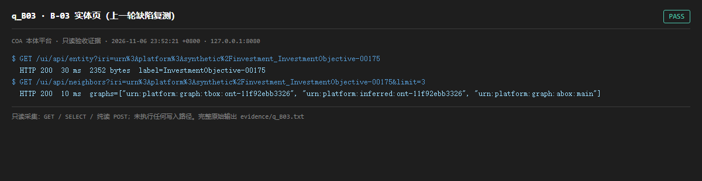

# q_B03 · B-03 实体页（上一轮缺陷复测）

| 项 | 内容 |
| --- | --- |
| 用例编号 | `q_B03` |
| 特性名称 | B-03 实体页（上一轮缺陷复测） |
| 分组 | E 前置交付 B-03/B-04 |
| 文档依据 | 49-B03B04-实体页与健康看板.md |
| 采集时间 | 2026-11-06 23:52:21 +0800 |
| 结论 | **PASS** |
| 证据截图 |  |
| 完整原始输出 | `evidence/q_B03.txt` |

## 1 测试目标

复测上一轮尽调中连续两次 15s 超时的 /ui/api/entity 是否已修复，并检查邻居查询。

## 2 输入

- `GET /ui/api/entity?iri=<真实 IRI>`
- `GET /ui/api/neighbors?iri=<真实 IRI>&limit=3`

> 零污染约束：以上输入均为 HTTP GET、只读 SQL `SELECT`、只读 SPARQL `SELECT`，以及一个已确认不写库的纯读 `POST /context/resolve`。未调用 `/answer`（会写 PROV 拒答事件）、未运行 smoke/acceptance、未触发任何 seed / refresh / import / materialize / approve / publish / reindex / rollback 写路径。

## 3 期待输出

HTTP 200，实体页含 label/classes/fields，邻居端点返回 graphs 与邻居集合，且响应在秒级内。

## 4 真实输出

```
$ GET /ui/api/entity?iri=urn%3Aplatform%3Asynthetic%2Finvestment_InvestmentObjective-00175
  HTTP 200  30 ms  2352 bytes  label=InvestmentObjective-00175
$ GET /ui/api/neighbors?iri=urn%3Aplatform%3Asynthetic%2Finvestment_InvestmentObjective-00175&limit=3
  HTTP 200  10 ms  graphs=["urn:platform:graph:tbox:ont-11f92ebb3326", "urn:platform:inferred:ont-11f92ebb3326", "urn:platform:graph:abox:main"]
```

> 为控制篇幅，上面是结构化摘要；完整原始响应见 `evidence/q_B03.txt`，终端渲染截图见 `screenshots/q_B03.png`。

## 5 结论

**PASS** — 实体页 200 且 0.1s 内返回，邻居端点正常：上一轮「B-03 未重建镜像 / 实体页超时」的问题已被并行开发线修复。

审计结论要跟随代码演进而更新，这一条是对上一版尽调报告的主动修正。

---
[返回总报告](README.md)
