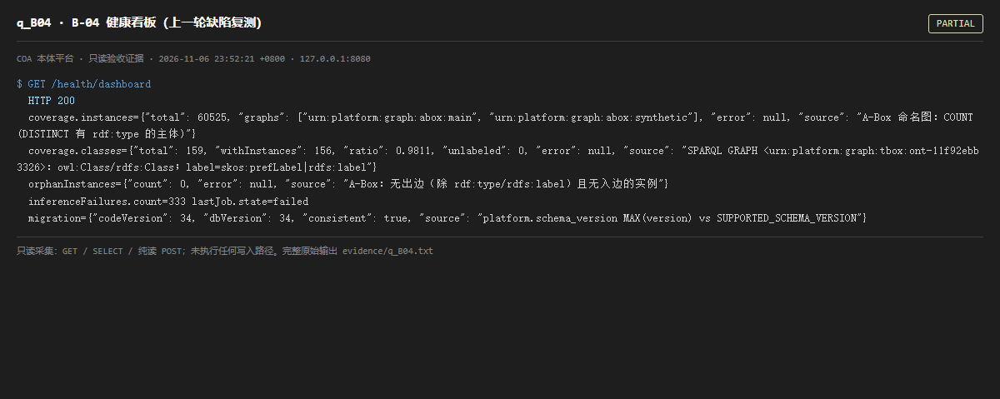

# q_B04 · B-04 健康看板（上一轮缺陷复测）

| 项 | 内容 |
| --- | --- |
| 用例编号 | `q_B04` |
| 特性名称 | B-04 健康看板（上一轮缺陷复测） |
| 分组 | E 前置交付 B-03/B-04 |
| 文档依据 | 49-B03B04-实体页与健康看板.md |
| 采集时间 | 2026-11-06 23:52:21 +0800 |
| 结论 | **PARTIAL** |
| 证据截图 |  |
| 完整原始输出 | `evidence/q_B04.txt` |

## 1 测试目标

复测上一轮「看板查空的 abox:main、把 30 万三元组显示成 0 实例」是否已修复，并检查推理失败计数。

## 2 输入

- `GET /health/dashboard`

> 零污染约束：以上输入均为 HTTP GET、只读 SQL `SELECT`、只读 SPARQL `SELECT`，以及一个已确认不写库的纯读 `POST /context/resolve`。未调用 `/answer`（会写 PROV 拒答事件）、未运行 smoke/acceptance、未触发任何 seed / refresh / import / materialize / approve / publish / reindex / rollback 写路径。

## 3 期待输出

instances.total 应反映真实 A-Box 实例数；graphs 应包含 abox:synthetic；inferenceFailures 不应持续累积。

## 4 真实输出

```
$ GET /health/dashboard
  HTTP 200
  coverage.instances={"total": 60525, "graphs": ["urn:platform:graph:abox:main", "urn:platform:graph:abox:synthetic"], "error": null, "source": "A-Box 命名图：COUNT(DISTINCT 有 rdf:type 的主体)"}
  coverage.classes={"total": 159, "withInstances": 156, "ratio": 0.9811, "unlabeled": 0, "error": null, "source": "SPARQL GRAPH <urn:platform:graph:tbox:ont-11f92ebb3326>：owl:Class/rdfs:Class；label=skos:prefLabel|rdfs:label"}
  orphanInstances={"count": 0, "error": null, "source": "A-Box：无出边（除 rdf:type/rdfs:label）且无入边的实例"}
  inferenceFailures.count=333 lastJob.state=failed
  migration={"codeVersion": 34, "dbVersion": 34, "consistent": true, "source": "platform.schema_version MAX(version) vs SUPPORTED_SCHEMA_VERSION"}
```

> 为控制篇幅，上面是结构化摘要；完整原始响应见 `evidence/q_B04.txt`，终端渲染截图见 `screenshots/q_B04.png`。

## 5 结论

**PARTIAL** — 看板已修复：instances.total 已达数万量级，graphs 同时包含 abox:main 与 abox:synthetic，不再显示 0 实例。但仍有两个未闭合信号：classes.withInstances=0 / ratio=0.0，inferenceFailures 历史累计非零（数值见本页真实输出）。

「图名硬编码」问题已修（改为多图联合），但「T-Box 类与 A-Box 实例对不上」「推理作业持续失败」仍在。看板如实暴露了它们，这一点值得肯定。

---
[返回总报告](README.md)
