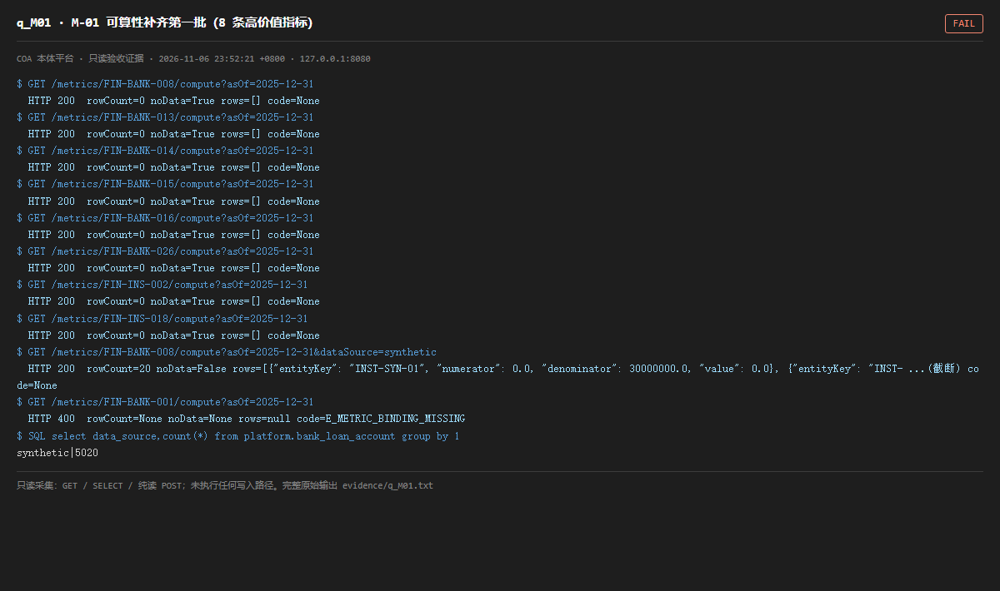

# q_M01 · M-01 可算性补齐第一批（8 条高价值指标）

| 项 | 内容 |
| --- | --- |
| 用例编号 | `q_M01` |
| 特性名称 | M-01 可算性补齐第一批（8 条高价值指标） |
| 分组 | C 本轮特性 M 口径与指标 |
| 文档依据 | 58-M01-M06-指标可算性补齐与规则核对.md §1/§4；52 §4.2 M-01 |
| 采集时间 | 2026-11-06 23:52:21 +0800 |
| 结论 | **FAIL** |
| 证据截图 |  |
| 完整原始输出 | `evidence/q_M01.txt` |

## 1 测试目标

逐条验证 58 号列出的 8 条指标 /compute 是否「返回非空且可复算」，并检查不可算时的错误码。

## 2 输入

- `GET /metrics/{8 条}/compute?asOf=2025-12-31（默认）`
- `GET /metrics/FIN-BANK-008/compute?asOf=2025-12-31&dataSource=synthetic`
- `GET /metrics/FIN-BANK-001/compute?asOf=2025-12-31（预期缺绑定）`
- `SQL: 事实表 data_source 分布`

> 零污染约束：以上输入均为 HTTP GET、只读 SQL `SELECT`、只读 SPARQL `SELECT`，以及一个已确认不写库的纯读 `POST /context/resolve`。未调用 `/answer`（会写 PROV 拒答事件）、未运行 smoke/acceptance、未触发任何 seed / refresh / import / materialize / approve / publish / reindex / rollback 写路径。

## 3 期待输出

按 58 号验收判据：≥6 条返回非空且可复算；其余给 E_METRIC_NOT_COMPUTABLE 与原因，不返回 0 或空结果冒充可算。

## 4 真实输出

```
$ GET /metrics/FIN-BANK-008/compute?asOf=2025-12-31
  HTTP 200  rowCount=0 noData=True rows=[] code=None
$ GET /metrics/FIN-BANK-013/compute?asOf=2025-12-31
  HTTP 200  rowCount=0 noData=True rows=[] code=None
$ GET /metrics/FIN-BANK-014/compute?asOf=2025-12-31
  HTTP 200  rowCount=0 noData=True rows=[] code=None
$ GET /metrics/FIN-BANK-015/compute?asOf=2025-12-31
  HTTP 200  rowCount=0 noData=True rows=[] code=None
$ GET /metrics/FIN-BANK-016/compute?asOf=2025-12-31
  HTTP 200  rowCount=0 noData=True rows=[] code=None
$ GET /metrics/FIN-BANK-026/compute?asOf=2025-12-31
  HTTP 200  rowCount=0 noData=True rows=[] code=None
$ GET /metrics/FIN-INS-002/compute?asOf=2025-12-31
  HTTP 200  rowCount=0 noData=True rows=[] code=None
$ GET /metrics/FIN-INS-018/compute?asOf=2025-12-31
  HTTP 200  rowCount=0 noData=True rows=[] code=None
$ GET /metrics/FIN-BANK-008/compute?asOf=2025-12-31&dataSource=synthetic
  HTTP 200  rowCount=20 noData=False rows=[{"entityKey": "INST-SYN-01", "numerator": 0.0, "denominator": 30000000.0, "value": 0.0}, {"entityKey": "INST- ...(截断) code=None
$ GET /metrics/FIN-BANK-001/compute?asOf=2025-12-31
  HTTP 400  rowCount=None noData=None rows=null code=E_METRIC_BINDING_MISSING
$ SQL select data_source,count(*) from platform.bank_loan_account group by 1
synthetic|5020
```

> 为控制篇幅，上面是结构化摘要；完整原始响应见 `evidence/q_M01.txt`，终端渲染截图见 `screenshots/q_M01.png`。

## 5 结论

**FAIL** — 默认参数下 8 条全部 rowCount=0 / noData=true，0 条满足「非空且可复算」；换成 dataSource=synthetic 后 FIN-BANK-008 才返回非空 rows（见本页真实输出）。FIN-BANK-001 正确返回 E_METRIC_BINDING_MISSING（这一条符合「不冒充可算」的要求）。

事实表 data_source 全为 synthetic，而 metric_compiler 的默认 dataSource 是 fixture，且 CTE 固定追加 data_source = %s。58 号的单测是「手工插入 fixture 固定事实行 → 自算自验」，所以 19 项全过；运行实例默认调用永远空。修复只需把默认值对齐运行库，或让默认按事实表实际来源解析，属于一行级配置问题，但对外宣称「可算性补齐」目前不成立。需注意：另一条老的 /output?compute=true 路径已从 metric_observation 成功出数（见 q_S14），说明数据其实具备，这是 G2 新端点默认值未对齐，而不是平台没数据——两条出数路径并存且参数不兼容，本身就是架构问题。

---
[返回总报告](README.md)
