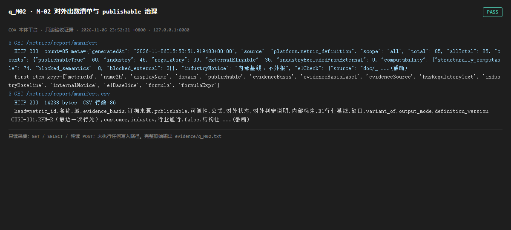

# q_M02 · M-02 对外出数清单与 publishable 治理

| 项 | 内容 |
| --- | --- |
| 用例编号 | `q_M02` |
| 特性名称 | M-02 对外出数清单与 publishable 治理 |
| 分组 | C 本轮特性 M 口径与指标 |
| 文档依据 | 52 §4.2 M-02 |
| 采集时间 | 2026-11-06 23:52:21 +0800 |
| 结论 | **PASS** |
| 证据截图 |  |
| 完整原始输出 | `evidence/q_M02.txt` |

## 1 测试目标

验证 85 行清单 100% 覆盖、每条含 publishable/证据/公式/可算性/缺口，且 JSON 与 CSV 两种导出一致。

## 2 输入

- `GET /metrics/report/manifest`
- `GET /metrics/report/manifest.csv`

> 零污染约束：以上输入均为 HTTP GET、只读 SQL `SELECT`、只读 SPARQL `SELECT`，以及一个已确认不写库的纯读 `POST /context/resolve`。未调用 `/answer`（会写 PROV 拒答事件）、未运行 smoke/acceptance、未触发任何 seed / refresh / import / materialize / approve / publish / reindex / rollback 写路径。

## 3 期待输出

count=85、meta.total=85；每条含 publishable/evidenceBasis/formula/computability/externalStatus；CSV 行数与 JSON 一致。

## 4 真实输出

```
$ GET /metrics/report/manifest
  HTTP 200  count=85 meta={"generatedAt": "2026-11-06T15:52:51.919483+00:00", "source": "platform.metric_definition", "scope": "all", "total": 85, "allTotal": 85, "counts": {"publishableTrue": 60, "industry": 46, "regulatory": 39, "externalEligible": 35, "industryExcludedFromExternal": 0, "computability": {"structurally_computable": 74, "blocked_semantics": 8, "blocked_external": 3}}, "industryNotice": "内部基线、不外报", "e1Check": {"source": "doc/_ ...(截断)
  first item keys=['metricId', 'nameZh', 'displayName', 'domain', 'publishable', 'evidenceBasis', 'evidenceBasisLabel', 'evidenceSource', 'hasRegulatoryText', 'industryBaseline', 'internalNotice', 'e1Baseline', 'formula', 'formulaExpr']
$ GET /metrics/report/manifest.csv
  HTTP 200  14238 bytes  CSV 行数=86
  head=metric_id,名称,域,evidence_basis,证据来源,publishable,可算性,公式,对外状态,对外判定说明,内部标注,E1行业基线,缺口,variant_of,output_mode,definition_version
 CUST-001,RFM-R（最近一次行为）,customer,industry,行业通行,false,结构性 ...(截断)
```

> 为控制篇幅，上面是结构化摘要；完整原始响应见 `evidence/q_M02.txt`，终端渲染截图见 `screenshots/q_M02.png`。

## 5 结论

**PASS** — 85 行 100% 覆盖、字段齐全、JSON 与 CSV 同源，meta 明确给出 publishable / externalEligible 等聚合口径（数值见本页真实输出）。

清单是「能否对外」的治理台账，不等于「已经算出数」——与 q_M01/q_S14 必须分开读。

---
[返回总报告](README.md)
