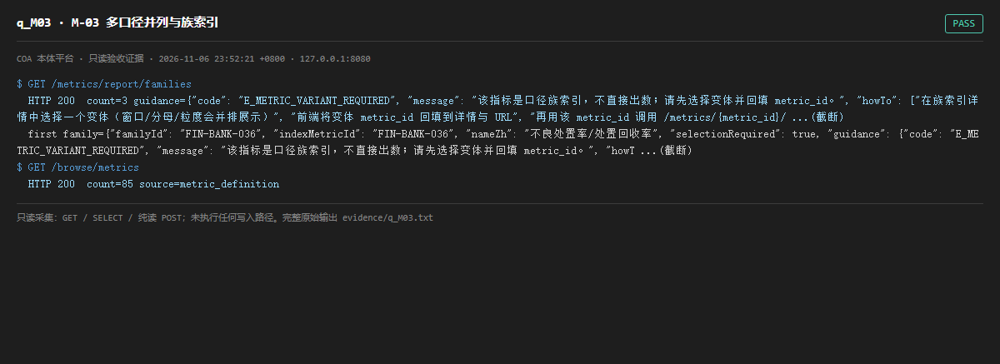

# q_M03 · M-03 多口径并列与族索引

| 项 | 内容 |
| --- | --- |
| 用例编号 | `q_M03` |
| 特性名称 | M-03 多口径并列与族索引 |
| 分组 | C 本轮特性 M 口径与指标 |
| 文档依据 | 52 §4.2 M-03 |
| 采集时间 | 2026-11-06 23:52:21 +0800 |
| 结论 | **PASS** |
| 证据截图 |  |
| 完整原始输出 | `evidence/q_M03.txt` |

## 1 测试目标

验证同族 variant 可并排列出、族索引有 guidance、缺族时能给出指引。

## 2 输入

- `GET /metrics/report/families`
- `GET /browse/metrics`

> 零污染约束：以上输入均为 HTTP GET、只读 SQL `SELECT`、只读 SPARQL `SELECT`，以及一个已确认不写库的纯读 `POST /context/resolve`。未调用 `/answer`（会写 PROV 拒答事件）、未运行 smoke/acceptance、未触发任何 seed / refresh / import / materialize / approve / publish / reindex / rollback 写路径。

## 3 期待输出

families 返回 count 与 guidance；browse/metrics 返回 85 行口径卡且含 filters。

## 4 真实输出

```
$ GET /metrics/report/families
  HTTP 200  count=3 guidance={"code": "E_METRIC_VARIANT_REQUIRED", "message": "该指标是口径族索引，不直接出数；请先选择变体并回填 metric_id。", "howTo": ["在族索引详情中选择一个变体（窗口/分母/粒度会并排展示）", "前端将变体 metric_id 回填到详情与 URL", "再用该 metric_id 调用 /metrics/{metric_id}/ ...(截断)
  first family={"familyId": "FIN-BANK-036", "indexMetricId": "FIN-BANK-036", "nameZh": "不良处置率/处置回收率", "selectionRequired": true, "guidance": {"code": "E_METRIC_VARIANT_REQUIRED", "message": "该指标是口径族索引，不直接出数；请先选择变体并回填 metric_id。", "howT ...(截断)
$ GET /browse/metrics
  HTTP 200  count=85 source=metric_definition
```

> 为控制篇幅，上面是结构化摘要；完整原始响应见 `evidence/q_M03.txt`，终端渲染截图见 `screenshots/q_M03.png`。

## 5 结论

**PASS** — 族索引与口径卡列表均可读，guidance 字段存在。

「选择后回填 metric_id」属 UI 交互，本环境无浏览器，未做点击级验证。

---
[返回总报告](README.md)
