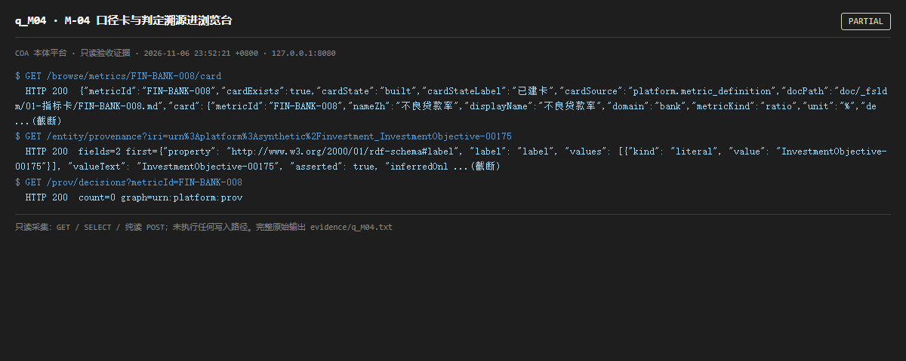

# q_M04 · M-04 口径卡与判定溯源进浏览台

| 项 | 内容 |
| --- | --- |
| 用例编号 | `q_M04` |
| 特性名称 | M-04 口径卡与判定溯源进浏览台 |
| 分组 | C 本轮特性 M 口径与指标 |
| 文档依据 | 52 §4.2 M-04 |
| 采集时间 | 2026-11-06 23:52:21 +0800 |
| 结论 | **PARTIAL** |
| 证据截图 |  |
| 完整原始输出 | `evidence/q_M04.txt` |

## 1 测试目标

验证单张口径卡可取、实体溯源可查，PROV 节点可点。

## 2 输入

- `GET /browse/metrics/FIN-BANK-008/card`
- `GET /entity/provenance?iri=<真实 A-Box IRI>`
- `GET /prov/decisions?metricId=FIN-BANK-008`

> 零污染约束：以上输入均为 HTTP GET、只读 SQL `SELECT`、只读 SPARQL `SELECT`，以及一个已确认不写库的纯读 `POST /context/resolve`。未调用 `/answer`（会写 PROV 拒答事件）、未运行 smoke/acceptance、未触发任何 seed / refresh / import / materialize / approve / publish / reindex / rollback 写路径。

## 3 期待输出

card 返回公式/证据；provenance 返回 fields 且含 source_ref；decisions 返回 items/count。

## 4 真实输出

```
$ GET /browse/metrics/FIN-BANK-008/card
  HTTP 200  {"metricId":"FIN-BANK-008","cardExists":true,"cardState":"built","cardStateLabel":"已建卡","cardSource":"platform.metric_definition","docPath":"doc/_fsldm/01-指标卡/FIN-BANK-008.md","card":{"metricId":"FIN-BANK-008","nameZh":"不良贷款率","displayName":"不良贷款率","domain":"bank","metricKind":"ratio","unit":"%","de ...(截断)
$ GET /entity/provenance?iri=urn%3Aplatform%3Asynthetic%2Finvestment_InvestmentObjective-00175
  HTTP 200  fields=2 first={"property": "http://www.w3.org/2000/01/rdf-schema#label", "label": "label", "values": [{"kind": "literal", "value": "InvestmentObjective-00175"}], "valueText": "InvestmentObjective-00175", "asserted": true, "inferredOnl ...(截断)
$ GET /prov/decisions?metricId=FIN-BANK-008
  HTTP 200  count=0 graph=urn:platform:prov
```

> 为控制篇幅，上面是结构化摘要；完整原始响应见 `evidence/q_M04.txt`，终端渲染截图见 `screenshots/q_M04.png`。

## 5 结论

**PARTIAL** — 口径卡与实体溯源字段可读且带来源；但 /prov/decisions 对该指标返回 0 条判定记录，说明「判定链可点」在多数指标上暂无可点内容。

结构上成立、数据上稀疏，属于「面板已建、证据未铺满」。

---
[返回总报告](README.md)
