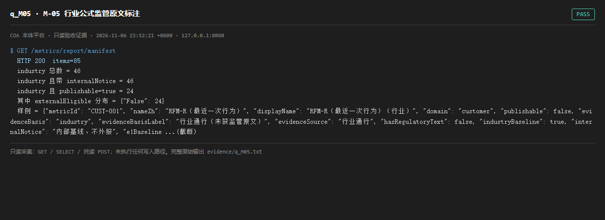

# q_M05 · M-05 行业公式监管原文标注

| 项 | 内容 |
| --- | --- |
| 用例编号 | `q_M05` |
| 特性名称 | M-05 行业公式监管原文标注 |
| 分组 | C 本轮特性 M 口径与指标 |
| 文档依据 | 52 §4.2 M-05；12-口径终裁-v9.md |
| 采集时间 | 2026-11-06 23:52:21 +0800 |
| 结论 | **PASS** |
| 证据截图 |  |
| 完整原始输出 | `evidence/q_M05.txt` |

## 1 测试目标

验证行业口径逐条标 evidenceBasis=industry 与「内部基线、不外报」，且对外清单排除未获监管原文的条目。

## 2 输入

- `GET /metrics/report/manifest（本地交叉统计 industry × publishable × externalEligible）`

> 零污染约束：以上输入均为 HTTP GET、只读 SQL `SELECT`、只读 SPARQL `SELECT`，以及一个已确认不写库的纯读 `POST /context/resolve`。未调用 `/answer`（会写 PROV 拒答事件）、未运行 smoke/acceptance、未触发任何 seed / refresh / import / materialize / approve / publish / reindex / rollback 写路径。

## 3 期待输出

行业条目 100% 带 industryBaseline 与 internalNotice；publishable=true 且 industry 的条目 externalEligible 必须为 false。

## 4 真实输出

```
$ GET /metrics/report/manifest
  HTTP 200  items=85
  industry 总数 = 46
  industry 且带 internalNotice = 46
  industry 且 publishable=true = 24
  其中 externalEligible 分布 = {"False": 24}
  样例 = {"metricId": "CUST-001", "nameZh": "RFM-R（最近一次行为）", "displayName": "RFM-R（最近一次行为）〔行业〕", "domain": "customer", "publishable": false, "evidenceBasis": "industry", "evidenceBasisLabel": "行业通行（未获监管原文）", "evidenceSource": "行业通行", "hasRegulatoryText": false, "industryBaseline": true, "internalNotice": "内部基线、不外报", "e1Baseline ...(截断)
```

> 为控制篇幅，上面是结构化摘要；完整原始响应见 `evidence/q_M05.txt`，终端渲染截图见 `screenshots/q_M05.png`。

## 5 结论

**PASS** — 全部 industry 口径 100% 带 internalNotice；其中 publishable=true 的那部分 externalEligible 全为 false、externalStatus=internal_baseline，确实被排除在对外清单之外（分组计数见本页真实输出）。

审计员初看 meta 的 industryExcludedFromExternal=0 一度怀疑漏排除，逐条交叉后确认判据成立——此处以逐条数据为准，不以聚合字段名推断。

---
[返回总报告](README.md)
