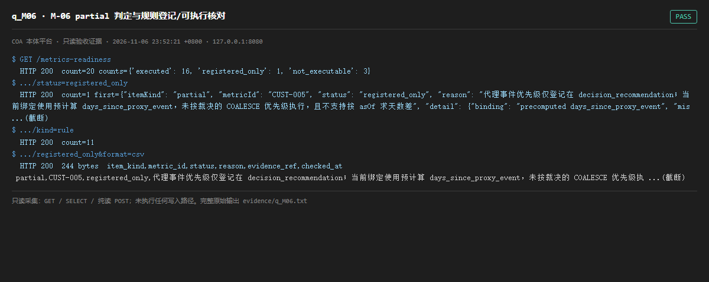

# q_M06 · M-06 partial 判定与规则登记/可执行核对

| 项 | 内容 |
| --- | --- |
| 用例编号 | `q_M06` |
| 特性名称 | M-06 partial 判定与规则登记/可执行核对 |
| 分组 | C 本轮特性 M 口径与指标 |
| 文档依据 | 58-M01-M06-指标可算性补齐与规则核对.md §2/§4；52 §4.2 M-06 |
| 采集时间 | 2026-11-06 23:52:21 +0800 |
| 结论 | **PASS** |
| 证据截图 |  |
| 完整原始输出 | `evidence/q_M06.txt` |

## 1 测试目标

验证 20 条台账（9 partial + 11 规则）逐条有状态，且「仅登记」可导出、不与可执行混淆。

## 2 输入

- `GET /metrics-readiness`
- `GET /metrics-readiness?status=registered_only`
- `GET /metrics-readiness?kind=rule`
- `GET /metrics-readiness?status=registered_only&format=csv`

> 零污染约束：以上输入均为 HTTP GET、只读 SQL `SELECT`、只读 SPARQL `SELECT`，以及一个已确认不写库的纯读 `POST /context/resolve`。未调用 `/answer`（会写 PROV 拒答事件）、未运行 smoke/acceptance、未触发任何 seed / refresh / import / materialize / approve / publish / reindex / rollback 写路径。

## 3 期待输出

按 58 号：executed=16 / registered_only=1 / not_executable=3，总 20；registered_only 可单独筛出并导出 CSV。

## 4 真实输出

```
$ GET /metrics-readiness
  HTTP 200  count=20 counts={'executed': 16, 'registered_only': 1, 'not_executable': 3}
$ .../status=registered_only
  HTTP 200  count=1 first={"itemKind": "partial", "metricId": "CUST-005", "status": "registered_only", "reason": "代理事件优先级仅登记在 decision_recommendation；当前绑定使用预计算 days_since_proxy_event，未按裁决的 COALESCE 优先级执行，且不支持按 asOf 求天数差", "detail": {"binding": "precomputed days_since_proxy_event", "mis ...(截断)
$ .../kind=rule
  HTTP 200  count=11
$ .../registered_only&format=csv
  HTTP 200  244 bytes  item_kind,metric_id,status,reason,evidence_ref,checked_at
 partial,CUST-005,registered_only,代理事件优先级仅登记在 decision_recommendation；当前绑定使用预计算 days_since_proxy_event，未按裁决的 COALESCE 优先级执 ...(截断)
```

> 为控制篇幅，上面是结构化摘要；完整原始响应见 `evidence/q_M06.txt`，终端渲染截图见 `screenshots/q_M06.png`。

## 5 结论

**PASS** — counts 与 58 号完全一致（16/1/3，共 20），筛选与 CSV 导出均可用，registered_only 条目带具体原因说明。

这条台账做得扎实：明确区分「已执行 / 仅登记 / 不可执行」，没有把登记当可执行。

---
[返回总报告](README.md)
