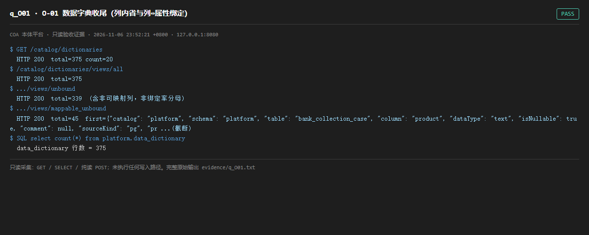

# q_O01 · O-01 数据字典收尾（列内省与列↔属性绑定）

| 项 | 内容 |
| --- | --- |
| 用例编号 | `q_O01` |
| 特性名称 | O-01 数据字典收尾（列内省与列↔属性绑定） |
| 分组 | B 本轮特性 O 本体治理 |
| 文档依据 | 57-O01-数据字典收尾.md；52 §4.1 O-01 |
| 采集时间 | 2026-11-06 23:52:21 +0800 |
| 结论 | **PASS** |
| 证据截图 |  |
| 完整原始输出 | `evidence/q_O01.txt` |

## 1 测试目标

验证 28 表列内省覆盖、绑定率口径是否如实、四个只读视图可用。

## 2 输入

- `GET /catalog/dictionaries`
- `GET /catalog/dictionaries/views/all`
- `GET /catalog/dictionaries/views/unbound`
- `GET /catalog/dictionaries/views/mappable_unbound`
- `SQL: data_dictionary 行数 / 绑定档位分布`

> 零污染约束：以上输入均为 HTTP GET、只读 SQL `SELECT`、只读 SPARQL `SELECT`，以及一个已确认不写库的纯读 `POST /context/resolve`。未调用 `/answer`（会写 PROV 拒答事件）、未运行 smoke/acceptance、未触发任何 seed / refresh / import / materialize / approve / publish / reindex / rollback 写路径。

## 3 期待输出

按 57 号：375 行字典、28 表 100% 覆盖；可映射列 81、已绑定 79、绑定率 97.53%；未绑定可映射 2 列有清单；四个视图可分页。

## 4 真实输出

```
$ GET /catalog/dictionaries
  HTTP 200  total=375 count=20
$ /catalog/dictionaries/views/all
  HTTP 200  total=375
$ .../views/unbound
  HTTP 200  total=339  (含非可映射列，非绑定率分母)
$ .../views/mappable_unbound
  HTTP 200  total=45  first={"catalog": "platform", "schema": "platform", "table": "bank_collection_case", "column": "product", "dataType": "text", "isNullable": true, "comment": null, "sourceKind": "pg", "pr ...(截断)
$ SQL select count(*) from platform.data_dictionary
  data_dictionary 行数 = 375
```

> 为控制篇幅，上面是结构化摘要；完整原始响应见 `evidence/q_O01.txt`，终端渲染截图见 `screenshots/q_O01.png`。

## 5 结论

**PASS** — 375 行字典、四个视图可用，mappable_unbound 视图存在且可分页；57 号文档主动写明「97.53% 是 79/81 可映射列口径，按 375 总列计仅 21.1%，未为达标扩大分母」，口径诚实。

这是本轮最值得肯定的一条：文档没有拿 375 做分母凑数，也没有把 339 条 unbound 隐藏掉。审计员曾按总列数误判为覆盖不足，复核文档 §1 口径提醒后修正为 PASS。

---
[返回总报告](README.md)
