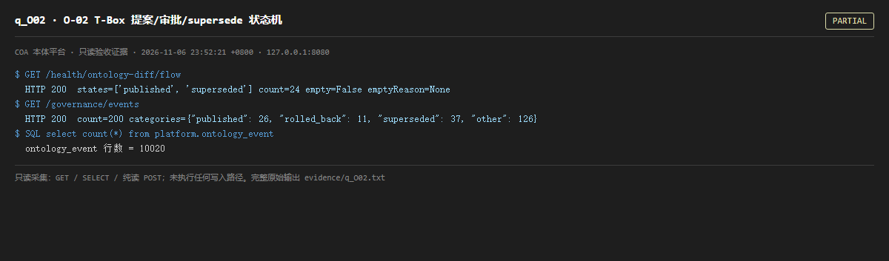

# q_O02 · O-02 T-Box 提案/审批/supersede 状态机

| 项 | 内容 |
| --- | --- |
| 用例编号 | `q_O02` |
| 特性名称 | O-02 T-Box 提案/审批/supersede 状态机 |
| 分组 | B 本轮特性 O 本体治理 |
| 文档依据 | 52 §4.1 O-02；58 §2 |
| 采集时间 | 2026-11-06 23:52:21 +0800 |
| 结论 | **PARTIAL** |
| 证据截图 |  |
| 完整原始输出 | `evidence/q_O02.txt` |

## 1 测试目标

验证状态迁移有 actor/reason/time 留痕，非法迁移被拒（只读侧检查已记录的状态流）。

## 2 输入

- `GET /health/ontology-diff/flow`
- `GET /governance/events`
- `SQL: SELECT count(*) FROM platform.ontology_event`

> 零污染约束：以上输入均为 HTTP GET、只读 SQL `SELECT`、只读 SPARQL `SELECT`，以及一个已确认不写库的纯读 `POST /context/resolve`。未调用 `/answer`（会写 PROV 拒答事件）、未运行 smoke/acceptance、未触发任何 seed / refresh / import / materialize / approve / publish / reindex / rollback 写路径。

## 3 期待输出

flow.states 覆盖 proposal→review→approved→published→superseded；事件表非空且含 actor/reason/time 语义列。

## 4 真实输出

```
$ GET /health/ontology-diff/flow
  HTTP 200  states=['published', 'superseded'] count=24 empty=False emptyReason=None
$ GET /governance/events
  HTTP 200  count=200 categories={"published": 26, "rolled_back": 11, "superseded": 37, "other": 126}
$ SQL select count(*) from platform.ontology_event
  ontology_event 行数 = 10020
```

> 为控制篇幅，上面是结构化摘要；完整原始响应见 `evidence/q_O02.txt`，终端渲染截图见 `screenshots/q_O02.png`。

## 5 结论

**PARTIAL** — 状态流与治理事件可读、事件量级与 /ontology/verify 的 checked 一致；但「非法迁移被拒」「每状态 actor/reason/time」属于写路径判定，只读验证无法触发，只能确认结构存在。

52 号把 O-02 标为「已完成」并给出单测证据；本用例不否定代码，只标注运行侧可验证边界。

---
[返回总报告](README.md)
