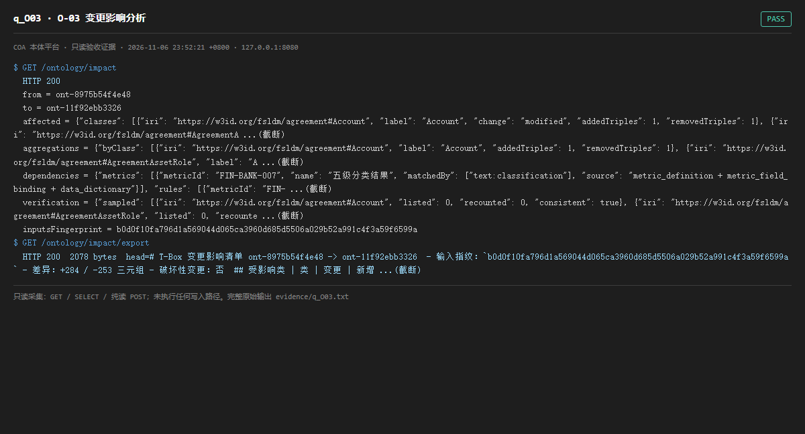

# q_O03 · O-03 变更影响分析

| 项 | 内容 |
| --- | --- |
| 用例编号 | `q_O03` |
| 特性名称 | O-03 变更影响分析 |
| 分组 | B 本轮特性 O 本体治理 |
| 文档依据 | 52 §4.1 O-03 |
| 采集时间 | 2026-11-06 23:52:21 +0800 |
| 结论 | **PASS** |
| 证据截图 |  |
| 完整原始输出 | `evidence/q_O03.txt` |

## 1 测试目标

验证影响分析能给出受影响类/属性/依赖，并带输入指纹与可导出结果。

## 2 输入

- `GET /ontology/impact`
- `GET /ontology/impact/export`

> 零污染约束：以上输入均为 HTTP GET、只读 SQL `SELECT`、只读 SPARQL `SELECT`，以及一个已确认不写库的纯读 `POST /context/resolve`。未调用 `/answer`（会写 PROV 拒答事件）、未运行 smoke/acceptance、未触发任何 seed / refresh / import / materialize / approve / publish / reindex / rollback 写路径。

## 3 期待输出

返回 changeSet/affected/aggregations/dependencies/verification/inputsFingerprint；export 为可下载文本且 200。

## 4 真实输出

```
$ GET /ontology/impact
  HTTP 200
  from = ont-8975b54f4e48
  to = ont-11f92ebb3326
  affected = {"classes": [{"iri": "https://w3id.org/fsldm/agreement#Account", "label": "Account", "change": "modified", "addedTriples": 1, "removedTriples": 1}, {"iri": "https://w3id.org/fsldm/agreement#AgreementA ...(截断)
  aggregations = {"byClass": [{"iri": "https://w3id.org/fsldm/agreement#Account", "label": "Account", "addedTriples": 1, "removedTriples": 1}, {"iri": "https://w3id.org/fsldm/agreement#AgreementAssetRole", "label": "A ...(截断)
  dependencies = {"metrics": [{"metricId": "FIN-BANK-007", "name": "五级分类结果", "matchedBy": ["text:classification"], "source": "metric_definition + metric_field_binding + data_dictionary"}], "rules": [{"metricId": "FIN- ...(截断)
  verification = {"sampled": [{"iri": "https://w3id.org/fsldm/agreement#Account", "listed": 0, "recounted": 0, "consistent": true}, {"iri": "https://w3id.org/fsldm/agreement#AgreementAssetRole", "listed": 0, "recounte ...(截断)
  inputsFingerprint = b0d0f10fa796d1a569044d065ca3960d685d5506a029b52a991c4f3a59f6599a
$ GET /ontology/impact/export
  HTTP 200  2078 bytes  head=# T-Box 变更影响清单 ont-8975b54f4e48 -> ont-11f92ebb3326  - 输入指纹：`b0d0f10fa796d1a569044d065ca3960d685d5506a029b52a991c4f3a59f6599a` - 差异：+284 / -253 三元组 - 破坏性变更：否  ## 受影响类 | 类 | 变更 | 新增 ...(截断)
```

> 为控制篇幅，上面是结构化摘要；完整原始响应见 `evidence/q_O03.txt`，终端渲染截图见 `screenshots/q_O03.png`。

## 5 结论

**PASS** — 影响分析字段完整、带 inputsFingerprint，导出端点返回文本。

「3 组固定变更与人工核对一致」需构造变更，属写路径，本轮未做。

---
[返回总报告](README.md)
