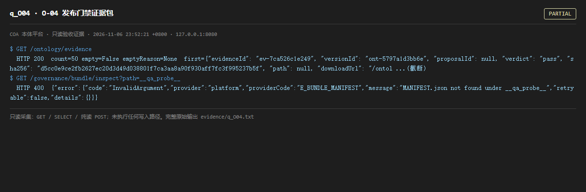

# q_O04 · O-04 发布门禁证据包

| 项 | 内容 |
| --- | --- |
| 用例编号 | `q_O04` |
| 特性名称 | O-04 发布门禁证据包 |
| 分组 | B 本轮特性 O 本体治理 |
| 文档依据 | 52 §4.1 O-04 |
| 采集时间 | 2026-11-06 23:52:21 +0800 |
| 结论 | **PARTIAL** |
| 证据截图 |  |
| 完整原始输出 | `evidence/q_O04.txt` |

## 1 测试目标

验证证据包可枚举/引用，含 verdict 与 hash，且失败也有包。

## 2 输入

- `GET /ontology/evidence`
- `GET /governance/bundle/inspect?path=（非法参数，验证拒绝而非静默通过）`

> 零污染约束：以上输入均为 HTTP GET、只读 SQL `SELECT`、只读 SPARQL `SELECT`，以及一个已确认不写库的纯读 `POST /context/resolve`。未调用 `/answer`（会写 PROV 拒答事件）、未运行 smoke/acceptance、未触发任何 seed / refresh / import / materialize / approve / publish / reindex / rollback 写路径。

## 3 期待输出

evidence 返回 items；对非法 path 应返回明确错误码，不应静默 200。

## 4 真实输出

```
$ GET /ontology/evidence
  HTTP 200  count=50 empty=False emptyReason=None  first={"evidenceId": "ev-7ca526c1e249", "versionId": "ont-5797a1d3bb6e", "proposalId": null, "verdict": "pass", "sha256": "d5cc0e9ce2fb2627ec20d3d49d038801f7ca3aa8a90f930aff7fc3f995237b5f", "path": null, "downloadUrl": "/ontol ...(截断)
$ GET /governance/bundle/inspect?path=__qa_probe__
  HTTP 400  {"error":{"code":"InvalidArgument","provider":"platform","providerCode":"E_BUNDLE_MANIFEST","message":"MANIFEST.json not found under __qa_probe__","retryable":false,"details":{}}}
```

> 为控制篇幅，上面是结构化摘要；完整原始响应见 `evidence/q_O04.txt`，终端渲染截图见 `screenshots/q_O04.png`。

## 5 结论

**PARTIAL** — 证据包端点可用且对非法路径给出明确拒绝；但「每次发布都生成含 3 项 verdict 与 hash 的包」需触发发布写路径，只读侧只能确认结构。

拒绝行为是好的：没有把非法输入静默当成成功。

---
[返回总报告](README.md)
