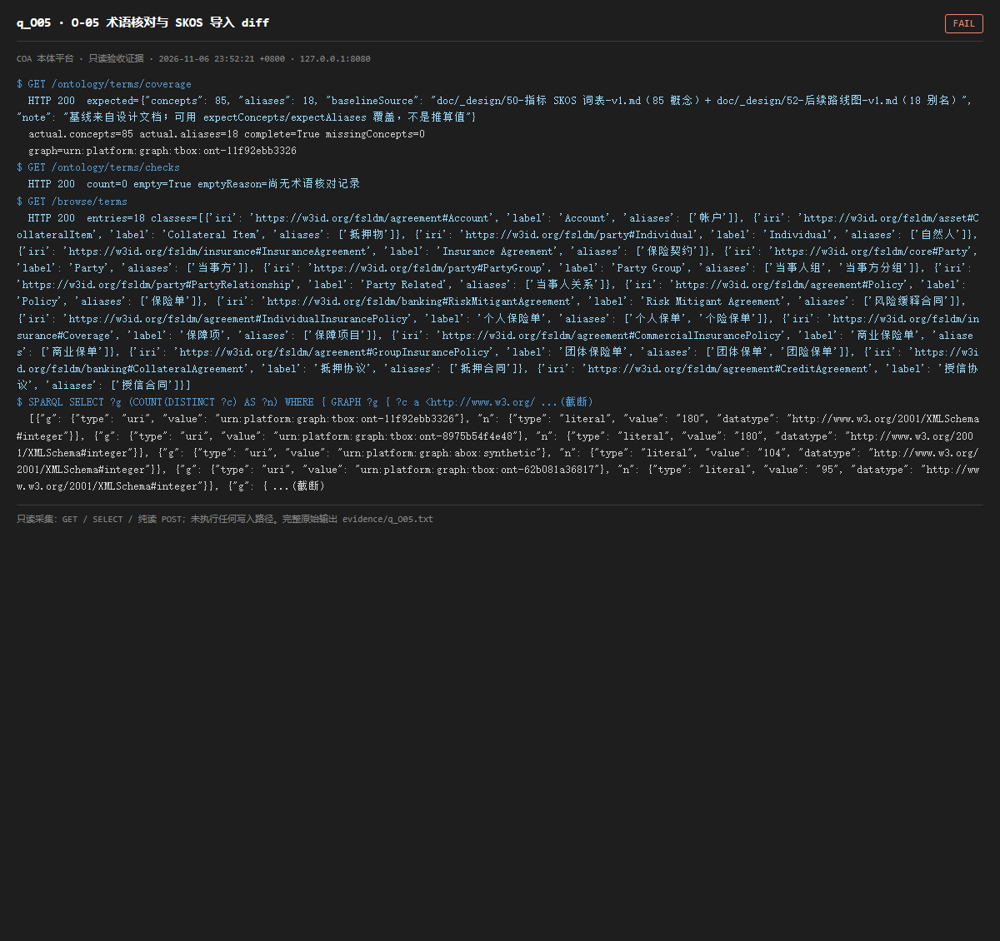

# q_O05 · O-05 术语核对与 SKOS 导入 diff

| 项 | 内容 |
| --- | --- |
| 用例编号 | `q_O05` |
| 特性名称 | O-05 术语核对与 SKOS 导入 diff |
| 分组 | B 本轮特性 O 本体治理 |
| 文档依据 | 50-B05-指标词表入SKOS.md；52 §4.1 O-05 |
| 采集时间 | 2026-11-06 23:52:21 +0800 |
| 结论 | **FAIL** |
| 证据截图 |  |
| 完整原始输出 | `evidence/q_O05.txt` |

## 1 测试目标

验证 85 概念 / 18 别名已进当前 T-Box，并有覆盖率/冲突报告与核对记录。

## 2 输入

- `GET /ontology/terms/coverage`
- `GET /ontology/terms/checks`
- `GET /browse/terms`
- `SPARQL: 按命名图统计 skos:Concept 数`

> 零污染约束：以上输入均为 HTTP GET、只读 SQL `SELECT`、只读 SPARQL `SELECT`，以及一个已确认不写库的纯读 `POST /context/resolve`。未调用 `/answer`（会写 PROV 拒答事件）、未运行 smoke/acceptance、未触发任何 seed / refresh / import / materialize / approve / publish / reindex / rollback 写路径。

## 3 期待输出

按判据：expected 85 概念/18 别名，actual 应接近且 complete=true；checks 有核对记录；词表在当前 T-Box 指针指向的图里。

## 4 真实输出

```
$ GET /ontology/terms/coverage
  HTTP 200  expected={"concepts": 85, "aliases": 18, "baselineSource": "doc/_design/50-指标 SKOS 词表-v1.md（85 概念）+ doc/_design/52-后续路线图-v1.md（18 别名）", "note": "基线来自设计文档；可用 expectConcepts/expectAliases 覆盖，不是推算值"}
  actual.concepts=85 actual.aliases=18 complete=True missingConcepts=0
  graph=urn:platform:graph:tbox:ont-11f92ebb3326
$ GET /ontology/terms/checks
  HTTP 200  count=0 empty=True emptyReason=尚无术语核对记录
$ GET /browse/terms
  HTTP 200  entries=18 classes=[{'iri': 'https://w3id.org/fsldm/agreement#Account', 'label': 'Account', 'aliases': ['帐户']}, {'iri': 'https://w3id.org/fsldm/asset#CollateralItem', 'label': 'Collateral Item', 'aliases': ['抵押物']}, {'iri': 'https://w3id.org/fsldm/party#Individual', 'label': 'Individual', 'aliases': ['自然人']}, {'iri': 'https://w3id.org/fsldm/insurance#InsuranceAgreement', 'label': 'Insurance Agreement', 'aliases': ['保险契约']}, {'iri': 'https://w3id.org/fsldm/core#Party', 'label': 'Party', 'aliases': ['当事方']}, {'iri': 'https://w3id.org/fsldm/party#PartyGroup', 'label': 'Party Group', 'aliases': ['当事人组', '当事方分组']}, {'iri': 'https://w3id.org/fsldm/party#PartyRelationship', 'label': 'Party Related', 'aliases': ['当事人关系']}, {'iri': 'https://w3id.org/fsldm/agreement#Policy', 'label': 'Policy', 'aliases': ['保险单']}, {'iri': 'https://w3id.org/fsldm/banking#RiskMitigantAgreement', 'label': 'Risk Mitigant Agreement', 'aliases': ['风险缓释合同']}, {'iri': 'https://w3id.org/fsldm/agreement#IndividualInsurancePolicy', 'label': '个人保险单', 'aliases': ['个人保单', '个险保单']}, {'iri': 'https://w3id.org/fsldm/insurance#Coverage', 'label': '保障项', 'aliases': ['保障项目']}, {'iri': 'https://w3id.org/fsldm/agreement#CommercialInsurancePolicy', 'label': '商业保险单', 'aliases': ['商业保单']}, {'iri': 'https://w3id.org/fsldm/agreement#GroupInsurancePolicy', 'label': '团体保险单', 'aliases': ['团体保单', '团险保单']}, {'iri': 'https://w3id.org/fsldm/banking#CollateralAgreement', 'label': '抵押协议', 'aliases': ['抵押合同']}, {'iri': 'https://w3id.org/fsldm/agreement#CreditAgreement', 'label': '授信协议', 'aliases': ['授信合同']}]
$ SPARQL SELECT ?g (COUNT(DISTINCT ?c) AS ?n) WHERE { GRAPH ?g { ?c a <http://www.w3.org/ ...(截断)
  [{"g": {"type": "uri", "value": "urn:platform:graph:tbox:ont-11f92ebb3326"}, "n": {"type": "literal", "value": "180", "datatype": "http://www.w3.org/2001/XMLSchema#integer"}}, {"g": {"type": "uri", "value": "urn:platform:graph:tbox:ont-8975b54f4e48"}, "n": {"type": "literal", "value": "180", "datatype": "http://www.w3.org/2001/XMLSchema#integer"}}, {"g": {"type": "uri", "value": "urn:platform:graph:abox:synthetic"}, "n": {"type": "literal", "value": "104", "datatype": "http://www.w3.org/2001/XMLSchema#integer"}}, {"g": {"type": "uri", "value": "urn:platform:graph:tbox:ont-62b081a36817"}, "n": {"type": "literal", "value": "95", "datatype": "http://www.w3.org/2001/XMLSchema#integer"}}, {"g": { ...(截断)
```

> 为控制篇幅，上面是结构化摘要；完整原始响应见 `evidence/q_O05.txt`，终端渲染截图见 `screenshots/q_O05.png`。

## 5 结论

**FAIL** — 当前指针指向的 T-Box 图（graph 字段见本页真实输出，审计期间被反复改写）内 skos:Concept 为 0，coverage 返回 actual 0/85、0/18、complete=false，checks 无任何核对记录。词表实际只存在于历史版本图（本页 SPARQL 结果里每个含 95~180 个概念），未随当前版本一起发布。

这不是凭空造假：B-05 确实把词表写进了图库，但它没有随当前发布版本一起被「带过去」。从本体原理看，这是 T-Box 版本切换时内容未随指针迁移，属于版本治理缺陷而非数据编造。与 q_P02 的多指针漂移是同一个根因。

---
[返回总报告](README.md)
