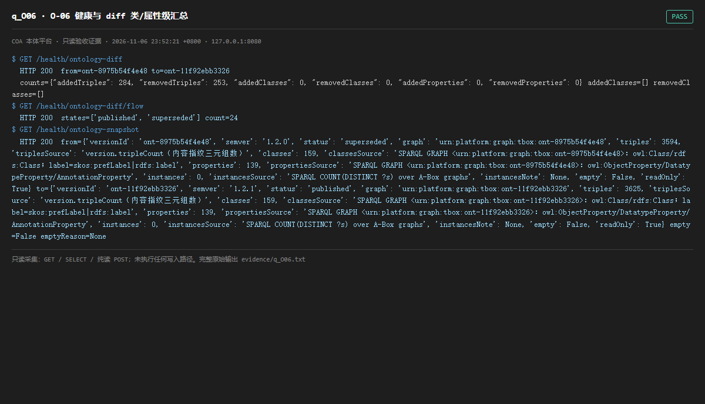

# q_O06 · O-06 健康与 diff 类/属性级汇总

| 项 | 内容 |
| --- | --- |
| 用例编号 | `q_O06` |
| 特性名称 | O-06 健康与 diff 类/属性级汇总 |
| 分组 | B 本轮特性 O 本体治理 |
| 文档依据 | 52 §4.1 O-06；49 §3 |
| 采集时间 | 2026-11-06 23:52:21 +0800 |
| 结论 | **PASS** |
| 证据截图 |  |
| 完整原始输出 | `evidence/q_O06.txt` |

## 1 测试目标

验证 diff 能按类/属性聚合、支持两版本对比、空态明确。

## 2 输入

- `GET /health/ontology-diff`
- `GET /health/ontology-diff/flow`
- `GET /health/ontology-snapshot`

> 零污染约束：以上输入均为 HTTP GET、只读 SQL `SELECT`、只读 SPARQL `SELECT`，以及一个已确认不写库的纯读 `POST /context/resolve`。未调用 `/answer`（会写 PROV 拒答事件）、未运行 smoke/acceptance、未触发任何 seed / refresh / import / materialize / approve / publish / reindex / rollback 写路径。

## 3 期待输出

diff 返回 addedClasses/removedClasses/addedProperties/removedProperties/counts；snapshot 支持 from/to；空态有 emptyReason。

## 4 真实输出

```
$ GET /health/ontology-diff
  HTTP 200  from=ont-8975b54f4e48 to=ont-11f92ebb3326
  counts={"addedTriples": 284, "removedTriples": 253, "addedClasses": 0, "removedClasses": 0, "addedProperties": 0, "removedProperties": 0} addedClasses=[] removedClasses=[]
$ GET /health/ontology-diff/flow
  HTTP 200  states=['published', 'superseded'] count=24
$ GET /health/ontology-snapshot
  HTTP 200  from={'versionId': 'ont-8975b54f4e48', 'semver': '1.2.0', 'status': 'superseded', 'graph': 'urn:platform:graph:tbox:ont-8975b54f4e48', 'triples': 3594, 'triplesSource': 'version.tripleCount（内容指纹三元组数）', 'classes': 159, 'classesSource': 'SPARQL GRAPH <urn:platform:graph:tbox:ont-8975b54f4e48>：owl:Class/rdfs:Class；label=skos:prefLabel|rdfs:label', 'properties': 139, 'propertiesSource': 'SPARQL GRAPH <urn:platform:graph:tbox:ont-8975b54f4e48>：owl:ObjectProperty/DatatypeProperty/AnnotationProperty', 'instances': 0, 'instancesSource': 'SPARQL COUNT(DISTINCT ?s) over A-Box graphs', 'instancesNote': None, 'empty': False, 'readOnly': True} to={'versionId': 'ont-11f92ebb3326', 'semver': '1.2.1', 'status': 'published', 'graph': 'urn:platform:graph:tbox:ont-11f92ebb3326', 'triples': 3625, 'triplesSource': 'version.tripleCount（内容指纹三元组数）', 'classes': 159, 'classesSource': 'SPARQL GRAPH <urn:platform:graph:tbox:ont-11f92ebb3326>：owl:Class/rdfs:Class；label=skos:prefLabel|rdfs:label', 'properties': 139, 'propertiesSource': 'SPARQL GRAPH <urn:platform:graph:tbox:ont-11f92ebb3326>：owl:ObjectProperty/DatatypeProperty/AnnotationProperty', 'instances': 0, 'instancesSource': 'SPARQL COUNT(DISTINCT ?s) over A-Box graphs', 'instancesNote': None, 'empty': False, 'readOnly': True} empty=False emptyReason=None
```

> 为控制篇幅，上面是结构化摘要；完整原始响应见 `evidence/q_O06.txt`，终端渲染截图见 `screenshots/q_O06.png`。

## 5 结论

**PASS** — 类/属性级聚合、状态流、两版本快照与空态说明均按判据返回。

O-06 属只读增强，本轮可完整验证。

---
[返回总报告](README.md)
