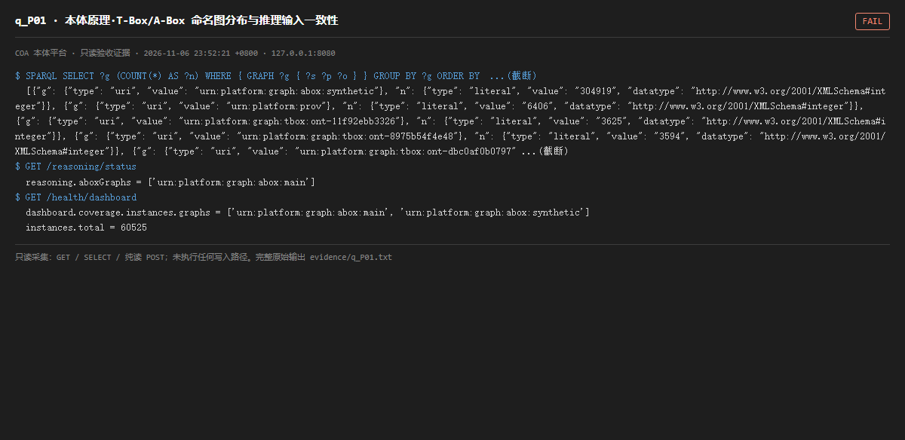

# q_P01 · 本体原理·T-Box/A-Box 命名图分布与推理输入一致性

| 项 | 内容 |
| --- | --- |
| 用例编号 | `q_P01` |
| 特性名称 | 本体原理·T-Box/A-Box 命名图分布与推理输入一致性 |
| 分组 | F 本体原理专项 |
| 文档依据 | 45-产品架构介绍.md；48-技术说明书.md；本体工程通用原理 |
| 采集时间 | 2026-11-06 23:52:21 +0800 |
| 结论 | **FAIL** |
| 证据截图 |  |
| 完整原始输出 | `evidence/q_P01.txt` |

## 1 测试目标

从本体原理检查：T-Box 与 A-Box 是否分区、实例图命名是否有单一权威、推理器读入的图是否等于真实数据所在图。

## 2 输入

- `SPARQL: 按命名图统计三元组 TOP`
- `GET /reasoning/status（aboxGraphs）`
- `GET /health/dashboard（coverage.instances.graphs）`

> 零污染约束：以上输入均为 HTTP GET、只读 SQL `SELECT`、只读 SPARQL `SELECT`，以及一个已确认不写库的纯读 `POST /context/resolve`。未调用 `/answer`（会写 PROV 拒答事件）、未运行 smoke/acceptance、未触发任何 seed / refresh / import / materialize / approve / publish / reindex / rollback 写路径。

## 3 期待输出

推理器的 aboxGraphs 应与看板统计的 A-Box 图集合一致；命名图 IRI 应由注册表驱动而非散落硬编码。

## 4 真实输出

```
$ SPARQL SELECT ?g (COUNT(*) AS ?n) WHERE { GRAPH ?g { ?s ?p ?o } } GROUP BY ?g ORDER BY  ...(截断)
  [{"g": {"type": "uri", "value": "urn:platform:graph:abox:synthetic"}, "n": {"type": "literal", "value": "304919", "datatype": "http://www.w3.org/2001/XMLSchema#integer"}}, {"g": {"type": "uri", "value": "urn:platform:prov"}, "n": {"type": "literal", "value": "6406", "datatype": "http://www.w3.org/2001/XMLSchema#integer"}}, {"g": {"type": "uri", "value": "urn:platform:graph:tbox:ont-11f92ebb3326"}, "n": {"type": "literal", "value": "3625", "datatype": "http://www.w3.org/2001/XMLSchema#integer"}}, {"g": {"type": "uri", "value": "urn:platform:graph:tbox:ont-8975b54f4e48"}, "n": {"type": "literal", "value": "3594", "datatype": "http://www.w3.org/2001/XMLSchema#integer"}}, {"g": {"type": "uri", "value": "urn:platform:graph:tbox:ont-dbc0af0b0797" ...(截断)
$ GET /reasoning/status
  reasoning.aboxGraphs = ['urn:platform:graph:abox:main']
$ GET /health/dashboard
  dashboard.coverage.instances.graphs = ['urn:platform:graph:abox:main', 'urn:platform:graph:abox:synthetic']
  instances.total = 60525
```

> 为控制篇幅，上面是结构化摘要；完整原始响应见 `evidence/q_P01.txt`，终端渲染截图见 `screenshots/q_P01.png`。

## 5 结论

**FAIL** — 推理器只读 urn:platform:graph:abox:main，看板同时读 abox:main + abox:synthetic，而真实实例绝大多数在 abox:synthetic。三方对「哪个图是 A-Box」没有唯一权威，物化产物数量极少（见 q_S05 的 pointer.inferred）。

这是架构层面的核心问题：named graph 在本体平台里同时承担「数据分区」和「溯源单元」两种职责，却没有一份注册表约束谁可以读哪些图。O-01 给物理列做了绑定注册表，但图命名空间没有等价物，于是每个模块各写各的图名常量；物化产物数量极少。

---
[返回总报告](README.md)
