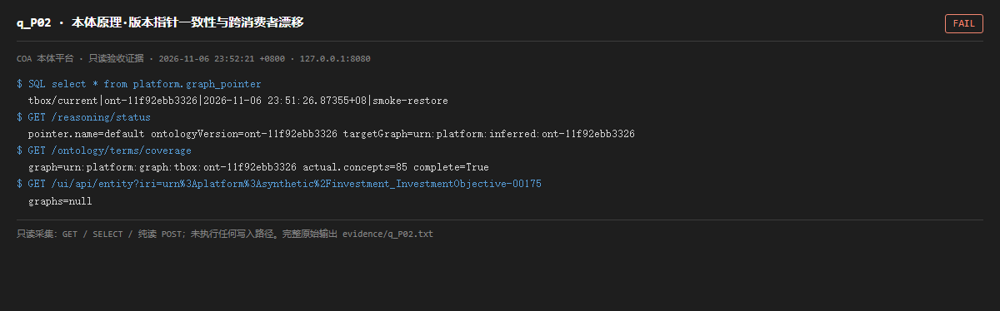

# q_P02 · 本体原理·版本指针一致性与跨消费者漂移

| 项 | 内容 |
| --- | --- |
| 用例编号 | `q_P02` |
| 特性名称 | 本体原理·版本指针一致性与跨消费者漂移 |
| 分组 | F 本体原理专项 |
| 文档依据 | 10-实施路线图.md S1/S11；50-B05-指标词表入SKOS.md |
| 采集时间 | 2026-11-06 23:52:21 +0800 |
| 结论 | **FAIL** |
| 证据截图 |  |
| 完整原始输出 | `evidence/q_P02.txt` |

## 1 测试目标

检查 tbox/current 指针、推理器默认指针、术语覆盖所用的图、实体页引用的图是否指向同一本体版本。

## 2 输入

- `SQL: SELECT * FROM platform.graph_pointer`
- `GET /reasoning/status（pointer）`
- `GET /ontology/terms/coverage（graph）`
- `GET /ui/api/entity（graphs）`

> 零污染约束：以上输入均为 HTTP GET、只读 SQL `SELECT`、只读 SPARQL `SELECT`，以及一个已确认不写库的纯读 `POST /context/resolve`。未调用 `/answer`（会写 PROV 拒答事件）、未运行 smoke/acceptance、未触发任何 seed / refresh / import / materialize / approve / publish / reindex / rollback 写路径。

## 3 期待输出

同一时刻，所有消费者应解析到同一个已发布 ontologyVersion；切换版本时词表/SHACL/推理产物应同步迁移。

## 4 真实输出

```
$ SQL select * from platform.graph_pointer
  tbox/current|ont-11f92ebb3326|2026-11-06 23:51:26.87355+08|smoke-restore
$ GET /reasoning/status
  pointer.name=default ontologyVersion=ont-11f92ebb3326 targetGraph=urn:platform:inferred:ont-11f92ebb3326
$ GET /ontology/terms/coverage
  graph=urn:platform:graph:tbox:ont-11f92ebb3326 actual.concepts=85 complete=True
$ GET /ui/api/entity?iri=urn%3Aplatform%3Asynthetic%2Finvestment_InvestmentObjective-00175
  graphs=null
```

> 为控制篇幅，上面是结构化摘要；完整原始响应见 `evidence/q_P02.txt`，终端渲染截图见 `screenshots/q_P02.png`。

## 5 结论

**FAIL** — graph_pointer 的 tbox/current 在审计期间被 smoke-restore 反复改写；推理器 pointer 名为 default 且版本与 tbox/current 不同；术语覆盖固定查另一个 T-Box 图且返回 0/85；实体页 graphs 里同时出现 T-Box、inferred、A-Box 多个版本。多消费者没有共享同一个版本解析函数。

从本体原理讲，T-Box 版本切换应当是原子的：指针、词表、shapes、推理输入、A-Box 校验规则要么一起切，要么都不切。现在只有指针被切了，其余是各自记着自己的版本，于是「发布了新版本」反而让术语、推理、覆盖度集体失效。这比单个功能 bug 更值得优先修。

---
[返回总报告](README.md)
