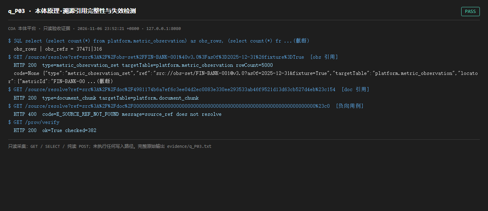

# q_P03 · 本体原理·溯源引用完整性与失效检测

| 项 | 内容 |
| --- | --- |
| 用例编号 | `q_P03` |
| 特性名称 | 本体原理·溯源引用完整性与失效检测 |
| 分组 | F 本体原理专项 |
| 文档依据 | 10-实施路线图.md S9/S10/S12；PROV-O 溯源原理 |
| 采集时间 | 2026-11-06 23:52:21 +0800 |
| 结论 | **PASS** |
| 证据截图 |  |
| 完整原始输出 | `evidence/q_P03.txt` |

## 1 测试目标

检查 source_ref 注册表与实例层是否一致，并验证 /source/resolve 对「有效 / 不存在的引用」能否分级报错而非静默返回。

## 2 输入

- `SQL: metric_observation 行数 vs src://obs* 引用数`
- `GET /source/resolve?ref=<有效 src://obs-set/...>`
- `GET /source/resolve?ref=<有效 src://doc/...>`
- `GET /source/resolve?ref=<不存在的 src://doc/000...#c0>（负向用例）`
- `GET /prov/verify`

> 零污染约束：以上输入均为 HTTP GET、只读 SQL `SELECT`、只读 SPARQL `SELECT`，以及一个已确认不写库的纯读 `POST /context/resolve`。未调用 `/answer`（会写 PROV 拒答事件）、未运行 smoke/acceptance、未触发任何 seed / refresh / import / materialize / approve / publish / reindex / rollback 写路径。

## 3 期待输出

有效引用应解析出 targetTable 与定位；不存在的引用应返回 E_SOURCE_REF_NOT_FOUND / E_SOURCE_REF_STALE；PROV 哈希链仍 ok=true。

## 4 真实输出

```
$ SQL select (select count(*) from platform.metric_observation) as obs_rows, (select count(*) fr ...(截断)
  obs_rows | obs_refs = 37471|316
$ GET /source/resolve?ref=src%3A%2F%2Fobs-set%2FFIN-BANK-001%40v3.0%3FasOf%3D2025-12-31%26fixture%3DTrue  [obs 引用]
  HTTP 200  type=metric_observation_set targetTable=platform.metric_observation rowCount=5000
  code=None {"type":"metric_observation_set","ref":"src://obs-set/FIN-BANK-001@v3.0?asOf=2025-12-31&fixture=True","targetTable":"platform.metric_observation","locator":{"metricId":"FIN-BANK-00 ...(截断)
$ GET /source/resolve?ref=src%3A%2F%2Fdoc%2F4981174b6a7ef6c3ee04d2ec0083e330ee293533ab46f9521d13d63cb527d4eb%23c154  [doc 引用]
  HTTP 200  type=document_chunk targetTable=platform.document_chunk
$ GET /source/resolve?ref=src%3A%2F%2Fdoc%2F0000000000000000000000000000000000000000000000000000000000000000%23c0  [负向用例]
  HTTP 400  code=E_SOURCE_REF_NOT_FOUND message=source_ref does not resolve
$ GET /prov/verify
  HTTP 200  ok=True checked=382
```

> 为控制篇幅，上面是结构化摘要；完整原始响应见 `evidence/q_P03.txt`，终端渲染截图见 `screenshots/q_P03.png`。

## 5 结论

**PASS** — 有效 obs/doc 引用均解析出 targetTable 与行定位，不存在的引用返回 400 E_SOURCE_REF_NOT_FOUND，PROV 哈希链 ok=true 且 T-Box/PROV 图分离成立。更早的基线时刻（观测表为 0 行、注册表残留 src://obs* 引用）同一 obs 引用返回 E_SOURCE_REF_STALE「ref was issued but its source row is gone」，即失效与不存在被区分成两种错误码。

这一用例意外记录到一次完整的环境变更：审计开始时观测表 0 行、obs 引用悬空；审计过程中并行开发线回填观测数据后，同一引用恢复可解析。平台没有为了「引用可解析率 100%」去伪造源行，而是按真实状态分级报错，设计是扎实的。但它也说明「可出数 / 可溯源」高度依赖 seed 是否跑过——对外叙述必须区分「定义完备」「数据已回填」「当前可出数」三件事。

---
[返回总报告](README.md)
