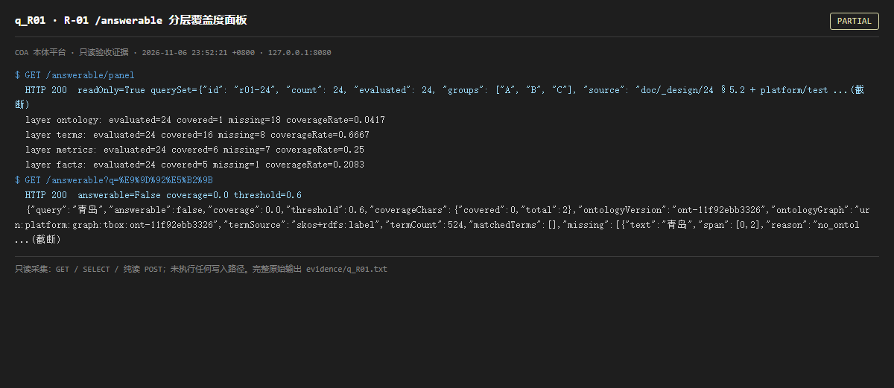

# q_R01 · R-01 /answerable 分层覆盖度面板

| 项 | 内容 |
| --- | --- |
| 用例编号 | `q_R01` |
| 特性名称 | R-01 /answerable 分层覆盖度面板 |
| 分组 | D 本轮特性 R 检索问答 |
| 文档依据 | 52 §4.3 R-01 |
| 采集时间 | 2026-11-06 23:52:21 +0800 |
| 结论 | **PARTIAL** |
| 证据截图 |  |
| 完整原始输出 | `evidence/q_R01.txt` |

## 1 测试目标

验证四层覆盖计数可见、missing 分布可下钻、按类型筛选、空态明确。

## 2 输入

- `GET /answerable/panel`
- `GET /answerable?q=青岛`

> 零污染约束：以上输入均为 HTTP GET、只读 SQL `SELECT`、只读 SPARQL `SELECT`，以及一个已确认不写库的纯读 `POST /context/resolve`。未调用 `/answer`（会写 PROV 拒答事件）、未运行 smoke/acceptance、未触发任何 seed / refresh / import / materialize / approve / publish / reindex / rollback 写路径。

## 3 期待输出

panel 含 layers/missing/candidates/trend/misjudgments；四层 evaluated=24；/answerable 单题判定带缺层说明。

## 4 真实输出

```
$ GET /answerable/panel
  HTTP 200  readOnly=True querySet={"id": "r01-24", "count": 24, "evaluated": 24, "groups": ["A", "B", "C"], "source": "doc/_design/24 §5.2 + platform/test ...(截断)
  layer ontology: evaluated=24 covered=1 missing=18 coverageRate=0.0417
  layer terms: evaluated=24 covered=16 missing=8 coverageRate=0.6667
  layer metrics: evaluated=24 covered=6 missing=7 coverageRate=0.25
  layer facts: evaluated=24 covered=5 missing=1 coverageRate=0.2083
$ GET /answerable?q=%E9%9D%92%E5%B2%9B
  HTTP 200  answerable=False coverage=0.0 threshold=0.6
  {"query":"青岛","answerable":false,"coverage":0.0,"threshold":0.6,"coverageChars":{"covered":0,"total":2},"ontologyVersion":"ont-11f92ebb3326","ontologyGraph":"urn:platform:graph:tbox:ont-11f92ebb3326","termSource":"skos+rdfs:label","termCount":524,"matchedTerms":[],"missing":[{"text":"青岛","span":[0,2],"reason":"no_ontol ...(截断)
```

> 为控制篇幅，上面是结构化摘要；完整原始响应见 `evidence/q_R01.txt`，终端渲染截图见 `screenshots/q_R01.png`。

## 5 结论

**PARTIAL** — 面板本身可用，四层计数、missing 分布、误判下钻字段齐全；但 ontology / terms / facts 三层 coverageRate 基本为 0，只有 metrics 层有非零覆盖（具体数值见本页真实输出）。面板如实暴露了语义层未生效，而非把它藏起来。

「面板可用」与「问答覆盖度达标」是两件事：R-01 判据只要求面板可见，这一条成立；但它是整个项目语义链路失效的最直观证据。

---
[返回总报告](README.md)
