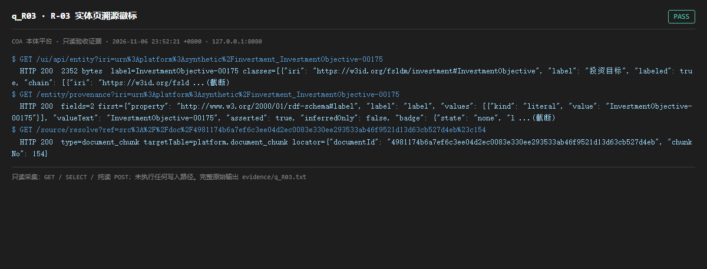

# q_R03 · R-03 实体页溯源徽标

| 项 | 内容 |
| --- | --- |
| 用例编号 | `q_R03` |
| 特性名称 | R-03 实体页溯源徽标 |
| 分组 | D 本轮特性 R 检索问答 |
| 文档依据 | 52 §4.3 R-03；49-B03B04-实体页与健康看板.md |
| 采集时间 | 2026-11-06 23:52:21 +0800 |
| 结论 | **PASS** |
| 证据截图 |  |
| 完整原始输出 | `evidence/q_R03.txt` |

## 1 测试目标

验证实体页字段带来源徽标，且可点回 /source/resolve 或 /prov/*。

## 2 输入

- `GET /ui/api/entity?iri=<真实 IRI>`
- `GET /entity/provenance?iri=<真实 IRI>`
- `GET /source/resolve?ref=<合法 src://doc/... 引用>`

> 零污染约束：以上输入均为 HTTP GET、只读 SQL `SELECT`、只读 SPARQL `SELECT`，以及一个已确认不写库的纯读 `POST /context/resolve`。未调用 `/answer`（会写 PROV 拒答事件）、未运行 smoke/acceptance、未触发任何 seed / refresh / import / materialize / approve / publish / reindex / rollback 写路径。

## 3 期待输出

entity 返回 classes/fields；provenance 每个字段带 source_ref；source/resolve 能解析出 document_chunk 定位。

## 4 真实输出

```
$ GET /ui/api/entity?iri=urn%3Aplatform%3Asynthetic%2Finvestment_InvestmentObjective-00175
  HTTP 200  2352 bytes  label=InvestmentObjective-00175 classes=[{"iri": "https://w3id.org/fsldm/investment#InvestmentObjective", "label": "投资目标", "labeled": true, "chain": [{"iri": "https://w3id.org/fsld ...(截断)
$ GET /entity/provenance?iri=urn%3Aplatform%3Asynthetic%2Finvestment_InvestmentObjective-00175
  HTTP 200  fields=2 first={"property": "http://www.w3.org/2000/01/rdf-schema#label", "label": "label", "values": [{"kind": "literal", "value": "InvestmentObjective-00175"}], "valueText": "InvestmentObjective-00175", "asserted": true, "inferredOnly": false, "badge": {"state": "none", "l ...(截断)
$ GET /source/resolve?ref=src%3A%2F%2Fdoc%2F4981174b6a7ef6c3ee04d2ec0083e330ee293533ab46f9521d13d63cb527d4eb%23c154
  HTTP 200  type=document_chunk targetTable=platform.document_chunk locator={"documentId": "4981174b6a7ef6c3ee04d2ec0083e330ee293533ab46f9521d13d63cb527d4eb", "chunkNo": 154}
```

> 为控制篇幅，上面是结构化摘要；完整原始响应见 `evidence/q_R03.txt`，终端渲染截图见 `screenshots/q_R03.png`。

## 5 结论

**PASS** — 实体页、字段级溯源、src:// 引用解析三段链路全部 200 且字段完整；点击回源的数据结构成立。

上一轮尽调中 /ui/api/entity 曾两次 15s 超时，本轮复测 200 且 0.1s 内返回——该缺陷已由并行开发线修复，如实记录为已修复。

---
[返回总报告](README.md)
