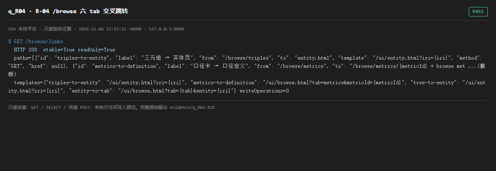

# q_R04 · R-04 /browse 六 tab 交叉跳转

| 项 | 内容 |
| --- | --- |
| 用例编号 | `q_R04` |
| 特性名称 | R-04 /browse 六 tab 交叉跳转 |
| 分组 | D 本轮特性 R 检索问答 |
| 文档依据 | 52 §4.3 R-04；53-D1-画布多跳双实现.md |
| 采集时间 | 2026-11-06 23:52:21 +0800 |
| 结论 | **PASS** |
| 证据截图 |  |
| 完整原始输出 | `evidence/q_R04.txt` |

## 1 测试目标

验证交叉跳转的路径模板已注册、URL 稳定、且明确不新增写操作。

## 2 输入

- `GET /browse/links`

> 零污染约束：以上输入均为 HTTP GET、只读 SQL `SELECT`、只读 SPARQL `SELECT`，以及一个已确认不写库的纯读 `POST /context/resolve`。未调用 `/answer`（会写 PROV 拒答事件）、未运行 smoke/acceptance、未触发任何 seed / refresh / import / materialize / approve / publish / reindex / rollback 写路径。

## 3 期待输出

返回 paths/templates/artifacts，stable=true、readOnly=true、writeOperations 为空或明确列出只读。

## 4 真实输出

```
$ GET /browse/links
  HTTP 200  stable=True readOnly=True
  paths=[{"id": "triples-to-entity", "label": "三元组 → 实体页", "from": "/browse/triples", "to": "entity.html", "template": "/ui/entity.html?iri={iri}", "method": "GET", "href": null}, {"id": "metrics-to-definition", "label": "口径卡 → 口径定义", "from": "/browse/metrics", "to": "/browse/metrics/{metricId} + browse met ...(截断)
  templates={"triples-to-entity": "/ui/entity.html?iri={iri}", "metrics-to-definition": "/ui/browse.html?tab=metrics&metricId={metricId}", "tree-to-entity": "/ui/entity.html?iri={iri}", "entity-to-tab": "/ui/browse.html?tab={tab}&entity={iri}"} writeOperations=0
```

> 为控制篇幅，上面是结构化摘要；完整原始响应见 `evidence/q_R04.txt`，终端渲染截图见 `screenshots/q_R04.png`。

## 5 结论

**PASS** — 跳转模板与稳定 URL 已注册且标记 readOnly。

本环境无浏览器，未做「点击级」验证，仅验证契约端点。

---
[返回总报告](README.md)
