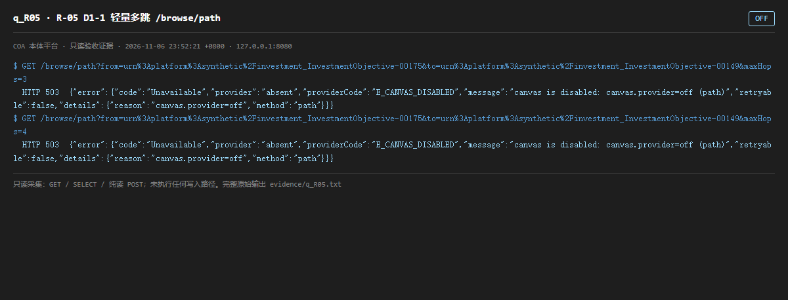

# q_R05 · R-05 D1-1 轻量多跳 /browse/path

| 项 | 内容 |
| --- | --- |
| 用例编号 | `q_R05` |
| 特性名称 | R-05 D1-1 轻量多跳 /browse/path |
| 分组 | D 本轮特性 R 检索问答 |
| 文档依据 | 55-R05-轻量多跳落地.md；53-D1-画布多跳双实现.md |
| 采集时间 | 2026-11-06 23:52:21 +0800 |
| 结论 | **OFF** |
| 证据截图 |  |
| 完整原始输出 | `evidence/q_R05.txt` |

## 1 测试目标

验证 3 组固定实体对能返回路径、maxHops≤3 生效、超出返回 E_CANVAS_HOPS_EXCEEDED。

## 2 输入

- `GET /browse/path?from=<IRI1>&to=<IRI2>&maxHops=3`
- `GET /browse/path?from=<IRI1>&to=<IRI2>&maxHops=4`
- `SQL/源码: config.py CanvasConfig.provider 默认值`

> 零污染约束：以上输入均为 HTTP GET、只读 SQL `SELECT`、只读 SPARQL `SELECT`，以及一个已确认不写库的纯读 `POST /context/resolve`。未调用 `/answer`（会写 PROV 拒答事件）、未运行 smoke/acceptance、未触发任何 seed / refresh / import / materialize / approve / publish / reindex / rollback 写路径。

## 3 期待输出

按 55 号 §5：正常返回路径；maxHops=4 返回 E_CANVAS_HOPS_EXCEEDED。

## 4 真实输出

```
$ GET /browse/path?from=urn%3Aplatform%3Asynthetic%2Finvestment_InvestmentObjective-00175&to=urn%3Aplatform%3Asynthetic%2Finvestment_InvestmentObjective-00149&maxHops=3
  HTTP 503  {"error":{"code":"Unavailable","provider":"absent","providerCode":"E_CANVAS_DISABLED","message":"canvas is disabled: canvas.provider=off (path)","retryable":false,"details":{"reason":"canvas.provider=off","method":"path"}}}
$ GET /browse/path?from=urn%3Aplatform%3Asynthetic%2Finvestment_InvestmentObjective-00175&to=urn%3Aplatform%3Asynthetic%2Finvestment_InvestmentObjective-00149&maxHops=4
  HTTP 503  {"error":{"code":"Unavailable","provider":"absent","providerCode":"E_CANVAS_DISABLED","message":"canvas is disabled: canvas.provider=off (path)","retryable":false,"details":{"reason":"canvas.provider=off","method":"path"}}}
```

> 为控制篇幅，上面是结构化摘要；完整原始响应见 `evidence/q_R05.txt`，终端渲染截图见 `screenshots/q_R05.png`。

## 5 结论

**OFF** — 两次均返回 503 E_CANVAS_DISABLED（canvas is disabled: canvas.provider=off）。源码 config.py:60 确认 CanvasConfig.provider 默认 'off'，53 号文档允许「同一接口、两个实现、配置切换」，因此这是设计内的默认关闭，不是功能缺失。

但 52 号把 R-05 标为「已完成」、55 号给出「3 组固定实体对返回路径」的验收结果；在默认部署下该判据不可复现。建议文档把状态改为「已实现 / 默认未启用」，并给出启用配置，否则容易被读成已上线。

---
[返回总报告](README.md)
