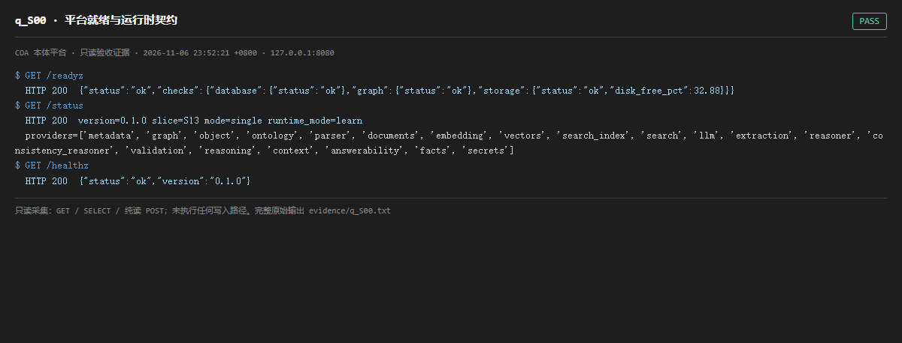

# q_S00 · 平台就绪与运行时契约

| 项 | 内容 |
| --- | --- |
| 用例编号 | `q_S00` |
| 特性名称 | 平台就绪与运行时契约 |
| 分组 | A 核心工作流 S0-S14 |
| 文档依据 | 10-实施路线图.md S0；45-产品架构介绍.md |
| 采集时间 | 2026-11-06 23:52:21 +0800 |
| 结论 | **PASS** |
| 证据截图 |  |
| 完整原始输出 | `evidence/q_S00.txt` |

## 1 测试目标

验证单机平台能被健康检查识别，且 /status 声明的 provider、slice、runtime_mode 与实际组件一致。

## 2 输入

- `GET /readyz`
- `GET /status`
- `GET /healthz`

> 零污染约束：以上输入均为 HTTP GET、只读 SQL `SELECT`、只读 SPARQL `SELECT`，以及一个已确认不写库的纯读 `POST /context/resolve`。未调用 `/answer`（会写 PROV 拒答事件）、未运行 smoke/acceptance、未触发任何 seed / refresh / import / materialize / approve / publish / reindex / rollback 写路径。

## 3 期待输出

HTTP 200；readyz 的 database/graph/storage 三项均为 ok；status 返回 version、slice、mode=single、providers 元数据和 postgres/oxigraph 适配器。

## 4 真实输出

```
$ GET /readyz
  HTTP 200  {"status":"ok","checks":{"database":{"status":"ok"},"graph":{"status":"ok"},"storage":{"status":"ok","disk_free_pct":32.88}}}
$ GET /status
  HTTP 200  version=0.1.0 slice=S13 mode=single runtime_mode=learn
  providers=['metadata', 'graph', 'object', 'ontology', 'parser', 'documents', 'embedding', 'vectors', 'search_index', 'search', 'llm', 'extraction', 'reasoner', 'consistency_reasoner', 'validation', 'reasoning', 'context', 'answerability', 'facts', 'secrets']
$ GET /healthz
  HTTP 200  {"status":"ok","version":"0.1.0"}
```

> 为控制篇幅，上面是结构化摘要；完整原始响应见 `evidence/q_S00.txt`，终端渲染截图见 `screenshots/q_S00.png`。

## 5 结论

**PASS** — 三项健康端点均为 200，database/graph/storage 全 ok；providers 声明 metadata=postgres、graph=oxigraph-http，与 docker compose 实际服务一致。

注意 status 仍自报 slice=S13，而文档已宣称 S14 与 17 条 O/M/R 特性完成——这是未回写的元数据漂移，非功能故障。

---
[返回总报告](README.md)
