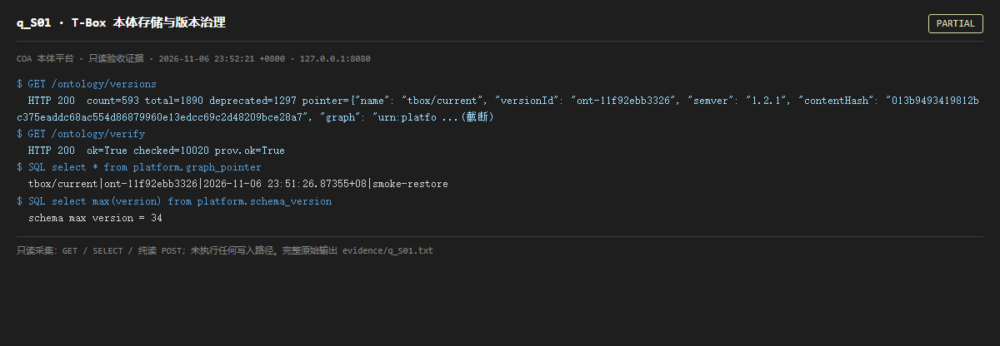

# q_S01 · T-Box 本体存储与版本治理

| 项 | 内容 |
| --- | --- |
| 用例编号 | `q_S01` |
| 特性名称 | T-Box 本体存储与版本治理 |
| 分组 | A 核心工作流 S0-S14 |
| 文档依据 | 10-实施路线图.md S1；S11；52 §4.1 O-02 |
| 采集时间 | 2026-11-06 23:52:21 +0800 |
| 结论 | **PARTIAL** |
| 证据截图 |  |
| 完整原始输出 | `evidence/q_S01.txt` |

## 1 测试目标

验证 T-Box 以命名图形式存入图库、版本可枚举、当前指针可读、审计链可校验。

## 2 输入

- `GET /ontology/versions`
- `GET /ontology/verify`
- `SQL: SELECT * FROM platform.graph_pointer`
- `SQL: SELECT max(version) FROM platform.schema_version`

> 零污染约束：以上输入均为 HTTP GET、只读 SQL `SELECT`、只读 SPARQL `SELECT`，以及一个已确认不写库的纯读 `POST /context/resolve`。未调用 `/answer`（会写 PROV 拒答事件）、未运行 smoke/acceptance、未触发任何 seed / refresh / import / materialize / approve / publish / reindex / rollback 写路径。

## 3 期待输出

存在大量 ontology_version 记录；/ontology/verify ok=true；graph_pointer 只有唯一 tbox/current 且 version_id 指向已发布版本；关系 schema 版本与代码迁移头一致。

## 4 真实输出

```
$ GET /ontology/versions
  HTTP 200  count=593 total=1890 deprecated=1297 pointer={"name": "tbox/current", "versionId": "ont-11f92ebb3326", "semver": "1.2.1", "contentHash": "013b9493419812bc375eaddc68ac554d86879960e13edcc69c2d48209bce28a7", "graph": "urn:platfo ...(截断)
$ GET /ontology/verify
  HTTP 200  ok=True checked=10020 prov.ok=True
$ SQL select * from platform.graph_pointer
  tbox/current|ont-11f92ebb3326|2026-11-06 23:51:26.87355+08|smoke-restore
$ SQL select max(version) from platform.schema_version
  schema max version = 34
```

> 为控制篇幅，上面是结构化摘要；完整原始响应见 `evidence/q_S01.txt`，终端渲染截图见 `screenshots/q_S01.png`。

## 5 结论

**PARTIAL** — 版本枚举为千条量级、审计链 ok=true 均成立；但审计期间 graph_pointer 的 tbox/current 被外部 smoke-restore 反复改写，且与 /reasoning/status、/ontology/terms/coverage 使用的版本不同，见 q_P02。

版本机制本身可用，缺的是「多指针/多消费者的一致性约束」。这也是本次审计里最值得从架构层面修的一点。

---
[返回总报告](README.md)
