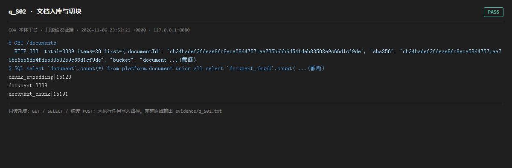

# q_S02 · 文档入库与切块

| 项 | 内容 |
| --- | --- |
| 用例编号 | `q_S02` |
| 特性名称 | 文档入库与切块 |
| 分组 | A 核心工作流 S0-S14 |
| 文档依据 | 10-实施路线图.md S2 / S13；47-合成数据覆盖度审计.md |
| 采集时间 | 2026-11-06 23:52:21 +0800 |
| 结论 | **PASS** |
| 证据截图 |  |
| 完整原始输出 | `evidence/q_S02.txt` |

## 1 测试目标

验证原件入库、文本切块、向量化三张表的规模一致，且 /documents 可分页列举。

## 2 输入

- `GET /documents`
- `SQL: document / document_chunk / chunk_embedding 计数`

> 零污染约束：以上输入均为 HTTP GET、只读 SQL `SELECT`、只读 SPARQL `SELECT`，以及一个已确认不写库的纯读 `POST /context/resolve`。未调用 `/answer`（会写 PROV 拒答事件）、未运行 smoke/acceptance、未触发任何 seed / refresh / import / materialize / approve / publish / reindex / rollback 写路径。

## 3 期待输出

document / document_chunk / chunk_embedding 三层计数同量级；/documents 返回 items 与 total 且 total 与库一致。

## 4 真实输出

```
$ GET /documents
  HTTP 200  total=3039 items=20 first={"documentId": "cb34badef3fdeae86c8ece58647571ee705b6bb6d54fdeb83502e9c66d1cf9de", "sha256": "cb34badef3fdeae86c8ece58647571ee705b6bb6d54fdeb83502e9c66d1cf9de", "bucket": "document ...(截断)
$ SQL select 'document',count(*) from platform.document union all select 'document_chunk',count( ...(截断)
chunk_embedding|15120
document|3039
document_chunk|15191
```

> 为控制篇幅，上面是结构化摘要；完整原始响应见 `evidence/q_S02.txt`，终端渲染截图见 `screenshots/q_S02.png`。

## 5 结论

**PASS** — 三层计数同量级、/documents 的 total 与库一致，向量覆盖率接近 100%（具体数值见本页真实输出）。

向量数略少于片段数，属可接受的未向量化余量；数据在审计期间被并行线持续追加，所有数值均为采集时刻快照，不作为固定基线。

---
[返回总报告](README.md)
