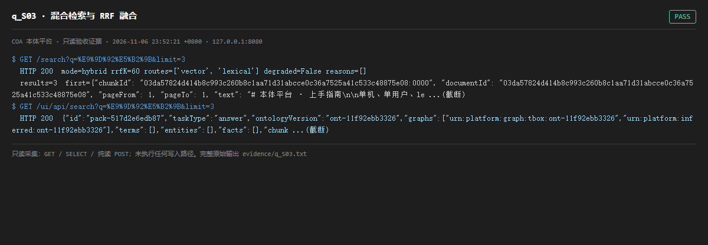

# q_S03 · 混合检索与 RRF 融合

| 项 | 内容 |
| --- | --- |
| 用例编号 | `q_S03` |
| 特性名称 | 混合检索与 RRF 融合 |
| 分组 | A 核心工作流 S0-S14 |
| 文档依据 | 10-实施路线图.md S3；45-产品架构介绍.md |
| 采集时间 | 2026-11-06 23:52:21 +0800 |
| 结论 | **PASS** |
| 证据截图 |  |
| 完整原始输出 | `evidence/q_S03.txt` |

## 1 测试目标

验证 pgvector + FTS 双路召回、RRF(k=60) 融合，且非降级模式。

## 2 输入

- `GET /search?q=青岛&limit=3`
- `GET /ui/api/search?q=青岛&limit=3`

> 零污染约束：以上输入均为 HTTP GET、只读 SQL `SELECT`、只读 SPARQL `SELECT`，以及一个已确认不写库的纯读 `POST /context/resolve`。未调用 `/answer`（会写 PROV 拒答事件）、未运行 smoke/acceptance、未触发任何 seed / refresh / import / materialize / approve / publish / reindex / rollback 写路径。

## 3 期待输出

HTTP 200；mode=hybrid、rrfK=60、routes 含 vector 与 lexical、degraded=false、results 非空且每条带 chunkId 与 citation。

## 4 真实输出

```
$ GET /search?q=%E9%9D%92%E5%B2%9B&limit=3
  HTTP 200  mode=hybrid rrfK=60 routes=['vector', 'lexical'] degraded=False reasons=[]
  results=3  first={"chunkId": "03da57824d414b8c993c260b8c1aa71d31abcce0c36a7525a41c533c48875e08:0000", "documentId": "03da57824d414b8c993c260b8c1aa71d31abcce0c36a7525a41c533c48875e08", "pageFrom": 1, "pageTo": 1, "text": "# 本体平台 · 上手指南\n\n单机、单用户、le ...(截断)
$ GET /ui/api/search?q=%E9%9D%92%E5%B2%9B&limit=3
  HTTP 200  {"id":"pack-517d2e6edb87","taskType":"answer","ontologyVersion":"ont-11f92ebb3326","graphs":["urn:platform:graph:tbox:ont-11f92ebb3326","urn:platform:inferred:ont-11f92ebb3326"],"terms":[],"entities":[],"facts":[],"chunk ...(截断)
```

> 为控制篇幅，上面是结构化摘要；完整原始响应见 `evidence/q_S03.txt`，终端渲染截图见 `screenshots/q_S03.png`。

## 5 结论

**PASS** — 双路召回与 RRF 参数均按设计返回，degraded=false，结果非空。

注意：/search 能召回「青岛」相关片段，但 /answerable?q=青岛 仍判定 coverage=0（见 q_R01）——检索层与可答性判定层用的是两套覆盖口径。

---
[返回总报告](README.md)
