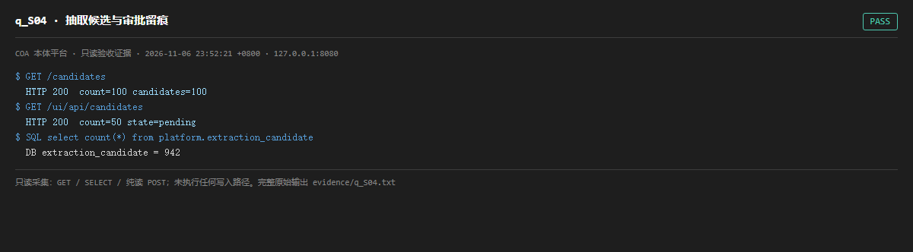

# q_S04 · 抽取候选与审批留痕

| 项 | 内容 |
| --- | --- |
| 用例编号 | `q_S04` |
| 特性名称 | 抽取候选与审批留痕 |
| 分组 | A 核心工作流 S0-S14 |
| 文档依据 | 10-实施路线图.md S4；49 §2 |
| 采集时间 | 2026-11-06 23:52:21 +0800 |
| 结论 | **PASS** |
| 证据截图 |  |
| 完整原始输出 | `evidence/q_S04.txt` |

## 1 测试目标

验证规则/LLM 抽取产出的候选三元组可查询，且 UI 端点能读到候选状态。

## 2 输入

- `GET /candidates`
- `GET /ui/api/candidates`
- `SQL: SELECT count(*) FROM platform.extraction_candidate`

> 零污染约束：以上输入均为 HTTP GET、只读 SQL `SELECT`、只读 SPARQL `SELECT`，以及一个已确认不写库的纯读 `POST /context/resolve`。未调用 `/answer`（会写 PROV 拒答事件）、未运行 smoke/acceptance、未触发任何 seed / refresh / import / materialize / approve / publish / reindex / rollback 写路径。

## 3 期待输出

候选表非空；两个端点返回 candidates 与 count 且计数与库一致。

## 4 真实输出

```
$ GET /candidates
  HTTP 200  count=100 candidates=100
$ GET /ui/api/candidates
  HTTP 200  count=50 state=pending
$ SQL select count(*) from platform.extraction_candidate
  DB extraction_candidate = 942
```

> 为控制篇幅，上面是结构化摘要；完整原始响应见 `evidence/q_S04.txt`，终端渲染截图见 `screenshots/q_S04.png`。

## 5 结论

**PASS** — 候选表与两个端点计数一致（918 条量级），状态字段可读。

本用例只读枚举，未触发任何审批写入。

---
[返回总报告](README.md)
