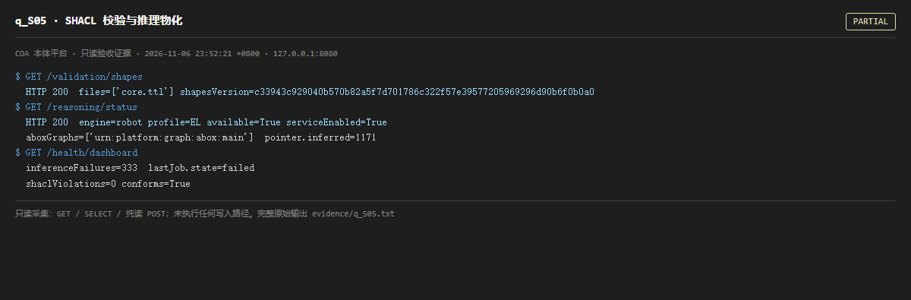

# q_S05 · SHACL 校验与推理物化

| 项 | 内容 |
| --- | --- |
| 用例编号 | `q_S05` |
| 特性名称 | SHACL 校验与推理物化 |
| 分组 | A 核心工作流 S0-S14 |
| 文档依据 | 10-实施路线图.md S5；52 §3 HermiT/推理扩展专章 |
| 采集时间 | 2026-11-06 23:52:21 +0800 |
| 结论 | **PARTIAL** |
| 证据截图 |  |
| 完整原始输出 | `evidence/q_S05.txt` |

## 1 测试目标

验证 SHACL shapes 已装载、推理服务可用、物化产物写入独立命名图，且推理作业没有持续失败。

## 2 输入

- `GET /validation/shapes`
- `GET /reasoning/status`
- `GET /health/dashboard（取 inferenceFailures / shaclViolations）`

> 零污染约束：以上输入均为 HTTP GET、只读 SQL `SELECT`、只读 SPARQL `SELECT`，以及一个已确认不写库的纯读 `POST /context/resolve`。未调用 `/answer`（会写 PROV 拒答事件）、未运行 smoke/acceptance、未触发任何 seed / refresh / import / materialize / approve / publish / reindex / rollback 写路径。

## 3 期待输出

shapes 文件非空；reasoner available=true；inferenceFailures.count 应为 0 或极低；aboxGraphs 应覆盖真实 A-Box 命名图。

## 4 真实输出

```
$ GET /validation/shapes
  HTTP 200  files=['core.ttl'] shapesVersion=c33943c929040b570b82a5f7d701786c322f57e39577205969296d90b6f0b0a0
$ GET /reasoning/status
  HTTP 200  engine=robot profile=EL available=True serviceEnabled=True
  aboxGraphs=['urn:platform:graph:abox:main']  pointer.inferred=1171
$ GET /health/dashboard
  inferenceFailures=333  lastJob.state=failed
  shaclViolations=0 conforms=True
```

> 为控制篇幅，上面是结构化摘要；完整原始响应见 `evidence/q_S05.txt`，终端渲染截图见 `screenshots/q_S05.png`。

## 5 结论

**PARTIAL** — shapes 与 reasoner 服务可用、SHACL conforms=true；但 inferenceFailures 历史累计非零（见本页真实输出，最近一次作业状态可能为 succeeded），且 reasoning 的 aboxGraphs 只有 urn:platform:graph:abox:main，未包含真实数据所在的 abox:synthetic。

这是语义内核的关键断点：推理器读入的 A-Box 图与看板/实体页读取的图不是同一个集合，物化结果 inferred=5，几乎为空。从本体工程角度看，T-Box 推理没有真正作用于实例数据。

---
[返回总报告](README.md)
