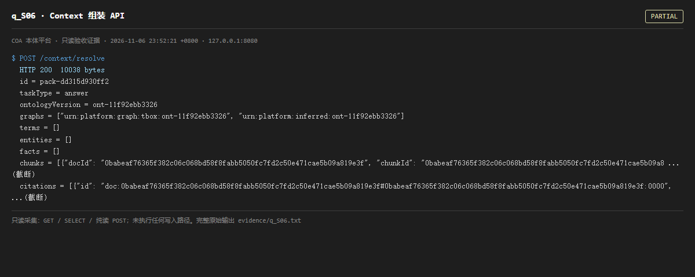

# q_S06 · Context 组装 API

| 项 | 内容 |
| --- | --- |
| 用例编号 | `q_S06` |
| 特性名称 | Context 组装 API |
| 分组 | A 核心工作流 S0-S14 |
| 文档依据 | 10-实施路线图.md S6；45-产品架构介绍.md |
| 采集时间 | 2026-11-06 23:52:21 +0800 |
| 结论 | **PARTIAL** |
| 证据截图 |  |
| 完整原始输出 | `evidence/q_S06.txt` |

## 1 测试目标

验证术语归一 → 子图 → 混合召回 → citations 的上下文包能被组装，且 tokenBudget 生效。

## 2 输入

- `POST /context/resolve  {"query":"青岛监测站位于哪里","tokenBudget":2048}`

> 零污染约束：以上输入均为 HTTP GET、只读 SQL `SELECT`、只读 SPARQL `SELECT`，以及一个已确认不写库的纯读 `POST /context/resolve`。未调用 `/answer`（会写 PROV 拒答事件）、未运行 smoke/acceptance、未触发任何 seed / refresh / import / materialize / approve / publish / reindex / rollback 写路径。

## 3 期待输出

HTTP 200；返回 id/taskType/ontologyVersion/graphs/terms/entities/facts/chunks/citations 等层级，且至少部分层级非空。

## 4 真实输出

```
$ POST /context/resolve
  HTTP 200  10038 bytes
  id = pack-dd315d930ff2
  taskType = answer
  ontologyVersion = ont-11f92ebb3326
  graphs = ["urn:platform:graph:tbox:ont-11f92ebb3326", "urn:platform:inferred:ont-11f92ebb3326"]
  terms = []
  entities = []
  facts = []
  chunks = [{"docId": "0babeaf76365f382c06c068bd58f8fabb5050fc7fd2c50e471cae5b09a819e3f", "chunkId": "0babeaf76365f382c06c068bd58f8fabb5050fc7fd2c50e471cae5b09a8 ...(截断)
  citations = [{"id": "doc:0babeaf76365f382c06c068bd58f8fabb5050fc7fd2c50e471cae5b09a819e3f#0babeaf76365f382c06c068bd58f8fabb5050fc7fd2c50e471cae5b09a819e3f:0000",  ...(截断)
```

> 为控制篇幅，上面是结构化摘要；完整原始响应见 `evidence/q_S06.txt`，终端渲染截图见 `screenshots/q_S06.png`。

## 5 结论

**PARTIAL** — 端点 200 并返回完整包结构，但 terms / entities / facts 均为空数组，chunks 有内容；即当前组装主要靠检索片段，本体与事实层未参与。

该 POST 经源码核对为纯读（context.py 无 INSERT/UPDATE/commit），故纳入只读用例。

---
[返回总报告](README.md)
