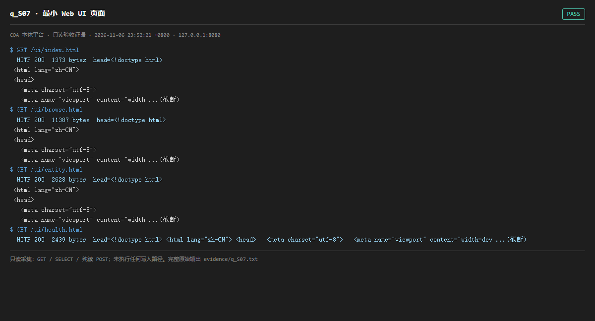

# q_S07 · 最小 Web UI 页面

| 项 | 内容 |
| --- | --- |
| 用例编号 | `q_S07` |
| 特性名称 | 最小 Web UI 页面 |
| 分组 | A 核心工作流 S0-S14 |
| 文档依据 | 10-实施路线图.md S7；46 技术说明书 UI 章节 |
| 采集时间 | 2026-11-06 23:52:21 +0800 |
| 结论 | **PASS** |
| 证据截图 |  |
| 完整原始输出 | `evidence/q_S07.txt` |

## 1 测试目标

验证原生 HTML 前端页面可访问（无构建链），且关键 tab 页面存在。

## 2 输入

- `GET /ui/index.html`
- `GET /ui/browse.html`
- `GET /ui/entity.html`
- `GET /ui/health.html`

> 零污染约束：以上输入均为 HTTP GET、只读 SQL `SELECT`、只读 SPARQL `SELECT`，以及一个已确认不写库的纯读 `POST /context/resolve`。未调用 `/answer`（会写 PROV 拒答事件）、未运行 smoke/acceptance、未触发任何 seed / refresh / import / materialize / approve / publish / reindex / rollback 写路径。

## 3 期待输出

四个页面 HTTP 200 且返回 HTML 文本，非 404 / 非空白。

## 4 真实输出

```
$ GET /ui/index.html
  HTTP 200  1373 bytes  head=<!doctype html>
 <html lang="zh-CN">
 <head>
   <meta charset="utf-8">
   <meta name="viewport" content="width ...(截断)
$ GET /ui/browse.html
  HTTP 200  11387 bytes  head=<!doctype html>
 <html lang="zh-CN">
 <head>
   <meta charset="utf-8">
   <meta name="viewport" content="width ...(截断)
$ GET /ui/entity.html
  HTTP 200  2628 bytes  head=<!doctype html>
 <html lang="zh-CN">
 <head>
   <meta charset="utf-8">
   <meta name="viewport" content="width ...(截断)
$ GET /ui/health.html
  HTTP 200  2439 bytes  head=<!doctype html> <html lang="zh-CN"> <head>   <meta charset="utf-8">   <meta name="viewport" content="width=dev ...(截断)
```

> 为控制篇幅，上面是结构化摘要；完整原始响应见 `evidence/q_S07.txt`，终端渲染截图见 `screenshots/q_S07.png`。

## 5 结论

**PASS** — 四个原生页面全部 200 并返回 HTML 内容。

UI 可用性只做到「页面可加载」，未做浏览器交互级验证（本环境为无头 CLI）。

---
[返回总报告](README.md)
