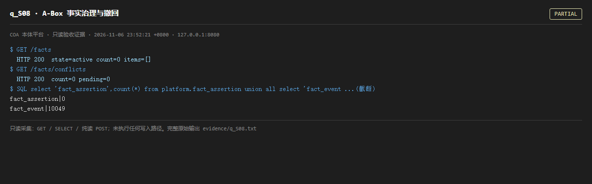

# q_S08 · A-Box 事实治理与撤回

| 项 | 内容 |
| --- | --- |
| 用例编号 | `q_S08` |
| 特性名称 | A-Box 事实治理与撤回 |
| 分组 | A 核心工作流 S0-S14 |
| 文档依据 | 10-实施路线图.md S8；a_progress.md |
| 采集时间 | 2026-11-06 23:52:21 +0800 |
| 结论 | **PARTIAL** |
| 证据截图 |  |
| 完整原始输出 | `evidence/q_S08.txt` |

## 1 测试目标

验证事实断言表、冲突列表、按来源撤回所需的数据结构可读。

## 2 输入

- `GET /facts`
- `GET /facts/conflicts`
- `SQL: fact_assertion / fact_event 计数`

> 零污染约束：以上输入均为 HTTP GET、只读 SQL `SELECT`、只读 SPARQL `SELECT`，以及一个已确认不写库的纯读 `POST /context/resolve`。未调用 `/answer`（会写 PROV 拒答事件）、未运行 smoke/acceptance、未触发任何 seed / refresh / import / materialize / approve / publish / reindex / rollback 写路径。

## 3 期待输出

fact_assertion 应有当前生效断言；/facts 返回 items 与 state；冲突端点返回 pending 计数。

## 4 真实输出

```
$ GET /facts
  HTTP 200  state=active count=0 items=[]
$ GET /facts/conflicts
  HTTP 200  count=0 pending=0
$ SQL select 'fact_assertion',count(*) from platform.fact_assertion union all select 'fact_event ...(截断)
fact_assertion|0
fact_event|10049
```

> 为控制篇幅，上面是结构化摘要；完整原始响应见 `evidence/q_S08.txt`，终端渲染截图见 `screenshots/q_S08.png`。

## 5 结论

**PARTIAL** — 事件账本有近万条历史、端点与冲突结构可读；但 fact_assertion 长期为 0 / 个位数、/facts items 近乎为空（审计期间并行线写入了少量断言），断言层基本处于空库状态，撤回/冲突能力难以在当前数据上演示。

历史链在、当前态为空，不等于功能缺失；但从「可演示」角度不达标。

---
[返回总报告](README.md)
