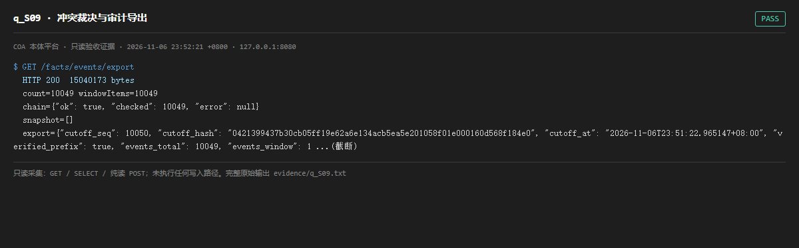

# q_S09 · 冲突裁决与审计导出

| 项 | 内容 |
| --- | --- |
| 用例编号 | `q_S09` |
| 特性名称 | 冲突裁决与审计导出 |
| 分组 | A 核心工作流 S0-S14 |
| 文档依据 | 10-实施路线图.md S9；29-S0-S14-收尾验收清单.md |
| 采集时间 | 2026-11-06 23:52:21 +0800 |
| 结论 | **PASS** |
| 证据截图 |  |
| 完整原始输出 | `evidence/q_S09.txt` |

## 1 测试目标

验证审计事件可导出为 NDJSON，且导出结果自带哈希链信息。

## 2 输入

- `GET /facts/events/export（仅取 chain/snapshot 摘要）`

> 零污染约束：以上输入均为 HTTP GET、只读 SQL `SELECT`、只读 SPARQL `SELECT`，以及一个已确认不写库的纯读 `POST /context/resolve`。未调用 `/answer`（会写 PROV 拒答事件）、未运行 smoke/acceptance、未触发任何 seed / refresh / import / materialize / approve / publish / reindex / rollback 写路径。

## 3 期待输出

HTTP 200；返回 items/count/chain/snapshot/export/ndjson，且 chain 含校验结论。

## 4 真实输出

```
$ GET /facts/events/export
  HTTP 200  15040173 bytes
  count=10049 windowItems=10049
  chain={"ok": true, "checked": 10049, "error": null}
  snapshot=[]
  export={"cutoff_seq": 10050, "cutoff_hash": "0421399437b30cb05ff19e62a6e134acb5ea5e201058f01e000160d568f184e0", "cutoff_at": "2026-11-06T23:51:22.965147+08:00", "verified_prefix": true, "events_total": 10049, "events_window": 1 ...(截断)
```

> 为控制篇幅，上面是结构化摘要；完整原始响应见 `evidence/q_S09.txt`，终端渲染截图见 `screenshots/q_S09.png`。

## 5 结论

**PASS** — 导出端点返回完整事件集合与链信息，量级与 fact_event 计数一致。

导出为纯读；为控制篇幅，md 中只展示摘要字段，完整 NDJSON 在 evidence 快照中。

---
[返回总报告](README.md)
