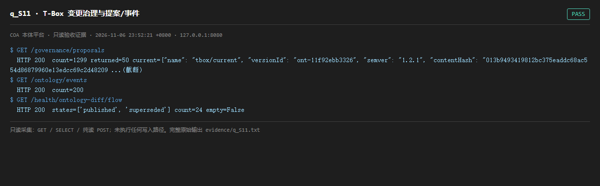

# q_S11 · T-Box 变更治理与提案/事件

| 项 | 内容 |
| --- | --- |
| 用例编号 | `q_S11` |
| 特性名称 | T-Box 变更治理与提案/事件 |
| 分组 | A 核心工作流 S0-S14 |
| 文档依据 | 10-实施路线图.md S11；52 §4.1 O-02 |
| 采集时间 | 2026-11-06 23:52:21 +0800 |
| 结论 | **PASS** |
| 证据截图 |  |
| 完整原始输出 | `evidence/q_S11.txt` |

## 1 测试目标

验证版本生命周期、提案、事件、回滚计划四类治理对象可查询。

## 2 输入

- `GET /governance/proposals`
- `GET /ontology/events`
- `GET /health/ontology-diff/flow`

> 零污染约束：以上输入均为 HTTP GET、只读 SQL `SELECT`、只读 SPARQL `SELECT`，以及一个已确认不写库的纯读 `POST /context/resolve`。未调用 `/answer`（会写 PROV 拒答事件）、未运行 smoke/acceptance、未触发任何 seed / refresh / import / materialize / approve / publish / reindex / rollback 写路径。

## 3 期待输出

三类端点 200 且返回 items/count；flow 返回 states 列表覆盖 proposal→…→superseded。

## 4 真实输出

```
$ GET /governance/proposals
  HTTP 200  count=1299 returned=50 current={"name": "tbox/current", "versionId": "ont-11f92ebb3326", "semver": "1.2.1", "contentHash": "013b9493419812bc375eaddc68ac554d86879960e13edcc69c2d48209 ...(截断)
$ GET /ontology/events
  HTTP 200  count=200
$ GET /health/ontology-diff/flow
  HTTP 200  states=['published', 'superseded'] count=24 empty=False
```

> 为控制篇幅，上面是结构化摘要；完整原始响应见 `evidence/q_S11.txt`，终端渲染截图见 `screenshots/q_S11.png`。

## 5 结论

**PASS** — 提案/事件/状态流三类治理对象均可查询，states 覆盖生命周期。

/governance/proposals 与 /ontology/proposals 返回体达 MB 量级（见 evidence 原始输出长度），只读枚举有明显性能成本。

---
[返回总报告](README.md)
